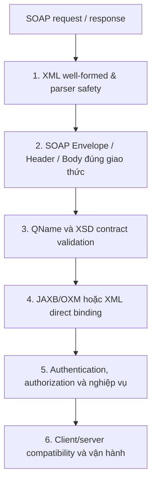
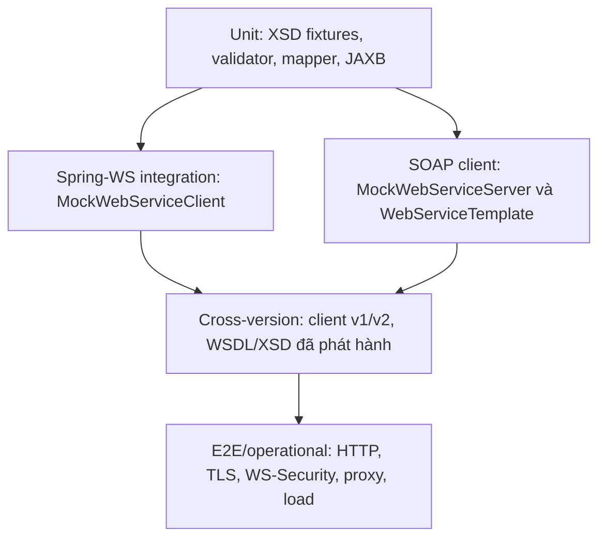

# Kiểm thử cả dữ liệu biên, dữ liệu sai và phản hồi vi phạm hợp đồng

## 1. Vì sao SOAP contract-first phải thử cả trường hợp sai?

Trong **Spring Web Services (Spring-WS)**, một dịch vụ SOAP theo hướng **contract-first** thường công bố **XSD** để xác định QName, kiểu dữ liệu, thứ tự và số lần xuất hiện của phần tử XML; **WSDL** xác định operation, thông điệp và SOAP binding. Công cụ XJC có thể sinh các lớp JAXB từ XSD; endpoint server và SOAP client dùng JAXB/OXM hoặc xử lý XML trực tiếp để trao đổi thông điệp.

Một bộ kiểm thử chỉ gửi thông điệp “đẹp” rồi khẳng định nhận được response là **chưa đủ**. Trong tích hợp doanh nghiệp, lỗi có thể đến từ:

- **Dữ liệu biên:** số tiền bằng 0, vượt một đơn vị nhỏ nhất, định danh dài vừa hết giới hạn, danh sách đúng mức `maxOccurs`, phần tử optional vắng mặt, ký tự Unicode, ngày giờ tại ranh giới múi giờ.
- **Dữ liệu sai:** XML không well-formed, sai namespace, sai thứ tự `xs:sequence`, enum không được hỗ trợ, số âm, kiểu ngày sai, element lạ, cấu trúc thừa, cố tình gây quá tải parser.
- **Phản hồi vi phạm hợp đồng:** server trả XML có QName không đúng WSDL, enum mới mà client cũ chưa biết, thiếu phần tử bắt buộc, amount sai kiểu, SOAP Fault không nhất quán hoặc nội dung bị thay đổi ngoài phạm vi chữ ký.
- **Sai về nghiệp vụ/bảo mật dù XML hợp schema:** đối tác có định danh hợp lệ nhưng không có quyền xem đơn hàng; yêu cầu lặp gây xử lý trùng; token hết hạn; dữ liệu chữ ký không đúng node thực tế được sử dụng.

**Mục tiêu:** phát hiện những tình huống đó **trước khi** client đối tác bị lỗi JAXB/unmarshalling, xử lý sai dữ liệu, bị lộ thông tin hoặc ghi nhận giao dịch không đúng.

### Mục tiêu học tập

Sau bài thuộc chương **Kiểm tra dữ liệu** của module `SPRING_WEB_SERVICES`, bạn có thể:

1. Phân biệt kiểm thử **well-formed XML**, **SOAP protocol**, **XSD schema**, **JAXB binding**, **nghiệp vụ**, **security** và **tương thích hợp đồng**.
2. Thiết kế ma trận boundary-value, equivalence partition và negative tests từ các facet XSD.
3. Kiểm tra cả **request đi vào** và **response do server phát ra**, kể cả trường hợp phản hồi sai nhưng JAXB vẫn có thể parse.
4. Cấu hình `PayloadValidatingInterceptor` ở Spring-WS và hiểu giới hạn của việc chỉ bật validation ở một tầng.
5. Dùng JAXP Schema/Validator, `MockWebServiceClient` và mock phía SOAP client để kiểm thử độc lập với business logic.
6. Kiểm thử SOAP Fault, QName, WS-Security, XML security, chứng chỉ, dữ liệu tùy chọn và khả năng tương thích với client đã phát hành.

## 2. Sáu lớp kiểm tra không nên đánh đồng

Một tài liệu XML có thể hợp lệ ở một lớp nhưng sai ở lớp khác. Ví dụ một request có đúng thẻ đóng và đúng QName vẫn có thể thiếu trường bắt buộc, hoặc có đủ trường nhưng người gửi không được phép truy cập.



Đây là **mô hình các trách nhiệm**, không áp đặt một thứ tự cứng cho mọi stack. Với thông điệp có mã hóa WS-Security, hạ tầng có thể phải giải mã/xác minh trước khi ứng dụng nhìn thấy payload để validate; parser cũng có thể xử lý một số dữ liệu trước interceptor.

| Lớp | Hỏi điều gì? | Ví dụ lỗi |
| --- | --- | --- |
| **XML syntax / parser** | XML có well-formed và được parse an toàn không? | `<ord:orderId>ABC` không đóng thẻ; XXE/DTD bị cấm. |
| **SOAP protocol** | Envelope, Body, Header, SOAP version đúng không? | Envelope SOAP 1.2 gửi vào endpoint chỉ hỗ trợ SOAP 1.1. |
| **XSD contract** | QName, thứ tự, kiểu, enum, cardinality, facet hợp lệ không? | `status=UNKNOWN`, `amount=-1`, thiếu `orderId`. |
| **JAXB/OXM** | XML có chuyển được sang/lại object Java đã sinh từ hợp đồng không? | Root thiếu `@XmlRootElement` hoặc `JAXBElement`/context sai. |
| **Business & security** | Người gửi có quyền? Giao dịch có hợp lệ? | Xem đơn hàng của người khác dù ID đúng định dạng. |
| **Compatibility** | Client cũ, WSDL version khác, gateway có xử lý như cam kết không? | Response có phần tử mới khiến client sinh từ XSD cũ lỗi. |

**Hai nguyên tắc bắt buộc:**

1. `JAXB unmarshal` **thành công không chứng minh XML đã được validate toàn bộ XSD**. Một số binding vẫn tạo object khi phần tử optional/bắt buộc bị thiếu nếu schema validation không được bật.
2. **XSD validation thành công không chứng minh người gửi đã được xác thực hoặc được phân quyền**. Hợp đồng XML diễn đạt cấu trúc và một số ràng buộc dữ liệu, không diễn đạt đầy đủ chính sách quyền hay tác động nghiệp vụ.

## 3. Thiết lập một hợp đồng mẫu để sinh các ca kiểm thử

Để kiểm thử có thể tái lập, hãy bắt đầu bằng **XSD đã được duyệt** thay vì suy các giá trị hợp lệ từ Java DTO hiện tại. Giả sử một SOAP service tra cứu đơn hàng công bố namespace:

```text
https://example.com/orders/v1
```

Schema mẫu `src/main/resources/xsd/orders-v1.xsd`:

```xml
<?xml version="1.0" encoding="UTF-8"?>
<xs:schema xmlns:xs="http://www.w3.org/2001/XMLSchema"
           xmlns:ord="https://example.com/orders/v1"
           targetNamespace="https://example.com/orders/v1"
           elementFormDefault="qualified">

    <xs:simpleType name="OrderCodeType">
        <xs:restriction base="xs:string">
            <xs:pattern value="ORD-[0-9]{6}"/>
        </xs:restriction>
    </xs:simpleType>

    <xs:simpleType name="OrderStatusType">
        <xs:restriction base="xs:string">
            <xs:enumeration value="PENDING"/>
            <xs:enumeration value="CONFIRMED"/>
            <xs:enumeration value="CANCELLED"/>
        </xs:restriction>
    </xs:simpleType>

    <xs:simpleType name="AmountType">
        <xs:restriction base="xs:decimal">
            <xs:minInclusive value="0"/>
            <xs:totalDigits value="8"/>
            <xs:fractionDigits value="2"/>
        </xs:restriction>
    </xs:simpleType>

    <xs:simpleType name="NoteType">
        <xs:restriction base="xs:string">
            <xs:maxLength value="80"/>
        </xs:restriction>
    </xs:simpleType>

    <xs:simpleType name="TagType">
        <xs:restriction base="xs:string">
            <xs:pattern value="[A-Z]{2,10}"/>
        </xs:restriction>
    </xs:simpleType>

    <xs:element name="GetOrderRequest">
        <xs:complexType>
            <xs:sequence>
                <xs:element name="orderId" type="ord:OrderCodeType"/>
                <xs:element name="includeTags" type="xs:boolean"
                            minOccurs="0"/>
            </xs:sequence>
        </xs:complexType>
    </xs:element>

    <xs:element name="GetOrderResponse">
        <xs:complexType>
            <xs:sequence>
                <xs:element name="orderId" type="ord:OrderCodeType"/>
                <xs:element name="status" type="ord:OrderStatusType"/>
                <xs:element name="amount" type="ord:AmountType"/>
                <xs:element name="estimatedAt" type="xs:dateTime"
                            minOccurs="0"/>
                <xs:element name="note" type="ord:NoteType"
                            minOccurs="0" nillable="true"/>
                <xs:element name="tag" type="ord:TagType"
                            minOccurs="0" maxOccurs="3"/>
            </xs:sequence>
        </xs:complexType>
    </xs:element>
</xs:schema>
```

Đây là XSD phục vụ **bài học về validation**, chưa bao gồm các ràng buộc domain đầy đủ: `amount` không chỉ định đơn vị tiền tệ; `estimatedAt` không bắt buộc chứa timezone; XSD không nói người gọi có quyền xem đơn hàng nào. Hợp đồng triển khai thực tế cần bổ sung phần cần thiết và WSDL/operation, SOAP Fault, policy bảo mật tương ứng.

### 3.1. Request hợp lệ tối thiểu

```xml
<ord:GetOrderRequest xmlns:ord="https://example.com/orders/v1">
    <ord:orderId>ORD-000000</ord:orderId>
</ord:GetOrderRequest>
```

`includeTags` vắng mặt là hợp lệ vì `minOccurs="0"`. Ngược lại, `orderId` bắt buộc và phải khớp pattern `ORD-[0-9]{6}`.

### 3.2. Response hợp lệ tối thiểu

```xml
<ord:GetOrderResponse xmlns:ord="https://example.com/orders/v1">
    <ord:orderId>ORD-000000</ord:orderId>
    <ord:status>PENDING</ord:status>
    <ord:amount>0.00</ord:amount>
</ord:GetOrderResponse>
```

Response này hợp lệ với schema: `amount=0` được phép bởi `minInclusive=0`; `estimatedAt`, `note` và `tag` đều có thể vắng mặt.

### 3.3. Response có dữ liệu tùy chọn và giá trị biên

```xml
<ord:GetOrderResponse
    xmlns:ord="https://example.com/orders/v1"
    xmlns:xsi="http://www.w3.org/2001/XMLSchema-instance">
    <ord:orderId>ORD-999999</ord:orderId>
    <ord:status>CONFIRMED</ord:status>
    <ord:amount>999999.99</ord:amount>
    <ord:estimatedAt>2026-12-31T23:59:59+07:00</ord:estimatedAt>
    <ord:note xsi:nil="true"/>
    <ord:tag>VIP</ord:tag>
    <ord:tag>EXPORT</ord:tag>
    <ord:tag>PRIORITY</ord:tag>
</ord:GetOrderResponse>
```

Ở đây:

- `999999.99` có **8 chữ số có nghĩa** và **2 chữ số thập phân**, phù hợp các facet minh họa.
- `note` cho phép `xsi:nil="true"` vì được khai báo `nillable="true"`.
- Ba phần tử `tag` là **đúng cận trên** của `maxOccurs="3"`.
- `estimatedAt` có offset, nhưng `xs:dateTime` tự nó không buộc mọi đối tác phải gửi timezone; nếu nghiệp vụ cần offset bắt buộc, phải bổ sung chính sách/kiểu/ràng buộc tương thích.

## 4. Kỹ thuật thiết kế dữ liệu biên từ XSD

**Boundary Value Analysis (BVA)** tập trung vào các điểm sát ranh giới; **Equivalence Partitioning** chia giá trị thành các lớp hợp lệ và không hợp lệ. Với XSD, nhiều ranh giới đã được mô tả rõ bằng facet.

### 4.1. Bảng phân hoạch theo từng quy tắc

| Quy tắc XSD | Giá trị hợp lệ sát biên | Giá trị sai sát biên | Nội dung cần kiểm tra |
| --- | --- | --- | --- |
| `OrderCodeType` pattern `ORD-[0-9]{6}` | `ORD-000000`, `ORD-999999` | `ORD-00000`, `ORD-1000000`, `ord-123456` | Độ dài, chữ hoa, đúng số chữ số. |
| `AmountType minInclusive=0` | `0`, `0.01` | `-0.01` | Cận dưới gồm 0; không từ chối số tiền bằng 0 khi contract cho phép. |
| `fractionDigits=2` | `1.23` | `1.234` | Mức chính xác; dùng giá trị có chữ số thập phân thứ ba khác 0 để kiểm thử rõ. |
| `totalDigits=8` | `999999.99` | `9999999.99` | Tổng chữ số có nghĩa, không phải độ dài chuỗi chứa dấu chấm. |
| `OrderStatusType` enum | `PENDING`, `CONFIRMED`, `CANCELLED` | `UNKNOWN`, `confirmed` | Tập giá trị đóng và phân biệt hoa/thường. |
| `includeTags minOccurs=0` | Không có phần tử | Có hai phần tử `includeTags` | Vắng mặt được phép, lặp lại không được phép. |
| `note minOccurs=0 nillable=true` | Vắng mặt, `xsi:nil="true"`, chuỗi rỗng | Một phần tử có text dài hơn 80 ký tự | Phân biệt **missing**, **nil**, **empty** và giá trị. |
| `tag minOccurs=0 maxOccurs=3` | 0, 1 hoặc 3 tag | 4 tag | Đếm số lần xuất hiện, không chỉ giá trị từng tag. |
| `TagType` pattern `[A-Z]{2,10}` | `AB`, chuỗi 10 chữ hoa | `A`, chuỗi 11 chữ hoa, `abc` | Kết hợp độ dài và tập ký tự. |
| `estimatedAt xs:dateTime` | `2026-12-31T23:59:59+07:00` | `2026-13-01T10:00:00Z` | Tháng 13 không hợp lệ; timezone là vấn đề ngữ nghĩa riêng. |

Không chỉ thử một giá trị sai chung chung. **Mỗi facet nên có ít nhất một ca sát biên, một ca ngoài biên và một ca đại diện ở giữa**; ví dụ số tiền âm, số có quá nhiều chữ số phần nguyên và số có quá nhiều chữ số thập phân phát hiện các lỗi khác nhau.

### 4.2. Nhớ sự khác biệt giữa giá trị và dạng biểu diễn

Với `xs:decimal`, một giá trị có thể có nhiều cách biểu diễn chữ số; khi kiểm tra facet `fractionDigits` hoặc `totalDigits`, **không được thay phép kiểm tra schema bằng một regex tự viết theo độ dài chuỗi** rồi mặc định hành vi tương đương. XML Schema áp dụng quy tắc theo không gian giá trị/kiểu và facet.

Tương tự, `xs:dateTime` có thể biểu diễn offset khác nhau cho cùng thời điểm tuyệt đối. Hai chuỗi ngày khác nhau không nhất thiết là hai thời điểm khác nhau. Khi ứng dụng cần so sánh “trước/sau”, hãy tách **lexical validation** khỏi **so sánh instant/zone nghiệp vụ**.

### 4.3. Optional, nil và empty là ba tình huống khác nhau

```xml
<!-- 1. Vắng mặt: không có ord:note. -->
<ord:GetOrderResponse xmlns:ord="https://example.com/orders/v1">
    <ord:orderId>ORD-123456</ord:orderId>
    <ord:status>CONFIRMED</ord:status>
    <ord:amount>10.00</ord:amount>
</ord:GetOrderResponse>
```

```xml
<!-- 2. Nil: có element nhưng không có giá trị theo XSD. -->
<ord:note xmlns:ord="https://example.com/orders/v1"
          xmlns:xsi="http://www.w3.org/2001/XMLSchema-instance"
          xsi:nil="true"/>
```

```xml
<!-- 3. Empty: element hiện diện với chuỗi rỗng. -->
<ord:note xmlns:ord="https://example.com/orders/v1"></ord:note>
```

Hai fragment `note` cuối chỉ minh họa **cách viết element con**, không phải tài liệu `GetOrderResponse` hoàn chỉnh khi đứng một mình. XSD ví dụ cho phép cả ba trạng thái ở vị trí `note` của response. JAXB có thể ánh xạ một số trường hợp thành `null` hoặc `JAXBElement<?>` tùy binding; vì vậy test phải đối chiếu **XML wire format**, không chỉ `assertNull` trên object.

### 4.4. Các tổ hợp biên thường bị bỏ quên

- Phần tử optional đứng **đúng vị trí** trong `xs:sequence` và phần tử optional bị chèn sai vị trí.
- Một phần tử có `xsi:nil="true"` trong khi `nillable` mặc định là `false`.
- Dữ liệu có dấu cách đầu/cuối trong field có pattern; đừng dựa vào trim ngầm.
- Dãy có đúng `maxOccurs` và **vượt đúng một phần tử**.
- Boolean theo lexical space của XSD như `true`/`false`/`1`/`0` so với chuỗi `yes`.
- Giá trị tiền bằng 0, gần 0, gần giới hạn trên và số thập phân độ chính xác cao.
- Ngày có offset biên, năm nhuận, thời khắc chuyển ngày ở múi giờ khác nhau.
- Ký tự đặc biệt `&`, `<` hoặc Unicode được escape đúng; khác với XML bị chèn markup sai.

## 5. Dữ liệu sai: tạo ca kiểm thử theo lớp lỗi

### 5.1. XML không well-formed

```xml
<ord:GetOrderRequest xmlns:ord="https://example.com/orders/v1">
    <ord:orderId>ORD-123456
</ord:GetOrderRequest>
```

Thiếu thẻ đóng `</ord:orderId>`. Parser có thể từ chối **trước khi** endpoint mapping, JAXB hoặc `PayloadValidatingInterceptor` được gọi. Test phải kiểm tra server từ chối an toàn, không mặc định mọi lỗi parser đều được ánh xạ qua cùng exception resolver của nghiệp vụ.

### 5.2. Sai QName và namespace

```xml
<ord:GetOrderRequest xmlns:ord="https://example.com/orders/v2">
    <ord:orderId>ORD-123456</ord:orderId>
</ord:GetOrderRequest>
```

Local name vẫn là `GetOrderRequest` nhưng QName thực tế là `{https://example.com/orders/v2}GetOrderRequest`. Nó **không khớp** một `@PayloadRoot` yêu cầu namespace v1.

Phải phân biệt:

- **Không có endpoint khớp** vì QName Body root sai.
- **Đã chọn đúng endpoint** nhưng nội dung sai schema.
- **SOAP Envelope version sai** nên chưa đến bước chọn endpoint.

Những lỗi này có thể cho kết quả Fault/HTTP khác nhau tùy cấu hình. Không sửa mapping v1 thành v2 tùy tiện để “chữa” một client gửi sai contract.

### 5.3. Sai thứ tự và cardinality trong xs:sequence

```xml
<ord:GetOrderResponse xmlns:ord="https://example.com/orders/v1">
    <ord:status>CONFIRMED</ord:status>
    <ord:orderId>ORD-123456</ord:orderId>
    <ord:amount>10.00</ord:amount>
</ord:GetOrderResponse>
```

Tất cả giá trị riêng lẻ đều trông hợp lệ, nhưng **thứ tự** `status` và `orderId` sai `xs:sequence`. Nếu chỉ so vài chuỗi text hoặc chuyển XML thành một map không có thứ tự, test có thể bỏ sót lỗi này.

Tương tự, gửi bốn phần tử `tag` khi `maxOccurs=3` hoặc gửi hai phần tử `status` thay vì một là lỗi cardinality, kể cả mọi giá trị text đều đúng enum.

### 5.4. Phần tử không biết trước và schema mở

```xml
<ord:GetOrderResponse
    xmlns:ord="https://example.com/orders/v1"
    xmlns:ext="https://partner.example.com/ext/v1">
    <ord:orderId>ORD-123456</ord:orderId>
    <ord:status>CONFIRMED</ord:status>
    <ord:amount>10.00</ord:amount>
    <ext:warehouseCode>HCM-01</ext:warehouseCode>
</ord:GetOrderResponse>
```

XSD mẫu **không có `xs:any`**, do đó phần tử `ext:warehouseCode` **không hợp lệ** ở cuối response. Một JAXB runtime có thể bỏ qua/giữ phần tử lạ tùy cấu hình; chỉ đọc được Java object không chứng minh response phù hợp hợp đồng.

Nếu schema khác có `xs:any` ở vùng extension, phải thử riêng `namespace`, `processContents=strict/lax/skip`, `minOccurs/maxOccurs` và ngữ nghĩa. Wildcard **không tự biến một extension bắt buộc thành thay đổi tương thích ngược**.

### 5.5. Sai lexical space và kiểu dữ liệu

Ví dụ một response có:

```xml
<ord:amount xmlns:ord="https://example.com/orders/v1">
    12,50
</ord:amount>
```

Dấu phẩy không phải cách biểu diễn `xs:decimal` trong XML Schema; một parser tuân thủ schema không được diễn giải theo locale máy chủ. Giá trị `12.50` hợp lệ, nhưng `12,50` không hợp lệ với kiểu `xs:decimal`. Những trường sai khác nên thử:

| Kiểu | Hợp lệ theo kiểu XSD | Ví dụ không hợp lệ |
| --- | --- | --- |
| `xs:boolean` | `true`, `false`, `1`, `0` | `yes`, `TRUE`. |
| `xs:decimal` | `12.50` | `12,50`, `NaN`. |
| `xs:dateTime` | `2026-12-31T23:59:59Z` | `2026-13-01T23:59:59Z`. |
| Enum của `OrderStatusType` | `PENDING` | `DELIVERED`, `pending`. |
| `OrderCodeType` | `ORD-123456` | `123456`, `ORD-12A456`. |

Kiểm thử schema dùng đúng **lexical space** của XML, không thay bằng parser/formatter locale của Java. Khi ánh xạ `xs:dateTime` sang `Instant` hoặc `LocalDateTime` trong domain model, cần quy ước offset/timezone và test riêng; một chuỗi ngày hợp lệ không đảm bảo ngữ nghĩa thời gian mong muốn.

### 5.6. Sai về nghiệp vụ dù dữ liệu hợp schema

Giả sử request:

```xml
<ord:GetOrderRequest xmlns:ord="https://example.com/orders/v1">
    <ord:orderId>ORD-654321</ord:orderId>
</ord:GetOrderRequest>
```

Định dạng ID đúng nhưng đơn có thể thuộc tài khoản khác. Một test chỉ gọi schema validator sẽ **PASS**, trong khi test authorization phải đảm bảo application service **không trả dữ liệu** nếu người gọi thiếu quyền.

Các ca nghiệp vụ cần phân biệt với lỗi schema:

- Đơn không tồn tại, đã bị hủy hoặc chưa được phép công bố.
- Trạng thái đơn hợp enum nhưng không tương thích với thao tác yêu cầu.
- Thời điểm giao dự kiến ở quá khứ, vượt SLA hoặc không cùng timezone policy.
- Một request bị gửi lại, gây side effect kép nếu operation có ghi dữ liệu.
- Người gọi đúng chứng chỉ nhưng thiếu quyền truy cập tài nguyên cụ thể.

Tách các ca này giúp thiết kế **SOAP Fault và mã lỗi nghiệp vụ** ổn định, thay vì gộp mọi tình huống thành “invalid XML”.

## 6. Kiểm thử phản hồi vi phạm hợp đồng: điều dễ bỏ sót nhất

Nhiều nhóm chỉ validate **request đầu vào** rồi giả định server luôn trả XML hợp lệ vì response do code Java tạo ra. Giả định này không an toàn:

- Mapper có thể gán một enum mới không tồn tại trong schema của client.
- JAXB object được tạo thiếu trường bắt buộc hoặc chứa giá trị vượt facet XSD.
- Một đoạn code DOM/StAX tự xây response sai namespace hoặc thứ tự.
- Một interceptor/transformer sửa response sau khi marshalling.
- Server đã triển khai contract v2 nhưng vẫn công bố WSDL v1 cho một số đối tác.
- SOAP Fault được tạo với cấu trúc hoặc `detail` không nhất quán quy ước đã công bố.

**Nếu client cũ từ chối response hoặc đọc sai dữ liệu, phía producer vẫn có lỗi hợp đồng** dù endpoint đã chạy thành công và HTTP có vẻ “200 OK”.

### 6.1. Response bị thiếu trường bắt buộc

```xml
<ord:GetOrderResponse xmlns:ord="https://example.com/orders/v1">
    <ord:orderId>ORD-123456</ord:orderId>
    <ord:status>CONFIRMED</ord:status>
</ord:GetOrderResponse>
```

`amount` bắt buộc theo XSD nhưng bị bỏ. Một số đường unmarshalling vẫn có thể tạo object Java với `amount=null` nếu không áp dụng schema validation; test chỉ kiểm tra không ném exception trong Java chưa đủ.

**Kỳ vọng:** phát hiện response sai trước khi công bố; khi không thể phát phản hồi hợp lệ, server phải thực hiện chiến lược lỗi được thiết kế rõ ràng (có thể SOAP Fault phía server) thay vì âm thầm gửi XML sai hoặc một SOAP Body nửa vời.

### 6.2. Response chứa enum ngoài contract

```xml
<ord:GetOrderResponse xmlns:ord="https://example.com/orders/v1">
    <ord:orderId>ORD-123456</ord:orderId>
    <ord:status>REFUNDED</ord:status>
    <ord:amount>10.00</ord:amount>
</ord:GetOrderResponse>
```

`REFUNDED` không có trong enumeration của XSD ví dụ. Dù domain Java có trạng thái hoàn tiền, mapper của SOAP contract v1 phải quyết định **một giá trị công khai hợp lệ** hoặc phát hành hợp đồng mới. Không đưa trạng thái nội bộ vào XML rồi trông chờ client JAXB v1 “tự hiểu”.

Thêm giá trị enum vào XSD mới cũng không bảo đảm client sinh mã từ **XSD cũ** sẽ đọc được: cần test consumer cũ. Đây là trường hợp thay đổi có thể gây **breaking change** dù QName root không đổi.

### 6.3. Response sai namespace, sai thứ tự, sai lượng

Các lỗi đáng thử trên đường trả ra:

1. Root `<GetOrderResponse>` **không khai báo namespace**.
2. Root mang `https://example.com/orders/v2` khi WSDL đang công bố v1.
3. `amount` xuất hiện trước `status` trái `xs:sequence`.
4. Có hai phần tử `status`.
5. Có bốn `tag` trong khi `maxOccurs=3`.
6. `note` có `xsi:nil="true"` nhưng đồng thời chứa text hoặc phần tử con, vi phạm quy tắc nil.
7. `amount` âm, có độ chính xác sai hoặc là giá trị Java `double` được làm tròn không đúng hợp đồng.
8. `estimatedAt` sai lexical syntax hoặc bị map lệch múi giờ.

Test response phải so cả **QName và nội dung**. Chỉ dùng một assert kiểu `response.getStatus() == CONFIRMED` có thể không phát hiện sai namespace hoặc thứ tự phần tử trên wire.

### 6.4. Server response validation và client response validation khác nhau

| Vị trí | Mục đích | Giới hạn cần lưu ý |
| --- | --- | --- |
| **Server – trước khi gửi** | Bắt lỗi mapper/marshaller, ngăn phát response vi phạm schema công bố. | Cần xác nhận đường xử lý khi response sai: log, Fault, chặn gửi, đã commit hay chưa. |
| **Client – sau khi nhận** | Bảo vệ consumer trước message không đáng tin cậy hoặc contract drift. | Không sửa được lỗi producer; phải có quy tắc phát hiện, từ chối và báo lỗi rõ. |
| **Offline contract test** | Validate XML fixture/snapshot response bằng bản XSD đã phát hành. | Không thay thế kiểm thử transport, SOAP Header, WS-Security và trạng thái runtime. |

**Quan trọng:** Không nên mặc định rằng chỉ bật `setValidateResponse(true)` trên mọi interceptor sẽ **tự động tạo SOAP Fault đúng và không gửi phản hồi sai**. Hành vi khi response validation thất bại phụ thuộc class interceptor, Spring-WS version và pipeline cụ thể. Hãy kiểm thử cả **what was sent on the wire**, log/metric lỗi, việc kết thúc request và chính sách Fault. Nếu ứng dụng có side effect trước khi phát hiện response sai, còn cần xem **atomicity/transaction** và cơ chế bù trừ.

### 6.5. Kiểm tra consumer bằng một response giả cố tình sai

Giả sử server thật vẫn ổn. Trong test SOAP client, hãy cấu hình mock server trả:

```xml
<ord:GetOrderResponse xmlns:ord="https://example.com/orders/v1">
    <ord:orderId>ORD-123456</ord:orderId>
    <ord:status>UNKNOWN</ord:status>
    <ord:amount>12.345</ord:amount>
</ord:GetOrderResponse>
```

Response cố ý có **hai lỗi độc lập**: enum `UNKNOWN` và `fractionDigits` vượt 2. Hãy thử:

- Bộ schema validator độc lập phải từ chối.
- JAXB client có thể ném lỗi binding hoặc ánh xạ một phần theo hành vi runtime; **không dùng kết quả của một runtime cụ thể thay cho chứng cứ schema**.
- Client cần phân loại đây là **invalid response/contract violation**, không phải “order not found” hoặc kết quả nghiệp vụ bình thường.
- Log/telemetry không tiết lộ thông tin nhạy cảm; retry không được gây side effect trái ngữ nghĩa operation.

Nên có các fixture gây **mỗi lỗi riêng biệt** ngoài fixture chứa nhiều lỗi, vì một validator có thể dừng ở lỗi đầu tiên và không xác minh được các nhánh còn lại.

## 7. Cấu hình schema validation trong Spring-WS

Spring-WS có `PayloadValidatingInterceptor` dành cho SOAP server. Nó có thể xác minh XML payload dựa trên schema được cấp. Tuy nhiên, **XSD nằm trong classpath không có nghĩa validation được bật**; interceptor phải được tạo và **đăng ký vào chain** mà request thực sự đi qua.

### 7.1. Đăng ký XSD và PayloadValidatingInterceptor

Ví dụ Java configuration trong ứng dụng có `@EnableWs` và `MessageDispatcherServlet` đã được bật:

```java
import java.util.List;
import org.springframework.context.annotation.Bean;
import org.springframework.context.annotation.Configuration;
import org.springframework.core.io.ClassPathResource;
import org.springframework.ws.config.annotation.WsConfigurer;
import org.springframework.ws.server.EndpointInterceptor;
import org.springframework.ws.server.endpoint.adapter.method.MethodArgumentResolver;
import org.springframework.ws.server.endpoint.adapter.method.MethodReturnValueHandler;
import org.springframework.ws.soap.server.endpoint.interceptor.PayloadValidatingInterceptor;
import org.springframework.xml.xsd.SimpleXsdSchema;
import org.springframework.xml.xsd.XsdSchema;

@Configuration
public class OrderValidationConfiguration implements WsConfigurer {

    private final PayloadValidatingInterceptor validator;

    public OrderValidationConfiguration(
            PayloadValidatingInterceptor validator) {
        this.validator = validator;
    }

    @Bean
    public static XsdSchema ordersSchema() {
        return new SimpleXsdSchema(
            new ClassPathResource("xsd/orders-v1.xsd"));
    }

    @Bean
    public static PayloadValidatingInterceptor orderValidator(
            XsdSchema ordersSchema) {
        PayloadValidatingInterceptor interceptor =
            new PayloadValidatingInterceptor();
        interceptor.setXsdSchema(ordersSchema);
        interceptor.setValidateRequest(true);
        interceptor.setValidateResponse(true);
        return interceptor;
    }

    @Override
    public void addInterceptors(List<EndpointInterceptor> interceptors) {
        interceptors.add(validator);
    }

    // Tương thích cả Spring-WS 4.0.x (abstract callbacks)
    // và 4.1+ (default callbacks).
    @Override
    public void addArgumentResolvers(
            List<MethodArgumentResolver> resolvers) {
    }

    @Override
    public void addReturnValueHandlers(
            List<MethodReturnValueHandler> handlers) {
    }
}
```

**Lưu ý để dùng đoạn ví dụ:**

- Cần có một cấu hình hạ tầng `@EnableWs` với servlet/endpoint mapping trong cùng Spring context. `@EnableWs` không được tự suy ra từ việc implements `WsConfigurer`.
- `@Bean static` ở đây giúp tránh vòng phụ thuộc khởi tạo khi class cấu hình cần inject interceptor do chính nó cung cấp. Có thể tổ chức hai `@Configuration` riêng nếu muốn rõ ràng hơn.
- `setValidateRequest(true)` dùng để từ chối request sai XSD theo cơ chế validation được cấu hình.
- `setValidateResponse(true)` kích hoạt kiểm tra response, nhưng **cần xác minh cách xử lý khi thất bại** trước khi dùng như một hàng rào bảo vệ production. Một số cấu hình có thể chỉ log/làm dừng chain; không mặc định tạo Fault hoàn chỉnh cho mọi lỗi response.
- Với nhiều XSD/import/include, cần thiết kế schema resolver/catalog và bảo mật truy cập ngoài. Không để client quyết định nơi validator tải schema qua `xsi:schemaLocation` không đáng tin.
- Khi dự án thực sự dùng Spring-WS 4.1+, `WsConfigurer` có default methods và hai override rỗng có thể lược bỏ; trong 4.0.x, chúng thường cần để triển khai interface.

### 7.2. Khi nào response validation phù hợp?

Bật ở môi trường test/staging thường rất hữu ích để phát hiện mapper tạo XML sai. Với production, hãy xác định:

1. Có cần validation mọi response hay chỉ kiểm tra trên đường build/integration tests để tránh chi phí runtime?
2. Điều gì xảy ra khi response không hợp lệ: request có bị chặn, có SOAP Fault chuẩn, hay chỉ ghi log?
3. Nếu nghiệp vụ đã cập nhật database trước khi phát hiện lỗi response thì việc commit/rollback có đúng contract giao dịch?
4. Có những endpoint trả streaming/binary/MTOM mà việc validate hoặc materialize response quá tốn bộ nhớ không?
5. Test client sẽ nhìn thấy lỗi như thế nào khi server có hoặc không có response validation?

Một **hệ thống tài chính/đối tác nhạy cảm** có thể cần cơ chế xác minh chặt trước khi publish, nhưng vẫn không được giả định một interceptor đơn lẻ tự giải quyết atomicity hoặc nghĩa vụ bảo mật.

### 7.3. JAXB/OXM cũng có điểm bật schema riêng

Khi dùng `Jaxb2Marshaller` phía client hoặc trong một pipeline OXM:

```java
import org.springframework.core.io.ClassPathResource;
import org.springframework.oxm.jaxb.Jaxb2Marshaller;

Jaxb2Marshaller marshaller = new Jaxb2Marshaller();
marshaller.setContextPath("com.example.orders.contract.v1");
marshaller.setSchema(
    new ClassPathResource("xsd/orders-v1.xsd"));
```

Khi Spring quản lý bean và khởi tạo đúng, OXM có thể dùng schema đó để validate trong marshal/unmarshal qua **chính marshaller ấy**. Điều này **không đảm bảo** mọi `@Endpoint` server đã sử dụng cùng một bean; endpoint adapter có thể có cơ chế JAXB binding riêng. Kiểm thử đường xử lý thực tế thay vì chỉ nhìn thấy bean.

Ngoài ra, JAXB context chỉ biết những kiểu/element được đăng ký phù hợp. Với root không có `@XmlRootElement`, cần `JAXBElement`/`ObjectFactory` hợp lệ. Sai root JAXB, sai QName và sai XSD là ba loại lỗi cần phân biệt.

## 8. Kiểm thử XSD độc lập bằng JAXP Validator

Đối với **phản hồi vi phạm hợp đồng**, một phép thử **độc lập với JAXB runtime** rất quan trọng. Java chuẩn hỗ trợ `SchemaFactory` và `Validator` để kiểm tra trực tiếp XML fixture/đầu ra đã serialize.

### 8.1. Hàm kiểm tra một payload XML

```java
import java.io.InputStream;
import java.io.StringReader;
import javax.xml.XMLConstants;
import javax.xml.transform.stream.StreamSource;
import javax.xml.validation.Schema;
import javax.xml.validation.SchemaFactory;
import javax.xml.validation.Validator;

public final class ContractXmlValidator {
    private final Schema schema;

    public ContractXmlValidator() throws Exception {
        SchemaFactory factory = SchemaFactory.newInstance(
            XMLConstants.W3C_XML_SCHEMA_NS_URI);
        factory.setFeature(
            XMLConstants.FEATURE_SECURE_PROCESSING, true);
        factory.setProperty(XMLConstants.ACCESS_EXTERNAL_DTD, "");
        factory.setProperty(XMLConstants.ACCESS_EXTERNAL_SCHEMA, "");

        try (InputStream xsd = ContractXmlValidator.class
                .getResourceAsStream("/xsd/orders-v1.xsd")) {
            if (xsd == null) {
                throw new IllegalStateException("Không tìm thấy XSD");
            }
            schema = factory.newSchema(new StreamSource(xsd));
        }
    }

    public void validate(String xmlPayload) throws Exception {
        Validator validator = schema.newValidator();
        validator.setProperty(XMLConstants.ACCESS_EXTERNAL_DTD, "");
        validator.setProperty(XMLConstants.ACCESS_EXTERNAL_SCHEMA, "");
        validator.validate(
            new StreamSource(new StringReader(xmlPayload)));
    }
}
```

Đoạn code giả định schema minh họa là **một XSD không cần resolve include/import từ file khác**. Với nhiều XSD, hãy cung cấp `LSResourceResolver`/catalog kiểm soát cùng base URI thích hợp; không vô tình cấm mọi import rồi “chữa” bằng cách cho phép network không kiểm soát. Trên provider không hỗ trợ tính năng bảo vệ cần thiết, test/ứng dụng nên **fail closed** hoặc chuyển sang implementation thích hợp, không bỏ qua lỗi cấu hình.

`Schema` có thể được dùng lại an toàn theo đặc tả triển khai phù hợp; `Validator` **không nên được chia sẻ tùy ý giữa nhiều thread** vì có state phục vụ một lần validate. Hàm trên tạo một `Validator` mới mỗi lần.

### 8.2. Kiểm thử một response đúng và một response sai

```java
import org.junit.jupiter.api.Test;
import static org.junit.jupiter.api.Assertions.assertDoesNotThrow;
import static org.junit.jupiter.api.Assertions.assertThrows;

class OrderContractSchemaTest {
    private final ContractXmlValidator validator =
        new ContractXmlValidator();

    OrderContractSchemaTest() throws Exception {}

    @Test
    void responseHopLeVoiGiaTriBien() {
        String xml = """
            <ord:GetOrderResponse
               xmlns:ord="https://example.com/orders/v1">
              <ord:orderId>ORD-999999</ord:orderId>
              <ord:status>CONFIRMED</ord:status>
              <ord:amount>999999.99</ord:amount>
            </ord:GetOrderResponse>
            """;
        assertDoesNotThrow(() -> validator.validate(xml));
    }

    @Test
    void responseCoEnumNgoaiHopDongBiTuChoi() {
        String xml = """
            <ord:GetOrderResponse
               xmlns:ord="https://example.com/orders/v1">
              <ord:orderId>ORD-123456</ord:orderId>
              <ord:status>UNKNOWN</ord:status>
              <ord:amount>12.34</ord:amount>
            </ord:GetOrderResponse>
            """;
        assertThrows(org.xml.sax.SAXException.class,
            () -> validator.validate(xml));
    }
}
```

Đây là **ví dụ JUnit 5** dùng Java text blocks, giả định class `ContractXmlValidator` đã nằm trong test source set và có XSD trên test runtime classpath. Ca `UNKNOWN` sai enumeration nhưng XML well-formed, vì vậy schema validator phải từ chối; kiểm thử chính xác loại exception có thể phụ thuộc hành vi provider, nhưng lỗi schema thường thuộc họ `SAXException`.

### 8.3. Tạo nhiều fixture dữ liệu sai có chủ đích

Nên lưu các trường hợp XML (hoặc tạo có kiểm soát trong test) theo tên biểu đạt **quy tắc bị vi phạm**, ví dụ:

```text
valid-minimal-response.xml
valid-max-tags-response.xml
valid-nil-note-response.xml
invalid-missing-amount.xml
invalid-unknown-status.xml
invalid-amount-negative.xml
invalid-fraction-digits.xml
invalid-response-namespace.xml
invalid-response-order.xml
invalid-too-many-tags.xml
invalid-extra-element.xml
invalid-malformed-xml.xml
```

Danh sách là **tên fixture đề xuất**, không yêu cầu tạo thêm file trong bài học này. Khi dùng trong dự án thực, các fixture là tài sản kiểm thử hợp đồng và nên được quản trị cùng version XSD/WSDL tương ứng.

## 9. Kiểm thử Spring-WS server bằng MockWebServiceClient

`MockWebServiceClient` trong `spring-ws-test` đưa SOAP request qua hạ tầng Spring-WS trong một Spring test context. Nó hữu ích để kiểm tra **endpoint mapping**, **interceptor**, **JAXB/payload adapter**, **SOAP Fault** và **phản hồi** mà không cần mở một HTTP server thật.

### 9.1. Phép thử đường thành công

Giả sử ứng dụng có:

- Bean `@Endpoint` nhận `GetOrderRequest` và trả `GetOrderResponse` theo JAXB.
- `@EnableWs` và endpoint adapter đã khởi tạo.
- `PayloadValidatingInterceptor` được đăng ký như mục 7.
- `OrderQueryService` mock/fixture trả một đơn hợp lệ.

Trong class JUnit tích hợp đã có `ApplicationContext applicationContext` được inject:

```java
import org.springframework.xml.transform.StringSource;
import org.springframework.ws.test.server.MockWebServiceClient;
import static org.springframework.ws.test.server.RequestCreators.withPayload;
import static org.springframework.ws.test.server.ResponseMatchers.noFault;
import static org.springframework.ws.test.server.ResponseMatchers.payload;

MockWebServiceClient client =
    MockWebServiceClient.createClient(applicationContext);

StringSource request = new StringSource("""
    <ord:GetOrderRequest xmlns:ord="https://example.com/orders/v1">
      <ord:orderId>ORD-123456</ord:orderId>
    </ord:GetOrderRequest>
    """);

StringSource expected = new StringSource("""
    <ord:GetOrderResponse xmlns:ord="https://example.com/orders/v1">
      <ord:orderId>ORD-123456</ord:orderId>
      <ord:status>CONFIRMED</ord:status>
      <ord:amount>12.50</ord:amount>
    </ord:GetOrderResponse>
    """);

client.sendRequest(withPayload(request))
    .andExpect(noFault())
    .andExpect(payload(expected));
```

Đoạn này là **thân test minh họa**, không phải class độc lập đã chạy: test context phải chứa các bean cần thiết; `OrderQueryService` giả lập được thiết lập để tạo response mong đợi. Matcher `payload(expected)` so cấu trúc payload theo cơ chế so sánh XML của test, nhưng **không thay thế kiểm tra XSD độc lập**. Nên thêm test validation của XML được marshal và test với client từ WSDL đã công bố.

### 9.2. Phép thử request thiếu phần tử bắt buộc

```java
import static org.springframework.ws.test.server.ResponseMatchers
    .clientOrSenderFault;

StringSource invalidRequest = new StringSource("""
    <ord:GetOrderRequest xmlns:ord="https://example.com/orders/v1"/>
    """);

client.sendRequest(withPayload(invalidRequest))
    .andExpect(clientOrSenderFault());
```

Với **SOAP validation interceptor thực sự được gắn** và XSD minh họa, thiếu `orderId` là lỗi schema; một Fault phía client/sender là kỳ vọng phù hợp với cấu hình validator thường dùng. Sau đó phải xác minh thêm **application service không được gọi** — chẳng hạn qua test double/mock — chứ không chỉ nhìn thấy Fault.

**Không áp dụng matcher trên cho mọi lỗi:** XML malformed có thể bị parser từ chối trước khi vào dispatcher; namespace root sai có thể không có endpoint mapping; lỗi chứng chỉ TLS có thể khiến request chưa đến server. Mỗi tầng có kết quả công khai riêng theo stack triển khai.

### 9.3. Test mọi ngưỡng dữ liệu bằng request và response phù hợp

Hãy kiểm tra:

- `orderId=ORD-000000` và `ORD-999999` được chấp nhận về schema.
- `orderId=ORD-00000`, `ORD-1000000` và `ord-123456` bị từ chối.
- `includeTags` vắng mặt được chấp nhận; `includeTags=yes` bị từ chối.
- Phản hồi có `amount=0.00`, `amount=999999.99`, 0/3 phần tử `tag` được công bố đúng.
- Phản hồi `amount=-0.01`, `amount=12.345`, 4 `tag` bị phát hiện là sai schema.
- `note` vắng mặt, nil và empty được đối chiếu với **ý nghĩa ứng dụng** chứ không chỉ kiểu Java `null`.

Không nhất thiết mọi trường hợp đều đi qua HTTP integration test. Các facet XSD có thể được thử nhiều lần bằng **schema unit test** rẻ hơn; chọn một tập đại diện để xác nhận **đường Spring-WS thực sự bật và áp dụng validation**.

### 9.4. Test producer cố tình tạo response không hợp lệ

Tạo một **test configuration tách biệt** trong đó endpoint trả một response sai, ví dụ `status=UNKNOWN` hoặc thiếu `amount`. Sau đó:

1. Gửi `GetOrderRequest` hợp lệ bằng `MockWebServiceClient`.
2. Xác minh phía producer có phát hiện response sai khi `setValidateResponse(true)`.
3. Xác minh **chính xác kết quả cuối**: phản hồi có bị chặn không, server có tạo SOAP Fault hợp lệ không, chỉ log cảnh báo hay ném exception.
4. Kiểm tra không vô tình phát một body XML sai mà client tiếp nhận như kết quả thành công.
5. Thử cả response XML tự tạo bằng `Element`/`Source`, vì những đường này có thể không được các annotation JAXB ràng buộc chặt.

Không khai báo hai bean `@Endpoint` cùng `@PayloadRoot` trong cùng context để giả lập response sai; hãy thay endpoint bằng bean test hoặc dùng context riêng, tránh lỗi mapping trùng khiến phép thử không đến được bước validation.

## 10. Kiểm thử SOAP client khi server gửi dữ liệu sai

Một client Spring-WS có thể dùng `WebServiceTemplate` và `Jaxb2Marshaller` để nhận XML. Không nên chỉ thử response từ server mà nhóm đang kiểm soát: cần **một mock server** cố tình trả response sai.

### 10.1. Tạo mock phía client

Trong `spring-ws-test`, `MockWebServiceServer` hỗ trợ kiểm tra request do `WebServiceTemplate` gửi và cung cấp response giả:

```java
import org.springframework.xml.transform.StringSource;
import org.springframework.ws.test.client.MockWebServiceServer;
import static org.springframework.ws.test.client.RequestMatchers.payload;
import static org.springframework.ws.test.client.ResponseCreators.withPayload;

MockWebServiceServer server =
    MockWebServiceServer.createServer(webServiceTemplate);

StringSource expectedRequest = new StringSource("""
    <ord:GetOrderRequest xmlns:ord="https://example.com/orders/v1">
      <ord:orderId>ORD-123456</ord:orderId>
    </ord:GetOrderRequest>
    """);

StringSource invalidResponse = new StringSource("""
    <ord:GetOrderResponse xmlns:ord="https://example.com/orders/v1">
      <ord:orderId>ORD-123456</ord:orderId>
      <ord:status>UNKNOWN</ord:status>
      <ord:amount>12.50</ord:amount>
    </ord:GetOrderResponse>
    """);

server.expect(payload(expectedRequest))
    .andRespond(withPayload(invalidResponse));

// Tiếp theo: gọi WebServiceTemplate hoặc SOAP gateway thật.
// Phải kiểm tra client từ chối kết quả sai, không coi là thành công.
// Sau khi gọi, sử dụng server.verify() để xác nhận kỳ vọng mock.
```

Đoạn trên minh họa **setup của một test**; biến `webServiceTemplate` phải là client đã được cấu hình. Nếu SOAP client yêu cầu action, token hoặc header khác, mock setup và request matcher cần phản ánh chúng. Không dùng một mock chỉ so Body để khẳng định TLS/chứng chỉ hoặc WS-Security được kiểm thử.

### 10.2. Xác minh thất bại ở consumer

Có thể cấu hình `Jaxb2Marshaller` của consumer với schema:

```java
Jaxb2Marshaller oxm = new Jaxb2Marshaller();
oxm.setContextPath("com.example.orders.contract.v1");
oxm.setSchema(new ClassPathResource("xsd/orders-v1.xsd"));

webServiceTemplate.setMarshaller(oxm);
webServiceTemplate.setUnmarshaller(oxm);
```

Nếu `WebServiceTemplate` và OXM được Spring quản lý, vòng đời khởi tạo sẽ được gọi tương ứng; trong test thủ công tạo `oxm` ngoài container, cần hoàn tất initialization (ví dụ `afterPropertiesSet()`) trước khi dùng.

Với response chứa enum `UNKNOWN`, consumer nên **không trả một business result bình thường**. Test có thể xác minh client nhận lỗi validation/unmarshalling và gateway chuyển thành **loại lỗi tích hợp công khai** phù hợp, tùy exception policy của dự án. Không viết `assertThrows(IllegalArgumentException.class)` chỉ vì nghe quen; xác nhận exception đúng từ Spring OXM/JAXB provider và adapter thực tế.

### 10.3. Consumer tests không chỉ dựa vào JAXB exception

Ngay cả khi **JAXB không báo lỗi**, response vẫn có thể sai XSD, ví dụ thiếu phần tử bắt buộc mà JAXB giữ `null`. Để có hàng rào rõ ràng, bổ sung:

- Validate **raw XML payload** bằng **bản XSD mà client đã ký duyệt**, độc lập với kết quả binding.
- Kiểm tra root QName, thứ tự, bắt buộc/optional, enum, tiền/date/time.
- Kiểm tra code không gọi nghiệp vụ downstream với một object chứa dữ liệu thiếu hoặc sai.
- Kiểm tra error mapping, retry, circuit breaker và telemetry đúng chính sách.

Đặc biệt, với SOAP gateway gọi hệ thống ngoài, **retry một lỗi contract violation thường không có ích** nếu producer tiếp tục trả cùng XML sai. Không coi lỗi schema giống timeout mạng; thiết lập chính sách phân loại và cảnh báo đối tác.

## 11. Xác minh SOAP Fault và dữ liệu lỗi

SOAP Fault là **một phần của tương tác SOAP**, không phải một Java exception được serialize tùy ý. Khi thử dữ liệu sai, cần kiểm tra cả **lỗi được phát hiện** và **phản hồi lỗi có thể hiểu được với client**.

### 11.1. Phân loại lỗi để chọn kỳ vọng

| Tình huống | Nguồn lỗi | Kết quả cần kiểm tra |
| --- | --- | --- |
| Request thiếu phần tử bắt buộc | XSD validation khi endpoint được chọn | Fault phía sender/client theo policy; business service không chạy. |
| Request root sai QName | Endpoint mapping/contract version | Không định tuyến nhầm; kết quả cuối phụ thuộc dispatcher/error strategy. |
| XML không well-formed | XML parser/protocol | Từ chối an toàn, có thể xảy ra trước interceptor/endpoint. |
| SOAP version không đúng | SOAP layer | Version mismatch/protocol error theo SOAP stack. |
| SOAP Header bắt buộc không được hiểu | SOAP `mustUnderstand` processing | Fault `MustUnderstand` nếu chính sách giao thức áp dụng. |
| Token/chữ ký hết hạn, sai chữ ký | WS-Security/authentication | Không vào nghiệp vụ, thông tin lỗi không lộ bí mật. |
| Người gọi không có quyền xem order | Authorization/business | Fault hoặc lỗi nghiệp vụ đã công bố, không trả dữ liệu. |
| Server tạo response sai XSD | Producer contract violation | Phát hiện và chặn/ánh xạ theo policy; không âm thầm báo thành công. |
| Server lỗi cơ sở dữ liệu | Nội bộ | Fault phía server/receiver phù hợp, không lộ stack trace/SQL. |

SOAP 1.1 và SOAP 1.2 khác cấu trúc Fault và tên mã như `Client/Server` so với `Sender/Receiver`. Các matcher test có thể gom ý nghĩa tương ứng, nhưng không hard-code một định dạng Fault cho mọi SOAP version.

### 11.2. Ví dụ SOAP Fault 1.1 rút gọn

```xml
<soap:Envelope
    xmlns:soap="http://schemas.xmlsoap.org/soap/envelope/">
    <soap:Body>
        <soap:Fault>
            <faultcode>soap:Client</faultcode>
            <faultstring>Invalid request payload</faultstring>
        </soap:Fault>
    </soap:Body>
</soap:Envelope>
```

Đây là **một hình dạng minh họa**, không phải kết quả mặc định của mọi Spring-WS configuration. Lỗi XSD có thể đi kèm `detail` theo quy tắc đã công bố; nếu có, chỉ chứa thông tin lỗi cần thiết, không chứa nguyên payload, account secret, stack trace, tên bảng SQL hay đường dẫn nội bộ.

### 11.3. Không dùng HTTP status làm test duy nhất

HTTP transport có các quy tắc trạng thái riêng; SOAP binding dùng Body/Fault mang nghĩa giao thức. Một hệ thống có thể trả HTTP 500 kèm SOAP Fault cho một số lỗi, hoặc một proxy có thể trả HTTP 4xx/5xx **không có SOAP Envelope**. Vì vậy một test chỉ `assertEquals(500, status)` không chứng minh server đã trả Fault chuẩn.

Hãy kiểm tra **hai tầng**:

1. **HTTP-level:** status, `Content-Type`, SOAPAction khi có, TLS/transport và giới hạn gateway.
2. **SOAP-level:** Envelope version, Fault code/reason/detail, không có dữ liệu nghiệp vụ bị rò và đúng semantic của hợp đồng.

Với lỗi trước khi SOAP stack chạy (ví dụ TLS, malformed HTTP), không ép tất cả phải trở thành SOAP Fault nếu hợp đồng vận hành không cam kết được.

## 12. Negative security tests: XML hợp lệ chưa chắc an toàn

XML Schema không thể thay thế **XML parser hardening**, **WS-Security**, **TLS/mTLS** hay kiểm tra quyền tài nguyên. Một bộ test tốt cần thử cả dữ liệu **well-formed/hợp XSD** nhưng không đáng tin cậy, cùng các payload cố gắng tác động đến parser.

### 12.1. Tránh XXE và tải tài nguyên bên ngoài

Khi nhận XML từ bên ngoài, parser có thể bị cấu hình không an toàn để đọc DTD/entity hoặc schema từ URL do client cung cấp. Điều cần kiểm thử:

- Request có DTD/entity external **không được khiến server đọc file hoặc truy cập mạng** trái chính sách.
- XML parser/transformer và `SchemaFactory`/schema resolver được cấu hình giới hạn truy cập ngoài.
- Request dùng `xsi:schemaLocation` không được buộc server tải XSD từ địa chỉ do client tự khai, nếu contract/policy không cho phép.
- Parser không bỏ qua các giới hạn nếu provider từ chối tính năng `FEATURE_SECURE_PROCESSING` hay `ACCESS_EXTERNAL_*`.
- Schema import/include dùng catalog hoặc resolver tin cậy, có nguồn dữ liệu được quản trị.

Với XSD mẫu ở bài này, server có thể nạp XSD từ classpath của chính ứng dụng. **Không tin `schemaLocation` do đối tác gửi** để thay thế contract đã ký duyệt.

### 12.2. Giới hạn bộ nhớ, số node và thời gian xử lý

`maxOccurs=3` đối với `tag` chỉ giới hạn số phần tử đó **nếu có validation**. Nó không giới hạn tổng kích thước SOAP Envelope, độ sâu của các vùng XML khác, số ký tự text, tài nguyên dành cho chữ ký hoặc số request đồng thời.

Nên có test cho:

1. Payload gần và vượt **HTTP request byte limit**.
2. XML có độ sâu bất thường, nhiều node, text rất dài hoặc entity expansion bị cấm.
3. Nhiều request đồng thời ở gần giới hạn để đo heap, GC, timeout và mức tiêu thụ CPU.
4. Multipart/MTOM attachment lớn nếu dịch vụ hỗ trợ dữ liệu nhị phân.
5. SOAP Header lớn hoặc nhiều phần tử header lạ, không chỉ Body.

**Kỳ vọng:** server từ chối an toàn theo chính sách, không hết heap hoặc treo thread pool. Kết quả HTTP/SOAP cụ thể tùy tầng chặn; có thể là lỗi transport trước khi có SOAP Fault.

### 12.3. WS-Security: kiểm tra đúng nội dung được bảo vệ

Khi hợp đồng yêu cầu token, timestamp, chữ ký hoặc mã hóa SOAP message, test phải xem **dữ liệu được ứng dụng xử lý** có chính là dữ liệu đã được bảo vệ:

| Tình huống | Điều cần kiểm tra |
| --- | --- |
| Thiếu hoặc sai token | Không thực thi endpoint nghiệp vụ nếu policy yêu cầu token hợp lệ. |
| Timestamp hết hạn | Yêu cầu bị từ chối; không nới cửa sổ thời gian ngoài policy. |
| Chữ ký sai hoặc certificate không được tin cậy | Không cho phép request được xem là xác thực. |
| Chữ ký bảo vệ một element nhưng ứng dụng đọc element khác | Bảo vệ khỏi **XML Signature wrapping** bằng kiểm tra ID/reference/QName/node thực sự sử dụng. |
| SOAP Header `mustUnderstand` không được xử lý | Có Fault xử lý Header phù hợp thay vì bỏ qua âm thầm. |
| Request được replay | Áp dụng nonce/timestamp/replay cache/idempotency theo threat model và operation. |
| TLS hợp lệ nhưng principal không có quyền xem order | Authorization nghiệp vụ vẫn từ chối. |

Không sửa SOAP XML sau khi xác minh chữ ký rồi sử dụng bản đã bị thay đổi. Các interceptor, transformer hoặc logger có thể làm thay đổi node/namespace theo những cách tác động tới canonicalization, vì vậy cần test **đúng stack WSS4J/SOAP message factory**.

### 12.4. Test quyền truy cập và phân vùng dữ liệu

Một request `GetOrderRequest` hợp schema chứa ID đơn của khách hàng khác vẫn phải bị từ chối:

```text
Principal A  + ORD thuộc A → kết quả được phép (nếu policy cho phép).
Principal A  + ORD thuộc B → không có dữ liệu của B trong response/Fault.
Principal không xác thực + ORD hợp lệ → từ chối theo chính sách.
Principal A  + ORD không tồn tại → lỗi được định nghĩa, không tiết lộ thông tin về B.
```

Đây là **test authorization và bảo mật dữ liệu**, không phải schema negative test. Không dựng logic “đủ ID đúng pattern thì có quyền”. Quan sát cả application service/repository để chắc chắn truy vấn đã bị giới hạn theo principal đáng tin cậy.

## 13. Kiểm thử tương thích giữa các phiên bản contract

Một XSD thay đổi có thể khiến **client đã sinh mã từ XSD/WSDL cũ** lỗi, dù server mới và client mới tự nói chuyện thành công. Bởi vậy, cần thử cả **tương thích của XML wire format** và **ngữ nghĩa nghiệp vụ**.

### 13.1. Ma trận producer/consumer theo phiên bản

| Producer | Consumer | Câu hỏi cần trả lời |
| --- | --- | --- |
| Server v1 | Client v1 | Hợp đồng gốc hoạt động và được bảo toàn? |
| Server v1.1 | **Client v1 chưa regenerate** | Response mới có còn được đọc và hiểu đúng không? |
| Server v1 | Client v1.1 | Client mới có xử lý được trường optional vắng mặt không? |
| Server v1.1 | Client v1.1 | Các trường mới, schema và Fault hoạt động đúng chứ? |
| Server v2 | Client v1 | Có còn hỗ trợ thông qua operation/namespace v1 riêng không? Nếu không, thay đổi đã được công bố rõ chưa? |
| Server v1/v2 | Client khác nền tảng Java/.NET | Namespace, enum, nil, date/time, SOAPAction và Fault có tương thích không? |

Không được **regenerate tất cả client lên schema mới** rồi tuyên bố đã kiểm tra tương thích ngược. Client thực tế của đối tác có thể đang dùng mã JAXB/.NET sinh từ một bản WSDL cũ trong nhiều năm.

### 13.2. “Chỉ thêm trường optional” không bảo đảm an toàn

Giả sử server v1.1 thêm `<ord:deliveryWindow>` optional vào `GetOrderResponse`:

```xml
<ord:deliveryWindow>2026-12-02</ord:deliveryWindow>
```

Nếu client v1 đã được sinh từ XSD **không cho phép phần tử đó**, một validator strict hoặc runtime JAXB của đối tác có thể từ chối response. Ngay cả khi client bỏ qua element lạ, nghiệp vụ mới cũng không được **phụ thuộc bắt buộc vào việc client hiểu trường đó**.

Nếu XSD v1 có điểm mở rộng `xs:any` phù hợp từ đầu, thay đổi có thể dễ tiến hóa hơn nhưng vẫn cần thử:

- `namespace` và `processContents` của wildcard;
- JAXB `@XmlAnyElement`/`JAXBElement`/DOM binding của client cũ;
- Ý nghĩa extension có thể bị bỏ qua an toàn không;
- Chữ ký WS-Security có bao phủ đúng phần mới không;
- Kích thước, số lượng và thứ tự XML có còn hợp đồng không.

### 13.3. Những thay đổi dễ phá vỡ compatibility

| Thay đổi | Tác động có thể xảy ra |
| --- | --- |
| Đổi namespace v1 sang v2 | Thay QName Body; `@PayloadRoot` và JAXB client cũ có thể không khớp. |
| Đổi tên root `GetOrderResponse` | Consumer có thể không nhận ra global element. |
| Đổi thứ tự trong `xs:sequence` | Validator/consumer cũ có thể từ chối. |
| Xóa trường bắt buộc hoặc làm giá trị bắt buộc biến mất | Client cũ nhận data thiếu, có thể gây lỗi nghiệp vụ. |
| Thêm enumeration mới | Client enum cũ có thể không parse được. |
| Đổi `minOccurs`/`nillable` | Phân biệt missing/nil có thể bị mất hoặc tạo ra giá trị mới chưa được hỗ trợ. |
| Đổi decimal sang double hoặc đổi cách làm tròn | Có thể mất độ chính xác và thay đổi ngữ nghĩa tiền. |
| Thay cấu trúc SOAP Fault/detail | Client error handler có thể không phân loại lỗi đúng. |
| Bật Header `mustUnderstand` mới | Client cũ có thể không hỗ trợ quy tắc xử lý bắt buộc. |
| Đổi WS-Security policy/chứng chỉ | Client cũ có thể bị từ chối trước khi xử lý Body. |

Việc nâng Spring-WS, JAXB/XJC hoặc SOAP message factory cũng cần **regression tests XML thực tế**. Không suy luận “Java compile được” đồng nghĩa wire contract không đổi.

### 13.4. Bản XSD nào được dùng để validate?

Trong CI của producer:

- Validate output mới bằng **XSD đang công bố** của chính producer.
- Validate những fixture XML đã phát hành để phát hiện việc XSD mới vô tình từ chối cấu trúc cũ.
- Thử **client v1 thực tế** trên output mới và xác minh ngữ nghĩa khi field mới vắng mặt/bị bỏ qua.

Trong CI của consumer:

- Validate response mock của producer bằng **bản XSD mà consumer đã cam kết hỗ trợ**.
- Kiểm tra hành vi khi producer gửi XML từ phiên bản không được hỗ trợ.
- Không tải tùy ý WSDL/XSD mới nhất từ server để sinh lại model trong mỗi build mà không có phê duyệt; làm vậy có thể che **contract drift**.

**Với hệ thống có nhiều WSDL/XSD**, cần quản trị namespace và schema catalog đúng từng operation để không nhầm tài liệu tương tự nhưng khác phiên bản.

## 14. Từ ma trận kiểm thử đến mutation/property-based tests

Viết thủ công vài XML fixtures là điểm bắt đầu tốt, nhưng có thể mở rộng bằng **mutation testing** hoặc **property-based testing** dựa trên schema đã xác định.

### 14.1. Tạo một mẫu hợp lệ rồi biến đổi một quy tắc

Xuất phát từ response hợp lệ tối thiểu, lần lượt thực hiện **một mutation**:

1. Xóa `amount`.
2. Đổi `status` thành enum lạ.
3. Đổi namespace root sang v2.
4. Hoán đổi `status` và `orderId`.
5. Đổi `amount` thành `-0.01`.
6. Đổi `amount` thành `12.345`.
7. Chèn thêm 4 phần tử `tag`.
8. Đặt `xsi:nil="true"` lên `amount` (không `nillable`).
9. Chèn element lạ không được wildcard cho phép.
10. Phá thẻ đóng để tạo XML malformed.

Mỗi mutation phải có **kỳ vọng rõ ràng**: bị lỗi parser, bị schema validator từ chối, không mapping được endpoint hoặc bị business/security từ chối. Không tạo một bộ test chung chỉ assert “có exception bất kỳ” vì không biết chính sách nào đã thật sự hoạt động.

### 14.2. Đừng tạo XML bằng nối chuỗi ở code production

Trong test, tạo fixture text đơn giản có thể chấp nhận được nếu mục tiêu là **cố ý tạo XML sai**. Nhưng khi phát XML từ dữ liệu nghiệp vụ trong ứng dụng, nên dùng:

- JAXB marshaller với QName hợp đồng chính xác;
- DOM API tạo element bằng `createElementNS`, text bằng `setTextContent`;
- `XMLStreamWriter` tạo element/namespace và text bằng `writeCharacters`.

Nối thẳng `"<ord:orderId>" + userInput + "</ord:orderId>"` có nguy cơ lỗi escaping hoặc XML injection; dữ liệu chứa `&`, `<` hoặc dấu ngoặc kép cần được serializer xử lý.

### 14.3. Kiểm thử tính bất biến (metamorphic properties)

Một số thuộc tính hữu ích:

- **Đổi prefix XML** nhưng giữ nguyên namespace URI và local name → kết quả định tuyến/validation không đổi.
- **Thêm whitespace** giữa các phần tử trong content model phù hợp → không thay ý nghĩa dữ liệu.
- **Đổi một ký tự của namespace URI** → QName khác, không được định tuyến nhầm.
- **Thay vị trí hai element trong `xs:sequence`** → từ hợp lệ thành không hợp lệ nếu schema yêu cầu thứ tự đó.
- **Tăng số tag từ 3 lên 4** → từ hợp lệ thành sai `maxOccurs`.
- **Đổi `note` từ vắng mặt sang nil** → có thể đều hợp XSD nhưng nghiệp vụ phải xác định ý nghĩa hai tình huống.

Property-based test không thay thế fixtures chuẩn đã ký duyệt. Đặc biệt, nếu framework test tự sinh XML bằng cách bỏ qua XSD thì nó có thể tạo những “valid case” thực ra không hợp lệ; cần một **schema validator độc lập** làm oracle cho các test liên quan đến contract.

### 14.4. Fuzzing có giới hạn và không biến CI thành stress test vô hạn

Có thể thử:

- Ký tự Unicode, ký tự XML đặc biệt và chuỗi rất dài;
- Nhiều namespace prefix, element lạ, sai `xsi:nil`;
- Dữ liệu number/dateTime sai lexical form;
- Cây XML lồng sâu trong giới hạn môi trường thử nghiệm;
- SOAP Header lạ, dữ liệu WS-Security sai định dạng.

Đặt giới hạn thời gian, bộ nhớ, số lượng trường hợp và môi trường cách ly; không tạo các payload vô hạn hoặc bật XXE để thử nghiệm một cách thiếu kiểm soát. Với phép thử tải lớn, có thể chạy trong pipeline hiệu năng riêng thay vì làm mọi pull request tốn quá nhiều tài nguyên.

## 15. Tổ chức các cấp độ test và tiêu chí CI

Một bộ kiểm thử có chất lượng phải vừa **nhanh khi thay đổi code**, vừa **phát hiện lỗi hợp đồng thực tế**. Không cần gửi mọi dữ liệu biên qua HTTP thật trong mỗi lần build, nhưng cũng không thể dừng ở unit test Java object.

### 15.1. Test pyramid phù hợp Spring-WS



| Cấp độ | Bài kiểm tra trọng tâm | Thời điểm phù hợp |
| --- | --- | --- |
| **XSD-only unit** | Valid/invalid XML theo facets, namespace, sequence, nil, enum. | Mọi commit/pull request. |
| **Mapper/JAXB unit** | Tạo response và marshal XML đúng, round-trip các giá trị quan trọng. | Mọi commit/pull request. |
| **Server Spring-WS integration** | Endpoint mapping, validation interceptor, request sai và SOAP Fault. | CI của service. |
| **Client Spring-WS mock** | Server trả response sai schema, sai Fault hoặc khác namespace. | CI của SOAP client/gateway. |
| **Contract compatibility** | WSDL/XSD v1, v1.1, v2; client cũ chưa regenerate. | Mỗi thay đổi contract và trước release. |
| **Operational/security E2E** | HTTP SOAP version, TLS/mTLS, WS-Security, proxy, giới hạn payload. | Staging/pre-production và định kỳ. |
| **Load/fuzz** | Heap/GC, thời gian parse, parser bombs có giới hạn, lượng request đồng thời. | Pipeline chuyên dụng, trước thay đổi hạ tầng lớn. |

**Gợi ý tổ chức:** mỗi schema có một tập XML fixtures có tên mô tả lỗi cụ thể; mỗi SOAP operation có ít nhất một positive integration test và vài negative tests đại diện; mỗi client có test nhận **response vi phạm hợp đồng**; mỗi thay đổi schema cần đánh giá compatibility với WSDL/XSD đã phát hành.

### 15.2. Những bước CI nên kiểm tra

```text
1. Validate và biên dịch XSD/WSDL (bao gồm include/import).
2. Sinh JAXB/XJC bằng toolchain khóa phiên bản khi dự án dùng generated types.
3. Compile & chạy unit tests cho mapper và schema fixtures.
4. Chạy Spring-WS server tests:
   - request đúng → response đúng;
   - request sai XSD → không vào nghiệp vụ;
   - response sai → phát hiện producer violation;
   - lỗi nghiệp vụ → SOAP Fault phù hợp.
5. Chạy SOAP client tests với mock response đúng/sai.
6. Chạy compatibility tests với bản contract đã phát hành.
7. Chạy security/HTTP/load checks ở môi trường và thời điểm phù hợp.
8. Chỉ cho phát hành khi các tiêu chí bắt buộc đều đạt.
```

Không dùng một nguồn WSDL động chưa chốt phiên bản để **regenerate client một cách im lặng trước test compatibility**. Mục đích là phát hiện sai khác với consumer cũ, không đồng bộ hóa mọi thứ lên contract mới rồi che lỗi.

### 15.3. Tiêu chí PASS/FAIL nên theo hành vi, không chỉ exception

Một ca “request sai XSD bị từ chối” nên có **bốn điều kiện**:

1. Không có kết quả thành công giả.
2. SOAP Fault hoặc phản hồi lỗi tuân theo chính sách công bố cho loại lỗi đó.
3. Application service không thực thi nghiệp vụ ngoài ý muốn.
4. Log/metric có thể truy vết mà không rò dữ liệu nhạy cảm.

Một ca “response vi phạm hợp đồng” nên có **năm điều kiện**:

1. XML output sai bị phát hiện bởi schema validator sử dụng **đúng bản XSD**.
2. Có bằng chứng consumer không coi XML sai thành kết quả nghiệp vụ bình thường.
3. Producer-side validation/telemetry thể hiện lỗi đúng theo thiết kế.
4. SOAP Fault/HTTP outcome được xác nhận thực tế nếu response được phát ra.
5. Không có side effect chưa được kiểm soát nếu lỗi phát hiện sau khi xử lý nghiệp vụ.

Với lỗi ở tầng HTTP/TLS trước SOAP, tiêu chí phải phù hợp tầng đó; không ép interceptor Spring-WS hoặc application service phải được gọi chỉ để tạo một SOAP Fault.

## 16. Case study: response hợp JAXB nhưng sai hợp đồng

**Bối cảnh:** Dịch vụ `GetOrder` đã công bố XSD/WSDL v1. Một team refactor Java mapper sau khi thêm trạng thái nội bộ `REFUNDED`. Test của họ chỉ xác nhận một object Java được tạo ra:

```java
// Ví dụ phản diện: kiểm tra quá ít.
GetOrderResponse response = mapper.toContractResponse(order);
assertNotNull(response);
```

Trong staging, endpoint trả:

```xml
<ord:GetOrderResponse xmlns:ord="https://example.com/orders/v1">
    <ord:orderId>ORD-123456</ord:orderId>
    <ord:status>REFUNDED</ord:status>
    <ord:amount>12.345</ord:amount>
</ord:GetOrderResponse>
```

Hai lỗi contract:

- `REFUNDED` không thuộc `OrderStatusType` của v1.
- `12.345` có độ chính xác thập phân vượt `fractionDigits=2`.

### 16.1. Vì sao test Java đơn giản không bắt được?

`assertNotNull(response)` chỉ chứng minh mapper trả một object. Nó không xác nhận class đã được marshal đúng QName, annotation JAXB có nhất quán hay không, và chắc chắn không validate XSD.

Ngay cả `assertEquals(REFUNDED, response.getStatus())` cũng có thể vô tình hợp thức hóa trạng thái **không tồn tại trong contract v1**, nếu developer kiểm tra bằng enum nội bộ hoặc binding tùy biến không nhất quán.

### 16.2. Kế hoạch sửa lỗi

1. Lấy **XSD/WSDL v1 đã công bố** làm nguồn sự thật, không sửa schema chỉ để khớp mapper sai.
2. Thêm schema test cho fixture chứa `REFUNDED` và `12.345`, mỗi lỗi một test riêng.
3. Sửa `OrderContractMapper` để trả giá trị công khai v1 hợp lệ **theo ngữ nghĩa đã cam kết**, hoặc đưa trường hợp không thể biểu diễn sang một lỗi nghiệp vụ đã công bố.
4. Nếu v1 không thể diễn đạt nghiệp vụ mới mà không làm mất ý nghĩa quan trọng, thiết kế **contract v2** và giữ v1 theo kế hoạch hỗ trợ.
5. Bổ sung positive marshal/validate test và negative response test từ phía client dùng `MockWebServiceServer`.
6. Kiểm tra Fault, certificate/security policy và mô hình retry nếu lỗi xảy ra ngoài môi trường test.
7. Chạy compatibility tests với **client sinh từ schema v1**, không chỉ client mới.

### 16.3. Những lựa chọn không phù hợp

- **Không tắt response validation** để client bớt báo lỗi.
- **Không tự động thêm `REFUNDED` vào v1** mà bỏ qua thẩm định compatibility.
- **Không chuyển `amount` sang `double`** rồi chấp nhận sai số.
- **Không ghi đè XSD do đối tác sở hữu** vì source Java hiện tại có trường mới.
- **Không chuyển lỗi contract thành “đơn không tồn tại”**, vì sẽ sai ngữ nghĩa và che nguyên nhân.

**Kết luận case study:** lỗi giao diện SOAP có thể tồn tại trong **response do chính server tạo ra**, không chỉ trong request từ bên ngoài. Test tốt cần buộc cả producer và consumer giữ đúng hợp đồng.

## 17. Những ngộ nhận thường gặp

| Ngộ nhận | Cách hiểu chính xác |
| --- | --- |
| “XJC đã sinh JAXB class thì XML luôn đúng XSD.” | Generated type chỉ thể hiện binding; dữ liệu runtime có thể sai và validation không tự bật ở mọi đường đi. |
| “Request sai thường bị JAXB chặn, nên không cần schema validation.” | Không phải mọi facet đều được JAXB thực thi nếu thiếu schema validator. |
| “Chỉ validate request là đủ.” | Response sai cũng có thể làm client cũ lỗi hoặc xử lý sai nghiệp vụ. |
| “`@ResponsePayload` đảm bảo response phù hợp WSDL.” | Annotation chỉ tham gia chuyển giá trị trả về thành payload; không thay thế schema validation. |
| “HTTP 200 chứng minh SOAP response hợp lệ.” | Cần kiểm tra SOAP Body/Fault, QName, XSD và ngữ nghĩa. |
| “SOAP Fault luôn là HTTP 500.” | Tùy SOAP binding, transport và tầng lỗi; HTTP status không thay thế kiểm tra Fault. |
| “`minOccurs=0` và `nillable=true` giống nhau.” | Một cái cho phép element vắng mặt, cái kia cho phép hiện diện với `xsi:nil`. |
| “`xs:decimal` dùng dấu phẩy theo locale Việt Nam.” | XML Schema có lexical space độc lập locale Java/UI. |
| “Một response có field mới optional chắc chắn tương thích client cũ.” | Client cũ có thể validate strict hoặc JAXB không hỗ trợ field lạ. |
| “`setValidateResponse(true)` chắc chắn tạo Fault chuẩn khi XML sai.” | Cần kiểm tra hành vi interceptor cụ thể và kết quả thực tế trên wire. |
| “`MockWebServiceClient` đã kiểm tra HTTPS/TLS.” | Đây là server dispatcher test, không thay HTTP transport/security E2E. |
| “Request đúng XSD thì được quyền truy cập.” | Authorization là trách nhiệm riêng, dựa vào danh tính đáng tin cậy. |
| “Có WS-Security token là đủ để tin mọi node trong Body.” | Phải xác minh chữ ký/ID và dữ liệu thực sự được ứng dụng sử dụng. |
| “Một test với nhiều lỗi cùng lúc đủ kiểm tra mọi rule.” | Validator có thể dừng ở lỗi đầu; cần mutation riêng từng rule. |
| “Regenerate client từ WSDL mới rồi test là đã kiểm tra backward compatibility.” | Phải thử client/schema cũ chưa regenerate. |

## 18. Checklist kiểm thử dữ liệu SOAP trước khi phát hành

- [ ] XSD/WSDL được quản trị theo **contract-first** và có phiên bản/namespace xác định.
- [ ] Test XML **well-formed và malformed** bằng parser an toàn.
- [ ] Test đúng và sai **QName root**, namespace URI, local name và thứ tự `xs:sequence`.
- [ ] Test mọi facet quan trọng: `pattern`, `minLength/maxLength`, `minInclusive/maxInclusive`, `totalDigits/fractionDigits`, enum.
- [ ] Test `minOccurs/maxOccurs` đúng cận và **vượt đúng một giá trị**.
- [ ] Test **optional / nil / empty / missing** theo XSD và theo ý nghĩa nghiệp vụ.
- [ ] Test `xs:dateTime`, timezone/offset và chuyển đổi Java date/time theo policy.
- [ ] Test số tiền chính xác bằng `BigDecimal`, không chấp nhận làm tròn tùy tiện.
- [ ] Test phần tử không biết trước, namespace mở rộng và `xs:any` nếu hợp đồng có wildcard.
- [ ] Validate **response XML thực tế**, không chỉ kiểm tra object Java hoặc code HTTP.
- [ ] `PayloadValidatingInterceptor` đã được đăng ký đúng chain và dùng đúng XSD; hành vi response validation khi lỗi đã được đo/kiểm tra.
- [ ] SOAP client có test nhận **response vi phạm hợp đồng**, lỗi được phân loại rõ và không thành kết quả nghiệp vụ bình thường.
- [ ] SOAP Fault được kiểm tra cả code/reason/detail, không chỉ HTTP status.
- [ ] Đảm bảo service không bị gọi với request sai XSD hoặc không đủ quyền.
- [ ] Có test XML security: XXE/DTD, giới hạn kích thước/depth, schema resolver tin cậy.
- [ ] Có test WS-Security: token, timestamp, chữ ký, certificate trust, replay và signed-node correctness.
- [ ] Có test authorization theo principal/tenant và quyền tài nguyên, kể cả với ID hợp schema.
- [ ] Có fixtures XSD/WSDL đã phát hành và test với client v1/v2, Java/.NET nếu là tích hợp liên nền tảng.
- [ ] Có test các lỗi xảy ra **trước endpoint mapping** và các lỗi xảy ra **sau business side effect**.
- [ ] Có CI gates, test names mô tả quy tắc bị vi phạm và theo dõi regressions có thể tái lập.

## 19. Câu hỏi tự kiểm tra

1. XML well-formed, XSD-valid, JAXB-unmarshaled và business-authorized khác nhau ở những điều kiện nào?
2. Vì sao `@PayloadRoot` đúng không bảo đảm `orderId` hợp pattern?
3. Với `fractionDigits=2` và `totalDigits=8`, vì sao `999999.99` và `12.345` thuộc hai nhóm kết quả khác nhau?
4. Nếu `minOccurs=0` nhưng `nillable=false`, phần tử vắng mặt và phần tử có `xsi:nil="true"` có cùng hợp lệ không?
5. Vì sao gửi bốn `tag` có thể sai XSD dù từng `tag` đều khớp pattern?
6. Vì sao thêm một enum `REFUNDED` trong domain không có nghĩa được phép xuất giá trị này trong SOAP v1?
7. Khi một SOAP response thiếu `amount` nhưng JAXB unmarshal không ném lỗi, còn cách kiểm tra nào độc lập?
8. `setValidateResponse(true)` có bảo đảm tự động sinh SOAP Fault chuẩn cho mọi response sai không? Cần xác minh gì?
9. `MockWebServiceClient` và `MockWebServiceServer` kiểm tra hai hướng tích hợp khác nhau như thế nào?
10. Vì sao cần test một mutation vi phạm một facet thay vì chỉ dùng một payload chứa năm lỗi cùng lúc?
11. Nếu SOAP client v1 từ chối một trường mới optional của server v1.1, kết luận nào rút ra về backward compatibility?
12. Khi một request có ID đúng XSD nhưng người gọi không có quyền xem đơn, đây là lỗi schema hay authorization?
13. Request chứa DTD và external entity nên được xử lý ở tầng nào, và vì sao interceptor sau parser chưa đủ?
14. Một SOAP Header có timestamp/chữ ký hợp lệ có tự chứng minh dữ liệu application đọc là node đã được ký không?
15. Vì sao kiểm tra HTTP 500 chưa đủ chứng minh SOAP Fault chuẩn?
16. Khi server phát hiện response sai XSD **sau khi ghi database**, cần xem xét vấn đề giao dịch và tác động phụ nào?

## 20. Bài tập thực hành

Thiết kế một bộ test cho hai operation SOAP: `GetOrder` (chỉ đọc) và `CancelOrder` (thay đổi trạng thái).

### Phần A — XSD boundary và negative tests

1. Áp dụng XSD `GetOrderRequest`/`GetOrderResponse` trong mục 3 và thêm cặp `CancelOrderRequest`/`CancelOrderResponse` có QName riêng.
2. Tạo ít nhất **ba ca hợp lệ** và **mười ca không hợp lệ** cho các facet, cardinality, nil và XML structure.
3. Dùng `SchemaFactory`/`Validator` xác minh fixture đúng/sai và ghi rõ facet được test.
4. Marshal một `GetOrderResponse` từ JAXB rồi validate XML thực tế; thử mapper thiếu `amount` hoặc trả enum mới.

### Phần B — Spring-WS endpoint và SOAP client

5. Đăng ký `PayloadValidatingInterceptor` cho request; thử bật response validation trong môi trường test.
6. Dùng `MockWebServiceClient` gửi request đúng, sai XSD và sai namespace; xác minh endpoint/service được gọi hay bị chặn.
7. Dùng `MockWebServiceServer` cho client nhận response sai QName, sai enum và thiếu trường; phân biệt contract violation với lỗi transport.
8. Kiểm tra SOAP Fault được công bố cho request không hợp lệ và lỗi nghiệp vụ, không lộ exception nội bộ.

### Phần C — Bảo mật, side effect và tương thích

9. Gửi request `CancelOrder` hợp XSD nhưng không có quyền; xác minh trạng thái database **không bị thay đổi**.
10. Gửi một request lặp lại và xác minh cách hệ thống áp dụng idempotency theo quy tắc đã chọn.
11. Thử token/chữ ký WS-Security sai hoặc timestamp hết hạn; không cho nghiệp vụ chạy.
12. Chạy test với JAXB client đã sinh từ WSDL v1 và phản hồi v1.1 có trường mới; ghi lại kết quả và lựa chọn versioning.
13. Nếu phát hiện response sai sau side effect, mô tả transaction boundary, cách rollback hoặc compensation phù hợp.
14. Tổng hợp một **bảng coverage** gồm tên ca test, layer, XML fixture, expected result, actual result và tính tương thích.

**Tiêu chí hoàn thành:** không có payload sai schema nào được coi là dữ liệu hợp lệ; producer không tự ý phát response vi phạm contract; consumer từ chối response không hỗ trợ; lỗi được biểu diễn đúng SOAP/HTTP policy; quyền và trạng thái nghiệp vụ được bảo vệ; khả năng tương thích được xác minh bằng **client cũ và XML thực tế**.

## 21. Tổng kết

Kiểm thử dữ liệu của một dịch vụ **Spring Web Services** contract-first phải đi xa hơn happy path: bắt đầu bằng **XSD/WSDL làm nguồn sự thật**, xây **boundary tests** cho từng facet, **negative tests** cho cấu trúc và giao thức, rồi kiểm tra **cả request lẫn response**. Phản hồi do chính server sinh ra vẫn có thể vi phạm hợp đồng dù Java code chạy không lỗi, vì vậy phải có **schema validation độc lập** và test ở phía client.

Khi triển khai, kết hợp `PayloadValidatingInterceptor`, JAXB/OXM và công cụ JAXP với kiểm thử SOAP Fault, XML security, WS-Security/chứng chỉ, authorization và client compatibility. **Một hệ thống tích hợp ổn định không chỉ biết xử lý dữ liệu đúng, mà còn phát hiện, từ chối và báo lỗi có kiểm soát khi nhận hoặc tạo dữ liệu sai.**
