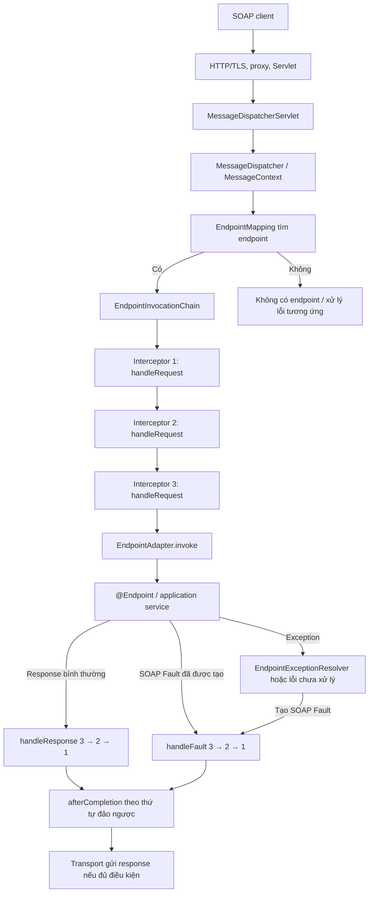

# EndpointInterceptor và vị trí trước, sau lời gọi endpoint

## Mục tiêu học tập

Trong chương **Interceptor** của module **SPRING_WEB_SERVICES**, bài này nghiên cứu `EndpointInterceptor` — cơ chế chèn xử lý dùng chung vào đường đi của một SOAP request trong Spring Web Services (Spring-WS).

Phạm vi học gắn với **SOAP contract-first**: XSD định nghĩa payload, WSDL mô tả operation/binding, JAXB ánh xạ XML sang Java, `@Endpoint` thực hiện nghiệp vụ, còn interceptor hỗ trợ kiểm tra schema, bảo mật thông điệp, tracing và các chính sách trước/sau khi gọi endpoint.

Học xong, bạn có thể:

1. Giải thích vị trí của `EndpointInterceptor` so với `MessageDispatcher`, `EndpointMapping`, `EndpointInvocationChain`, `EndpointAdapter` và `EndpointExceptionResolver`.
2. Viết đúng bốn callback `handleRequest`, `handleResponse`, `handleFault` và `afterCompletion`, biết điều kiện để mỗi callback được thực thi.
3. Dự đoán thứ tự chạy với nhiều interceptor: **request xuôi**, **response/fault và completion ngược** trong các chain đủ điều kiện.
4. Phân biệt giá trị trả về `true`/`false` của các callback; biết tại sao `false` không tự tạo SOAP Fault.
5. Đặt đúng trách nhiệm: schema validation, WS-Security, correlation/tracing ở interceptor; nghiệp vụ ở service; Fault mapping ở exception resolver.
6. Đăng ký interceptor qua `@EnableWs` và `WsConfigurer.addInterceptors`, nhận diện interceptor chọn lọc theo QName/SOAPAction.
7. Xây dựng interceptor đo thời gian xử lý không giữ mutable request state trong singleton và không ghi log dữ liệu nhạy cảm.
8. Viết unit test cho interceptor và kiểm thử qua `MockWebServiceClient`; hiểu giới hạn của test không có HTTP/TLS thực.
9. Phân tích các trường hợp dừng sớm, exception, SOAP Fault, endpoint không được mapping, request lỗi XML và thiếu security policy.
10. Thiết kế chuỗi interceptor dễ bảo trì, có xử lý lỗi an toàn và phù hợp hợp đồng SOAP/WSDL với đối tác doanh nghiệp.

## 1. EndpointInterceptor giải quyết vấn đề gì?

Giả sử dịch vụ tra cứu đơn hàng có nhiều operation: `GetOrder`, `SubmitOrder` và `CancelOrder`. Mỗi lời gọi cần một số bước chung:

- Xác thực payload có khớp XSD không.
- Xác minh `wsse:Security`, chữ ký, timestamp hoặc chứng chỉ khi hợp đồng yêu cầu.
- Tạo correlation ID để liên kết log giữa các thành phần.
- Đo thời gian xử lý và số lượng SOAP Fault.
- Áp dụng kiểm tra header/protocol đã thỏa thuận.
- Ghi dấu vết kiểm toán ở mức cho phép mà không làm lộ dữ liệu nghiệp vụ.

Nếu chép các bước đó vào từng phương thức `@Endpoint`, code bị lặp, dễ bỏ sót operation mới và khó kiểm thử nhất quán.

**`EndpointInterceptor` cho phép tách các xử lý cắt ngang ra khỏi endpoint**. Nó được gọi bởi hạ tầng Spring-WS như một phần của `EndpointInvocationChain` sau khi mapping đã chọn endpoint. Đây là khái niệm **server-side**, khác với `ClientInterceptor` được dùng khi một `WebServiceTemplate` gọi SOAP service khác.

### 1.1. Điểm phân biệt quan trọng

| Thành phần | Câu hỏi chịu trách nhiệm | Ví dụ |
| --- | --- | --- |
| `EndpointMapping` | “Request thuộc endpoint nào?” | QName `{urn:example:orders:v1}GetOrderRequest` → method `getOrder`. |
| `EndpointInvocationChain` | “Endpoint nào đi kèm những interceptor nào?” | Endpoint cùng [tracing, schema validation, security] đã đăng ký. |
| **`EndpointInterceptor`** | “Cần làm gì trước/sau endpoint?” | XSD validation, WS-Security, metrics, request ID. |
| `EndpointAdapter` | “Làm sao gọi endpoint đã chọn?” | Đọc JAXB request, gọi method, ghi response. |
| `@Endpoint` / application service | “Use case làm gì?” | Tra cứu đơn hàng, kiểm tra quyền trên tài nguyên. |
| `EndpointExceptionResolver` | “Exception nào cần thành SOAP Fault gì?” | `OrderNotFoundException` → Fault detail phù hợp WSDL. |
| HTTP filter/gateway | “Cần xử lý gì trước khi SOAP dispatcher chạy?” | TLS, body size, request path, rate limit/transport policy. |

**Endpoint interceptor không có nhiệm vụ định tuyến thay `EndpointMapping` và không thay thế hoàn toàn authentication/authorization.** Nó là một điểm kiểm soát hữu ích nhưng phải được gắn vào đúng chain, xử lý đúng thứ tự và có security policy rõ ràng.

## 2. Vị trí của interceptor trong luồng SOAP

Trong ứng dụng Spring-WS dùng SOAP/HTTP, một request thường đi qua:



Sơ đồ diễn giải **thứ tự khái niệm trong trường hợp endpoint được mapping và các callback đều tiếp tục xử lý**. Nhánh `false`, exception ở interceptor, response trống và lỗi trước khi tạo `MessageContext` có đường đi riêng được phân tích ở các mục sau.

### 2.1. Mapping xảy ra trước endpoint interceptor

Một `EndpointInterceptor` chỉ được gắn với chain sau khi `EndpointMapping` tìm ra endpoint. Vì vậy:

- Interceptor theo endpoint **không đảm bảo** chạy với XML sai cú pháp không tạo được SOAP message.
- Request có QName không khớp bất kỳ mapping nào có thể **không đi qua** các interceptor thuộc chain endpoint.
- Authentication bắt buộc ở **mọi** lời gọi có thể cần thêm biện pháp tại TLS/gateway/Servlet filter ngoài WS-Security interceptor trong Spring-WS.
- Nếu custom mapping dùng `tenantId` hoặc action header **trước** khi security interceptor xác minh, đó vẫn là dữ liệu chưa được bảo đảm tính xác thực.

Một interceptor kiểm tra chữ ký **không chứng minh** tất cả endpoint được bảo vệ nếu nó chỉ được đăng ký ở một nhóm route.

### 2.2. Adapter chỉ gọi endpoint sau khi request interceptor cho phép

Với request hợp lệ:

```text
SOAP Body QName → EndpointMapping
                 → handleRequest(...)
                 → handleRequest(...)
                 → ...
                 → EndpointAdapter
                 → @Endpoint
                 → response/fault callbacks
```

Nếu một `handleRequest` trả `false`, phần còn lại của request chain và endpoint **không được tiếp tục gọi**. Đừng dựa vào endpoint để tự từ chối dữ liệu mà một interceptor đã nhận trách nhiệm xử lý hoặc đã chặn.

## 3. Bốn callback của EndpointInterceptor

Interface Spring-WS ở package `org.springframework.ws.server`:

```java
package org.springframework.ws.server;

import org.springframework.ws.context.MessageContext;

public interface EndpointInterceptor {

    boolean handleRequest(
            MessageContext messageContext,
            Object endpoint) throws Exception;

    boolean handleResponse(
            MessageContext messageContext,
            Object endpoint) throws Exception;

    boolean handleFault(
            MessageContext messageContext,
            Object endpoint) throws Exception;

    void afterCompletion(
            MessageContext messageContext,
            Object endpoint,
            Exception ex) throws Exception;
}
```

Đây là **hình thức chữ ký API để học**, không phải hướng dẫn sao chép interface này vào code ứng dụng. Ở dự án thật chỉ cần import interface từ thư viện Spring-WS.

| Callback | Thời điểm | Return | Công việc thường gặp |
| --- | --- | --- | --- |
| `handleRequest` | Sau mapping, **trước** `EndpointAdapter.invoke`. | `true` tiếp tục; `false` dừng request chain. | Validation, security checks, chuẩn hóa metadata, bắt đầu timing. |
| `handleResponse` | Sau khi endpoint được gọi và có **response bình thường** để xử lý. | `true` tiếp tục chuỗi xử lý response; `false` chặn luồng response tương ứng. | Metrics, thêm SOAP Header được cho phép, đánh dấu kết quả. |
| `handleFault` | Khi có **SOAP Fault response** được xử lý trong chain. | `true` tiếp tục chuỗi xử lý fault; `false` chặn luồng fault tương ứng. | Fault metrics, correlation, quan sát lỗi an toàn. |
| `afterCompletion` | Kết thúc vòng xử lý sau request/response/fault theo điều kiện chain. | `void`. | Dọn tài nguyên/hoàn tất metric, nhưng không thay thế `finally` cho mọi lỗi trước đó. |

### 3.1. Tham số `MessageContext`

`MessageContext` đại diện cho cuộc trao đổi SOAP tại Spring-WS. Có thể đọc:

```java
messageContext.getRequest();
messageContext.hasResponse();
messageContext.getResponse();
messageContext.getProperty("some.request.scoped.key");
messageContext.setProperty("some.request.scoped.key", value);
```

Không phải mọi thời điểm đều có response. Vì thế phải kiểm tra `hasResponse()` khi logic cần đọc response; `handleRequest` thường chỉ có request.

Không nhầm `MessageContext` với `TransportContext`. Nếu cần thông tin HTTP Servlet, Spring-WS có `TransportContextHolder` và loại connection tương ứng; nhưng đó là **transport detail**, không phải XML payload hoặc security principal.

### 3.2. Tham số `endpoint`

`endpoint` là đối tượng đã được `EndpointMapping` chọn. Với annotation-driven mapping, nó có thể là đối tượng đại diện cho method endpoint, không bắt buộc là instance của class `@Endpoint`. Tránh ép kiểu vô điều kiện sang `OrderEndpoint`.

Có thể dùng endpoint cho metrics tên operation hoặc chính sách phạm vi xử lý, nhưng nên khai báo rõ cách định danh và tránh log toàn bộ `toString()` khi nó có thông tin không phù hợp.

### 3.3. Tham số `ex` trong `afterCompletion`

`afterCompletion(messageContext, endpoint, ex)` có thể nhận exception khi có lỗi trong xử lý. `ex == null` **không nhất thiết** có nghĩa nghiệp vụ thành công: ứng dụng có thể đã tạo SOAP Fault được xử lý qua exception resolver hoặc callback khác mà không còn exception chưa giải quyết.

Để phân loại kết quả, hãy kết hợp thông tin Fault/response thực tế và chính sách metrics; không chỉ dùng `ex != null` làm bộ đếm “SOAP Fault”.

## 4. `handleRequest`: trước khi endpoint được gọi

Đây là điểm mở rộng phổ biến nhất.

### 4.1. Một request ví dụ

Client gửi:

```xml
<soapenv:Envelope
    xmlns:soapenv="http://schemas.xmlsoap.org/soap/envelope/"
    xmlns:ord="urn:example:orders:v1">
    <soapenv:Header/>
    <soapenv:Body>
        <ord:GetOrderRequest>
            <ord:orderId>ORD-000042</ord:orderId>
        </ord:GetOrderRequest>
    </soapenv:Body>
</soapenv:Envelope>
```

Sau khi `PayloadRootAnnotationMethodEndpointMapping` chọn method cho QName `{urn:example:orders:v1}GetOrderRequest`, các request interceptors có thể:

- Kiểm tra request XML theo XSD.
- Xác minh WS-Security Header bắt buộc và chữ ký/timestamp.
- Tạo request ID hoặc đặt metadata truy vết.
- Từ chối theo chính sách chung áp dụng cho chain đã chọn.

### 4.2. `true` nghĩa là gì?

`true` nghĩa là interceptor hoàn thành phần xử lý request của mình và **cho phép request chain tiếp tục**. Nó không chứng minh:

- XML đã được validate nếu interceptor không thực hiện validation.
- Chữ ký WS-Security hợp lệ nếu chưa chạy security interceptor.
- Caller có quyền truy cập đơn hàng hoặc tenant.
- Endpoint chắc chắn được gọi (interceptor **sau** có thể dừng chuỗi).

Do đó không viết test chỉ dựa vào `handleRequest() == true` rồi kết luận request an toàn.

### 4.3. `false` nghĩa là gì?

`false` thông báo cho dispatcher **không gọi interceptor tiếp theo và không gọi endpoint**. Đây là tín hiệu điều khiển pipeline.

Ví dụ một interceptor được thiết kế để từ chối request sai theo schema có thể chuẩn bị SOAP Fault rồi trả `false`. Nhưng:

**Trả `false` một mình không tự sinh SOAP Fault.** Nếu interceptor muốn client nhận phản hồi cụ thể, nó phải bảo đảm cách tạo SOAP response/Fault phù hợp với Spring-WS và hợp đồng. Nếu không, có thể không có response như mong đợi.

### 4.4. Có nên tự chặn mọi request bằng custom code?

Không nếu đã có interceptor chuẩn:

- Kiểm tra payload XSD → `PayloadValidatingInterceptor`.
- WS-Security token/signature → `Wss4jSecurityInterceptor` khi đúng stack/version.
- Logging XML → `PayloadLoggingInterceptor` hoặc `SoapEnvelopeLoggingInterceptor` với chính sách chống lộ dữ liệu.
- Chuyển XML payload theo schema chuyển đổi → `PayloadTransformingInterceptor` trong tình huống thích hợp.

Custom interceptor nên tập trung vào nhu cầu **không được interceptor chuẩn đáp ứng** như correlation ID nội bộ, metrics theo contract, kiểm tra một header protocol riêng đã thống nhất.

## 5. `handleResponse`: sau endpoint khi có response bình thường

Khi endpoint hoàn tất và tạo một SOAP response không phải Fault, `handleResponse` được gọi theo **thứ tự ngược** của các interceptor đã đi qua `handleRequest` thành công.

### 5.1. Ví dụ

```text
Đăng ký: I1 = tracing, I2 = schema validation, I3 = audit

Request:
  I1.handleRequest
  I2.handleRequest
  I3.handleRequest
  EndpointAdapter → OrderEndpoint

Response bình thường:
  I3.handleResponse
  I2.handleResponse
  I1.handleResponse

Hoàn tất:
  I3.afterCompletion
  I2.afterCompletion
  I1.afterCompletion
```

Đây là thứ tự lý tưởng khi **cả ba interceptor đều tiếp tục** và dispatcher xử lý response theo chain bình thường.

### 5.2. Những gì thích hợp trong response callback

- Đếm số response thành công sau khi biết trạng thái.
- Kiểm tra hoặc làm giàu metadata response mà hợp đồng cho phép.
- Xác thực response theo schema với interceptor chuẩn khi cần.
- Hoàn thiện trace/span đã bắt đầu từ `handleRequest`.
- Chuẩn hóa một số SOAP Header như correlation theo contract nếu được phép.

Không nên sửa tùy tiện XML business payload đã được JAXB sinh theo XSD, nhất là sau khi thông điệp đã ký hoặc trước khi security response signing. Thứ tự giữa **mapper → schema validation → WS-Security signing** là quyết định kiến trúc có ảnh hưởng trực tiếp tới tính đúng đắn và bảo mật.

### 5.3. Giá trị `false` của response callback

Khác với `handleRequest`, `handleResponse` xử lý **đường phản hồi**. Theo tài liệu Spring-WS, `false` ở `handleResponse` chặn việc tiếp tục response chain; tài liệu reference còn lưu ý trường hợp này có thể khiến response **không được gửi về client**.

Đừng dùng `return false` để biểu thị “response không hợp lệ nhưng vẫn trả response bình thường”. Khi validation thất bại, cần hiểu chính sách xử lý lỗi/transport; một số interceptor chuẩn chặn response thay vì tự biến nó thành SOAP Fault.

### 5.4. Không dùng để sửa trạng thái database sau commit tùy ý

`handleResponse` không phải transaction callback bảo đảm chắc chắn client đã nhận được thông điệp. Tầng HTTP có thể mất kết nối **sau** khi response được tạo; interceptor có thể chạy trước khi network gửi hoàn tất.

Nghiệp vụ ghi dữ liệu, idempotency, outbox và transaction phải đặt ở application service/infrastructure. Không lấy thời điểm `handleResponse` làm bằng chứng “đối tác đã xác nhận”.

## 6. `handleFault`: sau khi có SOAP Fault

Khi pipeline tạo một SOAP Fault, interceptor đã tham gia có thể nhận `handleFault` theo thứ tự đảo ngược. Fault có thể phát sinh do:

- Schema request invalid và interceptor chuẩn tạo Fault.
- Exception nghiệp vụ được `EndpointExceptionResolver` ánh xạ.
- Lỗi SOAP Header/mustUnderstand hoặc lỗi xử lý protocol ở tầng tương ứng.
- Lỗi WS-Security được security stack chuyển thành SOAP Fault theo profile.

### 6.1. SOAP 1.1 Fault

```xml
<soapenv:Envelope
    xmlns:soapenv="http://schemas.xmlsoap.org/soap/envelope/">
    <soapenv:Body>
        <soapenv:Fault>
            <faultcode>soapenv:Client</faultcode>
            <faultstring>Invalid order request</faultstring>
        </soapenv:Fault>
    </soapenv:Body>
</soapenv:Envelope>
```

SOAP 1.2 dùng `Code`/`Reason` thay vì `faultcode`/`faultstring`. Một interceptor ghi metrics nên xác nhận **SOAP version** và dạng Fault thực tế khi cần phân loại lỗi.

### 6.2. Fault không phải lúc nào cũng đi qua callback

Nếu TLS handshake thất bại, XML không parse được trước khi dispatcher có `MessageContext`, gateway chặn HTTP 413 hoặc request không có endpoint mapping, endpoint interceptor có thể **không được chạy**. Vì thế, không dùng `handleFault` làm nguồn metrics duy nhất cho toàn bộ lỗi của hệ thống.

### 6.3. `handleFault` khác `EndpointExceptionResolver`

| Nhu cầu | Thành phần phù hợp |
| --- | --- |
| Chọn exception nghiệp vụ nào thành SOAP Fault gì | `EndpointExceptionResolver` hoặc cơ chế xử lý Fault chuyên trách. |
| Sinh typed Fault detail theo XSD/WSDL | Resolver/Fault mapper có kiểm thử contract. |
| Ghi metric “SOAP Fault đã được tạo” | `handleFault` của interceptor thích hợp. |
| Gắn correlation header an toàn vào Fault | Interceptor khi còn có thể thao tác SOAP message phù hợp. |
| Bảo đảm response Fault có chữ ký theo security profile | Security interceptor/stack đã cấu hình và kiểm thử. |
| Lỗi HTTP trước khi tạo SOAP message | Gateway/Servlet/transport error handling, không chờ `handleFault`. |

**Không** đưa toàn bộ exception-to-fault mapping vào một interceptor tracing chỉ vì nó có callback `handleFault`.

## 7. `afterCompletion`: dọn dẹp và kết thúc vòng xử lý

`afterCompletion` được gọi vào cuối vòng xử lý đối với những interceptor **đủ điều kiện tham gia chain** theo hợp đồng của Spring-WS, thường theo thứ tự ngược so với request. Nó phù hợp để:

- Ghi metric thời gian tổng đã lưu trong `MessageContext`.
- Đóng/hoàn tất tài nguyên riêng của interceptor nếu có.
- Hoàn thiện tracing context và dọn trạng thái gắn với phạm vi xử lý.
- Ghi lại tình huống exception an toàn, không lộ stack trace cho client.

### 7.1. Không coi đây là `finally` tuyệt đối

Tài liệu API nêu rằng callback chỉ áp dụng khi `handleRequest` của interceptor đã hoàn tất thành công theo điều kiện chain. Nếu exception xảy ra **ngay trong phần khởi tạo của `handleRequest`** hoặc request bị chặn ở tầng sớm hơn, interceptor đó có thể không nhận `afterCompletion`.

Vì vậy:

- Nếu tự mở tài nguyên ở `handleRequest` và các bước mở tiếp theo có thể ném exception, phải tự xử lý cleanup bằng `try/finally` ngay trong logic đó.
- Không gắn tài nguyên request vào singleton field rồi chỉ chờ `afterCompletion` dọn.
- Không trông chờ `afterCompletion` cho request lỗi TLS, XML parser hoặc không map được endpoint.
- Nếu dùng ThreadLocal riêng, thiết kế xử lý đầy đủ các đường đi và không tạo rò state sang request sau; ưu tiên **`MessageContext` request-scoped property**.

### 7.2. Thứ tự hoàn tất

Với I1, I2, I3 cùng xử lý request:

```text
I1.handleRequest → I2.handleRequest → I3.handleRequest
→ endpoint / response hoặc fault
→ I3.afterCompletion → I2.afterCompletion → I1.afterCompletion
```

Nếu `I2.handleRequest` trả `false`, endpoint và I3 không chạy. Phạm vi callback hoàn tất được giới hạn bởi các interceptor đã tham gia; **không suy diễn** rằng I3 sẽ được gọi hoặc rằng nó có thể dọn tài nguyên mà nó chưa tạo.

### 7.3. Callback không bảo đảm client đã nhận bytes

`afterCompletion` là callback trong vòng xử lý phía server, **không phải ACK từ client** và không có nghĩa transport đã gửi xong/thành công mọi byte SOAP. Đừng dùng nó để xác nhận giao dịch tài chính, delivery guarantee hoặc đóng một quy trình nghiệp vụ cần xác nhận từ phía đối tác.

## 8. Luồng nhiều interceptor và các nhánh đặc biệt

Để tránh nhầm khi review code, nên mô tả thứ tự cho từng kịch bản.

### 8.1. Kịch bản A — response thành công

```text
Client → MessageDispatcher
   → EndpointMapping
   → I1.handleRequest() = true
   → I2.handleRequest() = true
   → I3.handleRequest() = true
   → EndpointAdapter.invoke(endpoint)
   → response SOAP bình thường
   → I3.handleResponse() = true
   → I2.handleResponse() = true
   → I1.handleResponse() = true
   → afterCompletion cho chain thích hợp (thường 3 → 2 → 1)
```

### 8.2. Kịch bản B — interceptor dừng sớm

```text
EndpointMapping → I1.handleRequest() = true
                → I2.handleRequest() = false
                X I3.handleRequest() không chạy
                X EndpointAdapter/endpoint không chạy
```

Điều còn lại phụ thuộc cách I2 xử lý phản hồi và hợp đồng dispatcher. Nếu I2 định từ chối request, nó phải làm đúng nhiệm vụ tạo response/Fault hoặc kích hoạt cơ chế lỗi đã cấu hình, **không chỉ trả false và giả định client sẽ thấy SOAP Fault**.

### 8.3. Kịch bản C — endpoint ném exception nghiệp vụ

```text
Mapping → interceptors.handleRequest(true)
        → Adapter gọi endpoint
        → OrderNotFoundException
        → EndpointExceptionResolver
        → SOAP Fault được tạo (nếu có mapping phù hợp)
        → handleFault theo chain đủ điều kiện
        → afterCompletion phù hợp
```

Nếu không resolver nào xử lý exception, lỗi có thể được đẩy ra tầng khác; không đảm bảo `handleFault` chạy.

### 8.4. Kịch bản D — response XML không hợp lệ

```text
Endpoint tạo response
→ response validation interceptor phát hiện sai XSD
→ chặn response theo cấu hình
→ có thể không gửi SOAP response bình thường
```

Phân biệt với **request validation failure**: interceptor `PayloadValidatingInterceptor` phía server có thể tạo SOAP Fault cho request sai schema, trong khi response sai schema thường bị chặn/log theo cách khác. Hãy kiểm thử cả hai thay vì mặc định mọi trường hợp cùng một Fault.

### 8.5. Kịch bản E — không có endpoint được mapping

```text
SOAP request hợp lệ → EndpointMapping không tìm thấy endpoint
                   → không có EndpointInvocationChain thích hợp
                   → không thể giả định I1/I2/I3 của chain được chạy
```

Nếu bảo mật phải áp dụng cho **mọi HTTP request**, kể cả những request chưa map, cần thêm lớp transport/gateway hoặc security filter độc lập với endpoint mapping.

### 8.6. Kịch bản F — `handleResponse` hoặc `handleFault` trả false

Callback response/fault có khả năng dừng đường phản hồi. Đừng dùng `false` như một “cờ warning”, vì nó thay đổi điều khiển pipeline. Với yêu cầu “response không đúng schema”, hãy thiết kế cơ chế lỗi/test rõ ràng thay vì âm thầm chặn rồi khiến client timeout.

## 9. Thực hành: một SOAP endpoint theo XSD/WSDL

Ta dùng một hợp đồng `GetOrder` đơn giản để kiểm tra callback thực tế.

### 9.1. XSD dữ liệu

**`src/main/resources/xsd/orders-v1.xsd`**:

```xml
<?xml version="1.0" encoding="UTF-8"?>
<xs:schema
    xmlns:xs="http://www.w3.org/2001/XMLSchema"
    xmlns:tns="urn:example:orders:v1"
    targetNamespace="urn:example:orders:v1"
    elementFormDefault="qualified">

    <xs:simpleType name="OrderIdType">
        <xs:restriction base="xs:string">
            <xs:pattern value="ORD-[0-9]{6}"/>
        </xs:restriction>
    </xs:simpleType>

    <xs:element name="GetOrderRequest">
        <xs:complexType>
            <xs:sequence>
                <xs:element name="orderId" type="tns:OrderIdType"/>
            </xs:sequence>
        </xs:complexType>
    </xs:element>

    <xs:element name="GetOrderResponse">
        <xs:complexType>
            <xs:sequence>
                <xs:element name="orderId" type="tns:OrderIdType"/>
                <xs:element name="status" type="xs:string"/>
            </xs:sequence>
        </xs:complexType>
    </xs:element>
</xs:schema>
```

`GetOrderRequest` và `GetOrderResponse` là **global elements** trong namespace `urn:example:orders:v1`. XSD là nguồn contract cho JAXB/XJC và schema validation.

### 9.2. SOAP Body request

```xml
<ord:GetOrderRequest xmlns:ord="urn:example:orders:v1">
    <ord:orderId>ORD-000042</ord:orderId>
</ord:GetOrderRequest>
```

Ví dụ này là **payload**, không phải toàn bộ SOAP Envelope. Với SOAP 1.1 thật, payload được đặt trong `soap:Body` theo Envelope namespace `http://schemas.xmlsoap.org/soap/envelope/`.

### 9.3. Endpoint gọn

Giả sử JAXB/XJC sinh class `GetOrderRequest`, `GetOrderResponse` và các accessor tương ứng:

```java
package com.example.orders.soap.endpoint;

import org.springframework.ws.server.endpoint.annotation.Endpoint;
import org.springframework.ws.server.endpoint.annotation.PayloadRoot;
import org.springframework.ws.server.endpoint.annotation.RequestPayload;
import org.springframework.ws.server.endpoint.annotation.ResponsePayload;

import com.example.orders.contract.GetOrderRequest;
import com.example.orders.contract.GetOrderResponse;
import com.example.orders.application.OrderLookupService;

@Endpoint
public class OrderEndpoint {

    private static final String NS = "urn:example:orders:v1";

    private final OrderLookupService service;

    public OrderEndpoint(OrderLookupService service) {
        this.service = service;
    }

    @PayloadRoot(namespace = NS, localPart = "GetOrderRequest")
    @ResponsePayload
    public GetOrderResponse getOrder(
            @RequestPayload GetOrderRequest request) {

        String status =
                service.getStatus(request.getOrderId());

        GetOrderResponse response = new GetOrderResponse();
        response.setOrderId(request.getOrderId());
        response.setStatus(status);
        return response;
    }
}
```

Ví dụ giả định interface ứng dụng:

```java
package com.example.orders.application;

public interface OrderLookupService {
    String getStatus(String orderId);
}
```

Lớp endpoint **không** gọi interceptor trực tiếp. Spring-WS tự gọi các interceptor đã đăng ký quanh `EndpointAdapter`. Service tập trung nghiệp vụ; interceptor tập trung chính sách chung.

**Ghi chú:** Đây là các đoạn code theo cấu trúc minh họa, cần XJC output/JAXB runtime, Spring context, WSDL exposure và Servlet mapping trong project thật. Với XSD global element dùng anonymous complex type như ví dụ, XJC thường sinh lớp root tương ứng; luôn kiểm tra `@XmlRootElement`/`ObjectFactory` của mã sinh thực tế.

## 10. Viết interceptor đo thời gian bằng MessageContext

Mục tiêu ví dụ: đo thời gian xử lý **chỉ cho request đi qua chain**, phân biệt response/fault và không lưu trạng thái request trong singleton field.

### 10.1. Vì sao dùng `MessageContext` properties?

`@Endpoint` và `EndpointInterceptor` thường là Spring singleton, xử lý nhiều request đồng thời. Nếu viết:

```java
// Không an toàn: cùng một field mutable cho nhiều request đồng thời.
private long startedAt;

@Override
public boolean handleRequest(MessageContext ctx, Object endpoint) {
    startedAt = System.nanoTime();
    return true;
}
```

hai thread có thể ghi đè `startedAt`, khiến thời gian đo sai và có nguy cơ lẫn dữ liệu giữa requests.

Thay vì thế, lưu timestamp trong **`MessageContext` của từng lần trao đổi**.

### 10.2. Implementation đầy đủ

**`SoapTimingInterceptor.java`**

```java
package com.example.orders.soap.interceptor;

import java.util.concurrent.TimeUnit;

import org.springframework.stereotype.Component;
import org.springframework.ws.context.MessageContext;
import org.springframework.ws.server.endpoint.interceptor.EndpointInterceptorAdapter;

@Component
public final class SoapTimingInterceptor
        extends EndpointInterceptorAdapter {

    private static final String START_KEY =
            SoapTimingInterceptor.class.getName() + ".startNanos";

    private static final String OUTCOME_KEY =
            SoapTimingInterceptor.class.getName() + ".outcome";

    @Override
    public boolean handleRequest(
            MessageContext context, Object endpoint) {
        context.setProperty(START_KEY, System.nanoTime());
        return true;
    }

    @Override
    public boolean handleResponse(
            MessageContext context, Object endpoint) {
        context.setProperty(OUTCOME_KEY, "RESPONSE");
        return true;
    }

    @Override
    public boolean handleFault(
            MessageContext context, Object endpoint) {
        context.setProperty(OUTCOME_KEY, "FAULT");
        return true;
    }

    @Override
    public void afterCompletion(
            MessageContext context,
            Object endpoint,
            Exception ex) {

        Object started = context.getProperty(START_KEY);
        if (!(started instanceof Long startNanos)) {
            return;
        }

        long elapsedNanos = System.nanoTime() - startNanos;
        long elapsedMillis =
                TimeUnit.NANOSECONDS.toMillis(elapsedNanos);

        Object outcome = context.getProperty(OUTCOME_KEY);
        String result = ex != null
                ? "EXCEPTION"
                : outcome == null ? "NO_RESPONSE_CLASSIFIED"
                : outcome.toString();

        if (logger.isInfoEnabled()) {
            logger.info("SOAP dispatch result=" + result
                    + " durationMs=" + elapsedMillis);
        }
    }
}
```

### 10.3. Vì sao ví dụ này tương đối an toàn?

- `START_KEY` và `OUTCOME_KEY` là key **request-scoped**, không phải mutable instance field.
- `System.nanoTime()` phù hợp đo khoảng thời gian, không dùng làm timestamp để đồng bộ giữa hệ thống.
- Không log SOAP Body, UsernameToken, mật khẩu, private key hay chữ ký.
- `handleResponse`/`handleFault` chỉ đánh dấu loại kết quả, không sửa hợp đồng XML.
- `afterCompletion` tính khoảng thời gian từ một timestamp có sẵn; nếu thiếu timestamp, tránh ép kiểu hoặc NPE.
- Nếu có exception trước khi `handleRequest` hoàn thành, có thể không có timing record. Vì vậy, monitoring tổng thể nên bổ sung **metrics tại Servlet/gateway/transport** khi muốn quan sát mọi request.

### 10.4. Điều gì cần bổ sung để dùng production?

Ví dụ dùng `logger.info` để dễ học. Production có thể cần:

- Metric library/tracing được đội nền tảng quản lý thay vì log cho mỗi request.
- Bổ sung operation name **ổn định** theo QName, không lưu payload nhạy cảm.
- Correlation ID do server tạo và chuẩn hóa header do client gửi.
- Sampling, log levels, retention, phân loại SOAP Fault và giới hạn cardinality metric labels.
- Không đưa `orderId`, raw SOAPAction hay tenantId tự khai vào nhãn metric có cardinality không giới hạn.
- Phân biệt exception chưa xử lý, Fault đã được resolver xử lý, response bình thường và trường hợp không có response.

**Không sử dụng metric “afterCompletion đã chạy” như bằng chứng HTTP response đã đến client.**

## 11. Đăng ký interceptor với `WsConfigurer`

Spring-WS annotation-driven configuration hỗ trợ `@EnableWs` và `WsConfigurer.addInterceptors(...)`. Cách đăng ký thông dụng:

```java
package com.example.orders.soap.config;

import java.util.List;

import org.springframework.context.annotation.Configuration;
import org.springframework.ws.config.annotation.EnableWs;
import org.springframework.ws.config.annotation.WsConfigurer;
import org.springframework.ws.server.EndpointInterceptor;

import com.example.orders.soap.interceptor.SoapTimingInterceptor;

@Configuration
@EnableWs
public class WebServiceConfiguration implements WsConfigurer {

    private final SoapTimingInterceptor timing;

    public WebServiceConfiguration(SoapTimingInterceptor timing) {
        this.timing = timing;
    }

    @Override
    public void addInterceptors(List<EndpointInterceptor> interceptors) {
        interceptors.add(timing);
    }
}
```

`SoapTimingInterceptor` đã có `@Component` nên được tiêm vào config khi nằm trong phạm vi component scanning; có thể dùng `@Bean` thay thế nếu muốn quản lý rõ vòng đời.

### 11.1. Nếu cần nhiều interceptor

Ví dụ muốn thứ tự:

```text
1. Timing/tracing
2. WS-Security validation
3. XSD request validation
4. Endpoint
```

Hãy đăng ký theo thứ tự có chủ ý và kiểm tra trên môi trường thực. Khi các callback trả về bình thường, response đi theo chiều đảo ngược: validation → security → tracing.

**Không có một thứ tự tối ưu cho mọi ứng dụng.** Một số bước đọc XML nên diễn ra sau kiểm tra kích thước/parse an toàn; WS-Security có yêu cầu phải kiểm tra ký/encryption theo security profile; XSD response validation và ký response cần phối hợp cẩn thận để tránh sửa nội dung sau khi ký.

### 11.2. Bean schema validator đầy đủ vòng đời

`PayloadValidatingInterceptor` là interceptor chuẩn của Spring-WS, có thể cấu hình bằng XSD. Để bảo đảm framework quản lý việc khởi tạo/afterPropertiesSet của interceptor, nên tạo **Spring bean** thay vì tùy tiện dùng `new` ở bất kỳ chỗ nào.

**`SchemaInterceptorBeans.java`**

```java
package com.example.orders.soap.config;

import org.springframework.context.annotation.Bean;
import org.springframework.context.annotation.Configuration;
import org.springframework.core.io.ClassPathResource;
import org.springframework.ws.soap.server.endpoint.interceptor.PayloadValidatingInterceptor;

@Configuration
public class SchemaInterceptorBeans {

    @Bean
    public PayloadValidatingInterceptor payloadValidator() {
        PayloadValidatingInterceptor validator =
                new PayloadValidatingInterceptor();

        validator.setSchema(
                new ClassPathResource("xsd/orders-v1.xsd"));
        validator.setValidateRequest(true);
        validator.setValidateResponse(true);

        return validator;
    }
}
```

Để đưa validator vào chain, thay đổi constructor `WebServiceConfiguration` để nhận `PayloadValidatingInterceptor`:

```java
private final SoapTimingInterceptor timing;
private final PayloadValidatingInterceptor validator;

public WebServiceConfiguration(
        SoapTimingInterceptor timing,
        PayloadValidatingInterceptor validator) {
    this.timing = timing;
    this.validator = validator;
}

@Override
public void addInterceptors(List<EndpointInterceptor> interceptors) {
    interceptors.add(timing);
    interceptors.add(validator);
}
```

Đây là **đoạn thay thế** cho phần field/constructor/`addInterceptors` của class trước, không copy nguyên hai phiên bản vào cùng class. Cần import `PayloadValidatingInterceptor` đúng package và bảo đảm file `xsd/orders-v1.xsd` nằm trong classpath.

**Lưu ý API:** `setSchema(Resource)` nhận `ClassPathResource`; API `setXsdSchema(XsdSchema)` là một cấu hình khác với loại tham số khác. Khi dùng Spring-WS khác nhánh, kiểm tra tài liệu của đúng phiên bản.

### 11.3. Nếu ứng dụng dùng WS-Security

Một interceptor như `Wss4jSecurityInterceptor` cần được tạo thành bean với **validation actions**, crypto/truststore, callback handlers và policy phù hợp. Chỉ thêm một bean vào danh sách mà không cấu hình hành động xác minh **không tạo ra authentication**.

Cần xác minh security interceptor có trong **mọi chain bắt buộc**, không bị custom mapping hoặc interceptor chọn lọc khiến operation mới bỏ qua kiểm tra. XSD validation không thay thế chữ ký, timestamp, mTLS hoặc authorization.

## 12. Interceptor áp dụng toàn cục hay theo một nhóm endpoint?

Tùy cấu hình, interceptor có thể áp dụng cho tất cả endpoint do một context/mapping quản lý hoặc **chọn lọc** theo QName/SOAPAction.

### 12.1. Phạm vi rộng

Khi thêm vào `WsConfigurer.addInterceptors` với annotation-driven mapping thông thường, interceptor được dùng trong cấu hình endpoint mappings tương ứng. Đây là cách đơn giản cho tracing chung và một số policy mặc định.

Tuy vậy, đừng khẳng định tự động nó bảo vệ:

- Request thất bại **trước khi có EndpointInvocationChain**.
- Endpoint được đăng ký trên một `MessageDispatcher` khác.
- Custom `EndpointMapping` quản lý interceptor riêng không dùng cấu hình chung.
- Một URL HTTP không thuộc Spring-WS.
- Client-side `WebServiceTemplate` gọi đi.

### 12.2. Chọn lọc theo payload root hoặc SOAPAction

Spring-WS có cơ chế lựa chọn interceptor theo request message, trong đó `SmartEndpointInterceptor` có phương thức:

```java
boolean shouldIntercept(
        MessageContext messageContext,
        Object endpoint);
```

Các lớp hỗ trợ như `PayloadRootSmartSoapEndpointInterceptor` hoặc `SoapActionSmartEndpointInterceptor` giúp phạm vi áp dụng theo message type; XML namespace/QName hay SOAPAction cần khớp cấu hình cụ thể.

Dạng cấu hình XML Spring-WS từng được dùng:

```xml
<sws:interceptors>
    <bean class="com.example.orders.soap.interceptor.SoapTimingInterceptor"/>

    <sws:payloadRoot namespaceUri="urn:example:orders:v1">
        <bean class="com.example.orders.soap.interceptor.OrdersOnlyInterceptor"/>
    </sws:payloadRoot>
</sws:interceptors>
```

Ví dụ XML này **minh họa phạm vi cấu hình** và cần khai báo `xmlns:sws`, `schemaLocation` cùng các bean thực tế; không phải ApplicationContext XML độc lập. Khi dùng `@EnableWs`/Java configuration, dùng các API/configuration được hỗ trợ bởi phiên bản Spring-WS đã chọn thay vì trộn các kiểu cấu hình thiếu chủ đích.

### 12.3. Điểm nguy hiểm với security interceptor chọn lọc

Nếu một operation mới `ExportOrdersRequest` không khớp điều kiện security interceptor, nó có thể **bỏ qua kiểm tra chữ ký**, mặc dù `GetOrderRequest` đã được bảo vệ.

Đối với yêu cầu bắt buộc trên toàn bộ dịch vụ:

1. Dùng chính sách fail-closed tại transport/security boundary.
2. Cấu hình interceptor bảo mật bao phủ **tất cả operation cần bảo vệ**.
3. Test độc lập từng QName/SOAPAction và cả trường hợp sai/không map.
4. Với custom mapping, kiểm tra `EndpointInvocationChain` thực sự có interceptor phù hợp.
5. Đừng dùng HTTP Header hoặc tenantId tự khai để chọn “cấp bảo mật thấp hơn”.

## 13. Interceptor, SOAP Header và `mustUnderstand`

SOAP Header mang các block như WS-Security, WS-Addressing, correlation hoặc thông tin giao thức riêng. Với SOAP 1.1, thuộc tính `actor` chỉ SOAP actor đích; với SOAP 1.2, `role` chỉ vai trò node đích. `mustUnderstand` yêu cầu node được nhắm tới hiểu/xử lý block bắt buộc.

Ví dụ SOAP 1.1:

```xml
<soapenv:Envelope
    xmlns:soapenv="http://schemas.xmlsoap.org/soap/envelope/"
    xmlns:auth="urn:example:auth:v1"
    xmlns:ord="urn:example:orders:v1">
    <soapenv:Header>
        <auth:RequestPolicy soapenv:mustUnderstand="1">
            strict
        </auth:RequestPolicy>
    </soapenv:Header>
    <soapenv:Body>
        <ord:GetOrderRequest>
            <ord:orderId>ORD-000042</ord:orderId>
        </ord:GetOrderRequest>
    </soapenv:Body>
</soapenv:Envelope>
```

Một SOAP-aware interceptor có thể xem/khai báo header mình hiểu qua các API liên quan (ví dụ `SoapEndpointInterceptor` có thêm cơ chế `understands(...)`). Tuy nhiên:

- `mustUnderstand="1"` **không chứng minh** header là thật.
- Một header tên `AdminRole` **không cấp quyền** nếu caller tự gửi.
- Chữ ký WS-Security chỉ bảo vệ các phần **thực sự được ký** theo profile; cần kiểm tra đúng signed parts và tránh XML Signature Wrapping.
- Nếu một header được đánh dấu bắt buộc mà node không hiểu/xử lý, giao thức có thể yêu cầu SOAP `MustUnderstand` Fault.
- Không nên viết một interceptor “trả true” rồi mặc định nó đã hoàn thành yêu cầu security của header.

Với security yêu cầu WS-Security, dùng stack đã được duy trì và cấu hình trust/crypto/timestamp, thay vì tự viết parser XML để quyết định chữ ký có hợp lệ không.

## 14. Logging và dữ liệu nhạy cảm trong interceptor

`PayloadLoggingInterceptor` ghi phần payload; `SoapEnvelopeLoggingInterceptor` có thể ghi cả SOAP Envelope/Header. Chúng hữu ích khi phát triển nhưng có rủi ro lớn trong dịch vụ doanh nghiệp.

### 14.1. Những gì có thể bị lộ

- UsernameToken, password digest và nonce.
- Thông tin chứng chỉ, security token hoặc chữ ký XML.
- Thông tin tài khoản, hóa đơn, dữ liệu khách hàng trong SOAP Body.
- Header mang tenant ID, user ID, correlation ID giả mạo hoặc thông tin định tuyến nhạy cảm.
- Lỗi chứa stack trace, SQL query hoặc đường dẫn nội bộ.
- MTOM attachments/dữ liệu nhị phân nếu công cụ log xử lý không cẩn thận.

### 14.2. Chính sách logging an toàn

- Mặc định log **operation/QName được chuẩn hóa**, thời gian, kết quả thành công/Fault và server-generated correlation ID.
- Chỉ log phần payload có thể dùng sau khi **masking/redaction** và được phê duyệt.
- Không ghi toàn bộ `wsse:Security` hoặc private key/keystore password.
- Giới hạn mức log theo môi trường và retention/access control.
- Không dùng giá trị do client tự khai làm metric label cardinality không giới hạn.
- Cần hiểu XML canonicity: hai XML có prefix khác nhau nhưng cùng QName/ngữ nghĩa không nên bị coi là thay đổi contract chỉ vì chuỗi log khác.

### 14.3. Interceptor có thể làm thay đổi chữ ký?

Có. Nếu sửa SOAP Body/Header **sau** khi thông điệp đã được ký và checksum/chữ ký bao phủ phần đó, chữ ký có thể không còn hợp lệ. Khi cần ký response, thiết kế thứ tự thao tác để dữ liệu được hoàn thiện/validate **trước** bước tạo chữ ký cuối cùng; kiểm thử điều đó bằng client độc lập.

Với inbound, đừng sửa phần XML được ký trước khi kiểm chứng signature theo cách làm mất ngữ nghĩa và mở cửa cho parser differential hoặc signature wrapping.

## 15. Kiểm thử interceptor bằng unit test

Trước khi kiểm tra cả SOAP dispatcher, nên kiểm tra logic riêng của interceptor.

### 15.1. Test `handleRequest` và response marker

Vì `SoapTimingInterceptor` dùng `MessageContext` làm nơi lưu property, ta có thể tạo mock context với Mockito:

```java
package com.example.orders.soap.interceptor;

import static org.junit.jupiter.api.Assertions.assertTrue;
import static org.mockito.ArgumentMatchers.*;
import static org.mockito.Mockito.*;

import org.junit.jupiter.api.Test;
import org.springframework.ws.context.MessageContext;

class SoapTimingInterceptorTest {

    @Test
    void handleRequestStoresStartTime() throws Exception {
        SoapTimingInterceptor interceptor =
                new SoapTimingInterceptor();

        MessageContext context = mock(MessageContext.class);
        Object endpoint = new Object();

        boolean accepted =
                interceptor.handleRequest(context, endpoint);

        assertTrue(accepted);
        verify(context).setProperty(
                eq(SoapTimingInterceptor.class.getName()
                        + ".startNanos"),
                any(Long.class));
    }

    @Test
    void handleResponseMarksNormalResponse() throws Exception {
        SoapTimingInterceptor interceptor =
                new SoapTimingInterceptor();

        MessageContext context = mock(MessageContext.class);

        boolean accepted =
                interceptor.handleResponse(context, new Object());

        assertTrue(accepted);
        verify(context).setProperty(
                SoapTimingInterceptor.class.getName() + ".outcome",
                "RESPONSE");
    }

    @Test
    void handleFaultMarksFault() throws Exception {
        SoapTimingInterceptor interceptor =
                new SoapTimingInterceptor();

        MessageContext context = mock(MessageContext.class);

        boolean accepted =
                interceptor.handleFault(context, new Object());

        assertTrue(accepted);
        verify(context).setProperty(
                SoapTimingInterceptor.class.getName() + ".outcome",
                "FAULT");
    }
}
```

Với Mockito, `any(Long.class)` khớp giá trị timestamp được autobox thành `Long`. Nếu Mockito/JUnit version trong dự án khác, cần xác minh API tương ứng.

**Giới hạn:** test này **không xác minh thứ tự của nhiều interceptor do dispatcher gọi**, không tạo SOAP response và không đi qua transport. Đây chỉ là unit test callback.

### 15.2. Test dừng sớm không gọi endpoint

Tạo một interceptor cố ý dừng để học cơ chế:

```java
import org.springframework.ws.context.MessageContext;
import org.springframework.ws.server.endpoint.interceptor.EndpointInterceptorAdapter;

final class StopInterceptor extends EndpointInterceptorAdapter {

    @Override
    public boolean handleRequest(
            MessageContext context, Object endpoint) {
        return false;
    }
}
```

Khi đưa vào một Spring-WS test context, cần assert rằng service/endpoint **không được gọi**. Vì ví dụ này **không tạo SOAP Fault**, đừng kỳ vọng client tự nhận một Fault đẹp hoặc coi đây là cấu hình bảo mật có thể dùng production.

Một test hữu ích khác là interceptor đầu tiên đặt marker rồi interceptor tiếp theo dừng: kiểm tra interceptor phía sau và endpoint không chạy, đồng thời kiểm tra callback completion theo phiên bản/configuration được dùng.

## 16. Kiểm thử interceptor trong Spring-WS dispatcher

`MockWebServiceClient` giúp đưa SOAP payload vào `MessageDispatcher` trong Spring ApplicationContext và nhận response để kiểm tra. Test này bao gồm mapping, adapter, interceptor, JAXB và resolver **đã đăng ký** mà không cần socket HTTP thật.

### 16.1. Test thành công với endpoint và interceptor

Giả sử đã có `OrderEndpoint`, `OrderLookupService`, `SoapTimingInterceptor` và JAXB classes như các phần trước.

```java
package com.example.orders.soap;

import static org.springframework.ws.test.server.RequestCreators.withPayload;
import static org.springframework.ws.test.server.ResponseMatchers.noFault;
import static org.springframework.ws.test.server.ResponseMatchers.payload;

import java.util.List;

import org.junit.jupiter.api.Test;
import org.springframework.beans.factory.annotation.Autowired;
import org.springframework.context.ApplicationContext;
import org.springframework.context.annotation.Bean;
import org.springframework.context.annotation.Configuration;
import org.springframework.context.annotation.Import;
import org.springframework.test.context.junit.jupiter.SpringJUnitConfig;
import org.springframework.ws.config.annotation.EnableWs;
import org.springframework.ws.config.annotation.WsConfigurer;
import org.springframework.ws.server.EndpointInterceptor;
import org.springframework.ws.test.server.MockWebServiceClient;
import org.springframework.xml.transform.StringSource;

import com.example.orders.application.OrderLookupService;
import com.example.orders.soap.endpoint.OrderEndpoint;
import com.example.orders.soap.interceptor.SoapTimingInterceptor;

@SpringJUnitConfig(classes = SoapDispatcherTest.Config.class)
class SoapDispatcherTest {

    @Autowired
    ApplicationContext context;

    @Configuration
    @EnableWs
    @Import(OrderEndpoint.class)
    static class Config implements WsConfigurer {

        @Bean
        OrderLookupService lookup() {
            return id -> "CONFIRMED";
        }

        @Bean
        SoapTimingInterceptor timing() {
            return new SoapTimingInterceptor();
        }

        @Override
        public void addInterceptors(
                List<EndpointInterceptor> interceptors) {
            interceptors.add(timing());
        }
    }

    @Test
    void invokesEndpointWithInterceptors() {
        String request = """
            <ord:GetOrderRequest xmlns:ord="urn:example:orders:v1">
                <ord:orderId>ORD-000042</ord:orderId>
            </ord:GetOrderRequest>
            """;

        String expected = """
            <ord:GetOrderResponse xmlns:ord="urn:example:orders:v1">
                <ord:orderId>ORD-000042</ord:orderId>
                <ord:status>CONFIRMED</ord:status>
            </ord:GetOrderResponse>
            """;

        MockWebServiceClient client =
                MockWebServiceClient.createClient(context);

        client.sendRequest(withPayload(new StringSource(request)))
              .andExpect(noFault())
              .andExpect(payload(new StringSource(expected)));
    }
}
```

Trong cấu hình `@Configuration` thông thường, method `@Bean timing()` được Spring quản lý; việc gọi nó trong `addInterceptors` sử dụng cùng bean khi cấu hình proxy bean methods được bật mặc định. Nếu cấu hình `proxyBeanMethods=false` hoặc dùng cơ chế khác, nên tiêm bean trực tiếp để tránh tạo instance không được quản lý.

**Điều kiện của ví dụ:** test class cần JUnit Jupiter, Spring Test, `spring-ws-test`, JAXB generated classes/runtime và Spring-WS annotation-driven config thích hợp. Không có database; service dùng stub chỉ để kiểm tra dispatcher.

### 16.2. Test thứ tự I1/I2/I3

Để kiểm tra thứ tự chính xác, tạo các interceptor có cùng `List<String> events` ở test scope, mỗi callback append chuỗi:

```text
I1:request
I2:request
I3:request
endpoint
I3:response
I2:response
I1:response
I3:completion
I2:completion
I1:completion
```

Đó là **kỳ vọng kiểm thử** khi tất cả callback đều tiếp tục và response bình thường. Cần dùng cấu hình Spring-WS thật, không chỉ tự gọi method interceptor bằng tay, vì gọi tay không chứng minh dispatcher vận hành đúng.

### 16.3. Test SOAP Fault và nhánh validation

Nếu service ném `OrderNotFoundException` và resolver tạo SOAP Fault, test phải khẳng định:

- Endpoint đã thực sự được gọi với request **hợp lệ theo XSD**.
- Resolver ánh xạ lỗi thành đúng Fault code/reason và detail nếu hợp đồng yêu cầu.
- Các interceptor phù hợp đi qua `handleFault`, không chỉ `handleResponse`.
- Fault không làm rò stack trace hoặc dữ liệu nhạy cảm.

Ngược lại, nếu request gửi `orderId=BAD` không khớp XSD pattern `ORD-[0-9]{6}`, schema validator có thể chặn **trước endpoint**. Test Fault đó thuộc tầng **validation**, không phải test `OrderNotFoundException` trong domain.

### 16.4. `MockWebServiceClient` không kiểm tra transport thật

Nó không chứng minh:

- TLS/mTLS và certificate trust.
- HTTP Servlet mapping, `Content-Type`, SOAPAction thực trên wire hoặc reverse proxy.
- Gateway body limits, chunked transfer, network timeout.
- Client SOAP đối tác xử lý chính xác WSDL/XSD/WS-Security.
- WS-Security interceptor đã chạy nếu test context **không đăng ký** nó.

Cần integration/conformance tests qua HTTP/TLS thật bên cạnh dispatcher test.

## 17. EndpointInterceptor và ClientInterceptor khác nhau

Một Spring-WS application có thể vừa cung cấp SOAP endpoint vừa gọi SOAP client downstream.

| Đặc điểm | Server `EndpointInterceptor` | Client `ClientInterceptor` |
| --- | --- | --- |
| Vị trí | `MessageDispatcher` quanh lời gọi endpoint. | `WebServiceTemplate` quanh request/response khi client gửi đi. |
| Callback request | `handleRequest(MessageContext, Object endpoint)`. | `handleRequest(MessageContext)`. |
| Callback response | `handleResponse(MessageContext, Object endpoint)`. | `handleResponse(MessageContext)`. |
| Callback fault | `handleFault(MessageContext, Object endpoint)`. | `handleFault(MessageContext)`. |
| Hoàn tất | `afterCompletion(MessageContext, Object, Exception)`. | `afterCompletion(MessageContext, Exception)`. |
| Mục đích | Validation inbound, security server, tracing endpoint. | Đặt SOAP Headers/action, security outbound, kiểm tra response, tracing client. |
| Cấu hình | `WsConfigurer` hoặc endpoint mapping. | `WebServiceTemplate`/client interceptor list. |

**Đừng dùng một class implements `ClientInterceptor` rồi mong `MessageDispatcher` tự chạy nó.** Hai interfaces có chữ ký khác nhau và nằm ở hai phía giao tiếp.

Khi dùng WS-Security outbound, client interceptor có thể tạo chữ ký/token; server interceptor xác minh. Hai bên cần thống nhất security profile và kiểm thử message thực, không chỉ đồng ý tên annotation.

## 18. Kiến trúc an toàn với WS-Security và phân quyền

Trong hệ thống doanh nghiệp, interceptor có thể làm một phần của **authentication pipeline**, nhưng authorization vẫn cần ngữ cảnh nghiệp vụ.

Ví dụ request `GetOrderRequest` chứa `tenantId` và `orderId`:

```text
1. HTTP/TLS/gateway kiểm tra kênh và giới hạn cơ bản.
2. MessageDispatcher chọn endpoint theo QName/SOAPAction.
3. Security interceptor xác minh WS-Security token,
   signature, timestamp, certificate và signed parts.
4. Schema validator kiểm tra payload theo XSD.
5. EndpointAdapter/JAXB chuyển XML sang GetOrderRequest.
6. Endpoint yêu cầu authenticated caller từ trusted provider.
7. Application service kiểm tra quyền đối với tenant/order cụ thể.
8. Repository chỉ truy vấn dữ liệu đúng phạm vi.
9. SOAP response hoặc Fault đi qua các interceptor theo policy.
```

Thứ tự security/validation trong ứng dụng cụ thể phải xem xét rủi ro XML parsing, signed XML, encryption, performance và chính sách của đối tác; **không** chép thứ tự minh họa mà không kiểm tra.

### 18.1. Xác thực != phân quyền

Dù chữ ký và mTLS chứng minh message từ `partner-a`, request vẫn có thể chỉ `tenant-b` mà caller không được xem. Authorization service phải kiểm tra **authenticated principal + operation permission + tenant/resource**.

Không tin:

- `tenantId` hoặc `role=admin` do client tự khai trong SOAP Body/Header.
- HTTP SOAPAction hoặc WS-Addressing Action như bằng chứng quyền.
- `mustUnderstand` như bằng chứng chữ ký được xác minh.
- `X-Forwarded-Client-Cert` nếu trust boundary gateway không được bảo đảm.

### 18.2. Tránh XML Signature Wrapping

Một chữ ký XML có thể hợp lệ với phần tử A, nhưng code ứng dụng lại xử lý phần tử B chưa được ký nếu có sai lệch trong cách chọn node. Cần bảo đảm **security processor xác minh đúng payload/Header mà JAXB/endpoint thực sự sử dụng**, dùng thư viện/policy được bảo trì, chống duplicate IDs và external entities.

### 18.3. Interceptor không thay cho các lớp bảo vệ bên ngoài

Một request XML quá lớn có thể làm cạn tài nguyên **trước khi** interceptor có cơ hội xử lý. Cần:

- Giới hạn HTTP body size tại gateway/transport.
- Cấu hình XML parser chống DTD/XXE, entity expansion và tài nguyên external.
- Giới hạn độ sâu/cấu trúc XML và timeout phù hợp.
- Kiểm soát concurrency/rate limit và retry/idempotency.
- Dùng TLS/mTLS, truststore và chính sách chứng chỉ ở transport.
- Dùng WS-Security interceptor cho bảo vệ thông điệp end-to-end khi hợp đồng yêu cầu.

## 19. Chẩn đoán lỗi theo callback

| Triệu chứng | Nguyên nhân khả dĩ | Điểm kiểm tra |
| --- | --- | --- |
| `handleRequest` không chạy | Không có mapping/chain, bean chưa đăng ký, request lỗi sớm. | Endpoint QName, `@EnableWs`, `WsConfigurer`, bean interceptors, dispatcher logs. |
| Request chạy nhưng endpoint không được gọi | Một interceptor trả `false` hoặc ném exception. | Thứ tự interceptors, điều kiện validation/security và Fault/response. |
| `handleResponse` không chạy | Endpoint trả Fault, không tạo response, exception hoặc chain đã dừng. | `MessageContext.hasResponse()` và Fault handling. |
| `handleFault` không chạy dù HTTP lỗi | Lỗi ở TLS/gateway/parser trước SOAP, không có Fault response. | HTTP status/transport logs và parser. |
| `afterCompletion` không chạy như kỳ vọng | Interceptor chưa được gọi hoặc request hook chưa hoàn tất đủ điều kiện. | Scope chain, thứ tự và nhánh short-circuit/exception. |
| Endpoint được gọi dù chữ ký sai | Security interceptor không có/không bảo phủ route hoặc cấu hình xác minh thiếu. | Registered chain, WSS4J actions, certificate trust và negative tests. |
| Response lỗi sau khi ký | Interceptor sau đó sửa nội dung được ký. | Thứ tự response callbacks và security signing. |
| Không hợp lệ theo XSD nhưng JAXB vẫn đọc được | Không bật schema validation hoặc model không kiểm hết facets. | `PayloadValidatingInterceptor`, XSD path, validateRequest. |
| SOAP Fault thiếu detail | Exception resolver chỉ tạo code/reason. | Fault mapping và XSD/WSDL typed detail. |
| Metrics lỗi/thiếu request | Chỉ đo ở `afterCompletion` của endpoint chain. | Thêm HTTP/gateway metrics cho lỗi trước mapping. |
| Hai request dùng chung start time | Mutable singleton field trong interceptor. | Dùng `MessageContext` property, không lưu per-request state trong field. |
| Log lộ token hoặc thông tin khách hàng | Logging toàn Envelope/Body trong production. | Masking, log level, cấu hình logging interceptors. |
| Test pass nhưng production bị lỗi TLS | Test dùng `MockWebServiceClient`, không có network. | Integration test qua HTTPS/mTLS thực. |

### 19.1. Một quy trình chẩn đoán cụ thể

```text
SOAP client
  ↓
TLS / HTTP / Servlet / parsing thành SOAP message
  ↓
EndpointMapping có tìm thấy QName đúng?
  ↓
EndpointInvocationChain chứa những interceptor nào?
  ↓
Có interceptor nào trả false hoặc ném exception?
  ↓
EndpointAdapter có hỗ trợ method/JAXB classes?
  ↓
Endpoint/application service có chạy?
  ↓
Response thường hay SOAP Fault được tạo?
  ↓
Callback response/fault chạy ở thứ tự nào?
  ↓
HTTP transport thật gửi gì về client?
```

Phân biệt lỗi **trước mapping**, lỗi **interceptor**, lỗi **adapter/JAXB**, lỗi **business** và lỗi **response/transport** trước khi sửa code.

## 20. Checklist khi thiết kế interceptor cho SOAP endpoint

- [ ] Interceptor có trách nhiệm rõ: validation, security, tracing, logging hay một policy chung cụ thể.
- [ ] Không đưa toàn bộ logic business và repository access vào `EndpointInterceptor`.
- [ ] Có sơ đồ/thứ tự request và response/fault callbacks; không dựa vào thứ tự may rủi.
- [ ] Hiểu rõ `handleRequest true/false` và xử lý phản hồi khi dừng sớm.
- [ ] Không dùng `handleResponse false`/`handleFault false` như cờ warning vì có thể chặn response.
- [ ] `afterCompletion` không bị coi là `finally` tuyệt đối hoặc ACK từ client.
- [ ] Không lưu dữ liệu request trong field của singleton interceptor; dùng context-scoped properties.
- [ ] Có kiểm tra `MessageContext.hasResponse()` nếu đọc response trong nhánh không đảm bảo có phản hồi.
- [ ] XSD validation được đăng ký và có request/response tests.
- [ ] WS-Security validation thực sự bật token/signature/timestamp/trust theo policy, không chỉ có bean.
- [ ] Mọi route cần bảo vệ đều được interceptor tương ứng bao phủ; test cả operation mới.
- [ ] Exception nghiệp vụ được map thành Fault đúng SOAP version và WSDL detail.
- [ ] Có test `false`/exception/missing mapping/invalid payload/invalid signature và xác minh endpoint không bị gọi khi bị chặn.
- [ ] Logging/metrics chỉ ghi thông tin được phép, không log secret.
- [ ] Thứ tự schema validation, SOAP response signing và message transformation được kiểm thử với SOAP client thật.
- [ ] Unit tests cho callback và dispatcher tests qua `MockWebServiceClient`.
- [ ] HTTP/TLS/mTLS, reverse proxy, body size và interoperability được test ngoài Spring-WS mock dispatcher.
- [ ] Khi nâng Spring-WS hoặc thay WSDL/XSD, kiểm tra lại interface/API và toàn bộ callback behavior.

## 21. Bài tập thực hành và đáp án

### Bài 1 — Xác định vị trí

Request SOAP đi tới Spring-WS. `EndpointMapping` chọn method `getOrder` và interceptor chain có hai phần tử I1, I2. Endpoint được gọi ở đâu?

**Đáp án:** Sau khi `I1.handleRequest` và `I2.handleRequest` đều cho tiếp tục bằng `true`, `EndpointAdapter` mới gọi `getOrder`. Mapping đi trước interceptor; adapter/endpoint đi sau request callbacks.

### Bài 2 — Thứ tự request và response

Đăng ký interceptor theo I1, I2, I3. Cả ba trả `true`; endpoint trả response thành công. Viết thứ tự.

**Đáp án:**

```text
I1.handleRequest
I2.handleRequest
I3.handleRequest
Endpoint
I3.handleResponse
I2.handleResponse
I1.handleResponse
I3.afterCompletion
I2.afterCompletion
I1.afterCompletion
```

Thứ tự callback hoàn tất được mô tả trong trường hợp chain đủ điều kiện, không phải lời hứa mọi nhánh lỗi đều gọi đủ.

### Bài 3 — Dừng sớm

I1 trả `true`, I2 trả `false`. I3 có chạy không? Endpoint có được gọi không? Client có chắc nhận SOAP Fault?

**Đáp án:** I3 và endpoint **không được tiếp tục gọi**. Client **không chắc** nhận SOAP Fault chỉ vì I2 trả `false`; interceptor phải thực hiện cách tạo response/Fault đúng hợp đồng hoặc có cơ chế lỗi được cấu hình.

### Bài 4 — Fault và exception resolver

`OrderNotFoundException` được `SoapFaultMappingExceptionResolver` chuyển thành SOAP 1.1 Fault. Nên dùng `handleResponse` hay `handleFault` để đếm loại phản hồi đó?

**Đáp án:** `handleFault` phù hợp với phản hồi SOAP Fault trong chain đủ điều kiện. Nếu cần kiểm tra typed fault detail, đó là trách nhiệm của Fault mapper/resolver và contract test, không nên để interceptor metrics sinh XML detail.

### Bài 5 — Request sai XSD

XSD yêu cầu `ORD-[0-9]{6}` nhưng request gửi `ORD-42`. Nếu `PayloadValidatingInterceptor` bật request validation, có nên kỳ vọng endpoint chạy rồi ném `OrderNotFoundException`?

**Đáp án:** Không. Request có thể bị interceptor validation chặn **trước endpoint**. Cần test riêng tình huống dữ liệu **hợp lệ theo XSD nhưng không tồn tại trong nghiệp vụ**.

### Bài 6 — Mutable singleton

Interceptor có `private long startTime;` và mỗi request ghi `System.nanoTime()` vào field. Điều gì sai?

**Đáp án:** Interceptor thường là singleton dùng đồng thời cho nhiều request. Field mutable có thể bị thread khác ghi đè, tạo race condition. Sử dụng `MessageContext.setProperty/getProperty` hoặc một scope phù hợp, không giữ state request trong instance field.

### Bài 7 — `afterCompletion` là ACK?

Một developer ghi trạng thái “client đã nhận hóa đơn” vào DB trong `afterCompletion`. Điều đó có đúng không?

**Đáp án:** Không. Callback chỉ cho biết vòng xử lý ở server đã đến bước tương ứng; mạng có thể lỗi sau đó. Cần cơ chế xác nhận/giao dịch nghiệp vụ hoặc protocol ACK rõ nếu yêu cầu chứng minh phía nhận đã xử lý.

### Bài 8 — Bảo vệ tất cả routes

`GetOrderRequest` đi qua `Wss4jSecurityInterceptor` nhưng `ExportOrdersRequest` được custom mapping không gắn security interceptor. Có thể coi service được bảo vệ hoàn toàn không?

**Đáp án:** Không. Operation export có thể là lỗ hổng bypass. Phải áp chính sách nhất quán lên mọi chain, kiểm tra custom mappings và bổ sung negative tests cho từng operation.

### Bài 9 — SOAP Header `mustUnderstand`

Client gửi `<x:AdminRole soap:mustUnderstand="1">true</x:AdminRole>`. Một interceptor đọc được header. Có được cấp quyền admin không?

**Đáp án:** Không. `mustUnderstand` chỉ quy định nghĩa vụ xử lý SOAP Header, không xác minh claim. Cần principal đã được xác thực và kiểm tra quyền theo policy.

### Bài 10 — ClientInterceptor khác EndpointInterceptor

Một `WebServiceTemplate` gửi SOAP request ra ngoài. Có nên cấu hình `EndpointInterceptor` để thêm SOAPAction cho outbound client không?

**Đáp án:** Không. Client dùng `WebServiceMessageCallback`/`SoapMessage.setSoapAction(...)` hoặc `ClientInterceptor` tương ứng; `EndpointInterceptor` chạy server-side quanh endpoint invocation.

### Bài 11 — Phân loại lỗi trước mapping

Gateway chặn request quá lớn bằng HTTP 413. Vì sao `handleFault` không ghi metric?

**Đáp án:** Request bị từ chối **trước Spring-WS MessageDispatcher/EndpointInvocationChain**, nên endpoint interceptor không chạy. Cần metrics ở gateway/transport nếu muốn quan sát lỗi này.

### Bài 12 — Interceptor sửa response sau chữ ký

Một response được ký theo WS-Security rồi interceptor khác sửa phần SOAP Body được ký. Client thấy lỗi gì và xử lý thế nào?

**Đáp án:** Chữ ký có thể không còn hợp lệ. Thiết kế thứ tự tạo/validate XML và ký cuối cùng sao cho không ai sửa signed parts sau ký; test bằng client độc lập có xác minh chữ ký.

## 22. Tài liệu tham khảo chính thức

Tài liệu về các API trong bài được đối chiếu với **Spring Web Services 4.1.4**. Với Spring-WS 5.x hoặc phiên bản khác, phải đọc lại API và release notes trước khi áp dụng nguyên trạng.

1. [Spring-WS 4.1.4 — Reference Documentation](https://docs.spring.io/spring-ws/docs/4.1.4/reference/html/) — mục *Endpoint mappings* và *Intercepting Requests — EndpointInterceptor*, cùng logging/validation/security/test.
2. [EndpointInterceptor API](https://docs.spring.io/spring-ws/docs/4.1.x/api/org/springframework/ws/server/EndpointInterceptor.html) — chữ ký và hợp đồng bốn callbacks, điều kiện gọi.
3. [EndpointInterceptorAdapter API](https://docs.spring.io/spring-ws/docs/4.1.x/api/org/springframework/ws/server/endpoint/interceptor/EndpointInterceptorAdapter.html) — default implementation cho pre/post hooks.
4. [EndpointInvocationChain API](https://docs.spring.io/spring-ws/docs/4.1.x/api/org/springframework/ws/server/EndpointInvocationChain.html) — endpoint và interceptors được mapping chọn.
5. [WsConfigurer API](https://docs.spring.io/spring-ws/docs/4.1.4/api/org/springframework/ws/config/annotation/WsConfigurer.html) — `addInterceptors` và annotation-driven configuration.
6. [SmartEndpointInterceptor API](https://docs.spring.io/spring-ws/docs/4.1.x/api/org/springframework/ws/server/SmartEndpointInterceptor.html) — `shouldIntercept` để giới hạn phạm vi.
7. [PayloadValidatingInterceptor API (server)](https://docs.spring.io/spring-ws/docs/4.1.4/api/org/springframework/ws/soap/server/endpoint/interceptor/PayloadValidatingInterceptor.html) — kiểm tra XSD và SOAP Fault khi request invalid.
8. [EndpointExceptionResolver API](https://docs.spring.io/spring-ws/docs/4.1.x/api/org/springframework/ws/server/EndpointExceptionResolver.html) — xử lý exception thành response/Fault.
9. [MockWebServiceClient API](https://docs.spring.io/spring-ws/docs/4.1.x/api/org/springframework/ws/test/server/MockWebServiceClient.html) — kiểm thử SOAP dispatcher.
10. [ClientInterceptor API](https://docs.spring.io/spring-ws/docs/4.1.x/api/org/springframework/ws/client/support/interceptor/ClientInterceptor.html) — interception phía SOAP client.
11. [W3C SOAP 1.2 Part 1](https://www.w3.org/TR/soap12-part1/) — SOAP Envelope/Header, mustUnderstand, roles và Fault processing.
12. [Spring-WS — Securing Your Web Services](https://docs.spring.io/spring-ws/docs/4.1.4/reference/html/#security) — WSS4J, signature, certificate, timestamp và xử lý lỗi bảo mật.

**Phạm vi kiểm chứng:** Ví dụ code dùng Java 17+, Spring-WS 4.1.x, JAXB/Jakarta thích hợp và các lớp ứng dụng minh họa. Bài này trình bày kiến trúc và mã mẫu chứ chưa tạo một Spring Boot project độc lập; trước khi chạy cần có dependencies, WSDL/XSD, code generator, servlet mapping và security configuration theo project thật.

## Tổng kết

**`EndpointInterceptor` là điểm mở rộng quanh lời gọi endpoint trong Spring-WS.** Khi đã có `EndpointInvocationChain`, `handleRequest` chạy **trước** `EndpointAdapter`, còn `handleResponse` và `handleFault` xử lý phản hồi tương ứng **sau** khi endpoint/exception handling tạo message; `afterCompletion` hỗ trợ kết thúc vòng xử lý trong những điều kiện chain thích hợp. Với nhiều interceptor, request thường đi **xuôi** theo danh sách, response/fault/completion đi **ngược**.

Điểm quan trọng nhất khi thiết kế thực tế: **`true`/`false` điều khiển pipeline, không tự chứng minh bảo mật hay tạo SOAP Fault**. Hãy dùng interceptor chuẩn cho schema validation và WS-Security, giữ logic nghiệp vụ trong application service, ánh xạ exception sang Fault theo WSDL, giới hạn logging dữ liệu nhạy cảm và kiểm thử cả nhánh thành công, lỗi, dừng sớm, security failure và transport failure. Đó là nền tảng để dịch vụ SOAP contract-first vận hành an toàn, dễ quan sát và tương thích với đối tác doanh nghiệp.

