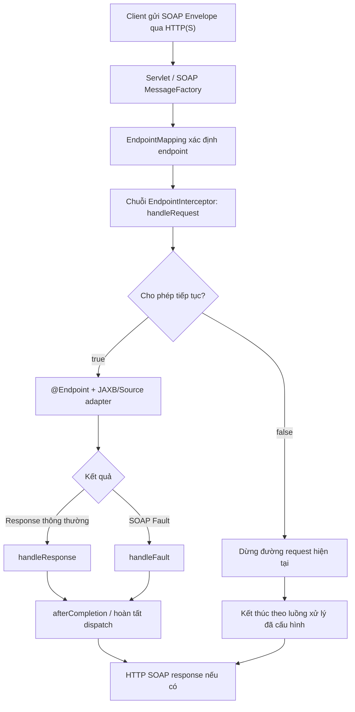

# handleRequest, handleResponse, handleFault và afterCompletion

Khi xây dựng dịch vụ SOAP theo hướng **contract-first** với Spring Web Services (Spring-WS), endpoint tập trung xử lý nghiệp vụ từ XML phù hợp XSD/WSDL. Tuy nhiên, những việc như xác thực, kiểm tra schema, đo thời gian, ghi dấu vết và quan sát SOAP Fault cần được thực hiện nhất quán ở nhiều operation. **`EndpointInterceptor`** cung cấp một điểm mở rộng để tham gia vào vòng đời xử lý một SOAP message đã được định tuyến đến endpoint.

Bài thuộc chương **Interceptor** trong module `SPRING_WEB_SERVICES`, giải thích cụ thể bốn callback **`handleRequest`, `handleResponse`, `handleFault` và `afterCompletion`**: thời điểm gọi, giá trị trả về, cách sắp xếp nhiều interceptor, những trường hợp không gọi như dự kiến và cách dùng với JAXB, SOAP client, SOAP Fault, XSD validation, WS-Security, chứng chỉ và kiểm thử tích hợp doanh nghiệp.

> **Nguyên tắc chính:** Interceptor không phải endpoint, cũng không thay thế XSD, exception resolver hoặc chính sách xác thực. Nó tham gia **pipeline SOAP** tại những thời điểm xác định, với quyền đọc/kiểm tra hoặc tác động đến message tùy API và cấu hình. Một callback trả `true` không đồng nghĩa request hợp lệ, và một callback trả `false` không tự tạo SOAP Fault.

## 1. Interceptor nằm ở đâu trong một SOAP service?

Một Spring-WS server nhận HTTP request bằng `MessageDispatcherServlet`, tạo SOAP message qua message factory, chọn endpoint từ một `EndpointMapping`, rồi gọi endpoint adapter. Interceptor được gắn vào chuỗi thực thi của endpoint để thực hiện xử lý cắt ngang.



Sơ đồ này chỉ thể hiện **các trường hợp điển hình**. Ngoại lệ phát sinh trước khi ánh xạ được endpoint, khi parse SOAP Envelope, hoặc ở tầng transport có thể khiến interceptor không bao giờ chạy. Một exception trong adapter/endpoint cũng có thể được chuyển thành SOAP Fault bởi exception resolver; khi đó chuỗi callback thực tế phụ thuộc kết quả giải quyết lỗi và cách dispatcher xử lý response.

### Phân biệt những cơ chế gần tên

| Cơ chế | Nhiệm vụ chính | Không nên nhầm với |
| --- | --- | --- |
| `Servlet Filter` | Xử lý HTTP request/response trước hoặc ngoài SOAP dispatcher | Interceptor gắn với SOAP endpoint |
| `MessageDispatcherServlet` | Nhận HTTP request và điều phối xử lý Spring-WS | Callback nghiệp vụ của interceptor |
| `EndpointMapping` | Tìm endpoint bằng QName, SOAPAction hoặc cơ chế khác | XSD validator và SOAP security |
| **`EndpointInterceptor`** | Tham gia vòng đời request/response/fault của endpoint đã được tìm thấy | REST `HandlerInterceptor` của Spring MVC |
| `EndpointExceptionResolver` | Chuyển một số exception thành SOAP Fault | `handleFault` dùng để quan sát/xử lý fault đã có |
| `ClientInterceptor` | Xử lý message ở **phía SOAP client** trong `WebServiceTemplate` | `EndpointInterceptor` chạy ở **server** |
| `Wss4jSecurityInterceptor` / schema validator | Interceptor chuyên biệt cho WS-Security và kiểm tra XSD | Interceptor audit tự viết |

**Điểm quan trọng:** Một bean có `@Endpoint` và `@PayloadRoot` đúng không tự bật interceptor. Interceptor phải được **đăng ký vào chuỗi endpoint** qua cấu hình Spring-WS phù hợp.

## 2. API và hợp đồng của bốn callback

Giao diện server-side được khai báo trong Spring-WS:

```java
import org.springframework.ws.context.MessageContext;
import org.springframework.ws.server.EndpointInterceptor;

public class ExampleInterceptor implements EndpointInterceptor {
    @Override
    public boolean handleRequest(
            MessageContext messageContext, Object endpoint) throws Exception {
        return true;
    }

    @Override
    public boolean handleResponse(
            MessageContext messageContext, Object endpoint) throws Exception {
        return true;
    }

    @Override
    public boolean handleFault(
            MessageContext messageContext, Object endpoint) throws Exception {
        return true;
    }

    @Override
    public void afterCompletion(
            MessageContext messageContext,
            Object endpoint,
            Exception ex) throws Exception {
        // Không có boolean return.
    }
}
```

Bảng ghi nhớ:

| Callback | Giai đoạn | Trả về | Cách hiểu thực tế |
| --- | --- | --- | --- |
| `handleRequest` | Trước khi endpoint adapter gọi method xử lý request | `boolean` | `true` cho pipeline tiếp tục; `false` dừng đường tiếp tục thông thường |
| `handleResponse` | Khi pipeline có response SOAP thông thường thích hợp | `boolean` | `true` tiếp tục các bước xử lý response; `false` có thể dừng các response callbacks tiếp theo |
| `handleFault` | Khi pipeline đang xử lý một SOAP Fault response | `boolean` | `true` tiếp tục fault callbacks; `false` có thể dừng các fault callbacks tiếp theo |
| `afterCompletion` | Sau khi quá trình dispatch liên quan kết thúc, đối với interceptor đủ điều kiện được gọi | `void` | Dùng ghi metric, cleanup và quan sát lỗi; không phải điểm trả một response mới |

Cả ba callback trả `boolean` đều có thể ném `Exception`. Nhưng **không nên dùng exception như cách định tuyến thông thường**, và không nên giả định mọi exception do interceptor ném ra sẽ được chuyển thành một SOAP Fault cùng kiểu trong mọi cấu hình.

Tham số `endpoint` là đối tượng endpoint mà dispatcher đã xác định. Với annotation-based endpoint, nó có thể là đối tượng biểu diễn method endpoint; **không nên ép kiểu bừa thành class `@Endpoint` do ứng dụng tự viết**.

## 3. Hiểu vòng đời bằng các kịch bản cụ thể

### 3.1. Request hợp lệ và endpoint trả response

Giả sử có ba interceptor được áp dụng theo thứ tự `A`, `B` và `C`. Một đường chạy điển hình:

```text
Client -> SOAP Message -> EndpointMapping
A.handleRequest()   -> true
B.handleRequest()   -> true
C.handleRequest()   -> true
Endpoint được gọi, tạo response
C.handleResponse()  -> true
B.handleResponse()  -> true
A.handleResponse()  -> true
... các afterCompletion thích hợp ...
Client nhận SOAP response
```

Thông thường, request callback được duyệt theo **thứ tự đã đăng ký**, còn response/fault callback theo **thứ tự đảo ngược** của những interceptor đã tham gia hợp lệ. Cách xử lý `afterCompletion` cũng cần được kiểm tra theo phiên bản/chặng callback cụ thể. Đừng cố phụ thuộc vào thứ tự callback để truyền một nguồn XML one-shot qua nhiều interceptor mà không có chính sách replay.

### 3.2. Endpoint trả SOAP Fault

```text
A.handleRequest -> B.handleRequest -> C.handleRequest
Endpoint hoặc cơ chế xử lý lỗi tạo SOAP Fault response
C.handleFault -> B.handleFault -> A.handleFault
... hoàn tất những callback đủ điều kiện ...
```

Ở trường hợp này, **`handleFault`** là nhánh phù hợp để nhận biết/quan sát SOAP Fault. Không cần endpoint phải ném exception ra ngoài: nó có thể trả fault thông qua cơ chế framework. Ngược lại, không phải **mọi exception** đều dẫn đến `handleFault`, vì có lỗi xảy ra trước dispatcher hoặc khi chưa tạo được một SOAP Fault response.

### 3.3. `handleRequest` trả `false`

```text
A.handleRequest -> true
B.handleRequest -> false
Dừng tiếp tục qua các interceptor sau / endpoint thông thường
Kết thúc theo dispatcher và response hiện có (nếu có)
```

`false` chỉ là một tín hiệu **short-circuit** của pipeline. Nó **không tự sinh XML lỗi**, không tự đặt HTTP status và không bảo đảm rằng những callback response/fault/afterCompletion nào cũng sẽ chạy. Nếu mục tiêu là từ chối request có SOAP Fault, phải tạo fault theo cơ chế framework hoặc dùng một interceptor/exception resolver chuyên trách rồi **kiểm thử đúng nhánh short-circuit**.

### 3.4. Endpoint ném exception

Nếu endpoint ném lỗi nghiệp vụ, adapter hoặc exception resolver có thể biến lỗi thành SOAP Fault. Khi đã có Fault, pipeline có thể chạy `handleFault`. Nếu lỗi xảy ra trước khi có endpoint chain hoặc không được xử lý thành một SOAP response, một phần callback có thể bị bỏ qua.

`afterCompletion(..., Exception ex)` có ích để quan sát lỗi, nhưng `ex == null` **không đủ để kết luận request đã thành công về nghiệp vụ**. Một SOAP Fault có thể đã được tạo và xử lý bình thường, hoặc việc từ chối không còn được biểu diễn thành exception tại giai đoạn đó.

## 4. Ví dụ hợp đồng SOAP xuyên suốt

Một dịch vụ đơn hàng công bố WSDL 1.1 theo kiểu document/literal, với XSD xác định các phần tử `GetOrderRequest`, `GetOrderResponse`. Để tập trung vào interceptor, ta dùng phần XSD rút gọn:

```xml
<?xml version="1.0" encoding="UTF-8"?>
<xs:schema xmlns:xs="http://www.w3.org/2001/XMLSchema"
           xmlns:ord="https://example.com/orders/v1"
           targetNamespace="https://example.com/orders/v1"
           elementFormDefault="qualified">

    <xs:element name="GetOrderRequest">
        <xs:complexType>
            <xs:sequence>
                <xs:element name="orderId" type="xs:positiveInteger"/>
            </xs:sequence>
        </xs:complexType>
    </xs:element>

    <xs:element name="GetOrderResponse">
        <xs:complexType>
            <xs:sequence>
                <xs:element name="status" type="xs:string"/>
            </xs:sequence>
        </xs:complexType>
    </xs:element>
</xs:schema>
```

Một SOAP 1.1 request phù hợp:

```xml
<soap:Envelope
    xmlns:soap="http://schemas.xmlsoap.org/soap/envelope/"
    xmlns:ord="https://example.com/orders/v1">
    <soap:Header/>
    <soap:Body>
        <ord:GetOrderRequest>
            <ord:orderId>42</ord:orderId>
        </ord:GetOrderRequest>
    </soap:Body>
</soap:Envelope>
```

Phần tử payload root là QName `{https://example.com/orders/v1}GetOrderRequest`, khác với URL HTTP `/ws` hoặc tên Java method `getOrder`. `@PayloadRoot` ánh xạ request đó đến endpoint; interceptor giúp xử lý những công việc chung quanh lần gọi.

**XSD-valid không đồng nghĩa request được phép truy vấn đơn hàng 42.** Dịch vụ vẫn phải xác thực, phân quyền theo tenant/tài nguyên, áp dụng WS-Security khi yêu cầu và trả SOAP Fault nghiệp vụ khi cần.

## 5. Implement đầy đủ một interceptor đo thời gian và kết quả

Một interceptor audit nên ghi thời gian ở `handleRequest`, phân loại outcome ở `handleResponse` hoặc `handleFault`, rồi hoàn tất đo thời gian ở `afterCompletion`. Tránh tạo mutable instance fields dành riêng cho từng request: một interceptor bean thường là **singleton** được nhiều thread dùng đồng thời.

Ví dụ Java (dùng SLF4J; giả định các Spring-WS dependencies phù hợp):

```java
import org.slf4j.Logger;
import org.slf4j.LoggerFactory;
import org.springframework.ws.context.MessageContext;
import org.springframework.ws.server.EndpointInterceptor;

public final class SoapAuditInterceptor implements EndpointInterceptor {
    private static final Logger log =
            LoggerFactory.getLogger(SoapAuditInterceptor.class);

    private static final String START =
            SoapAuditInterceptor.class.getName() + ".startNanos";
    private static final String OUTCOME =
            SoapAuditInterceptor.class.getName() + ".outcome";

    @Override
    public boolean handleRequest(
            MessageContext context, Object endpoint) {
        context.setProperty(START, System.nanoTime());
        context.setProperty(OUTCOME, "request-started");
        return true;
    }

    @Override
    public boolean handleResponse(
            MessageContext context, Object endpoint) {
        context.setProperty(OUTCOME, "soap-response");
        return true;
    }

    @Override
    public boolean handleFault(
            MessageContext context, Object endpoint) {
        context.setProperty(OUTCOME, "soap-fault");
        return true;
    }

    @Override
    public void afterCompletion(
            MessageContext context, Object endpoint, Exception ex) {
        Object start = context.getProperty(START);
        long elapsedMs = start instanceof Long
                ? (System.nanoTime() - (Long) start) / 1_000_000L
                : -1L;

        Object result = context.getProperty(OUTCOME);
        String outcome = ex != null
                ? "dispatch-exception"
                : String.valueOf(result);

        // Không ghi nội dung Body, token hay chuỗi SOAP Header.
        log.info("soap.outcome={} durationMs={} endpointType={}",
                outcome,
                elapsedMs,
                endpoint == null
                        ? "unresolved"
                        : endpoint.getClass().getSimpleName());
    }
}
```

Tại sao dùng `MessageContext#setProperty`?

- Nó giữ **trạng thái của một lượt xử lý message**, tránh race condition giữa nhiều request trên cùng singleton bean.
- Các callback đã áp dụng cho cùng message có thể đọc lại thời điểm bắt đầu và outcome.
- Không cần một `HashMap` toàn cục với key là thread hoặc request ID; không gây rò rỉ nếu map toàn cục không được dọn.
- `System.nanoTime()` phù hợp đo khoảng thời gian trôi qua hơn `currentTimeMillis()`, vốn có thể thay đổi theo đồng hồ hệ thống.

### Những giới hạn của ví dụ audit

1. `afterCompletion` chỉ có ý nghĩa với interceptor **đã được áp dụng và đủ điều kiện nhận callback**. Lỗi parse SOAP/HTTP trước endpoint mapping có thể nằm ngoài phạm vi này; quan sát tổng thể cần thêm logging/metrics ở transport hoặc filter.
2. `OUTCOME` có thể vẫn là `request-started` nếu request short-circuit hoặc không có response. Muốn phân loại chính xác cần xem thêm `messageContext.hasResponse()` và trạng thái Fault; không suy từ `ex == null`.
3. Không dùng `System.nanoTime()` để tạo timestamp cho log nghiệp vụ; hãy dùng đồng hồ wall time do hệ thống quan sát cung cấp.
4. Ví dụ chỉ log metadata tối thiểu. Với dữ liệu cá nhân, thậm chí tên method, tenant ID hoặc correlation ID cũng cần cân nhắc masking/chính sách lưu trữ.
5. Khi cần correlation với distributed tracing, nên tích hợp các API observability hiện hành thay vì tự tạo một hệ thống trace riêng chỉ bằng log.

## 6. Đăng ký interceptor trong Spring-WS

Trong Spring-WS, có thể đăng ký interceptor vào cấu hình endpoint bằng `WsConfigurer#addInterceptors` cùng `@EnableWs`:

```java
import java.util.List;
import org.springframework.context.annotation.Bean;
import org.springframework.context.annotation.Configuration;
import org.springframework.ws.config.annotation.EnableWs;
import org.springframework.ws.config.annotation.WsConfigurer;
import org.springframework.ws.server.EndpointInterceptor;

@Configuration
@EnableWs
public class SoapInterceptorConfiguration implements WsConfigurer {

    @Bean
    public SoapAuditInterceptor soapAuditInterceptor() {
        return new SoapAuditInterceptor();
    }

    @Override
    public void addInterceptors(List<EndpointInterceptor> interceptors) {
        interceptors.add(soapAuditInterceptor());
    }
}
```

Ví dụ giả định ứng dụng đã đăng ký `MessageDispatcherServlet`, endpoint annotation và những thành phần cần thiết để xử lý SOAP. Đăng ký ở đây không tự tạo URL `/ws` và cũng không tự xuất bản WSDL. Nếu Spring Boot starter đã cấu hình servlet, tránh tạo thêm một servlet registration trùng.

**Lưu ý:** Với ứng dụng dùng Spring Boot/Spring-WS ở phiên bản khác, annotation-based configuration và tập bean auto-configured có thể khác. Sau khi deploy, cần xác nhận danh sách interceptor **thực sự được gắn vào endpoint chain**, không chỉ kiểm tra có bean trong application context.

### Chỉ áp dụng cho một nhóm endpoint

Không phải interceptor nào cũng cần chạy cho mọi operation. Ví dụ audit chung có thể áp dụng rộng, trong khi một chính sách đặc biệt chỉ áp dụng cho nhóm nghiệp vụ. Spring-WS có những cơ chế interceptor có điều kiện hoặc endpoint mapping interceptor tùy phiên bản/cấu hình; cần chọn cách dựa trên QName, annotation hoặc endpoint được framework hỗ trợ.

Tránh tự viết điều kiện bằng cách parse **toàn bộ SOAP Body** trong `handleRequest` chỉ để biết operation nào đang chạy: điều đó có thể tiêu thụ một XML stream one-shot và làm endpoint không đọc lại được payload.

## 7. `handleRequest`: kiểm tra trước khi gọi endpoint

`handleRequest` là nơi thích hợp để làm những việc cần xảy ra **trước xử lý nghiệp vụ**, chẳng hạn:

- Ghi thời điểm bắt đầu và correlation metadata đã được chuẩn hóa.
- Kiểm tra một chính sách ngữ cảnh hợp đồng không phụ thuộc vào service logic.
- Từ chối một request khi vi phạm ràng buộc đã được xác minh.
- Kích hoạt các bước có sẵn như XSD validation hoặc WS-Security validation thông qua interceptor chuyên trách.

Nó **không phải** nơi tin mù quáng SOAP Header `Role=ADMIN` hoặc `TenantId=tenant-b` để cấp quyền. Một giá trị header có thể hợp lệ theo XSD nhưng vẫn sai về danh tính/quyền truy cập.

### `true` nghĩa là gì?

`return true` có nghĩa interceptor này cho pipeline tiếp tục. Nó **không** đồng nghĩa:

- Message đã qua toàn bộ interceptor tiếp theo.
- Endpoint chắc chắn sẽ được gọi.
- XSD đã hợp lệ nếu chưa có validator.
- Người gửi đã được xác thực.
- Response cuối cùng sẽ thành công.

### `false` nghĩa là gì?

`return false` có nghĩa từ chối tiếp tục chuỗi xử lý thông thường tại điểm đó. Bản thân nó không tạo Fault hoặc đặt response cụ thể. Một interceptor muốn từ chối với một SOAP Fault phải chuẩn bị response theo API được framework hỗ trợ.

Ví dụ minh họa tạo Fault khi một điều kiện đã được kiểm tra là không hợp lệ:

```java
import java.util.Locale;
import org.springframework.ws.context.MessageContext;
import org.springframework.ws.soap.SoapMessage;

public boolean handleRequest(
        MessageContext context, Object endpoint) throws Exception {

    if (requestIsAcceptedByVerifiedPolicy(context)) {
        return true;
    }

    SoapMessage response = (SoapMessage) (
            context.hasResponse()
                    ? context.getResponse()
                    : context.createResponse());

    response.getSoapBody().addClientOrSenderFault(
            "Yêu cầu không thỏa chính sách đã công bố",
            Locale.forLanguageTag("vi"));

    return false;
}
```

Đây là **fragment**, không phải một class đầy đủ: `requestIsAcceptedByVerifiedPolicy` là phương thức do ứng dụng thiết kế và phải dùng **dữ liệu đã xác minh**, không lấy từ một raw header. Fragment giả định response message factory hỗ trợ SOAP, chưa có Fault sẵn và xử lý được việc tạo response ở giai đoạn này; code thực tế cần kiểm tra loại message, trường hợp response đã tồn tại và các policy bảo mật. Không nên tự trả fault khác phiên bản SOAP hoặc ghi đè một Fault đã có.

**Quan trọng:** Việc tạo Fault rồi `return false` có thể ảnh hưởng đến những callback sau đó được chạy. Không được tự giả định `handleFault` trên chính interceptor luôn được gọi theo cùng cách với Fault do endpoint tạo ra. Hãy kiểm thử short-circuit với **message factory và phiên bản Spring-WS thực tế**.

## 8. `handleResponse`: quan sát và kiểm tra chiều đi ra

Khi endpoint tạo **SOAP response thông thường**, `handleResponse` có thể tham gia xử lý outbound. Ví dụ:

```java
@Override
public boolean handleResponse(
        MessageContext context, Object endpoint) {
    context.setProperty("business.responseKind", "normal");
    // Có thể ghi metric, xem metadata, hoặc để validator xử lý.
    return true;
}
```

Những việc hợp lý ở đây:

1. Ghi nhận response được tạo và đo thời gian trước bước hoàn tất.
2. Kiểm tra response contract theo XSD qua interceptor chuyên trách.
3. Thêm hoặc xử lý SOAP Header được hợp đồng cho phép theo API Spring-WS.
4. Quan sát kết quả không nhạy cảm như QName, kích thước hoặc tình trạng bảo mật, nếu implementation cho phép truy cập an toàn.

Không nên biến `handleResponse` thành nơi "sửa XML cho qua validator". Nếu JAXB object thiếu trường bắt buộc hoặc response sai namespace, nên sửa **response model/marshalling** và contract ở nguồn. Tự động bổ sung giá trị không có căn cứ có thể làm dữ liệu nghiệp vụ sai lệch.

### `handleResponse` không nhất thiết chạy cho mọi request

Các trường hợp cần chú ý:

- Request bị chặn ở `handleRequest`.
- Endpoint tạo SOAP Fault.
- Operation one-way hoặc không có response theo contract.
- Lỗi xảy ra trước khi endpoint được chọn.
- Một interceptor trước đó dừng việc xử lý response callbacks.

Vì thế, không chỉ dựa vào `handleResponse` để "đảm bảo đã giải phóng tài nguyên"; cleanup nên đặt ở giai đoạn cuối phù hợp như `afterCompletion`, kết hợp resource ownership tại nơi mở stream.

## 9. `handleFault`: xử lý khi đã có SOAP Fault

`handleFault` thường được dùng để quan sát **response là SOAP Fault** và xử lý các vấn đề cắt ngang liên quan Fault. Ví dụ phân loại Fault code mà không log Fault detail nhạy cảm:

```java
import org.springframework.ws.context.MessageContext;
import org.springframework.ws.soap.SoapMessage;

@Override
public boolean handleFault(
        MessageContext context, Object endpoint) {
    if (context.hasResponse()
            && context.getResponse() instanceof SoapMessage) {
        SoapMessage soap = (SoapMessage) context.getResponse();
        if (soap.getSoapBody().hasFault()) {
            context.setProperty("business.outcome", "soap-fault");
            // Có thể đo metric dựa vào fault code sau khi lọc dữ liệu.
        }
    }
    return true;
}
```

Ví dụ này giả định code nằm trong một class implement `EndpointInterceptor`; `getResponse()` không nhất thiết là SOAP ở mọi ngữ cảnh nên kiểm tra kiểu trước. Không đọc toàn bộ `faultstring` và `detail` để log một cách mặc định vì có thể chứa dữ liệu nghiệp vụ/nhận dạng.

### SOAP Fault và Java exception khác nhau

| Tình huống | Có SOAP Fault? | `handleFault` có thể tham gia? |
| --- | --- | --- |
| Endpoint trả response XML bình thường | Không | Nhánh thông thường là `handleResponse` |
| Endpoint/exception resolver tạo SOAP Fault | Có | Thường có nếu fault thuộc pipeline đã có endpoint chain |
| XML parser thất bại trước endpoint mapping | Chưa chắc | Không được bảo đảm |
| Lỗi TLS hoặc mất mạng trước khi SOAP được đọc | Không có SOAP Fault từ server | Không |
| `handleRequest` tự tạo Fault và trả `false` | Có thể có | Phụ thuộc cách dispatcher xử lý short-circuit; phải kiểm thử |
| Business exception được resolver chuyển thành Fault | Có | Có thể, tùy xử lý response/exception của phiên bản |

**Không dùng `handleFault` như một `catch` tổng quát cho mọi ngoại lệ**. Nó là callback của quá trình xử lý Fault message; muốn chuyển exception thành Fault có hợp đồng ổn định, hãy dùng các cơ chế `EndpointExceptionResolver` hoặc fault-specific framework API phù hợp.

### Đừng sửa fault code bừa bãi

SOAP 1.1 thường phân biệt `Client` và `Server`; SOAP 1.2 dùng `Sender` và `Receiver`, đồng thời có cấu trúc `Code`, `Reason`, `Detail` riêng. `MustUnderstand` là một lỗi giao thức có fault code đặc thù.

Một interceptor quan sát Fault không nên "đổi tất cả thành Server" chỉ để dễ báo cáo: như vậy client sẽ không còn phân biệt lỗi request do mình gửi với lỗi phía service. Đặc biệt với WS-Security, fault chi tiết phải tuân theo profile và không được rò rỉ thông tin chứng chỉ/token.

## 10. `afterCompletion`: việc sau cùng và giới hạn cần nhớ

Trong đường xử lý được hỗ trợ, `afterCompletion` thích hợp để:

- Ghi metric thời gian và kết quả cuối cùng.
- Xóa trạng thái diagnostic do interceptor thêm vào ngữ cảnh.
- Kết thúc một span truy vết đã mở đúng cách.
- Giải phóng tài nguyên **mà interceptor thực sự sở hữu**, nếu chưa được bàn giao quyền sở hữu cho framework.

Ví dụ:

```java
@Override
public void afterCompletion(
        MessageContext context, Object endpoint, Exception ex) {
    Object start = context.getProperty("request.startNanos");
    if (start instanceof Long) {
        long elapsed = System.nanoTime() - (Long) start;
        // Ghi metric tại một nơi để tránh đếm hai lần.
        recordLatencyNanos(elapsed);
    }
    if (ex != null) {
        recordDispatchFailure(ex.getClass().getSimpleName());
    }
    context.removeProperty("request.startNanos");
}
```

`recordLatencyNanos` và `recordDispatchFailure` là hàm minh họa do ứng dụng cung cấp. Dùng cùng property key ở `handleRequest` nếu đưa fragment vào class thật.

**Cần tránh bốn hiểu nhầm:**

1. `afterCompletion` không được bảo đảm chạy cho lỗi ở **mọi tầng**: TLS, filter, XML parse trước endpoint mapping, hoặc interceptor chưa được áp dụng nằm ngoài phạm vi của nó.
2. `ex == null` không chứng minh SOAP response không có Fault; Fault có thể đã được xử lý thành một response.
3. Không đóng một `InputStream` hoặc `Source` đã được trả cho marshaller/serializer nếu framework **chưa sử dụng xong**; cần xác định rõ resource ownership và thời điểm serialize.
4. Đừng cố sửa SOAP Body thành công từ `afterCompletion`: đó là giai đoạn hoàn tất, không phải phương thức tạo response nghiệp vụ.

Với yêu cầu audit cần bao phủ **mọi** HTTP request, kể cả request bị chặn trước SOAP mapping, cần kết hợp Servlet Filter/transport telemetry ngoài endpoint interceptor.

## 11. Thứ tự khi có nhiều interceptor

Giả sử ứng dụng đăng ký:

```java
@Override
public void addInterceptors(List<EndpointInterceptor> interceptors) {
    interceptors.add(traceInterceptor);
    interceptors.add(schemaValidator);
    interceptors.add(securityInterceptor);
}
```

Đây là **fragment cấu hình**; các biến là bean đã được inject và mã không nhằm khuyến nghị cố định một thứ tự security/validation cho mọi hệ thống. Thứ tự trong danh sách ảnh hưởng chuỗi request và chiều phản hồi.

Một mô hình thường gặp:

```text
Request:
    trace.handleRequest
      -> validator.handleRequest
        -> security.handleRequest
          -> endpoint

Normal response:
    security.handleResponse
      -> validator.handleResponse
        -> trace.handleResponse

Fault response:
    security.handleFault
      -> validator.handleFault
        -> trace.handleFault

Completion:
    cleanup / afterCompletion cho các interceptor đủ điều kiện
```

Khi `validator.handleRequest` trả `false`, các interceptor đứng sau có thể **không được áp dụng**. Khi một callback response/fault trả `false`, các callback ở phía sau trên chiều đảo ngược có thể bị dừng. Các tình huống exception/short-circuit làm chi tiết thứ tự callback khác đường thành công; đó là lý do cần kiểm thử, không chỉ vẽ sơ đồ.

### Cân nhắc trật tự validation và security

Thứ tự phải được thiết kế theo **chính sách bảo mật và nhu cầu của ứng dụng**:

- Giới hạn kích thước và chặn XML nguy hiểm cần đặt sớm ở transport/parser.
- WS-Security validation nên diễn ra trước khi thực thi nghiệp vụ dựa trên danh tính/ủy quyền.
- XSD validation và SOAP message parsing có thể cần phối hợp với việc kiểm tra/chuyển đổi nội dung đã được ký hoặc mã hóa.
- Audit/tracing không nên đọc hoặc sửa node XML theo cách tiêu thụ stream, làm hỏng chữ ký hay đưa token vào log.
- Nếu dữ liệu cần được giải mã trước khi schema validation, phải thiết kế thứ tự theo luồng bảo mật thực tế; không ép thứ tự đơn giản chỉ vì sơ đồ.

Không có một thứ tự `trace → XSD → WS-Security` luôn đúng cho mọi profile. Hãy xác định **message sau giải mã, node được xác minh chữ ký, vùng dữ liệu được ký** và những phần có thể được phép thay đổi.

## 12. Tích hợp `PayloadValidatingInterceptor`

Spring-WS có interceptor chuyên trách để validate payload theo XSD. Ví dụ cấu hình (giả định bean `XsdSchema` hợp lệ và đã được nạp):

```java
import org.springframework.context.annotation.Bean;
import org.springframework.context.annotation.Configuration;
import org.springframework.core.io.ClassPathResource;
import org.springframework.xml.xsd.SimpleXsdSchema;
import org.springframework.xml.xsd.XsdSchema;
import org.springframework.ws.soap.server.endpoint.interceptor.PayloadValidatingInterceptor;

@Configuration
public class OrderSchemaValidationConfiguration {

    @Bean
    public XsdSchema ordersSchema() {
        return new SimpleXsdSchema(
                new ClassPathResource("xsd/orders.xsd"));
    }

    @Bean
    public PayloadValidatingInterceptor payloadValidatingInterceptor(
            XsdSchema ordersSchema) {
        PayloadValidatingInterceptor interceptor =
                new PayloadValidatingInterceptor();
        interceptor.setXsdSchema(ordersSchema);
        interceptor.setValidateRequest(true);
        interceptor.setValidateResponse(true);
        return interceptor;
    }
}
```

Interceptor này còn phải được **đăng ký vào endpoint chain**; chỉ tạo bean chưa đủ. `setValidateRequest(true)` kiểm tra payload request theo schema, còn `setValidateResponse(true)` giúp phát hiện response của server không khớp hợp đồng.

**Phạm vi:** Payload validation thường tập trung vào SOAP Body, không tự chứng minh SOAP Header đã được xác thực hoặc ký. Một XML đúng schema vẫn có thể vi phạm quyền tenant, WS-Security hoặc trạng thái nghiệp vụ.

Nếu XSD import/include các tệp khác, phải đảm bảo resolver và tài nguyên được nạp đúng từ classpath/JAR/deployment. Khi schema bị lỗi, việc vô hiệu hóa validation để request đi qua không phải một bản sửa an toàn.

## 13. WS-Security interceptor và ranh giới tin cậy

Một SOAP Header chứa `wsse:Security` có thể mang chứng chỉ, token, chữ ký, timestamp hoặc dữ liệu mã hóa. Spring-WS có các cơ chế tích hợp WS-Security (ví dụ `Wss4jSecurityInterceptor` ở những phiên bản phù hợp). Nó có trách nhiệm kiểm chứng policy đã cấu hình, **không đơn thuần là đọc sự tồn tại của một phần tử XML**.

| Nội dung | Nên được xử lý thế nào |
| --- | --- |
| Username/token | Xác minh bằng nguồn tin cậy, kiểm tra hiệu lực/audience/issuer phù hợp |
| Chữ ký XML | Xác minh thuật toán, khóa/chứng chỉ, trust policy và **những node thực sự được ký** |
| Timestamp | Kiểm tra giới hạn thời gian, độ lệch đồng hồ và chính sách replay |
| Tenant/role do client khai báo | Đối chiếu principal, quyền operation/tài nguyên; không cấp quyền từ raw header |
| SOAP Body sau ký/giải mã | Bảo đảm endpoint dùng đúng nội dung đã xác minh, tránh signature wrapping |
| Error detail | Không đưa token, private key, keystore path, stack trace ra SOAP Fault |

Một custom `handleRequest` muốn đọc `TenantId` chỉ nên dùng giá trị như **gợi ý chưa tin cậy** trước bước xác thực; sau đó phải đối chiếu với principal đã xác minh. Không coi `@PayloadRoot` hoặc HTTP `SOAPAction` là chứng cứ được quyền gọi operation.

**Lưu ý về caching/streaming:** đọc toàn SOAP Body trong interceptor audit có thể tiêu thụ nguồn `StreamSource` hoặc `StAXSource` một lần, khiến security/validator/endpoint không đọc lại được. Hãy dùng API của message factory có replay được xác nhận hoặc chỉ log metadata không nhạy cảm.

## 14. So sánh `EndpointInterceptor` với `ClientInterceptor`

Cùng tên callback nhưng chạy ở **hai phía khác nhau**:

| Đặc điểm | Server `EndpointInterceptor` | Client `ClientInterceptor` |
| --- | --- | --- |
| Nơi đăng ký | Endpoint chain / `WsConfigurer` | `WebServiceTemplate` |
| Mục tiêu | Kiểm tra request đến, quan sát response/fault của server | Thao tác/quan sát request đi, response/fault nhận về |
| Đối tượng endpoint | Có tham số `Object endpoint` trong callback | API client không dùng cùng endpoint parameter |
| Ranh giới | Sau khi message đến server và có endpoint mapping thích hợp | Trong đường gửi/nhận của client template |
| Ví dụ | Audit server, payload validation, WS-Security inbound | SOAPAction callback, security outbound, logging client an toàn |

Không nên lấy nguyên class implement `EndpointInterceptor` rồi cắm vào `WebServiceTemplate#setInterceptors(...)`. Client và server sử dụng **hai giao diện khác nhau**, với chữ ký và vòng đời riêng. Tương tự, HTTP `ClientHttpRequestInterceptor` của `RestTemplate` không phải interceptor mặc định cho SOAP message của Spring-WS.

Nếu một giao dịch thất bại do client không gửi SOAPAction, lỗi có thể nằm ở SOAP client callback hoặc WSDL binding, **không phải** ở `handleRequest` của một interceptor vốn chưa được gọi vì request không được định tuyến.

## 15. Xử lý XML theo luồng: lỗi interceptor tiêu thụ payload

Giả sử custom interceptor muốn ghi toàn XML request:

```java
// Pseudocode: KHÔNG copy làm chuẩn cho Source one-shot.
Source payload = messageContext.getRequest().getPayloadSource();
Transformer transformer = transformerFactory.newTransformer();
transformer.transform(payload, logOutput);
return true;
```

Nếu `Source` chứa stream/cursor tiến về trước, lần transform này có thể tiêu thụ payload. Endpoint hoặc interceptor XSD phía sau có thể gặp EOF khi đọc lại. Một số message factory giữ DOM/cache nên vấn đề không xuất hiện trong test nhưng xuất hiện khi chuyển sang backend tối ưu streaming.

**Phương án tốt hơn:**

1. Log correlation ID, request QName, operation, thời gian, kích thước/loại kết quả nếu lấy được an toàn.
2. Nếu cần inspect body ở nhiều giai đoạn, xác minh cơ chế **payload caching/replay** của message factory đang dùng, đặt giới hạn bộ nhớ và test request lớn.
3. Chỉ materialize thành DOM/byte snapshot khi thực sự cần và dữ liệu nằm trong giới hạn cho phép.
4. Không log toàn SOAP Header với WS-Security token, chữ ký, mật khẩu hoặc dữ liệu cá nhân.
5. Khi xử lý payload đã được ký, không tự rewrite/sắp xếp XML khiến node được xác minh và node endpoint sử dụng không còn tương đương.

Một `DOMSource` có thể đọc lại dễ hơn, nhưng một SOAP Body 5 MiB có thể tốn bộ nhớ nhiều hơn 5 MiB khi DOM được dựng và copy nhiều lần. Kiểm thử hiệu năng nên đo concurrency, heap/GC và latency thực tế.

## 16. Không nên lưu trạng thái per-request trong field của singleton

Ví dụ **sai**:

```java
public final class UnsafeTimingInterceptor implements EndpointInterceptor {
    private long startNanos; // SAI: chia sẻ giữa mọi request!

    @Override
    public boolean handleRequest(MessageContext ctx, Object endpoint) {
        startNanos = System.nanoTime();
        return true;
    }

    // handleResponse, handleFault, afterCompletion bị lược để minh họa lỗi.
}
```

Một singleton có thể đồng thời xử lý nhiều SOAP message. Request B ghi đè `startNanos` khi request A còn đang chạy; metric của A trở nên sai. `volatile` hoặc `synchronized` không phải giải pháp tốt để lưu riêng trạng thái mỗi request, vì vẫn không biểu diễn đúng nhiều lượt xử lý song song.

Nên dùng:

- `MessageContext#setProperty` và `getProperty` với key đặt namespace rõ ràng.
- Context/span observability được quản lý bởi infrastructure, nếu vòng đời phù hợp.
- Data object immutable được tạo cho mỗi request, không giữ trong field singleton.
- Resource cleanup tại nơi sở hữu hoặc callback chắc chắn phù hợp, có test cho exception.

Với MDC/`ThreadLocal`, cần rất thận trọng nếu có thread reuse, async xử lý hoặc exception: phải đặt/xóa theo scope rõ ràng. `afterCompletion` có thể hữu ích nhưng **không nên là tầng bảo vệ duy nhất** khi request bị từ chối trước endpoint chain.

## 17. Test callback bằng test double có kiểm soát

Khi cần xác minh thứ tự callback, một interceptor test có thể ghi event vào một collection do test quản lý. Không dùng collection mutable toàn cục trong ứng dụng thực tế; ví dụ này chỉ dành cho test tuần tự.

```java
import java.util.List;
import org.springframework.ws.context.MessageContext;
import org.springframework.ws.server.EndpointInterceptor;

public final class RecordingInterceptor implements EndpointInterceptor {
    private final String name;
    private final List<String> events;

    public RecordingInterceptor(String name, List<String> events) {
        this.name = name;
        this.events = events;
    }

    @Override
    public boolean handleRequest(MessageContext ctx, Object ep) {
        events.add(name + ".request");
        return true;
    }

    @Override
    public boolean handleResponse(MessageContext ctx, Object ep) {
        events.add(name + ".response");
        return true;
    }

    @Override
    public boolean handleFault(MessageContext ctx, Object ep) {
        events.add(name + ".fault");
        return true;
    }

    @Override
    public void afterCompletion(
            MessageContext ctx, Object ep, Exception ex) {
        events.add(name + ".afterCompletion");
    }
}
```

Để kiểm tra đường **short-circuit**, tạo interceptor test khác trả `false` ở `handleRequest` hoặc `handleResponse`. Sau đó assert cả danh sách event và việc endpoint/logic nghiệp vụ có được gọi không.

Với Spring-WS Test, `MockWebServiceClient` giúp gọi endpoint/interceptor thông qua message dispatch mà không cần HTTP server. Tuy nhiên, nếu muốn xác nhận lỗi ở **Servlet Filter, TLS, reverse proxy hoặc XML streaming backend**, cần thêm integration test với `MessageDispatcherServlet` và message factory thật.

### Ví dụ ý tưởng test SOAP response

```java
import static org.springframework.ws.test.server.RequestCreators.withPayload;
import static org.springframework.ws.test.server.ResponseMatchers.noFault;
import static org.springframework.ws.test.server.ResponseMatchers.payload;

import org.springframework.xml.transform.StringSource;
import org.springframework.ws.test.server.MockWebServiceClient;

// Trong test có applicationContext chứa endpoint và interceptor:
MockWebServiceClient client =
        MockWebServiceClient.createClient(applicationContext);

client.sendRequest(withPayload(new StringSource("""
    <ord:GetOrderRequest xmlns:ord="https://example.com/orders/v1">
        <ord:orderId>42</ord:orderId>
    </ord:GetOrderRequest>
    """)))
    .andExpect(noFault())
    .andExpect(payload(new StringSource("""
        <ord:GetOrderResponse xmlns:ord="https://example.com/orders/v1">
            <ord:status>PAID</ord:status>
        </ord:GetOrderResponse>
        """)));
```

Đoạn code là **fragment trong test** với `applicationContext` có sẵn, dùng Java text blocks. Nó chỉ kiểm tra đường response bình thường; muốn kiểm thử vòng đời phải kết hợp `RecordingInterceptor` và assert event. Khi thêm `PayloadValidatingInterceptor`, test cần nạp XSD và gửi đúng QName.

## 18. Ma trận kiểm thử bốn callback

Một bộ test đủ tốt nên bao phủ thành công, SOAP Fault, exception, short-circuit và bảo mật. Không chỉ khẳng định endpoint trả HTTP 200.

| Mã | Tình huống | Điều cần assert |
| --- | --- | --- |
| I01 | Request đúng schema, endpoint trả response | `handleRequest`, `handleResponse`, completion phù hợp; business được gọi |
| I02 | Endpoint tạo SOAP Fault nghiệp vụ | `handleFault` được quan sát trong đường xử lý thích hợp |
| I03 | Exception được resolver chuyển thành Fault | Fault code/detail và callbacks thực tế đúng chính sách |
| I04 | Exception không được resolver xử lý | Ghi nhận exception và phạm vi callbacks có/không chạy |
| I05 | Interceptor A trả `false` ở request | Endpoint không thực thi và các interceptor sau không tiếp tục như đường bình thường |
| I06 | Interceptor B trả `false` ở response | Các response callbacks tiếp theo dừng theo framework behavior |
| I07 | Interceptor B trả `false` ở fault | Các fault callbacks tiếp theo dừng theo framework behavior |
| I08 | SOAP Envelope sai cú pháp trước endpoint mapping | Không đòi server interceptor phải chạy; kiểm tra transport/protocol error |
| I09 | XSD request thiếu `orderId` | Validator từ chối; logic nghiệp vụ không chạy |
| I10 | SOAP Body đúng XSD nhưng user không có quyền tenant | Security/authorization từ chối trước business action |
| I11 | WS-Security token hoặc chữ ký sai | Chính sách security từ chối; không rò rỉ dữ liệu |
| I12 | Response thiếu field bắt buộc theo XSD | Response validation phát hiện lỗi server |
| I13 | SOAP Fault 1.1 `Client` vs `Server` | Không bị interceptor audit sửa thành mã không đúng |
| I14 | SOAP 1.2 `Sender`/`Receiver` | Fault phù hợp SOAP version và binding |
| I15 | Ba interceptors A/B/C cùng được áp dụng | Kiểm tra thứ tự request, response/fault và completion của phiên bản dùng |
| I16 | Interceptor trùng bean hoặc đăng ký hai lần | Không đo metric hai lần; phát hiện trùng |
| I17 | Hai request chạy song song | Không có shared mutable start time/correlation bị ghi đè |
| I18 | Response là one-way/không có response theo contract | Không đòi `handleResponse` luôn được gọi |
| I19 | Logging interceptor đọc Body trước JAXB | Kiểm thử khả năng replay, nhất là backend streaming |
| I20 | Payload lớn và cache bật | Giới hạn heap/GC/latency nằm trong mức cho phép |
| I21 | Lỗi HTTPS/TLS hoặc mất kết nối trước SOAP dispatch | Quan sát bằng tầng transport, không phụ thuộc `afterCompletion` |
| I22 | Interceptor audit không chạy do endpoint mapping không khớp | Không nhầm với lỗi của chính audit interceptor |
| I23 | SOAPAction đúng nhưng payload QName sai | Không có hành vi nghiệp vụ vượt qua kiểm tra hợp đồng |
| I24 | Xóa trạng thái per-request khi hoàn tất | Không rò rỉ context/MDC hoặc giữ tài nguyên qua request sau |
| I25 | SOAP client từ .NET/Java gọi WSDL công bố | Fault, XSD validation và interceptor không phá compatibility |

Đặc biệt với I05–I07 và I15, **đừng viết test chỉ dựa vào sơ đồ trong bài**. Hãy chạy và xác nhận behavior của **phiên bản Spring-WS đang triển khai**, vì early termination, exception handling, smart interceptors và message creation có thể ảnh hưởng callback được thực thi.

## 19. Chẩn đoán khi "interceptor không chạy"

| Triệu chứng | Giả thuyết trước tiên | Cách kiểm tra |
| --- | --- | --- |
| Không thấy `handleRequest` | Request không tới `MessageDispatcherServlet` hoặc không có endpoint mapping | Kiểm tra URL/context path/servlet/filter/QName |
| Không thấy `handleResponse` | SOAP Fault, one-way message, short-circuit hoặc lỗi trước response | Kiểm tra `hasResponse`, Fault, thứ tự callback |
| Không thấy `handleFault` | Không có SOAP Fault trong đường dispatcher, hoặc lỗi quá sớm | Phân biệt SOAP Fault với exception/HTTP error |
| Không thấy `afterCompletion` | Interceptor không đủ điều kiện hoặc lỗi trước chain | Ghi trace từ đầu, kiểm tra cách áp dụng interceptor |
| Interceptor chạy hai lần | Bean/registration trùng hoặc nhiều mapping đặc biệt | Kiểm tra cấu hình Spring-WS và danh sách interceptor |
| `getPayloadSource()` rỗng | XML stream đã bị interceptor trước đọc | Kiểm tra message factory, caching và logging |
| Code ép `endpoint` thành class handler bị lỗi | Endpoint có thể là method endpoint wrapper | Không cast tùy ý; chỉ sử dụng metadata an toàn |
| `setProperty` có giá trị từ request khác | Field singleton hoặc state key thiếu scope | Dùng `MessageContext` riêng theo request; tránh static mutable state |
| Cả request/response đều tạo Fault khác nhau | Nhiều interceptor/exception resolver cùng xử lý | Xác định bên nào tạo response và xử lý fault code |
| Request bị chặn dù `handleRequest` audit trả `true` | Một interceptor phía sau/security validator từ chối | Kiểm tra toàn bộ chuỗi, không chỉ một boolean |
| Test mock thành công nhưng HTTP thật thất bại | Servlet/proxy/TLS/stream backend khác | Chạy integration test với stack thật |

### Quy trình điều tra

1. Xác định **đã tới HTTP/servlet hay chưa**, không xem mọi HTTP 404 là lỗi interceptor.
2. Xác định **endpoint mapping có tìm được handler hay chưa**; nếu không, endpoint interceptor có thể chưa được áp dụng.
3. Kiểm tra bean và danh sách interceptor thực tế cùng thứ tự áp dụng.
4. Ghi event callback tối thiểu bằng test double hoặc log metadata được lọc.
5. Tách đường response thường, SOAP Fault, exception và short-circuit.
6. Xác nhận không có interceptor nào đã tiêu thụ XML Source hoặc làm thay đổi SOAP Header đã ký.
7. Thử lại với cùng WSDL/XSD, SOAP version, client và message factory như production.

## 20. Bài tập: kết hợp audit, validation và security

**Tình huống:** hệ thống đơn hàng có ba interceptor:

- `AuditInterceptor` ghi trace, thời gian và kết quả.
- `PayloadValidatingInterceptor` kiểm tra XSD request/response.
- `Wss4jSecurityInterceptor` xác minh chứng chỉ/chữ ký theo policy.

Ứng dụng đang gặp ba vấn đề: request sai XSD vẫn gọi business service; một số SOAP Fault không được ghi nhận vào audit; bật XML body logging làm endpoint đọc stream lỗi.

**Yêu cầu:** đưa ra cách sửa mà không loại bỏ yêu cầu bảo mật/hợp đồng.

**Hướng giải quyết:**

1. Kiểm tra `@EnableWs`, `WsConfigurer#addInterceptors` và cấu hình servlet/endpoint mapping. Một validator được tạo thành bean nhưng chưa đăng ký có thể hoàn toàn không tham gia dispatch.
2. Xác định order interceptor thực tế, thiết kế security và schema validation theo profile: dữ liệu sau giải mã, node được ký, XML Source và thời điểm authorization. Không gắn thứ tự cố định bất chấp WS-Security policy.
3. Tách audit completion và fault observation: `handleResponse` đánh dấu response thường, `handleFault` đánh dấu Fault, `afterCompletion` ghi số liệu một lần khi được gọi. Kết hợp transport/filter telemetry cho lỗi không đi vào endpoint chain.
4. Không gọi `transform(getPayloadSource())` trong interceptor log nếu backend không bảo đảm replay. Thay bằng metadata tracing hoặc bật cache theo tính năng được hỗ trợ, với giới hạn memory/GC.
5. Viết test request hợp lệ, request sai XSD, chữ ký sai, business fault, exception chưa được xử lý và request lỗi parse trước mapping.
6. Xác minh endpoint chỉ thực hiện nghiệp vụ sau khi các bước xác thực/validation phù hợp đã vượt qua; không trả SOAP success sai schema, không lộ token qua log/Fault.
7. Chạy HTTP integration và thử SOAP client sinh từ WSDL công bố để bắt sai khác giữa mock và transport thật.

**Điểm chấm quan trọng:** Lời giải đúng không phải "thêm `return false` vào mọi interceptor". Phải phân biệt ý nghĩa từng callback, cách tạo SOAP Fault hợp lệ, thời điểm XML được đọc và tính đầy đủ của authentication/authorization.

## 21. Checklist trước khi triển khai interceptor Spring-WS

1. **Hiểu phạm vi server-side `EndpointInterceptor`**, khác Servlet Filter, Spring MVC interceptor và Spring-WS `ClientInterceptor`.
2. **Biết đúng chức năng bốn callback:** `handleRequest`, `handleResponse`, `handleFault`, `afterCompletion`.
3. **Dùng boolean có mục đích:** `true` tiếp tục, `false` short-circuit; không tin rằng `false` tự tạo SOAP Fault.
4. **Không suy `afterCompletion` được gọi trong mọi lỗi**, nhất là lỗi trước endpoint mapping hoặc callback chưa được áp dụng.
5. **Không coi `ex == null` là thành công nghiệp vụ**; SOAP Fault có thể đã được xử lý thành response.
6. **Đăng ký interceptor đúng chỗ** qua hạ tầng `@EnableWs`/`WsConfigurer` hoặc cơ chế tương thích với dự án; tránh bean trùng.
7. **Kiểm tra thứ tự và điều kiện áp dụng** bằng test thực tế khi có validation, WS-Security và audit.
8. **Tách XSD validation khỏi authentication/authorization**; một request đúng XML vẫn có thể không được phép.
9. **Không đọc lại Source one-shot tùy ý**; kiểm soát payload caching, resource lifetime và log dữ liệu nhạy cảm.
10. **Không lưu trạng thái per-request trong field singleton**; dùng `MessageContext` hoặc observability scope phù hợp.
11. **Đặt SOAP Fault đúng phiên bản/policy**, không tự sửa client/server fault code chỉ vì metric.
12. **Kiểm thử cả request, response, fault, exception và short-circuit**, cùng transport failure nằm ngoài interceptor.
13. **Kiểm tra SOAP client/WSDL thực tế**: QName, SOAPAction, WS-Security headers, chứng chỉ và contract XSD.
14. **Giữ dữ liệu an toàn trong log và Fault**: không phát tán token, chữ ký, private key, stack trace hay nội dung cá nhân.
15. **Có regression tests khi nâng cấp Spring-WS/message factory**, nhất là callback order, XML caching và exception mapping.

**Kết luận:** Bốn callback của `EndpointInterceptor` tạo thành những điểm móc rõ ràng trong vòng đời server Spring-WS: **`handleRequest`** trước nghiệp vụ, **`handleResponse`** ở response thông thường, **`handleFault`** khi xử lý SOAP Fault và **`afterCompletion`** cho các công việc sau dispatch thuộc phạm vi phù hợp. Dùng đúng các callback giúp tách cross-cutting concerns khỏi endpoint, nhưng một hệ SOAP contract-first chỉ ổn định khi interceptor được đăng ký đúng, không tiêu thụ nhầm XML stream, không nhầm routing với validation, và phối hợp chính xác với XSD/WSDL, JAXB, SOAP Fault, WS-Security cùng kiểm thử liên thông.
