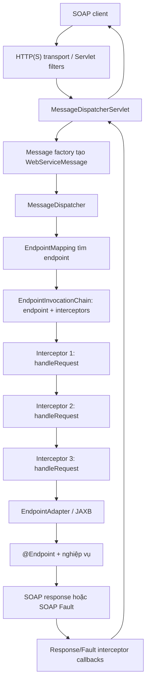
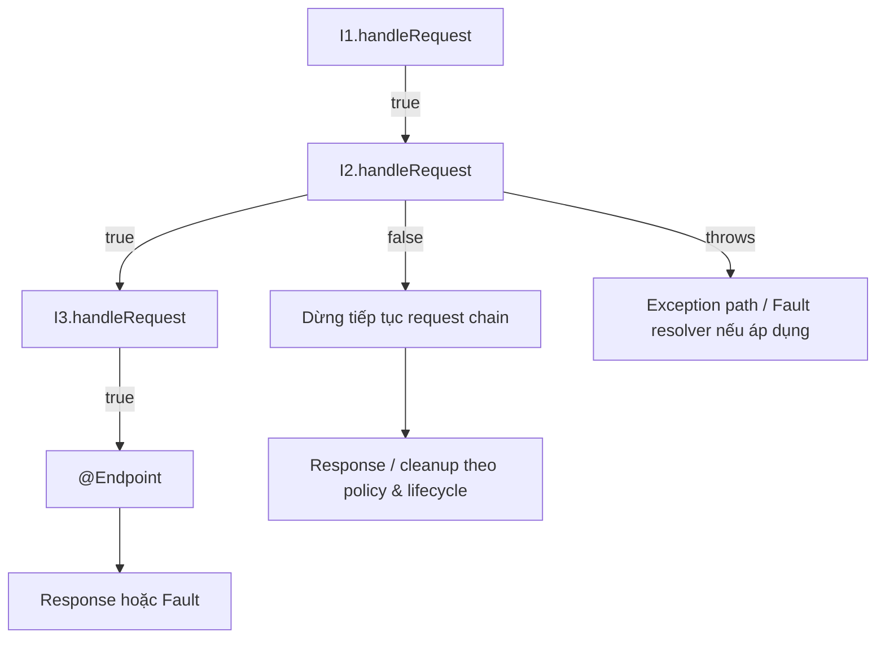
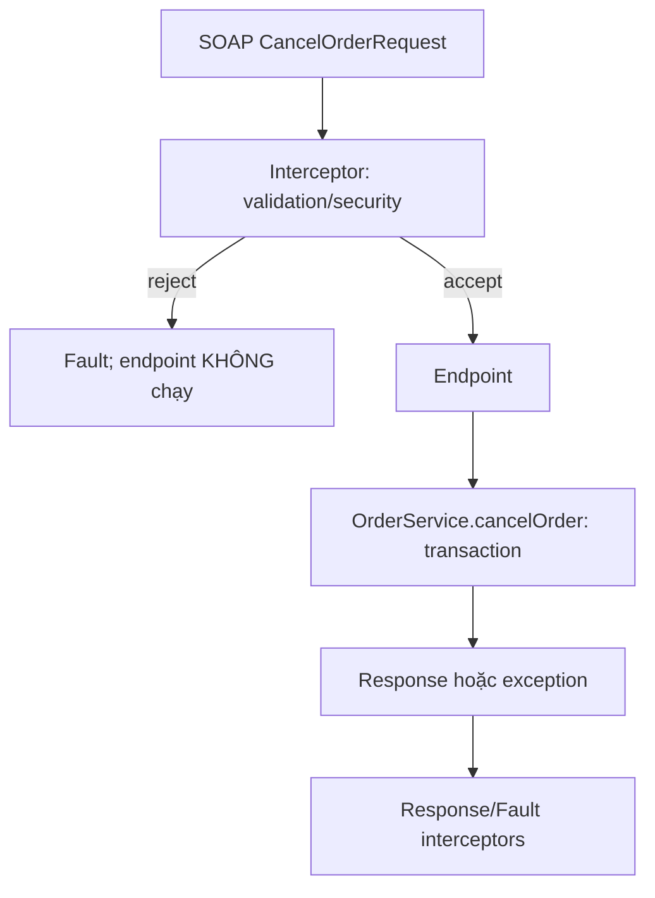

# Thứ tự chuỗi interceptor và hành vi khi ngừng xử lý

## 1. Vấn đề thực tế: tại sao cùng một request có thể dừng ở những vị trí khác nhau?

Trong một dịch vụ **Spring Web Services (Spring-WS)** theo hướng **contract-first**, client gửi yêu cầu SOAP `GetOrderRequest` để tra cứu đơn hàng. Trước khi endpoint thực thi, tổ chức có thể muốn áp dụng nhiều kiểm tra:

1. Ghi nhận mã correlation để theo dõi.
2. Xác minh token/chữ ký WS-Security nếu hợp đồng yêu cầu.
3. Kiểm tra payload theo XSD.
4. Ghi nhận thời gian thực thi và trạng thái phản hồi.

Các bước này thường được đặt trong **chuỗi `EndpointInterceptor` phía server**, bên cạnh cơ chế lọc HTTP/TLS và logic bảo mật nghiệp vụ. Vấn đề quan trọng là **thứ tự callback**, và đặc biệt là điều gì xảy ra khi một interceptor quyết định **không tiếp tục**.

Ví dụ một request thiếu thông tin xác thực: interceptor bảo mật có thể từ chối ngay trước khi `@Endpoint` chạy. Nhưng điều đó **không đồng nghĩa** Spring-WS tự phát HTTP 401, tự trả SOAP Fault hoặc tự thử một endpoint khác. Hành vi thực tế phụ thuộc interceptor, message context, exception resolver và cách response được tạo.

Bài học thuộc chương **Interceptor** của module `SPRING_WEB_SERVICES`, liên kết với thiết kế XSD/WSDL, JAXB, endpoint/client, SOAP Fault, XML security, WS-Security, chứng chỉ và kiểm thử tương thích doanh nghiệp. Trọng tâm là **luồng xử lý và dừng interceptor chain**, không phải tự tạo một stack WS-Security hoàn chỉnh.

### Kết quả học tập

Sau khi học, bạn có thể:

- Phân biệt Spring-WS `EndpointInterceptor` với Spring MVC `HandlerInterceptor`, HTTP `Filter` và Spring-WS `ClientInterceptor`.
- Giải thích thứ tự `handleRequest`, `handleResponse`, `handleFault` và `afterCompletion`.
- Hiểu rõ ý nghĩa `true`, `false`, exception; tránh nhầm “dừng chuỗi” với “trả Fault”.
- Cấu hình thứ tự interceptor thông qua `WsConfigurer.addInterceptors`.
- Phân tích ảnh hưởng của interceptor tới endpoint mapping, JAXB và SOAP Fault.
- Thiết kế chuỗi validation/security/tracing bảo đảm endpoint không chạy khi request sai.
- Viết test chứng minh callback nào chạy, callback nào không chạy và request có tạo side effect hay không.

## 2. Vị trí của interceptor trong kiến trúc xử lý SOAP

Luồng HTTP SOAP thông dụng:



Đây là **đường đi thành công được đơn giản hóa**. Nếu một interceptor trả `false` hoặc ném exception, các bước phía sau có thể không diễn ra. Nếu request thất bại trước bước tìm endpoint (TLS, HTTP routing, parse XML…), server-side endpoint interceptor có thể **chưa được gọi lần nào**.

### 2.1. Phân biệt các điểm mở rộng

| Thành phần | Nơi chạy | Phạm vi |
| --- | --- | --- |
| Servlet `Filter` / Spring Security filter chain | Trước servlet / ở tầng HTTP | URL, HTTP headers, authentication, CSRF, CORS, TLS metadata |
| `EndpointMapping` | Trong `MessageDispatcher` | Chọn endpoint từ SOAP request, ví dụ QName Body |
| **`EndpointInterceptor`** | Quanh quá trình gọi endpoint được mapping | SOAP request/response/fault, validation, cross-cutting logic |
| `EndpointAdapter` | Sau giai đoạn interceptor request | Giải tham số `@RequestPayload`, gọi method endpoint, marshal response |
| `EndpointExceptionResolver` | Trong nhánh exception phù hợp | Chuyển lỗi thành SOAP Fault/response theo policy |
| `ClientInterceptor` | Phía `WebServiceTemplate` | Can thiệp request gửi đi và response/fault nhận về của **client** |
| Spring MVC `HandlerInterceptor` | Phía MVC servlet | Không tự áp dụng cho Spring-WS `@Endpoint` |

Tên “interceptor” giống nhau không làm hai loại server/client dùng chung lifecycle. Chẳng hạn, `ClientInterceptor.handleRequest` chạy khi ứng dụng **gửi SOAP request**, trong khi `EndpointInterceptor.handleRequest` chạy ở server **sau khi đã tìm được endpoint**.

### 2.2. Chuỗi interceptor gắn với endpoint đã được mapping

`EndpointMapping` có thể cung cấp `EndpointInvocationChain` chứa endpoint và các interceptor áp dụng. Điều này đặc biệt quan trọng khi ứng dụng có nhiều mapping như `PayloadRootAnnotationMethodEndpointMapping` hoặc `SoapActionAnnotationMethodEndpointMapping`:

```text
MessageDispatcher
    |
    +-- EndpointMapping #1
    |       -> endpoint + interceptors A, B
    |
    +-- EndpointMapping #2 (chỉ được thử nếu #1 không match)
            -> endpoint + interceptors C, D
```

Nếu mapping số 1 chọn endpoint, mapping số 2 **không trở thành đường fallback** chỉ vì interceptor A từ chối hoặc endpoint adapter sau đó lỗi. Khi có nhiều cơ chế định tuyến, cần kiểm tra tất cả những đường có thể vào nghiệp vụ đều thực thi security/validation bắt buộc.

## 3. Bốn callback quan trọng trong `EndpointInterceptor`

Interface thường được sử dụng là `org.springframework.ws.server.EndpointInterceptor`. Những callback chính:

```java
import org.springframework.ws.context.MessageContext;
import org.springframework.ws.server.EndpointInterceptor;

public interface ExampleOfEndpointInterceptor
        extends EndpointInterceptor {

    @Override
    boolean handleRequest(
        MessageContext messageContext, Object endpoint)
        throws Exception;

    @Override
    boolean handleResponse(
        MessageContext messageContext, Object endpoint)
        throws Exception;

    @Override
    boolean handleFault(
        MessageContext messageContext, Object endpoint)
        throws Exception;

    @Override
    void afterCompletion(
        MessageContext messageContext, Object endpoint, Exception ex)
        throws Exception;
}
```

Đoạn interface trên minh họa **chữ ký callback**, không phải một interface Java được dùng để thay thế trực tiếp interface của Spring-WS trong dự án: khi viết code thật nên tạo **class implements EndpointInterceptor** như mục 7.

| Callback | Khi nào được dùng | Return | Ý nghĩa |
| --- | --- | --- | --- |
| `handleRequest` | Trước khi adapter/endpoint được gọi, trong giai đoạn duyệt chain | `boolean` | `true` cho phép chain tiếp; `false` dừng các bước tiếp theo theo cơ chế dispatcher |
| `handleResponse` | Khi có response thông thường và nhánh response interceptor được kích hoạt | `boolean` | `true` để tiếp tục callbacks còn lại; `false` có thể dừng việc tiếp tục chuỗi response callbacks |
| `handleFault` | Khi có SOAP Fault và nhánh fault interceptor được kích hoạt | `boolean` | `true` để tiếp tục; `false` có thể dừng việc tiếp tục các fault callbacks |
| `afterCompletion` | Giai đoạn hoàn tất đối với những interceptor thuộc phạm vi được dispatcher xử lý | `void` | Dọn dẹp/tracing, nhận `Exception` nếu framework chuyển lỗi tương ứng |

**Lưu ý về độ chính xác:** thứ tự và phạm vi cụ thể khi một callback ném exception hoặc trả `false` cần được xác minh bằng test/Javadoc của **phiên bản Spring-WS đang dùng**. Đặc biệt, không giả định mọi interceptor đều chắc chắn nhận `afterCompletion` trong mọi lỗi xảy ra trước mapping, hoặc khi chính `handleRequest` của nó từ chối.

### 3.1. `handleRequest` trả `true`

Ví dụ:

```java
@Override
public boolean handleRequest(
        MessageContext context, Object endpoint) {
    return true;
}
```

Ý nghĩa: interceptor đã xử lý bước request và đồng ý cho dispatcher tiếp tục sang interceptor kế tiếp, hoặc vào endpoint adapter nếu đã hết chain. Nó **không có nghĩa request chắc chắn hợp lệ** nếu các kiểm tra quan trọng chưa được thực hiện.

### 3.2. `handleRequest` trả `false`

Ví dụ:

```java
@Override
public boolean handleRequest(
        MessageContext context, Object endpoint) {
    if (isRejected(context)) {
        return false;
    }
    return true;
}
```

Đây là đoạn minh họa điều kiện; `isRejected` chưa được định nghĩa. Khi trả `false`:

- Chain không tiếp tục gọi các request interceptors đứng sau theo luồng thông thường.
- Endpoint adapter và business method **không được thực thi theo đường đi đó**.
- Không tự động có lời gọi endpoint khác hoặc một REST controller khác.
- **Chỉ `return false` không bảo đảm tạo ra SOAP Fault hoặc HTTP status đặc biệt.** Nếu cần phản hồi từ chối, phải thiết kế việc tạo response/fault hoặc exception mapping theo policy.

Chính xác nhánh completion/response callbacks nào diễn ra khi dừng sớm phụ thuộc dispatcher/interceptor lifecycle; phải test thay vì đoán.

### 3.3. `handleRequest` ném exception

```java
@Override
public boolean handleRequest(
        MessageContext context, Object endpoint) {
    throw new IllegalArgumentException(
        "Request metadata is invalid"
    );
}
```

Đây là **nhánh lỗi**, không đồng nghĩa trả `false`. Exception có thể được xử lý bởi endpoint exception resolution/transport policy tùy vị trí và phiên bản Spring-WS, hoặc đi lên để tạo lỗi server. **Không** giả định mọi exception trong interceptor sẽ tự biến thành SOAP Fault đúng contract. Cần cấu hình resolver hoặc tạo SOAP Fault có kiểm soát và thử response thực tế.

### 3.4. `handleResponse` và `handleFault` không phải cùng một callback

Response SOAP thông thường:

```xml
<soap:Body xmlns:soap="http://schemas.xmlsoap.org/soap/envelope/">
    <ord:GetOrderResponse xmlns:ord="urn:example:orders:v1">
        <ord:status>CREATED</ord:status>
    </ord:GetOrderResponse>
</soap:Body>
```

SOAP 1.1 Fault:

```xml
<soap:Body xmlns:soap="http://schemas.xmlsoap.org/soap/envelope/">
    <soap:Fault>
        <faultcode>soap:Client</faultcode>
        <faultstring>Yêu cầu không hợp lệ</faultstring>
    </soap:Fault>
</soap:Body>
```

Với response bình thường, hệ thống thường đi qua nhánh `handleResponse`; với SOAP Fault, đi qua nhánh `handleFault`. Vì vậy một interceptor chỉ ghi log trong `handleResponse` có thể **bỏ sót các lỗi SOAP Fault**, dù request đã vào endpoint. Nếu cần đo kết quả ở cả hai nhánh, triển khai cả hai callback và có cơ chế cleanup sau hoàn tất.

### 3.5. Ý nghĩa của `afterCompletion`

`afterCompletion` là nơi thích hợp để đóng tracing span, tính thời gian, dọn context liên quan request hoặc cleanup tài nguyên được tạo bởi interceptor. Nó **không phải** nơi chính để ghi SOAP payload response, vì quá trình serialization hoặc response/fault processing có thể đã tiến đến giai đoạn hoàn tất.

Tránh viết:

```java
// Không nên giả định afterCompletion luôn có exception
// hoặc luôn chạy trong mọi nhánh từ TLS -> SOAP.
if (ex == null) {
    metrics.markBusinessSuccess();
}
```

`ex == null` không chứng minh nghiệp vụ thành công: request có thể đã bị từ chối bằng `false` hoặc kết thúc với một SOAP Fault được resolver xử lý. Nếu cần phân loại kết quả, hãy kết hợp response/fault/endpoint execution signals và logs có correlation.

## 4. Thứ tự request và thứ tự response/fault: đọc chuỗi hai chiều

Giả sử một endpoint có ba interceptors:

```text
I1 = CorrelationInterceptor
I2 = SecurityInterceptor
I3 = SchemaValidationInterceptor
```

Đường đi yêu cầu bình thường:

```text
REQUEST:
  I1.handleRequest
  I2.handleRequest
  I3.handleRequest
  EndpointAdapter -> @Endpoint
```

Đường đi xử lý phản hồi thông thường thường **quay ngược qua những interceptors đã xử lý request thành công**:

```text
RESPONSE:
  I3.handleResponse
  I2.handleResponse
  I1.handleResponse
  I3 / I2 / I1: afterCompletion theo vòng đời triển khai
```

Với SOAP Fault, các `handleFault` thường được gọi theo thứ tự đảo ngược tương tự:

```text
FAULT:
  I3.handleFault
  I2.handleFault
  I1.handleFault
  afterCompletion theo phạm vi/lifecycle dispatcher
```

**Đừng nhầm thứ tự interceptor với thứ tự bean initialization hoặc servlet mapping.** Bảng trên là mô hình lifecycle thường gặp; khi cần xác nhận chi tiết thứ tự và callback completion của phiên bản thư viện cụ thể, hãy dùng recording interceptor/test như mục 13.

### 4.1. Vì sao response đi theo chiều ngược lại?

Ý tưởng tương tự *nested scopes*:

```text
I1 (tracing bắt đầu)
    I2 (security/identity)
        I3 (validation)
            @Endpoint
        I3 (response/fault inspection)
    I2 (response security)
I1 (kết thúc tracing)
```

Nhờ vậy interceptor ngoài cùng, ví dụ tracing, có thể quan sát toàn bộ quá trình xử lý những bước nằm bên trong. Nhưng cơ chế này chỉ áp dụng trong phạm vi request đã vào chain, không bao phủ lỗi HTTP/TLS hoặc parser xảy ra trước mapping.

### 4.2. Phân biệt thứ tự cấu hình và thứ tự endpoint mapping

| Thứ tự | Được kiểm soát ở đâu? | Quyết định gì? |
| --- | --- | --- |
| Servlet mapping | Servlet container | Request đến MVC hay Spring-WS |
| `EndpointMapping` order | Spring-WS dispatcher / mappings | EndpointInvocationChain nào được chọn |
| **Interceptor chain order** | Danh sách interceptors được đăng ký vào mapping | Callback request/response/fault chạy theo thứ tự nào |
| Security filter chain order | Spring Security/Servlet filters | Chặn HTTP request trước servlet |
| `ClientInterceptor` order | `WebServiceTemplate` client configuration | Can thiệp phía client, không phải server |

`@Order` của Spring bean interceptor **không nên được coi là bằng chứng** sẽ tự sắp thứ tự trong mọi danh sách `WsConfigurer.addInterceptors`. Để an toàn, đưa interceptor vào danh sách theo thứ tự tường minh, và xác minh kết quả runtime.

## 5. Khi request interceptor thứ hai dừng chuỗi

Giả sử:

```text
I1 = CorrelationInterceptor
I2 = SecurityInterceptor
I3 = PayloadValidatingInterceptor

I1.handleRequest -> true
I2.handleRequest -> false
```

Kết quả logic:



Các kết luận có thể dựa vào hợp đồng của callback:

- `I3.handleRequest` không được chạy sau khi `I2.handleRequest` trả `false` trong luồng thực thi bình thường.
- `@Endpoint` không được gọi theo đường đi đó.
- Nếu interceptor từ chối vì security, bạn phải **chủ động bảo đảm trả đúng lỗi cho client** và không tạo side effect nghiệp vụ.
- Không được mặc định request đã tự được rollback hoặc client đã nhận HTTP 403 chỉ vì trả `false`.

### 5.1. Vì sao một `return false` trống có thể gây lỗi khó hiểu?

Ví dụ:

```java
@Override
public boolean handleRequest(
        MessageContext context, Object endpoint) {
    if (!isAuthenticated(context)) {
        return false; // Không tạo Fault/response.
    }
    return true;
}
```

Đây là **anti-pattern** nếu hợp đồng bắt buộc client phải nhận một lỗi SOAP có cấu trúc. Nó dừng processing mà không tự tạo explanation theo contract; trạng thái response thực tế có thể gây khó hiểu hoặc phụ thuộc môi trường.

Cách tốt hơn là chọn một trong hai chính sách có kiểm thử:

1. **Tạo SOAP Fault một cách có kiểm soát** vào response message, rồi dừng request chain.
2. **Ném exception nghiệp vụ/protocol xác định** và bảo đảm exception resolver phù hợp biến nó thành Fault đúng contract (kiểm chứng với phiên bản Spring-WS hiện tại).

Nếu lỗi là HTTP authentication/TLS và được phát hiện ở filter/transport, trả HTTP status thích hợp tại **tầng đó** thay vì tự ghép SOAP Fault trong interceptor không bao giờ được chạy.

### 5.2. Interceptor nào nhận cleanup khi dừng sớm?

Đây là nơi cần đặc biệt thận trọng. Với các phiên bản/framework khác nhau, callback `afterCompletion` có thể được gọi theo danh sách những interceptor đã hoàn tất `handleRequest` thành công, hoặc có khác biệt khi một interceptor trả `false`/ném exception.

Thiết kế tốt:

- Interceptor chỉ nắm tài nguyên mà chính nó đã khởi tạo.
- Nếu mở resource trước một thao tác có thể thất bại, có đường cleanup rõ ràng trong phạm vi framework hỗ trợ.
- Với tracing/MDC, dùng `try/finally` ở đúng điểm xử lý hoặc kết hợp callback completion và fallback cleanup đã được kiểm thử.
- Ghi lại những callback thực sự xảy ra bằng test cho **phiên bản Spring-WS đang dùng**, không dựa hoàn toàn vào sơ đồ tư duy.

Trong bài này, các ví dụ test sẽ quan sát cả sequence; nếu code cần đảm bảo chính xác callback completion khi dừng sớm, hãy tham chiếu behavior từ test chứ không dựa vào giả định tổng quát.

## 6. Khi response interceptor trả `false`

Ngoài `handleRequest`, các callback `handleResponse` và `handleFault` cũng trả boolean. Một response interceptor có thể quyết định không đi tiếp chuỗi response callback theo semantics của Spring-WS.

Ví dụ một chuỗi đã xử lý request thành công:

```text
I1, I2, I3 -> @Endpoint -> response
I3.handleResponse -> true
I2.handleResponse -> false
I1.handleResponse -> có thể không được gọi theo stop semantics
```

**Điểm cần phân biệt:** khi `handleResponse` trả `false`, endpoint **đã chạy**. Không thể dùng kết quả đó để “ngăn endpoint thực thi” hoặc rollback nghiệp vụ đã commit. Nếu cần từ chối request dựa trên security/XSD, phải kiểm tra trong `handleRequest` hoặc trước đó.

Tương tự, `handleFault` trả `false` liên quan quá trình xử lý **một Fault đã xuất hiện**; nó không tương đương “request được chấp nhận”. Kiểm soát việc gửi/sửa Fault phải tuân thủ behavior của dispatcher/response path và contract cụ thể.

### 6.1. Khi response đã được ghi một phần

Không nên tùy ý chỉnh response sau khi serialization/transport đã bắt đầu commit. Trong luồng Spring-WS, response interceptor thường làm việc với `WebServiceMessage` trước khi gửi ra transport, nhưng XML signature/security và state của message cần được xử lý đúng thứ tự. Nếu một interceptor ký SOAP response rồi interceptor khác sửa payload hoặc header đã được ký, chữ ký có thể mất hiệu lực.

Do đó, khi thiết kế response chain cần có quy tắc **validation/transform → security signing → logging metadata**, với thứ tự thật được xác minh theo chiều callback ngược.

## 7. Viết một `EndpointInterceptor` có thể quan sát luồng

Ví dụ sau dùng một `TimelineInterceptor` để ghi dấu các callback. Trong dự án thật nên sử dụng logger/tracing với correlation ID thay vì in ra console; code này chủ yếu phục vụ học và thử nghiệm thứ tự.

```java
import java.util.List;
import org.springframework.ws.context.MessageContext;
import org.springframework.ws.server.EndpointInterceptor;

public final class TimelineInterceptor implements EndpointInterceptor {

    private final String name;
    private final List<String> events;
    private final boolean continueRequest;

    public TimelineInterceptor(
            String name,
            List<String> events,
            boolean continueRequest) {
        this.name = name;
        this.events = events;
        this.continueRequest = continueRequest;
    }

    @Override
    public boolean handleRequest(
            MessageContext context, Object endpoint) {
        events.add(name + ".handleRequest");
        return continueRequest;
    }

    @Override
    public boolean handleResponse(
            MessageContext context, Object endpoint) {
        events.add(name + ".handleResponse");
        return true;
    }

    @Override
    public boolean handleFault(
            MessageContext context, Object endpoint) {
        events.add(name + ".handleFault");
        return true;
    }

    @Override
    public void afterCompletion(
            MessageContext context, Object endpoint, Exception ex) {
        events.add(
            name + ".afterCompletion:" +
            (ex == null ? "none" : ex.getClass().getSimpleName())
        );
    }
}
```

**Giới hạn:** `List<String>` trong ví dụ chỉ phù hợp test đơn luồng hoặc được đồng bộ hóa thích hợp. Nếu dùng một singleton interceptor trong server thật với một mutable `ArrayList` chung, nhiều requests song song sẽ ghi lẫn timeline. Dùng per-request context, tracer hoặc thread-safe recorder có phân biệt correlation ID cho kiểm thử concurrent.

### 7.1. Kết quả kỳ vọng khi tất cả cho phép đi tiếp

Cho ba interceptor `A`, `B`, `C` theo đúng thứ tự đăng ký và endpoint trả SOAP response thường:

```text
A.handleRequest
B.handleRequest
C.handleRequest
[endpoint invocation]
C.handleResponse
B.handleResponse
A.handleResponse
[completion callbacks theo lifecycle]
```

Nếu endpoint tạo SOAP Fault:

```text
A.handleRequest
B.handleRequest
C.handleRequest
[endpoint invocation / exception resolver]
C.handleFault
B.handleFault
A.handleFault
[completion callbacks theo lifecycle]
```

Các timeline chỉ mô tả trình tự request và response/fault thông dụng. Test được viết ở mục 13 sẽ là cơ sở xác minh chính xác thứ tự `afterCompletion` trong môi trường/phiên bản cụ thể.

### 7.2. Kết quả khi B trả `false`

```text
A.handleRequest
B.handleRequest
[dừng request chain]

C.handleRequest: không chạy
@Endpoint: không chạy
```

Điều không thể kết luận chỉ từ hai dòng trên: đã có SOAP response/Fault hay chưa, callback completion nào được gọi, và HTTP status cuối cùng là gì. Để khẳng định những điều đó phải tạo một response policy và chạy test.

## 8. Dừng request bằng SOAP Fault có chủ đích

Không nên đặt một check contract bắt buộc rồi lặng lẽ `return false`. Với điều kiện nghiệp vụ/protocol có chủ đích, hãy tạo Fault phù hợp hoặc dùng cơ chế exception resolution đã cấu hình và kiểm chứng.

### 8.1. Ví dụ kiểm tra CorrelationId đơn giản

Đoạn code sau minh họa logic từ chối nếu một giá trị correlation đã được **một bước đáng tin cậy trước đó** ghi vào `MessageContext` không tồn tại. Nó không tự đọc XML header, không xác thực danh tính và không dùng để thay thế WS-Security.

```java
import java.util.Locale;
import org.springframework.ws.WebServiceMessage;
import org.springframework.ws.context.MessageContext;
import org.springframework.ws.server.EndpointInterceptor;
import org.springframework.ws.soap.SoapFault;
import org.springframework.ws.soap.SoapMessage;

public final class CorrelationRequiredInterceptor
        implements EndpointInterceptor {

    public static final String PROPERTY = "orders.correlationId";

    @Override
    public boolean handleRequest(
            MessageContext context, Object endpoint) {

        Object id = context.getProperty(PROPERTY);
        if (id instanceof String text && !text.isBlank()) {
            return true;
        }

        WebServiceMessage output = context.getResponse();
        if (!(output instanceof SoapMessage soap)) {
            throw new IllegalStateException(
                "Expected SOAP response message"
            );
        }

        SoapFault fault = soap.getSoapBody()
            .addClientOrSenderFault(
                "Thiếu mã tương quan bắt buộc",
                Locale.forLanguageTag("vi-VN")
            );

        // Có thể bổ sung fault detail theo XSD/WSDL đã công bố.
        // Không trả token hoặc dữ liệu nhạy cảm trong faultstring.
        return false;
    }

    @Override
    public boolean handleResponse(
            MessageContext context, Object endpoint) {
        return true;
    }

    @Override
    public boolean handleFault(
            MessageContext context, Object endpoint) {
        return true;
    }

    @Override
    public void afterCompletion(
            MessageContext context, Object endpoint, Exception ex) {
        // Cleanup nếu interceptor thực sự sở hữu tài nguyên.
    }
}
```

Đây là ví dụ Spring-WS `SoapBody.addClientOrSenderFault(...)` theo API SOAP trừu tượng của Spring-WS. Một số đặc điểm cần xác minh:

- `MessageContext.getResponse()` phải tạo/trả response message phù hợp trong cấu hình của bạn; phương thức và message factory quyết định representation thực tế.
- Nếu một SOAP Fault hoặc response khác đã được tạo trước đó, không được thêm Fault thứ hai một cách mù quáng.
- `return false` sau khi tự tạo Fault dừng request chain, nhưng **không bảo đảm các Fault callbacks ở các interceptors khác sẽ chạy theo đúng kỳ vọng** trong trường hợp dừng sớm. Cần kiểm thử kết quả.
- Giá trị `PROPERTY` cần được đặt từ một interceptor trước đó, với registration order rõ ràng; nếu không, interceptor này sẽ từ chối mọi request.
- Fault code `Client` của SOAP 1.1 và `Sender` của SOAP 1.2 có ý nghĩa tương ứng trong API thích hợp; HTTP status phụ thuộc binding và stack.

### 8.2. Vì sao ví dụ này khác exception?

```text
Kiểm tra header
  |
  +-- Hợp lệ -> return true -> tiếp tục chain
  |
  +-- Không hợp lệ
         -> tạo SOAP Fault trong response
         -> return false
         -> dừng trước endpoint
```

Trong một thiết kế khác, interceptor có thể ném `MissingCorrelationIdException`, rồi cấu hình `SoapFaultMappingExceptionResolver` hoặc resolver tùy chỉnh để tạo Fault. Khi chọn cách đó, cần test rằng exception phát sinh ở vị trí interceptor thực sự được resolver bao phủ; đừng suy đoán mà không chạy test.

### 8.3. Dừng ở interceptor sau khi response đã được tạo

Nếu interceptor định tạo SOAP Fault:

1. Kiểm tra response đã tồn tại và chứa nội dung gì.
2. Không trộn một payload response thành công với `soap:Fault` trong cùng một Body trái quy tắc SOAP.
3. Đảm bảo SOAP version và media type nhất quán.
4. Kiểm tra response có được serialize ra transport đúng không.
5. Tránh tạo hai Fault trong cùng request do nhiều lớp cùng phát hiện một lỗi.

Không nên chuyển một lỗi application validation thành HTTP 401 một cách tùy tiện nếu hợp đồng SOAP quy định Fault `Sender`/`Client` với error detail, hoặc ngược lại bỏ qua security gate của HTTP/TLS.

## 9. Cấu hình chuỗi interceptor trong Spring-WS

Với ứng dụng Spring-WS sử dụng annotation-driven setup, có thể thêm interceptor bằng `WsConfigurer.addInterceptors(...)`. Hãy đăng ký các interceptor thành Spring beans ở nơi thích hợp, sau đó **đưa chúng vào danh sách theo thứ tự mong muốn**. Việc có một bean `PayloadValidatingInterceptor` không tự bảo đảm nó được gắn vào mọi endpoint mapping: cần cấu hình chain tương ứng.

### 9.1. Cấu hình mẫu đúng về constructor injection

Với ba interceptor beans **đã có sẵn** do ứng dụng đăng ký, cấu hình thuần về thứ tự có thể viết:

```java
import java.util.List;
import org.springframework.context.annotation.Configuration;
import org.springframework.ws.config.annotation.EnableWs;
import org.springframework.ws.config.annotation.WsConfigurer;
import org.springframework.ws.server.EndpointInterceptor;
import org.springframework.ws.soap.server.endpoint.interceptor.PayloadValidatingInterceptor;

@Configuration
@EnableWs
public class OrderedSoapInterceptors implements WsConfigurer {

    private final CorrelationHeaderInterceptor correlation;
    private final OrderSecurityInterceptor security;
    private final PayloadValidatingInterceptor validation;

    public OrderedSoapInterceptors(
            CorrelationHeaderInterceptor correlation,
            OrderSecurityInterceptor security,
            PayloadValidatingInterceptor validation) {
        this.correlation = correlation;
        this.security = security;
        this.validation = validation;
    }

    @Override
    public void addInterceptors(List<EndpointInterceptor> chain) {
        chain.add(correlation);
        chain.add(security);
        chain.add(validation);
    }
}
```

Code này là minh họa phần đăng ký; `CorrelationHeaderInterceptor` và `OrderSecurityInterceptor` là các lớp ứng dụng phải được định nghĩa. `PayloadValidatingInterceptor` cần bean được cấu hình XSD đúng, ví dụ `setXsdSchema` và lựa chọn `setValidateRequest`/`setValidateResponse`.

Trên những version Spring-WS có `WsConfigurerAdapter`, bạn có thể gặp code override `addInterceptors` trong adapter. Với cấu hình mới, ưu tiên API hiện hành của stack. Kiểm tra Javadoc của phiên bản đang sử dụng, vì package/class và cách cấu hình bean có thể thay đổi.

### 9.2. Mục tiêu của thứ tự này

```text
request:
  Correlation -> Security -> XSD validation -> Endpoint

response/fault:
  XSD validation -> Security -> Correlation
```

Tùy chính sách, bạn có thể muốn security trước khi parse/validate schema tốn kém; hoặc phải giải mã SOAP payload trước khi validation; hoặc chữ ký response phải được áp dụng sau mọi thao tác biến đổi. **Thứ tự “đúng” phụ thuộc semantics của từng interceptor và những gì nó cần để hoạt động.**

Ví dụ nếu security interceptor giải mã payload, validation có thể cần được đặt để chạy **sau giải mã ở chiều request**, nhưng ở chiều response phải kiểm tra order sao cho validation diễn ra trước thao tác mã hóa/ký khiến XML thay đổi. Không có một danh sách interceptor vạn năng cho mọi SOAP policy.

### 9.3. Phân biệt đăng ký interceptor toàn cục và theo mapping

`WsConfigurer.addInterceptors` là cơ chế cấu hình thông dụng cho Spring-WS annotation-based endpoints. Tuy nhiên khi ứng dụng tạo **custom EndpointMapping** hoặc chia nhiều servlet/application contexts, cần kiểm tra interceptor chain có thực sự được áp dụng cho tất cả các mapping đó hay không.

Không được chỉ nhìn danh sách trong một `@Configuration` rồi kết luận mọi SOAP operation đã được bảo vệ. Một mapping legacy có thể đi theo chain khác. Kiểm tra các `EndpointMapping` beans runtime và viết test cho những đường có thể vào nghiệp vụ.

### 9.4. Thứ tự interceptor ảnh hưởng cả hướng response

Nếu chuỗi request:

```text
Tracing -> WS-Security -> XSD validation -> Endpoint
```

thì chiều response/fault thường quay ngược:

```text
Endpoint -> XSD validation -> WS-Security -> Tracing
```

Điều này có thể hữu ích để:

- Validate response **trước** khi ký hoặc mã hóa.
- Ký/mã hóa nội dung hoàn chỉnh mà server thực sự sẽ gửi.
- Ghi metadata tracing cuối cùng sau xử lý trong những lớp khác.

Nhưng nếu một logging interceptor in toàn bộ SOAP response **sau khi security xử lý**, nó có thể log token/chữ ký. Thiết kế logging an toàn phải tránh ghi raw XML chứa dữ liệu nhạy cảm, bất kể thứ tự callback.

## 10. Minh họa trên contract SOAP `GetOrder`

Một ví dụ đủ cụ thể giúp phân biệt validation interceptor với lỗi JAXB và lỗi nghiệp vụ. Giả sử contract có XSD cho thao tác `GetOrder`:

```xml
<?xml version="1.0" encoding="UTF-8"?>
<xs:schema
    xmlns:xs="http://www.w3.org/2001/XMLSchema"
    xmlns:tns="urn:example:orders:v1"
    targetNamespace="urn:example:orders:v1"
    elementFormDefault="qualified">

    <xs:simpleType name="OrderIdType">
        <xs:restriction base="xs:string">
            <xs:pattern value="ORD-[0-9]{3,10}"/>
        </xs:restriction>
    </xs:simpleType>

    <xs:complexType name="GetOrderRequestType">
        <xs:sequence>
            <xs:element name="orderId" type="tns:OrderIdType"/>
        </xs:sequence>
    </xs:complexType>

    <xs:complexType name="GetOrderResponseType">
        <xs:sequence>
            <xs:element name="orderId" type="tns:OrderIdType"/>
            <xs:element name="status" type="xs:string"/>
        </xs:sequence>
    </xs:complexType>

    <xs:element name="GetOrderRequest"
                type="tns:GetOrderRequestType"/>
    <xs:element name="GetOrderResponse"
                type="tns:GetOrderResponseType"/>
</xs:schema>
```

Phần tử payload root cần khớp:

```text
{urn:example:orders:v1}GetOrderRequest
```

SOAP 1.1 request hợp lệ:

```xml
<?xml version="1.0" encoding="UTF-8"?>
<soap:Envelope
    xmlns:soap="http://schemas.xmlsoap.org/soap/envelope/"
    xmlns:ord="urn:example:orders:v1">
    <soap:Body>
        <ord:GetOrderRequest>
            <ord:orderId>ORD-100</ord:orderId>
        </ord:GetOrderRequest>
    </soap:Body>
</soap:Envelope>
```

Nếu client gửi `<ord:orderId>abc</ord:orderId>`, `orderId` **không khớp** pattern `ORD-[0-9]{3,10}`. Một `PayloadValidatingInterceptor` được bật đúng schema ở request phase có thể từ chối nó **trước khi `@Endpoint` được gọi**.

### 10.1. XSD validation và JAXB unmarshalling là hai bước khác nhau

| Bước | Câu hỏi | Ví dụ lỗi |
| --- | --- | --- |
| Endpoint mapping | Payload QName có chọn được method không? | Root namespace v2 trong khi chỉ đăng ký v1 |
| Request interceptor validation | Nội dung XML có hợp XSD không? | `orderId=abc` trái pattern |
| Endpoint adapter/JAXB | XML có chuyển được sang kiểu Java argument không? | Root thiếu binding, kiểu dữ liệu không thể parse |
| Business validation | Đơn hàng có tồn tại và caller có quyền không? | `ORD-100` hợp XSD nhưng không thuộc tenant |
| Response interceptor validation | Response có hợp XSD không? | Server trả `status` trước `orderId` khi XSD quy định sequence ngược |

**Không có quy luật rằng JAXB tự động thay thế toàn bộ XSD validation.** Khi muốn enforce `minOccurs`, `xs:sequence`, restriction/pattern hoặc enumeration, cần cấu hình validation thích hợp.

### 10.2. `PayloadValidatingInterceptor` có thể kiểm tra request và response

Ví dụ cấu hình bean XML schema và interceptor:

```java
import org.springframework.context.annotation.Bean;
import org.springframework.context.annotation.Configuration;
import org.springframework.core.io.ClassPathResource;
import org.springframework.ws.soap.server.endpoint.interceptor.PayloadValidatingInterceptor;
import org.springframework.xml.xsd.SimpleXsdSchema;
import org.springframework.xml.xsd.XsdSchema;

@Configuration
public class OrdersValidationConfiguration {

    @Bean
    public XsdSchema ordersSchema() {
        return new SimpleXsdSchema(
            new ClassPathResource("xsd/orders.xsd")
        );
    }

    @Bean
    public PayloadValidatingInterceptor validation(
            XsdSchema ordersSchema) {

        PayloadValidatingInterceptor interceptor =
            new PayloadValidatingInterceptor();
        interceptor.setXsdSchema(ordersSchema);
        interceptor.setValidateRequest(true);
        interceptor.setValidateResponse(true);
        return interceptor;
    }
}
```

Đoạn code trên tạo các bean, **không tự chứng minh interceptor đã được đặt vào đúng chain**. Phải kết hợp với cấu hình `WsConfigurer` hoặc mapping tương ứng và kiểm thử như mục 9.

Khi response validation được bật, một lỗi trong response thường xảy ra **sau khi business method đã chạy**. Không nên nhầm với validation đầu vào: response validator giúp phát hiện server vi phạm contract, nhưng nó **không thể đảo ngược** mọi side effect đã commit.

### 10.3. Response SOAP bình thường

```xml
<soap:Envelope
    xmlns:soap="http://schemas.xmlsoap.org/soap/envelope/"
    xmlns:ord="urn:example:orders:v1">
    <soap:Body>
        <ord:GetOrderResponse>
            <ord:orderId>ORD-100</ord:orderId>
            <ord:status>CREATED</ord:status>
        </ord:GetOrderResponse>
    </soap:Body>
</soap:Envelope>
```

`handleResponse` chạy trong nhánh có response thông thường khi dispatcher gọi các response callbacks. Trong ví dụ schema này, nếu response có `status` trước `orderId` thì lỗi `xs:sequence` có thể bị validation bắt.

### 10.4. SOAP Fault là một nhánh riêng

```xml
<soap:Envelope
    xmlns:soap="http://schemas.xmlsoap.org/soap/envelope/">
    <soap:Body>
        <soap:Fault>
            <faultcode>soap:Client</faultcode>
            <faultstring>Mã đơn hàng không hợp lệ</faultstring>
        </soap:Fault>
    </soap:Body>
</soap:Envelope>
```

Fault được xử lý theo các quy tắc SOAP và callback `handleFault` khi nhánh tương ứng được thực thi. **Không nên áp dụng schema XSD của `GetOrderResponse` trực tiếp cho `soap:Fault`**: phần tử Fault nằm trong SOAP namespace và có cấu trúc riêng; nếu cần validate fault detail, định nghĩa schema/policy phù hợp.

## 11. Đặt tracing, security và validation theo ranh giới đúng

### 11.1. Không có một thứ tự áp dụng cho mọi hệ thống

Với request SOAP thông thường:

```text
HTTP/TLS auth (filter/proxy)
    |
    v
SOAP parsing
    |
    v
EndpointMapping
    |
    v
Tracing -> Security -> SchemaValidation -> Endpoint
```

Đây chỉ là **một chiến lược tham khảo**. Có các trường hợp cần điều chỉnh:

- Nếu SOAP Body đang được WS-Security mã hóa, server có thể phải giải mã trước khi XSD validator nhìn thấy XML nghiệp vụ.
- Nếu security policy yêu cầu validate header trước bất kỳ thao tác đắt đỏ, security nên xử lý sớm.
- Nếu chữ ký bảo vệ một phần Body, phải verify signature với cấu trúc được ký; thay đổi XML trước khi xác minh chữ ký có thể gây lỗi bảo mật.
- Nếu response cần được ký, mọi thao tác biến đổi payload cần hoàn tất trước khi ký.
- Nếu interceptor response log metadata, nó phải tránh phát tán header security hoặc dữ liệu nhạy cảm.

Đặt callback theo thứ tự tường minh và test request/response/fault là cách bảo đảm quyết định thứ tự có cơ sở.

### 11.2. WS-Security interceptor không phải HTTP filter

`Wss4jSecurityInterceptor` (ở những Spring-WS versions/stack hỗ trợ) xử lý các quy tắc SOAP message security như chữ ký, token, timestamp và encryption dựa trên cấu hình thư viện WSS4J.

HTTP authentication/TLS có thể chặn request **trước servlet**; `EndpointInterceptor` chỉ có cơ hội hoạt động nếu request đã qua bước đó và được dispatcher mapping. Vì vậy:

- Không dùng một SOAP interceptor để sửa lỗi TLS handshake.
- Không coi sự hiện diện của `wsse:Security` đồng nghĩa token đã được xác thực.
- Không tự triển khai kiểm tra chữ ký bằng cách tìm `Signature` theo local name.
- Phải kiểm tra security interceptor có được đăng ký **trên mọi đường EndpointMapping dẫn tới business operation**.

### 11.3. Interceptor từ chối không tự tạo 403

Một HTTP `403` có thể do Spring Security filter/CSRF ở tầng HTTP, xảy ra trước Spring-WS. Ngược lại, SOAP validation error có thể trở thành `soap:Fault` với Fault code `Client` (SOAP 1.1) hoặc `Sender` (SOAP 1.2) tùy policy.

Từng loại lỗi có nơi phát sinh và response khác nhau. Khi chẩn đoán, hãy kiểm tra **HTTP status, Content-Type, SOAP Envelope/Fault và tầng log đầu tiên có lỗi**, đừng gom mọi 403/500 vào một “interceptor exception”.

### 11.4. Interceptor và authorization nghiệp vụ

Một interceptor có thể xác minh token hợp lệ, nhưng chưa đủ để quyết định caller có quyền sửa đơn hàng `ORD-100`. Authorization nên gắn với **identity, action và tài nguyên cụ thể**; có thể nằm trong service nghiệp vụ hoặc một lớp chính sách riêng sau khi xác thực.

Nếu endpoint hỗ trợ operation có side effect như `CancelOrder` hoặc `PayOrder`, phải bảo đảm validation/security từ chối request **trước khi ghi dữ liệu**. Một interceptor response có phát hiện lỗi về sau không thể tự hoàn tác transaction đã commit.

## 12. Thứ tự callback và logic nghiệp vụ có side effect

Giả sử operation `CancelOrder` thay trạng thái đơn hàng:



Có ít nhất ba câu hỏi cần xem:

1. **Request bị dừng trước nghiệp vụ?** Không có side effect; đây là thời điểm thích hợp để từ chối payload hoặc caller không hợp lệ.
2. **Business method ném exception?** Transaction có rollback hay không phụ thuộc boundary và transaction manager, không phải mặc định do interceptor.
3. **Response bị lỗi sau khi transaction commit?** Client có thể nhận Fault/timeout dù giao dịch đã diễn ra; retry không điều kiện có nguy cơ lặp hành động.

Vì vậy, với các thao tác có side effect, cần idempotency key, transaction ID và khả năng tra cứu kết quả. **Không** coi `return false` tại response interceptor là cơ chế rollback.

### 12.1. Dừng xử lý không đồng nghĩa hủy bỏ message delivery

Spring-WS có thể dùng HTTP/HTTPS hoặc transport khác nếu stack hỗ trợ. Dừng interceptor chain là quyết định **message dispatch/invocation**, không quyết định chung về retry, redelivery, acknowledgment hoặc transaction của mọi transport.

Với JMS/broker nếu có tích hợp, cơ chế ack/redelivery là trách nhiệm transport và transaction configuration riêng. Với HTTP, việc socket bị ngắt có thể khiến client không nhận response dù server đã xử lý nghiệp vụ.

### 12.2. Interceptor không phải “global catch-all”

Những lỗi dưới đây có thể xảy ra **trước EndpointInterceptor**:

| Tầng | Ví dụ lỗi | EndpointInterceptor có chắc chạy không? |
| --- | --- | --- |
| TLS/HTTPS | Certificate chain không được tin, mTLS thất bại | Không |
| Proxy/gateway | Route sai, HTTP 413, rate limit | Không |
| Servlet filter | HTTP authentication/CSRF từ chối | Thường không |
| SOAP message factory | XML không well-formed, sai Envelope version | Không bảo đảm |
| Endpoint mapping | Không tìm thấy `@PayloadRoot` QName | Không bảo đảm |
| Endpoint interceptor | Payload/WS-Security bị từ chối | Có nếu request đã vào chain này |
| Endpoint adapter | JAXB unmarshalling lỗi | Request interceptors có thể đã chạy |
| Business method | Order không tồn tại, exception | Interceptors đã qua request phase |

Muốn quan sát end-to-end, cần tracing/logging ở **cả tầng transport/filter, SOAP dispatcher và nghiệp vụ**; chỉ ghi log trong một `EndpointInterceptor` là chưa đủ.

## 13. Dựng test để đo thứ tự thay vì suy đoán

### 13.1. Vì sao test thứ tự phải tách các trường hợp?

Một happy-path test chỉ chứng minh tất cả `handleRequest` cho đi tiếp và endpoint trả response; nó chưa xác nhận:

- Khi interceptor thứ hai trả `false`, interceptor thứ ba và endpoint có thực sự không chạy không?
- Khi interceptor ném exception, response có SOAP Fault đúng code không?
- Khi endpoint trả Fault, `handleFault` có được gọi thay vì `handleResponse` không?
- Khi response callback trả `false`, những callback trước đó có bị bỏ qua không?
- `afterCompletion` được gọi trong những trường hợp nào trên phiên bản đang dùng?

Nhóm test cần bao phủ **ít nhất** các nhánh này, đặc biệt nếu interceptor chứa logic bảo mật.

### 13.2. Dùng recording interceptor theo request

Một test có thể sử dụng `TimelineInterceptor` ở mục 7, với `List<String> events` là dữ liệu test và ba interceptors được đăng ký:

```java
List<String> events = new ArrayList<>();

EndpointInterceptor first =
    new TimelineInterceptor("A", events, true);
EndpointInterceptor second =
    new TimelineInterceptor("B", events, false);
EndpointInterceptor third =
    new TimelineInterceptor("C", events, true);

// Đăng ký first, second, third đúng thứ tự vào
// EndpointMapping được MockWebServiceClient sử dụng.
```

Đây là **đoạn chuẩn bị test**, không phải class Java chạy độc lập. Kết hợp `MockWebServiceClient` hoặc một HTTP integration test để đưa request qua dispatcher thật.

Sau khi gửi request, một assertion trọng tâm:

```java
assertEquals(
    List.of("A.handleRequest", "B.handleRequest"),
    events.stream()
        .filter(e -> e.endsWith(".handleRequest"))
        .toList()
);

assertFalse(events.contains("C.handleRequest"));
```

Test này cố ý chỉ so request callbacks. Các sự kiện completion/response/fault cũng nên được ghi lại, nhưng phải xác nhận behavior của framework thay vì gắn expected sequence không có căn cứ. Nếu interceptor B muốn tạo SOAP Fault, bổ sung behavior đó cho test fixture, rồi assert SOAP response/Fault cụ thể.

### 13.3. Test endpoint không thực thi khi dừng

Đối với `CancelOrder`, yêu cầu quan trọng hơn timeline:

```text
Given:
  Correlation interceptor trả true
  Security interceptor từ chối

When:
  Client gửi CancelOrderRequest

Then:
  Security check được gọi một lần
  Validation interceptor sau security không được gọi
  OrderService.cancelOrder(...) được gọi 0 lần
  Response/Fault đúng contract của service
```

Trong test sử dụng Mockito hoặc fake service, có thể xác minh “không gọi” bằng spy/mock phù hợp:

```java
verify(orderService, never()).cancelOrder(anyString());
```

Code trên là mảnh assertion minh họa; cách đặt mock bean phụ thuộc Spring Boot/test version. Việc xác minh **không có side effect** là quan trọng khi interceptors mang trách nhiệm authorization.

### 13.4. Test SOAP message-level

Spring-WS có `MockWebServiceClient` để gửi request qua endpoint dispatch infrastructure mà không nhất thiết chạy HTTP socket thật.

```java
import org.junit.jupiter.api.Test;
import org.springframework.beans.factory.annotation.Autowired;
import org.springframework.boot.test.context.SpringBootTest;
import org.springframework.context.ApplicationContext;
import org.springframework.xml.transform.StringSource;
import org.springframework.ws.test.server.MockWebServiceClient;

import static org.springframework.ws.test.server.RequestCreators.withPayload;
import static org.springframework.ws.test.server.ResponseMatchers.payload;

@SpringBootTest
class GetOrderInterceptorTest {

    @Autowired
    ApplicationContext context;

    @Test
    void validRequestProducesExpectedPayload() {
        MockWebServiceClient client =
            MockWebServiceClient.createClient(context);

        StringSource request = new StringSource("""
            <GetOrderRequest xmlns="urn:example:orders:v1">
                <orderId>ORD-100</orderId>
            </GetOrderRequest>
            """);

        StringSource expected = new StringSource("""
            <GetOrderResponse xmlns="urn:example:orders:v1">
                <orderId>ORD-100</orderId>
                <status>CREATED</status>
            </GetOrderResponse>
            """);

        client.sendRequest(withPayload(request))
              .andExpect(payload(expected));
    }
}
```

Ví dụ chỉ là **khung test**: cần Spring test context, `spring-ws-test`, endpoint mapping, JAXB/endpoint adapter, bean nghiệp vụ trả dữ liệu xác định và interceptor chain phù hợp. Dùng Java text block cần phiên bản Java có hỗ trợ.

Nếu chuỗi thực tế bắt buộc SOAP Header `CorrelationId` hoặc WS-Security, test chỉ gửi payload `withPayload` sẽ **không đủ** và có thể bị từ chối. Khi đó gửi SOAP Envelope đầy đủ bằng request creator hỗ trợ của phiên bản Spring-WS hoặc dựng `SoapMessage` có Header đúng contract.

### 13.5. Test Fault khác test response bình thường

Không chỉ thay giá trị `orderId` thành sai format rồi kỳ vọng một HTTP status cố định. Cần xác minh:

1. Request có đúng QName root và SOAP version trước khi validation không?
2. Interceptor validation có chạy và từ chối request không?
3. Endpoint/service có **không** được gọi không?
4. Response có SOAP Fault đúng version, code/reason/detail theo policy không?
5. `handleFault`/`handleResponse` được gọi ra sao trên nhánh đó?
6. Có làm rò chi tiết exception hoặc dữ liệu nhạy cảm trong Fault không?

Chẳng hạn, nếu interceptor tự thêm Fault rồi `return false`, nhánh callback có thể khác với trường hợp endpoint ném exception và Fault được tạo bởi resolver. Hai tình huống này cần test **riêng**.

## 14. Ma trận callback và hành vi kỳ vọng

Bảng dưới đây giúp viết test theo từng nhánh. “Có thể” nghĩa là callback phụ thuộc implementation/lifecycle; **không thay thế kết quả test của phiên bản Spring-WS thực tế**.

| Tình huống | Request callbacks | Endpoint có chạy? | Response/Fault path | Completion |
| --- | --- | --- | --- | --- |
| Tất cả trả `true`, endpoint trả response | Theo thứ tự đăng ký | Có | `handleResponse` thường theo chiều ngược | Các interceptors đủ điều kiện theo lifecycle |
| Tất cả trả `true`, endpoint tạo Fault | Theo thứ tự đăng ký | Có | `handleFault` thường theo chiều ngược | Các interceptors đủ điều kiện |
| Interceptor ở giữa trả `false` | Dừng tại interceptor đó | **Không** | Phụ thuộc cách Fault/response đã được tạo và dispatcher | Kiểm tra theo phiên bản/nhánh |
| Interceptor ở giữa ném exception | Dừng bởi exception | **Không**, nếu exception trước adapter | Resolver/Fault hoặc lỗi transport, tùy cấu hình | Kiểm tra theo phiên bản/nhánh |
| Endpoint adapter/JAXB ném exception | Request interceptors có thể đã chạy | Method thường chưa vào | Exception/Fault nếu resolver xử lý | Kiểm tra theo nhánh |
| Business method ném exception | Request interceptors đã qua | Có | SOAP Fault nếu resolver phù hợp | Các callback đủ điều kiện |
| `handleResponse` trả `false` | Request/endpoint đã chạy | **Có rồi** | Các response callbacks còn lại có thể bị ngừng | Theo lifecycle |
| `handleFault` trả `false` | Tùy Fault nguồn | Có thể có/không | Các fault callbacks còn lại có thể bị ngừng | Theo lifecycle |
| Không có endpoint mapping | Chưa vào endpoint chain | Không | Không chắc đã có SOAP Fault | Endpoint interceptors không bảo đảm chạy |
| HTTP/TLS/Filter từ chối | Không vào Spring-WS chain | Không | HTTP/transport error | Endpoint interceptors không chạy |

Đặc biệt:

**`return false` của `handleRequest` không tự làm rollback một business operation trước đó**, bởi callback này vốn nằm trước invocation. Nếu business operation đã chạy, thường lỗi xuất hiện ở response/fault phase, hoặc có một side effect do interceptor trước đó gây ra. Vì vậy interceptor nên tránh side effect nghiệp vụ không cần thiết và giữ logic có thể retry/cleanup.

### 14.1. Phép thử bắt buộc cho stop semantics

Hãy tạo một test fixture có ba interceptors `A`, `B`, `C` và một endpoint ghi sự kiện. Chạy tối thiểu:

```text
Test T1:
  A.request=true
  B.request=true
  C.request=true
  Endpoint trả response
  -> assert request order A, B, C
  -> assert response order theo framework

Test T2:
  A.request=true
  B.request=false
  C.request không được gọi
  Endpoint không được gọi
  -> assert Fault/response policy
  -> log đầy đủ afterCompletion để xác minh

Test T3:
  A.request=true
  B.request ném exception
  C.request không được gọi
  Endpoint không được gọi
  -> assert exception resolver/Fault hoặc error policy

Test T4:
  Request callbacks đều true
  Endpoint ném exception và được resolver đổi thành Fault
  -> assert Fault code/detail
  -> xác minh handleFault/handleResponse

Test T5:
  Request callbacks đều true
  Endpoint trả response bình thường
  B.handleResponse=false
  -> assert thứ tự response callbacks và output
```

Một test suite như vậy có giá trị hơn nhiều so với chỉ khẳng định “Spring-WS chạy interceptor”.

## 15. Cách gửi SOAP request thật để quan sát chain

Giả sử server đã chạy tại `http://localhost:8080/ws` và WSDL công bố operation `GetOrder`. Lưu vào `get-order.xml`:

```xml
<?xml version="1.0" encoding="UTF-8"?>
<soap:Envelope
    xmlns:soap="http://schemas.xmlsoap.org/soap/envelope/"
    xmlns:ord="urn:example:orders:v1">
    <soap:Body>
        <ord:GetOrderRequest>
            <ord:orderId>ORD-100</ord:orderId>
        </ord:GetOrderRequest>
    </soap:Body>
</soap:Envelope>
```

Gửi SOAP 1.1:

```bash
curl -i -X POST "http://localhost:8080/ws" \
  -H "Content-Type: text/xml; charset=utf-8" \
  -H 'SOAPAction: "urn:example:orders:v1:GetOrder"' \
  --data-binary @get-order.xml
```

Lệnh dùng cú pháp Bash và endpoint/action giả định; client thật phải lấy SOAPAction, URL và SOAP version từ **WSDL công bố**. Trên Windows PowerShell có thể dùng `curl.exe` và cách quote/tiếp dòng tương ứng.

Kỳ vọng khi hợp lệ:

```text
HTTP request
  -> SOAP message factory
  -> EndpointMapping
  -> Correlation.handleRequest
  -> Security.handleRequest
  -> Validation.handleRequest
  -> OrdersEndpoint
  -> Validation.handleResponse
  -> Security.handleResponse
  -> Correlation.handleResponse
  -> transport ghi SOAP response
```

Nếu chưa đăng ký security/correlation interceptors như ví dụ, dĩ nhiên không có callbacks tương ứng. Mục tiêu của test là đo **chuỗi đang thực sự được cấu hình**.

### 15.1. Gửi request sai pattern XSD

Lưu `invalid-order.xml`:

```xml
<soap:Envelope
    xmlns:soap="http://schemas.xmlsoap.org/soap/envelope/"
    xmlns:ord="urn:example:orders:v1">
    <soap:Body>
        <ord:GetOrderRequest>
            <ord:orderId>INVALID</ord:orderId>
        </ord:GetOrderRequest>
    </soap:Body>
</soap:Envelope>
```

Gửi:

```bash
curl -i -X POST "http://localhost:8080/ws" \
  -H "Content-Type: text/xml; charset=utf-8" \
  -H 'SOAPAction: "urn:example:orders:v1:GetOrder"' \
  --data-binary @invalid-order.xml
```

Nếu `PayloadValidatingInterceptor` được cấu hình đúng XSD và `setValidateRequest(true)`, request này cần bị từ chối theo behavior/policy validation trước khi vào business method. Xác minh **`OrdersEndpoint` không được gọi** và response chứa lỗi phù hợp. Không được đoán mọi phiên bản/cấu hình sẽ trả cùng một HTTP status hoặc Fault string.

### 15.2. Gửi request sai namespace

Nếu root là:

```xml
<GetOrderRequest>
    <orderId>ORD-100</orderId>
</GetOrderRequest>
```

thì namespace của root rỗng, không khớp `{urn:example:orders:v1}GetOrderRequest`. Khi mapping theo `@PayloadRoot`, request có thể **không tìm được endpoint**, nghĩa là interceptor chain gắn với endpoint đó **chưa được thiết lập**.

Không nên kết luận “validation interceptor đã sai vì không chặn được XML” nếu request còn chưa vào đúng endpoint mapping.

### 15.3. Security từ chối trước validation

Khi thực sự cấu hình `Security` trước `PayloadValidation`:

```text
Correlation.handleRequest -> true
Security.handleRequest    -> reject
PayloadValidation.handleRequest -> không chạy
OrdersEndpoint -> không chạy
```

Đây là tình huống có chủ đích nếu security cần chặn sớm. Nhưng kết quả trả client phải theo policy: SOAP Fault có bảo vệ hay HTTP authentication error tùy nơi phát hiện lỗi.

Nếu bạn chỉ nhìn log XSD validation và thấy không có, chưa thể kết luận request bị mất; nó có thể đã bị một lớp trước đó từ chối.

## 16. Những hiểu nhầm quan trọng

| Nhận định sai | Vì sao sai? | Cách nghĩ đúng |
| --- | --- | --- |
| `return false` tự trả HTTP 403 | Boolean điều khiển tiếp tục chain, không quy định response HTTP | Tạo response/Fault hoặc dùng policy HTTP/security rõ ràng |
| Mọi interceptor luôn nhận `afterCompletion` | Có nhánh request không vào chain hoặc dừng/exception sớm | Test lifecycle đúng phiên bản và quản lý tài nguyên chặt |
| `handleResponse` luôn chạy dù có SOAP Fault | Response thường và Fault có callback riêng | Viết/test cả `handleResponse` và `handleFault` |
| `handleFault` chỉ gọi khi endpoint ném exception | Fault còn có thể do validation/security/logic khác tạo | Quan sát nhánh Fault thực tế và điểm tạo message |
| `handleResponse(false)` ngăn nghiệp vụ đã chạy | Nó diễn ra sau invocation | Kiểm tra request trước endpoint để từ chối |
| `EndpointInterceptor` chạy trước HTTP auth/TLS | HTTP filter/proxy và TLS ở trước servlet/message dispatch | Phân biệt transport security và SOAP message security |
| Gắn interceptor vào một mapping là bảo vệ tất cả | Các mapping khác có thể dùng chain riêng | Kiểm tra coverage mọi đường route |
| Có XSD là mọi request được validate | Validation phải được cấu hình | Dùng `PayloadValidatingInterceptor` và test |
| JAXB luôn kiểm tra đầy đủ schema | JAXB binding không tự chứng minh mọi XSD constraint | Chủ động schema validation khi cần |
| Đặt `@Order` lên bean là tự đủ | Thứ tự danh sách interceptors có thể do cấu hình tạo | Cấu hình tường minh và kiểm thử |
| Validation response lỗi thì transaction tự rollback | Business có thể đã commit trước response phase | Transaction/idempotency được thiết kế riêng |
| Mọi HTTP 500 đều là SOAP Fault | Proxy/servlet có thể trả HTML/JSON lỗi | Kiểm tra Content-Type và SOAP Body |
| `ClientInterceptor` và `EndpointInterceptor` có cùng vị trí | Một ở client, một ở server | Debug theo phía gọi và phía nhận |
| Fault resolver bảo đảm xử lý được mọi lỗi parse XML | Lỗi parse có thể xảy ra trước endpoint mapping/resolver | Xử lý lỗi theo tầng transport/parser/dispatcher |
| Chữ ký SOAP vẫn hợp lệ sau mọi sửa response | Sửa vùng đã ký có thể làm signature sai | Hoàn tất biến đổi trước khi ký, test liên thông |

### 16.1. Chẩn đoán theo sự kiện đầu tiên bị thiếu

Ví dụ log:

```text
requestId=req-42 I1.handleRequest
requestId=req-42 I2.handleRequest
requestId=req-42 SOAP_FAULT=SECURITY_REJECTED
```

Không thấy `I3.handleRequest` hoặc endpoint log. Với security từ chối ở `I2`, điều này có thể đúng. Để phân biệt dừng do `false` với exception, cần log thêm loại kết quả/exception và response Fault.

Nếu không thấy cả `I1.handleRequest`, hãy kiểm tra transport/servlet/message factory/endpoint mapping trước. Chỉ thay đổi interceptor order không giúp request vốn bị HTTP 404 hoặc TLS handshake thất bại.

### 16.2. Logging cần theo request và tránh lộ dữ liệu

Một chuỗi interceptor thường xử lý đồng thời nhiều request. Nên:

- Tạo correlation ID hợp lệ, giới hạn độ dài/ký tự để tránh log injection.
- Gắn ID xuyên qua servlet/WS/domain logs và cleanup MDC khi request kết thúc.
- Ghi metadata như request QName, endpoint mapping, trạng thái, elapsed time.
- Không log raw SOAP Envelope chứa token, `wsse:Security`, chữ ký, dữ liệu nhạy cảm hoặc private key.
- Không dùng một mutable list static chung để đánh giá thứ tự requests concurrent mà không phân biệt correlation ID.

## 17. Bài thực hành có đáp án

### Bài 1. Tìm thứ tự request callbacks

Chuỗi được đăng ký:

```text
Tracing -> Security -> Validation
```

Cả ba `handleRequest` trả `true`. Endpoint được gọi.

**Đáp án:** Thứ tự request callbacks là `Tracing.handleRequest`, `Security.handleRequest`, `Validation.handleRequest`, rồi endpoint adapter và `@Endpoint`.

### Bài 2. Phản hồi đi theo chiều nào?

Với chain trên và endpoint trả SOAP response hợp lệ, xác định thứ tự response callbacks thông dụng.

**Đáp án:** `Validation.handleResponse` → `Security.handleResponse` → `Tracing.handleResponse`. Completion callbacks có quy tắc riêng theo lifecycle, nên cần test khi thiết kế cleanup.

### Bài 3. Interceptor thứ hai trả `false`

`Tracing.handleRequest` trả `true`, `Security.handleRequest` trả `false`.

**Đáp án:** Validation interceptor đứng sau và `@Endpoint` không được thực thi trong luồng bình thường. `return false` không tự xác định SOAP Fault/HTTP status; phải thực thi response policy phù hợp và test.

### Bài 4. Từ chối bằng exception có giống `return false` không?

`Security.handleRequest` ném `InvalidSignatureException`.

**Đáp án:** Đây là nhánh exception. Dispatcher/exception resolver/transport sẽ xử lý theo cấu hình, không đồng nhất với việc interceptor tự tạo Fault rồi trả `false`. Cần test SOAP Fault và cleanup behavior cụ thể.

### Bài 5. Một SOAP Fault thay vì response

Endpoint ném `OrderNotFoundException` và resolver tạo SOAP Fault.

**Đáp án:** Nhánh Fault phù hợp có thể gọi `handleFault` theo chiều ngược; không coi `handleResponse` là đường duy nhất. Với logging/tracing, nên xử lý/đếm cả response thành công và Fault.

### Bài 6. `handleResponse(false)` có ngăn được việc thanh toán không?

`PayOrder` đã commit database, sau đó interceptor response trả `false` vì phát hiện sai header.

**Đáp án:** Không. Callback đã chạy sau nghiệp vụ; `false` không rollback transaction đã commit. Cần kiểm tra request/security trước khi thực hiện side effect và thiết kế idempotency, transaction policy phù hợp.

### Bài 7. Vì sao interceptor không thấy request sai QName?

`@PayloadRoot` yêu cầu `{urn:example:orders:v1}GetOrderRequest`, nhưng Body root là `{}GetOrderRequest`.

**Đáp án:** Endpoint mapping có thể không tìm được method, vì vậy chain gắn với endpoint chưa được chọn. Kiểm tra QName payload, namespace, mapping và message factory trước khi sửa interceptor.

### Bài 8. Validator có tự chạy khi có XSD không?

Ứng dụng công bố `orders.xsd` nhưng không đăng ký validation interceptor.

**Đáp án:** Không. Công bố XSD/WSDL không tự bật validation đầy đủ. Cần cấu hình `PayloadValidatingInterceptor`/schema validation thích hợp và viết test.

### Bài 9. Vì sao security phải phủ mọi EndpointMapping?

Ứng dụng có PayloadRootMapping với security interceptor và SoapActionMapping legacy không có security.

**Đáp án:** Request có thể vào legacy endpoint qua mapping thứ hai mà bỏ qua security. Cần kiểm soát mapping order và bảo đảm security/validation bắt buộc trên **mọi đường route có thể tới nghiệp vụ**, hoặc loại bỏ route không an toàn.

### Bài 10. `afterCompletion` có phải luôn báo thành công khi `ex == null`?

**Đáp án:** Không. Một SOAP Fault được xử lý hoặc request bị dừng sớm có thể không đi qua exception parameter như mong đợi. Không dùng riêng `ex == null` để tính tỷ lệ thành công nghiệp vụ.

### Bài 11. Dùng `@Order(0)` trên một bean interceptor là đủ?

**Đáp án:** Không thể giả định như vậy. Với `WsConfigurer.addInterceptors`, cần kiểm tra danh sách interceptor thực sự được thêm, thứ tự và mapping áp dụng. Cấu hình rõ ràng và test callback order.

### Bài 12. Log chỉ thấy interceptor đầu tiên

Client nhận HTTP 403, chỉ có access log, không thấy bất kỳ `EndpointInterceptor` nào.

**Đáp án:** Request có thể bị Spring Security/CSRF hoặc proxy từ chối trước `MessageDispatcherServlet`. Kiểm tra filter/transport trước, không gán nguyên nhân cho `handleRequest(false)` khi interceptor chưa chạy.

### Bài 13. Lỗi XSD trên response

Endpoint trả `GetOrderResponse` thiếu `orderId` nhưng validation được bật cả request/response.

**Đáp án:** Lỗi có thể bị response validator phát hiện **sau** khi endpoint đã chạy. Nếu nghiệp vụ có side effect, response error không tự rollback. Cần kiểm tra schema và mã marshal response, xử lý transaction ở đúng boundary.

### Bài 14. Ký SOAP rồi thay đổi Body

Interceptor A ký response; interceptor B sau đó thay đổi payload đã ký.

**Đáp án:** Chữ ký có thể sai vì dữ liệu ký thay đổi. Phải sắp thứ tự response processing để hoàn tất dữ liệu trước khi ký, và test WS-Security interoperability. Thứ tự request và response có thể đảo nhau nên cần thiết kế cả hai chiều.

### Bài 15. Bảo đảm không có side effect

Security interceptor từ chối `CancelOrderRequest`.

**Đáp án:** Test phải xác minh `OrderService.cancelOrder(...)` **không được gọi**, không chỉ assert HTTP status hoặc text của Fault. Đây là kiểm tra quan trọng đối với nghiệp vụ thay đổi trạng thái.

### Bài 16. Phân biệt client và server interceptor

Ứng dụng dùng `WebServiceTemplate` gọi đối tác và log từ `ClientInterceptor.handleRequest` xuất hiện, nhưng phía đối tác nói không thấy SOAP request.

**Đáp án:** Client interceptor chạy **trước khi hoặc trong quá trình gửi đi** ở phía client; nó không chứng minh server nhận message. Cần kiểm tra HTTP message sender, network/TLS, proxy và server-side logs.

## 18. Checklist triển khai và xác minh

| Hạng mục | Câu hỏi kiểm tra |
| --- | --- |
| Ownership | Interceptor thuộc Spring-WS server hay client? Có bị nhầm MVC filter/interceptor? |
| Mapping | EndpointMapping đã tìm được endpoint chưa? Chain có gắn đúng interceptors? |
| Order | Thứ tự `addInterceptors` có rõ ràng và được kiểm thử ở runtime? |
| Request stop | `handleRequest(false)` có thực sự chặn endpoint? Có response/Fault theo contract? |
| Exceptions | Các exception trong interceptor có resolver/policy phù hợp không? |
| Response | `handleResponse` có quan sát/sửa đúng response thường không? |
| Fault | `handleFault` có được xử lý và test trên Fault không? |
| Completion | `afterCompletion` có cleanup đúng những request thuộc phạm vi callback không? |
| XSD | Có validate request/response đúng schema và thứ tự? |
| WS-Security | Token/chữ ký/trust/replay có được kiểm tra trước nghiệp vụ trên mọi đường mapping? |
| XML security | Parser có chống external entity và giới hạn tài nguyên đúng cách? |
| TLS/HTTP | Có phân biệt lỗi filter/transport với lỗi Spring-WS interceptor? |
| Transactions | Có bảo đảm request bị reject không gây side effect? Retry/idempotency rõ ràng? |
| Observability | Correlation ID, duration, result/Fault được ghi an toàn; cleanup MDC đúng? |
| Concurrency | Interceptor singleton không giữ mutable request state gây lẫn dữ liệu? |
| Regression | Có test callback order, false, exception, Fault, missing mapping, HTTP integration? |

## 19. Tổng kết

Hãy nhớ **thứ tự và điểm dừng** trong Spring-WS:

- `EndpointInterceptor` chạy **sau khi endpoint được mapping**, trước khi adapter gọi endpoint theo luồng bình thường.
- `handleRequest` thường được gọi theo **thứ tự đăng ký**; `return true` cho phép tiếp tục.
- `handleRequest(false)` **dừng xử lý phía sau**, ngăn endpoint chạy qua đường đi đó, nhưng **không tự tạo SOAP Fault hay HTTP status cụ thể**.
- Ném exception là một nhánh khác với trả `false`; Fault cần được xử lý bởi policy/resolver/response được cấu hình và kiểm chứng.
- Với response hoặc SOAP Fault, callbacks thường đi theo **chiều ngược** so với request; hãy kiểm thử nhánh cụ thể và không giả định mọi completion callback luôn được gọi.
- `handleResponse(false)` **không** thể hoàn tác nghiệp vụ đã thực hiện; việc từ chối dữ liệu/xác thực cần xử lý trước side effect.
- XSD validation, WS-Security và observability phải được đăng ký **đúng thứ tự và đúng mọi EndpointMapping**, không chỉ xuất hiện dưới dạng bean trong Spring context.
- HTTP/TLS/filter errors có thể xảy ra trước Spring-WS; một interceptor duy nhất không thể thay thế tracing/error handling end-to-end.

Một mô hình ngắn:

```text
Transport -> MessageDispatcher -> EndpointMapping
    -> I1.handleRequest
    -> I2.handleRequest
         true  -> I3.handleRequest -> EndpointAdapter -> @Endpoint
         false -> STOP (response/fault do policy quyết định)
         throws -> exception handling
    -> response/fault callbacks ở những interceptors phù hợp
    -> completion/cleanup
    -> transport ghi SOAP response
```

Với tích hợp doanh nghiệp, câu hỏi không chỉ là “interceptor có chạy không?” mà còn là: **nó chạy ở vị trí nào, có chặn được nghiệp vụ khi cần, client nhận lỗi gì và có bảo vệ đầy đủ các đường routing hay không?**

### Tài liệu tham khảo

- [Spring Web Services — Reference Documentation](https://docs.spring.io/spring-ws/docs/current/reference/html/).
- [Spring Web Services — API Documentation](https://docs.spring.io/spring-ws/docs/current/api/).
- [Spring Framework — Ordering](https://docs.spring.io/spring-framework/docs/current/javadoc-api/org/springframework/core/Ordered.html).
- [W3C — Web Services Description Language (WSDL) 1.1](https://www.w3.org/TR/2001/NOTE-wsdl-20010315).
- [W3C — XML Schema Part 1: Structures](https://www.w3.org/TR/xmlschema-1/).
- [W3C — SOAP 1.1](https://www.w3.org/TR/2000/NOTE-SOAP-20000508/).
- [W3C — SOAP 1.2 Part 1: Messaging Framework](https://www.w3.org/TR/soap12-part1/).
- [OASIS — Web Services Security](https://www.oasis-open.org/committees/tc_home.php?wg_abbrev=wss).
