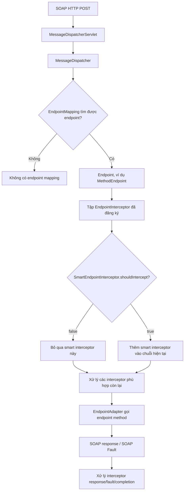
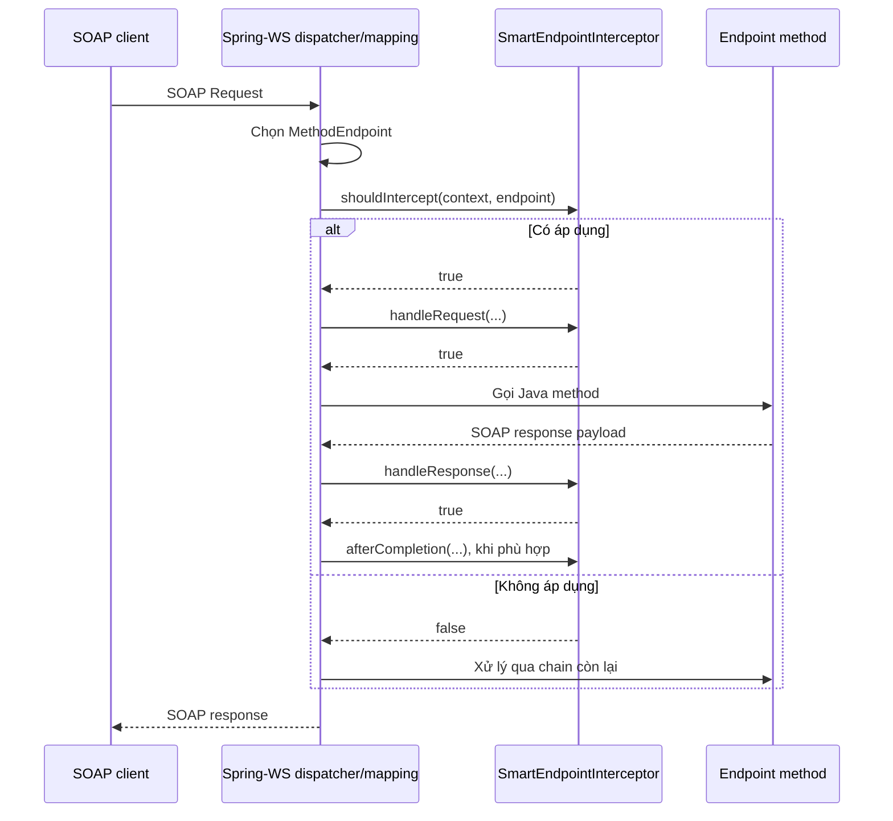

# SmartEndpointInterceptor và giới hạn phạm vi theo endpoint

## 1. Bài toán: vì sao không nên áp dụng mọi interceptor cho mọi SOAP operation?

Trong hệ thống tích hợp **Spring Web Services (Spring-WS)**, một ứng dụng SOAP có thể công bố nhiều operation nhưng không phải operation nào cũng cần cùng một logic trước/sau khi thực thi. Ví dụ:

- `GetOrder` chỉ đọc trạng thái đơn hàng.
- `CancelOrder` thay đổi trạng thái và phải ghi **dấu vết kiểm toán (*audit*)** chi tiết hơn.
- Một operation khác có thể yêu cầu log correlation ID hoặc kiểm tra định dạng header đặc thù.
- Schema validation thường được áp dụng rộng cho các thông điệp thuộc một hợp đồng; còn interceptor audit nghiệp vụ có thể chỉ phù hợp cho nhóm operation nhất định.

Nếu đăng ký một `EndpointInterceptor` thông thường, ta thường phải kiểm tra điều kiện bên trong `handleRequest(...)`, `handleResponse(...)` và `handleFault(...)`, hoặc chấp nhận logic của interceptor chạy trên các endpoint không liên quan. Khi API có nhiều WSDL hoặc version khác nhau, việc này khiến audit thừa, log nhiễu, tăng chi phí và làm ranh giới trách nhiệm khó kiểm soát.

**`SmartEndpointInterceptor`** của Spring-WS giải quyết bài toán **chọn lọc interceptor dựa trên endpoint đã được định tuyến**. Nó mở rộng `EndpointInterceptor` bằng phương thức `shouldIntercept(MessageContext, Object endpoint)`, cho phép quyết định interceptor có được gắn vào chuỗi xử lý của **request hiện tại** hay không.

Điều này đặc biệt hữu ích trong kiến trúc SOAP **contract-first**: tên operation và phần tử XML được xác định từ XSD/WSDL; server dùng endpoint mapping để chọn Java method phù hợp, sau đó mới quyết định interceptor nào áp dụng.

### Mục tiêu học tập

Sau bài này, bạn có thể:

1. Phân biệt `EndpointInterceptor` và `SmartEndpointInterceptor`, hiểu ý nghĩa của `shouldIntercept(...)`.
2. Xác định đối tượng `endpoint` mà Spring-WS đưa vào interceptor, đặc biệt `MethodEndpoint` khi dùng `@Endpoint`/`@PayloadRoot`.
3. Giới hạn audit, telemetry hoặc kiểm tra đặc thù đến **một SOAP operation, nhóm method hoặc endpoint bean** mà không cần đọc lại toàn bộ SOAP Body.
4. Đăng ký smart interceptor trong `WsConfigurerAdapter` và tránh nhầm giữa *registration scope* với *conditional execution*.
5. Hiểu lifecycle `handleRequest`, `handleResponse`, `handleFault` và `afterCompletion`, kể cả xử lý fault và dừng chuỗi.
6. Tránh sử dụng bộ lọc chọn lọc như biện pháp bảo mật duy nhất khi cần chính sách **fail-closed**.
7. Kiểm thử bằng `MockWebServiceClient`, HTTP integration, XSD validation và bộ test âm tính.

Ví dụ xuyên suốt: SOAP dịch vụ đơn hàng `OrdersService` với `GetOrder` và `CancelOrder`, namespace `https://example.org/orders/v1`. Operation `CancelOrder` được đánh dấu cần audit; `GetOrder` không được đánh dấu. Địa chỉ và mã đơn trong bài chỉ là ví dụ.

## 2. Nắm chắc vị trí interceptor trong Spring-WS pipeline

Một SOAP request thường được xử lý qua các tầng khái niệm:



Sơ đồ nhằm giải thích **trách nhiệm**. Cơ chế thực tế phụ thuộc endpoint mapping, phiên bản Spring-WS, interceptor chain và các tình huống ngắt sớm. Không nên suy ra từ sơ đồ rằng mọi callback đều chạy trong mọi trường hợp.

### 2.1. Phân biệt ba quyết định

| Câu hỏi | Thành phần phụ trách | Kết quả |
|---|---|---|
| SOAP Body/Action tương ứng với handler nào? | `EndpointMapping` | Chọn endpoint hoặc không tìm thấy |
| Interceptor chọn lọc này có áp dụng cho endpoint đó không? | `SmartEndpointInterceptor.shouldIntercept(...)` | Chọn hoặc loại interceptor khỏi chuỗi |
| Endpoint method có chữ ký Java được framework hỗ trợ không? | `EndpointAdapter` và resolvers/handlers | Gọi method hoặc báo lỗi adapter |

**SmartEndpointInterceptor không thay EndpointMapping hoặc EndpointAdapter.** Nó không tự tạo SOAP operation, không làm JAXB hiểu class còn thiếu, không sửa `@PayloadRoot` sai namespace, cũng không làm một request đến sai servlet tự động được định tuyến.

### 2.2. Khác nhau giữa `EndpointInterceptor` và `SmartEndpointInterceptor`

`EndpointInterceptor` cung cấp các callback tiêu biểu:

```java
boolean handleRequest(MessageContext context, Object endpoint)
        throws Exception;

boolean handleResponse(MessageContext context, Object endpoint)
        throws Exception;

boolean handleFault(MessageContext context, Object endpoint)
        throws Exception;

void afterCompletion(MessageContext context, Object endpoint,
                     Exception exception) throws Exception;
```

Chữ ký trên là **dạng mô tả API**, không phải một interface Java được định nghĩa đầy đủ. Callback thực tế thuộc `org.springframework.ws.server.EndpointInterceptor`.

`SmartEndpointInterceptor` kế thừa interface đó và thêm:

```java
boolean shouldIntercept(MessageContext context, Object endpoint);
```

Nếu `shouldIntercept(...)` trả `false`, interceptor đó không nên được chọn cho endpoint hiện tại bởi endpoint mapping hỗ trợ smart interceptor. Nếu trả `true`, nó có thể tham gia callback request/response/fault/completion theo lifecycle thông thường.

**Hai điều kiện đều cần:** interceptor phải **được đăng ký** vào chain của endpoint mapping và `shouldIntercept(...)` phải đánh giá **true** cho request tương ứng. Việc tạo bean smart interceptor trong ApplicationContext nhưng không đăng ký vào mapping **không tự đảm bảo** nó sẽ chạy.

### 2.3. Giới hạn phạm vi và thứ tự thực thi là hai khái niệm

- **Phạm vi (*scope*):** interceptor có được chọn cho endpoint hiện tại hay không.
- **Thứ tự (*order*):** giữa những interceptor đã chọn, interceptor nào chạy trước/sau.
- **Điều kiện ngắt (*short-circuit*):** một `handleRequest(...)` trả `false` có thể dừng việc gọi endpoint hoặc các interceptor tiếp theo; phản hồi lúc đó phải được xử lý theo đúng contract/policy.

Đừng dùng `shouldIntercept(false)` để thay thế `handleRequest(false)`: một cái nghĩa là **bỏ qua chính interceptor**, còn cái kia là **ngăn tiến trình bình thường sau khi interceptor đã được chọn**, tùy dispatcher lifecycle.

## 3. Contract-first: hai operation để thử giới hạn phạm vi

Hãy giả sử WSDL 1.1 của chúng ta có hai operation:

| Operation WSDL | Global input element | Global output element | Yêu cầu audit đặc thù |
|---|---|---|---|
| `GetOrder` | `{https://example.org/orders/v1}GetOrderRequest` | `GetOrderResponse` | Không |
| `CancelOrder` | `{https://example.org/orders/v1}CancelOrderRequest` | `CancelOrderResponse` | **Có** |

### 3.1. XSD mẫu tự chứa

```xml
<?xml version="1.0" encoding="UTF-8"?>
<xs:schema xmlns:xs="http://www.w3.org/2001/XMLSchema"
           xmlns:tns="https://example.org/orders/v1"
           targetNamespace="https://example.org/orders/v1"
           elementFormDefault="qualified">

  <xs:simpleType name="OrderIdType">
    <xs:restriction base="xs:string">
      <xs:pattern value="ORD-[0-9]{6}"/>
    </xs:restriction>
  </xs:simpleType>

  <xs:element name="GetOrderRequest">
    <xs:complexType>
      <xs:sequence>
        <xs:element name="orderId" type="tns:OrderIdType"/>
      </xs:sequence>
    </xs:complexType>
  </xs:element>

  <xs:element name="GetOrderResponse">
    <xs:complexType>
      <xs:sequence>
        <xs:element name="orderId" type="tns:OrderIdType"/>
        <xs:element name="status" type="xs:string"/>
      </xs:sequence>
    </xs:complexType>
  </xs:element>

  <xs:element name="CancelOrderRequest">
    <xs:complexType>
      <xs:sequence>
        <xs:element name="orderId" type="tns:OrderIdType"/>
        <xs:element name="reason" type="xs:string"/>
      </xs:sequence>
    </xs:complexType>
  </xs:element>

  <xs:element name="CancelOrderResponse">
    <xs:complexType>
      <xs:sequence>
        <xs:element name="orderId" type="tns:OrderIdType"/>
        <xs:element name="status" type="xs:string"/>
      </xs:sequence>
    </xs:complexType>
  </xs:element>
</xs:schema>
```

Đây là ví dụ tập trung vào XML payload. Trong WSDL thực, từng input/output element được tham chiếu qua `message/part`, `portType/operation` và `binding`. SOAPAction (SOAP 1.1) hoặc tham số action (SOAP 1.2) được khai báo theo binding, không tự sinh từ tên Java method.

Ví dụ không khai báo typed SOAP Fault; nếu hợp đồng doanh nghiệp đã phê duyệt có `wsdl:fault`, cần giữ nguyên và test XML detail tương ứng.

### 3.2. Request XML mẫu

```xml
<ord:GetOrderRequest xmlns:ord="https://example.org/orders/v1">
  <ord:orderId>ORD-000123</ord:orderId>
</ord:GetOrderRequest>
```

```xml
<ord:CancelOrderRequest xmlns:ord="https://example.org/orders/v1">
  <ord:orderId>ORD-000123</ord:orderId>
  <ord:reason>CUSTOMER_REQUEST</ord:reason>
</ord:CancelOrderRequest>
```

Hai đoạn trên là **SOAP Body payload**, không phải Envelope đầy đủ. Với HTTP POST SOAP 1.1, cần gói trong `soap:Envelope` và sử dụng media type `text/xml` phù hợp WSDL binding.

Khi server dùng `@PayloadRoot`, một request được chọn theo **QName của XML root trong SOAP Body**. Khi chọn interceptor theo **Java method annotation**, ta không cần parse lại payload chỉ để quyết định có cần audit hay không.

## 4. Chọn phạm vi theo endpoint Java method

Spring-WS annotation-based endpoint sử dụng đối tượng như `MethodEndpoint` để biểu diễn method đã được định tuyến. Đối tượng truyền vào `shouldIntercept(MessageContext, Object endpoint)` có thể là một `MethodEndpoint` khi dùng `@Endpoint` và `@PayloadRoot`.

Vì tham số `endpoint` có kiểu **`Object`**, không nên ép kiểu trực tiếp mà không kiểm tra. Các hệ thống dùng endpoint kiểu khác hoặc adapter mở rộng có thể truyền một loại endpoint object khác.

### 4.1. Chọn theo annotation phương thức

Một lựa chọn dễ bảo trì là đánh dấu **chính method cần audit** bằng annotation riêng:

```java
package org.example.orders.soap.audit;

import java.lang.annotation.ElementType;
import java.lang.annotation.Retention;
import java.lang.annotation.RetentionPolicy;
import java.lang.annotation.Target;

@Retention(RetentionPolicy.RUNTIME)
@Target(ElementType.METHOD)
public @interface AuditedSoapOperation {
}
```

`@Retention(RUNTIME)` quan trọng: interceptor dùng Java reflection khi request chạy. Nếu annotation chỉ được giữ ở source/class mà không có runtime retention, `method.isAnnotationPresent(...)` sẽ không nhận biết nó.

### 4.2. SOAP endpoint gồm hai method trong cùng bean

Giả định JAXB classes từ XSD mục 3 là `GetOrderRequest`, `GetOrderResponse`, `CancelOrderRequest` và `CancelOrderResponse`. Nếu generator sinh `JAXBElement` thay cho root class, cần điều chỉnh chữ ký theo cách ánh xạ JAXB thực tế.

```java
package org.example.orders.soap.endpoint;

import org.example.orders.soap.audit.AuditedSoapOperation;
import org.springframework.ws.server.endpoint.annotation.Endpoint;
import org.springframework.ws.server.endpoint.annotation.PayloadRoot;
import org.springframework.ws.server.endpoint.annotation.RequestPayload;
import org.springframework.ws.server.endpoint.annotation.ResponsePayload;

@Endpoint
public class OrdersEndpoint {
    private static final String NS =
        "https://example.org/orders/v1";

    private final OrdersService service;

    public OrdersEndpoint(OrdersService service) {
        this.service = service;
    }

    @PayloadRoot(namespace = NS, localPart = "GetOrderRequest")
    @ResponsePayload
    public GetOrderResponse getOrder(
            @RequestPayload GetOrderRequest request) {

        GetOrderResponse response = new GetOrderResponse();
        response.setOrderId(request.getOrderId());
        response.setStatus(service.statusOf(request.getOrderId()));
        return response;
    }

    @AuditedSoapOperation
    @PayloadRoot(namespace = NS, localPart = "CancelOrderRequest")
    @ResponsePayload
    public CancelOrderResponse cancelOrder(
            @RequestPayload CancelOrderRequest request) {

        service.cancel(request.getOrderId(), request.getReason());

        CancelOrderResponse response = new CancelOrderResponse();
        response.setOrderId(request.getOrderId());
        response.setStatus("CANCELLED");
        return response;
    }
}
```

Ví dụ chỉ thể hiện ranh giới SOAP endpoint/Java method. `OrdersService` là service nghiệp vụ phải được triển khai riêng, kèm kiểm soát concurrency, authorization, idempotency và business rules trước khi hủy đơn. Đừng coi annotation audit là bằng chứng người gửi **được quyền** hủy đơn.

Ở đây, hai operation **cùng một Java endpoint bean**, nhưng chỉ `cancelOrder(...)` có `@AuditedSoapOperation`. Nếu bộ lọc chỉ so sánh **class** `OrdersEndpoint` thì nó sẽ áp dụng cho **cả hai** operation. Vì thế, để chọn chính xác từng operation, phải xét **method**, không chỉ bean.

### 4.3. Cần phân biệt «endpoint bean», «endpoint method» và «payload QName»

| Phạm vi | Căn cứ lọc | Khi thích hợp |
|---|---|---|
| Toàn bộ endpoint bean | Class/bean type | Mọi operation trong bean cùng cần một policy |
| Một method cụ thể | `MethodEndpoint.getMethod()` + annotation/method identity | Một số operation cần audit/metric riêng |
| Nhóm operation có tag | Custom annotation với metadata | Quản lý nhóm nghiệp vụ theo policy được review |
| Một payload QName | `@PayloadRoot(namespace, localPart)` hoặc đối chiếu mapping | Cần gắn policy với XML contract hơn là Java method |
| Toàn bộ SOAP API | Interceptor không lọc hoặc policy ở security/gateway | Validation/bảo vệ bắt buộc cho mọi operation |

**Cẩn trọng:** tên method Java như `cancelOrder` là chi tiết triển khai, không nhất thiết trùng tên `wsdl:operation`. Khi áp dụng rule theo QName, hãy dùng namespace và local name đúng từ XSD/WSDL, không suy đoán operation từ tên method.

## 5. Viết `SmartEndpointInterceptor` chọn theo method annotation

Đây là một ví dụ đầy đủ về **interceptor audit chọn lọc**. Nó ghi các event metadata được phép, không ghi nội dung SOAP request/response và không kiểm tra quyền. Với ứng dụng thật, audit sink phải lưu sự kiện theo chính sách retention và tin cậy, không chỉ dựa vào log thông thường.

### 5.1. Implementation

```java
package org.example.orders.soap.audit;

import org.slf4j.Logger;
import org.slf4j.LoggerFactory;
import org.springframework.ws.context.MessageContext;
import org.springframework.ws.server.SmartEndpointInterceptor;
import org.springframework.ws.server.endpoint.MethodEndpoint;

public final class OperationAuditInterceptor
        implements SmartEndpointInterceptor {

    private static final Logger LOG =
        LoggerFactory.getLogger(OperationAuditInterceptor.class);

    @Override
    public boolean shouldIntercept(
            MessageContext messageContext, Object endpoint) {

        if (!(endpoint instanceof MethodEndpoint methodEndpoint)) {
            return false;
        }

        return methodEndpoint.getMethod()
            .isAnnotationPresent(AuditedSoapOperation.class);
    }

    @Override
    public boolean handleRequest(
            MessageContext messageContext, Object endpoint) {

        record("REQUEST", endpoint);
        return true;
    }

    @Override
    public boolean handleResponse(
            MessageContext messageContext, Object endpoint) {

        record("RESPONSE", endpoint);
        return true;
    }

    @Override
    public boolean handleFault(
            MessageContext messageContext, Object endpoint) {

        record("SOAP_FAULT", endpoint);
        return true;
    }

    @Override
    public void afterCompletion(
            MessageContext messageContext,
            Object endpoint,
            Exception exception) {

        if (exception != null) {
            LOG.warn("soap_audit stage=COMPLETION_ERROR "
                    + "endpoint={} exceptionType={}",
                endpointName(endpoint),
                exception.getClass().getSimpleName());
        }
    }

    private void record(String stage, Object endpoint) {
        LOG.info("soap_audit stage={} endpoint={}",
            stage, endpointName(endpoint));
    }

    private String endpointName(Object endpoint) {
        if (endpoint instanceof MethodEndpoint methodEndpoint) {
            var method = methodEndpoint.getMethod();
            return method.getDeclaringClass().getSimpleName()
                + "#" + method.getName();
        }
        return endpoint.getClass().getSimpleName();
    }
}
```

Ví dụ dùng Java 17+ `instanceof` pattern matching và `var` cục bộ. Đường import của `SmartEndpointInterceptor` và `MethodEndpoint` thuộc Spring-WS, không phải Spring MVC.

### 5.2. Phân tích `shouldIntercept(...)`

```java
if (!(endpoint instanceof MethodEndpoint methodEndpoint)) {
    return false;
}
return methodEndpoint.getMethod()
    .isAnnotationPresent(AuditedSoapOperation.class);
```

Đoạn code này nói: **chỉ audit các annotation-method endpoints có annotation `@AuditedSoapOperation`**. Kết quả kỳ vọng:

| Request | Method được mapping chọn | Annotation? | `shouldIntercept` |
|---|---|---|---|
| `GetOrderRequest` | `getOrder(...)` | Không | `false` |
| `CancelOrderRequest` | `cancelOrder(...)` | Có | `true` |
| Endpoint object không phải `MethodEndpoint` | Loại khác | Không xác định | `false` |

Việc trả `false` cho endpoint object không nhận biết là **chính sách tiện cho audit chọn lọc**, không phải chính sách fail-closed dùng để bảo vệ giao dịch. Nếu operation mới hoặc endpoint style mới phải được bắt buộc kiểm tra bảo mật, một filter mặc định bỏ qua kiểu không biết có thể tạo **lỗ hổng bypass**. Mục 11 phân tích thêm.

### 5.3. Vì sao không đọc XML trong `shouldIntercept`?

Khi mục tiêu là chọn operation, Spring-WS **đã chọn endpoint**. Nhìn vào `MethodEndpoint` có lợi hơn tự chạy XPath trên `MessageContext.getRequest().getPayloadSource()`:

- Không parse lại dữ liệu SOAP chỉ để lấy operation đã được mapping xác định.
- Không phụ thuộc prefix XML, `SOAPAction` hoặc một field dữ liệu đầu vào dễ thay đổi.
- Không tiêu thụ nguồn XML streaming theo cách khiến endpoint khó đọc tiếp.
- Có thể test rõ theo annotation/Java method.
- Dễ giữ logic audit tách biệt khỏi rule nghiệp vụ.

Nếu cần thông tin **người dùng, tenant, giá trị request hoặc SOAP Header** để quyết định, phải đọc từ nguồn đã được kiểm tra và có chính sách riêng. `shouldIntercept` chỉ giải quyết **scope theo endpoint**, không phải toàn bộ authorization policy.

### 5.4. Điều gì xảy ra nếu interceptor ghi log thất bại?

Ví dụ trên dùng logger và trả `true`. Trong hệ thống cần **audit bắt buộc và không được mất sự kiện**, logger thông thường có thể không đủ: cần thiết kế persistent audit sink, correlation ID, transaction/outbox hoặc cơ chế ghi sự kiện có độ tin cậy phù hợp, kèm xử lý lỗi và chính sách fail-closed/fail-open đã duyệt.

Đừng chỉ thêm `try/catch` rồi nuốt mọi lỗi nếu việc audit là yêu cầu tuân thủ. Ngược lại, không nên làm toàn bộ SOAP service ngừng hoạt động vì sink telemetry không thiết yếu đang chậm, nếu policy cho phép bỏ qua.

## 6. Đăng ký smart interceptor vào Spring-WS

Một `SmartEndpointInterceptor` phải được kết nối vào endpoint mapping/interceptor chain thực tế. Trong cấu hình Spring-WS annotation-driven, có thể dùng `WsConfigurerAdapter`:

```java
package org.example.orders.soap.config;

import java.util.List;
import org.example.orders.soap.audit.OperationAuditInterceptor;
import org.springframework.context.annotation.Bean;
import org.springframework.context.annotation.Configuration;
import org.springframework.ws.config.annotation.EnableWs;
import org.springframework.ws.config.annotation.WsConfigurerAdapter;
import org.springframework.ws.server.EndpointInterceptor;

@Configuration
@EnableWs
public class SoapInterceptorConfiguration
        extends WsConfigurerAdapter {

    @Bean
    public OperationAuditInterceptor operationAuditInterceptor() {
        return new OperationAuditInterceptor();
    }

    @Override
    public void addInterceptors(
            List<EndpointInterceptor> interceptors) {
        interceptors.add(operationAuditInterceptor());
    }
}
```

Trong mô hình này:

1. `@EnableWs` cung cấp hạ tầng annotation-driven của Spring-WS.
2. `@Bean` tạo interceptor instance.
3. `addInterceptors(...)` đưa interceptor vào danh sách mà Spring-WS gắn vào endpoint mappings do cấu hình tương ứng quản lý.
4. Khi một endpoint được chọn, smart filter có thể được gọi để xác định scope của **request hiện tại**.

**Lưu ý:** các phiên bản Spring-WS có API cấu hình khác nhau hoặc ưu tiên interface `WsConfigurer` và bean setup cụ thể. Ví dụ phù hợp cho hướng Java config dùng `WsConfigurerAdapter`; cần kiểm tra API version của dự án. Trong WAR có root và servlet child context, cấu hình interceptor phải thuộc **SOAP context mà servlet dùng**. Đặt bean trong một sibling MVC context không có tác dụng.

### 6.1. Cấu hình servlet và endpoint

Ví dụ đăng ký `MessageDispatcherServlet` thủ công trong Spring Boot:

```java
import org.springframework.boot.web.servlet.ServletRegistrationBean;
import org.springframework.context.ApplicationContext;
import org.springframework.context.annotation.Bean;
import org.springframework.context.annotation.Configuration;
import org.springframework.ws.transport.http.MessageDispatcherServlet;

@Configuration
public class SoapServletConfiguration {

    @Bean
    public ServletRegistrationBean<MessageDispatcherServlet>
            soapServlet(ApplicationContext applicationContext) {

        MessageDispatcherServlet servlet =
            new MessageDispatcherServlet();
        servlet.setApplicationContext(applicationContext);
        servlet.setTransformWsdlLocations(false);

        return new ServletRegistrationBean<>(servlet, "/ws/*");
    }
}
```

Đoạn code minh họa trường hợp **không sử dụng SOAP servlet auto-registration**. Spring Boot starter có thể đã tự đăng ký `MessageDispatcherServlet`, nên không tạo servlet thứ hai với URL mapping trùng nhau. Endpoint `OrdersEndpoint`, cấu hình `@EnableWs` và interceptor phải được nạp trong cùng pipeline; với WAR nhiều context phải kiểm tra parent/child visibility.

### 6.2. WSDL và XSD là các phần riêng

WSDL tĩnh có thể công bố qua `SimpleWsdl11Definition`; WSDL sinh từ XSD có thể dùng `DefaultWsdl11Definition` theo quy trình hợp đồng.

```java
@Bean(name = "orders")
public SimpleWsdl11Definition ordersWsdl() {
    SimpleWsdl11Definition definition =
        new SimpleWsdl11Definition();
    definition.setWsdl(
        new ClassPathResource("wsdl/orders.wsdl"));
    return definition;
}
```

Bean trên cần import `SimpleWsdl11Definition` và `ClassPathResource` phù hợp. Đây là ví dụ WSDL đã được phê duyệt, **không đồng nghĩa việc tạo bean đã đăng ký audit interceptor**. Với mapping `/ws/*`, metadata thường có thể tải ở `GET /ws/orders.wsdl`, còn SOAP POST gửi đến service address được WSDL công bố.

### 6.3. Đừng nhầm bean có tồn tại với interceptor đã được gắn

Một lỗi phổ biến:

```java
@Bean
public OperationAuditInterceptor operationAuditInterceptor() {
    return new OperationAuditInterceptor();
}
```

Đoạn này chỉ tạo bean. Nếu không có `addInterceptors(...)` hoặc cấu hình endpoint mappings tương đương, interceptor **không được bảo đảm** tham gia chuỗi xử lý.

Cách xác minh tốt nhất là **test request cụ thể** và quan sát event audit của `CancelOrder`, đồng thời chứng minh `GetOrder` không tạo event.

## 7. Giới hạn theo exact payload QName hoặc nhóm operation

Annotation phương thức thường thích hợp khi nhóm phát triển sở hữu code endpoint. Nhưng trong một số hệ thống, chính sách audit phải bám vào **hợp đồng XML** hoặc danh sách operation được đối tác phê duyệt.

### 7.1. Lọc theo `@PayloadRoot` đã gắn trên method

Đoạn logic sau có thể dùng trong `shouldIntercept(...)` nếu ứng dụng chỉ dùng mapping kiểu `@PayloadRoot`:

```java
@Override
public boolean shouldIntercept(
        MessageContext messageContext, Object endpoint) {

    if (!(endpoint instanceof MethodEndpoint methodEndpoint)) {
        return false;
    }

    PayloadRoot root = methodEndpoint.getMethod()
        .getAnnotation(PayloadRoot.class);

    return root != null
        && "https://example.org/orders/v1".equals(root.namespace())
        && "CancelOrderRequest".equals(root.localPart());
}
```

Ví dụ cần import `PayloadRoot` và `MethodEndpoint`. Cách này không đọc SOAP Body lại, mà dùng annotation mapping đã được khai báo ở Java method.

**Điều kiện:** một operation được mapping bằng SOAPAction hoặc cơ chế endpoint mapping khác có thể không mang `@PayloadRoot`. Khi đó filter trên trả `false` dù operation thực tế là `CancelOrder`. Không áp dụng ví dụ này cho mọi loại mapping mà không test.

### 7.2. Dùng chính xác QName, không so chuỗi tùy tiện

Nếu có nhiều hợp đồng cùng local name `CancelOrderRequest`, chỉ so `localPart` sẽ chọn nhầm:

```text
{https://example.org/orders/v1}CancelOrderRequest
{https://example.org/legacy/v1}CancelOrderRequest
```

Hai XML elements **khác nhau** vì namespace URI khác nhau. Khi policy gắn với XML contract, kiểm tra **cả namespace URI và local name**, đồng thời version hóa rule phù hợp WSDL/XSD.

### 7.3. Dùng annotation với metadata

Có thể mở rộng annotation tùy biến:

```java
@Retention(RetentionPolicy.RUNTIME)
@Target(ElementType.METHOD)
public @interface AuditedSoapOperation {
    String eventType();
    String policyVersion() default "v1";
}
```

Endpoint:

```java
@AuditedSoapOperation(
    eventType = "ORDER_CANCEL_REQUESTED",
    policyVersion = "v1")
@PayloadRoot(namespace = NS, localPart = "CancelOrderRequest")
@ResponsePayload
public CancelOrderResponse cancelOrder(
        @RequestPayload CancelOrderRequest request) {
    // ...
}
```

Đây là **biến thể thay thế** annotation rỗng ở mục 4, không khai báo đồng thời hai định nghĩa của cùng annotation trong một project. Interceptor có thể dùng `getAnnotation(AuditedSoapOperation.class)` để lấy metadata và ghi event đúng policy.

Không đưa thông tin nhạy cảm vào annotation. Event type/policy version có thể là metadata tĩnh; customer ID, credentials và dữ liệu request phải được xử lý theo chính sách riêng.

### 7.4. Scope theo cả class hay theo từng method?

Nếu mọi method trong `OrdersEndpoint` đều cần audit, có thể đặt annotation ở **class** và kiểm tra declaring class/bean class. Tuy nhiên, trong các hệ thống có proxy hoặc interface, class reflection có thể khác class khai báo method thật. Cần kiểm tra việc dùng `AnnotatedElementUtils`/merged annotation semantics phù hợp và test theo runtime proxy.

Nếu chỉ `CancelOrder` cần audit, filter theo **method** rõ ràng hơn. Nếu một method trong class được overload và có annotation khác nhau, cần xem chính xác `MethodEndpoint.getMethod()` thay vì so mỗi tên `cancelOrder`.

## 8. Lifecycle: request, response, fault và completion

Một `SmartEndpointInterceptor` **được chọn** sẽ tham gia các callback thông thường của `EndpointInterceptor`. Trình tự khái niệm khi xử lý thành công:



Trình tự trên mô tả ý tưởng. Trong trường hợp fault, interceptor đã được chọn có thể được gọi `handleFault(...)` thay cho `handleResponse(...)`. `afterCompletion(...)` được dùng cho dọn dẹp và quan sát kết thúc xử lý theo lifecycle của dispatcher; **không nên thiết kế một nghiệp vụ quan trọng dựa vào giả định callback này sẽ luôn chạy trong mọi trường hợp**, kể cả lỗi transport xảy ra trước khi endpoint được chọn.

### 8.1. Ý nghĩa của các giá trị boolean

| Phương thức | `true` thường nghĩa là | `false` có thể dẫn tới |
|---|---|---|
| `shouldIntercept` | Chọn interceptor cho endpoint | Bỏ qua interceptor này |
| `handleRequest` | Tiếp tục request chain/endpoint processing | Dừng tiến trình request thông thường |
| `handleResponse` | Tiếp tục response processing | Ngắt các bước tiếp theo trong response chain |
| `handleFault` | Tiếp tục fault processing | Ngắt các bước tiếp theo trong fault chain |

**Trả false trong `handleRequest` không tự tạo một SOAP Fault hợp lệ.** Nếu interceptor thực hiện policy gate và muốn chặn request, phải chuẩn bị phản hồi SOAP Fault hoặc cơ chế từ chối theo cách Spring-WS hỗ trợ. Chặn bằng cách trả false nhưng không có response được định nghĩa có thể khiến client gặp timeout, empty response hoặc behavior không mong đợi.

### 8.2. Thứ tự nhiều interceptors

Giả sử có:

1. Interceptor xác thực/WS-Security.
2. `PayloadValidatingInterceptor` để kiểm tra XSD.
3. Smart audit interceptor dành riêng cho `CancelOrder`.
4. Interceptor telemetry/correlation.

Khi cấu hình `addInterceptors(...)`, thứ tự đưa vào chain ảnh hưởng request và response/fault hooks. Trong các pipeline interceptor điển hình, request được xử lý theo thứ tự đăng ký, còn response/fault thường được xử lý theo chiều ngược lại; cần kiểm chứng trên **phiên bản framework và pipeline thực tế**.

Nếu security interceptor chặn request trước audit, audit operation có thể không ghi nhận attempt bị từ chối. Nếu audit chạy trước security, phải tránh ghi nhận như một hành động hủy đơn **đã thành công**. Phân biệt event:

- `CANCEL_REQUEST_RECEIVED`: server đã nhận và chọn endpoint.
- `CANCEL_AUTHORIZED`: identity/authorization đã qua.
- `CANCEL_COMPLETED`: nghiệp vụ đã thực hiện và commit.
- `CANCEL_REJECTED`: request bị từ chối.
- `CANCEL_FAILED`: xử lý lỗi.

Một interceptor chỉ biết nhận request/fault không nên tự phát ra event *nghiệp vụ đã commit* trước khi transaction hoàn thành. Audit nghiệp vụ quan trọng thường cần phối hợp với domain service hoặc transactional outbox.

### 8.3. Lỗi xảy ra trước khi endpoint được chọn

Nếu XML không parse được hoặc servlet không tìm thấy endpoint mapping, `shouldIntercept(...)` có thể **chưa bao giờ được gọi**. Vì thế audit hoặc security cần bao phủ cả **request không có endpoint** phải được thiết kế ở tầng thích hợp hơn: gateway, HTTP filter, SOAP transport/global observability hoặc security mechanism có thể xử lý trước endpoint mapping.

## 9. Kết hợp smart interceptor với XSD validation

Spring-WS có `PayloadValidatingInterceptor` để kiểm tra SOAP Body theo XSD. Việc giới hạn phạm vi validator phải dựa trên **ranh giới hợp đồng** và không bỏ sót operation.

Ví dụ hai XSD khác nhau cho Orders và Payments. Có thể cần:

- Một validator cho nhóm operation Orders.
- Một validator khác cho nhóm Payments.
- Một smart interceptor audit chỉ áp dụng `CancelOrder`.

Tuy nhiên, không nên dùng filter `shouldIntercept(...)` của **audit** để quyết định validator có chạy hay không. Tránh logic như:

```java
if (!shouldAudit(endpoint)) {
    return true; // Bỏ qua cả schema validation
}
```

Điều này có thể cho phép operation không audit nhận XML không hợp lệ. Schema validation và audit là hai yêu cầu độc lập.

### 9.1. Ví dụ cấu hình validator riêng

```java
@Bean
public PayloadValidatingInterceptor ordersPayloadValidator(
        XsdSchema ordersSchema) {

    PayloadValidatingInterceptor validator =
        new PayloadValidatingInterceptor();
    validator.setXsdSchema(ordersSchema);
    validator.setValidateRequest(true);
    validator.setValidateResponse(true);
    return validator;
}
```

Chỉ khai báo bean như trên **chưa tự đăng ký** validator vào endpoint mapping. Cần thêm qua cấu hình Spring-WS/`WsConfigurerAdapter` hoặc mapping tương ứng. Nếu server có nhiều nhóm schema với global elements không cùng hợp đồng, cần thiết kế validation scope phù hợp và test mọi root element.

### 9.2. Một thứ tự cấu hình minh họa

```java
@Override
public void addInterceptors(
        List<EndpointInterceptor> interceptors) {

    interceptors.add(securityInterceptor);
    interceptors.add(ordersPayloadValidator);
    interceptors.add(operationAuditInterceptor);
}
```

Đây là **fragment minh họa**: các biến `securityInterceptor`, `ordersPayloadValidator` và `operationAuditInterceptor` là các bean đã được cấu hình đúng, không phải toàn bộ class có thể compile ngay. Đặc biệt:

- `securityInterceptor` thường yêu cầu WS-Security crypto, policy, truststore và timing configuration.
- `ordersPayloadValidator` phải áp dụng cho request/response thuộc schema Orders, **không mặc nhiên áp dụng** cho Payments nếu app phục vụ cả hai.
- `operationAuditInterceptor` chỉ chọn một số method, nên không làm rộng hoặc hẹp phạm vi của hai interceptor còn lại.
- Thứ tự muốn ghi nhận audit cho security failure hay không phải được quyết định rõ và test bằng negative cases.

## 10. Khi nào SmartEndpointInterceptor không phù hợp?

`SmartEndpointInterceptor` không phải giải pháp phổ quát cho mọi chính sách theo operation.

| Nhu cầu | Có nên dùng SmartEndpointInterceptor? | Lý do |
|---|---|---|
| Audit chọn lọc cho `CancelOrder` | **Có** | Endpoint method đã được chọn là căn cứ rõ |
| Đo metrics theo endpoint/operation | Có | Có thể lọc hoặc gắn nhãn từ MethodEndpoint |
| Một SOAP header nghiệp vụ chỉ liên quan vài operation | Có, nếu xử lý sau mapping phù hợp | Scope method giúp tránh kiểm tra thừa |
| Bảo mật bắt buộc cho toàn bộ SOAP API | **Không dùng smart filter bỏ qua làm lớp duy nhất** | Operation mới/unmapped có thể bypass |
| Chặn XML quá lớn trước khi parse | Không | Cần transport/gateway/body-size limits |
| Chặn request chưa xác thực trước endpoint mapping | Không đủ | Filter chỉ chạy khi đã chọn endpoint |
| Phát hiện SOAP Envelope malformed | Không | Lỗi xảy ra trước khi chọn endpoint |
| Chọn endpoint dựa trên SOAP Action/payload | Không | Việc của EndpointMapping |
| Ánh xạ JAXB và XML Schema | Không | Việc của OXM/validator |
| Kiểm tra quyền hủy đơn theo user và trạng thái DB | Không nên chỉ dùng smart filter | Cần security/domain policy và atomic state validation |
| Ghi event «hủy đơn đã commit» | Không nên chỉ ở handleRequest | Domain transaction/outbox phù hợp hơn |

### 10.1. Nguyên tắc fail-closed cho bảo mật

Giả sử `CancelOrder` bắt buộc xác thực X.509/WS-Security và kiểm tra quyền. Nếu chỉ dùng:

```java
return endpoint instanceof MethodEndpoint m
    && m.getMethod().isAnnotationPresent(ProtectedOperation.class);
```

rồi chỉ áp dụng **security interceptor** khi trả true, một developer quên annotation ở operation mới có thể khiến endpoint **không được bảo vệ**. Đây là thiết kế fail-open nguy hiểm.

Một chính sách an toàn hơn:

1. Mặc định bảo vệ **toàn bộ SOAP surface** ở transport/WS-Security layer theo contract/security profile.
2. Khi có ngoại lệ public endpoint, khai báo tường minh, được review và kiểm thử deny/allow.
3. Với operation thay đổi dữ liệu, kiểm tra **authorization** trong domain/application service dựa trên identity đã xác minh.
4. Test một operation mới/không có annotation để chứng minh nó **không bypass** security.
5. Không để SOAPAction hoặc QName do client khai là bằng chứng quyền.

Smart interceptor phù hợp cho **scoping phụ trợ**, không thay thế hệ thống xác thực/ủy quyền chính.

### 10.2. Dùng annotation như metadata policy

Nếu doanh nghiệp cần policy rõ ràng cho từng operation, có thể dùng annotation yêu cầu policy và **startup test** kiểm tra mọi operation đã được phân loại. Ví dụ cần đảm bảo mọi `@PayloadRoot` method đều được gắn `@PublicSoapOperation` hoặc `@ProtectedSoapOperation`, không được thiếu cả hai; cấu hình startup/test không cho phép operation chưa phân loại được public.

Đây là chính sách quản trị rộng hơn bản thân `SmartEndpointInterceptor`; có thể dùng reflection/static analysis để phát hiện annotation thiếu và integration test để xác nhận mapping thực thi đúng.

## 11. Scope theo endpoint class, method và SOAPAction: lựa chọn thế nào?

### 11.1. Theo class

Nếu mọi method trong `InventoryEndpoint` cần đo thời gian xử lý nhưng `OrdersEndpoint` không, có thể lọc bằng class/bean identity. Tuy nhiên với AOP proxies, Java class thực tế có thể là proxy thay vì class nguồn. Nếu dùng `MethodEndpoint`, kiểm tra metadata từ `getMethod()` và/hoặc bean target class phù hợp, rồi test runtime thực.

Không so chuỗi `getClass().getSimpleName().contains("Inventory")` làm căn cứ bảo mật. Đổi tên class hoặc compiler proxy có thể làm rule sai.

### 11.2. Theo method annotation

Phù hợp khi cần phân biệt `GetOrder` và `CancelOrder` trong cùng `OrdersEndpoint`. Code ở mục 5 minh họa lựa chọn này. Nếu method annotation được đặt trên interface, method nguồn, meta-annotation hoặc proxy, cần kiểm chứng liệu `getMethod().isAnnotationPresent(...)` có tìm đúng annotation không; khi cần có thể dùng Spring annotation utilities hỗ trợ merged annotations.

### 11.3. Theo `@PayloadRoot`

Phù hợp khi nhóm muốn policy bám vào XML root QName do XSD/WSDL công bố. Nhược điểm: nếu một operation được mapping theo `@SoapAction` thay vì `@PayloadRoot`, mã lọc theo annotation payload root có thể không thấy nó.

### 11.4. Theo SOAPAction

SOAPAction trong SOAP 1.1 hoặc action trong SOAP 1.2 có vai trò routing/intent, nhưng không phải chỉ báo an toàn về identity. Việc map bằng `SoapActionEndpointMapping` hoặc cấu hình tương đương là một quyết định **chọn endpoint**, khác với SmartEndpointInterceptor scope.

Nếu muốn giới hạn audit theo operation đã chọn, so metadata của method/mapping đáng tin hơn chỉ đọc một HTTP header do client cung cấp. Chữ ký, xác thực và quyền vẫn phải được thực thi riêng.

### 11.5. Theo package hoặc contract version

Nếu WSDL v1/v2 cùng tồn tại:

```text
org.example.orders.soap.v1.OrdersV1Endpoint
org.example.orders.soap.v2.OrdersV2Endpoint
```

Một smart interceptor có thể lọc theo annotation/version metadata thay vì so package string. Tách scope theo version giúp tránh audit v1 áp vào v2 hoặc ngược lại. Nhưng việc chia v1/v2 cũng phải nhất quán với XSD, QName, JAXB context, endpoint mapping và security policy.

## 12. Thread-safety và state của singleton smart interceptor

Spring interceptor thường là singleton bean. Nhiều SOAP requests có thể dùng **cùng instance interceptor** đồng thời.

### 12.1. Điều không nên làm

```java
public class BadInterceptor implements SmartEndpointInterceptor {
    private String currentOperation; // Sai: shared mutable state

    @Override
    public boolean shouldIntercept(
            MessageContext context, Object endpoint) {
        currentOperation = endpoint.toString();
        return true;
    }

    // Các callback khác đọc currentOperation...
}
```

Đây là **snippet cố ý chưa implement đủ interface** để minh họa anti-pattern. Nếu hai request chạy song song, request B có thể ghi đè `currentOperation` trước khi request A đến `handleResponse`. Audit sẽ gắn sai operation.

### 12.2. Thiết kế an toàn hơn

- Xác định operation từ tham số `endpoint` được truyền vào **mỗi callback**, không lưu vào field mutable của singleton.
- Với correlation ID hoặc state chỉ thuộc request, dùng cơ chế **request-scoped context**/message properties phù hợp API và lifecycle.
- Nếu dùng MDC, làm sạch MDC trong `finally` khi request kết thúc; tránh rò context giữa thread pools.
- Nếu dùng asynchronous audit sink, event phải mang operation/correlation metadata đầy đủ, không lấy từ mutable global field.
- Không chia sẻ một XML parser/XPath mutable hoặc JAXB Marshaller stateful tùy ý giữa threads.

Ví dụ `OperationAuditInterceptor` ở mục 5 không lưu `endpoint` vào field, nên tránh được lỗi cụ thể trên. Việc logger/sink thread-safe cần xác nhận theo implementation.

## 13. SOAP Fault và thời điểm callback có thể không xảy ra

Một smart interceptor được chọn cho `CancelOrder` có thể gặp các tình huống sau:

| Tình huống | `shouldIntercept` | `handleRequest` | `handleResponse`/`handleFault` |
|---|---|---|---|
| `CancelOrder` xử lý thành công | Có thể true | Thường chạy | Response callback theo lifecycle |
| `CancelOrder` gây SOAP Fault nghiệp vụ | Có thể true | Thường chạy | Fault callback theo lifecycle |
| `GetOrder` không được audit | false | Không chạy ở interceptor này | Không chạy ở interceptor này |
| XML malformed trước mapping | Có thể không được gọi | Không | Không |
| SOAP Body QName không có endpoint | Có thể không được gọi | Không | Không |
| Security interceptor trước đó chặn | Phụ thuộc mapping/interceptor chain | Có thể không chạy | Phụ thuộc chính sách và response |
| Lỗi transport/connection cắt ngang | Có thể không chạy đủ | Phụ thuộc thời điểm | Không được giả định luôn chạy |

**Đừng gắn nghĩa «giao dịch thành công» vào riêng `handleResponse` nếu response đã được tạo nhưng transaction domain chưa hoàn tất hoặc bị rollback sau đó.** Audit outcome cần phối hợp với domain transaction và cách lưu sự kiện.

### 13.1. Có cần tạo SOAP Fault khi audit bị từ chối?

Smart interceptor ở ví dụ trên **không chặn**; nó chỉ ghi event. Nếu muốn dùng interceptor như một *gate* kiểm tra policy, phải:

1. Xác định policy có yêu cầu bắt buộc hay không.
2. Bảo đảm scope bao phủ mọi endpoint cần bảo vệ.
3. Xác thực identity/chữ ký/timestamp trước khi tin input.
4. Khi từ chối, thiết lập SOAP Fault đúng SOAP version và hợp đồng, không chỉ trả `false`.
5. Test cả request bị từ chối và request hợp lệ; domain service không được gọi khi không có quyền.
6. Theo dõi các request không mapping được hoặc bị chặn trước interceptor ở tầng khác.

Trong SOAP 1.1, lỗi phía client thường được biểu diễn với Fault code như `Client`; SOAP 1.2 có mã tương ứng `Sender` và cấu trúc Fault khác. Không tự viết XML Fault bằng string nếu framework cung cấp fault resolver/cơ chế SOAP message thích hợp.

## 14. Kiểm thử scope bằng `MockWebServiceClient`

Bài toán quan trọng nhất cần chứng minh là:

- Request tới `CancelOrder` → smart interceptor **được chọn và chạy**.
- Request tới `GetOrder` → smart interceptor **không được chọn**.
- Cả hai SOAP requests vẫn được định tuyến đến endpoint tương ứng.
- SOAP Fault của `CancelOrder` đi qua fault path phù hợp và không log bí mật.
- Schema invalid hoặc security invalid bị xử lý ở tầng của chúng, không bị smart audit rule «cho qua» ngoài ý muốn.

### 14.1. Tạo audit sink có thể đếm sự kiện trong test

Ví dụ production dùng Logger; để test nên đưa thao tác ghi event qua một interface có thể thay bằng fake/spying bean:

```java
public interface SoapAuditSink {
    void record(String stage, String operation);
}
```

Một implementation chỉ dùng trong test:

```java
import java.util.concurrent.ConcurrentLinkedQueue;

public final class RecordingSoapAuditSink
        implements SoapAuditSink {

    private final ConcurrentLinkedQueue<String> events =
        new ConcurrentLinkedQueue<>();

    @Override
    public void record(String stage, String operation) {
        events.add(stage + "|" + operation);
    }

    public long countStage(String stage) {
        return events.stream()
            .filter(e -> e.startsWith(stage + "|"))
            .count();
    }

    public void clear() {
        events.clear();
    }
}
```

Để dùng sink này, production interceptor nên nhận `SoapAuditSink` bằng constructor injection thay cho gọi Logger trực tiếp; logic `shouldIntercept(...)` không đổi. Đây là **phương án nâng cấp thiết kế** so với class ở mục 5, không phải thêm bean sink rồi tự động làm thay đổi class ví dụ cũ.

### 14.2. Test hai SOAP operations

```java
@SpringBootTest
class ScopedAuditInterceptorTest {

    @Autowired
    ApplicationContext context;

    @Autowired
    RecordingSoapAuditSink auditSink;

    @BeforeEach
    void reset() {
        auditSink.clear();
    }

    @Test
    void getOrderDoesNotRunCancellationAudit() {
        var client = MockWebServiceClient.createClient(context);

        String request = """
            <ord:GetOrderRequest xmlns:ord="https://example.org/orders/v1">
              <ord:orderId>ORD-000123</ord:orderId>
            </ord:GetOrderRequest>
            """;

        client.sendRequest(withPayload(new StringSource(request)))
            .andExpect(noFault());

        assertEquals(0, auditSink.countStage("REQUEST"));
    }

    @Test
    void cancelOrderRunsAuditOnce() {
        var client = MockWebServiceClient.createClient(context);

        String request = """
            <ord:CancelOrderRequest xmlns:ord="https://example.org/orders/v1">
              <ord:orderId>ORD-000123</ord:orderId>
              <ord:reason>CUSTOMER_REQUEST</ord:reason>
            </ord:CancelOrderRequest>
            """;

        client.sendRequest(withPayload(new StringSource(request)))
            .andExpect(noFault());

        assertEquals(1, auditSink.countStage("REQUEST"));
    }
}
```

Đoạn test dùng JUnit 5, `spring-ws-test` và Java 17+, cần import:

```java
import org.junit.jupiter.api.BeforeEach;
import org.junit.jupiter.api.Test;
import org.springframework.beans.factory.annotation.Autowired;
import org.springframework.boot.test.context.SpringBootTest;
import org.springframework.context.ApplicationContext;
import org.springframework.ws.test.server.MockWebServiceClient;
import org.springframework.xml.transform.StringSource;

import static org.junit.jupiter.api.Assertions.assertEquals;
import static org.springframework.ws.test.server.RequestCreators.withPayload;
import static org.springframework.ws.test.server.ResponseMatchers.noFault;
```

**Điều kiện của test:** `RecordingSoapAuditSink` phải được đăng ký làm bean và interceptor đang chạy phải **inject chính sink này**; các JAXB classes, `OrdersService` test fixture, `@EnableWs`, endpoint mappings và servlet-compatible Spring context cũng phải được tạo. Đây là **test skeleton để thể hiện assertions scope**, không thể copy một mình vào project rồi chạy mà không cấu hình fixture/injection.

Ví dụ `@TestConfiguration` có thể cung cấp fake sink với `@Primary` để thay sink production. Nếu dùng test song song, phải cô lập event store theo test/request thay vì dùng chung `clear()` trên singleton và gây race giữa các case.

### 14.3. Kiểm thử trực tiếp `shouldIntercept`

Để kiểm thử filter mà không khởi động SOAP servlet, có thể tạo `MethodEndpoint` đại diện hai method bằng API được phiên bản Spring-WS hiện tại hỗ trợ, rồi gọi `shouldIntercept(...)`:

| Endpoint method | Kỳ vọng |
|---|---|
| `OrdersEndpoint#getOrder(...)` | `false` |
| `OrdersEndpoint#cancelOrder(...)` | `true` |
| Endpoint object không phải `MethodEndpoint` | `false` theo ví dụ |
| Method mới chưa có annotation audit | `false`; test bảo mật phải xem có cần fail-closed không |

Tuy nhiên, **unit test filter không thay integration test**: vẫn cần chứng minh `addInterceptors(...)` được Spring-WS sử dụng, endpoint mapping tạo MethodEndpoint đúng và callback chạy trên request thật.

### 14.4. Negative test cho lỗi sớm

Gửi request XML sai namespace hoặc malformed XML. Nếu chưa chọn được endpoint, audit smart interceptor có thể không chạy; điều này **phù hợp với scope được thiết kế**. Muốn audit cả attempt chưa map được, đặt telemetry ở HTTP transport/global pipeline.

Gửi `CancelOrderRequest` với `orderId` sai pattern từ XSD. Nếu XSD validator từ chối trước audit, audit event có thể không có; nếu audit đã chạy trước validator, event thể hiện *request nhận được*, không thể được diễn giải là *hủy đơn thành công*. Xác định expectation từ thứ tự interceptor và chính sách audit trước khi viết test.

## 15. Kiểm thử HTTP thật, WSDL và SOAP interoperability

`MockWebServiceClient` kiểm thử Spring-WS dispatch bên trong context, nhưng không đầy đủ các lớp:

- Servlet URL mapping và context path.
- HTTP SOAP 1.1 `Content-Type: text/xml` / SOAPAction.
- SOAP 1.2 `application/soap+xml` và action.
- Reverse proxy, TLS/mTLS, forwarded headers.
- WSDL/XSD publication và import URLs.
- WS-Security header/signature/certificate validation.
- Client từ các nền tảng khác.

Để test HTTP thực, lưu SOAP 1.1 Envelope:

```xml
<soap:Envelope
    xmlns:soap="http://schemas.xmlsoap.org/soap/envelope/"
    xmlns:ord="https://example.org/orders/v1">
  <soap:Body>
    <ord:CancelOrderRequest>
      <ord:orderId>ORD-000123</ord:orderId>
      <ord:reason>CUSTOMER_REQUEST</ord:reason>
    </ord:CancelOrderRequest>
  </soap:Body>
</soap:Envelope>
```

Gửi bằng shell POSIX, giả sử `cancel-order-soap11.xml` chứa Envelope trên và hợp đồng WSDL công bố action minh họa:

```bash
curl -i -X POST "http://localhost:8080/ws" \
  -H 'Content-Type: text/xml; charset=utf-8' \
  -H 'SOAPAction: "urn:example:orders:CancelOrder"' \
  --data-binary @cancel-order-soap11.xml
```

**Lưu ý:** action chỉ là ví dụ; phải dùng đúng giá trị `soap:operation@soapAction` của WSDL đã được phê duyệt. Không suy ra action từ tên Java method. Nếu gateway yêu cầu HTTPS/mTLS/WS-Security, lệnh curl không kèm các header/chữ ký tương ứng có thể bị từ chối, và điều đó không chứng minh smart interceptor sai.

### 15.1. Những điều phải kiểm tra trên wire

| Quan sát | Mục đích |
|---|---|
| HTTP request vào đúng `MessageDispatcherServlet` | Loại lỗi routing |
| SOAP Body QName là `CancelOrderRequest` | Mapping chọn đúng method |
| `shouldIntercept` của audit trả true | Scope hoạt động |
| `handleRequest` audit chạy đúng một lần | Không duplicate registration |
| SOAP response/fault đúng schema và binding | Không thay đổi contract |
| `GetOrder` không tạo audit cancel | Không overmatching |
| WS-Security invalid bị từ chối | Audit filter không vô hiệu security |
| WSDL/XSD URL đúng và import được | Client ngoài có thể sinh mã |
| Client khác stack gọi thành công | Interoperability |

## 16. Lỗi thường gặp và cách chẩn đoán

| Triệu chứng | Nguyên nhân khả dĩ | Kiểm tra |
|---|---|---|
| `shouldIntercept` không bao giờ chạy | Interceptor bean chưa đăng ký vào mapping | `addInterceptors(...)`, Spring context, endpoint mapping |
| Có bean nhưng `handleRequest` không chạy | `shouldIntercept=false` hoặc chain bị chặn sớm | Endpoint object thực, annotation và thứ tự interceptors |
| Audit chạy cho cả `GetOrder` và `CancelOrder` | Đăng ký plain interceptor hoặc filter class thay vì method | `implements SmartEndpointInterceptor` và logic method |
| Audit không chạy cho `CancelOrder` | Annotation thiếu/retention sai; mapping chọn method khác | Runtime `MethodEndpoint.getMethod()`, test fixture |
| Lỗi `ClassCastException` | Ép mọi `endpoint` thành `MethodEndpoint` | Dùng `instanceof` và policy cho endpoint style khác |
| Audit bị nhân đôi | Bean/interceptor đăng ký nhiều lần hoặc nhiều servlet/mappings | Context, `addInterceptors`, auto-configuration |
| Interceptor chỉ chạy ở test | Test context khác runtime servlet child context | Kiểm tra parent/child và HTTP integration |
| XML malformed nhưng không có audit | Lỗi xảy ra trước endpoint mapping | Dùng transport/gateway telemetry nếu cần ghi nhận |
| SOAP Fault nghiệp vụ nhưng không có event hoàn tất | Fault path/chain khác response path | `handleFault`, afterCompletion, order và exception handling |
| Bật validator làm audit biến mất | Validator chặn request trước audit | Thứ tự và nghĩa event audit |
| Mọi operation bất ngờ public | Security chỉ áp dụng cho method có annotation, endpoint mới thiếu tag | Fail-closed policy, negative authorization tests |
| Lỗi `No endpoint mapping found` | QName sai hoặc endpoint chưa được scan | Payload root QName, `@PayloadRoot`, component scanning |
| Lỗi `No adapter for endpoint` | Method signature không được adapter hỗ trợ | JAXB types, `@RequestPayload`, `@ResponsePayload` |
| WSDL đúng nhưng client ngoài không gọi được | SOAP address, TLS, SOAPAction, import schema | HTTP/integration tests trên endpoint public |
| XML response sai XSD | Serializer/JAXB mapping lệch hợp đồng | Response schema validation |
| Audit lộ PII | Log raw SOAP Body/WS-Security Header | Log metadata tối thiểu, mask/redact và phân quyền |

### Trình tự điều tra thực tế

1. Xác định request đã tới đúng SOAP servlet chưa; xem URL, context path, SOAP version và payload QName.
2. Xác định `EndpointMapping` có chọn được method không.
3. Xem đối tượng `endpoint` trong `shouldIntercept(...)` có phải `MethodEndpoint` không.
4. Kiểm tra annotation metadata trên **method thực được chọn**.
5. Kiểm tra interceptor có được đưa vào `addInterceptors(...)` của đúng SOAP ApplicationContext không.
6. Kiểm tra thứ tự interceptor khác và khả năng short-circuit.
7. Xác định lỗi thuộc request, response, SOAP Fault hay xảy ra trước mapping.
8. Thêm regression test 1 operation được chọn, 1 không được chọn, 1 fault và 1 trường hợp lỗi sớm.
9. Kiểm tra bảo mật độc lập để không tạo lỗ hổng mới do scope nhầm.

## 17. Thiết kế kiểm soát vận hành

### 17.1. Metric và audit nên có correlation ID

Một audit event có thể gồm:

```text
eventType: CANCEL_REQUEST_RECEIVED
operation: CancelOrder
contractVersion: orders-v1
correlationId: 4d0e... (ví dụ, không phải dữ liệu thật)
stage: REQUEST
result: RECEIVED
timestamp: ISO-8601 UTC
```

Không ghi raw SOAP Body, private key, token, mật khẩu, chữ ký WS-Security hoặc thông tin thanh toán vào log thường. Nếu correlation ID đến từ client, phải kiểm tra định dạng/giới hạn độ dài trước khi dùng trong logging/tracing.

### 17.2. Audit request khác audit business transaction

Một interceptor thấy SOAP response thành công **không nhất thiết** xác nhận database transaction đã commit hoặc một integration event bên ngoài đã được chuyển giao. Nếu cần dấu vết pháp lý, dùng domain event/outbox/transaction hooks và định nghĩa rõ thời điểm **completed**. Smart interceptor phù hợp ghi dấu vết **vào/ra giao thức** và kết nối trace với domain events.

### 17.3. Tương thích và phiên bản hóa

Khi thêm WSDL operation mới, hãy:

- Xác định scope audit/security/validation cho operation đó **trước khi triển khai**.
- Kiểm tra annotation/whitelist và test kết quả lọc.
- Không thay SOAPAction, QName hoặc WSDL binding chỉ để tiện interceptor.
- Thêm ca regression cho operation mới.
- Xác nhận client cũ vẫn sử dụng được các operation hiện hữu.

Nếu điều kiện lọc dựa trên Java method annotation, refactor method có thể làm mất annotation. Review và test cần bao phủ trường hợp này. Nếu điều kiện dựa trên QName, đổi namespace/version phải cập nhật policy sau khi hợp đồng được phê duyệt.

## 18. Bài thực hành có hướng dẫn

Giả sử Spring-WS server đang hỗ trợ hai operation `GetOrder` và `CancelOrder`:

1. **Chuẩn bị contract:** tạo XSD ở mục 3; công bố WSDL hoặc sử dụng bản WSDL đã phê duyệt có hai operations.
2. **Sinh JAXB:** dùng XJC tương thích Spring Boot/JAXB runtime; xác định class root `@XmlRootElement` hoặc `JAXBElement`/`ObjectFactory`.
3. **Tạo endpoint:** viết `OrdersEndpoint` với hai phương thức như mục 4 và service giả lập.
4. **Tạo annotation:** `@AuditedSoapOperation` có runtime retention và chỉ đánh dấu `cancelOrder(...)`.
5. **Cài interceptor:** implement `SmartEndpointInterceptor`, lọc bằng `MethodEndpoint` và annotation.
6. **Đăng ký:** đưa interceptor vào `WsConfigurerAdapter.addInterceptors(...)` trong SOAP ApplicationContext.
7. **Test happy path:** `GetOrder` trả response nhưng không tạo event cancel; `CancelOrder` tạo event REQUEST và response.
8. **Test fault:** `CancelOrder` gây lỗi nghiệp vụ có SOAP Fault; xác định chính xác event nào được ghi.
9. **Test schema invalid:** `CancelOrderRequest` với orderId sai pattern; validator từ chối và audit semantics khớp thứ tự đã chọn.
10. **Test endpoint khác:** thêm một endpoint không phải `MethodEndpoint` (nếu project dùng style đó) và giải thích policy mặc định.
11. **Test bảo mật:** bỏ annotation audit, cố gửi operation sửa trạng thái không có quyền; xác minh authorization vẫn từ chối.
12. **Test đồng thời:** chạy nhiều request song song, đảm bảo audit không gắn sai operation/correlation ID.
13. **Test HTTP:** gửi SOAP 1.1/1.2 đúng binding qua servlet và proxy, xác minh WSDL/XSD và SOAP Fault.
14. **Đưa vào CI:** lưu test scope, annotation metadata và security deny-by-default để phát hiện refactor sai.

### Câu hỏi tự kiểm tra

1. `SmartEndpointInterceptor` khác `EndpointInterceptor` ở phương thức nào và mục đích gì?
2. Nếu `shouldIntercept(...)` trả false, điều đó có ngăn endpoint thực thi không?
3. Nếu `handleRequest(...)` trả false, điều gì phải được chuẩn bị để client không nhận phản hồi lỗi mơ hồ?
4. Vì sao lọc theo Java class `OrdersEndpoint` sẽ áp dụng cả `GetOrder` và `CancelOrder`?
5. `MethodEndpoint.getMethod()` có lợi gì so với tự đọc SOAP Body để xác định operation?
6. Khi nào lọc theo `@PayloadRoot` có thể bỏ sót operation dùng SOAPAction mapping?
7. Vì sao không nên dùng một smart interceptor chọn lọc làm cơ chế authorization duy nhất?
8. Nếu `CancelOrder` được mapping nhưng không có adapter hỗ trợ chữ ký Java, smart interceptor có tự sửa được không?
9. Có những tình huống nào `afterCompletion(...)` không được gọi như mong đợi?
10. Làm thế nào chứng minh interceptor có bean nhưng chưa được đăng ký vào mapping?
11. Vì sao audit `CANCEL_REQUEST_RECEIVED` khác `CANCEL_COMPLETED`?
12. Vì sao cần một test operation được chọn **và** một operation bị loại để kiểm tra scope?
13. Trong môi trường có nhiều SOAP servlet child contexts, cần đặt `@EnableWs` và `WsConfigurer` ở đâu?
14. Khi WSDL thêm operation mới, test nào giúp tránh security bypass do thiếu annotation?
15. Có nên log SOAP Header chứa chữ ký số và token để audit dễ hơn không?

## 19. Definition of Done

Một cơ chế giới hạn interceptor theo endpoint được coi là sẵn sàng tích hợp khi:

- [ ] Đã xác định rõ **mục tiêu interceptor**: audit, telemetry, kiểm tra header hay policy khác.
- [ ] Có danh sách operation/endpoint được áp dụng và **không** được áp dụng, gắn với WSDL/XSD version.
- [ ] Dùng `SmartEndpointInterceptor.shouldIntercept(...)` trên endpoint object đã được chọn; xử lý an toàn các endpoint không phải `MethodEndpoint`.
- [ ] Lọc theo method annotation/QName/class với điều kiện rõ ràng, không phụ thuộc string log hoặc dữ liệu client chưa tin.
- [ ] Interceptor được đăng ký qua đúng `WsConfigurerAdapter` hoặc endpoint mapping của SOAP servlet thực.
- [ ] Test chứng minh `CancelOrder` được chọn, `GetOrder` bị loại, không duplicate audit.
- [ ] `handleRequest`, `handleResponse`, `handleFault` và completion được kiểm tra theo lifecycle cần thiết.
- [ ] Interceptor giữ state per-request an toàn, không lưu dữ liệu request vào mutable singleton field.
- [ ] Không dùng smart filter audit như lớp bảo mật duy nhất; authorization/WS-Security vẫn **fail-closed**.
- [ ] Validation XSD và SOAP Fault được kiểm thử độc lập; request sai schema/security không vào nghiệp vụ.
- [ ] Logging/audit không làm lộ credentials, private keys, WS-Security headers hoặc dữ liệu nhạy cảm.
- [ ] Có MockWebServiceClient tests, HTTP integration, client interoperability và test thay đổi contract.
- [ ] Kết quả audit có correlation ID, chính sách retention và định nghĩa rõ event request/commit/fault.

**Ghi nhớ:** `SmartEndpointInterceptor` là cơ chế **lọc interceptor theo endpoint đã được định tuyến**, giúp áp dụng các hành vi chọn lọc mà không phải nạp chúng lên mọi SOAP operation. Chọn đúng scope cần biết endpoint method/QName; triển khai đúng còn phải đăng ký bean vào mapping, kiểm thử đủ lifecycle, không làm lỏng validation hay authorization và bảo toàn hợp đồng XSD/WSDL.

## 20. Tài liệu tham khảo

- [Spring Web Services — Reference Documentation](https://docs.spring.io/spring-ws/docs/current/reference/html/): SOAP contract-first, endpoint mapping, interceptor và cấu hình annotation-driven.
- [Spring Web Services — SmartEndpointInterceptor API](https://docs.spring.io/spring-ws/docs/current/api/org/springframework/ws/server/SmartEndpointInterceptor.html): `shouldIntercept(...)` và giao diện interceptor chọn lọc.
- [Spring Web Services — EndpointInterceptor API](https://docs.spring.io/spring-ws/docs/current/api/org/springframework/ws/server/EndpointInterceptor.html): các callback request/response/fault/completion.
- [Spring Web Services — MethodEndpoint API](https://docs.spring.io/spring-ws/docs/current/api/org/springframework/ws/server/endpoint/MethodEndpoint.html): method handler và metadata Java endpoint.
- [Spring Web Services — WsConfigurerAdapter API](https://docs.spring.io/spring-ws/docs/current/api/org/springframework/ws/config/annotation/WsConfigurerAdapter.html): đăng ký interceptors/resolvers trong Spring-WS Java config.
- [Spring Web Services — MockWebServiceClient API](https://docs.spring.io/spring-ws/docs/current/api/org/springframework/ws/test/server/MockWebServiceClient.html): test endpoint dispatch và SOAP pipeline trong Spring context.
- [Spring Web Services — PayloadValidatingInterceptor API](https://docs.spring.io/spring-ws/docs/current/api/org/springframework/ws/soap/server/endpoint/interceptor/PayloadValidatingInterceptor.html): request/response schema validation.
- [W3C — WSDL 1.1](https://www.w3.org/TR/wsdl.html) và [W3C — XML Schema Part 1](https://www.w3.org/TR/xmlschema-1/): hợp đồng SOAP operation, XML namespace/QName và schema validation.
- [OWASP — Web Service Security Cheat Sheet](https://cheatsheetseries.owasp.org/cheatsheets/Web_Service_Security_Cheat_Sheet.html): nguyên tắc bảo vệ SOAP/web services và ranh giới xác thực/ủy quyền.
