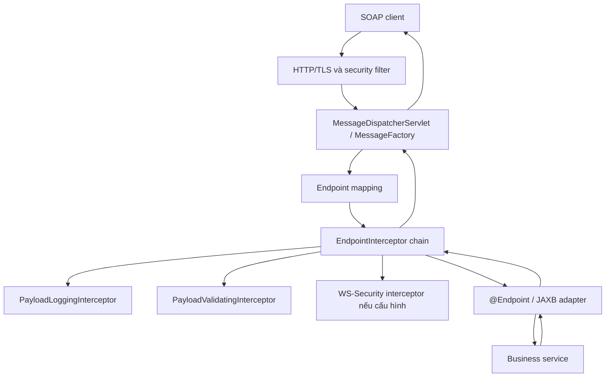

# PayloadLoggingInterceptor và ghi nội dung payload

Khi một dịch vụ SOAP đang tích hợp với đối tác gặp lỗi “request gửi đúng nhưng server trả Fault”, lập trình viên thường muốn xem **XML thực sự đi qua Spring Web Services**. `PayloadLoggingInterceptor` giúp quan sát **payload XML** mà Spring-WS đang xử lý. Tuy nhiên, ghi nội dung SOAP Body có thể làm lộ mã định danh, dữ liệu khách hàng, thông tin đơn hàng hoặc những phần nghiệp vụ vốn được bảo vệ bằng TLS/WS-Security. Một interceptor hữu ích khi phát triển có thể trở thành lỗ hổng bảo mật hoặc nút thắt hiệu năng khi bật đại trà trong production.

Bài học thuộc chương **Interceptor** của module **SPRING_WEB_SERVICES**. Trong quy trình **contract-first**, nhóm thiết kế XSD/WSDL, sinh JAXB, xây dựng `@Endpoint` và `WebServiceTemplate`, rồi kiểm tra SOAP Fault, interceptor, XML security, WS-Security và chứng chỉ. **Payload logging** nằm trong bức tranh đó như một công cụ **quan sát/chẩn đoán**, không phải công cụ validate XSD, xác thực chữ ký hay bảo đảm hợp đồng.

Trọng tâm: `PayloadLoggingInterceptor` thực sự thấy phần nào của thông điệp, khi nào callback được chạy, cách cấu hình trong Spring-WS, cách tránh ghi dữ liệu nhạy cảm và chiến lược thay thế bằng **metadata-only logging** để vận hành an toàn.

> Nguyên tắc: **không bật ghi toàn bộ SOAP payload ở production chỉ để “dễ debug”**. Trước tiên hãy ghi metadata đã kiểm soát; chỉ thu payload có giới hạn, có quyền truy cập và thời hạn lưu rõ ràng khi quy trình xử lý sự cố thật sự cần.

## 1. Mục tiêu học tập

Sau bài này, bạn có thể:

- Phân biệt `PayloadLoggingInterceptor`, `SoapEnvelopeLoggingInterceptor`, Spring-WS message tracing, HTTP access logs và application logs.
- Cấu hình `PayloadLoggingInterceptor` trong chuỗi `EndpointInterceptor` bằng `WsConfigurer` và chỉ kích hoạt ở profile chẩn đoán phù hợp.
- Hiểu ba tình huống **request**, **response** và **SOAP Fault**, cùng các đường lỗi có thể không đi qua endpoint interceptor.
- Giải thích vì sao payload logging **không** mặc định ghi HTTP headers, SOAP Header hay toàn Envelope.
- Nhận biết các rủi ro PII, bí mật nghiệp vụ, token xuất hiện trong Body, lưu trữ log, correlation ID và XML Signature.
- Lựa chọn logging theo **mức độ nhạy cảm**, **mục tiêu chẩn đoán** và **ngân sách hiệu năng**.
- Xây dựng một interceptor thay thế chỉ ghi metadata, không serialize raw payload.
- Thiết kế kiểm thử xác nhận logger không lộ thông tin nhạy cảm, không làm hỏng SOAP message và không lẫn trạng thái giữa các request.

## 2. Payload là gì trong một SOAP message?

Một SOAP 1.1 request có dạng:

```xml
<soap:Envelope
    xmlns:soap="http://schemas.xmlsoap.org/soap/envelope/"
    xmlns:ord="urn:example:order:v1"
    xmlns:ctx="urn:example:context:v1">
    <soap:Header>
        <ctx:CorrelationId>corr-101</ctx:CorrelationId>
    </soap:Header>
    <soap:Body>
        <ord:GetOrderStatusRequest>
            <ord:orderId>ORD-1001</ord:orderId>
        </ord:GetOrderStatusRequest>
    </soap:Body>
</soap:Envelope>
```

Ở đây, **SOAP Envelope** bao gồm Header và Body, còn **payload** thường chỉ **phần tử nghiệp vụ đầu tiên trong SOAP Body**:

```xml
<ord:GetOrderStatusRequest xmlns:ord="urn:example:order:v1">
    <ord:orderId>ORD-1001</ord:orderId>
</ord:GetOrderStatusRequest>
```

`PayloadLoggingInterceptor` tập trung ghi payload đó từ nguồn XML của SOAP message. Nó **không phải bộ chụp toàn bộ HTTP request** và không phải cách mặc định để xem `ctx:CorrelationId` trong SOAP Header hay HTTP `SOAPAction`.

### 2.1. So sánh các phạm vi log

| Cơ chế | Thông tin quan sát chính | Điểm cần lưu ý |
|---|---|---|
| **`PayloadLoggingInterceptor`** | Payload XML trong SOAP Body theo callback server | Có thể chứa PII/dữ liệu nghiệp vụ, thường không gồm SOAP Header |
| **`SoapEnvelopeLoggingInterceptor`** | SOAP Envelope rộng hơn, gồm Header/Body | Nguy cơ lộ WS-Security token, chữ ký, header nhạy cảm cao hơn |
| **Spring-WS message tracing** | Thông điệp theo logger tracing của framework | Mức chi tiết phụ thuộc level, cấu hình, phiên bản; phải xem log thực tế |
| **HTTP access log** | URL, phương thức, status, thời gian, địa chỉ mạng | Không tự hiểu payload QName hoặc SOAP Fault detail |
| **Ứng dụng nghiệp vụ** | Operation, correlation ID, mã trạng thái, thời gian xử lý | Nên dùng dữ liệu đã chuẩn hóa, có giới hạn và đã lọc |
| **Gateway/proxy logs** | Hành vi transport, TLS, authentication, routing | Có thể bỏ sót request bị chặn ở tầng khác; quản lý quyền riêng |

Không nên bật đồng thời tất cả các loại log trên ở mức chi tiết tối đa mà không xác định **dữ liệu nào được ghi trùng** và ai có quyền đọc.

### 2.2. QName của payload vẫn là căn cứ hợp đồng

Trong hệ thống **contract-first**, XSD khai báo global element, WSDL `wsdl:part/@element` tham chiếu QName đó, còn `@PayloadRoot` thường dùng QName của payload để tìm endpoint.

```text
XSD:  {urn:example:order:v1}GetOrderStatusRequest
WSDL: part element="ord:GetOrderStatusRequest"
SOAP: Body chứa ord:GetOrderStatusRequest
Java: @PayloadRoot(namespace="urn:example:order:v1",
                   localPart="GetOrderStatusRequest")
```

Prefix `ord` có thể thành `x` hoặc dùng default namespace mà **không đổi QName**. Vì vậy không nên so sánh raw log XML theo chuỗi prefix rồi kết luận client sai contract; cần dùng XML parser namespace-aware, matcher QName hoặc XSD validation.

## 3. Hợp đồng ví dụ để quan sát request và response

Một XSD rút gọn `orders-v1.xsd`:

```xml
<?xml version="1.0" encoding="UTF-8"?>
<xs:schema
    xmlns:xs="http://www.w3.org/2001/XMLSchema"
    targetNamespace="urn:example:order:v1"
    xmlns:ord="urn:example:order:v1"
    elementFormDefault="qualified">

    <xs:element name="GetOrderStatusRequest">
        <xs:complexType>
            <xs:sequence>
                <xs:element name="orderId" type="xs:string"/>
            </xs:sequence>
        </xs:complexType>
    </xs:element>

    <xs:element name="GetOrderStatusResponse">
        <xs:complexType>
            <xs:sequence>
                <xs:element name="orderId" type="xs:string"/>
                <xs:element name="status" type="xs:string"/>
                <xs:element name="customerEmail" type="xs:string"
                            minOccurs="0"/>
            </xs:sequence>
        </xs:complexType>
    </xs:element>
</xs:schema>
```

Ví dụ payload request:

```xml
<ord:GetOrderStatusRequest xmlns:ord="urn:example:order:v1">
    <ord:orderId>ORD-1001</ord:orderId>
</ord:GetOrderStatusRequest>
```

Ví dụ response:

```xml
<ord:GetOrderStatusResponse xmlns:ord="urn:example:order:v1">
    <ord:orderId>ORD-1001</ord:orderId>
    <ord:status>SHIPPED</ord:status>
    <ord:customerEmail>private@example.org</ord:customerEmail>
</ord:GetOrderStatusResponse>
```

Trường `customerEmail` là **dữ liệu giả định để minh họa rủi ro**. Trong log production, ngay cả khi client được phép nhận giá trị này trong SOAP response, hệ thống logging vẫn phải có chính sách riêng: nhân sự vận hành hoặc nhà cung cấp hệ thống log **không tự có quyền** xem mọi dữ liệu khách hàng.

WSDL sẽ liên kết các global elements với input/output của một operation. Việc thêm logging interceptor **không sửa WSDL, không đổi QName và không tự validate schema**.

## 4. `PayloadLoggingInterceptor` nằm ở đâu trong luồng Spring-WS?

Trong server Spring-WS sử dụng servlet HTTP:



Sơ đồ nêu **các trách nhiệm có thể có**, không cam kết thứ tự chính xác giữa security, validation và logging. Thứ tự thực tế phụ thuộc cấu hình interceptor, Spring-WS version và điểm hook được sử dụng.

`PayloadLoggingInterceptor` thuộc loại **server-side `EndpointInterceptor`**. Nó thường được đăng ký qua cấu hình endpoint interceptor chain, sau khi Spring-WS đã tìm được endpoint phù hợp. Vì vậy có các trường hợp:

- **SOAP hợp lệ, mapping thành công:** interceptor có cơ hội ghi request và response/Fault theo cấu hình.
- **HTTP 401/403 hoặc TLS handshake thất bại:** SOAP dispatcher có thể chưa nhận message; endpoint interceptor không chạy.
- **XML malformed hoặc Envelope sai version:** parser/message factory có thể dừng trước khi map endpoint.
- **Payload root QName không match bất kỳ endpoint nào:** chuỗi interceptor gắn với endpoint có thể không được gọi.
- **Interceptor trước đó chặn request:** các interceptor đứng sau có thể không nhận callback bình thường.

Do đó, không bao giờ coi log của `PayloadLoggingInterceptor` là **bằng chứng đầy đủ của mọi request đã đi tới cổng mạng**. Muốn đếm request bị chặn sớm, cần HTTP/gateway/transport metrics an toàn và log ở các điểm phù hợp khác.

## 5. Các callback request, response, fault và completion

Một `EndpointInterceptor` trong Spring-WS tham gia những pha như:

```java
boolean handleRequest(MessageContext context, Object endpoint);
boolean handleResponse(MessageContext context, Object endpoint);
boolean handleFault(MessageContext context, Object endpoint);
void afterCompletion(
    MessageContext context,
    Object endpoint,
    Exception exception
);
```

Các method trên là **chữ ký rút gọn** để giải thích vòng đời; một số implementation/interface có khai báo `throws Exception` theo version.

| Callback | Khi nào có ý nghĩa? | Thứ thường cần quan sát |
|---|---|---|
| `handleRequest` | Request đã vào chuỗi interceptor được áp dụng | QName payload, ID yêu cầu đã lọc, thời điểm bắt đầu |
| `handleResponse` | Luồng trả response bình thường | QName response, trạng thái thành công |
| `handleFault` | Luồng xử lý SOAP Fault | Loại Fault, mã lỗi ứng dụng đã chuẩn hóa |
| `afterCompletion` | Dọn dẹp/ghi thời gian sau quá trình xử lý liên quan endpoint | Latency, outcome, release context nếu có |

Các callback không nhất thiết đồng loạt chạy cho **mọi** request mạng. Một exception trong parser, transport, security filter hoặc trước khi chọn endpoint có thể đi theo đường khác. Việc `handleRequest` trả `false` hoặc ném lỗi có thể thay đổi callback tiếp theo; không nên dựa vào `afterCompletion` như điểm cleanup duy nhất cho dữ liệu do một filter tầng HTTP tạo.

### 5.1. Cấu hình logger và callback không đồng nghĩa nội dung sẽ xuất hiện

Ngay cả khi `setLogRequest(true)`, bạn còn cần:

- Interceptor đã **được đăng ký** trong chain thực.
- Có request **đi tới endpoint** và qua callback đó.
- Logging backend **cho phép mức log** và category tương ứng.
- Appender/collector chưa lọc hoặc giới hạn bỏ dòng.
- Nội dung XML có payload đọc được theo message factory/transformer.
- Chính sách bảo mật cho phép ghi dữ liệu đó trong môi trường đang chạy.

Nếu một trong các điều kiện không đạt, “không thấy dòng payload log” chưa đủ để kết luận server không nhận request.

## 6. Cấu hình `PayloadLoggingInterceptor` qua `WsConfigurer`

Với stack Spring Web Services, lớp thường dùng là:

```java
import org.springframework.ws.server.endpoint.interceptor.PayloadLoggingInterceptor;
```

Một cấu hình điển hình cho môi trường **chẩn đoán có kiểm soát**:

```java
package org.example.orders.config;

import java.util.List;

import org.springframework.context.annotation.Configuration;
import org.springframework.context.annotation.Profile;
import org.springframework.ws.config.annotation.WsConfigurer;
import org.springframework.ws.server.EndpointInterceptor;
import org.springframework.ws.server.endpoint.interceptor.PayloadLoggingInterceptor;

@Configuration
@Profile("soap-payload-diagnostics")
public class SoapPayloadLoggingConfiguration implements WsConfigurer {

    @Override
    public void addInterceptors(
            List<EndpointInterceptor> interceptors) {

        PayloadLoggingInterceptor logging =
            new PayloadLoggingInterceptor();

        logging.setLogRequest(true);
        logging.setLogResponse(true);
        logging.setLogFault(false);

        interceptors.add(logging);
    }
}
```

Giải thích:

1. `WsConfigurer` cung cấp hook `addInterceptors` để đăng ký interceptor vào hạ tầng Spring-WS được cấu hình bằng annotation.
2. `@Profile("soap-payload-diagnostics")` chỉ tạo cấu hình này khi profile **được kích hoạt có chủ đích**. Đây là ví dụ kiểm soát phạm vi, không phải tên profile mặc định của Spring.
3. `setLogRequest(true)` bật ý định ghi payload request; `setLogResponse(true)` bật ghi payload response bình thường.
4. `setLogFault(false)` minh họa việc **không ghi toàn bộ payload Fault** theo chế độ chẩn đoán này. Bạn có thể cấu hình theo nhu cầu test riêng nhưng không nên bật log raw Fault ở production theo mặc định.
5. Interceptor được đăng ký **một lần** ở cấu hình phù hợp; tránh đăng ký trùng bằng cả Java config, XML config và bean registration nếu chúng cùng nằm trong một chain.
6. Cần có `@EnableWs`/hạ tầng Spring-WS, servlet hoặc transport và `@Endpoint` riêng. Chỉ tạo cấu hình logging **không** sinh dịch vụ SOAP.

Đoạn code phù hợp với cơ chế Spring-WS hỗ trợ setter `setLogRequest`, `setLogResponse` và `setLogFault`. Khi dự án dùng phiên bản khác, hãy kiểm API công khai của phiên bản đã resolve; không áp dụng class/method signature của một thế hệ không tương thích.

### 6.1. Kích hoạt profile chỉ khi có quyền

Ví dụ trong môi trường test cô lập:

```properties
spring.profiles.active=soap-payload-diagnostics
```

Cấu hình trên **chỉ minh họa một cách kích hoạt profile**; với hệ thống có nhiều profile, hãy dùng cơ chế cấu hình vận hành thích hợp thay vì ghi đè danh sách profile đang có. Quan trọng hơn, cần có **quyền truy cập log**, vùng lưu có kiểm soát, giới hạn thời gian và dữ liệu giả/synthetic nếu có thể.

Trong production, không cấp cho mọi người khả năng bật profile payload logging bằng cách sửa môi trường tùy tiện. Việc bật chẩn đoán phải qua quy trình phê duyệt, hạn chế phạm vi và thu hồi sau khi hoàn tất sự cố.

### 6.2. Không nhầm bean declaration với interceptor registration

Đoạn sau **chỉ tạo bean**, chưa chắc đã được Spring-WS tự thêm vào endpoint interceptor chain:

```java
@Bean
public PayloadLoggingInterceptor payloadLoggingInterceptor() {
    return new PayloadLoggingInterceptor();
}
```

Để chắc chắn endpoint sử dụng, hãy **đăng ký qua cấu hình `WsConfigurer`** hoặc cơ chế tương đương của stack đang dùng. Nếu bạn vừa khai báo bean vừa thêm chính bean ấy bằng `addInterceptors`, đó có thể là cách hợp lệ, nhưng cần biết rõ nó được thêm **một lần**. Không suy đoán mọi bean `EndpointInterceptor` tự động được áp dụng cho mọi endpoint.

## 7. Payload logging hiển thị điều gì, và không hiển thị điều gì?

Giả sử request ở mục 2 và response ở mục 3. Nội dung ghi log sẽ liên quan các payload:

```xml
<ord:GetOrderStatusRequest xmlns:ord="urn:example:order:v1">
    <ord:orderId>ORD-1001</ord:orderId>
</ord:GetOrderStatusRequest>
```

```xml
<ord:GetOrderStatusResponse xmlns:ord="urn:example:order:v1">
    <ord:orderId>ORD-1001</ord:orderId>
    <ord:status>SHIPPED</ord:status>
    <ord:customerEmail>private@example.org</ord:customerEmail>
</ord:GetOrderStatusResponse>
```

Đây là **hình dạng dữ liệu**, không phải bản sao chính xác dòng log Spring-WS: thông điệp text, prefix XML, whitespace, mức log và logger category phụ thuộc phiên bản, serializer và cấu hình.

**Không nên kỳ vọng** interceptor payload tự in:

- HTTP `Authorization`, cookies, TLS certificate hay header `SOAPAction`.
- SOAP `Header` gồm `wsse:Security`, `wsa:Action` hoặc correlation ID nằm ngoài Body.
- Toàn bộ HTTP status line, proxy headers hay thông tin kết nối.
- Một XML element không tồn tại trong message.
- Dữ liệu trước khi XML parser/transport thất bại.
- “Dữ liệu đã được xác thực” hoặc “XSD-valid” — logging chỉ là quan sát.

Nếu cần chẩn đoán SOAP Header, có thể dùng công cụ khác hoặc kiểm tra header qua `SoapMessage.getSoapHeader()`, nhưng phải xem đây là **đường xử lý nhạy cảm**, nhất là khi có WS-Security. `SoapEnvelopeLoggingInterceptor` ghi phạm vi rộng hơn và có rủi ro lộ credential/token cao hơn nhiều; không nên bật tùy tiện.

## 8. Logging SOAP Fault có khác logging response không?

SOAP Fault cũng nằm trong SOAP Body nhưng có cấu trúc giao thức riêng. Ví dụ SOAP 1.1:

```xml
<soap:Envelope
    xmlns:soap="http://schemas.xmlsoap.org/soap/envelope/">
    <soap:Body>
        <soap:Fault>
            <faultcode>soap:Client</faultcode>
            <faultstring>Invalid order identifier</faultstring>
        </soap:Fault>
    </soap:Body>
</soap:Envelope>
```

Nếu dùng SOAP 1.2, Fault có `Code`, `Reason`, `Detail` với namespace SOAP 1.2; không dùng nguyên cấu trúc SOAP 1.1.

### 8.1. Các con đường tạo Fault

| Lỗi | Điểm phát sinh có thể có | Có chắc payload interceptor nhìn thấy? |
|---|---|---|
| Nghiệp vụ ném exception, resolver tạo SOAP Fault | Sau khi đã chọn endpoint | Có thể, phụ thuộc chain và cấu hình `handleFault` |
| `PayloadValidatingInterceptor` từ chối request sai XSD | Trong endpoint interceptor chain | Phụ thuộc thứ tự/short-circuit và callback |
| Không có endpoint cho root QName | Endpoint mapping | **Không chắc**, có thể chưa vào chain |
| XML không well-formed | XML parser/message factory | Thường chưa vào endpoint interceptor |
| SOAP version mismatch | SOAP protocol/message factory | Có thể thất bại trước callback |
| WS-Security token/signature sai | Security interceptor hoặc tầng bảo mật khác | Phụ thuộc thứ tự và policy |
| HTTP auth/TLS thất bại | Transport/security filter | Không được bảo đảm có SOAP message hay callback |

Cần tách **SOAP Fault đã tạo thành message** với **exception hoặc HTTP error không tạo SOAP Fault**. Bật `setLogFault(true)` không có nghĩa mọi lỗi server sẽ tự có XML Fault để in.

### 8.2. Vì sao không nên log nguyên Fault detail?

Fault detail đôi khi chứa:

- Giá trị field không hợp lệ do người dùng gửi, có thể là PII.
- Thông tin nghiệp vụ như mã khách hàng, số hợp đồng, hạn mức.
- Message của exception hoặc dữ liệu từ hệ thống backend.
- Thông tin mà API trả cho đúng client nhưng hệ thống log không được phép lưu.

Trong production, thường nên log **mã lỗi ứng dụng**, **operation**, **correlation ID đã chuẩn hóa** và **thời gian xử lý**, thay vì raw `faultstring`/`detail`. Đồng thời, không để logging interceptor vô tình thay đổi Fault hoặc nuốt exception gây sai HTTP/SOAP behavior.

## 9. Log level, logger category và hệ thống thu thập log

`PayloadLoggingInterceptor` dựa trên cơ chế logging của framework và backend mà ứng dụng sử dụng. Để quan sát thực tế, cần kiểm:

1. Interceptor đã được đăng ký vào Spring-WS hay chưa.
2. Logger name/category nào được instance dùng, gồm cấu hình riêng nếu version hỗ trợ.
3. Mức log mà interceptor phát ra, và mức tối thiểu do ứng dụng/collector cho phép.
4. Appender ghi về console, file hay hệ thống tập trung.
5. Chính sách **lọc nội dung**, retention, quyền truy cập và encryption-at-rest của nơi lưu log.

Một cấu hình dạng properties để thử log trong môi trường kiểm soát có thể đặt category phù hợp với namespace lớp:

```properties
logging.level.org.springframework.ws.server.endpoint.interceptor=DEBUG
```

**Cảnh báo:** giá trị này không cam kết interceptor ở mọi phiên bản sẽ phát raw payload ở mức DEBUG; cần kiểm implementation/mức phát log thực tế và category đang sử dụng. Nếu cần thay đổi cấu hình logging, làm ở **môi trường test có dữ liệu giả**, không bật cả gói Spring-WS ở TRACE trong production để dò thông điệp.

### Tại sao console log cũng là lưu trữ dữ liệu?

Trong container/cloud, stdout thường được agent gửi vào dịch vụ log tập trung. Một dòng XML in console có thể được:

- Nhân bản sang nhiều hệ thống quan sát.
- Giữ lâu hơn SOAP message thực tế.
- Tìm kiếm và tải xuống bởi nhiều vai trò.
- Đưa vào alert, ticket hoặc công cụ hỗ trợ có quyền rộng.
- Lưu trong bản snapshot, backup hoặc hệ thống phân tích dữ liệu.

Vì vậy, **“chỉ log để debug” không có nghĩa là dữ liệu chỉ tồn tại trong máy phát triển**. Hãy áp dụng nguyên tắc hạn chế thu thập, phân quyền, mã hóa, retention và xóa khi hết mục đích.

## 10. Vì sao raw payload logging là điểm rủi ro bảo mật?

Dù `PayloadLoggingInterceptor` không chủ động ghi `wsse:Security` trong Header, Body vẫn có thể chứa thông tin cực kỳ nhạy cảm:

| Nhóm dữ liệu | Ví dụ trong SOAP Body | Nguy cơ nếu log thô |
|---|---|---|
| Định danh | Số đơn hàng, ID khách hàng, mã hợp đồng | Liên kết dữ liệu giữa người dùng |
| PII | Email, điện thoại, địa chỉ giao hàng | Lộ thông tin cá nhân |
| Tài chính | Số tài khoản, thông tin thanh toán, số dư | Rủi ro gian lận/tuân thủ |
| Hồ sơ nghiệp vụ | Nội dung yêu cầu, văn bản hợp đồng | Lộ bí mật thương mại |
| Token không đặt đúng chỗ | Session token, one-time code trong Body | Credential leakage |
| File/đính kèm | Dữ liệu nhị phân/MTOM hoặc nội dung được tham chiếu | Tăng kích thước và rủi ro dữ liệu |
| Fault detail | Giá trị field sai, exception message | Lộ đầu vào hoặc nội bộ hệ thống |

**TLS không bảo vệ bản log sau khi SOAP đã được giải mã tại server.** Nếu WS-Security dùng XML Encryption, thứ tự interceptor có thể ảnh hưởng log nhìn thấy ciphertext hay plaintext sau giải mã; **không được** xem “đã dùng WS-Security” là bằng chứng raw logging an toàn.

Chữ ký WS-Security cũng không biến thông điệp thành không nhạy cảm. Một thông điệp đã được xác thực hợp lệ vẫn có thể chứa dữ liệu không nên lưu lâu.

### 10.1. Rủi ro từ logging ở phía trước xác thực

Khi ghi XML của request chưa được xác minh danh tính/chữ ký:

- Kẻ gửi có thể cố ý tạo nội dung rất dài nhằm làm đầy log.
- Dữ liệu chứa ký tự điều khiển/newline có thể gây nhiễu dòng log nếu backend xử lý không an toàn.
- Payload giả mạo có thể khiến hệ thống quan sát nhầm đối tác đã gửi request.
- Log raw XML quá sớm có thể kéo theo việc parse/transform một tài liệu không đáng tin thêm lần nữa.

Khi cần log trước xác thực, nên giới hạn ở **transport metadata**, kích thước, thời gian, kết quả chặn và thông tin đã được kiểm soát định dạng. Không sử dụng `sourceSystem` hoặc `tenantId` do client tự ghi để định danh caller trong log bảo mật.

## 11. Chính sách logging theo môi trường

Thay vì một cờ `logPayload=true` dùng cho mọi nơi, hãy định nghĩa chính sách:

| Môi trường / tình huống | Khuyến nghị | Điều kiện |
|---|---|---|
| Unit/integration test với XML giả | Có thể bật PayloadLoggingInterceptor khi cần | Test-only config, không dùng dữ liệu thật |
| Local developer | Bật tạm theo profile riêng | Fixture giả, log local an toàn, tắt sau chẩn đoán |
| Staging với dữ liệu đã ẩn danh | Có thể bật ngắn hạn, có kiểm soát | Phân quyền, giới hạn dung lượng, retention ngắn |
| Production bình thường | **Metadata-only** | Không log toàn payload/credential |
| Production incident đặc biệt | Chỉ xem xét cơ chế chụp payload có kiểm duyệt | Phê duyệt, scope hẹp, masking, giới hạn thời gian và audit |
| Audit bảo mật | Ghi sự kiện bảo mật chuẩn hóa | Không lưu secret/token hay signed XML tùy tiện |

### 11.1. Những thứ nên log mặc định

- Timestamp, service/environment và một event name ổn định.
- Operation/endpoint **được server xác định**, nếu có.
- QName payload đã được lấy bằng cơ chế an toàn, không phải raw XML nguyên văn.
- Correlation ID có giới hạn độ dài/ký tự, ưu tiên do server sinh hoặc chuẩn hóa.
- Kết quả thành công/Fault ở dạng mã ổn định.
- Thời gian xử lý, kích thước/nhóm kích thước, số lượng yêu cầu theo metric.
- Caller identity/tenant **đã xác thực** nếu thật sự cần và theo chính sách riêng tư.

### 11.2. Những thứ không nên log mặc định

- Toàn bộ SOAP Body, SOAP Header hay Envelope.
- HTTP `Authorization`, cookies, password, API key, private key, OAuth token.
- WS-Security UsernameToken/Nonce/signature value hoặc thông tin bí mật.
- Email, số điện thoại, địa chỉ, thông tin thanh toán.
- SOAP Fault detail chứa raw invalid value hoặc stack trace.
- Một số lượng không giới hạn bản XML tương tự khi đối tác retry.
- XML attachment/MTOM và nội dung file.

Đôi khi doanh nghiệp có nghĩa vụ lưu **hồ sơ giao dịch** theo quy định. Đó là bài toán **audit archive** với chính sách lưu trữ, quyền truy cập, tính toàn vẹn và retention riêng — không nên giải quyết bằng cách bật logger raw payload không kiểm soát.

## 12. Che dữ liệu (redaction): không chỉ tìm và thay bằng regex

Nếu quy trình đặc biệt cần lưu một phần XML payload, giải pháp an toàn phải hiểu cấu trúc XML:

1. Xác định **allowlist** các QName/field **được phép** đưa vào log. Mặc định loại bỏ field lạ.
2. Parse bằng cơ chế **namespace-aware** và **hardened**; không tin prefix cố định như `ord`.
3. Giới hạn input size, số element, độ sâu và thời gian xử lý; không làm thêm công vô hạn chỉ để log.
4. Làm việc trên **bản sao dành cho quan sát**, không sửa SOAP message gốc.
5. Mask các field như email, địa chỉ, số tài khoản, token và phần nội dung nghiệp vụ nhạy cảm.
6. Giới hạn độ dài từng giá trị, số item collection, tổng số ký tự log và tốc độ phát event.
7. Không lưu bản **raw** rồi mới cố xóa về sau; lọc **trước khi dữ liệu đến collector**.
8. Có regression tests khi XSD/WSDL thay đổi và field mới được thêm vào.

### 12.1. Ví dụ vì sao regex theo prefix thất bại

Giả sử code chỉ thay:

```text
<ord:customerEmail>...</ord:customerEmail>
```

Nhưng đối tác có thể gửi:

```xml
<x:customerEmail xmlns:x="urn:example:order:v1">
    private@example.org
</x:customerEmail>
```

hoặc:

```xml
<customerEmail xmlns="urn:example:order:v1">
    private@example.org
</customerEmail>
```

Cả ba cùng QName nhưng regex tìm chuỗi `<ord:customerEmail>` sẽ bỏ sót hai trường hợp. Bản XML log có thể lộ dữ liệu cho dù chức năng SOAP vẫn hoạt động chính xác.

**Chiến lược tốt hơn:** xác định trường cần ẩn bằng expanded QName `{urn:example:order:v1}customerEmail` trên một cây XML đã được parse an toàn, hoặc dựng một **log event từ dữ liệu được chọn lọc** mà không serialize toàn bộ Body.

### 12.2. Redaction không được làm hỏng WS-Security

Thay đổi SOAP XML **trước khi xác minh hoặc sau khi ký** có thể làm thay đổi canonicalized octets, mất hiệu lực chữ ký hoặc làm sai giá trị nghiệp vụ. Vì thế:

- Redact **bản sao phục vụ log**, không sửa message đang gửi/nhận.
- Không viết interceptor “xóa node nhạy cảm khỏi request” rồi trả cùng request đó cho endpoint.
- Không mặc định cùng QName nhưng đổi prefix thì **XML Signature luôn còn hợp lệ**; signature/canonicalization có thể nhạy với biểu diễn namespace.
- Để WS-Security/WSS4J thực hiện xác minh, giải mã và áp policy; logger không phải lớp bảo mật.
- Nếu thư viện logging đọc `Source` theo dạng streaming, cần kiểm cơ chế giữ/replay payload; không tự tiêu thụ stream trước khi JAXB unmarshalling.

Một giải pháp log event metadata-only thường đơn giản và đáng tin hơn rất nhiều so với một bộ redaction XML viết vội.

## 13. Tạo interceptor chỉ ghi metadata cho production

Trong ứng dụng thường xuyên tiếp nhận SOAP, nên có một interceptor **không chép raw XML vào logger**. Ví dụ dưới đây ghi các sự kiện theo vòng đời và dùng `MessageContext` để lưu thời điểm bắt đầu của **một lần dispatch**, thay vì dùng instance field mutable:

```java
package org.example.orders.observability;

import org.slf4j.Logger;
import org.slf4j.LoggerFactory;
import org.springframework.ws.context.MessageContext;
import org.springframework.ws.server.EndpointInterceptor;

public final class SoapMetadataLoggingInterceptor
        implements EndpointInterceptor {

    private static final Logger LOG =
        LoggerFactory.getLogger(SoapMetadataLoggingInterceptor.class);

    private static final String START_KEY =
        "app.soap.logging.startedNanos";

    @Override
    public boolean handleRequest(
            MessageContext context, Object endpoint) {

        context.setProperty(START_KEY, System.nanoTime());
        LOG.info("soap_request_received");
        return true;
    }

    @Override
    public boolean handleResponse(
            MessageContext context, Object endpoint) {

        LOG.info("soap_response_sent");
        return true;
    }

    @Override
    public boolean handleFault(
            MessageContext context, Object endpoint) {

        LOG.warn("soap_fault_sent");
        return true;
    }

    @Override
    public void afterCompletion(
            MessageContext context,
            Object endpoint,
            Exception ex) {

        Object value = context.getProperty(START_KEY);
        if (value instanceof Long started) {
            long durationNanos = System.nanoTime() - started;
            long durationMillis =
                java.util.concurrent.TimeUnit.NANOSECONDS
                    .toMillis(durationNanos);

            LOG.info("soap_dispatch_completed durationMs={} failed={}",
                durationMillis, ex != null);
        }
    }
}
```

Đây là ví dụ Java 17 ở mức **điểm mở rộng server**; hành vi thời điểm gọi `afterCompletion` vẫn phụ thuộc chain. Nó cố ý **không** in `SoapMessage`, payload, token, `endpoint.toString()` hoặc exception message. Muốn log operation chính xác, hãy lấy từ mapping/metadata đã được server xác định theo một API phù hợp, hoặc gắn một mã operation ổn định trong service; không lấy bừa text trong XML không tin cậy.

### 13.1. Vì sao cách này an toàn hơn?

- Không có field `currentRequest` hoặc `lastPayload` bị ghi đồng thời.
- Mỗi request lưu thời điểm trong **MessageContext riêng**.
- Chỉ log event name/latency/outcome đơn giản.
- Không có serialize XML thứ hai chỉ để ghi log.
- Giảm nguy cơ lưu PII và không phụ thuộc serializer chọn prefix nào.
- Có thể kết hợp với metrics tracing để đếm requests/errors.

Tuy nhiên, ngay cả metadata cũng cần chính sách. Một correlation ID lấy từ SOAP Header phải được giới hạn và chuẩn hóa; không tự động xem nó là danh tính đã xác thực. Nếu bổ sung tenant ID, dùng giá trị đã qua authentication/authorization, không dùng `tenantHint` từ XML thô.

### 13.2. Đăng ký một interceptor trong `WsConfigurer`

```java
import java.util.List;

import org.springframework.context.annotation.Configuration;
import org.springframework.ws.config.annotation.WsConfigurer;
import org.springframework.ws.server.EndpointInterceptor;

@Configuration
public class ObservabilityConfiguration implements WsConfigurer {

    @Override
    public void addInterceptors(
            List<EndpointInterceptor> interceptors) {

        interceptors.add(new SoapMetadataLoggingInterceptor());
    }
}
```

Đây là **phương án production** tách biệt với cấu hình `@Profile("soap-payload-diagnostics")`. Nếu đồng thời kích hoạt cả hai, ứng dụng vẫn có thể log raw payload từ `PayloadLoggingInterceptor`; do đó chính sách triển khai phải bảo đảm profile chẩn đoán **không được bật ngoài phạm vi cho phép**.

Mã này trình bày cách đăng ký một interceptor mà không giữ state trong singleton. Đối với dự án thực, có thể khai báo interceptor thành bean ở cấu hình độc lập nếu cần inject các dependency theo constructor, nhưng vẫn chỉ đăng ký **một lần** vào chain.

## 14. So sánh với interceptor phía SOAP client

Tên lớp **`PayloadLoggingInterceptor`** trong chương này thuộc nhánh `org.springframework.ws.server.endpoint.interceptor` và triển khai vai trò **server endpoint interceptor**.

Client `WebServiceTemplate` có cơ chế interceptor khác: `org.springframework.ws.client.support.interceptor.ClientInterceptor`. Hai interface có **chữ ký callback khác nhau**; không thể mặc nhiên gắn server `PayloadLoggingInterceptor` trực tiếp vào mảng client interceptor.

Với client, flow thường là:

```text
Business code / WebServiceTemplate
    -> marshal request JAXB
    -> client interceptor / callback
    -> HTTP/TLS + WS-Security transport
    -> SOAP server
    <- SOAP response / Fault
    -> client interceptor / fault resolver
    -> unmarshal về Java
```

Muốn chẩn đoán client, có thể:

- Sử dụng một **ClientInterceptor** riêng, với cùng chính sách không log raw XML.
- Chạy mock SOAP server bằng `MockWebServiceServer` để assert request XML mà template gửi ra, thay vì lưu XML production.
- Bật message tracing của Spring-WS trong môi trường test đã cô lập, khi thực sự cần bản XML.
- Kiểm tra SOAPAction, endpoint URI, TLS handshake, timeout và security policy ở lớp transport.
- Dùng correlation ID/các mã event chuẩn hóa để nối log hai phía.

Không vì không thấy log từ server `PayloadLoggingInterceptor` mà kết luận client không gửi request: thông điệp có thể bị chặn trên mạng, tại HTTP security, SOAP parser hoặc endpoint mapping.

## 15. Thứ tự interceptor: logging, validation, WS-Security

Một server có thể có nhiều interceptors:

```java
@Override
public void addInterceptors(
        java.util.List<EndpointInterceptor> interceptors) {

    interceptors.add(securityInterceptor);
    interceptors.add(validationInterceptor);
    interceptors.add(metadataInterceptor);
}
```

Đoạn này là **mã cấu trúc giả định**: ba biến `securityInterceptor`, `validationInterceptor` và `metadataInterceptor` phải là những bean/instance đã được cấu hình theo chính sách thật. Không coi thứ tự trên là công thức đúng cho mọi hệ thống.

Những câu hỏi cần giải đáp trước khi chọn thứ tự:

1. Security interceptor nào xác minh chữ ký và giải mã payload? Nó có thay đổi dạng message trước khi validator đọc không?
2. XSD validator chạy trên **plaintext đã xác minh** hay trên ciphertext/định dạng chưa đúng?
3. Logger chỉ ghi metadata hay serialize toàn bộ XML?
4. Nếu một interceptor trả `false`, interceptor nào không chạy tiếp?
5. Response và Fault callbacks đi qua chain theo thứ tự nào trong version đang chạy?
6. Nếu SOAP signature được tạo ở outbound, logging/transform có thay đổi message trước/sau khi ký không?

Đừng dựa vào việc “log trước security để xem XML thật” nếu điều đó thu thập token hoặc input chưa xác thực. Cũng đừng coi “log sau security” tự động an toàn vì payload đã được giải mã và có thể **càng nhạy cảm hơn**.

### 15.1. Ghi nguyên văn payload có thể tác động tới hiệu năng và stream

Một số SOAP message source được backing bởi buffer, một số khác có thể gắn với stream tùy message factory và transport. Việc đọc XML để log có thể:

- Buộc thực hiện thêm một lần transform/serialize.
- Phân bổ thêm bộ nhớ tương đương kích thước payload.
- Làm tăng CPU, GC và latency.
- Phải xử lý namespace declarations và encoding lại.
- Với custom streaming code, có thể tiêu thụ nguồn XML trước khi JAXB xử lý.

`PayloadLoggingInterceptor` do framework cung cấp thường xử lý theo API của framework, nhưng việc thêm **custom logging/redaction interceptor** tự đọc `Source` cần được kiểm thử kỹ với message factory thực. **Không tự giả định một `Source` bất kỳ có thể đọc lại nhiều lần**.

### 15.2. Logging không được thay đổi kết quả nghiệp vụ

Interceptor quan sát nên không tạo side effect:

- Không thay QName, XML Body hay SOAP Header.
- Không tự thêm/bỏ phần tử vào thông điệp đang được xác minh chữ ký.
- Không đổi schema validation policy theo việc bật log.
- Không biến response thành Fault chỉ vì collector không khả dụng.
- Không làm SOAP request block vô hạn khi log backend chậm.
- Không giữ mutable request data ở instance field giữa các thread.

Nếu logging bị lỗi do transformer/IO/collector, cần chính sách vận hành rõ: log lỗi một cách an toàn và vẫn giữ tính toàn vẹn của nghiệp vụ trong phạm vi cho phép. Với audit bắt buộc theo pháp lý, đây là yêu cầu riêng cần thiết kế transaction/audit trail, không trộn với debug payload logger.

## 16. Giới hạn kích thước, tốc độ và khả năng chống DoS

Trong production, một SOAP request có thể chứa hàng nghìn phần tử lặp hoặc attachments lớn. Nếu ghi toàn bộ payload, chỉ một request bất thường có thể tạo nhiều MB log, nhiều bản sao trong RAM và chi phí lưu trữ cao.

| Rủi ro | Biểu hiện | Biện pháp |
|---|---|---|
| Payload quá lớn | Tăng heap/GC và dung lượng log | Giới hạn request size từ gateway/server, không raw log |
| Nhiều request lặp | Log flood và tăng chi phí collector | Rate limit, metric aggregation, sampling có chủ đích |
| XML quá sâu | Parser/transformer dùng CPU/tài nguyên lớn | XML parser hardening và depth/element limits |
| Attachment/MTOM | Dữ liệu nhị phân hoặc nội dung tham chiếu quá lớn | Metadata về size/content type, không ghi file |
| Logging đồng bộ | Latency tăng khi disk/collector chậm | Backend bất đồng bộ có giới hạn hàng đợi và drop policy rõ |
| Thông điệp lỗi hàng loạt | Fault logging bùng nổ | Ghi mã lỗi ổn định + count, không toàn `detail` |
| Payload giả chứa newline/text log | Làm nhiễu log hoặc cảnh báo | Structured fields, validate/sanitize inputs |
| Retention lâu | Dữ liệu nhạy cảm tồn tại lâu hơn nhu cầu | TTL, RBAC, encryption, deletion policy |

**Sampling không tự giải quyết privacy.** Nếu 1% payload được ghi mà mỗi payload vẫn chứa dữ liệu thanh toán, các bản ghi ấy vẫn là dữ liệu nhạy cảm phải bảo vệ. Cân nhắc lấy mẫu **metadata events** trước khi lấy mẫu raw XML.

### 16.1. Không dùng log thô để đo số lượng nghiệp vụ

Đếm số đơn/độ trễ nên dựa trên metrics/counters đã được xác định, ví dụ số SOAP calls theo operation/outcome, không dựa vào số dòng `PayloadLoggingInterceptor`. Một request có thể sinh nhiều dòng log, còn một số request thất bại trước interceptor sẽ **không có** dòng nào.

## 17. Kiểm thử chức năng và bảo mật của payload logging

Trong môi trường test, hãy kiểm tra **cả việc có log khi muốn, và không có log khi không được phép**.

| Mã | Ca kiểm thử | Kỳ vọng |
|---|---|---|
| P01 | Profile chẩn đoán bật, request hợp lệ | Interceptor được đăng ký và ghi payload request trong test |
| P02 | Profile chẩn đoán bật, response hợp lệ | Ghi payload response nếu cấu hình cho phép |
| P03 | Prefix XML đổi nhưng URI/local name giữ nguyên | Endpoint/validator xử lý như cùng QName |
| P04 | Metadata-only interceptor ở môi trường thường | Chỉ log event/latency, không chứa XML Body |
| P05 | Hai request với ID khác nhau chạy đồng thời | Event, correlation và response không lẫn |
| N01 | Profile chẩn đoán tắt | Không có raw payload log từ interceptor này |
| N02 | Response chứa email giả `private@example.org` | Log production **không chứa** địa chỉ ấy |
| N03 | SOAP Header chứa UsernameToken giả | Không ghi raw SOAP Header trong policy thông thường |
| N04 | Root QName không match endpoint | Không giả định payload interceptor sẽ thấy request |
| N05 | XML không well-formed | Parser có thể chặn trước interceptor; vẫn có metric/lỗi an toàn |
| N06 | HTTP auth/TLS thất bại | Không đòi phải có SOAP payload log |
| N07 | SOAP Fault có detail nhạy cảm | Chỉ log mã lỗi/metadata theo policy |
| N08 | Client gửi payload rất lớn | Không làm đầy log/heap; giới hạn size có hiệu lực |
| N09 | WS-Security signature sai | Business service không được gọi, không raw log secret |
| N10 | Bật cả hai cấu hình logging | Không vi phạm chính sách do profile chẩn đoán bị bật ngoài ý muốn |

### 17.1. Kiểm thử endpoint bằng `MockWebServiceClient`

`MockWebServiceClient` gửi payload vào Spring-WS application context để kiểm tra endpoint và interceptor; không cần HTTP server thực cho những ca này.

Ví dụ test ý tưởng với XSD mục 3:

```java
import static org.springframework.ws.test.server.RequestCreators.withPayload;
import static org.springframework.ws.test.server.ResponseMatchers.noFault;
import static org.springframework.ws.test.server.ResponseMatchers.validPayload;

import org.springframework.context.ApplicationContext;
import org.springframework.core.io.ClassPathResource;
import org.springframework.xml.transform.StringSource;
import org.springframework.ws.test.server.MockWebServiceClient;

MockWebServiceClient client =
    MockWebServiceClient.createClient(applicationContext);

StringSource request = new StringSource("""
    <o:GetOrderStatusRequest xmlns:o="urn:example:order:v1">
        <o:orderId>ORD-1001</o:orderId>
    </o:GetOrderStatusRequest>
    """);

client.sendRequest(withPayload(request))
      .andExpect(noFault())
      .andExpect(validPayload(
          new ClassPathResource("xsd/orders-v1.xsd")
      ));
```

Đây là **đoạn test lõi**, không phải class JUnit standalone: `applicationContext` phải đến từ Spring test context; XSD, `@Endpoint`, mapper và service nghiệp vụ phải tồn tại. Test này chỉ xác nhận response không là SOAP Fault và hợp lệ với XSD; muốn kiểm riêng log, cần instrument/capture **logger appender trong môi trường test** theo logging backend hoặc kiểm cấu hình interceptor.

**Đừng đưa XML chứa dữ liệu thật vào test fixture** chỉ để xác minh interceptor có hoạt động. Dùng thông tin giả và clear log appender/test context giữa các ca để tránh kết quả test này bị ảnh hưởng ca khác.

### 17.2. Kiểm thử “không có dữ liệu nhạy cảm” có ý nghĩa hơn test raw log

Với cấu hình production metadata-only, có thể tạo SOAP response chứa email giả `private@example.org`, gửi request, rồi kiểm tra output của test appender:

```text
Expected:
  soap_request_received
  soap_response_sent
  soap_dispatch_completed durationMs=...

Must NOT appear:
  private@example.org
  <ord:GetOrderStatusResponse
  UsernameToken
  Authorization: Bearer
```

Đây là mục tiêu test, không phải bản log cố định của framework. Với backend logging khác nhau, cách capture appender sẽ khác. Nếu policy áp dụng masking cho trường nào, thêm các biến thể namespace/prefix để tránh lỗ hổng regex.

### 17.3. Kiểm thử integration qua HTTP/TLS

Mock test không xác minh:

- Access log/gateway log có raw body hay không.
- TLS/mTLS certificate và HTTP security.
- SOAPAction và content type của binding.
- Error trước endpoint mapping hoặc parsing.
- Response/Fault qua message factory trên network thật.
- Giao tiếp với đối tác và logger backend trong môi trường triển khai.

Cần integration test với server thực, request hợp lệ/sai hợp đồng và proxy nếu hệ thống có gateway. Từ đó bảo đảm log không bị nhân bản ngoài chủ đích và endpoint vẫn xử lý SOAP đúng.

## 18. Chẩn đoán: có interceptor nhưng không thấy log

| Triệu chứng | Nguyên nhân thường gặp | Cách kiểm |
|---|---|---|
| Không có payload log | Profile chưa bật hoặc `WsConfigurer` chưa được nạp | Kiểm component scan/profile và danh sách interceptor |
| Có log metadata nhưng không có XML | Production config cố tình không raw log | Xác nhận chính sách trước khi bật chẩn đoán |
| Request hợp lệ nhưng không thấy log | Logger category/level lọc hoặc interceptor không trong chain | Kiểm cấu hình backend và mapping |
| WSDL tải được nhưng SOAP POST không log | WSDL publication khác endpoint dispatch | Kiểm servlet mapping, `@PayloadRoot` |
| HTTP 401/403 | HTTP/TLS security chặn trước interceptor | Kiểm gateway/filter/certificate |
| No endpoint mapping | QName root sai `targetNamespace`/local name | Dùng parser namespace-aware, đối chiếu XSD/WSDL |
| Request xuất log nhưng response không | Interceptor chain hoặc `setLogResponse(false)`, lỗi xử lý | Kiểm callback/outcome và configuration |
| Fault không xuất log | `setLogFault(false)` hoặc Fault xảy ra trước chain | Phân loại giai đoạn lỗi |
| Log thiếu SOAP Header | Đúng phạm vi của PayloadLoggingInterceptor | Không vội chuyển sang Envelope raw logging production |
| Log XML khác prefix trong mẫu | Serializer chọn namespace prefix khác | So QName và validation, không raw string |
| CPU/GC tăng khi debug | Serialize XML thêm, payload lớn, logger chậm | Tắt raw log, đo latency, áp size/rate limits |
| Xuất hiện email/token trong log | Chính sách masking/collector không phù hợp | Dừng raw logging, cô lập/xử lý log đã thu, rà soát truy cập |
| Không có log cho request malformed | Parser lỗi trước endpoint interceptor | Quan sát error ở tầng transport/parser an toàn |
| Trùng dòng payload | Đăng ký interceptor hai lần hoặc bật tracing khác | Rà soát cấu hình Java/XML/logger levels |

### 18.1. Quy trình debug theo thứ tự

1. Kiểm request có tới host/port/servlet mapping không, TLS/HTTP auth có chặn không.
2. Kiểm SOAP Envelope và phiên bản binding.
3. Đọc expanded QName của payload root và so với `@PayloadRoot`/WSDL part.
4. Xác nhận endpoint mapping thành công; khi chưa có endpoint, interceptor payload có thể chưa chạy.
5. Kiểm profile, `WsConfigurer` và interceptor được đăng ký **một lần**.
6. Kiểm logger category, level, appender và collector; không tự bật mức TRACE tràn lan.
7. Nếu thấy payload request nhưng không thấy response, kiểm callback response/Fault, validation và exception resolver.
8. Đối chiếu dữ liệu XML với XSD/JAXB; logging không thay việc validate.
9. Khi sự cố liên quan security, kiểm logs của tầng WS-Security và transport ở **dạng đã lọc**, không ghi token/chữ ký.
10. Tắt chẩn đoán, kiểm policy retention và hậu kiểm dữ liệu đã phát sinh.

## 19. Bài thực hành: xây dựng chính sách quan sát cho SOAP service

**Bối cảnh:** service SOAP contract-first cung cấp operation `GetOrderStatus`. Request chỉ chứa `orderId`, response chứa `status` và có thể chứa `customerEmail`. Hệ thống dùng HTTPS/mTLS và WS-Security Signature cho những đối tác cần xác thực mức message. Nhóm muốn phát hiện request sai namespace và SOAP Fault trong production, nhưng không được lưu email/credential.

### 19.1. Yêu cầu thiết kế

1. Trong môi trường local với dữ liệu giả, cho phép bật `PayloadLoggingInterceptor` bằng profile `soap-payload-diagnostics`.
2. Production mặc định chỉ chạy `SoapMetadataLoggingInterceptor`; raw payload log phải tắt.
3. Event log có operation name đã xác định, outcome, latency và correlation ID đã qua lọc nếu cần.
4. Không ghi `customerEmail`, `wsse:Security`, HTTP `Authorization` hoặc raw SOAP Fault detail.
5. Khi request có QName sai và không tìm được endpoint, hệ thống vẫn có metric lỗi ở tầng HTTP/dispatcher phù hợp mà không phụ thuộc `PayloadLoggingInterceptor`.
6. Khi SOAP Fault phát sinh, ghi fault category/code chuẩn hóa, không ghi raw exception stack trace cho client.
7. Chạy test SOAP 1.1 request đúng, request sai namespace, request lỗi validation và lỗi chữ ký.
8. Kiểm payload logging không làm thay đổi XML hoặc vi phạm WS-Security signature.
9. Có quy trình phê duyệt, expiration và dọn dẹp log khi cần bật chẩn đoán đặc biệt.

### 19.2. Chọn cơ chế đúng với nhu cầu

| Nhu cầu | Cơ chế nên ưu tiên |
|---|---|
| Xem payload để xác nhận QName/XSD khi phát triển | `PayloadLoggingInterceptor` trong test/local có kiểm soát |
| Quan sát số request và latency production | Metadata-only interceptor + metrics |
| Kiểm XSD của request/response | `PayloadValidatingInterceptor` |
| Xác minh token/chữ ký | WS-Security interceptor và security policy |
| Kiểm URL, TLS, HTTP 401/403 | HTTP/gateway/transport observability |
| Kiểm SOAP Header trong test | SOAP-aware matcher/interceptor test fixture, không raw log production |
| Kiểm client gửi đúng payload | `MockWebServiceServer` hoặc client integration test |
| Kiểm server xử lý đúng | `MockWebServiceClient` và HTTP integration test |
| Lưu audit transaction có giá trị pháp lý | Hệ thống audit riêng với quyền/retention/tính toàn vẹn |

### 19.3. Câu hỏi tự kiểm tra

1. `PayloadLoggingInterceptor` chủ yếu ghi gì: toàn SOAP Envelope, HTTP headers hay SOAP Body payload?
2. Vì sao `soap:Header` có WS-Security UsernameToken không nên bị ghi nguyên văn để “điều tra lỗi”?
3. Vì sao một request bị HTTP 401 có thể không xuất hiện trong log của interceptor này?
4. Nếu root QName sai, endpoint interceptor có chắc chạy không?
5. `setLogResponse(true)` có đồng nghĩa mọi SOAP Fault đều được log không?
6. Vì sao việc đổi prefix `ord` thành `x` không nhất thiết làm request sai hợp đồng?
7. Vì sao regex tìm `<ord:customerEmail>` không bảo đảm mask dữ liệu?
8. Một signed SOAP message có được sửa payload trực tiếp để xóa email trước khi endpoint xử lý không?
9. Khi production chỉ log `soap_dispatch_completed durationMs`, làm sao vẫn kiểm được độ trễ và tỷ lệ lỗi?
10. Server và client interceptor có dùng cùng interface hay không?
11. Khi bật payload logging làm heap tăng đột ngột, nên kiểm những chi phí nào?
12. Metadata-only logging có tự thay việc validate XSD, xác thực token hoặc phân quyền người gọi không?

**Đáp án tham khảo:** (1) SOAP Body payload; (2) lộ token/chữ ký và dữ liệu an ninh; (3) chặn ở HTTP trước SOAP endpoint; (4) không; (5) không, phụ thuộc callback/điểm lỗi và cấu hình; (6) QName vẫn cùng URI/local part; (7) prefix và default namespace có thể khác; (8) không, có thể phá chữ ký và contract; (9) đo metrics/structured events không chứa payload; (10) không, server `EndpointInterceptor` khác client `ClientInterceptor`; (11) serialize XML thêm, buffering, GC, appender/collector chậm; (12) không.

### 19.4. Thử nghiệm mở rộng

Thực hiện ba lượt test trên cùng bộ cấu hình:

- **Local chẩn đoán:** bật profile, dùng dữ liệu giả; xác minh request/response payload được log và không có dữ liệu thật.
- **Production giả lập:** tắt profile; chạy request có `customerEmail=private@example.org` trong response và kiểm toàn bộ log không chứa giá trị đó.
- **Tải đồng thời:** gửi nhiều yêu cầu với orderId khác nhau, có một nhóm lỗi Fault; kiểm metadata không bị trộn giữa request, request duration ổn định và log volume không tăng theo kích thước Body.

Trong mỗi lượt, phải xác nhận SOAP response/Fault **vẫn đúng XSD/WSDL**; không được đổi nghiệp vụ chỉ vì bật/tắt logger.

## 20. Tổng kết

`PayloadLoggingInterceptor` là công cụ Spring Web Services hữu ích để **ghi nội dung payload XML** khi server xử lý một endpoint SOAP. Nó giúp quan sát request/response trong quá trình phát triển và gỡ lỗi QName/JAXB/contract, nhưng **không phải** một cơ chế ghi trọn Envelope, một bộ kiểm XSD hay lớp bảo mật. Một số lỗi — TLS, HTTP auth, parser, SOAP version, endpoint mapping — có thể xảy ra trước khi interceptor được gọi.

Vì SOAP Body có thể chứa PII, bí mật nghiệp vụ hoặc dữ liệu bị bảo vệ, **raw payload logging chỉ nên bật trong môi trường và khoảng thời gian được kiểm soát**. Trong production, ưu tiên event/metrics đã chuẩn hóa, correlation ID đã lọc, mã lỗi ổn định và thời gian xử lý. Khi phải thu XML, hãy dùng bản sao, allowlist QName, masking an toàn, giới hạn tài nguyên và chính sách truy cập/retention nghiêm ngặt; không dùng regex theo prefix hay chỉnh message đã ký.

Kết hợp quan sát đúng phạm vi với **XSD/WSDL contract-first**, JAXB/OXM, `@PayloadRoot`, `PayloadValidatingInterceptor`, SOAP Fault, XML parser hardening, TLS và WS-Security giúp hệ thống tích hợp doanh nghiệp vừa dễ chẩn đoán vừa bảo vệ dữ liệu, không đánh đổi bảo mật để lấy sự tiện lợi của log.
