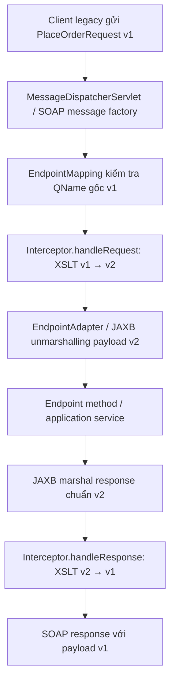
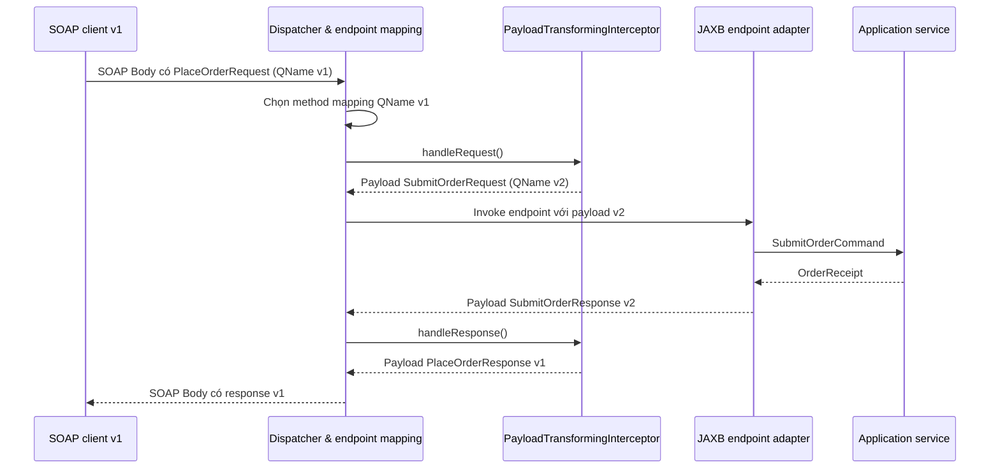
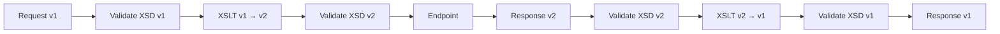
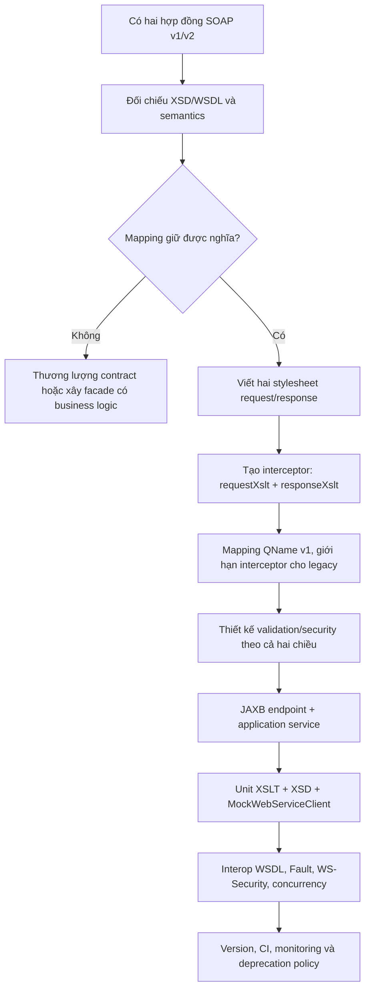

# PayloadTransformingInterceptor và chuyển đổi hợp đồng bằng XSLT

## 1. Bối cảnh: giữ dịch vụ SOAP mới mà vẫn phục vụ đối tác dùng hợp đồng cũ

Một doanh nghiệp nâng cấp dịch vụ đặt hàng từ hợp đồng SOAP v1 sang v2. Phía v1 gửi `PlaceOrderRequest`, còn v2 dùng `SubmitOrderRequest` với các tên trường và namespace khác nhau. Nhóm triển khai muốn:

- Tiếp tục phục vụ client v1 trong thời gian chuyển đổi.
- Xử lý nghiệp vụ ở một application service chung.
- Không sao chép toàn bộ mã xử lý đơn hàng thành hai nhánh khó bảo trì.
- Công bố XSD/WSDL chính xác cho cả client cũ lẫn client mới.
- Giữ các cơ chế SOAP Fault, XML security, WS-Security và kiểm thử liên thông.

Một cách giải quyết là dùng **`PayloadTransformingInterceptor`** của **Spring Web Services (Spring-WS)**. Interceptor này áp dụng **XSLT** lên **SOAP payload**: request v1 được chuyển thành dạng XML v2 **trước khi method endpoint xử lý**, còn response v2 được chuyển ngược về dạng v1 **sau khi method endpoint trả kết quả**.

Ví dụ client cũ gửi:

```xml
<legacy:PlaceOrderRequest
    xmlns:legacy="urn:example:orders:legacy:v1">
  <legacy:externalRef>EXT-1001</legacy:externalRef>
  <legacy:items>
    <legacy:item>
      <legacy:sku>SKU-01</legacy:sku>
      <legacy:qty>2</legacy:qty>
    </legacy:item>
  </legacy:items>
</legacy:PlaceOrderRequest>
```

Endpoint nghiệp vụ hiện đại muốn đọc:

```xml
<ord:SubmitOrderRequest
    xmlns:ord="urn:example:orders:canonical:v2">
  <ord:clientReference>EXT-1001</ord:clientReference>
  <ord:lines>
    <ord:line>
      <ord:productCode>SKU-01</ord:productCode>
      <ord:quantity>2</ord:quantity>
    </ord:line>
  </ord:lines>
</ord:SubmitOrderRequest>
```

**Đề bài trực tiếp:** hiểu `PayloadTransformingInterceptor`, cấu hình stylesheet ở đúng điểm trong pipeline Spring-WS và biết **giới hạn của nó**. Đặc biệt, việc chuyển XML không tự thay đổi WSDL, SOAP version, thông tin xác thực hay Fault contract.

Trong module **SPRING_WEB_SERVICES**, đây là phần của chương **Interceptor**, gắn với phát triển SOAP contract-first, JAXB code generation, endpoint và SOAP client, XSD/WSDL, SOAP Fault, interceptor, XML/WS-Security, chứng chỉ và interoperability testing.

**Mục tiêu sau bài học:** người học có thể thiết kế sơ đồ chuyển đổi request/response, viết XSLT 1.0, cấu hình interceptor theo operation legacy, kiểm soát thứ tự validation/security, xác minh bằng `MockWebServiceClient` và nhận diện khi nào cần một compatibility gateway hoặc mapper Java thay thế.

## 2. `PayloadTransformingInterceptor` thực sự làm gì?

`PayloadTransformingInterceptor` nằm trong package:

```java
org.springframework.ws.server.endpoint.interceptor
        .PayloadTransformingInterceptor
```

Đây là một implementation của `org.springframework.ws.server.EndpointInterceptor`, dựa trên cơ chế biến đổi XML bằng XSLT. Nó có hai thuộc tính chính:

| Thuộc tính Java/bean | Nhiệm vụ | Thời điểm |
|---|---|---|
| `requestXslt` / `setRequestXslt(Resource)` | Chuyển XML payload của request | `handleRequest(...)` trước khi endpoint được invoke |
| `responseXslt` / `setResponseXslt(Resource)` | Chuyển XML payload của response bình thường | `handleResponse(...)` sau khi endpoint xử lý |

Có thể chỉ cấu hình một chiều request hoặc response; chiều không có stylesheet được giữ nguyên. Nhưng **phải có ít nhất một trong hai** để interceptor có ý nghĩa và khởi tạo hợp lệ.

Các hook của interceptor:

| Hook | Hành vi của `PayloadTransformingInterceptor` |
|---|---|
| `handleRequest(MessageContext, Object)` | Áp dụng request XSLT nếu được cấu hình; thông thường trả `true` để tiếp tục chuỗi |
| `handleResponse(MessageContext, Object)` | Áp dụng response XSLT nếu được cấu hình; thông thường trả `true` |
| `handleFault(MessageContext, Object)` | **Không chuyển SOAP Fault** theo mặc định |
| `afterCompletion(MessageContext, Object, Exception)` | Không thêm logic cleanup riêng theo mặc định |
| `afterPropertiesSet()` | Chuẩn bị các stylesheet khi bean được khởi tạo |

Điều này tạo ra ba sự thật quan trọng:

1. Interceptor biến đổi **payload XML**, không phải hợp đồng WSDL được công bố.
2. Interceptor chỉ được gọi sau khi Spring-WS đã tìm được **endpoint phù hợp**.
3. Chuyển đổi response bình thường không đồng nghĩa với chuyển đổi **Fault**.

Vì vậy, nếu consumer cũ cần một fault detail v1 riêng, **phải thiết kế và xử lý Fault bằng cơ chế khác**, không kỳ vọng `responseXslt` tự làm việc đó.

### 2.1. Không nhầm với `PayloadValidatingInterceptor`

| Thành phần | Câu hỏi nó giải quyết |
|---|---|
| `PayloadTransformingInterceptor` | “XML này cần chuyển thành hình dạng nào trước/sau endpoint?” |
| `PayloadValidatingInterceptor` | “Payload hiện tại có hợp lệ theo schema được cấu hình không?” |
| `Wss4jSecurityInterceptor` | “SOAP security token/signature/timestamp có đáp ứng policy không?” |
| `PayloadLoggingInterceptor` | “Cần quan sát payload ra sao?” (cần redaction nếu nhạy cảm) |
| `SoapFaultMappingExceptionResolver` | “Exception được biểu diễn thành SOAP Fault thế nào?” |

Transform **không mặc nhiên validate** cả input và output. Một XML tạo được sau XSLT có thể đúng cú pháp nhưng sai `xs:sequence`, thiếu phần tử bắt buộc hoặc chứa state ngoài enum XSD.

## 3. Vị trí trong pipeline: endpoint mapping diễn ra trước XSLT

Đây là chi tiết quyết định tính đúng đắn của kiến trúc.



**Trình tự chính xác về mặt ý tưởng:**

1. `MessageDispatcherServlet` tiếp nhận request SOAP; message factory parse Envelope và cung cấp payload.
2. Spring-WS **chọn endpoint dựa trên thông điệp gốc**, ví dụ QName `{urn:example:orders:legacy:v1}PlaceOrderRequest`.
3. Sau khi chọn endpoint, chuỗi `EndpointInterceptor` chạy `handleRequest`. `PayloadTransformingInterceptor` chuyển payload v1 thành v2.
4. `DefaultMethodEndpointAdapter` cùng argument resolver/JAXB đọc **payload đã được chuyển**, sau đó gọi Java method.
5. Method tạo response v2.
6. `handleResponse` chuyển payload response v2 về response v1, rồi Spring-WS xuất thông điệp về client.

**Hệ quả:** đừng viết một method chỉ có `@PayloadRoot(namespace = V2, localPart = "SubmitOrderRequest")` rồi mong request `PlaceOrderRequest` v1 được interceptor biến thành v2 để mapper nhận diện. Request v1 **không đến được interceptor** nếu chưa có endpoint mapping tương ứng.

Điểm khởi đầu cần có là **mapping cho QName cũ**, hoặc một compatibility mapping/gateway được thiết kế riêng cho v1.

### 3.1. Sơ đồ trình tự và ranh giới trách nhiệm



Không phải mỗi ô là một Java bean độc lập: sơ đồ dùng để hiểu thứ tự và vị trí đổi XML. SOAP Header và transport vẫn phải tuân theo policy hiện hành, không tự được v1↔v2 chỉ vì Body đã chuyển.

## 4. Thiết kế hai hợp đồng trước khi viết stylesheet

Trong hướng **contract-first**, phải chốt cấu trúc v1/v2 và hành vi operation trước. Ta dùng ví dụ tối giản:

| Khái niệm | Legacy v1 | Canonical v2 |
|---|---|---|
| Request root QName | `{urn:example:orders:legacy:v1}PlaceOrderRequest` | `{urn:example:orders:canonical:v2}SubmitOrderRequest` |
| External order ID | `externalRef` | `clientReference` |
| Danh sách hàng | `items/item` | `lines/line` |
| Mã hàng | `sku` | `productCode` |
| Số lượng | `qty` | `quantity` |
| Response root QName | `PlaceOrderResponse` | `SubmitOrderResponse` |
| Mã xác nhận | `receiptNo` | `orderId` |
| Trạng thái | `status` | `state` |

### 4.1. Phác thảo XSD cho request v1

```xml
<?xml version="1.0" encoding="UTF-8"?>
<xs:schema xmlns:xs="http://www.w3.org/2001/XMLSchema"
           targetNamespace="urn:example:orders:legacy:v1"
           xmlns:l="urn:example:orders:legacy:v1"
           elementFormDefault="qualified">
  <xs:element name="PlaceOrderRequest">
    <xs:complexType>
      <xs:sequence>
        <xs:element name="externalRef" type="xs:string"/>
        <xs:element name="items">
          <xs:complexType>
            <xs:sequence>
              <xs:element name="item" maxOccurs="unbounded">
                <xs:complexType>
                  <xs:sequence>
                    <xs:element name="sku" type="xs:string"/>
                    <xs:element name="qty" type="xs:positiveInteger"/>
                  </xs:sequence>
                </xs:complexType>
              </xs:element>
            </xs:sequence>
          </xs:complexType>
        </xs:element>
      </xs:sequence>
    </xs:complexType>
  </xs:element>
  <xs:element name="PlaceOrderResponse">
    <xs:complexType>
      <xs:sequence>
        <xs:element name="receiptNo" type="xs:string"/>
        <xs:element name="status" type="xs:string"/>
      </xs:sequence>
    </xs:complexType>
  </xs:element>
</xs:schema>
```

### 4.2. Phác thảo XSD cho request v2

```xml
<?xml version="1.0" encoding="UTF-8"?>
<xs:schema xmlns:xs="http://www.w3.org/2001/XMLSchema"
           targetNamespace="urn:example:orders:canonical:v2"
           xmlns:o="urn:example:orders:canonical:v2"
           elementFormDefault="qualified">
  <xs:element name="SubmitOrderRequest">
    <xs:complexType>
      <xs:sequence>
        <xs:element name="clientReference" type="xs:string"/>
        <xs:element name="lines">
          <xs:complexType>
            <xs:sequence>
              <xs:element name="line" maxOccurs="unbounded">
                <xs:complexType>
                  <xs:sequence>
                    <xs:element name="productCode" type="xs:string"/>
                    <xs:element name="quantity" type="xs:positiveInteger"/>
                  </xs:sequence>
                </xs:complexType>
              </xs:element>
            </xs:sequence>
          </xs:complexType>
        </xs:element>
      </xs:sequence>
    </xs:complexType>
  </xs:element>
  <xs:element name="SubmitOrderResponse">
    <xs:complexType>
      <xs:sequence>
        <xs:element name="orderId" type="xs:string"/>
        <xs:element name="state" type="xs:string"/>
      </xs:sequence>
    </xs:complexType>
  </xs:element>
</xs:schema>
```

Hai schema này minh họa **cấu trúc payload**; WSDL đầy đủ còn cần message, portType, binding, service address, action và các Fault được thỏa thuận. Trong thực tế, schema nên định nghĩa constraint cho mã, enum trạng thái và idempotency theo nghiệp vụ.

**Một vấn đề không thể giải bằng XSLT:** nếu v2 cần một field bắt buộc như `currency` mà v1 không mang và không có policy mặc định tin cậy, không thể tự bịa giá trị. Cần thỏa thuận contract, bổ sung nguồn đã xác thực hoặc thiết kế adapter có lỗi rõ ràng.

## 5. Stylesheet chuyển request v1 sang v2

Đặt stylesheet trong mã nguồn được quản lý version, ví dụ:

```text
src/main/resources/
  contracts/
    orders/v1/legacy-orders.xsd
    orders/v2/canonical-orders.xsd
  xslt/
    orders/
      legacy-request-to-v2.xsl
      canonical-response-to-v1.xsl
```

Nên coi XSLT là một **artifact gắn với cặp phiên bản hợp đồng**, không đặt tên mơ hồ như `convert.xsl`. Khi v3 ra đời, nhóm có thể bổ sung mapping v1→v3 hoặc v2→v3 và kiểm soát thay đổi tương thích riêng.

### 5.1. XSLT 1.0 cho request

```xml
<?xml version="1.0" encoding="UTF-8"?>
<xsl:stylesheet version="1.0"
    xmlns:xsl="http://www.w3.org/1999/XSL/Transform"
    xmlns:l="urn:example:orders:legacy:v1"
    xmlns:o="urn:example:orders:canonical:v2"
    exclude-result-prefixes="l">

  <xsl:output method="xml"
              encoding="UTF-8"
              omit-xml-declaration="yes"
              indent="yes"/>

  <xsl:template match="/">
    <xsl:choose>
      <xsl:when test="l:PlaceOrderRequest">
        <o:SubmitOrderRequest>
          <o:clientReference>
            <xsl:value-of
                select="l:PlaceOrderRequest/l:externalRef"/>
          </o:clientReference>
          <o:lines>
            <xsl:for-each
                select="l:PlaceOrderRequest/l:items/l:item">
              <o:line>
                <o:productCode>
                  <xsl:value-of select="l:sku"/>
                </o:productCode>
                <o:quantity>
                  <xsl:value-of select="l:qty"/>
                </o:quantity>
              </o:line>
            </xsl:for-each>
          </o:lines>
        </o:SubmitOrderRequest>
      </xsl:when>
      <xsl:otherwise>
        <xsl:message terminate="yes">
          Unsupported legacy payload QName
        </xsl:message>
      </xsl:otherwise>
    </xsl:choose>
  </xsl:template>
</xsl:stylesheet>
```

Kết quả:

```xml
<o:SubmitOrderRequest xmlns:o="urn:example:orders:canonical:v2">
  <o:clientReference>EXT-1001</o:clientReference>
  <o:lines>
    <o:line>
      <o:productCode>SKU-01</o:productCode>
      <o:quantity>2</o:quantity>
    </o:line>
  </o:lines>
</o:SubmitOrderRequest>
```

### 5.2. Phân tích những phần dễ gây lỗi

- `l:PlaceOrderRequest` là QName theo **namespace URI**, không yêu cầu client thật sự dùng prefix `l`. Client dùng `legacy` hay `ns1` vẫn được nếu URI khớp.
- Các path XPath 1.0 như `l:items/l:item` **phải có prefix** khi XML input có namespace. Unprefixed `item` thông thường chọn element không có namespace và sẽ không khớp.
- `xsl:value-of` tạo text node với escape XML, không phải thao tác ghép raw markup; nó không tự validate field.
- `xsl:for-each` giữ thứ tự document trừ khi có `xsl:sort`; điều này có thể quan trọng đối với `xs:sequence` và thứ tự line.
- `xsl:message terminate="yes"` là cách phát hiện root không mong đợi, tránh việc stylesheet lặng lẽ sinh XML rỗng.
- Nếu input có `items` thiếu `item`, stylesheet có thể tạo `<o:lines/>`, nhưng XSD v2 minh họa yêu cầu ít nhất một line. **Schema validation trước/sau vẫn bắt buộc** khi dữ liệu không tin cậy.

### 5.3. Đừng để XSLT tự sửa số tiền hoặc timezone

Chuyển tên phần tử `qty` → `quantity` là phép chuyển tương đối cơ học. Nhưng phép tính `xs:decimal` cho tiền bằng XSLT 1.0 có thể dùng số dấu phẩy động không phù hợp yêu cầu precision. Với ngày giờ, thay `+07:00` bằng `Z` bằng thao tác chuỗi sẽ thay đổi **ý nghĩa thời điểm**, không chỉ format.

Nếu cần cộng thuế, chuyển đổi tiền tệ, làm tròn, đổi giờ theo vùng, hoặc quyết định trạng thái nghiệp vụ, đặt logic ở application/domain service hoặc dùng kiểu số/ngày giờ với semantics được kiểm soát và test biên. Interceptor không nên trở thành một engine nghiệp vụ khó audit.

## 6. Stylesheet chuyển response v2 sang v1

Endpoint xử lý nghiệp vụ trả XML v2:

```xml
<o:SubmitOrderResponse xmlns:o="urn:example:orders:canonical:v2">
  <o:orderId>ORD-9001</o:orderId>
  <o:state>RECEIVED</o:state>
</o:SubmitOrderResponse>
```

Client cũ chờ XML v1:

```xml
<l:PlaceOrderResponse xmlns:l="urn:example:orders:legacy:v1">
  <l:receiptNo>ORD-9001</l:receiptNo>
  <l:status>RECEIVED</l:status>
</l:PlaceOrderResponse>
```

Stylesheet `canonical-response-to-v1.xsl`:

```xml
<?xml version="1.0" encoding="UTF-8"?>
<xsl:stylesheet version="1.0"
    xmlns:xsl="http://www.w3.org/1999/XSL/Transform"
    xmlns:l="urn:example:orders:legacy:v1"
    xmlns:o="urn:example:orders:canonical:v2"
    exclude-result-prefixes="o">

  <xsl:output method="xml" encoding="UTF-8"
              omit-xml-declaration="yes"/>

  <xsl:template match="/">
    <xsl:choose>
      <xsl:when test="o:SubmitOrderResponse">
        <l:PlaceOrderResponse>
          <l:receiptNo>
            <xsl:value-of
                select="o:SubmitOrderResponse/o:orderId"/>
          </l:receiptNo>
          <l:status>
            <xsl:value-of
                select="o:SubmitOrderResponse/o:state"/>
          </l:status>
        </l:PlaceOrderResponse>
      </xsl:when>
      <xsl:otherwise>
        <xsl:message terminate="yes">
          Unexpected canonical response payload
        </xsl:message>
      </xsl:otherwise>
    </xsl:choose>
  </xsl:template>
</xsl:stylesheet>
```

**Điều kiện cần thiết:** `state` và `status` phải có cùng ý nghĩa hoặc có một bảng quy đổi được phê duyệt. Nếu canonical v2 thêm `PAYMENT_PENDING` mà legacy v1 không hiểu, không được mặc định trả `RECEIVED` chỉ để client parse thành công.

Hai stylesheet request và response **không phải phép nghịch đảo tổng quát**. Khi một phía có field được gộp/bỏ, transform ngược có thể mất thông tin. Đánh giá tương thích theo **semantics và dữ liệu**, không chỉ theo XML syntax.

## 7. Cấu hình bean `PayloadTransformingInterceptor` trong Spring-WS

### 7.1. Java configuration đơn giản

```java
package com.example.orders.soap.config;

import org.springframework.context.annotation.Bean;
import org.springframework.context.annotation.Configuration;
import org.springframework.core.io.ClassPathResource;
import org.springframework.ws.server.endpoint.interceptor.PayloadTransformingInterceptor;

@Configuration
public class LegacyTransformBeanConfiguration {

    @Bean(name = "legacyOrderTransformer")
    public PayloadTransformingInterceptor legacyOrderTransformer() {
        PayloadTransformingInterceptor interceptor =
                new PayloadTransformingInterceptor();

        interceptor.setRequestXslt(new ClassPathResource(
                "xslt/orders/legacy-request-to-v2.xsl"));
        interceptor.setResponseXslt(new ClassPathResource(
                "xslt/orders/canonical-response-to-v1.xsl"));

        return interceptor;
    }
}
```

Đây là cấu hình bean; **đăng ký bean không đồng nghĩa tự động đưa nó vào mọi endpoint chain**. Phải gắn interceptor với endpoint mapping hoặc `WsConfigurer` đúng như kiến trúc triển khai. Khi Spring khởi tạo bean, `afterPropertiesSet()` chuẩn bị stylesheet theo vòng đời Spring.

### 7.2. Tương đương bằng XML bean definition

Nếu dự án legacy dùng Spring XML configuration, cấu hình có thể là:

```xml
<bean id="legacyOrderTransformer"
      class="org.springframework.ws.server.endpoint.interceptor.PayloadTransformingInterceptor">
  <property name="requestXslt"
            value="classpath:xslt/orders/legacy-request-to-v2.xsl"/>
  <property name="responseXslt"
            value="classpath:xslt/orders/canonical-response-to-v1.xsl"/>
</bean>
```

Hai tên property **chính xác** là `requestXslt` và `responseXslt`. Tránh viết `requestXsl`/`responseXsl` hoặc tự suy đoán tên từ framework XSLT khác.

### 7.3. Chỉ chuyển một chiều

Một số tình huống chỉ muốn chỉnh response cho client legacy, ví dụ endpoint đã nhận đúng input nhưng client cũ cần output khác:

```java
PayloadTransformingInterceptor interceptor =
        new PayloadTransformingInterceptor();
interceptor.setResponseXslt(new ClassPathResource(
        "xslt/orders/canonical-response-to-v1.xsl"));
```

Khi đó request không đổi. Ngược lại, chỉ có `requestXslt` thì response không đổi. Sự lựa chọn phải căn cứ trên **hợp đồng đã công bố**: một legacy request QName khác v2 thường cần cả hai chiều hoặc một thiết kế mapping riêng.

## 8. Chỉ áp dụng interceptor cho operation legacy

Nếu cứ đăng ký `PayloadTransformingInterceptor` toàn cục, một `SubmitOrderRequest` v2 hợp lệ cũng có thể bị stylesheet v1→v2 từ chối vì root không đúng. Điều này làm hỏng client mới.

Giải pháp là gắn interceptor vào **mapping phục vụ thông điệp v1**. Spring-WS có cơ chế **smart interceptor** hỗ trợ lọc theo QName payload.

### 8.1. Ví dụ cấu hình có điều kiện theo QName

```java
package com.example.orders.soap.config;

import java.util.List;
import org.springframework.beans.factory.annotation.Qualifier;
import org.springframework.context.annotation.Configuration;
import org.springframework.ws.config.annotation.EnableWs;
import org.springframework.ws.config.annotation.WsConfigurer;
import org.springframework.ws.server.EndpointInterceptor;
import org.springframework.ws.server.endpoint.interceptor.PayloadTransformingInterceptor;
import org.springframework.ws.soap.server.endpoint.interceptor.PayloadRootSmartSoapEndpointInterceptor;

@EnableWs
@Configuration
public class LegacyWsConfigurer implements WsConfigurer {

    private static final String LEGACY_NS =
            "urn:example:orders:legacy:v1";

    private final PayloadTransformingInterceptor legacyTransformer;

    public LegacyWsConfigurer(
            @Qualifier("legacyOrderTransformer")
            PayloadTransformingInterceptor legacyTransformer) {
        this.legacyTransformer = legacyTransformer;
    }

    @Override
    public void addInterceptors(List<EndpointInterceptor> interceptors) {
        interceptors.add(new PayloadRootSmartSoapEndpointInterceptor(
                legacyTransformer, LEGACY_NS, "PlaceOrderRequest"));
    }
}
```

Với các phiên bản Spring-WS có hai API trên, `PayloadRootSmartSoapEndpointInterceptor` chỉ ủy quyền sang transform khi **payload request có namespace URI và local name** được khai báo. Điều này tránh tác động đến endpoint canonical v2.

**Chi tiết cấu hình quan trọng:**

- Bean `legacyOrderTransformer` được tạo ở **`LegacyTransformBeanConfiguration` riêng**, không constructor-inject từ cùng config đang tạo nó gây vòng phụ thuộc.
- Chỉ có **một cơ chế kích hoạt `@EnableWs`/SOAP servlet được kiểm soát** trong ứng dụng; tránh đăng ký trùng với auto-configuration của Spring Boot.
- Nếu có nhiều operation v1 (`CancelOrderRequest`, `GetOrderRequest`), cần định nghĩa phạm vi match phù hợp, hoặc có transformer/mapping riêng cho từng operation.
- Có thể tổ chức interceptor ở cấp endpoint mapping phục vụ riêng v1 thay vì gắn smart interceptor toàn cục; lựa chọn phụ thuộc cách project đăng ký mapping.
- Sau khi tích hợp, kiểm tra qua `MockWebServiceClient` rằng request v1 thật được transform, v2 không bị transform và endpoint được chọn đúng.

### 8.2. Không lọc theo QName sau khi đã thay đổi QName một cách vô ý

Một chuỗi nhiều smart interceptors có thể gặp lỗi khó thấy:

1. Interceptor A lọc `PlaceOrderRequest` v1 rồi transform thành `SubmitOrderRequest` v2.
2. Interceptor B đặt sau A nhưng cũng lọc theo QName v1; khi B kiểm tra request hiện tại, payload **có thể đã thành v2**, nên B bị bỏ qua.

Vì vậy, khi cần nhiều bước validation/transform, đừng mặc định mọi bộ lọc “legacy-only” có thể đặt tùy ý quanh các transformer. Hãy kiểm tra thời điểm bộ lọc đọc QName, hoặc gắn cả chuỗi vào **mapping đã chọn theo QName gốc** và kiểm thử đầy đủ thứ tự. Đây là một trong những lý do nên tránh cấu hình interceptor quá phức tạp chỉ để duy trì một hợp đồng cũ.

## 9. Chữ ký `@Endpoint` khi mapping v1 nhưng payload đã biến thành v2

Đây là nơi dễ nhầm nhất trong thực hành.

### 9.1. Endpoint cho v1 nhưng nhận JAXB DTO v2

Giả sử `SubmitOrderRequest` và `SubmitOrderResponse` được JAXB/XJC sinh từ XSD v2. Một endpoint có thể định tuyến theo **QName v1** nhưng xử lý **đối tượng v2 sau XSLT**:

```java
package com.example.orders.soap.endpoint;

import com.example.orders.application.OrderApplicationService;
import com.example.orders.soap.generated.v2.SubmitOrderRequest;
import com.example.orders.soap.generated.v2.SubmitOrderResponse;
import com.example.orders.soap.mapper.OrderContractMapper;
import org.springframework.ws.server.endpoint.annotation.Endpoint;
import org.springframework.ws.server.endpoint.annotation.PayloadRoot;
import org.springframework.ws.server.endpoint.annotation.RequestPayload;
import org.springframework.ws.server.endpoint.annotation.ResponsePayload;

@Endpoint
public class LegacyOrderEndpoint {
    private static final String LEGACY_NS =
            "urn:example:orders:legacy:v1";

    private final OrderApplicationService service;
    private final OrderContractMapper mapper;

    public LegacyOrderEndpoint(
            OrderApplicationService service,
            OrderContractMapper mapper) {
        this.service = service;
        this.mapper = mapper;
    }

    @PayloadRoot(namespace = LEGACY_NS, localPart = "PlaceOrderRequest")
    @ResponsePayload
    public SubmitOrderResponse placeLegacyOrder(
            @RequestPayload SubmitOrderRequest request) {
        var command = mapper.toCommand(request);
        var receipt = service.submit(command);
        return mapper.toResponse(receipt);
    }
}
```

**Đọc đúng từng lớp:**

- Annotation `@PayloadRoot` định danh **request QName ban đầu** để Spring-WS tìm được method.
- Argument `@RequestPayload SubmitOrderRequest` là kiểu **đã qua transform**; JAXB unmarshal payload mới sau `handleRequest`.
- Giá trị method trả `SubmitOrderResponse` được marshal thành **XML v2**.
- `handleResponse` chuyển response XML đó thành **PlaceOrderResponse v1** trước khi gửi về client legacy.

Nếu JAXB generated class không mang `@XmlRootElement` hoặc có dạng `JAXBElement<T>`, code endpoint/marshaller phải điều chỉnh theo output thực tế của XJC. Không sửa trực tiếp generated code để “đánh lừa” endpoint mapping.

### 9.2. Endpoint canonical v2 không đi qua XSLT legacy

```java
@Endpoint
public class CanonicalOrderEndpoint {
    private static final String NS =
            "urn:example:orders:canonical:v2";

    private final OrderApplicationService service;
    private final OrderContractMapper mapper;

    public CanonicalOrderEndpoint(
            OrderApplicationService service,
            OrderContractMapper mapper) {
        this.service = service;
        this.mapper = mapper;
    }

    @PayloadRoot(namespace = NS, localPart = "SubmitOrderRequest")
    @ResponsePayload
    public SubmitOrderResponse submitOrder(
            @RequestPayload SubmitOrderRequest request) {
        var command = mapper.toCommand(request);
        var receipt = service.submit(command);
        return mapper.toResponse(receipt);
    }
}
```

Ví dụ minh họa hai QName request khác nhau có thể cùng tồn tại và cùng sử dụng một application service độc lập SOAP. Các class `OrderApplicationService` và `OrderContractMapper` là thành phần dự án tự viết; chúng phải được triển khai, kiểm tra business validation/authorization và trả XML đúng XSD. Phần mã này không phải project đầy đủ độc lập.

### 9.3. Mối quan hệ với WSDL

Chữ ký Java không thay thế public WSDL:

| Client | WSDL/XSD công bố | Request QName trên dây | Response QName trên dây |
|---|---|---|---|
| Client v1 | `LegacyOrders.wsdl` + XSD v1 | `PlaceOrderRequest` | `PlaceOrderResponse` |
| Client v2 | `CanonicalOrders.wsdl` + XSD v2 | `SubmitOrderRequest` | `SubmitOrderResponse` |

JAXB DTO v2 là chi tiết phía server. Client v1 **không phải biết** `SubmitOrderRequest` hay namespace v2 đã tồn tại trong quá trình xử lý nội bộ. Nếu WSDL v1 đã công bố SOAP Fault detail kiểu v1, server cũng phải tiếp tục tuân contract lỗi đó.

## 10. Thứ tự interceptor: validation, transform và security

`EndpointInterceptor` có các hook theo vòng đời:

- `handleRequest` chạy theo thứ tự cấu hình trên đường **đi vào**.
- `handleResponse`/`handleFault` chạy theo **thứ tự ngược lại** trên đường đi ra đối với những interceptor tham gia thành công.
- `afterCompletion` dành cho cleanup sau xử lý endpoint theo vòng đời được API quy định.

Do đó, sắp xếp interceptor phải tính **cả hai chiều**, không chỉ xem request.

### 10.1. Chuỗi mong muốn khi có hai schema



Về lý thuyết, một danh sách interceptor **[validator v1, transformer, validator v2]** có thể phù hợp:

```text
handleRequest:  validate-v1 -> transform-v1-to-v2 -> validate-v2
endpoint:       xử lý payload v2
handleResponse: validate-v2 -> transform-v2-to-v1 -> validate-v1
```

Nhưng phải cấu hình **phạm vi áp dụng thực tế** (mapping legacy) và kiểm tra smart interceptor có đánh giá QName trước/sau transform. Không sao chép ví dụ này thành danh sách global rồi để validator v1 kiểm tra mọi request v2. Khi cần, đưa validation đầu vào/đầu ra vào compatibility adapter với những bước kiểm tra tường minh.

### 10.2. Sắp xếp với WS-Security

Khi dùng WS-Security để xác minh chữ ký của SOAP Body v1, phải **xác minh thông điệp gốc trước khi đổi Body bằng XSLT**. Ở chiều trả, nếu server ký response, phải **transform sang response v1 trước khi ký**, nếu không chữ ký có thể không còn hợp lệ.

Một trật tự mục tiêu thường gặp:

```text
Inbound:
  TLS/mTLS -> parse XML an toàn -> verify WS-Security
  -> validate XML v1 -> transform -> validate XML v2 -> endpoint

Outbound (response bình thường):
  endpoint -> validate XML v2 -> transform -> validate XML v1
  -> WS-Security sign -> HTTP response
```

Vì response interceptors chạy ngược thứ tự request, **security interceptor nếu xử lý verify inbound và sign outbound** có thể được đặt ở trước transformer trên inbound để tạo thứ tự mong muốn theo cả hai chiều. Tuy nhiên hành vi chính xác phụ thuộc chính sách và các interceptor/provider được cấu hình. Hãy kiểm thử bằng request/response được ký thật, đừng chỉ dựa vào sơ đồ.

**Không quên SOAP Header:** `PayloadTransformingInterceptor` tập trung vào **payload Body**, không tự đổi namespace, policy hay phiên bản của `wsse:Security`, `wsa:Action`, `mustUnderstand`, SOAP Envelope hoặc HTTP `SOAPAction`. Nếu v1 và v2 khác cả security/WS-Addressing, cần thêm adapter giao thức riêng.

## 11. SOAP Fault không được chuyển bởi `PayloadTransformingInterceptor`

Đây là giới hạn cần ghi nhớ khi triển khai compatibility layer.

`PayloadTransformingInterceptor` áp dụng `responseXslt` cho **normal response** qua `handleResponse`. `handleFault` của lớp này **không thực hiện chuyển đổi Fault** theo mặc định.

Vì vậy, nếu endpoint v2 ném exception và Spring-WS tạo SOAP Fault có detail v2, client v1 có thể:

- Không nhận ra QName của fault detail.
- Không ánh xạ được fault code theo client stub.
- Không hiểu error enum hoặc tên trường mới.
- Thất bại ngay trong SOAP unmarshal, mặc dù request bình thường đã được chuyển đúng.

### 11.1. Cách thiết kế Fault cho legacy client

| Loại lỗi | Cách tiếp cận |
|---|---|
| XML v1 sai XSD | Trả lỗi request không hợp lệ theo fault policy/WSDL v1 |
| Transformer không ánh xạ được input v1 | Phân biệt caller error với lỗi cấu hình nội bộ; trả Fault an toàn |
| Nghiệp vụ trả `ORDER_DUPLICATE` | Chuyển thành error code/detail v1 đã công bố nếu v1 có khái niệm tương đương |
| Nghiệp vụ trả trạng thái mới không thể biểu diễn ở v1 | Thỏa thuận fallback có nghĩa hoặc thiết kế Fault v1 rõ ràng |
| Lỗi database/internal | SOAP Server/Receiver Fault phù hợp, không lộ SQL/stack trace |
| WS-Security signature/token sai | Từ chối ở security layer, theo SOAP/HTTP policy |

Nếu cần typed SOAP Fault khác nhau theo hợp đồng, có thể dùng **exception resolver tùy chỉnh**, một facade riêng cho v1 hoặc gateway có trách nhiệm chuyển lỗi rõ ràng. Không nên nhét XML `soap:Fault` thô vào `responseXslt` rồi kỳ vọng interceptor tự gọi nó khi Fault xuất hiện.

### 11.2. SOAP 1.1 và SOAP 1.2 có Fault khác nhau

SOAP 1.1 sử dụng `faultcode`, `faultstring`, `detail`; SOAP 1.2 sử dụng `Code`, `Reason` và `Detail`. Việc thay `PlaceOrderRequest` thành `SubmitOrderRequest` trong payload **không làm đổi SOAP 1.1 sang SOAP 1.2**. Nếu hai WSDL dùng SOAP binding khác version, đó là bài toán ở message factory/transport/compatibility gateway, không phải XSLT payload đơn thuần.

## 12. XML security: stylesheet cũng cần được kiểm soát

XSLT là ngôn ngữ biến đổi XML, nhưng stylesheet có thể tạo thêm nhu cầu tải tài nguyên ngoài:

- `document('https://...')` tải nội dung XML từ URL.
- `xsl:include` hoặc `xsl:import` tải stylesheet khác.
- DTD/external entities trong XML hoặc stylesheet.
- Extension functions của processor có thể truy cập Java, filesystem hoặc network tùy provider.
- XPath nặng và output khổng lồ có thể tiêu tốn CPU/heap.

Nếu client hoặc đối tác có thể chọn một stylesheet tùy ý, ứng dụng có nguy cơ **SSRF, đọc file nội bộ, lộ bí mật và denial of service**. Ngay cả stylesheet do nhóm phát triển viết cũng cần kiểm soát import và phiên bản XSLT processor.

### 12.1. Các quy tắc tối thiểu

1. **Đóng gói XSLT được review vào classpath**; không nhận stylesheet từ SOAP request, query string hoặc URL do client cung cấp.
2. **Kiểm soát `TransformerFactory` provider** và chế độ secure processing; xác minh các feature thực sự có hiệu lực.
3. **Tắt external DTD và stylesheet resolution** khi mapping không cần đọc bên ngoài.
4. Nếu phải dùng `xsl:include/import` hợp lệ, dùng resolver/catalog có allowlist tài nguyên được duyệt; không cho phép URL tùy ý.
5. **Chặn XXE tại parser/SOAP message factory**, giới hạn payload trước khi transform và validation; không nghĩ XSLT sẽ tự sửa request XML độc hại.
6. Đặt giới hạn CPU, thời gian, kích thước output và đồng thời xử lý, phù hợp SLO.
7. **Fail closed** khi provider không hỗ trợ thiết lập bảo mật bắt buộc; chạy negative tests với DTD, external entity và `document()`.

### 12.2. Ví dụ JAXP compiler với chính sách external access

Đoạn sau là **một lựa chọn khi cần viết custom transform service/interceptor** hoặc kiểm chứng processor bên ngoài `PayloadTransformingInterceptor`:

```java
import javax.xml.XMLConstants;
import javax.xml.transform.Templates;
import javax.xml.transform.TransformerFactory;
import javax.xml.transform.stream.StreamSource;
import java.io.InputStream;

public final class SafeXsltCompiler {

    public static Templates compile(InputStream trustedXslt) throws Exception {
        TransformerFactory factory = TransformerFactory.newInstance();
        factory.setFeature(
                XMLConstants.FEATURE_SECURE_PROCESSING, true);
        factory.setAttribute(XMLConstants.ACCESS_EXTERNAL_DTD, "");
        factory.setAttribute(XMLConstants.ACCESS_EXTERNAL_STYLESHEET, "");
        return factory.newTemplates(new StreamSource(trustedXslt));
    }
}
```

Trong production, caller phải đóng `InputStream` bằng `try-with-resources`, sử dụng XSLT được phê duyệt, lựa chọn provider phù hợp và không bỏ qua exception nếu thiết lập bảo mật thất bại.

**Điểm dễ hiểu sai:** ví dụ JAXP này **không tự cấu hình** `TransformerFactory` mà `PayloadTransformingInterceptor` của Spring-WS đang sử dụng. Lớp đó kế thừa các cơ chế quản lý transformer riêng của Spring-XML; khi cần chính sách bảo mật bắt buộc, hãy xác minh cách provider/factory được khởi tạo trong version thực tế, cân nhắc custom factory/transform adapter được kiểm soát, và chứng minh bằng test. Đừng chỉ thêm bean `SafeXsltCompiler` rồi tuyên bố interceptor built-in đã được harden.

### 12.3. XSLT 1.0, 2.0, 3.0 và processor

Ví dụ stylesheet ở bài dùng **XSLT 1.0** để tương thích với JAXP processors thông dụng. Các lệnh như `xsl:for-each-group` hoặc các hàm XPath 2.0/3.x không được bảo đảm hoạt động chỉ nhờ đổi `version="3.0"`. Nếu chọn Saxon hay processor riêng, phải khóa phiên bản, kiểm tra license/tính năng cần thiết, security configuration và interoperability trên cùng JVM production.

## 13. Stateless interceptor và concurrency

`PayloadTransformingInterceptor` là bean Spring thường được dùng đồng thời bởi nhiều SOAP request. Hãy tránh “nâng cấp” nó bằng các field mutable lưu dữ liệu của invocation:

```java
// ANTI-PATTERN: field của singleton biến thành trạng thái request hiện tại.
private String currentPartnerId;
private String currentOrderId;
```

Một request của partner A có thể ghi đè bởi partner B khi xử lý đồng thời. Đối với XSLT, quy tắc chung của JAXP là:

- `Templates` đã compile có thể được cache và dùng lại giữa các thread.
- `Transformer` có trạng thái và nên **tạo mới theo lần chuyển đổi**.
- Các parameter, URI resolver hoặc error listener có thể chứa dữ liệu của request; không chia sẻ mutable instance tùy tiện.

Interceptor tích hợp sẵn quản lý stylesheet và transformer theo cơ chế riêng của lớp; khi mở rộng hoặc tạo custom wrapper, cần giữ nguyên tắc này và kiểm thử concurrency. Không đưa identity/secret của một đối tác làm XSLT global parameter rồi quên xóa; nên chuyển metadata theo request qua context hoặc command rõ ràng.

### 13.1. Chi phí memory

Một SOAP message dùng SAAJ có thể đã được parse thành cây XML trong bộ nhớ. XSLT có thể tạo thêm cây/buffer trung gian; JAXB unmarshal và marshal lại tạo object graph. Vì vậy:

| Khâu | Chi phí có thể có |
|---|---|
| SAAJ/message factory | Node XML, attributes, namespace, SOAP Header/Body |
| XSLT request | Đọc DOM/Source và sinh representation payload v2 |
| JAXB | Generated DTO và object domain |
| XSLT response | Payload v2 thành payload v1, buffer/output |
| Schema validation/WS-Security | Thêm lượt duyệt XML, canonicalization/chữ ký |

Không giả định XSLT sẽ streaming chỉ vì `Source` là `StreamSource`. Processor có thể phải xây dựng cây để thực thi XPath; phiên bản Spring-WS/interceptor cũng có thể buffer message để thay payload.

Với payload lớn, đo heap/GC và latency p95/p99 dưới tải; áp dụng giới hạn size/concurrency, phân trang, batch hoặc một protocol thích hợp hơn nếu contract cho phép.

## 14. Kiểm thử stylesheet độc lập trước khi nối vào Spring-WS

Trước khi khởi chạy server, nên test hai stylesheet như các **hàm chuyển đổi XML**. Điều này giúp phân biệt lỗi XPath/namespace với lỗi mapping/endpoint.

### 14.1. Ví dụ JUnit 5 cho request stylesheet

```java
import static org.junit.jupiter.api.Assertions.*;

import java.io.StringReader;
import javax.xml.XMLConstants;
import javax.xml.transform.TransformerFactory;
import javax.xml.transform.dom.DOMResult;
import javax.xml.transform.stream.StreamSource;
import org.junit.jupiter.api.Test;
import org.w3c.dom.Document;
import org.w3c.dom.Element;

class LegacyOrderXsltTest {

    @Test
    void legacyPayloadBecomesCanonicalQName() throws Exception {
        String xml = """
            <l:PlaceOrderRequest xmlns:l="urn:example:orders:legacy:v1">
              <l:externalRef>EXT-1001</l:externalRef>
              <l:items>
                <l:item>
                  <l:sku>SKU-01</l:sku>
                  <l:qty>2</l:qty>
                </l:item>
              </l:items>
            </l:PlaceOrderRequest>
            """;

        TransformerFactory factory = TransformerFactory.newInstance();
        factory.setFeature(XMLConstants.FEATURE_SECURE_PROCESSING, true);
        factory.setAttribute(XMLConstants.ACCESS_EXTERNAL_DTD, "");
        factory.setAttribute(XMLConstants.ACCESS_EXTERNAL_STYLESHEET, "");

        try (var stylesheet = getClass().getResourceAsStream(
                "/xslt/orders/legacy-request-to-v2.xsl")) {

            assertNotNull(stylesheet);
            var transformer = factory.newTransformer(
                    new StreamSource(stylesheet));
            DOMResult result = new DOMResult();
            transformer.transform(
                    new StreamSource(new StringReader(xml)), result);

            Document output = (Document) result.getNode();
            Element root = output.getDocumentElement();

            assertEquals("SubmitOrderRequest", root.getLocalName());
            assertEquals("urn:example:orders:canonical:v2",
                    root.getNamespaceURI());
            assertEquals("EXT-1001",
                    root.getElementsByTagNameNS(
                            "urn:example:orders:canonical:v2",
                            "clientReference").item(0).getTextContent().trim());
        }
    }
}
```

Test này dùng Java text blocks (Java 15+); với Java 17+ trong Spring Boot hiện đại có thể dùng trực tiếp. **Lưu ý bảo mật:** XML đầu vào ở đây là chuỗi fixture tin cậy. Với XML không tin cậy, chỉ `StreamSource` trên chuỗi mà không kiểm soát parser thực thi **chưa đủ để chứng minh chống XXE**. Cần test parser/message factory và chặn external access ở toàn bộ ingress pipeline.

### 14.2. Negative cases cho XSLT

| Input | Kỳ vọng |
|---|---|
| `PlaceOrderRequest` v1 hợp lệ | Output `SubmitOrderRequest` v2 đúng namespace |
| Cùng URI v1 nhưng prefix khác | Output tương đương, không phụ thuộc prefix |
| Local name đúng nhưng namespace sai | Không tạo output hợp lệ; phát lỗi theo policy |
| Root `CancelOrderRequest` đưa vào stylesheet đặt hàng | `xsl:message terminate="yes"` hoặc lỗi rõ ràng |
| `qty=0` | Bị XSD/validation từ chối, không tự sửa thành 1 |
| `sku` chứa ký tự XML phải escape | XML output vẫn well-formed, nội dung không bị injection |
| `items` rỗng | Output phải bị validation v2 từ chối nếu `line` bắt buộc |
| XSLT thử `document()` URL ngoài | Tài nguyên ngoài bị từ chối trong security tests |
| XSLT bị thiếu hoặc syntax sai | Lỗi ở startup/khởi tạo, không để nhận traffic rồi hỏng |

Test biến đổi đơn lẻ mới chứng minh stylesheet đúng một phần; cần thêm schema validation, SOAP message-level tests và bảo mật.

## 15. Test Spring-WS bằng `MockWebServiceClient`

`MockWebServiceClient` của `spring-ws-test` gửi payload XML qua dispatcher/application context, giúp kiểm tra **mapping legacy, interceptor, JAXB argument resolver và response**.

Một dạng cấu trúc test:

```java
import static org.springframework.ws.test.server.RequestCreators.withPayload;
import static org.springframework.ws.test.server.ResponseMatchers.payload;

import org.junit.jupiter.api.Test;
import org.springframework.beans.factory.annotation.Autowired;
import org.springframework.boot.test.context.SpringBootTest;
import org.springframework.context.ApplicationContext;
import org.springframework.xml.transform.StringSource;
import org.springframework.ws.test.server.MockWebServiceClient;

@SpringBootTest
class LegacyOrderEndpointIntegrationTest {

    @Autowired
    ApplicationContext applicationContext;

    @Test
    void legacyClientSeesLegacyResponse() throws Exception {
        String request = """
            <l:PlaceOrderRequest xmlns:l="urn:example:orders:legacy:v1">
              <l:externalRef>EXT-1001</l:externalRef>
              <l:items><l:item>
                <l:sku>SKU-01</l:sku><l:qty>2</l:qty>
              </l:item></l:items>
            </l:PlaceOrderRequest>
            """;

        String expected = """
            <l:PlaceOrderResponse xmlns:l="urn:example:orders:legacy:v1">
              <l:receiptNo>ORD-9001</l:receiptNo>
              <l:status>RECEIVED</l:status>
            </l:PlaceOrderResponse>
            """;

        MockWebServiceClient client =
                MockWebServiceClient.createClient(applicationContext);
        client.sendRequest(withPayload(new StringSource(request)))
                .andExpect(payload(new StringSource(expected)));
    }
}
```

Test này giả định đã có đầy đủ XSD, generated classes, endpoint, mapper, application service fake trả `ORD-9001` và interceptor bean wired đúng. Không thể chỉ copy snippet rồi chạy mà thiếu những fixture/dependency đó.

### 15.1. Cần kiểm tra cả canonical v2 không bị biến đổi

Một test v1 pass **chưa đủ**. Thêm request trực tiếp `SubmitOrderRequest` v2, kiểm tra:

- Request được mapping vào endpoint canonical v2.
- Không bị XSLT legacy từ chối root hoặc đổi cấu trúc.
- Response trả `SubmitOrderResponse` v2 như WSDL v2.
- Hai loại consumer cùng gọi được application logic nhưng không trộn schema.

Điều này xác nhận filter `PayloadRootSmartSoapEndpointInterceptor` hoặc endpoint-mapping riêng thực sự giới hạn đúng phạm vi legacy.

### 15.2. Kiểm tra Fault bằng test riêng

`PayloadTransformingInterceptor` không tự chuyển Fault. Test một tình huống `ORDER_NOT_FOUND` hoặc duplicate:

1. Gửi request v1 hợp lệ.
2. Business service phát lỗi nghiệp vụ.
3. Xác minh Fault code, reason, detail QName và cấu trúc đúng **WSDL/Fault contract v1**.
4. Xác minh không xuất raw Java exception, SQL query, chứng chỉ hoặc secret.

Nếu kết quả là fault detail v2, cần sửa exception resolver/compatibility adapter, **không** sửa `responseXslt` rồi kỳ vọng `handleFault` sẽ gọi nó.

### 15.3. Test HTTP/interop thật

`MockWebServiceClient` không chứng minh transport, TLS, SOAPAction hay WSDL URL công bố. Một lượt test liên thông nên gồm:

- Java/.NET client sinh từ **WSDL v1** gửi request, đọc response/Fault v1.
- Client v2 dùng WSDL v2 gửi request không qua XSLT.
- Kiểm tra SOAP 1.1/1.2, media type `text/xml`/`application/soap+xml`, SOAPAction/action đúng binding.
- Kiểm tra WS-Security signed request và response, chứng chỉ/truststore thật trong test environment.
- Đọc WSDL qua reverse proxy/API gateway và kiểm tra endpoint URI public.
- Negative tests với DTD/XXE, namespace sai, payload quá lớn và mapping không bảo toàn dữ liệu.

## 16. Những lỗi thực tế thường gặp

| Triệu chứng | Nguyên nhân | Cách xử lý |
|---|---|---|
| Request v1 không đến interceptor | Chỉ khai báo `@PayloadRoot` theo QName v2 | Có mapping QName v1 trước transform |
| Request v2 bị lỗi “unexpected legacy root” | Đăng ký transformer global | Giới hạn theo QName/mapping legacy |
| XSLT không lấy được field | XPath thiếu namespace prefix | Dùng `l:PlaceOrderRequest/l:items/l:item` |
| Output có text nhưng sai QName | Literal result element không có namespace v2 | Khai báo `o:` đúng URI và validate XSD |
| Bean interceptor tồn tại nhưng không có hiệu lực | Chưa gắn vào endpoint mapping/`WsConfigurer` | Kiểm tra interceptor chain trong integration test |
| Client v1 nhận `SubmitOrderResponse` v2 | Thiếu `responseXslt` hoặc pipeline không chạy | Kiểm tra `handleResponse` và expected legacy payload |
| Client v1 không đọc được SOAP Fault | `handleFault` mặc định không chuyển đổi | Dùng v1 fault resolver/compatibility mapping |
| Validator legacy thất bại sau XSLT | Thứ tự hoặc phạm vi validator sai | Xác định input/output v1/v2 và chiều đảo response |
| Smart interceptor thứ hai bị bỏ qua | QName request đã đổi trước khi bộ lọc kiểm tra | Gắn chuỗi tại mapping gốc hoặc thiết kế adapter rõ ràng |
| XSLT chứa `document()` đọc URL nội bộ | External access không được khóa | Harden provider/stylesheet và test SSRF |
| SOAP signature lỗi sau transform | Biến đổi Body đã ký hoặc ký sai thời điểm | Verify inbound trước transform; sign outbound sau transform |
| SOAP Header/action vẫn là v1 | Interceptor chỉ chuyển Body payload | Bổ sung mapping WS-Addressing/action theo WSDL/policy |
| Timezone/decimal sai nghĩa | Dùng transform text/number không kiểm soát | Áp dụng domain mapper và contract tests cho precision/timezone |
| Interceptor chậm khi batch lớn | DOM/SAAJ + XSLT + JAXB tạo buffer/cây | Giới hạn size, benchmark, phân trang hoặc đổi kiến trúc |
| Nâng XSD v2 khiến v1 lỗi | Không cập nhật stylesheet đã version hóa | CI test v1↔v2, review schema và migration plan |

## 17. Khi nào dùng interceptor, khi nào dùng endpoint/gateway riêng?

`PayloadTransformingInterceptor` không phải giải pháp duy nhất. Chọn theo mức khác biệt hợp đồng:

| Tình huống | Hướng thường phù hợp |
|---|---|
| Hai hợp đồng có cùng semantics, chủ yếu đổi tên/nhóm XML | `PayloadTransformingInterceptor` + XSLT |
| Chỉ một field cần chuyển `XMLGregorianCalendar` sang `LocalDate` | JAXB adapter hoặc mapper Java |
| SOAP legacy và canonical khác cả operation semantics, authentication hoặc fault policy | Compatibility endpoint/facade riêng |
| V1 SOAP 1.1, v2 SOAP 1.2, khác SOAP Header/WSDL binding | Adapter giao thức hoặc gateway có cấu hình message-level rõ |
| Mapping cần DB lookup, chính sách giá, transaction hoặc authorization | Application service/mapper, không thực hiện trong XSLT |
| Payload cực lớn, cần streaming hoặc xử lý theo record | Đánh giá SAX/StAX, batch/pagination hoặc thiết kế hợp đồng khác |
| Nhiều khách hàng có phiên bản độc lập và lifecycle dài | Tách adapter/gateway và versioned contract artifacts |

Ưu điểm của interceptor là **trong suốt với business endpoint** khi mapping được cấu hình đúng. Nhược điểm là sự khác biệt giữa QName dùng để tìm method và QName sau transform có thể làm code khó hiểu. Cần tài liệu kiến trúc, test và ownership rõ ràng để người bảo trì không vô tình đổi `@PayloadRoot` v1 thành v2.

## 18. Quy trình áp dụng trong dự án



Các bước có thể làm theo thứ tự:

1. **Định nghĩa phạm vi tương thích:** client nào ở v1, client nào ở v2, khi nào kết thúc hỗ trợ v1.
2. **Khóa hợp đồng XSD/WSDL:** xác định operation QName, request/response/fault, SOAPAction, security policy và schema version.
3. **Lập bảng mapping:** xem xét cardinality, nil/optional, enum, decimal, timezone và dữ liệu bắt buộc không tồn tại trong v1.
4. **Viết stylesheet XSLT 1.0 có namespace tường minh:** test root, dữ liệu, số lượng item và lỗi không hỗ trợ.
5. **Khai báo `PayloadTransformingInterceptor`:** dùng `requestXslt`, `responseXslt` theo đúng chiều.
6. **Giữ mapping QName v1 ban đầu:** gắn interceptor chỉ cho legacy operation; không ảnh hưởng v2.
7. **Sắp xếp validation và security:** kiểm tra XSD đầu vào và đầu ra, verify signature trước transform, sign sau transform.
8. **Duy trì Fault v1:** test riêng vì transformer tích hợp không xử lý `handleFault`.
9. **Chạy test ba mức:** stylesheet unit, Spring-WS dispatcher và client khác công nghệ qua HTTP thực.
10. **Theo dõi và nâng cấp:** ghi metric transform failure, invalid schema, fault category, performance; review mapping khi có XSD mới.

### Checklist trước khi cho đối tác legacy tích hợp

- [ ] XSD/WSDL v1 và v2 được lưu, công bố và version hóa độc lập.
- [ ] Endpoint có mapping **request QName gốc v1**, không phụ thuộc transform để được chọn.
- [ ] `requestXslt` chuyển v1 → v2, `responseXslt` chuyển v2 → v1.
- [ ] Interceptor chỉ chạy trên operation legacy, không làm hỏng endpoint canonical.
- [ ] Request/response XML qua XSLT vẫn hợp lệ theo schema tương ứng.
- [ ] Fault detail v1 được xử lý riêng; không dựa vào `handleFault` của transformer.
- [ ] XML parser và XSLT processor bị giới hạn external entities/resources.
- [ ] WS-Security chữ ký/timestamp và TLS/mTLS được xác minh đúng thứ tự.
- [ ] Không đưa business logic, authorization hoặc dữ liệu bí mật vào stylesheet.
- [ ] Đã test concurrency, heap/latency, retry/idempotency với payload đại diện.
- [ ] Golden XML, client v1/v2, WSDL/public endpoint và SOAPAction đã được kiểm thử.

## 19. Bài tập thực hành

### Bài tập 1 — XSLT request và response

Dùng hai schema và stylesheet ở phần 4–6:

1. Tạo XML request có ba `item`, biến đổi và xác nhận có ba `line`.
2. Thay prefix legacy bằng `x` nhưng giữ namespace URI, so output QName và giá trị.
3. Thêm SKU có ký tự đặc biệt cần escape XML; bảo đảm output well-formed.
4. Tạo canonical response và biến đổi thành legacy response đúng `receiptNo`/`status`.
5. Thử root `CancelOrderRequest`; transform phải thất bại, không trả XML rỗng như thành công.

### Bài tập 2 — Chọn endpoint trước khi transform

Tạo hai endpoint:

- Method v1 có `@PayloadRoot(namespace = LEGACY_NS, localPart = "PlaceOrderRequest")` và parameter JAXB `SubmitOrderRequest` v2 sau transform.
- Method v2 có `@PayloadRoot(namespace = CANONICAL_NS, localPart = "SubmitOrderRequest")`, xử lý trực tiếp v2.

Đăng ký interceptor có điều kiện cho v1. Dùng `MockWebServiceClient` xác minh mỗi QName chọn đúng method. Thử chỉ khai báo method v2 và gửi v1 để giải thích vì sao transformer không có cơ hội chạy.

### Bài tập 3 — Validation và thứ tự interceptor

Vẽ hai đường:

```text
request: v1 schema -> XSLT -> v2 schema -> endpoint
response: endpoint -> v2 schema -> XSLT -> v1 schema
```

Thiết kế cấu hình interceptor/validation phù hợp và chứng minh bằng test. Thử đặt cả hai validator ở phạm vi global hoặc đặt smart QName filter không đúng chỗ; ghi lại lỗi. Sau đó đưa WS-Security verify/sign vào sơ đồ sao cho chữ ký không bị vô hiệu do biến đổi Body.

### Bài tập 4 — SOAP Fault và security

Cho application service ném `DuplicateOrderException`. Định nghĩa cách client v1 nhận lỗi `ORDER_ALREADY_EXISTS` trong typed fault detail v1. Kiểm tra:

1. XSLT response mặc định không xử lý `handleFault`.
2. Exception resolver tạo Fault phù hợp WSDL v1.
3. Lỗi không lộ tên class Java, token hoặc stack trace.
4. Request có chữ ký sai bị từ chối trước side effect.
5. Payload XML/XSLT cố tải external URL bị chặn trong test security.

### Bài tập 5 — Quyết định kiến trúc

Đối tác yêu cầu nâng cấp từ v1 sang v3, bổ sung `currency`, `requestedDeliveryAt`, mã thuế và trạng thái đa bước. Hãy lập bảng:

- Field nào chuyển bằng XSLT không mất nghĩa?
- Field nào cần business default đã phê duyệt?
- Field nào không thể suy ra từ v1 và phải từ chối/đàm phán?
- Có nên tiếp tục thêm stylesheet hay xây facade riêng?
- Cách version hóa, chạy contract tests và kế hoạch ngừng hỗ trợ v1?

### Bài tập 6 — Tải và khả năng tương thích

Chạy test với 100, 1.000 và 10.000 line hàng, có/không có XSD validation và WS-Security ký Body. Đo CPU, heap, GC và latency p95 khi nhiều SOAP request đồng thời. Kết luận dựa trên số liệu: giới hạn payload, timeout, phân trang/batch hay thay thiết kế thay vì giả định XSLT luôn streaming.

## 20. Tổng kết

**`PayloadTransformingInterceptor` là cầu nối chuyển đổi XML payload bằng XSLT ở ranh giới endpoint Spring-WS.** `requestXslt` xử lý request trước khi gọi method; `responseXslt` xử lý response bình thường sau khi method trả kết quả. Cơ chế này đặc biệt hữu ích khi duy trì contract SOAP v1 bên cạnh v2 mà không nhân đôi business logic.

Để triển khai đúng, luôn nhớ **endpoint mapping diễn ra trước interceptor**, nên cần mapping QName legacy; hạn chế transformer đúng phạm vi; xác minh schema trước và sau biến đổi; bảo vệ XML/WS-Security và thứ tự ký/xác minh; đồng thời **xử lý SOAP Fault riêng** vì transformer không chuyển Fault theo mặc định.

Giữ **XSD/WSDL là nguồn hợp đồng**, **JAXB/mapper** chuyển payload sang Java, **application service** chịu trách nhiệm nghiệp vụ/quyền/idempotency, còn **interceptor và SOAP client** chịu phần tương thích giao thức. Một hệ thống tích hợp doanh nghiệp ổn định phải được kiểm thử bằng XML fixture, Spring-WS dispatcher, client độc lập, negative security cases và tải đại diện, chứ không chỉ bởi việc stylesheet chạy không ném exception.

### Tham khảo API chính thức

- [Spring-WS — PayloadTransformingInterceptor API](https://docs.spring.io/spring-ws/docs/4.1.1/api/org/springframework/ws/server/endpoint/interceptor/PayloadTransformingInterceptor.html): các thuộc tính `requestXslt`, `responseXslt` và hook request/response/fault.
- [Spring-WS — EndpointInterceptor API](https://docs.spring.io/spring-ws/docs/4.0.9/api/org/springframework/ws/server/EndpointInterceptor.html): thời điểm endpoint mapping, vòng đời và thứ tự interceptor.
- [Spring-WS — PayloadRootSmartSoapEndpointInterceptor API](https://docs.spring.io/spring-ws/docs/4.1.4/api/org/springframework/ws/soap/server/endpoint/interceptor/PayloadRootSmartSoapEndpointInterceptor.html): giới hạn interceptor theo payload QName.
