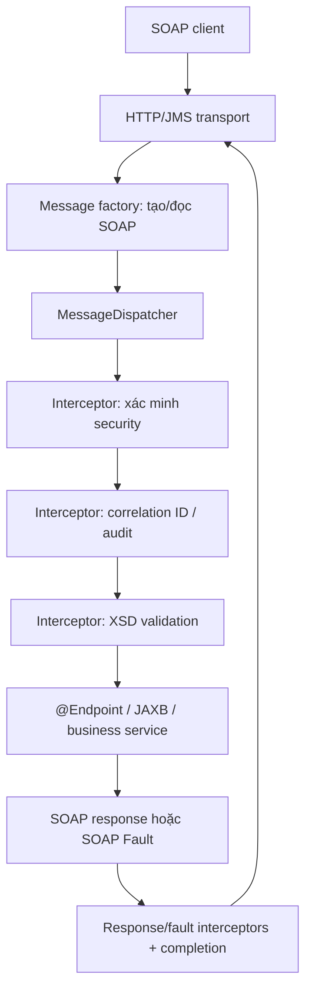
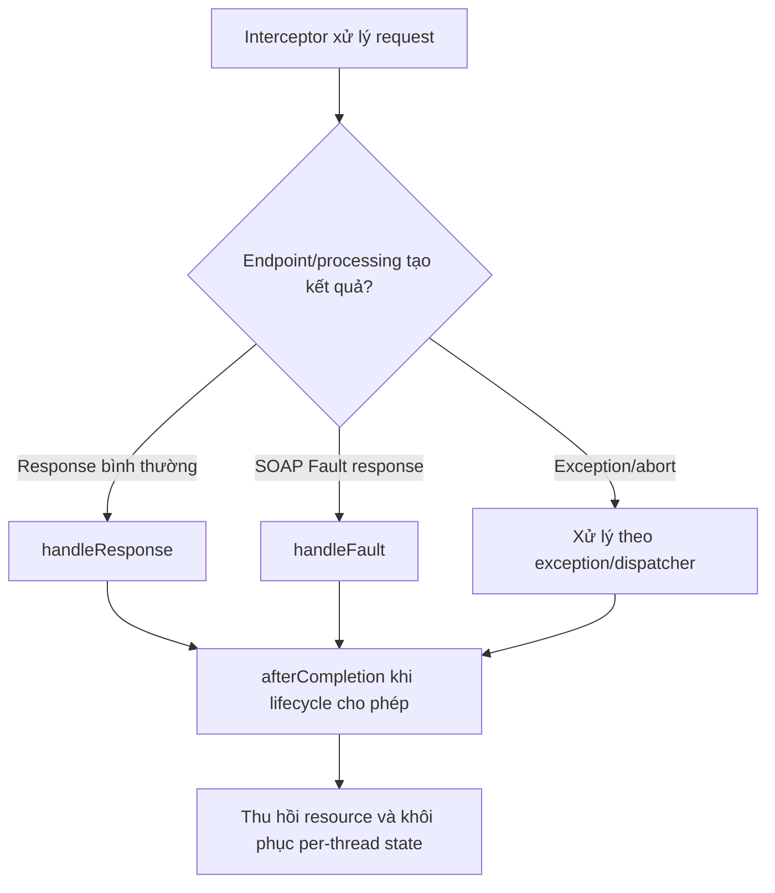

# Thu hồi tài nguyên, xử lý lỗi và dữ liệu theo yêu cầu trong interceptor

Khi một dịch vụ SOAP nhận hàng trăm yêu cầu đồng thời, các thao tác ở interceptor như tạo mã tương quan, đo thời gian, xác thực metadata, mở stream tạm hoặc bổ sung thông tin log phải được quản lý theo **đúng vòng đời từng request**. Nếu giữ dữ liệu của request trong field của singleton interceptor, có thể rò rỉ thông tin giữa các khách hàng. Nếu chỉ dọn tài nguyên khi trả response thành công, nhánh SOAP Fault, exception hoặc xử lý bị chặn có thể làm mất file descriptor, rò `ThreadLocal` hoặc giữ dữ liệu nhạy cảm quá lâu.

Bài thuộc chương **Interceptor** của module **SPRING_WEB_SERVICES**. Trong phát triển SOAP **contract-first** bằng Spring Web Services (Spring-WS), chúng ta cần tôn trọng XSD/WSDL, JAXB và endpoint, đồng thời tổ chức SOAP Fault, XML security, WS-Security, chứng chỉ và kiểm thử tương thích. Chủ đề này tập trung vào ba việc liên quan chặt chẽ:

1. **Thu hồi tài nguyên:** ai tạo, ai sở hữu, ai đóng, và phải làm gì khi request kết thúc bất thường?
2. **Xử lý lỗi:** phân biệt response bình thường, SOAP Fault, exception và việc interceptor tự ngăn xử lý tiếp.
3. **Dữ liệu theo yêu cầu:** chia sẻ thông tin giữa interceptor và endpoint mà không gây race condition hoặc rò rỉ giữa request.

Ví dụ dùng Java 17+, Spring-WS theo hệ Jakarta và SOAP 1.1 khi minh họa XML. Những lớp như `EndpointInterceptor`, `MessageContext` và `@Endpoint` thuộc Spring-WS; `javax.xml.transform.*` vẫn là API Java SE trong ứng dụng Jakarta.

## 1. Vì sao interceptor là nơi dễ phát sinh lỗi vòng đời?

Một SOAP request thường đi qua nhiều thành phần:



Sơ đồ thể hiện **trách nhiệm logic**; thứ tự thực tế do cấu hình quyết định, và lỗi parse SOAP, TLS hoặc transport có thể xảy ra **trước khi request vào chuỗi endpoint interceptor**.

Một interceptor có thể phải xử lý nhiều loại kết thúc:

| Kết thúc | Ví dụ | Rủi ro nếu chỉ có happy path |
| --- | --- | --- |
| Response thành công | `GetOrderResponse` được marshal và gửi ra | Quên xóa MDC, đóng stream |
| SOAP Fault | Request sai XSD hoặc service báo lỗi nghiệp vụ | Cleanup không chạy nếu chỉ đặt ở `handleResponse` |
| Exception trong endpoint | Database timeout, JAXB marshal lỗi | Không có response bình thường để dựa vào |
| Interceptor chủ động chặn | `handleRequest` trả `false` | Các interceptor/endpoint phía sau không chạy; phải kiểm tra nghĩa vụ dọn dẹp |
| Lỗi ngay khi khởi tạo request | Parser không đọc được Envelope | Interceptor chưa chắc được gọi; cần bảo vệ ở tầng tạo tài nguyên |
| Kết nối đứt giữa chừng | Client ngắt HTTP, proxy timeout | Không dựa hoàn toàn vào callback của endpoint để thu hồi resource transport |

**Nguyên tắc:** chỉ giữ resource theo request khi thật cần thiết. Nếu resource có thể được tạo và dùng gọn trong một phương thức, ưu tiên `try-with-resources` hoặc `try/finally` ngay tại nơi tạo thay vì kéo dài đến cuối pipeline.

## 2. Hợp đồng `EndpointInterceptor` của Spring-WS

Spring-WS cung cấp `org.springframework.ws.server.EndpointInterceptor` để tham gia vòng đời xử lý endpoint. Chữ ký chính (trình bày theo Java API):

```java
public interface EndpointInterceptor {
    boolean handleRequest(
            MessageContext messageContext, Object endpoint)
            throws Exception;

    boolean handleResponse(
            MessageContext messageContext, Object endpoint)
            throws Exception;

    boolean handleFault(
            MessageContext messageContext, Object endpoint)
            throws Exception;

    void afterCompletion(
            MessageContext messageContext,
            Object endpoint,
            Exception ex) throws Exception;
}
```

Đây là bản tóm tắt phần chính để học vòng đời, không phải hướng dẫn tự khai báo lại interface của Spring-WS. Tham số `endpoint` đại diện endpoint đã được chọn; không nên giả định nó luôn có cùng class với bean `@Endpoint` vì adapter/mapping có thể bao bọc handler.

| Callback | Dùng cho | Điều **không nên** mặc định |
| --- | --- | --- |
| `handleRequest` | Kiểm tra request, chuẩn bị state, quyết định có tiếp tục hay không | Không phải nơi an toàn duy nhất để mở tài nguyên rồi quên đóng |
| `handleResponse` | Quan sát/chỉnh response thường theo API phù hợp | Không chạy thay cho `handleFault` trong mọi trường hợp |
| `handleFault` | Quan sát/xử lý nhánh **SOAP Fault response** | Không chắc được gọi cho mọi Java exception hoặc lỗi xảy ra trước dispatch |
| `afterCompletion` | Thu hồi state/resource và ghi nhận kết quả khi chain hoàn tất | Không phải `finally` tuyệt đối của JVM, HTTP filter hoặc toàn bộ transport |

### 2.1. `handleRequest` trả `true` hoặc `false`

- Trả `true`: cho phép request tiếp tục qua các interceptor/endpoint theo pipeline.
- Trả `false`: yêu cầu **dừng xử lý tiếp** ở chuỗi tương ứng. Điều này **không tự tạo SOAP Fault đúng hợp đồng**; interceptor phải bảo đảm phản hồi phù hợp đã được chuẩn bị hoặc có cơ chế xử lý lỗi đúng.
- Ném exception: cần xác định tầng nào bắt và biến exception thành SOAP Fault/HTTP error. Không giả định exception ở mọi pha đều được resolver ứng dụng xử lý như nhau.

Ví dụ:

```java
@Override
public boolean handleRequest(
        MessageContext context, Object endpoint) throws Exception {
    if (isRejected(context)) {
        // Ví dụ này chưa tạo SOAP Fault: không dùng nguyên vẹn
        // cho production chỉ với return false.
        return false;
    }
    return true;
}
```

`isRejected` là hàm minh họa chưa định nghĩa; mục tiêu là thấy **boolean quyết định luồng chạy** chứ không mang mô tả lỗi. Với request từ bên ngoài, nên phân loại lỗi rồi dùng xử lý Fault/exception rõ ràng theo SOAP version và nơi phát sinh.

### 2.2. `handleResponse`, `handleFault` và `afterCompletion`

Trình tự khái niệm:



**Lưu ý đặc biệt:** việc callback nào thực sự được gọi khi `handleRequest` trả `false`, khi một interceptor tự ném exception, hoặc khi lỗi xảy ra trước endpoint mapping **phụ thuộc vòng đời dispatcher và vị trí interceptor trong chain**. Hãy kiểm thử các nhánh này trên phiên bản Spring-WS của ứng dụng; không dùng `afterCompletion` làm cơ chế duy nhất bảo vệ resource đã mở **trước khi** interceptor được đưa vào vòng đời hoàn tất.

Nếu request bị chặn rất sớm ở gateway/TLS, endpoint interceptor thậm chí không tồn tại trong đường thực thi đó. Resource do transport/filter tạo phải được quản lý ở transport/filter.

## 3. Phân biệt `MessageContext` và trạng thái singleton

`MessageContext` là ngữ cảnh xử lý một web-service message, cung cấp những thao tác như:

```java
WebServiceMessage request = messageContext.getRequest();
boolean responseExists = messageContext.hasResponse();
Object value = messageContext.getProperty("orders.trace.id");
messageContext.setProperty("orders.trace.id", "req-1001");
```

Đoạn mã dùng biến `messageContext` do callback cung cấp. Khi cần kiểm tra SOAP Header/Body/Fault, có thể xem request/response dưới giao diện `SoapMessage` nếu message implementation hỗ trợ.

### 3.1. Dữ liệu nào nên lưu trong context?

| Dữ liệu | Có thể lưu trong `MessageContext`? | Ghi chú |
| --- | --- | --- |
| Correlation ID đã chuẩn hóa | Có | Giúp truy vết request; cần giới hạn độ dài |
| Thời điểm bắt đầu bằng `System.nanoTime()` | Có | Dùng tính thời gian xử lý, không dùng làm timestamp lịch |
| Cờ phát hiện SOAP Fault | Có | Phục vụ metric/log trong cùng request |
| Metadata đã xác minh từ interceptor bảo mật | Có, theo thiết kế | Không tự coi header thô là identity đáng tin |
| Resource tạm do ứng dụng sở hữu | Có, nhưng phải có cleanup rõ | Chỉ giữ khi không thể đóng ngay |
| `InputStream`/StAX reader của framework | Thường **không nên sở hữu/đóng** | Không lấy ownership của message factory |
| `Jaxb2Marshaller`/`DataSource` dùng chung | Không cần đặt theo request | Chúng là bean dùng chung được quản lý bởi container |
| User session/cross-request state | Không | `MessageContext` không phải kho lưu trữ bền vững |

**Không đặt state của request vào field của singleton interceptor:**

```java
// SAI: interceptor singleton có thể nhận nhiều request đồng thời.
public final class UnsafeInterceptor implements EndpointInterceptor {
    private String lastCorrelationId;

    @Override
    public boolean handleRequest(
            MessageContext ctx, Object endpoint) {
        lastCorrelationId = "req-from-current-request";
        return true;
    }

    // Các method interface còn lại bị lược bỏ: minh họa anti-pattern.
}
```

Nếu request A và B xử lý song song, B có thể ghi đè `lastCorrelationId` trước khi A đọc; log/Fault của A sẽ bị gắn ID của B. Rủi ro còn nghiêm trọng hơn nếu field đó là user ID, token hoặc tenant.

### 3.2. Dùng property key có namespace logic

Thay vì `"id"` hoặc `"user"`, dùng key ổn định do component sở hữu:

```java
public static final String STATE_KEY =
        "example.orders.interceptor.requestLifecycleState";
```

Đặt property object theo **một key** còn giúp truyền nhiều giá trị liên quan như start time, correlation ID, fault status và các tài nguyên cần đóng. Khi đưa object đến endpoint, không expose mutable resource list cho nghiệp vụ nếu không cần.

### 3.3. Không biến context thành kênh dữ liệu gửi client

`messageContext.setProperty("orders.trace.id", id)` chỉ thay đổi trạng thái xử lý nội bộ. Nó **không tự tạo SOAP Header**, không sửa HTTP response header và không thêm `traceId` vào JAXB response. Nếu hợp đồng yêu cầu trả ID, phải ghi vào SOAP Header/Body hoặc metadata transport phù hợp thông qua thành phần chuyên trách.

## 4. Xác định quyền sở hữu và vòng đời tài nguyên

Một tài nguyên chỉ nên được đóng bởi thành phần **có quyền sở hữu nó**, theo đúng thời điểm được dùng xong.

| Tài nguyên | Chủ sở hữu thông thường | Thời điểm đóng/trả |
| --- | --- | --- |
| File/stream do interceptor tự mở | Interceptor hoặc service mở tài nguyên | `try-with-resources` ngay tại nơi dùng, hoặc cleanup cuối request nếu cần kéo dài |
| File tạm do interceptor tạo | Thành phần tạo file | Xóa ở nhánh thành công **và** lỗi, kiểm soát quota và quyền truy cập |
| Connection mượn từ pool | Component checkout connection | Trả pool theo transaction/scope; không đóng pool dùng chung |
| Transaction nghiệp vụ | Transaction manager/service | Theo transaction boundary, không tự thay thế bằng interceptor |
| SOAP message, input stream của transport | Spring-WS/message factory/transport | Để framework quản lý, trừ khi API chuyển ownership rõ |
| `Jaxb2Marshaller` hoặc `Schema` dùng chung | Spring IoC container | Quản lý theo vòng đời ứng dụng |
| MDC/ThreadLocal do interceptor đặt | Component đặt giá trị | Khôi phục/xóa tại thread phù hợp, kể cả nhánh lỗi |
| Metrics/tracing span | Hệ thống tracing hoặc component tạo span | Đóng đúng scope và ghi nhận lỗi theo API đã dùng |

### 4.1. Ưu tiên `try-with-resources` cho tài nguyên ngắn hạn

Nếu một interceptor chỉ cần đọc metadata từ một resource riêng trong `handleRequest`, hãy đóng ngay:

```java
Path trustedFile = Path.of("/opt/app/config/allowed-client-ids.txt");
try (InputStream input = Files.newInputStream(trustedFile)) {
    // Đọc dữ liệu cấu hình từ một đường dẫn do ứng dụng quản lý.
    // Không nhận đường dẫn tùy ý từ SOAP Header/Body.
}
```

`Path`, `Files` và `InputStream` cần import từ `java.nio.file` và `java.io`. Đoạn mã này chỉ minh họa ownership; sản phẩm thực tế nên cache/tải cấu hình có kiểm soát thay vì mở file trên **mọi** request.

`try-with-resources` giúp đóng stream ngay cả khi xử lý trong block ném exception. Không cần gửi stream vào `MessageContext` nếu chẳng có bước xử lý nào phía sau cần nó.

### 4.2. Khi resource thật sự phải sống tới cuối request

Ví dụ một middleware bắt buộc spool một attachment lớn vào file tạm để endpoint đọc sau: interceptor có thể đăng ký **tác vụ dọn dẹp** theo request.

```java
Path temporary = Files.createTempFile("ws-orders-", ".bin");
requestState.register(() -> {
    Files.deleteIfExists(temporary);
});
// Những bước khác trong request có thể sử dụng temporary
// theo chính sách đã kiểm tra và giới hạn dung lượng.
```

Đoạn mã giả định `requestState` là một object theo request có method `register(AutoCloseable)` như mục sau. Thực tế cần giải quyết trường hợp **file đã tạo nhưng đăng ký cleanup thất bại**, đặt thư mục tạm riêng tư và kiểm tra quota. Không đặt tên file từ dữ liệu user chưa kiểm tra; không để file nhạy cảm tồn tại vô hạn chỉ vì JVM bị kill trước khi callback cleanup chạy.

**`afterCompletion` không xử lý được mọi trường hợp tiến trình bị kill, mất điện hoặc sự cố OS.** Nếu ứng dụng tạo file tạm quan trọng, cần cơ chế dọn theo tuổi file/khởi động lại và chính sách retention độc lập.

## 5. Xây dựng object state theo một request

Một lớp `RequestLifecycleState` tập hợp thời gian bắt đầu, correlation ID và danh sách tài nguyên được sở hữu bởi request. Nó dùng riêng cho **một request**; không chia sẻ instance này như singleton.

```java
import java.util.ArrayDeque;
import java.util.Deque;
import java.util.Objects;
import java.util.UUID;

public final class RequestLifecycleState implements AutoCloseable {
    private final String correlationId = UUID.randomUUID().toString();
    private final long startedNanos = System.nanoTime();
    private final Deque<AutoCloseable> resources = new ArrayDeque<>();
    private boolean faultSeen;
    private boolean closed;

    public String correlationId() {
        return correlationId;
    }

    public long elapsedMillis() {
        return (System.nanoTime() - startedNanos) / 1_000_000L;
    }

    public boolean faultSeen() {
        return faultSeen;
    }

    public void markFaultSeen() {
        faultSeen = true;
    }

    public void register(AutoCloseable resource) {
        if (closed) {
            throw new IllegalStateException("Request already closed");
        }
        resources.push(Objects.requireNonNull(resource));
    }

    @Override
    public void close() throws Exception {
        if (closed) {
            return; // Hỗ trợ cleanup lặp mà không đóng hai lần.
        }
        closed = true;

        Exception first = null;
        while (!resources.isEmpty()) {
            try {
                resources.pop().close();
            } catch (Exception closeError) {
                if (first == null) {
                    first = closeError;
                } else {
                    first.addSuppressed(closeError);
                }
            }
        }
        if (first != null) {
            throw first;
        }
    }
}
```

Phương thức `close()` đóng **theo thứ tự LIFO** để các tài nguyên được cấp sau (thường phụ thuộc vào tài nguyên cấp trước) được đóng trước. Nếu một `close` thất bại, nó tiếp tục thử đóng các resource khác, gom lỗi đầu tiên và các lỗi suppressed. Hàm `close` idempotent trong phạm vi dùng tuần tự, **không phải class thread-safe**: toàn bộ object ở đây được thiết kế cho một chuỗi xử lý request đồng bộ.

Trong thực tế, không nên sử dụng danh sách này để tự đóng connection hoặc stream **do Spring-WS sở hữu**. Chỉ đăng ký resource ứng dụng đã tự tạo/nhận ownership rõ ràng. Nếu một xử lý được chuyển sang thread khác, cần chiến lược synchronization và lifecycle khác, không mang nguyên object này sang background worker rồi hy vọng `afterCompletion` sẽ chờ.

### 5.1. Vì sao dùng server-generated correlation ID?

Ví dụ tự sinh UUID để tránh vô tình tin một giá trị do client gửi. Nếu tích hợp yêu cầu lấy ID từ SOAP Header hoặc HTTP Header:

1. Đọc đúng nguồn và QName/header theo hợp đồng.
2. Giới hạn độ dài, định dạng và nội dung đưa vào log.
3. Làm rõ precedence nếu nhiều nguồn cung cấp ID.
4. Chỉ dùng như dữ liệu tracing, **không dùng để xác thực danh tính**.
5. Khi metadata gắn với tenant, user hoặc signature, xác minh security claims trước khi cấp quyền.

## 6. Ví dụ `RequestTracingInterceptor` với cleanup

Interceptor dưới đây tạo state riêng cho mỗi request, lưu vào `MessageContext` và ghi MDC theo **scope của request đồng bộ**. Nó minh họa bốn callback của `EndpointInterceptor`.

```java
import org.slf4j.Logger;
import org.slf4j.LoggerFactory;
import org.slf4j.MDC;
import org.springframework.stereotype.Component;
import org.springframework.ws.context.MessageContext;
import org.springframework.ws.server.EndpointInterceptor;

@Component
public final class RequestTracingInterceptor
        implements EndpointInterceptor {

    private static final Logger log =
            LoggerFactory.getLogger(RequestTracingInterceptor.class);

    public static final String STATE_KEY =
            "example.orders.interceptor.requestLifecycleState";

    private static final String MDC_KEY = "soapCorrelationId";

    private static RequestLifecycleState state(MessageContext context) {
        Object raw = context.getProperty(STATE_KEY);
        return raw instanceof RequestLifecycleState state ? state : null;
    }

    @Override
    public boolean handleRequest(
            MessageContext context, Object endpoint) {
        RequestLifecycleState current = new RequestLifecycleState();
        try {
            context.setProperty(STATE_KEY, current);
            MDC.put(MDC_KEY, current.correlationId());
            log.debug("SOAP request accepted, id={}",
                    current.correlationId());
            return true;
        } catch (RuntimeException failure) {
            // Nếu lỗi xảy ra TRONG handleRequest trước khi
            // chain quản lý completion, tự cleanup phần đã tạo.
            MDC.remove(MDC_KEY);
            try {
                current.close();
            } catch (Exception cleanupError) {
                failure.addSuppressed(cleanupError);
            }
            throw failure;
        }
    }

    @Override
    public boolean handleResponse(
            MessageContext context, Object endpoint) {
        RequestLifecycleState current = state(context);
        if (current != null) {
            log.debug("SOAP normal response, id={}",
                    current.correlationId());
        }
        return true;
    }

    @Override
    public boolean handleFault(
            MessageContext context, Object endpoint) {
        RequestLifecycleState current = state(context);
        if (current != null) {
            current.markFaultSeen();
            log.warn("SOAP Fault response, id={}",
                    current.correlationId());
        }
        return true;
    }

    @Override
    public void afterCompletion(
            MessageContext context,
            Object endpoint,
            Exception ex) {
        RequestLifecycleState current = state(context);
        try {
            if (current != null) {
                log.info("SOAP completed id={} elapsedMs={} fault={} error={}",
                        current.correlationId(),
                        current.elapsedMillis(),
                        current.faultSeen(),
                        ex == null ? "none" :
                                ex.getClass().getSimpleName());
            }
        } finally {
            try {
                if (current != null) {
                    current.close();
                }
            } catch (Exception cleanupError) {
                // Không để lỗi cleanup che mất SOAP Fault/exception gốc.
                log.warn("Request cleanup failed", cleanupError);
            } finally {
                MDC.remove(MDC_KEY);
            }
        }
    }
}
```

Điểm cần hiểu:

- `RequestTracingInterceptor` là singleton Spring bean (`@Component`), nhưng **`RequestLifecycleState` được tạo mới cho từng request**.
- `MessageContext#setProperty` giữ state riêng cho request. Một endpoint hoặc interceptor khác có thể đọc từ key này khi cần.
- `handleResponse` xử lý nhánh response bình thường; `handleFault` ghi nhận khi có SOAP Fault response. **Exception trong `afterCompletion` có thể là `null` dù có Fault**, nên không dùng `ex == null` làm chỉ dấu thành công tuyệt đối.
- `afterCompletion` cố đóng mọi resource, dọn MDC ngay cả khi việc log hoặc close lỗi.
- Nếu một exception xảy ra **ngay trong `handleRequest` trước khi callback được coi là đã tham gia vòng đời completion**, code catch chủ động dọn phần đã khởi tạo.
- Mã này **không tự tạo SOAP Fault** và không quyết định client có quyền thực hiện operation; nó chỉ minh họa quản lý state và tài nguyên.

### 6.1. Giới hạn của MDC/`ThreadLocal`

SLF4J `MDC` thường dựa trên dữ liệu theo thread. Trong ứng dụng servlet đồng bộ, cùng thread có thể phục vụ request khác ngay sau đó; quên `MDC.remove(...)` khiến log của request sau mang ID cũ.

Tuy nhiên, ví dụ đang dùng một **MDC key dành riêng** và giả định interceptor chạy đồng bộ, callbacks gắn với đúng thread. Nếu request chuyển thread (async, executor, queue, reactive pipeline), phải truyền correlation/tracing context bằng cơ chế chính thức và dọn trên **thread đã đặt giá trị**. `afterCompletion` chạy ở thread khác không thể bảo đảm xóa MDC đã được đặt trên thread ban đầu.

Nếu một filter/interceptor bên ngoài cũng sử dụng **cùng MDC key**, thay vì luôn remove, cần **lưu và khôi phục giá trị trước đó** theo cấu trúc scope. Không làm mất tracing context của thành phần sở hữu khác. Với hệ dùng OpenTelemetry/Micrometer tracing, ưu tiên cơ chế scope/tracer tương ứng thay vì tự chế `ThreadLocal` phức tạp.

### 6.2. Không mở resource trong `handleRequest` mà không có fallback

Một mẫu dễ rò:

```java
// Anti-pattern: mở stream rồi một validation khác ném exception
// trước khi stream được đăng ký hoặc đóng.
InputStream stream = Files.newInputStream(trustedPath);
validateRequest(messageContext); // Có thể ném exception.
state.register(stream);
```

Nên đăng ký ownership **ngay khi tạo**, hoặc giữ một block `try/finally` quanh thao tác tạo/đăng ký:

```java
InputStream stream = Files.newInputStream(trustedPath);
boolean registered = false;
try {
    state.register(stream);
    registered = true;
} finally {
    if (!registered) {
        stream.close();
    }
}
validateRequest(messageContext);
```

Đoạn mã giả định `trustedPath` thuộc ứng dụng, `state` được tạo trước, `validateRequest` là helper nghiệp vụ, và caller đã xử lý checked exceptions. Việc tạo resource để kéo dài tới cuối request chỉ đáng làm nếu các bước sau thực sự cần nó. Với stream dùng một lần trong interceptor, `try-with-resources` đơn giản hơn.

## 7. Đăng ký interceptor trong Spring-WS

Một `@Component` không mặc nhiên tham gia mọi dispatcher chain. Với cấu hình Spring-WS, có thể sử dụng `WsConfigurer` để đăng ký:

```java
import java.util.List;
import org.springframework.context.annotation.Configuration;
import org.springframework.ws.config.annotation.EnableWs;
import org.springframework.ws.config.annotation.WsConfigurer;
import org.springframework.ws.server.EndpointInterceptor;

@Configuration
@EnableWs
public class SoapInterceptorsConfiguration implements WsConfigurer {

    private final RequestTracingInterceptor tracing;

    public SoapInterceptorsConfiguration(
            RequestTracingInterceptor tracing) {
        this.tracing = tracing;
    }

    @Override
    public void addInterceptors(
            List<EndpointInterceptor> interceptors) {
        interceptors.add(tracing);
    }
}
```

Trong ứng dụng thực, cần cấu hình `MessageDispatcherServlet`/Spring Boot web-services phù hợp; tránh đăng ký lặp interceptor qua nhiều cấu hình không chủ đích.

### 7.1. Thứ tự interceptor tác động tới cleanup

Giả sử chuỗi có:

```text
1. WsSecurityInterceptor
2. RequestTracingInterceptor
3. PayloadValidatingInterceptor
4. OrdersEndpoint
```

Nếu security interceptor chặn request **trước bước 2**, tracing interceptor chưa tạo `RequestLifecycleState`. Đây không phải resource leak của tracing; nhưng có thể cần tracing ở tầng transport/filter để quan sát cả các request bị chặn trước endpoint.

Nếu tracing interceptor tạo resource ở bước 2 rồi validator bước 3 phát sinh Fault, đường cleanup của tracing phải được kiểm thử trên nhánh Fault. Ngược lại, một interceptor ở bước 3 không nên kỳ vọng luôn nhận request nếu một interceptor trước đã trả `false`.

Ở một số chuỗi interceptor, response/fault callbacks được gọi theo thứ tự ngược với request; **không phụ thuộc vào thứ tự không được xác minh**. Kiểm thử chính xác trên phiên bản Spring-WS đang dùng, đặc biệt với exception giữa chain và callback completion.

### 7.2. Phạm vi áp dụng theo operation

Không phải endpoint nào cũng cần một attachment temp file, metric tag hay schema bổ sung. Nếu interceptor chỉ phục vụ `CreateOrder`, hãy xác định phạm vi áp dụng bằng cơ chế cấu hình/mapping tương ứng hoặc kiểm tra QName payload/endpoint một cách nhất quán. **Không** mở resource cho mọi operation rồi chỉ dùng ở một operation, vì đây là chi phí và rủi ro không cần thiết.

Đặc biệt tránh thiết kế interceptor dựa vào so sánh raw XML string khi mapping theo QName đã có sẵn, và đừng tiêu thụ `StreamSource`/StAX cursor để “xem thử” rồi khiến endpoint không đọc lại được.

## 8. Endpoint đọc dữ liệu theo request

Endpoint có thể nhận `MessageContext` cùng payload:

```java
import org.springframework.ws.context.MessageContext;
import org.springframework.ws.server.endpoint.annotation.Endpoint;
import org.springframework.ws.server.endpoint.annotation.PayloadRoot;
import org.springframework.ws.server.endpoint.annotation.RequestPayload;
import org.springframework.ws.server.endpoint.annotation.ResponsePayload;

@Endpoint
public class OrdersEndpoint {
    private static final String NS = "https://example.org/orders/v1";
    private final OrderService orders;

    public OrdersEndpoint(OrderService orders) {
        this.orders = orders;
    }

    @PayloadRoot(namespace = NS, localPart = "GetOrderRequest")
    @ResponsePayload
    public GetOrderResponse getOrder(
            @RequestPayload GetOrderRequest request,
            MessageContext context) {

        Object raw = context.getProperty(
                RequestTracingInterceptor.STATE_KEY);
        if (!(raw instanceof RequestLifecycleState state)) {
            throw new IllegalStateException(
                    "Request trace interceptor is not configured");
        }

        return orders.getOrder(
                request.getOrderId(),
                state.correlationId());
    }
}
```

`GetOrderRequest`/`GetOrderResponse` là các lớp JAXB minh họa sinh từ XSD. `OrderService` là service nghiệp vụ cần triển khai. Các phương thức `@PayloadRoot` định tuyến theo QName của SOAP Body; middleware không quyết định mapping chỉ vì tạo property trong context.

Trong kiến trúc lớn, **không nhất thiết đưa toàn bộ `RequestLifecycleState` cho business service**. Có thể chọn chỉ truyền `correlationId` hoặc một immutable `RequestMetadata` chứa thông tin đã xác minh. Resource list và callback cleanup nên thuộc hạ tầng, không lộ ra model nghiệp vụ.

### 8.1. Metadata từ SOAP Header hoặc HTTP Header

Nếu đối tác gửi `correlationId` qua SOAP Header, interceptor có thể đọc `SoapHeaderElement` theo QName rồi chuẩn hóa. Nếu hệ dùng HTTP header `X-Correlation-ID` qua gateway, cần API của HTTP transport (không phải `@SoapHeader`), đồng thời xác định header đến từ proxy đáng tin cậy hay client tùy ý.

Ví dụ SOAP Header:

```xml
<s:Envelope xmlns:s="http://schemas.xmlsoap.org/soap/envelope/"
            xmlns:o="https://example.org/orders/v1"
            xmlns:m="https://example.org/orders/meta/v1">
    <s:Header>
        <m:RequestContext>
            <m:correlationId>req-2026-501</m:correlationId>
        </m:RequestContext>
    </s:Header>
    <s:Body>
        <o:GetOrderRequest>
            <o:orderId>ORD-1001</o:orderId>
        </o:GetOrderRequest>
    </s:Body>
</s:Envelope>
```

XSD/WSDL và `soap:header` (nếu hợp đồng khai báo) quyết định cấu trúc metadata; `mustUnderstand`/`actor`/`role` có ý nghĩa SOAP riêng. **Không tin `tenantId`, `sourceSystem` hay `userId` do client cung cấp** để phân quyền trước khi security layer kiểm tra identity và chữ ký/token phù hợp.

## 9. `handleFault` khác exception handling như thế nào?

Một **SOAP Fault** là thông điệp SOAP được trả cho client. Một **Java exception** là tín hiệu lỗi trong mã server; không phải mọi exception đều trở thành SOAP Fault, đặc biệt khi lỗi ở transport, parse Envelope hoặc ngoài dispatcher.

### 9.1. Phân loại tình huống

| Nguồn lỗi | Thành phần phát hiện điển hình | Có thể dẫn tới |
| --- | --- | --- |
| SOAP 1.2 gửi tới endpoint chỉ SOAP 1.1 | Message factory/transport | Fault `VersionMismatch` hoặc lỗi giao thức |
| Payload vi phạm XSD | `PayloadValidatingInterceptor` | SOAP Fault yêu cầu sai |
| Header bắt buộc không được hiểu | SOAP processing | `MustUnderstand` Fault |
| JAXB không unmarshal được | Endpoint adapter/OXM | Lỗi ánh xạ XML, có thể thành Fault |
| Nghiệp vụ không tìm thấy order | Business service | Fault nghiệp vụ nếu contract quy định |
| WS-Security chữ ký sai | Security interceptor/WSS4J | Security Fault hoặc từ chối theo policy |
| TLS certificate lỗi | TLS/HTTP transport | Connection failure trước dispatcher |
| Database timeout | Service/infrastructure | Server-side exception, có thể thành SOAP Fault |

**`handleFault` xử lý nhánh response đã là Fault**, không phải catch-all cho tất cả exception. Phải dùng `afterCompletion` và cơ chế exception mapping/transport phù hợp để quan sát và dọn resource trên các đường kết thúc khác.

### 9.2. Viết exception resolver để ánh xạ lỗi nghiệp vụ

Trong Spring-WS, một cơ chế như `SoapFaultMappingExceptionResolver` có thể ánh xạ một số exception ứng dụng thành Fault. Ví dụ minh họa bằng annotation:

```java
// Exception nghiệp vụ minh họa; Fault mapping được cấu hình
// riêng qua exception resolver tương ứng với hợp đồng:
public class OrderNotFoundException extends RuntimeException {
    public OrderNotFoundException(String orderId) {
        super("Order not found");
    }
}
```

Với resolver, bạn có thể định nghĩa mapping từ `OrderNotFoundException` sang một Fault code thích hợp, chẳng hạn SOAP 1.1 `Client` hoặc SOAP 1.2 `Sender` khi yêu cầu có lỗi theo contract; nếu không tìm thấy tài nguyên là tình huống nghiệp vụ đã được đặc tả, cũng có thể dùng business fault/message được công bố trong WSDL. **Không có quy tắc cố định mọi `OrderNotFoundException` đều phải là Fault Client**: điều này phụ thuộc hợp đồng dịch vụ và cách phân loại.

Ví dụ WSDL/SOAP Fault:

```xml
<s:Envelope xmlns:s="http://schemas.xmlsoap.org/soap/envelope/">
    <s:Body>
        <s:Fault>
            <faultcode>s:Client</faultcode>
            <faultstring>Order request is invalid</faultstring>
        </s:Fault>
    </s:Body>
</s:Envelope>
```

Fragment này chỉ minh họa **dạng SOAP 1.1 Fault**, không đảm bảo được sinh tự động khi code ném exception trên. Cần cấu hình exception resolver và test wire response/Fault detail theo WSDL/binding. SOAP 1.2 sử dụng cấu trúc Fault khác.

### 9.3. Đừng che giấu nguyên nhân ban đầu bằng lỗi cleanup

Giả sử endpoint ném exception `E1`. Nếu `afterCompletion` đóng file rồi ném exception `E2`, hệ thống có thể:

- Log `E2` như lỗi cuối cùng, khó chẩn đoán `E1`.
- Không hoàn tất đường phản hồi SOAP Fault như dự kiến.
- Bỏ qua việc đóng những resource khác nếu đóng tuần tự và dừng ngay.

Vì vậy, cleanup nên **cố gắng đóng tất cả**, log các lỗi dọn dẹp riêng, không thay thế nguyên nhân gốc và không đưa thông tin nhạy cảm vào Fault. Trong ví dụ `RequestLifecycleState`, lỗi close được gom/suppressed; trong `afterCompletion`, lỗi close được log thay vì thay thế exception xử lý ban đầu.

## 10. Khi interceptor cần dừng request

Một interceptor có thể từ chối vì header sai định dạng, thiếu quyền hoặc dữ liệu payload vi phạm chính sách. Có hai dạng hành vi cần phân biệt:

### 10.1. Trả `false`

`handleRequest(...)` trả `false` báo không nên đi tiếp. **Không suy diễn rằng Spring-WS tự tạo một `SoapFault` có mã lỗi đúng**. Nếu muốn trả response, phải chuẩn bị response SOAP hợp lệ theo API và contract; test cả nhánh không được đi tới endpoint và nhánh callback cleanup.

### 10.2. Ném exception

Nếu dùng exception để biểu diễn lỗi:

1. Chọn exception có ý nghĩa, phân loại lỗi client, server, security hoặc policy.
2. Bảo đảm exception có đường mapping phù hợp ở **vị trí phát sinh**; exception ở interceptor pre-dispatch có thể được xử lý khác exception từ endpoint.
3. Dọn resource đã tạo trước khi ném nếu chưa chắc callback completion quản lý nó.
4. Không ném exception chứa token/chứng chỉ hoặc XML thô trong message log/public Fault.
5. Kiểm thử cách client nhìn thấy SOAP Fault/HTTP error chứ không chỉ assert Java exception nội bộ.

Ví dụ xử lý ngắn hạn:

```java
@Override
public boolean handleRequest(
        MessageContext context, Object endpoint) throws Exception {
    try (InputStream input = openTrustedSource()) {
        if (!policyAllows(input)) {
            throw new RequestPolicyException("Request policy failed");
        }
        return true;
    } // Stream được đóng ngay cả khi policyAllows ném lỗi.
}
```

`openTrustedSource()`, `policyAllows(...)` và `RequestPolicyException` là các thành phần minh họa cần được định nghĩa theo ứng dụng. Đoạn mã này thể hiện cách **giới hạn ownership trong một scope nhỏ** và không cần dựa vào `afterCompletion` để đóng stream.

## 11. Dữ liệu log, tracing và bảo mật trong interceptor

Interceptor thường là vị trí thuận tiện để thêm correlation ID và metric. Nhưng chính vì đứng gần SOAP message, nó cũng có thể truy cập dữ liệu nhạy cảm:

- SOAP Body chứa dữ liệu khách hàng, giao dịch hoặc thông tin định danh.
- SOAP Header có thể có `wsse:Security`, token, timestamp, signature.
- HTTP headers có thể mang credential hoặc metadata do gateway cấp.
- Attachment có thể là tài liệu cá nhân hoặc file lớn.

**Không log toàn bộ Envelope mặc định.** Ưu tiên thông tin tối thiểu như correlation ID đã chuẩn hóa, operation QName, duration, kết quả success/fault và một error code không nhạy cảm.

### 11.1. WS-Security và thứ tự xử lý

Một `sourceSystem` trong SOAP Header có thể chỉ là lời khai của client. Nếu interceptor dùng nó để giới hạn tenant hoặc phân quyền, phải dựa trên kết quả xác minh danh tính/chữ ký và signed-part policy từ security stack.

```text
SOAP message
  → Verify WS-Security token/signature/timestamp
  → Verify schema/header contract as needed
  → Extract metadata đã được xác minh
  → Authorize principal/tenant
  → Business endpoint
```

Thứ tự trên là **mô hình trách nhiệm khi metadata liên quan quyền**, không tuyên bố Spring-WS tự thực thi đúng chuỗi này. Các interceptor phải được cấu hình, test với SOAP version và message factory cụ thể. Một header có `mustUnderstand=true` không chứng minh giá trị của nó đã được xác thực.

### 11.2. XML không tin cậy và resource limits

Nếu interceptor tự đọc `Source`, `DOMSource` hoặc `StAXSource`:

- Ngăn DTD/external entities khi không cần; cấu hình parser/JAXB/transformer an toàn trước XXE.
- Giới hạn kích thước message, độ sâu XML, thời gian và memory.
- Đừng tiêu thụ `StreamSource` hay StAX cursor trước khi endpoint/JAXB cần đọc tiếp mà không có cơ chế buffer/tái tạo hợp lệ.
- Không giữ `Source`, `MessageContext` hoặc DOM mutable trong một singleton collection sau request.
- Không sửa nội dung SOAP đã ký theo cách làm thay đổi phần tử mà security stack đã xác minh.

**Tránh dùng interceptor như nơi thực hiện nghiệp vụ nặng** (truy vấn database dài, dịch tài liệu, gọi network nhiều bước) nếu không có yêu cầu rõ. Những thao tác này tăng nguy cơ timeout/partial failure và làm phức tạp cleanup.

## 12. Sự khác biệt giữa server và client interceptor

Spring-WS có **hai interface khác nhau**:

| Server | Client |
| --- | --- |
| `org.springframework.ws.server.EndpointInterceptor` | `org.springframework.ws.client.support.interceptor.ClientInterceptor` |
| `handleRequest(MessageContext, Object endpoint)` | `handleRequest(MessageContext)` |
| `handleResponse(MessageContext, Object endpoint)` | `handleResponse(MessageContext)` |
| `handleFault(MessageContext, Object endpoint)` | `handleFault(MessageContext)` |
| `afterCompletion(MessageContext, Object endpoint, Exception)` | `afterCompletion(MessageContext, Exception)` |

**Ý tưởng cleanup và request-scoped state tương tự**, nhưng cách đăng ký và một số nhánh lỗi khác nhau:

- Server: `WsConfigurer#addInterceptors` hoặc cấu hình dispatcher phù hợp.
- Client: `WebServiceTemplate#setInterceptors(ClientInterceptor[])`.
- Client chịu thêm lỗi kết nối tới đối tác, DNS, TLS, proxy, timeout và SOAP Fault từ server.
- Không được mặc nhiên cho rằng `ClientInterceptor#afterCompletion` sẽ chạy khi HTTP connection không hề được thiết lập hoặc lỗi phát sinh trước khi pipeline interceptor hoạt động.

Ví dụ client đăng ký:

```java
WebServiceTemplate template = new WebServiceTemplate(messageFactory);
template.setInterceptors(new ClientInterceptor[] {
        outboundTracingInterceptor
});
```

`messageFactory` và `outboundTracingInterceptor` là dependency được cấu hình trước; client interceptor phải implement đúng interface `ClientInterceptor`, **không phải `EndpointInterceptor`**. Với SOAP client, đừng đóng transport connection pool dùng chung trong callback của một request.

## 13. Kiểm thử vòng đời và cleanup

Một test chỉ gọi `handleRequest` và thấy `true` chưa chứng minh tài nguyên được đóng, đặc biệt trên Fault hay exception. Cần kiểm tra cả **trạng thái message**, **gọi callback** và **resource ownership**.

### 13.1. Ma trận kiểm thử quan trọng

| Ca thử | Hành vi cần xác minh |
| --- | --- |
| Request hợp lệ, response bình thường | Có state riêng; `handleResponse` được gọi; cleanup đúng |
| Request hợp lệ, business Fault | `handleFault` và completion theo pipeline; cleanup vẫn đúng |
| Payload sai XSD | Validator chặn endpoint; tracing resource đã tạo được đóng |
| Header WS-Security sai | Security từ chối; không tin metadata thô, không rò state |
| Interceptor trước trả `false` | Interceptor sau không mở resource; callback nào chạy được kiểm thử |
| Tracing interceptor tự trả `false` | Không có resource bị bỏ quên và response đúng policy |
| `handleRequest` ném exception trước khi trả | Những resource đã mở được dọn ngay trong catch/finally |
| Endpoint ném exception | `afterCompletion` nhận/không nhận exception theo thực tế; không rò resource |
| `handleResponse` ném exception | Kiểm thử cleanup và cách phản hồi lỗi |
| `handleFault` ném exception | Không làm mất nguyên nhân gốc hoặc rò resource |
| Resource đầu tiên close lỗi | Tiếp tục đóng những resource còn lại, log lỗi đóng |
| SOAP Fault nhưng `ex == null` | Không coi `null` là success tuyệt đối |
| HTTP disconnect/timeout | Resource transport và request-level cleanup theo owner phù hợp |
| Hai request đồng thời | Correlation ID, state và resource không trộn lẫn |
| Thread pool tái sử dụng worker | MDC không tồn tại từ request trước |
| Luồng async hoặc chuyển executor | Metadata được truyền đúng, cleanup trên thread sở hữu |
| SOAP XML/attachment lớn | Không giữ buffer/file tạm vượt quota hoặc quá lâu |

### 13.2. Unit test state đóng tài nguyên dù một close lỗi

```java
import java.io.IOException;
import java.util.concurrent.atomic.AtomicInteger;
import org.junit.jupiter.api.Test;
import static org.junit.jupiter.api.Assertions.*;

class RequestLifecycleStateTest {

    @Test
    void closesAllResourcesEvenWhenOneCloseFails() {
        RequestLifecycleState state = new RequestLifecycleState();
        AtomicInteger closed = new AtomicInteger();

        state.register(() -> closed.incrementAndGet());
        state.register(() -> {
            closed.incrementAndGet();
            throw new IOException("close failed");
        });
        state.register(() -> closed.incrementAndGet());

        assertThrows(IOException.class, state::close);
        assertEquals(3, closed.get());

        // Đóng lại không làm chạy cleanup lần thứ hai.
        assertDoesNotThrow(state::close);
        assertEquals(3, closed.get());
    }
}
```

Test này chứng minh **lớp state** đóng theo LIFO và tiếp tục dọn resource sau lỗi. Nó **chưa chứng minh** Spring-WS gọi `afterCompletion` trên mọi tình huống; đó là việc của integration test.

### 13.3. Unit test interceptor lưu state per-request

Có thể dùng mock `MessageContext` hoặc message context test fixture tương thích với phiên bản Spring-WS:

```java
// Phác thảo assertions, không phải test class tự chạy:
interceptor.handleRequest(contextA, endpoint);
interceptor.handleRequest(contextB, endpoint);

RequestLifecycleState a = (RequestLifecycleState)
        contextA.getProperty(RequestTracingInterceptor.STATE_KEY);
RequestLifecycleState b = (RequestLifecycleState)
        contextB.getProperty(RequestTracingInterceptor.STATE_KEY);

assertNotSame(a, b);
assertNotEquals(a.correlationId(), b.correlationId());

interceptor.afterCompletion(contextA, endpoint, null);
interceptor.afterCompletion(contextB, endpoint, null);
```

**Chú ý:** nếu chạy tuần tự trên một thread, đoạn này có thể khiến giá trị MDC của B bị A xóa do tạo hai request “đồng thời” không theo vòng đời thực tế. Test per-request state độc lập với test MDC; hãy chạy các request đúng scope hoặc kiểm tra MDC trong test riêng. Nếu cần test concurrent, dùng executor và synchronization để chắc chắn cùng lúc có hai request khác nhau mà không xung đột.

### 13.4. Integration test SOAP pipeline

Với `MockWebServiceClient` có thể gửi payload vào Spring-WS context:

```java
import org.springframework.xml.transform.StringSource;
import static org.springframework.ws.test.server.RequestCreators.*;
import static org.springframework.ws.test.server.ResponseMatchers.*;

StringSource request = new StringSource(
    "<o:GetOrderRequest xmlns:o='https://example.org/orders/v1'>" +
    "<o:orderId>ORD-1001</o:orderId>" +
    "</o:GetOrderRequest>");

mockClient.sendRequest(withPayload(request))
          .andExpect(noFault());
```

Ví dụ giả định `mockClient` đã được tạo từ `ApplicationContext` có cấu hình endpoint và interceptor. Nếu contract bắt buộc SOAP Header/WS-Security, test phải thêm các phần đó; chỉ gửi Body có thể hợp lệ về XML nhưng bị policy từ chối.

Cần thêm test gây SOAP Fault từ endpoint và test request sai schema; dùng spy/counter hoặc một `AutoCloseable` test resource để xác nhận cleanup, không chỉ assert HTTP response hoặc Fault. Các mock không thay thế thử nghiệm với HTTP/TLS, client disconnect, proxy timeout và message factory runtime thật.

## 14. Chẩn đoán lỗi vận hành

| Triệu chứng | Nguyên nhân có thể | Bước kiểm tra |
| --- | --- | --- |
| MDC của request A xuất hiện ở log request B | Không xóa/khôi phục MDC, thread pool tái dùng | Kiểm tra cleanup trên cùng thread và tracing scope |
| Sau SOAP Fault, file tạm còn tồn tại | Chỉ đóng ở `handleResponse` | Thêm cleanup cuối vòng đời và fallback khi short-circuit |
| Đóng connection làm các request khác lỗi | Đóng resource dùng chung hoặc pool thay vì một lease | Xác định ownership thực của connection/resource |
| `afterCompletion` không thấy chạy | Request bị chặn trước chain, exception trong pha khác | Đo luồng callbacks; không coi `afterCompletion` là finally tuyệt đối |
| `handleFault` không gọi dù thấy exception | Chưa hình thành SOAP Fault response hoặc lỗi ở transport | Phân biệt Java exception, SOAP Fault, HTTP error |
| `ex == null` nhưng client nhận Fault | SOAP Fault đã được tạo/xử lý mà không truyền Exception vào completion | Ghi nhận nhánh `handleFault`/response type |
| Request bị `return false` nhưng client không nhận Fault chuẩn | Boolean không tự tạo Fault | Xây phản hồi/exception mapping theo contract và test |
| Resource tăng dù dùng `try-with-resources` | Nơi khác giữ buffer, thread, pooled lease hoặc temp file | Profiling resource owner/heap/file descriptor |
| Cấu hình interceptors đúng nhưng endpoint không chạy | QName Body sai, SOAP version mismatch hoặc earlier interceptor chặn | Xem dispatcher logs và order interceptor |
| XML quá lớn gây tăng RAM | Buffer/DOM/attachment spool không giới hạn | Áp quota, size/depth limits, kiểm tra streaming thật |
| Chữ ký sai sau interceptor sửa SOAP XML | Nội dung đã ký bị biến đổi | Kiểm tra security verification và signed-part policy |
| Giữ `MessageContext` cho async job rồi đọc lỗi | Message/stream đã đóng hoặc context không còn hợp lệ | Copy metadata immutable cần thiết, quản lý resource async riêng |

Khi chẩn đoán, ghi rõ **request đã vào interceptor nào, callback nào được gọi, resource nào do ai sở hữu**. Không cần log cả SOAP Envelope: correlation ID, operation QName, elapsed time và exception class/code thường đủ cho bước đầu.

## 15. Quy tắc thiết kế để giảm rò rỉ tài nguyên

### 15.1. Checklist trước khi triển khai

1. **Chỉ giữ state theo request** trong `MessageContext`/scope thích hợp; không dùng field mutable của singleton.
2. **Ưu tiên cleanup ngay** bằng `try-with-resources` khi tài nguyên không cần sống qua các callback.
3. **Đăng ký quyền sở hữu rõ ràng** nếu resource phải kéo dài tới cuối request; đóng LIFO và idempotent khi hợp lý.
4. **Dọn ngay trong nhánh khởi tạo lỗi**, bởi `afterCompletion` không bao phủ mọi lỗi trước khi interceptor được quản lý.
5. **Không chỉ cleanup trong `handleResponse`**; bao phủ SOAP Fault, exception và early abort.
6. **Giữ lỗi cleanup riêng** và cố đóng các resource còn lại; không che mất lỗi nghiệp vụ/security ban đầu.
7. **Không tự đóng tài nguyên do framework hoặc pool sở hữu**, như SOAP request stream, shared marshaller, connection pool.
8. **MDC/ThreadLocal phải có scope và cleanup đúng thread**; async cần context propagation có chủ đích.
9. **Không dùng metadata từ header thô để phân quyền** trước khi WS-Security/TLS/identity checks phù hợp được thực hiện.
10. **Đo và test tất cả đường kết thúc** trên Spring-WS và message factory thực tế; giả định callback chỉ từ tên method là không đủ.

### 15.2. Phân ranh trách nhiệm

```text
Interceptor
  - quan sát / chuẩn hóa metadata
  - đo thời gian / metrics
  - trích xuất request-scoped state
  - kiểm tra cross-cutting concern khi được cấu hình
  - dọn resource do chính interceptor sở hữu

Business service
  - quy tắc nghiệp vụ và transaction
  - truy cập database/remote systems theo service boundary

Security component
  - xác minh token/chữ ký/timestamp/chứng chỉ
  - xác thực principal và quyền truy cập

Framework/transport
  - SOAP parse/serialize, HTTP/JMS, connection lifecycle
  - Fault mapping theo dispatcher/exception resolvers
```

Thực hiện đúng ranh giới giúp interceptor gọn, dễ test và tránh biến nó thành “service thứ hai” với state phức tạp không được quản lý.

## 16. Bài tập tự kiểm tra

**Câu 1.** Một interceptor đặt `currentCustomerId` vào field instance và dùng ở `handleResponse`. Vì sao đây là lỗi?

**Đáp án:** Interceptor thường là bean singleton và có thể phục vụ nhiều request đồng thời; field bị ghi đè và rò dữ liệu giữa các request. Dùng `MessageContext` hoặc object metadata theo request.

**Câu 2.** Đóng stream ở `handleResponse` có đủ nếu endpoint có thể trả SOAP Fault?

**Đáp án:** Không. Fault đi qua nhánh khác; cần cơ chế cleanup cuối vòng đời cùng fallback khi xử lý bị chặn/lỗi trước đó. Nếu stream chỉ dùng ở một method, đóng ngay bằng `try-with-resources` là tốt hơn.

**Câu 3.** `handleFault` có luôn được gọi khi Java code ném exception không?

**Đáp án:** Không. Nó liên quan đến nhánh SOAP Fault response; exception trước parse/dispatch, lỗi transport hoặc lỗi chưa được chuyển thành Fault có thể không đi qua callback đó.

**Câu 4.** Vì sao `afterCompletion` không phải `finally` tuyệt đối cho cả request?

**Đáp án:** Có nhánh chưa vào interceptor chain, short-circuit hoặc sự cố trước khi callback được đăng ký/đạt tới, cũng như process crash. Cần cleanup tại nơi tạo resource và kiểm thử pha lỗi thực tế.

**Câu 5.** Có nên đóng toàn bộ HTTP connection pool trong `afterCompletion` của một SOAP request?

**Đáp án:** Không. Pool là tài nguyên dùng chung có vòng đời ứng dụng; chỉ trả hoặc đóng resource thuộc request nếu contract ownership cho phép.

**Câu 6.** Nếu `afterCompletion` nhận `ex == null`, có chắc client đã nhận response thành công?

**Đáp án:** Không. Server có thể đã tạo SOAP Fault hợp lệ mà không truyền exception vào tham số đó. Cần quan sát nhánh `handleFault` và message response, đồng thời nhớ lỗi transport khi gửi có thể xuất hiện sau lifecycle endpoint.

**Câu 7.** Một `InputStream` được mở, sau đó validator ném exception trước khi stream được đăng ký cleanup. Sửa thế nào?

**Đáp án:** Dùng `try-with-resources` nếu có thể; nếu cần giữ stream lâu hơn, đăng ký resource ngay và bảo đảm fallback đóng khi đăng ký thất bại hoặc pha khởi tạo chưa hoàn thành.

**Câu 8.** Vì sao một UUID correlation ID do server sinh phù hợp cho tracing nhưng không đủ làm credential?

**Đáp án:** Nó chỉ là mã liên kết log/request, không chứng minh danh tính, quyền truy cập hay chữ ký. Authorization phải dựa trên principal/claims đã xác minh.

**Câu 9.** Spring-WS SOAP client dùng interface interceptor nào?

**Đáp án:** `ClientInterceptor` từ `org.springframework.ws.client.support.interceptor`, không phải `EndpointInterceptor` của server. Ý tưởng cleanup tương tự nhưng method signatures và lỗi transport cần kiểm thử riêng.

**Câu 10.** Tại sao không nên chuyển nguyên `MessageContext` sang background executor để xử lý sau?

**Đáp án:** Context, SOAP message và stream có vòng đời request và có thể đã đóng/tiêu thụ. Hãy sao chép metadata cần thiết dưới dạng immutable và giao ownership/lifecycle resource rõ ràng cho tác vụ bất đồng bộ.

## Ghi nhớ

- **`handleRequest` xử lý trước endpoint; `handleResponse` là nhánh response bình thường; `handleFault` là nhánh SOAP Fault; `afterCompletion` dành cho thu hồi/ghi nhận cuối vòng đời khi được gọi.** Không xem chúng là một `try/finally` bao phủ mọi lỗi từ transport.
- **`MessageContext` giữ dữ liệu theo request**, khác với field mutable trong singleton interceptor. Không dùng nó để lưu session hoặc gửi metadata đến client tự động.
- **Ownership là chìa khóa cleanup:** tài nguyên ngắn hạn dùng `try-with-resources`; resource kéo dài dùng cleanup idempotent/fallback; không tự đóng resource do framework/pool sở hữu.
- **Không để exception cleanup che lỗi gốc.** Cố đóng mọi resource, ghi nhận lỗi close riêng và không lộ token, chứng chỉ hay XML nhạy cảm vào SOAP Fault/log.
- **SOAP Fault không đồng nghĩa Java exception.** `handleFault` không phải catch-all; `ex == null` tại completion không phải bảo đảm client thành công.
- **Dữ liệu header cần chuẩn hóa và kiểm tra tin cậy.** WS-Security, XSD, JAXB, authentication và authorization là các nhiệm vụ khác với tracing/cleanup.
- **Test cả happy path, Fault, short-circuit, exception, thread reuse và transport failure** trước khi coi một interceptor đã quản lý vòng đời an toàn.
