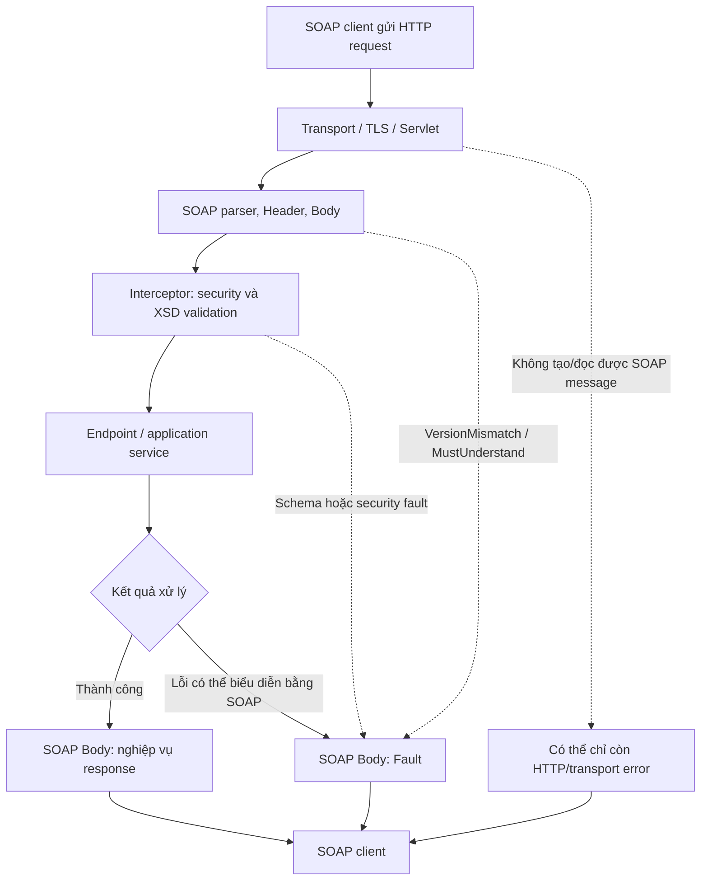
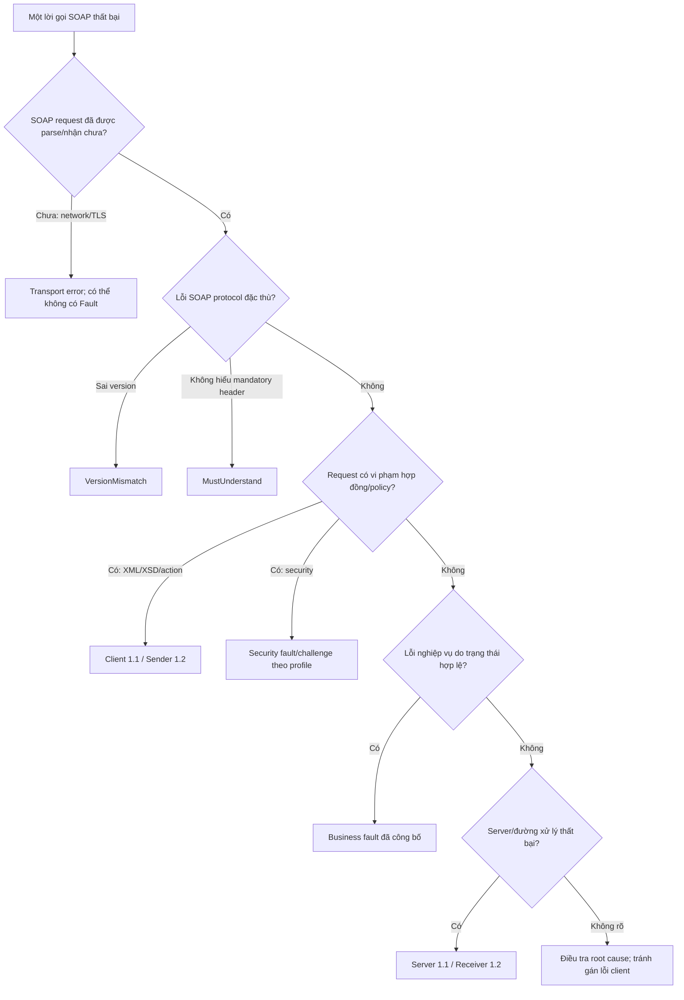
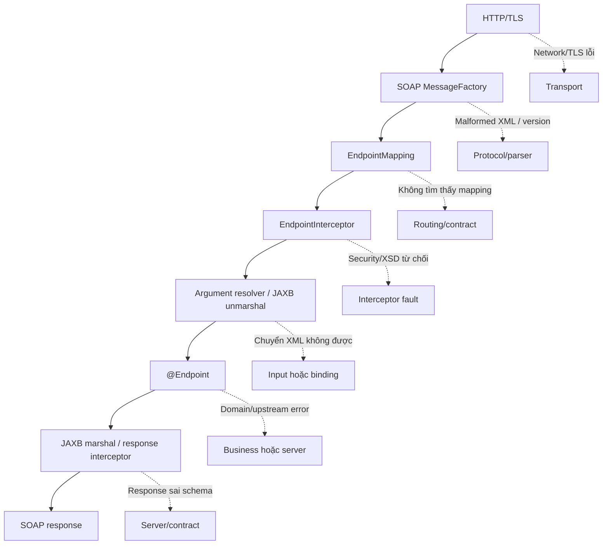

# Client, Server, Sender, Receiver và phân loại nguyên nhân lỗi

Trong dịch vụ SOAP phát triển theo hướng **contract-first** với Spring Web Services (Spring-WS), một lời gọi thất bại không chỉ là một Java exception hoặc mã trạng thái HTTP. Ở tầng giao thức, SOAP định nghĩa **SOAP Fault** để mô tả việc xử lý thông điệp không thành công. Khi client và server sử dụng các phiên bản SOAP khác nhau, tên mã lỗi cũng khác: SOAP 1.1 có **`Client` / `Server`**, còn SOAP 1.2 có **`Sender` / `Receiver`**.

Bài thuộc chương **SOAP Fault** trong module `SPRING_WEB_SERVICES`. Trọng tâm là phân biệt ý nghĩa của các mã lỗi trên, tìm **nguyên nhân gốc** từ XML/XSD/WSDL, JAXB/OXM, endpoint, interceptor, WS-Security, chứng chỉ và hạ tầng; sau đó ánh xạ lỗi thành Fault đúng hợp đồng, an toàn và dễ xử lý bởi SOAP client của hệ thống doanh nghiệp.

> **Quy tắc thực hành:** Fault code nên phản ánh **bên cần sửa nguyên nhân**, không đơn giản là bên đã ném exception. Một lỗi `UnmarshallingFailureException` không mặc nhiên là `Client`, và một lỗi nghiệp vụ “đơn hàng không tồn tại” không nhất thiết là lỗi server.

## 1. SOAP Fault là gì? Khác HTTP error và Java exception ra sao?

Một SOAP message có `Envelope`, bên trong là `Header` tùy chọn và `Body`. Khi có lỗi xử lý theo giao thức SOAP, `Body` có thể chứa **`Fault`** thay cho response nghiệp vụ thông thường.



Ba khái niệm cần tách rõ:

| Khái niệm | Ví dụ | Vai trò |
| --- | --- | --- |
| **Java exception** | `InvalidOrderException`, `SAXParseException` | Tín hiệu lỗi nội bộ khi chạy code; không phải định dạng hợp đồng |
| **SOAP Fault** | `soap:Client`, `env:Sender`, kèm reason/detail | Thông điệp lỗi SOAP trên wire, có semantics theo phiên bản SOAP |
| **HTTP/transport status** | HTTP 400, 500, timeout, TLS failure | Kết quả ở tầng HTTP/kết nối; không đủ thay thế nội dung Fault |

Một request có thể gặp HTTP 500 **kèm SOAP Fault hợp lệ**, trong khi timeout hoặc TLS handshake failure có thể khiến **không hề có SOAP Envelope** để client đọc. Do đó, không thể dùng mỗi HTTP status để biết lỗi thuộc loại nào.

**Contract-first** nghĩa là XSD/WSDL định nghĩa request/response và các business fault cần công bố, còn SOAP Fault code chuẩn mô tả nhóm lỗi ở tầng SOAP. Việc tích hợp ổn định đòi hỏi hai lớp này nhất quán, không đưa Java stack trace ra đối tác.

## 2. SOAP 1.1: `Client` và `Server`

SOAP 1.1 dùng Envelope namespace:

```text
http://schemas.xmlsoap.org/soap/envelope/
```

SOAP Fault gồm các phần tử cổ điển:

- `faultcode`: mã lỗi dưới dạng QName, ví dụ `soap:Client`.
- `faultstring`: diễn giải lỗi dành cho người đọc.
- `faultactor`: thành phần xử lý liên quan lỗi, không bắt buộc và phụ thuộc ngữ cảnh.
- `detail`: thông tin chi tiết về lỗi liên quan việc xử lý Body, dùng khi phù hợp.

### 2.1. `soap:Client`

Dùng khi thông điệp gửi đến **không đúng cách hoặc thiếu thông tin cần thiết để xử lý**. Thường có nghĩa bên gửi cần sửa request trước khi thử lại.

Ví dụ request gửi `orderId` không hợp lệ theo XSD:

```xml
<soap:Envelope
    xmlns:soap="http://schemas.xmlsoap.org/soap/envelope/"
    xmlns:err="https://example.com/orders/faults/v1">
    <soap:Body>
        <soap:Fault>
            <faultcode>soap:Client</faultcode>
            <faultstring>Request không hợp lệ theo hợp đồng</faultstring>
            <detail>
                <err:ValidationFault>
                    <err:code>INVALID_ORDER_ID</err:code>
                    <err:field>orderId</err:field>
                </err:ValidationFault>
            </detail>
        </soap:Fault>
    </soap:Body>
</soap:Envelope>
```

`err:ValidationFault` là phần tử **do dịch vụ định nghĩa**, phải có XSD tương ứng nếu công bố detail như một phần hợp đồng. Không thể tự thêm tên phần tử vào Fault rồi kết luận mọi SOAP client sẽ hiểu.

Các nguyên nhân thường thuộc nhóm sender/client:

1. Body không khớp QName của operation hoặc thiếu phần tử bắt buộc.
2. Giá trị vi phạm kiểu hoặc ràng buộc XSD.
3. Action và payload không nhất quán theo chính sách tích hợp.
4. Header bắt buộc thiếu hoặc dữ liệu nghiệp vụ sai định dạng.
5. Yêu cầu không thỏa quyền truy cập, tùy cách định nghĩa security/business fault của dịch vụ.

**Lưu ý:** `Client` không có nghĩa client **cố tình** làm sai; nó chỉ chỉ ra message hiện tại cần sửa hoặc không thể được chấp nhận như đã gửi.

### 2.2. `soap:Server`

Dùng khi không thể xử lý message vì vấn đề tại phía **bộ xử lý SOAP/ứng dụng server**, không phải vì message sai hình dạng.

Ví dụ lỗi tạm thời khi truy cập cơ sở dữ liệu:

```xml
<soap:Envelope
    xmlns:soap="http://schemas.xmlsoap.org/soap/envelope/">
    <soap:Body>
        <soap:Fault>
            <faultcode>soap:Server</faultcode>
            <faultstring>Dịch vụ tạm thời không thể xử lý yêu cầu</faultstring>
        </soap:Fault>
    </soap:Body>
</soap:Envelope>
```

Trong production không nên gửi tên class exception, database hostname, câu SQL, đường dẫn keystore hoặc stack trace vào `faultstring`. Thông tin kỹ thuật chi tiết cần được ghi ở server log có kiểm soát và liên kết bằng correlation ID.

Các nguyên nhân thường thuộc server:

- Lỗi cấu hình XML/JAXB/schema **của server**.
- Lỗi repository, connection pool hoặc upstream dependency.
- Response object do server tạo không marshal được thành XML hợp đồng.
- Lỗi xử lý nội bộ bất ngờ, không thể quy cho request sai.
- Hạ tầng server quá tải hoặc tài nguyên tạm thời không sẵn sàng.

`Server` **không tự chứng minh nên retry**: lỗi cấu hình không thể tự hết, trong khi lỗi backend nhất thời có thể phục hồi. Chính sách retry cần thông tin chi tiết hơn Fault code.

## 3. SOAP 1.2: `Sender` và `Receiver`

SOAP 1.2 có namespace khác:

```text
http://www.w3.org/2003/05/soap-envelope
```

Cấu trúc Fault SOAP 1.2 rõ ràng hơn SOAP 1.1:

| Thành phần | Ý nghĩa |
| --- | --- |
| `env:Code/env:Value` | Fault code ở mức SOAP, ví dụ `env:Sender` |
| `env:Code/env:Subcode` | Mã lỗi chuyên biệt dưới dạng QName, có thể lồng nhau |
| `env:Reason/env:Text` | Diễn giải bằng một hoặc nhiều ngôn ngữ (thuộc tính `xml:lang`) |
| `env:Node` | URI node SOAP tạo Fault, nếu áp dụng |
| `env:Role` | Vai trò của node tạo Fault, nếu áp dụng |
| `env:Detail` | Thông tin chi tiết lỗi theo hợp đồng/profile |

### 3.1. `env:Sender` — request cần được sửa

```xml
<env:Envelope
    xmlns:env="http://www.w3.org/2003/05/soap-envelope"
    xmlns:err="https://example.com/orders/faults/v1">
    <env:Body>
        <env:Fault>
            <env:Code>
                <env:Value>env:Sender</env:Value>
                <env:Subcode>
                    <env:Value>err:InvalidOrderId</env:Value>
                </env:Subcode>
            </env:Code>
            <env:Reason>
                <env:Text xml:lang="vi">
                    Mã đơn hàng không đúng định dạng
                </env:Text>
            </env:Reason>
            <env:Detail>
                <err:ValidationFault>
                    <err:code>INVALID_ORDER_ID</err:code>
                    <err:field>orderId</err:field>
                </err:ValidationFault>
            </env:Detail>
        </env:Fault>
    </env:Body>
</env:Envelope>
```

Đây là ví dụ **SOAP 1.2**, không thể chỉ đổi prefix để dùng như SOAP 1.1. `Subcode` là cơ chế của SOAP 1.2; nếu đối tác dùng SOAP 1.1, muốn truyền mã nghiệp vụ nên thiết kế `detail`/business fault phù hợp.

### 3.2. `env:Receiver` — lỗi tại bên xử lý

```xml
<env:Envelope xmlns:env="http://www.w3.org/2003/05/soap-envelope">
    <env:Body>
        <env:Fault>
            <env:Code>
                <env:Value>env:Receiver</env:Value>
            </env:Code>
            <env:Reason>
                <env:Text xml:lang="vi">
                    Dịch vụ chưa thể hoàn tất yêu cầu
                </env:Text>
            </env:Reason>
        </env:Fault>
    </env:Body>
</env:Envelope>
```

`Receiver` chỉ ra message **không được xử lý do lỗi ở phía nhận**; tùy nguyên nhân, gửi lại sau có thể thành công. Điều đó không cho phép client retry vô hạn: phải kiểm tra tính idempotent và trạng thái giao dịch.

### 3.3. Các Fault code chuẩn khác

Ngoài hai mã chính, SOAP 1.2 còn có:

- **`VersionMismatch`:** Envelope dùng phiên bản SOAP mà node nhận không xử lý được.
- **`MustUnderstand`:** một header được nhắm tới node, yêu cầu xử lý bắt buộc, nhưng node không hiểu.
- **`DataEncodingUnknown`:** phương pháp mã hóa dữ liệu được chỉ định không được node hiểu/hỗ trợ.

SOAP 1.1 cũng có `VersionMismatch` và `MustUnderstand`, nhưng không dùng cấu trúc Fault và toàn bộ tập code giống SOAP 1.2.

## 4. Bảng đối chiếu SOAP 1.1 và SOAP 1.2

| Chủ đề | SOAP 1.1 | SOAP 1.2 |
| --- | --- | --- |
| Lỗi do request/bên gửi | `Client` | `Sender` |
| Lỗi do bên xử lý/server | `Server` | `Receiver` |
| Sai SOAP Envelope version | `VersionMismatch` | `VersionMismatch` |
| Header bắt buộc chưa được hiểu | `MustUnderstand` | `MustUnderstand` |
| Không hiểu encoding được khai báo | Không có top-level code cùng tên trong bộ chuẩn 1.1 | `DataEncodingUnknown` |
| Nơi lưu fault code | `faultcode` | `Code/Value`, có thể có `Subcode` |
| Chuỗi mô tả | `faultstring` | `Reason/Text` với `xml:lang` |
| Chi tiết theo nghiệp vụ | `detail` | `Detail` |
| Body thành công | Phần tử response nghiệp vụ | Phần tử response nghiệp vụ |
| Transport HTTP binding phổ biến | `text/xml` và header `SOAPAction` | `application/soap+xml`, action có thể ở media type |
| Envelope namespace | `http://schemas.xmlsoap.org/soap/envelope/` | `http://www.w3.org/2003/05/soap-envelope` |

Mã **`Client` không phải tên khác có thể thay thế nguyên văn cho `Sender`** trong cùng một SOAP version; chúng nằm trong các namespace/cấu trúc tương ứng. Trong ứng dụng Spring-WS, abstraction như `clientOrSender` hoặc `serverOrReceiver` phản ánh quan hệ nghĩa, nhưng **XML trên wire phải theo phiên bản được cấu hình**.

### Kiểm tra SOAP version trước khi phân loại

Một request có thể thất bại vì:

- Envelope SOAP 1.2 gửi tới server chỉ xử lý SOAP 1.1.
- HTTP Content-Type không phù hợp với Envelope.
- Client gửi SOAPAction theo quy tắc 1.1 trong khi endpoint dùng profile SOAP 1.2.
- WSDL công bố binding khác với message factory thực tế.

Nếu lỗi là **SOAP version mismatch**, không nên tự quy tất cả về `Client` chỉ vì server không đọc được Body. Hãy nhận diện `VersionMismatch` và xử lý theo giao thức; khả năng trả SOAP Fault hoặc HTTP error phụ thuộc điểm phát hiện lỗi và message factory.

## 5. Phân loại lỗi dựa trên nguyên nhân gốc, không dựa vào exception name

Một exception như `UnmarshallingFailureException` có thể xuất hiện vì **input XML không hợp lệ**, hoặc vì **JAXB model trên server cấu hình sai**. Do đó, nếu mapping tất cả lỗi "unmarshal" thành `Client`, một lỗi server deploy sai JAXB package sẽ bị báo nhầm là lỗi của đối tác.

| Nhóm nguyên nhân | Ví dụ | Bên cần hành động trước | Định hướng Fault nếu tạo được |
| --- | --- | --- | --- |
| Request XML không well-formed | Thẻ đóng thiếu, `&` chưa escape | Bên gửi | `Client/Sender` hoặc lỗi protocol/parser phù hợp |
| Request đúng XML nhưng sai XSD | Thiếu `orderId`, sai enum, sai `xs:sequence` | Bên gửi | `Client/Sender` |
| SOAP Envelope/namespace sai phiên bản | SOAP 1.2 gửi tới SOAP 1.1-only endpoint | Bên gửi/nhóm tích hợp | `VersionMismatch` khi áp dụng |
| Header bắt buộc không được hiểu | `mustUnderstand` được nhắm tới node nhưng không hỗ trợ | Bên gửi/cấu hình tích hợp | `MustUnderstand` |
| Action và payload mismatch | `GetOrder` action nhưng Body là `CancelOrderRequest` | Bên gửi, trừ khi WSDL server sai | `Client/Sender` hoặc lỗi định tuyến đã công bố |
| Request bị từ chối do xác thực/ủy quyền | Token sai, user không có quyền tenant | Bên gửi/kiểm soát security | Security Fault hoặc HTTP error theo profile |
| Business rule sai | Hủy đơn đã giao, số dư không đủ | Bên gửi/nghiệp vụ | Business fault có code/detail rõ |
| Server XSD/JAXB không khớp | JAXB classes sinh từ schema cũ, import thiếu | Nhóm vận hành server | `Server/Receiver` |
| Server tạo response sai XSD | Thiếu output field bắt buộc | Nhóm phát triển server | `Server/Receiver` |
| Upstream database/service không sẵn sàng | DB timeout, service phụ trợ down | Nhóm vận hành/phụ thuộc | `Server/Receiver` |
| Lỗi lập trình không dự đoán | `NullPointerException`, bug trong endpoint | Nhóm phát triển server | `Server/Receiver` với thông điệp ngoài an toàn |
| TLS, DNS, TCP trước SOAP parsing | Không bắt tay TLS, mất kết nối | Transport/hạ tầng | **Có thể không có SOAP Fault** |

**Một nguyên nhân có thể nằm ở nhiều phía**: ví dụ server công bố WSDL sai khiến client gửi action sai. Khi đó thông điệp wire có thể trông như lỗi sender, nhưng **nguyên nhân tổ chức** thuộc server. Hệ thống cần lưu đủ thông tin chứng minh contract đã công bố, không dùng Fault code để quy trách nhiệm một cách máy móc.

## 6. Quy trình quyết định Fault code

Có thể sử dụng cây quyết định sau để thảo luận chính sách:



Cây quyết định **không tự động tạo Fault**, chỉ là hướng phân loại. Những bước thực tế cần lưu: SOAP version, request QName, WSDL operation, giai đoạn phát sinh lỗi, exception chain, business code, dấu vết authentication/authorization và trạng thái response.

**Thứ tự kỹ thuật** của parser, security interceptor, payload validator và endpoint adapter có thể thay đổi; không phải request nào cũng trải qua đúng thứ tự các câu hỏi trên. Phân loại phải dựa trên kết quả các bước đã thực sự chạy.

## 7. Ví dụ hợp đồng: dữ liệu request và business fault

Giả sử dịch vụ tra cứu đơn hàng dùng namespace `https://example.com/orders/v1` và từ chối mã đơn hàng không đúng XSD. Một phần schema:

```xml
<?xml version="1.0" encoding="UTF-8"?>
<xs:schema xmlns:xs="http://www.w3.org/2001/XMLSchema"
           xmlns:ord="https://example.com/orders/v1"
           targetNamespace="https://example.com/orders/v1"
           elementFormDefault="qualified">
    <xs:element name="GetOrderRequest">
        <xs:complexType>
            <xs:sequence>
                <xs:element name="orderId" type="xs:positiveInteger"/>
            </xs:sequence>
        </xs:complexType>
    </xs:element>

    <xs:element name="GetOrderResponse">
        <xs:complexType>
            <xs:sequence>
                <xs:element name="status" type="xs:string"/>
            </xs:sequence>
        </xs:complexType>
    </xs:element>
</xs:schema>
```

Request hợp lệ có phần SOAP Body:

```xml
<ord:GetOrderRequest xmlns:ord="https://example.com/orders/v1">
    <ord:orderId>42</ord:orderId>
</ord:GetOrderRequest>
```

Sai schema:

```xml
<ord:GetOrderRequest xmlns:ord="https://example.com/orders/v1">
    <ord:orderId>-5</ord:orderId>
</ord:GetOrderRequest>
```

Ở đây XML **well-formed**, nhưng `-5` vi phạm `xs:positiveInteger`. Nếu hệ thống bật payload validation, lỗi nên được phân loại là **lỗi request/sender**, không phải lỗi cơ sở dữ liệu hay lỗi JAXB server.

### Lỗi nghiệp vụ khác lỗi XSD

Một request `orderId=42` hoàn toàn đúng schema có thể tham chiếu đơn hàng không tồn tại. Về mặt hợp đồng, hệ thống có thể chọn:

1. Trả **business SOAP Fault** được WSDL/XSD công bố, ví dụ `ORDER_NOT_FOUND`.
2. Trả **response nghiệp vụ thông thường** chứa trạng thái tìm kiếm, nếu WSDL thiết kế như vậy.

Cả hai đều có thể phù hợp trong các hệ thống khác nhau; không nên bất ngờ đổi từ response sang Fault mà không quản lý compatibility. Nếu dùng Fault, phải chọn **top-level SOAP code** và detail theo chính sách: một business fault có thể thuộc nhóm sender/client nếu request tham chiếu tài nguyên không hợp lệ hoặc không được phép, nhưng **không phải cứ không tìm thấy dữ liệu là SOAP protocol error**.

## 8. WSDL 1.1: công bố business fault bằng `wsdl:fault`

Để đối tác có thể sinh client và xử lý một business fault có cấu trúc, WSDL 1.1 có thể khai báo fault message. Ví dụ XSD dành cho detail:

```xml
<?xml version="1.0" encoding="UTF-8"?>
<xs:schema xmlns:xs="http://www.w3.org/2001/XMLSchema"
           xmlns:err="https://example.com/orders/faults/v1"
           targetNamespace="https://example.com/orders/faults/v1"
           elementFormDefault="qualified">
    <xs:element name="OrderFault">
        <xs:complexType>
            <xs:sequence>
                <xs:element name="code" type="xs:string"/>
                <xs:element name="message" type="xs:string"/>
                <xs:element name="correlationId" type="xs:string"
                            minOccurs="0"/>
            </xs:sequence>
        </xs:complexType>
    </xs:element>
</xs:schema>
```

Các fragment WSDL 1.1 sau cho thấy quan hệ giữa fault message, portType và binding:

```xml
<!-- Bên trong wsdl:definitions: các prefix wsdl, soap, tns, err đã khai báo -->
<wsdl:message name="OrderFaultMessage">
    <wsdl:part name="fault" element="err:OrderFault"/>
</wsdl:message>

<wsdl:portType name="OrdersPortType">
    <wsdl:operation name="GetOrder">
        <wsdl:input message="tns:GetOrderInput"/>
        <wsdl:output message="tns:GetOrderOutput"/>
        <wsdl:fault name="OrderFault"
                    message="tns:OrderFaultMessage"/>
    </wsdl:operation>
</wsdl:portType>

<wsdl:binding name="OrdersBinding" type="tns:OrdersPortType">
    <soap:binding style="document"
                  transport="http://schemas.xmlsoap.org/soap/http"/>
    <wsdl:operation name="GetOrder">
        <soap:operation soapAction="urn:example:orders:v1:GetOrder"/>
        <wsdl:input><soap:body use="literal"/></wsdl:input>
        <wsdl:output><soap:body use="literal"/></wsdl:output>
        <wsdl:fault name="OrderFault">
            <soap:fault name="OrderFault" use="literal"/>
        </wsdl:fault>
    </wsdl:operation>
</wsdl:binding>
```

Đây là **fragment minh họa**, không phải WSDL hoàn chỉnh: `tns:GetOrderInput`, `tns:GetOrderOutput` và namespace import phải được khai báo trong tài liệu đầy đủ.

**Quan trọng:** `wsdl:fault` mô tả business fault mà công cụ tích hợp có thể hiểu; các Fault giao thức như `VersionMismatch` hoặc `MustUnderstand` không nhất thiết được liệt kê thành một declared business fault cho từng operation. Công cụ JAX-WS/JAXB có thể ánh xạ declared fault và undeclared SOAP fault khác nhau.

Nếu server chỉ trả một `faultstring` tự do nhưng WSDL hứa hẹn `err:OrderFault` trong detail, client sinh từ WSDL có thể không ánh xạ được thành exception/business model mong muốn. Hãy kiểm thử **Fault detail QName**, nội dung và schema trên wire.

## 9. Spring-WS: biến Java exception thành Fault code

Ở server Spring-WS, một phương thức `@Endpoint` có thể ném exception khi nghiệp vụ không thành công. Cách **ánh xạ exception sang SOAP Fault** có thể dùng `SoapFaultMappingExceptionResolver`.

Ví dụ cấu hình đơn giản:

```java
import java.util.Properties;
import org.springframework.context.annotation.Bean;
import org.springframework.context.annotation.Configuration;
import org.springframework.ws.soap.server.endpoint.SoapFaultDefinition;
import org.springframework.ws.soap.server.endpoint.SoapFaultMappingExceptionResolver;

@Configuration
public class SoapFaultConfiguration {

    @Bean
    public SoapFaultMappingExceptionResolver soapFaultResolver() {
        SoapFaultMappingExceptionResolver resolver =
                new SoapFaultMappingExceptionResolver();

        Properties mappings = new Properties();
        mappings.setProperty(
                InvalidOrderRequestException.class.getName(),
                "CLIENT,Request không hợp lệ");
        mappings.setProperty(
                OrderNotFoundException.class.getName(),
                "CLIENT,Đơn hàng không được tìm thấy");

        resolver.setExceptionMappings(mappings);

        SoapFaultDefinition fallback = new SoapFaultDefinition();
        fallback.setFaultCode(SoapFaultDefinition.SERVER);
        fallback.setFaultStringOrReason(
                "Dịch vụ tạm thời không thể xử lý yêu cầu");
        resolver.setDefaultFault(fallback);

        resolver.setOrder(1);
        return resolver;
    }
}
```

Trong ví dụ, `InvalidOrderRequestException` và `OrderNotFoundException` là **các class exception nghiệp vụ ứng dụng phải tự định nghĩa**; đoạn trên minh họa cơ chế ánh xạ, không chứa toàn bộ domain model.

Điều cần hiểu:

- Chuỗi mapping dạng `CLIENT,Request không hợp lệ` chứa fault code logic và reason/faultstring theo cú pháp resolver được hỗ trợ. Với SOAP 1.2, framework phải tạo Fault theo **SOAP version** của message factory.
- `defaultFault` dùng mã lỗi phía server khi exception không có mapping rõ ràng; không tiết lộ stack trace ra đối tác.
- `resolver.setOrder(1)` chỉ là ví dụ về thứ tự exception resolvers; cần kiểm tra những resolver khác đã đăng ký để không vô ý ghi đè policy.
- Bean resolver phải thực sự được Spring-WS dispatcher dùng. Việc có bean trong context không tự chứng minh toàn bộ lỗi, kể cả lỗi parser trước dispatch, đều đi qua nó.
- Mapping top-level fault code **chưa tạo business detail có cấu trúc**. Muốn có `err:OrderFault` đúng XSD, cần mở rộng/cấu hình resolver hoặc code tạo Fault detail bằng API Spring-WS theo contract.

Spring-WS còn có `@SoapFault` và `SoapFaultAnnotationExceptionResolver` ở những cấu hình/phiên bản hỗ trợ. Annotation có thể tiện cho lỗi đơn giản, nhưng dùng code Java để mô tả toàn bộ business fault đôi khi làm tầng domain phụ thuộc SOAP. Đối với hệ thống nhiều transport, một error model nghiệp vụ độc lập rồi ánh xạ ở adapter SOAP có thể dễ bảo trì hơn.

### Không mapping mọi RuntimeException thành Client

Một cách cấu hình nguy hiểm:

```text
RuntimeException -> CLIENT,Invalid request
```

Cách này có thể che đi `NullPointerException` trong server, lỗi database và lỗi JAXB response, khiến đối tác nghĩ mình gửi request sai. Thay vào đó, chỉ map **exception đã được xác định do request/điều kiện nghiệp vụ**; các lỗi không xác định nên đi vào nhánh server với log có correlation ID.

## 10. Phân loại lỗi qua nhiều tầng của Spring-WS

Một request có thể thất bại **trước khi endpoint method được gọi**:



| Tầng | Dấu hiệu | Điểm kiểm tra đầu tiên |
| --- | --- | --- |
| Transport / gateway | DNS, TLS, timeout, HTTP 401/403 trước SOAP | Chứng chỉ, network, HTTP filter, gateway |
| Message factory | Envelope XML không parse được, sai version | SOAP version, Content-Type, parser security |
| Endpoint mapping | `No endpoint mapping found` | QName SOAP Body, SOAPAction, WSDL, bean scanning |
| Interceptor | Schema validation hoặc WS-Security không qua | XSD thực tế, token/chữ ký, thứ tự interceptor |
| JAXB/OXM inbound | `UnmarshalException` hoặc conversion failure | Root QName, generated classes, schema/validation events |
| Application service | Business exception hoặc upstream timeout | Rule nghiệp vụ, permission, transaction, dependency |
| JAXB/OXM outbound | Không marshal được response | `ObjectFactory`, `JAXBElement`, required field, namespace |
| Response validation | Response XML sai XSD | Đối chiếu code server với XSD/WSDL phiên bản phát hành |

**Mốc để phân loại** là nguyên nhân và trách nhiệm sửa, không phải chỉ vị trí công cụ phát hiện. Chẳng hạn, `SAXParseException` xảy ra khi server cố đọc một XSD sai trong classpath là **lỗi server**, dù cùng class exception cũng có thể xuất hiện khi parse request XML sai.

## 11. Payload schema validation: tại sao XSD và JAXB chưa đủ khi đứng riêng lẻ?

XSD cho phép kiểm tra QName, kiểu dữ liệu, phần tử bắt buộc, thứ tự, enum, pattern, `minOccurs`, `nillable` và những ràng buộc khác. JAXB ánh xạ XML ↔ Java, nhưng **unmarshal thành công không tự chứng minh đã validate toàn bộ XSD**.

Ví dụ:

```xml
<ord:GetOrderRequest xmlns:ord="https://example.com/orders/v1">
    <ord:orderId>0</ord:orderId>
</ord:GetOrderRequest>
```

`0` không hợp lệ với `xs:positiveInteger`. Nhưng nếu Java binding nhận giá trị số này và schema validation không bật, lỗi có thể chỉ xuất hiện trong application service.

Spring-WS hỗ trợ cấu hình `PayloadValidatingInterceptor` để chặn request không đúng XSD:

```java
import org.springframework.context.annotation.Bean;
import org.springframework.context.annotation.Configuration;
import org.springframework.core.io.ClassPathResource;
import org.springframework.ws.soap.server.endpoint.interceptor.PayloadValidatingInterceptor;
import org.springframework.xml.xsd.SimpleXsdSchema;
import org.springframework.xml.xsd.XsdSchema;

@Configuration
public class SoapSchemaValidationConfig {

    @Bean
    public XsdSchema ordersSchema() {
        return new SimpleXsdSchema(
                new ClassPathResource("xsd/orders.xsd"));
    }

    @Bean
    public PayloadValidatingInterceptor payloadValidator(
            XsdSchema ordersSchema) {
        PayloadValidatingInterceptor interceptor =
                new PayloadValidatingInterceptor();
        interceptor.setXsdSchema(ordersSchema);
        interceptor.setValidateRequest(true);
        interceptor.setValidateResponse(true);
        return interceptor;
    }
}
```

Để hoạt động, interceptor cần được **đăng ký vào endpoint chain**, ví dụ qua `WsConfigurer#addInterceptors`. Cơ chế mặc định để tạo Fault khi validation thất bại cần được xác minh ở phiên bản Spring-WS đang dùng; không được giả định mọi lỗi validation đều đi qua cùng `SoapFaultMappingExceptionResolver`.

Với response validation, nếu output của server không khớp XSD, đó là **lỗi phía server**, ngay cả khi validator dùng cùng bộ schema như với request. Không bao giờ chuyển response validation failure thành lỗi `Client/Sender` và yêu cầu client sửa request hợp lệ.

## 12. SOAP Header, `MustUnderstand` và `VersionMismatch`

### 12.1. `MustUnderstand` không phải `Client` thông thường

SOAP cho phép đánh dấu một header cần được node được nhắm tới hiểu và xử lý. Ví dụ SOAP 1.1:

```xml
<soap:Header
    xmlns:soap="http://schemas.xmlsoap.org/soap/envelope/"
    xmlns:ctx="https://example.com/soap/context/v1">
    <ctx:ProcessingMode soap:mustUnderstand="1">
        strict
    </ctx:ProcessingMode>
</soap:Header>
```

Đây chỉ là fragment Header, không phải SOAP Envelope hoàn chỉnh. Nếu node được nhắm tới **không hiểu** header bắt buộc, lỗi thuộc nhóm **`MustUnderstand`**. Nhưng nếu node **hiểu header** và giá trị `strict` bị policy từ chối, lỗi có thể là validation/policy fault khác. Hai trường hợp không được trộn.

Trong SOAP 1.1, thuộc tính `actor` giúp định tuyến header đến một node xử lý; SOAP 1.2 dùng khái niệm `role`. Không được tự từ chối mọi header `mustUnderstand` trên đường đi nếu node hiện tại không phải bên được nhắm tới theo quy tắc SOAP tương ứng.

### 12.2. `VersionMismatch`

Client gửi SOAP 1.2 Envelope vào server chỉ hỗ trợ SOAP 1.1:

```xml
<env:Envelope
    xmlns:env="http://www.w3.org/2003/05/soap-envelope">
    <env:Body>...</env:Body>
</env:Envelope>
```

Việc nhận ra sai phiên bản là trách nhiệm của lớp SOAP message processing. Phản hồi có thể là `VersionMismatch` Fault hoặc một lỗi HTTP/protocol tùy khả năng xử lý và cấu hình. Không nên cố đưa Envelope sai phiên bản vào JAXB request DTO rồi biến thành một business `INVALID_ORDER`.

### 12.3. `DataEncodingUnknown` của SOAP 1.2

Nếu SOAP 1.2 message chỉ định một data encoding mà node không hiểu, Fault code `DataEncodingUnknown` có semantics riêng. Đừng dùng mã này cho lỗi chuyển ký tự UTF-8 thông thường hay `xs:decimal` sai; nó liên quan quy tắc mã hóa dữ liệu SOAP, không phải mọi lỗi serialization.

## 13. WS-Security, TLS và lỗi xác thực

Một SOAP client có thể gửi request đúng XSD nhưng không thỏa chính sách bảo mật: chứng chỉ không được tin cậy, chữ ký XML sai, token hết hạn, timestamp ngoài cửa sổ, chữ ký không bao phủ đúng Body, hoặc không đủ quyền thao tác trên tenant.

Những lỗi này cần phân loại theo **lớp bảo mật và policy cụ thể**, không chỉ suy từ mã `Client`:

| Trường hợp | Tầng xử lý | Định hướng phản hồi |
| --- | --- | --- |
| Không hoàn tất TLS handshake | Transport | Thường không có SOAP Fault |
| mTLS không có chứng chỉ hợp lệ | TLS/gateway | Có thể dừng trước SOAP dispatcher |
| UsernameToken/token sai | WS-Security / authentication | Security fault hoặc error theo profile, không lộ credential |
| XML Signature sai | WS-Security | Fault bảo mật, không cung cấp private key/cấu hình truststore |
| Timestamp quá cũ | WS-Security/replay policy | Từ chối theo profile/cửa sổ thời gian |
| Principal đúng nhưng thiếu quyền tenant | Authorization | Access-denied/business security fault phù hợp contract |
| Endpoint response không được ký như policy yêu cầu | Server WS-Security outbound | Lỗi server/profile; sửa pipeline ký response |

**Nhìn thấy phần tử `wsse:Security` không chứng minh thông điệp đã được xác thực.** Interceptor chuyên biệt phải xác minh token/chữ ký/timestamp, trust chain và scope của những node được bảo vệ. Nếu chỉ ký SOAP Body mà không ký header `TenantId`, không được coi tenant header là thông tin đã bảo toàn tính toàn vẹn.

Cần chống **XML Signature Wrapping**: node mà endpoint sử dụng phải là node đã được kiểm tra chữ ký. Không dùng Fault để tiết lộ "chữ ký sai ở node nào, bằng khóa nào" cho kẻ tấn công nếu thông tin đó vượt quá chính sách phản hồi.

## 14. SOAP Fault detail: đủ cho đối tác xử lý, không lộ hệ thống

Một thiết kế Fault ổn định thường có hai lớp thông tin:

1. **SOAP fault code chuẩn:** phân loại giao thức `Client/Server` hoặc `Sender/Receiver`.
2. **Business error code/detail có namespace:** mô tả một lỗi nghiệp vụ theo schema, ví dụ `ORDER_NOT_FOUND`, `INSUFFICIENT_PERMISSION` hoặc `INVALID_ORDER_ID`.

Ví dụ detail trong SOAP 1.1:

```xml
<detail xmlns:err="https://example.com/orders/faults/v1">
    <err:OrderFault>
        <err:code>ORDER_NOT_FOUND</err:code>
        <err:message>Không tìm thấy đơn hàng phù hợp</err:message>
        <err:correlationId>srv-79fa</err:correlationId>
    </err:OrderFault>
</detail>
```

Trong SOAP 1.2, detail sẽ nằm trong `env:Detail`. **Không nên để client phải parse `faultstring`/`Reason` bằng regex** để quyết định hành động; các chuỗi mô tả có thể thay đổi theo ngôn ngữ và chính sách. Khi contract cần máy xử lý, hãy cung cấp error code ổn định với QName và schema rõ ràng.

### Trường nào nên/không nên có trong detail?

| Nên cân nhắc công bố | Tránh công bố |
| --- | --- |
| Mã lỗi nghiệp vụ ổn định | Java class/stack trace |
| Correlation ID do server tạo | Đường dẫn máy chủ, tên database/table |
| Trường input sai nếu không nhạy cảm | Giá trị bí mật của header/token |
| Thông báo phù hợp người dùng | Private key, certificate path, truststore |
| Hướng dẫn sửa lỗi đã được phê duyệt | Tenant ID/tài nguyên mà caller chưa được phép biết |
| Retry hint nếu contract hỗ trợ | Thông tin hạ tầng nội bộ hoặc topology nhạy cảm |

Một lỗi "tài khoản hoặc đơn hàng không tồn tại" có thể cần trả thông điệp **không phân biệt** tồn tại/không tồn tại nếu việc xác nhận tồn tại làm rò rỉ thông tin. Chi tiết tùy yêu cầu bảo mật và quyền của người gọi.

## 15. HTTP status và SOAP Fault: không suy một chiều

SOAP over HTTP thường kết hợp status HTTP và Fault XML. Với SOAP 1.1, lỗi xử lý SOAP thường được gửi kèm HTTP 500 trong HTTP binding; SOAP 1.2 HTTP binding có quy tắc phản hồi riêng theo Fault code và tình huống. Tuy nhiên, **thực tế** còn chịu ảnh hưởng của servlet, API gateway, security filter, reverse proxy và client library.

| Quan sát từ client | Có thể kết luận | Chưa thể kết luận |
| --- | --- | --- |
| HTTP 500 + XML SOAP Fault | Server trả một SOAP fault ở tầng ứng dụng/giao thức | Mặc định mọi lỗi 500 đều là `Server/Receiver` |
| HTTP 400 + SOAP Fault | Có lỗi request/giao thức được biểu diễn thành SOAP | Không phải mọi Fault 400 đều giống nhau |
| HTTP 401/403 không có Envelope | Bị từ chối tại một lớp HTTP/security | SOAP endpoint đã chạy hay chưa |
| HTTP 200 + SOAP response | Có message đáp ứng ở tầng HTTP | Payload tự động đúng XSD/nhất quán nghiệp vụ |
| HTTP 200 + SOAP Fault (triển khai đặc thù) | Cần đọc Body để phát hiện Fault | Không nên coi chỉ status 200 là thành công |
| Timeout/mất kết nối | Không nhận được kết quả đầy đủ | Server có thực thi nghiệp vụ hay chưa |

Khi chuẩn hóa một hệ thống, nên bám **SOAP binding version đã công bố** và kiểm thử HTTP status đúng profile, thay vì coi HTTP status tùy tiện nào cũng là giao thức tương đương. Lỗi từ gateway không có SOAP Envelope nên client phải xử lý riêng với exception SOAP.

Một số SOAP client chỉ ném một lớp exception chung khi gặp HTTP 500. Trong test liên thông, cần kiểm tra **Content-Type, Envelope namespace và fault code thực nhận**, không chỉ log status.

## 16. Phía SOAP client: đọc Fault và quyết định hành động

Spring-WS client có `WebServiceTemplate`. Khi nhận SOAP Fault ở một đường xử lý hỗ trợ, template có thể chuyển nó thành `SoapFaultClientException` (trừ khi ứng dụng tùy biến fault handling/resolver).

Ví dụ minh họa:

```java
import javax.xml.namespace.QName;
import org.springframework.ws.client.core.WebServiceTemplate;
import org.springframework.ws.soap.client.SoapFaultClientException;

public final class OrderClient {
    private final WebServiceTemplate template;

    public OrderClient(WebServiceTemplate template) {
        this.template = template;
    }

    public Object getOrder(Object request) {
        try {
            return template.marshalSendAndReceive(
                    "https://api.example.com/ws", request);
        } catch (SoapFaultClientException ex) {
            QName code = ex.getFaultCode();
            String description = ex.getFaultStringOrReason();

            // Chỉ ghi mã lỗi/metadata đã lọc. Không log token/Body.
            throw new RemoteSoapFailure(code, description, ex);
        }
    }
}
```

`RemoteSoapFailure` là **exception ứng dụng tự định nghĩa**, chưa được cung cấp trong fragment. Trong ứng dụng thực, tham số `request` nên là JAXB class hoặc `JAXBElement` hợp lệ theo XSD/WSDL; URL, SOAPAction và WS-Security phải được cấu hình theo hợp đồng.

Một chiến lược client nên phân biệt:

- **SOAP Fault đã nhận**: đọc version, QName của fault code, detail và error code của hợp đồng.
- **Transport exception**: DNS, TLS, HTTP không có SOAP Envelope, timeout; không có fault code XML.
- **Lỗi JAXB/OXM client**: không marshal được request hoặc unmarshal được response, có thể do client model/schema không khớp.
- **Business fault có cấu trúc**: xử lý theo error code do contract định nghĩa, không dựa vào câu chữ của faultstring.

**Đừng catch `Exception` rồi retry mọi trường hợp.** Nếu request đã được server thực hiện nhưng client timeout trước khi nhận response, một retry thiếu idempotency có thể tạo giao dịch trùng.

## 17. Retry, idempotency và ý nghĩa vận hành của Fault

`Client/Sender` thường gợi ý **sửa request trước khi gửi lại**. `Server/Receiver` có thể là lỗi tạm thời **hoặc** lỗi triển khai lâu dài. Không phải top-level code nào cũng đủ để quyết định retry.

| Tình huống | Retry nguyên request? | Lưu ý |
| --- | --- | --- |
| Thiếu phần tử bắt buộc theo XSD | **Không** | Phải sửa payload trước |
| Token/chứng chỉ không hợp lệ | **Không** nếu giữ nguyên credential | Cần làm mới/sửa credential theo policy |
| Business fault `ORDER_NOT_FOUND` | Thường **không** | Trừ khi contract nêu rõ eventual consistency/retry |
| Database timeout trước khi thực thi | Có thể, có giới hạn | Phải biết semantics của operation |
| Server quá tải với retry hint | Có thể | Exponential backoff, jitter, retry budget |
| Endpoint marshal response lỗi | **Không** từ góc nhìn client nếu có thể tránh | Retry không sửa bug server |
| Timeout sau khi gửi lệnh thanh toán | **Không mù quáng** | Trạng thái server chưa rõ, cần idempotency key/status query |
| HTTP 429/503 do gateway | Theo policy HTTP/gateway | Có thể không có SOAP Fault; xem Retry-After và limits |

### Idempotency khác SOAP Fault code

Một operation đọc dữ liệu như `GetOrder` có thể retry an toàn hơn operation chuyển tiền hoặc hủy đơn. Với operation thay đổi trạng thái:

1. Thiết kế **idempotency key** được ràng buộc với principal/operation/business entity.
2. Lưu trạng thái xử lý trong phạm vi thời gian phù hợp.
3. Khi client timeout, hỗ trợ truy vấn trạng thái giao dịch hoặc nhận diện request trùng.
4. Không coi `wsa:MessageID` hay correlation ID do client tự khai báo là bằng chứng chống replay nếu server chưa có kiểm tra trùng.
5. Áp dụng backoff/jitter và giới hạn tổng số retry, tránh tạo tải tăng vọt khi server lỗi.

**Receiver/Server không có nghĩa "hãy retry ngay".** Đó là mô tả bên lỗi, không phải cơ chế điều khiển việc retry hoàn chỉnh.

## 18. Quan sát: phân loại lỗi để đo metric và điều tra

Một lỗi nên có đủ **ngữ cảnh kỹ thuật nội bộ**, khác với thông tin trả cho client:

```text
internalTraceId = srv-79fa
soapVersion     = 1.1
requestQName    = {https://example.com/orders/v1}GetOrderRequest
operation       = GetOrder
stage           = inbound-validation
faultCategory   = SENDER_CONTRACT
soapFaultCode   = {http://schemas.xmlsoap.org/soap/envelope/}Client
businessCode    = INVALID_ORDER_ID
exceptionRoot   = SAXParseException
outcome         = rejected-before-business
```

Log trên là **minh họa**; không nên cố ép một request chưa parse được thành `requestQName` đã xác định. Với lỗi TLS hoặc envelope malformed, trường tương ứng có thể vắng mặt.

Các dimension nên cân nhắc:

- `soapVersion`, QName của operation và request payload.
- Giai đoạn phát hiện: transport, parser, mapping, inbound validation, security, business, outbound marshal.
- Fault code logic và QName thực tế trên wire.
- Mã nghiệp vụ ổn định; trạng thái retryable theo policy, **không suy chỉ từ HTTP 500**.
- Kết quả xử lý/tình trạng transaction đã commit hay chưa.
- Internal trace ID để đối chiếu log có quyền truy cập; không đưa stack trace vào Fault.

Cần hạn chế cardinality metric: không đưa `orderId`, token, username, tenant ID bất kỳ hoặc raw faultstring làm nhãn metric tự do.

## 19. Ma trận kiểm thử phân loại Client/Server/Sender/Receiver

Để kiểm tra thật, nên dùng ít nhất ba lớp: **unit phân loại exception**, **Spring-WS endpoint test** và **HTTP/client interoperability test**.

| Mã | Tình huống | Fault/đường xử lý kỳ vọng |
| --- | --- | --- |
| F01 | SOAP 1.1, `orderId=-5` vi phạm XSD | Fault request `Client` hoặc behavior validator đã công bố |
| F02 | SOAP 1.2, `orderId=-5` vi phạm XSD | Fault request `Sender` theo cấu hình |
| F03 | SOAP 1.1, server database unavailable | `Server`, không lộ database hostname |
| F04 | SOAP 1.2, upstream service unavailable | `Receiver`, reason an toàn |
| F05 | SOAP 1.1 Envelope sai phiên bản | `VersionMismatch` hoặc protocol handling phù hợp |
| F06 | SOAP 1.2 mandatory header không được hiểu | `MustUnderstand` |
| F07 | SOAP 1.2 encoding không được hỗ trợ | `DataEncodingUnknown` khi áp dụng |
| F08 | XML có thẻ đóng thiếu | Parser/protocol reject; không được giả định endpoint đã chạy |
| F09 | SOAP Body đúng schema nhưng sai namespace operation | Routing/contract fault phù hợp |
| F10 | SOAPAction và payload QName mâu thuẫn | Bị chặn theo consistency policy |
| F11 | SOAP client thiếu SOAPAction bắt buộc | Contract/routing error đã công bố |
| F12 | XSD `positiveInteger` nhận `0` | Request validation từ chối |
| F13 | Server thiếu XSD import khi startup | Lỗi cấu hình server; không gán lỗi client |
| F14 | JAXB request model client không marshal được | Lỗi OXM **phía client** trước khi gửi |
| F15 | JAXB server không marshal được response | `Server/Receiver` hoặc server failure phù hợp |
| F16 | Response XML thiếu output field bắt buộc | Response validation; không trả success sai contract |
| F17 | `OrderNotFoundException` theo declared fault | Có `err:OrderFault` detail đúng QName/schema |
| F18 | Lỗi Java không map, ví dụ `NullPointerException` | Default server fault, không lộ stack trace |
| F19 | WS-Security token sai | Security fault, không chạy nghiệp vụ |
| F20 | Chữ ký đúng, principal không có quyền tenant | Authorization từ chối, không trả dữ liệu |
| F21 | mTLS handshake fail | Transport error; không kỳ vọng SOAP Fault |
| F22 | HTTP 500 có SOAP Fault | Client phân tích Body và fault code, không coi là exception HTTP đơn thuần |
| F23 | Timeout sau POST thay đổi trạng thái | Client không retry mù quáng; kiểm tra idempotency |
| F24 | SOAP 1.2 có `Subcode` nghiệp vụ | Subcode đúng QName; detail đúng contract |
| F25 | `MustUnderstand` khác lỗi invalid header value | Phân loại thành hai tình huống riêng |
| F26 | Gateway HTTP 401 không SOAP Envelope | Client xử lý transport/auth, không parse như SOAP Fault |
| F27 | Trùng correlation ID do client tự gửi | Không tự coi là cùng giao dịch; áp policy idempotency |
| F28 | Client .NET/Java sinh từ WSDL công bố | Hiểu declared fault và fault detail liên thông |
| F29 | Response SOAP Fault chứa dữ liệu nhạy cảm | Test phát hiện và không publish |
| F30 | Nâng cấp SOAP 1.1 sang 1.2 ở staging | Mã Fault/Envelope/Content-Type đúng version |

### Những assertion quan trọng

Một test không chỉ cần "nhận HTTP lỗi". Hãy kiểm tra:

1. **Envelope namespace**, SOAP version, top-level fault code và, với SOAP 1.2, subcode khi có.
2. **Fault detail QName/schema** cho lỗi nghiệp vụ đã công bố.
3. **Endpoint/application service có chạy hay không** khi request lỗi schema hoặc security.
4. **Fault string/reason không chứa secret**, Java stack trace hoặc dữ liệu tenant trái quyền.
5. **Client behavior**: tách Fault với timeout/TLS và có chính sách retry/idempotency đúng.
6. **WSDL/XSD công khai** có cùng version với server/client test.

Với Spring-WS Test, `MockWebServiceClient` hỗ trợ kiểm thử endpoint cùng các response matchers của framework; `MockWebServiceServer` hỗ trợ giả lập phản hồi khi kiểm thử `WebServiceTemplate`. Phải kiểm tra API matcher theo phiên bản thư viện thực tế thay vì sao chép một method signature không tồn tại. Để xác minh HTTP 400/500, proxy, TLS và SOAP 1.1/1.2 binding, cần **integration test qua transport thật**.

## 20. Case study: cùng một exception, hai nguyên nhân đối nghịch

**Bối cảnh:** Dịch vụ đơn hàng nhận request và ghi log:

```text
UnmarshallingFailureException
  caused by UnmarshalException
  caused by SAXParseException
```

Nhóm vận hành muốn mapping tất cả lỗi trên thành `soap:Client` vì "unmarshal là lỗi đầu vào". Nhưng có hai kịch bản:

**Kịch bản A — Request sai:** client gửi `<orderId>abc</orderId>`, trong khi XSD yêu cầu `xs:positiveInteger`. Schema compiler của server hoạt động tốt, JAXB model khớp XSD. Đây là lỗi **sender/client**, nên từ chối có thông tin trường input phù hợp.

**Kịch bản B — Server deploy sai:** server dùng JAXB classes của version v1 trong khi WSDL/XSD công bố version v2; request XML hoàn toàn phù hợp với v2 nhưng unmarshaller cũ không nhận QName mới. Lỗi xuất hiện ở **cùng đường unmarshal**, nhưng nguyên nhân là **server không đồng bộ hợp đồng**; không được đẩy trách nhiệm sang client.

**Quy trình điều tra:**

1. Lưu **WSDL/XSD mà client thật tải được**, không chỉ bản trong repository.
2. Ghi QName/namespace của request và SOAP version mà server thực nhận.
3. Validate request bằng schema của phiên bản đang công bố, độc lập với JAXB.
4. Kiểm tra generated classes, `package-info.java`, `@XmlSchema`, `ObjectFactory` và cấu hình `Jaxb2Marshaller`.
5. Phân biệt lỗi schema instance với lỗi binding/configuration của server.
6. Sửa gốc, giữ Fault ngoài an toàn, và bổ sung test hồi quy cho **cả hai kịch bản**.

**Kết quả mong đợi:** Kịch bản A được phân loại thành Client/Sender, kịch bản B thành Server/Receiver hoặc lỗi triển khai tương đương. Cùng tên exception không đủ để kết luận.

## 21. Checklist trước khi công bố SOAP Fault contract

1. **Biết SOAP version và HTTP binding** đang dùng; không tráo `Client/Server` với `Sender/Receiver` trong XML trên wire.
2. **Phân biệt top-level Fault chuẩn** với business error code, `Subcode` và `Detail`.
3. **Nhận diện `VersionMismatch`, `MustUnderstand`** và `DataEncodingUnknown` của SOAP 1.2 theo đúng ngữ cảnh.
4. **Phân loại từ root cause**, không chỉ tên exception hoặc HTTP status.
5. **XSD và WSDL cùng version**, gồm các global element của request, response và declared business fault.
6. **Đăng ký exception resolver thực tế**, chỉ mapping exception hợp lệ; default lỗi không xác định về server/receiver.
7. **Không nhầm Fault do interceptor tạo** với exception được resolver xử lý; kiểm thử cả hai nhánh.
8. **Bật inbound validation** phù hợp và kiểm tra response validation, không đổ lỗi output server cho client.
9. **Tách authentication/authorization khỏi XSD**; người có token đúng chưa chắc có quyền operation/tenant.
10. **Không giả định tất cả lỗi có SOAP Envelope**: TLS, DNS, HTTP gateway hoặc parse trước dispatcher có thể chỉ có transport error.
11. **Hạn chế thông tin Fault ngoài**: không đưa exception class, SQL, token, keystore hoặc dữ liệu không được phép tiết lộ.
12. **Dùng mã nghiệp vụ ổn định**, có namespace/schema và test Java/.NET client nếu đối tác cần đọc tự động.
13. **Áp retry có điều kiện**, idempotency key và trạng thái giao dịch cho operation thay đổi dữ liệu.
14. **Ghi metric theo nhóm lỗi và giai đoạn**, liên kết bằng internal trace ID nhưng không để lộ PII.
15. **Kiểm thử SOAP 1.1 và SOAP 1.2 riêng**, gồm HTTP status, Content-Type, Envelope, Fault code và detail.
16. **Thử liên thông từ WSDL công bố**, không chỉ gọi trực tiếp method Java hoặc mock XML trên máy dev.

**Kết luận:** `Client` của SOAP 1.1 và `Sender` của SOAP 1.2 thường chỉ ra request cần được sửa, còn `Server` và `Receiver` mô tả lỗi ở bên xử lý. Nhưng **Fault code không thay thế điều tra root cause**, không quyết định toàn bộ chính sách retry và không tự phân biệt lỗi giao thức, nghiệp vụ, bảo mật hay transport. Trong Spring-WS contract-first, phân loại đúng cần kết hợp XSD/WSDL, JAXB/OXM, interceptor, exception resolver, WS-Security và cách client thật đọc Fault. Một mô hình lỗi ổn định phải trả **mã SOAP đúng phiên bản, detail nghiệp vụ có hợp đồng, thông tin đủ để hành động và không tiết lộ dữ liệu nội bộ**.
