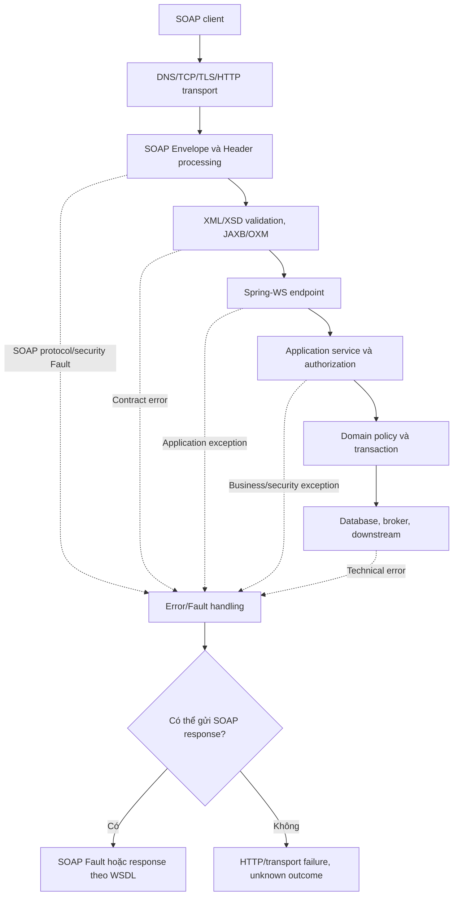
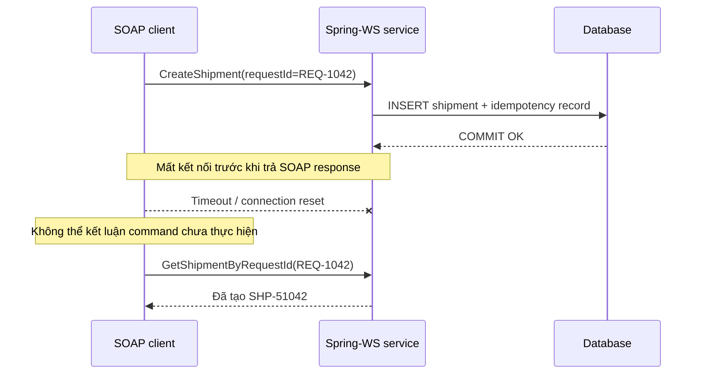
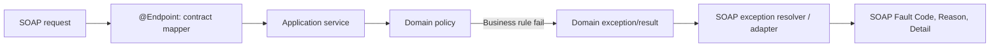

# Lỗi hợp đồng, lỗi nghiệp vụ, lỗi kỹ thuật và lỗi bảo mật

## 1. Tại sao phân loại lỗi là một phần của hợp đồng SOAP?

Trong một dịch vụ SOAP xây dựng bằng **Spring Web Services (Spring-WS)** theo hướng **contract-first**, client cần phân biệt ít nhất bốn loại sự cố:

1. **Lỗi hợp đồng**: thông điệp không tuân SOAP protocol, XSD, WSDL binding hoặc quy tắc XML đã công bố.
2. **Lỗi nghiệp vụ**: XML có thể hợp lệ, nhưng thao tác bị từ chối vì quy tắc nghiệp vụ, trạng thái hoặc quyền sử dụng tài nguyên.
3. **Lỗi kỹ thuật**: hệ thống không hoàn thành xử lý do sự cố hạ tầng hoặc lỗi triển khai.
4. **Lỗi bảo mật**: danh tính, token, chữ ký, timestamp, chứng chỉ hoặc phân quyền không thỏa chính sách.

Nếu mọi sự cố đều trở thành một `soap:Server` Fault với `faultstring="Internal Error"`, client không biết nên sửa request, yêu cầu người dùng thay đổi dữ liệu, chờ rồi retry, hay liên hệ bộ phận tích hợp. Ngược lại, nếu server đưa cả stack trace, SQL và chi tiết chứng chỉ vào SOAP Fault, đối tác có thể vô tình nhận thông tin nhạy cảm.

**SOAP Fault** là cấu trúc chuẩn của giao thức SOAP để biểu diễn lỗi xử lý thông điệp. Nó không tự thay thế một **bảng mã lỗi nghiệp vụ** và cũng không bảo đảm rằng tất cả lỗi đều có SOAP reply: khi TLS handshake thất bại hoặc kết nối mất sau khi server đã xử lý, client có thể không nhận được Envelope nào.

Bài học nằm trong chương **SOAP Fault** của module **SPRING_WEB_SERVICES**, đặt trong bối cảnh thiết kế XSD/WSDL, JAXB/OXM, endpoint và SOAP client, interceptor, XML security, WS-Security, chứng chỉ và kiểm thử tương thích hệ thống doanh nghiệp.

### Mục tiêu

Sau bài này, bạn có thể:

- Phân loại lỗi theo **nguồn phát sinh, ý nghĩa, trách nhiệm sửa và hành động tiếp theo của client**.
- Nhận diện thành phần SOAP 1.1 Fault và SOAP 1.2 Fault; không trộn hai định dạng.
- Thiết kế XSD/WSDL cho **typed Fault detail** trong operation request-response.
- Chuyển exception ứng dụng thành SOAP Fault qua Spring-WS exception resolver mà không lộ nội bộ.
- Phân biệt **business rejection trong response** với **business Fault**.
- Xử lý lỗi XML validation và WS-Security từ interceptor, kể cả khi endpoint chưa được gọi.
- Xử lý SOAP Fault phía client, tách biệt lỗi HTTP/TLS/timeout và xây dựng retry/idempotency an toàn.
- Viết contract tests, security tests và interoperability tests cho toàn bộ ma trận lỗi.

## 2. Bức tranh các ranh giới lỗi

Một SOAP request có nhiều điểm có thể thất bại:



Sơ đồ mô tả ranh giới, không quy định thứ tự chính xác của mọi interceptor. Trong Spring-WS, `MessageDispatcherServlet`, `MessageDispatcher`, endpoint mappings, endpoint adapters, endpoint interceptors và exception resolvers tham gia theo cấu hình thực tế. TLS/proxy có thể từ chối kết nối **trước cả Spring-WS**; WS-Security interceptor có thể từ chối message **trước khi handler method chạy**.

### 2.1. Ma trận bốn loại lỗi

| Loại | Dấu hiệu | Ví dụ | Tầng phát hiện | Client nên làm gì? |
| --- | --- | --- | --- | --- |
| **Hợp đồng** | QName, XSD, SOAP version, required header, WSDL binding không đúng | `GetStatusRequest` sai namespace; thiếu `shipmentId` | XML/SOAP stack hoặc contract adapter | Sửa dữ liệu, generator, WSDL hoặc binding; không retry y nguyên |
| **Nghiệp vụ** | Cú pháp hợp lệ nhưng rule không cho phép | Vận đơn bị khóa, trạng thái chuyển không hợp lệ | Application/domain policy | Sửa điều kiện nghiệp vụ hoặc xử lý mã từ chối có cấu trúc |
| **Kỹ thuật** | Dịch vụ hoặc hạ tầng không đáp ứng | Database timeout, downstream unavailable | Infra/application boundary | Theo dõi, phân loại retryable; chú ý idempotency/unknown outcome |
| **Bảo mật** | Không đạt authentication, integrity, timestamp hay authorization policy | Chữ ký XML sai, certificate không tin cậy, caller sai tenant | TLS/WS-Security/security + application | Sửa credential/policy/permission; không retry liên tục |

**Một sự cố có thể trải qua nhiều tầng.** Ví dụ XML bị sửa sau khi ký vừa khiến signature invalid vừa khiến payload sai schema. Hệ thống cần một lỗi công khai nhất quán và bảo vệ thông tin, không nhất thiết trả toàn bộ chẩn đoán nội bộ cho client.

## 3. SOAP Fault khác với HTTP status và lỗi nghiệp vụ

SOAP Fault là **SOAP message**. HTTP status nằm ở **transport**. Một trường `state="REJECTED"` trong response XML là **kết quả nghiệp vụ được hợp đồng định nghĩa**, không tự động là SOAP Fault.

| Điều quan sát được | Có SOAP Envelope? | Diễn giải hợp lý |
| --- | --- | --- |
| HTTP 200 với `GetShipmentStatusResponse` | Có, Body mang response | Có SOAP response bình thường; vẫn đọc trạng thái nghiệp vụ |
| HTTP 500 với SOAP 1.1 Fault | Có, Body mang `Fault` | SOAP error, đọc code/reason/detail |
| HTTP 401 từ reverse proxy | Có thể không | Lỗi authentication ở transport/gateway; có thể chưa vào Spring-WS |
| TLS handshake failed | Không | Lỗi kết nối/bảo mật trước SOAP |
| Connection timeout sau khi gửi request | Không chắc | Không biết server đã xử lý/commit hay chưa |
| HTTP 200 với response `status=REJECTED` | Có | Kết quả bị từ chối theo business contract, không tự coi là xử lý hạ tầng thành công |

Trong binding SOAP 1.1 qua HTTP, **SOAP Fault thường đi cùng HTTP 500** theo quy tắc binding; nhưng proxy, servlet container, transport adapter và các lỗi trước khi SOAP được tạo vẫn có thể cho status khác. Với SOAP 1.2, HTTP binding có các quy tắc riêng; đừng áp dụng máy móc mọi giả định của SOAP 1.1.

### 3.1. Tại sao HTTP 200 chưa đủ?

Với contract:

```xml
<sh:CreateShipmentResponse xmlns:sh="urn:example:shipment:v1">
  <sh:requestId>REQ-1042</sh:requestId>
  <sh:state>REJECTED</sh:state>
  <sh:reasonCode>LIMIT_EXCEEDED</sh:reasonCode>
</sh:CreateShipmentResponse>
```

HTTP 200 có thể chỉ có nghĩa request-response đã được thực hiện bình thường và **nghiệp vụ đã đưa ra quyết định từ chối**. Client phải đọc `state` và `reasonCode`. Nếu client chỉ kiểm HTTP status, nó có thể hiển thị “Tạo vận đơn thành công” sai sự thật.

### 3.2. Fault không đồng nghĩa “hãy retry”

Một `Sender/Client` Fault thường chỉ ra request cần sửa. `Receiver/Server` Fault thường biểu thị lỗi ở phía xử lý, nhưng **không tự bảo đảm retry an toàn**. Với một command tạo dữ liệu, server có thể đã commit trước khi không gửi được response. Khả năng retry phải dựa vào **idempotency và chính sách operation**, không chỉ fault code.

## 4. Cấu trúc SOAP 1.1 Fault

Ví dụ một lỗi hợp đồng vì `shipmentId` không hợp lệ:

```xml
<soapenv:Envelope
    xmlns:soapenv="http://schemas.xmlsoap.org/soap/envelope/"
    xmlns:sh="urn:example:shipment:v1">
  <soapenv:Body>
    <soapenv:Fault>
      <faultcode>soapenv:Client</faultcode>
      <faultstring>Invalid shipment request</faultstring>
      <detail>
        <sh:ShipmentFaultDetail>
          <sh:code>INVALID_SHIPMENT_ID</sh:code>
          <sh:correlationId>CORR-1042</sh:correlationId>
        </sh:ShipmentFaultDetail>
      </detail>
    </soapenv:Fault>
  </soapenv:Body>
</soapenv:Envelope>
```

Các phần quan trọng:

| Phần tử | Ý nghĩa | Lưu ý |
| --- | --- | --- |
| `faultcode` | QName diễn đạt nhóm lỗi SOAP | SOAP 1.1 có `VersionMismatch`, `MustUnderstand`, `Client`, `Server` |
| `faultstring` | Diễn giải cho con người | Không phải mã xử lý ổn định; không đưa stack trace |
| `faultactor` | Thông tin actor phát sinh lỗi, tùy chọn | Không cần trong mọi Fault |
| `detail` | Nội dung ứng dụng cho lỗi liên quan đến SOAP Body, tùy chọn | Nên có schema rõ nếu client cần xử lý máy móc |
| `ShipmentFaultDetail` | Global element ứng dụng có QName công khai | Phải thống nhất với XSD/WSDL nếu typed Fault được công bố |

`detail` không thay `faultcode`. Lỗi có thể có Fault ở cấp giao thức mà không có typed application detail. Ngược lại, khi muốn client hiểu một mã nghiệp vụ ổn định, nên dùng code trong typed detail hoặc structured response theo WSDL.

### 4.1. Bốn `faultcode` chuẩn hay gặp của SOAP 1.1

- **`VersionMismatch`**: namespace Envelope/version không phù hợp.
- **`MustUnderstand`**: node SOAP không xử lý được header bắt buộc được nhắm đến nó.
- **`Client`**: message không thể xử lý bình thường do vấn đề liên quan message do bên gửi cung cấp.
- **`Server`**: có vấn đề phía bên xử lý, không phải chỉ do message được gửi sai.

Không dùng `Client`/`Server` như mã lỗi nghiệp vụ chi tiết. `LIMIT_EXCEEDED`, `SHIPMENT_STATE_INVALID` hoặc `REPLAY_DETECTED` nên được mô tả bằng error taxonomy công khai nếu ứng dụng cần chúng.

## 5. Cấu trúc SOAP 1.2 Fault khác SOAP 1.1

Trong SOAP 1.2, Fault dùng `Code`, `Reason`, có thể có `Node`, `Role` và `Detail`, và **`Subcode`** cho phép diễn đạt loại lỗi cụ thể hơn.

```xml
<env:Envelope
    xmlns:env="http://www.w3.org/2003/05/soap-envelope"
    xmlns:sh="urn:example:shipment:v1">
  <env:Body>
    <env:Fault>
      <env:Code>
        <env:Value>env:Sender</env:Value>
      </env:Code>
      <env:Reason>
        <env:Text xml:lang="en">
          Invalid shipment request
        </env:Text>
      </env:Reason>
      <env:Detail>
        <sh:ShipmentFaultDetail>
          <sh:code>INVALID_SHIPMENT_ID</sh:code>
          <sh:correlationId>CORR-1042</sh:correlationId>
        </sh:ShipmentFaultDetail>
      </env:Detail>
    </env:Fault>
  </env:Body>
</env:Envelope>
```

| Đặc điểm | SOAP 1.1 | SOAP 1.2 |
| --- | --- | --- |
| Envelope namespace | `http://schemas.xmlsoap.org/soap/envelope/` | `http://www.w3.org/2003/05/soap-envelope` |
| Nhóm lỗi client | `Client` | `Sender` |
| Nhóm lỗi server | `Server` | `Receiver` |
| Mã chi tiết thuộc protocol | Thường bằng QName ứng dụng khi cần thêm | `Subcode` có cấu trúc đệ quy |
| Diễn giải | `faultstring` | `Reason/Text` có `xml:lang` |
| Chi tiết | `detail` | `Detail` |
| HTTP media type thường gặp | `text/xml` | `application/soap+xml` |

**Không copy XML Fault SOAP 1.1 rồi đổi tên namespace thành SOAP 1.2**. Message factory, WSDL binding, SOAPAction/Action, code và reason format phải đi cùng nhau. Với cả hai phiên bản, client cần đọc Fault theo SOAP version đã thỏa thuận.

## 6. Phân loại lỗi hợp đồng: những gì sender cần sửa

Nhóm lỗi hợp đồng bao gồm việc yêu cầu không khớp cách SOAP operation được công bố.

### 6.1. Các ví dụ

| Lỗi | Ví dụ | Điểm phát hiện |
| --- | --- | --- |
| XML syntax | XML không well-formed hoặc encoding sai | XML parser/message factory |
| SOAP Envelope | Sai SOAP version/namespace, Body sai cấu trúc | SOAP stack |
| Header contract | Header `mustUnderstand` không được hiểu hoặc sai targeting | SOAP runtime/interceptor |
| Payload QName | `CreateShipmentRequest` ở namespace v2 gửi vào chỉ có v1 | Endpoint mapping |
| XSD shape | Thiếu required element, sai thứ tự `xs:sequence` | Schema validation |
| XSD type | `codAmount="abc"` dù XSD yêu cầu `xs:decimal` | Schema validation/JAXB |
| WSDL binding | SOAPAction/action/content type không khớp policy | Transport/binding/mapping |
| Client codegen | Sinh classes từ XSD khác version | JAXB/client proxy + server validation |

**Không phải tất cả đều tự sinh cùng Fault.** Một số trường hợp như SOAP version mismatch có protocol Fault cụ thể; schema validation có thể tạo Client/Sender Fault; HTTP Content-Type bị từ chối có thể dừng ở transport; request không tìm được endpoint có thể đi qua lỗi routing không chứa detail kiểu nghiệp vụ.

### 6.2. XML schema không tự được kiểm tra toàn bộ

JAXB unmarshal thành công không mặc nhiên xác minh mọi facet XSD. Trong Spring-WS có thể dùng `PayloadValidatingInterceptor` hoặc cấu hình schema validation qua OXM đúng ngữ cảnh.

Ví dụ XSD:

```xml
<xs:element name="shipmentId" type="tns:ShipmentIdType"/>

<xs:simpleType name="ShipmentIdType">
  <xs:restriction base="xs:token">
    <xs:minLength value="1"/>
    <xs:maxLength value="40"/>
  </xs:restriction>
</xs:simpleType>
```

`shipmentId` dài 80 ký tự có thể vẫn được gán vào Java `String` nếu validation chưa bật. Nếu endpoint tiếp tục xử lý, hệ thống đã bỏ mất một lớp kiểm hợp đồng. Cần kiểm chứng bằng **gửi SOAP XML thật** và assert use case không bị gọi.

### 6.3. Không tự động “sửa” contract sai

Không nên:

- Tự đổi QName v2 thành v1 bằng string replacement.
- Bỏ qua unknown fields khi XSD v1 không cho phép.
- Đổi `codAmount="abc"` thành 0.
- Chấp nhận SOAP 1.2 chỉ vì Body giống SOAP 1.1.

Khi client sai contract, lỗi nên có tính ổn định và chỉ rõ hướng sửa WSDL/XSD hoặc version, không biến request thành một yêu cầu có nghĩa khác mà sender không biết.

## 7. Phân loại lỗi nghiệp vụ: XML đúng, quyết định không được chấp thuận

Các lỗi nghiệp vụ có thể xảy ra **sau khi SOAP/XSD/JAXB đều thành công**:

- `SHIPMENT_ALREADY_DELIVERED`: không thể hủy vận đơn đã giao.
- `INVALID_STATE_TRANSITION`: chuyển từ trạng thái `CREATED` thẳng sang `DELIVERED` không được phép.
- `LIMIT_EXCEEDED`: tài khoản vượt hạn mức COD.
- `PICKUP_SLOT_FULL`: khung giờ nhận hàng hết công suất.
- `REQUEST_ID_CONFLICT`: cùng idempotency key nhưng payload khác.
- `ACCOUNT_INACTIVE`: tài khoản bị khóa theo chính sách.
- `INVALID_DATE_WINDOW`: `end` không sau `start` dù cả hai đều là `xs:dateTime` hợp lệ.

**Cùng một business rule có thể dẫn đến cách biểu diễn khác nhau tùy WSDL.** Ví dụ người dùng cố đặt slot đã đầy là nhánh kết quả dự kiến và có thể diễn đạt trong một response `REJECTED`. Một trạng thái bất hợp lệ có thể được công bố là typed SOAP Fault. Điều bắt buộc là client biết xử lý theo **một contract nhất quán**, không phải mọi business rejection đều buộc phải dùng Fault.

### 7.1. Khi dùng SOAP Fault cho nghiệp vụ

Có thể dùng typed Fault khi:

- Operation công bố rõ `wsdl:fault` và client cần phân nhánh exceptional path.
- Caller gửi command không hợp lệ về quy tắc liên trường hoặc trạng thái không cho phép.
- Lỗi có mã, thông điệp và ngữ nghĩa ổn định.
- Cả client/server đã thỏa thuận fault code và thuộc tính retryability.

Ví dụ `INVALID_STATE_TRANSITION` có thể là Sender/Client Fault nếu request muốn thực hiện một chuyển trạng thái mà service không cho phép, với `detail` mang mã công khai.

### 7.2. Khi dùng business rejection trong response

Một số API muốn thống nhất:

```xml
<sh:CreateShipmentResponse
    xmlns:sh="urn:example:shipment:v1">
  <sh:requestId>REQ-1042</sh:requestId>
  <sh:state>REJECTED</sh:state>
  <sh:reasonCode>LIMIT_EXCEEDED</sh:reasonCode>
</sh:CreateShipmentResponse>
```

Đây là **response nghiệp vụ**, không phải SOAP Fault. Nó hợp lý nếu từ chối là kết quả dự kiến, có thể hiển thị và không cần dùng exception channel.

Tránh thiết kế trong đó cùng mã `LIMIT_EXCEEDED` lúc là SOAP Fault, lúc là response `REJECTED` mà không có quy tắc phân biệt. Client codegen và monitoring sẽ khó nhất quán.

### 7.3. Lỗi quyền truy cập giao nhau với nghiệp vụ

Caller không có quyền xem một `shipmentId` cụ thể có thể được xem là **authorization failure** thuộc nhóm bảo mật, dù dựa trên trạng thái domain. Đừng đưa mọi “không được phép” về lỗi nghiệp vụ thông thường; như vậy dễ tiết lộ sự tồn tại của tài nguyên hoặc tenant. Public error contract có thể chủ động gộp `NOT_FOUND` và `ACCESS_DENIED` khi threat model yêu cầu.

## 8. Phân loại lỗi kỹ thuật: khả dụng và trạng thái chưa rõ

Nhóm lỗi kỹ thuật thường xuất phát từ:

- Connection pool hoặc database không sẵn sàng.
- Downstream SOAP/REST service timeout.
- Broker không nhận message, queue bị quá tải.
- XML marshalling bug hoặc misconfiguration.
- Lỗi chuyển đổi nội bộ, null pointer, memory/resource exhaustion.
- Sự cố giao dịch/constraint không được ánh xạ sang mã nghiệp vụ phù hợp.

Không nên trả `DataIntegrityViolationException`, tên bảng SQL, hostname, stack trace hoặc message nội bộ vào `faultstring`. Thay vào đó, server có thể dùng mã chung như `SERVICE_TEMPORARILY_UNAVAILABLE` hoặc `PROCESSING_ERROR`, kèm correlation ID không nhạy cảm.

### 8.1. “Technical” không đồng nghĩa “retry an toàn”

Nếu command `CreateShipment` đã commit nhưng server không gửi được SOAP response, client có thể nhận timeout. Từ góc nhìn client, đó là **unknown outcome**, không phải chắc chắn chưa tạo vận đơn.



Một client retry với `requestId` **mới** có thể tạo vận đơn trùng. Cần thiết kế **idempotency key**, uniqueness constraint, payload fingerprint, endpoint tra cứu trạng thái và retry policy có giới hạn.

### 8.2. Khi nào dùng `Receiver/Server` Fault?

Thông thường dùng cho lỗi server không hoàn thành xử lý bình thường và không thể quy lỗi cho payload sender, ví dụ `SERVICE_UNAVAILABLE` hoặc lỗi nội bộ đã được che giấu. Nhưng client vẫn cần xét:

- Lỗi này có thể phục hồi không?
- Operation có tác dụng phụ không?
- Có commit nào đã xảy ra không?
- Có request ID để tra cứu/khử trùng lặp không?
- Có retry-after/backoff trong contract hoặc policy không?

Một `Receiver` Fault tự nó **không chứng minh** một thao tác ghi là chưa thực hiện.

## 9. Phân loại lỗi bảo mật: trước và sau endpoint

Lỗi bảo mật có thể xuất hiện ở nhiều ranh giới khác nhau:

| Nơi phát hiện | Ví dụ | Hành vi |
| --- | --- | --- |
| Transport/TLS | Certificate của server không được trust, mTLS thiếu client cert | Kết nối có thể thất bại trước SOAP; không có SOAP Fault |
| Gateway/HTTP security | Credential thiếu/sai, IP policy từ chối | Có thể là HTTP 401/403 hoặc response gateway riêng |
| SOAP WS-Security | Signature sai, timestamp hết hạn, token không hợp lệ | SOAP security stack/interceptor có thể tạo Fault theo policy |
| Application authorization | Caller đã xác thực nhưng không có quyền trên tenant/vận đơn | Từ chối trong application service, ánh xạ công khai có kiểm soát |
| XML parser security | DTD/entity expansion, external resource access, XML wrapping | Chặn parsing/security trước nghiệp vụ |

Không có luật cố định “mọi lỗi bảo mật phải là SOAP `Client` Fault”. Hành vi phụ thuộc security profile, SOAP version, transport, vị trí từ chối và WSDL/policy đã ký kết. Một số WS-Security faults có namespace/code riêng theo tiêu chuẩn; không tự sáng tác code `wsse:...` mà chưa xác minh interoperability.

### 9.1. Authentication khác authorization

- **Authentication**: ai đang gọi? Chứng minh qua TLS/mTLS, token, certificate, chữ ký hoặc cơ chế đã tin cậy.
- **Authorization**: caller đã xác thực có được thao tác trên `accountId`/`shipmentId` cụ thể không?

Một SOAP Body có `accountId="A"` hoặc custom Header `TenantCode=A` không phải giấy phép truy cập. Dù message có chữ ký hợp lệ, application service vẫn phải kiểm quyền trên đối tượng được yêu cầu.

### 9.2. Không tiết lộ thông tin bảo mật trong Fault

Tránh những thông điệp như:

- “Account 829384 có tồn tại nhưng bạn không có quyền”.
- “Private key không khớp certificate tên ...”.
- “Token HMAC signature expected ...”.
- “SQL SELECT shipment WHERE owner_id=... failed”.

Nên trả mã công khai ở mức cần thiết, correlation ID, và lưu chi tiết kỹ thuật trong hệ thống audit/log nội bộ có bảo vệ. Một số lỗi nên dùng thông báo chung để giảm rò rỉ thông tin.

### 9.3. WS-Security và XML Signature phải được kiểm đúng phần tử

Việc kiểm tra “Header có `Signature`” chưa đủ. Stack bảo mật cần xác minh **cryptographic signature**, reference thực được ký, key trust, timestamp/replay protection và rằng **SOAP Body được ứng dụng dùng chính là nội dung đã được xác thực** theo policy. Phải chống những tình huống phần tử được ký khác phần tử được xử lý (XML Signature Wrapping).

## 10. Thiết kế error taxonomy: một bảng thay vì exception ngẫu nhiên

Trước khi viết `@Endpoint`, nên chốt bảng mã lỗi công khai:

| Public code | Loại | Nơi phát hiện | Có nên retry nguyên request? | Mức thông tin |
| --- | --- | --- | --- | --- |
| `INVALID_XML` | Hợp đồng | Parser/schema | Không | Cơ bản |
| `UNSUPPORTED_CONTRACT_VERSION` | Hợp đồng | SOAP mapping | Không | Public version policy |
| `INVALID_SHIPMENT_ID` | Hợp đồng/business input | Cross-field/domain input | Không | Field path được phép |
| `INVALID_STATE_TRANSITION` | Nghiệp vụ | Domain policy | Không nếu state không đổi | Business code |
| `LIMIT_EXCEEDED` | Nghiệp vụ | Account policy | Không, trừ khi hạn mức thay đổi | Business code |
| `REQUEST_ID_CONFLICT` | Nghiệp vụ | Idempotency/DB | Không | ID được phép công bố |
| `SERVICE_TEMPORARILY_UNAVAILABLE` | Kỹ thuật | Infra/service | Có điều kiện, giới hạn | Không lộ backend |
| `PROCESSING_ERROR` | Kỹ thuật | Unhandled exception | Không tự động | Correlation ID |
| `AUTHENTICATION_FAILED` | Bảo mật | Security boundary | Không cho đến khi credential sửa | Tối thiểu |
| `ACCESS_DENIED` | Bảo mật | Authorization | Không | Không lộ tài nguyên |

Cột retry chỉ là **policy gợi ý cần xác nhận theo từng operation**. Với command ghi, ngay cả mã technical retryable cũng phải có idempotency/unknown-outcome protocol. Public code là phần của contract: đổi tên hoặc ngữ nghĩa mã có thể phá client giống như đổi XSD.

### 10.1. Những thuộc tính nên công bố

Một typed Fault detail có thể chứa:

- `code`: mã máy đọc được, ổn định và versioned.
- `message`: thông báo công khai, không mang chi tiết nhạy cảm.
- `correlationId`: ID dùng để đối soát log/traces.
- `violations`: danh sách `fieldPath` + `code` cho lỗi validation, nếu cần.
- `retryable`: chỉ khi semantics được định nghĩa rõ; đừng dùng một boolean thay cho idempotency.
- `retryAfter`: khi contract công bố tín hiệu retry và ý nghĩa thời gian.

Không nên trả full raw XML request, access token, tên exception Java hay raw database errors.

## 11. XSD mẫu: request, response và typed Fault detail

Giả sử dịch vụ vận đơn có operation `GetShipmentStatus`. Namespace v1 là `urn:example:shipment:v1`. XSD công bố cả payload bình thường và global Fault detail:

```xml
<?xml version="1.0" encoding="UTF-8"?>
<xs:schema
    xmlns:xs="http://www.w3.org/2001/XMLSchema"
    xmlns:tns="urn:example:shipment:v1"
    targetNamespace="urn:example:shipment:v1"
    elementFormDefault="qualified">

  <xs:simpleType name="ShipmentIdType">
    <xs:restriction base="xs:token">
      <xs:minLength value="1"/>
      <xs:maxLength value="40"/>
    </xs:restriction>
  </xs:simpleType>

  <xs:element name="GetShipmentStatusRequest">
    <xs:complexType>
      <xs:sequence>
        <xs:element name="shipmentId" type="tns:ShipmentIdType"/>
      </xs:sequence>
    </xs:complexType>
  </xs:element>

  <xs:element name="GetShipmentStatusResponse">
    <xs:complexType>
      <xs:sequence>
        <xs:element name="shipmentId" type="tns:ShipmentIdType"/>
        <xs:element name="status" type="xs:string"/>
      </xs:sequence>
    </xs:complexType>
  </xs:element>

  <xs:complexType name="FaultViolationType">
    <xs:sequence>
      <xs:element name="fieldPath" type="xs:string"/>
      <xs:element name="code" type="xs:string"/>
    </xs:sequence>
  </xs:complexType>

  <xs:element name="ShipmentFaultDetail">
    <xs:complexType>
      <xs:sequence>
        <xs:element name="code" type="xs:string"/>
        <xs:element name="message" type="xs:string"/>
        <xs:element name="correlationId"
                    type="xs:string" minOccurs="0"/>
        <xs:element name="violations" minOccurs="0">
          <xs:complexType>
            <xs:sequence>
              <xs:element name="violation"
                          type="tns:FaultViolationType"
                          minOccurs="1"
                          maxOccurs="unbounded"/>
            </xs:sequence>
          </xs:complexType>
        </xs:element>
      </xs:sequence>
    </xs:complexType>
  </xs:element>
</xs:schema>
```

Đây là **XSD ví dụ**; `ShipmentFaultDetail` được phép làm root của SOAP Fault detail nếu WSDL công bố nó là Fault. Với SOAP 1.1, phần ứng dụng này nằm dưới `<detail>`. Với SOAP 1.2, nó nằm dưới `env:Detail`.

Vì công bố `violations` là optional, những Fault không liên quan đến field có thể bỏ element. Đừng tạo container `violations` rỗng nếu schema quy định một `violation` khi container hiện diện.

### 11.1. Namespace và version của lỗi

Khi phát hành v2 với namespace `urn:example:shipment:v2`, typed detail v2 cũng cần QName theo contract v2 nếu bạn chọn namespace đồng bộ. Không trả `v2:ShipmentFaultDetail` cho client v1 được sinh theo WSDL v1. Mã `INVALID_SHIPMENT_ID` có thể giống nhau nếu semantics ổn định, nhưng XML shape phải đúng version.

## 12. WSDL 1.1: khai báo typed Fault thật sự

Một XSD element tên `ShipmentFaultDetail` **không tự tạo `wsdl:fault`**. WSDL cần khai báo message, portType fault và binding fault. Ví dụ fragment document/literal:

```xml
<wsdl:message name="GetShipmentStatusInput">
  <wsdl:part name="parameters"
             element="tns:GetShipmentStatusRequest"/>
</wsdl:message>

<wsdl:message name="GetShipmentStatusOutput">
  <wsdl:part name="parameters"
             element="tns:GetShipmentStatusResponse"/>
</wsdl:message>

<wsdl:message name="ShipmentFaultMessage">
  <wsdl:part name="fault"
             element="tns:ShipmentFaultDetail"/>
</wsdl:message>

<wsdl:portType name="ShipmentPortType">
  <wsdl:operation name="GetShipmentStatus">
    <wsdl:input message="tns:GetShipmentStatusInput"/>
    <wsdl:output message="tns:GetShipmentStatusOutput"/>
    <wsdl:fault name="ShipmentFault"
                message="tns:ShipmentFaultMessage"/>
  </wsdl:operation>
</wsdl:portType>

<wsdl:binding name="ShipmentSoap11Binding"
              type="tns:ShipmentPortType">
  <soap:binding
      style="document"
      transport="http://schemas.xmlsoap.org/soap/http"/>
  <wsdl:operation name="GetShipmentStatus">
    <soap:operation
        soapAction="urn:example:shipment:v1/GetShipmentStatus"/>
    <wsdl:input>
      <soap:body use="literal"/>
    </wsdl:input>
    <wsdl:output>
      <soap:body use="literal"/>
    </wsdl:output>
    <wsdl:fault name="ShipmentFault">
      <soap:fault name="ShipmentFault" use="literal"/>
    </wsdl:fault>
  </wsdl:operation>
</wsdl:binding>
```

Đoạn trên là **fragment**; để thành WSDL độc lập cần `wsdl:definitions`, khai báo namespace `wsdl`, `soap` và `tns`, `wsdl:types` import đúng XSD, `wsdl:service` và `soap:address`. `tns` ở đây là `urn:example:shipment:v1`.

Đối với WSDL 1.1 request-response, phần `wsdl:fault` cho phép client codegen hiểu typed fault như một nhánh lỗi được công bố. Cần kiểm tra toolchain Java/JAX-WS/.NET/ESB vì cách ánh xạ Fault sang exception/proxy có thể khác nhau.

### 12.1. Lưu ý với WSDL one-way

Một WSDL 1.1 **one-way operation** chỉ có input, không có output và không công bố typed Fault trong cùng operation. Đừng khẳng định client one-way chắc chắn nhận SOAP Fault detail khi server ném exception; với WS-I Basic Profile, HTTP response cho one-way không nên chứa SOAP Envelope.

Nếu operation cần báo mã lỗi nghiệp vụ trong cùng exchange, hãy chọn request-response hoặc thiết kế callback/status-query được công bố.

### 12.2. WSDL không khai báo mọi lỗi transport

TLS handshake failure, DNS failure hoặc proxy HTTP 401 có thể nằm ngoài một SOAP Fault đã khai báo trong WSDL. Fault contract bao phủ **những SOAP message có thể tạo**, không biến tất cả networking failures thành typed SOAP exceptions.

## 13. Ví dụ typed SOAP Fault cho lỗi nghiệp vụ

Giả sử client gọi `GetShipmentStatus` bằng một shipment ID không được phép tra cứu hoặc trạng thái không thể hiện cho caller. Một response SOAP 1.1 Fault có detail đã công bố có thể là:

```xml
<soapenv:Envelope
    xmlns:soapenv="http://schemas.xmlsoap.org/soap/envelope/"
    xmlns:sh="urn:example:shipment:v1">
  <soapenv:Body>
    <soapenv:Fault>
      <faultcode>soapenv:Client</faultcode>
      <faultstring>Shipment request rejected</faultstring>
      <detail>
        <sh:ShipmentFaultDetail>
          <sh:code>INVALID_SHIPMENT_ID</sh:code>
          <sh:message>Shipment identifier is invalid</sh:message>
          <sh:correlationId>CORR-1042</sh:correlationId>
          <sh:violations>
            <sh:violation>
              <sh:fieldPath>shipmentId</sh:fieldPath>
              <sh:code>INVALID_FORMAT</sh:code>
            </sh:violation>
          </sh:violations>
        </sh:ShipmentFaultDetail>
      </detail>
    </soapenv:Fault>
  </soapenv:Body>
</soapenv:Envelope>
```

Ví dụ này minh họa **invalid format**, không phải authorization failure. Với shipment ID có tồn tại nhưng caller không được quyền đọc, nên dùng lỗi công khai theo policy, tránh tiết lộ sự tồn tại/tenant hoặc owner.

### 13.1. Tách root Fault với các violation

Có thể trả một mã tổng quát `REQUEST_VALIDATION_FAILED` cùng nhiều field errors, thay vì một Fault cho từng field. Điều đó giúp client sửa nhiều lỗi một lần; nhưng cần giới hạn số lượng issues và chỉ công bố những `fieldPath` thuộc contract.

Không nên trả trực tiếp message template của Jakarta Validation dưới dạng mã contract nếu template có thể đổi khi nâng provider hoặc ngôn ngữ. Ánh xạ sang các mã công khai ổn định.

## 14. Từ exception domain đến SOAP Fault trong Spring-WS

Một kiến trúc tốt đặt quy tắc nghiệp vụ trong application/domain, còn SOAP adapter/resolver quyết định cách biểu diễn lỗi.



### 14.1. Exception nội bộ có mã, không phụ thuộc SOAP

```java
public enum ShipmentErrorCode {
    INVALID_SHIPMENT_ID,
    INVALID_STATE_TRANSITION,
    LIMIT_EXCEEDED,
    REQUEST_ID_CONFLICT
}

public final class ShipmentBusinessException
        extends RuntimeException {

    private final ShipmentErrorCode code;

    public ShipmentBusinessException(
            ShipmentErrorCode code, String internalMessage) {
        super(internalMessage);
        this.code = code;
    }

    public ShipmentErrorCode getCode() {
        return code;
    }
}
```

Đây là application/domain exception minh họa; trong project Java thông thường đặt các `public` top-level types vào file phù hợp. `internalMessage` chỉ dùng trong xử lý/log nội bộ đã kiểm soát, không tự đẩy vào `faultstring`.

### 14.2. Endpoint mỏng, không dựng XML Fault bằng chuỗi

```java
@Endpoint
public final class ShipmentStatusEndpoint {
    private static final String NS = "urn:example:shipment:v1";

    private final ShipmentQueryService service;
    private final ShipmentContractMapper mapper;

    public ShipmentStatusEndpoint(
            ShipmentQueryService service,
            ShipmentContractMapper mapper) {
        this.service = service;
        this.mapper = mapper;
    }

    @PayloadRoot(
        namespace = NS,
        localPart = "GetShipmentStatusRequest")
    @ResponsePayload
    public GetShipmentStatusResponse getStatus(
            @RequestPayload GetShipmentStatusRequest request) {

        ShipmentStatus status =
                service.findAuthorized(request.getShipmentId());
        return mapper.toResponse(status);
    }
}
```

`GetShipmentStatusRequest`/`GetShipmentStatusResponse` là các generated JAXB classes theo XSD ở mục 11. `ShipmentQueryService`, `ShipmentContractMapper` và `ShipmentStatus` là abstraction ứng dụng giả định.

Nếu service ném `ShipmentBusinessException`, exception resolver hoặc adapter chịu trách nhiệm biến nó thành Fault theo WSDL. Không catch tất cả exception trong endpoint rồi trả `new GetShipmentStatusResponse()` rỗng — việc đó biến lỗi thành một “thành công” khó phát hiện.

### 14.3. Vai trò các exception resolvers

Spring-WS có cơ chế `EndpointExceptionResolver`. Các triển khai thường dùng gồm:

- **`SoapFaultMappingExceptionResolver`**: ánh xạ exception class tới định nghĩa SOAP Fault (code/reason/locale), có thể cấu hình default Fault.
- **`SoapFaultAnnotationExceptionResolver`**: sử dụng annotation trên exception khi phù hợp.
- **Custom resolver/extension**: khi phải ghi **typed Fault detail** theo XSD/WSDL, đặt correlation ID, ánh xạ nhiều violation hoặc phân biệt version.

Chỉ cấu hình `SoapFaultMappingExceptionResolver` để chọn `Client`/`Server` **không tự bảo đảm** `detail` của Fault khớp `ShipmentFaultDetail` trong XSD. Phải bổ sung custom detail writer hoặc resolver phù hợp, rồi kiểm tra XML đã trả.

## 15. Cấu hình ánh xạ Fault code/reason

Một ví dụ cấu hình `SoapFaultMappingExceptionResolver` cho SOAP 1.1:

```java
import java.util.Properties;

import org.springframework.context.annotation.Bean;
import org.springframework.context.annotation.Configuration;
import org.springframework.ws.soap.server.endpoint.SoapFaultMappingExceptionResolver;
import org.springframework.ws.soap.server.endpoint.SoapFaultDefinition;

@Configuration
public class SoapFaultConfiguration {

    @Bean
    public SoapFaultMappingExceptionResolver faultResolver() {
        SoapFaultMappingExceptionResolver resolver =
                new SoapFaultMappingExceptionResolver();

        Properties mappings = new Properties();
        mappings.setProperty(
            ShipmentBusinessException.class.getName(),
            "CLIENT,Shipment request rejected");

        resolver.setExceptionMappings(mappings);

        SoapFaultDefinition fallback = new SoapFaultDefinition();
        fallback.setFaultCode(SoapFaultDefinition.SERVER);
        fallback.setFaultStringOrReason(
            "The service could not process the request");

        resolver.setDefaultFault(fallback);
        return resolver;
    }
}
```

Đây là cấu hình minh họa; cần import packages đúng dòng và có classes exception thực. Bản đồ exception này cho phép lựa chọn Fault chính, **nhưng chưa tạo typed `ShipmentFaultDetail`**, chưa phân biệt security failures ở interceptor và chưa cung cấp client idempotency policy.

**Thiết kế tốt hơn cho dự án lớn:** xây một bảng phân loại lỗi ứng dụng có versioned public codes và xử lý ở SOAP boundary. Nếu cần nhiều Fault codes từ cùng một exception class, dùng custom resolver kiểm tra `getCode()`; mapping một class sang một Fault code chung có thể không đủ.

### 15.1. Ví dụ thêm detail: trách nhiệm, không phỏng đoán API

Một custom resolver có thể thực hiện:

```text
on ShipmentBusinessException:
    1. Read trusted correlationId from request context.
    2. Map internal error code -> public code + safe message.
    3. Create SOAP 1.1 Client (or SOAP 1.2 Sender) Fault
       according to configured SOAP version/policy.
    4. Create Fault Detail root:
          {urn:example:shipment:v1}ShipmentFaultDetail
    5. Marshal JAXB fault model via XML/SOAP writer into Detail.
    6. Validate resulting Detail XML against versioned XSD.
    7. Record internal diagnostics securely.
```

Đây là **thuật toán thiết kế**, không phải Java API copy-paste. Với Spring-WS, có thể mở rộng resolver hoặc dùng `SoapFault`, `SoapFaultDetail` và `SoapFaultDetailElement` theo API phiên bản dự án; tránh dựng Fault bằng nối chuỗi XML. Khi dùng JAXB `JAXBElement<T>`, phải tạo root QName đúng; mã sinh JAXB cần tương thích Jakarta/Javax với Spring-WS/runtime.

### 15.2. Cẩn thận với resolver order

Một application có thể có nhiều resolvers: mapping nghiệp vụ, fallback kỹ thuật, security interceptors, validation interceptors. Trình tự và phạm vi mà mỗi resolver xử lý quyết định Fault cuối cùng. Hãy test một exception domain và một exception không dự kiến, đảm bảo fallback **không che** typed business Fault hoặc tiết lộ stack trace.

Lỗi bị từ chối trước endpoint có thể **không đi qua cùng resolver** với exception phát sinh trong application service. Do đó cần test riêng schema validation, endpoint mapping và WS-Security rejection.

## 16. Lỗi từ `PayloadValidatingInterceptor` không giống lỗi domain

Khi XSD validation được bật, một XML sai schema có thể bị chặn trước `@Endpoint`.

Ví dụ cấu hình:

```java
@Bean
public PayloadValidatingInterceptor shipmentSchemaValidator() {
    PayloadValidatingInterceptor validator =
            new PayloadValidatingInterceptor();
    validator.setSchema(
        new ClassPathResource("xsd/shipment-v1.xsd"));
    validator.setValidateRequest(true);
    validator.setValidateResponse(true);
    return validator;
}
```

Cần đăng ký bean này vào Spring-WS interceptor chain theo cấu hình thực tế; khai báo bean đơn lẻ không chứng minh interceptor đang chạy. Hãy test XML có QName đúng nhưng vượt facet `maxLength`, và xác minh endpoint không gọi use case.

### 16.1. Không biến lỗi schema thành “lỗi nghiệp vụ”

- Thiếu `shipmentId` hoặc sai `xs:sequence`: lỗi hợp đồng.
- `shipmentId` có format đúng nhưng chưa tồn tại: có thể là business not-found, authorization policy hoặc result trống theo WSDL.
- `shipmentId` đã giao nên không được hủy: lỗi nghiệp vụ theo trạng thái.
- Database hỏng trong lúc tìm: lỗi kỹ thuật.

Nếu mọi thứ được map thành `INVALID_SHIPMENT_ID`, monitoring và client sẽ mất khả năng phân biệt sửa contract với tra cứu dữ liệu.

### 16.2. Phân loại error ở SOAP boundary

Một error classifier tốt có thể định nghĩa:

```text
XML parser/Schema failure -> CONTRACT_INVALID
Unknown payload QName     -> CONTRACT_OPERATION_UNSUPPORTED
Domain validation failure -> BUSINESS_INVALID_REQUEST
State conflict            -> BUSINESS_CONFLICT
Unexpected DB outage      -> TECHNICAL_UNAVAILABLE
WS-Security failure       -> SECURITY_REJECTED
TLS handshake failure     -> TRANSPORT_FAILURE (client side only)
```

Không buộc tất cả thành `ShipmentFaultDetail` nếu binding/interceptor không thể tạo SOAP message tương thích hoặc security policy hạn chế detail. Chính sách fault content có thể khác giữa lỗi contract, business và security.

## 17. WS-Security và certificate failures: không phải mọi lỗi đều vào endpoint

Spring-WS có thể tích hợp WSS4J thông qua security interceptor, ví dụ cấu hình chính sách chữ ký, timestamp, token và chứng chỉ. Một message không đạt policy có thể bị chặn trước khi application handler chạy.

### 17.1. Ba tình huống phải tách

1. **mTLS handshake failure**: client certificate không được tin cậy, server không thể hoàn tất TLS; **không có SOAP message** ở phía client.
2. **WS-Security signature failure**: HTTP(S) kết nối có thể thành công, nhưng security header/message không thỏa; stack có thể tạo SOAP Fault theo security policy hoặc chặn theo cách khác đã cấu hình.
3. **Application authorization denied**: identity đã được xác thực nhưng không được truy cập tài nguyên; lỗi được quyết định trong application service và ánh xạ an toàn.

Không dùng `@SoapHeader` tự parse `wsse:Security` rồi kiểm sự hiện diện chuỗi `Signature` thay cho cryptographic verification. Không coi custom header `TenantCode` là identity đáng tin.

### 17.2. Thông điệp lỗi bảo mật nên tối thiểu

Các tiêu chí:

- Không công bố private key material hoặc thông tin xác minh bí mật.
- Không tiết lộ tenant/resource tồn tại nếu caller không có quyền.
- Không ghi nguyên WS-Security token hoặc SOAP payload nhạy cảm vào log.
- Có security audit nội bộ và correlation ID/tracing được phép.
- Giới hạn/giám sát retry sai credential để tránh brute-force/lockout/DoS.

### 17.3. Chữ ký và Fault

Một Fault được trả về sau security failure **không mặc nhiên được ký/encrypt** nếu chưa cấu hình output security policy. Nếu đối tác yêu cầu signed/encrypted Fault, cần kiểm thử SOAP response security thực tế với WSS4J/client stack và policy đã ký. Không giả định việc mã hóa request tự động mã hóa mọi Fault response.

## 18. Phía client: đọc SOAP Fault khác với đọc response bình thường

Với `WebServiceTemplate`, client thường gọi `marshalSendAndReceive(...)` để marshal request JAXB và unmarshal response JAXB.

Khi nhận SOAP Fault, template nhận biết Fault qua message stack và sử dụng `FaultMessageResolver`. Trong cấu hình mặc định tương ứng, `SoapFaultMessageResolver` có thể ném `SoapFaultClientException`; **không được ép SOAP Fault thành `GetShipmentStatusResponse`**.

Ví dụ:

```java
import org.springframework.ws.client.core.WebServiceTemplate;
import org.springframework.ws.client.WebServiceIOException;
import org.springframework.ws.soap.client.SoapFaultClientException;
import org.springframework.ws.soap.client.core.SoapActionCallback;

public final class ShipmentSoapGateway {
    private final WebServiceTemplate template;

    public ShipmentSoapGateway(WebServiceTemplate template) {
        this.template = template;
    }

    public GetShipmentStatusResponse getStatus(
            GetShipmentStatusRequest request) {

        try {
            Object result = template.marshalSendAndReceive(
                    request,
                    new SoapActionCallback(
                        "urn:example:shipment:v1/GetShipmentStatus"));

            if (!(result instanceof GetShipmentStatusResponse response)) {
                throw new UnexpectedShipmentResponseException();
            }
            return response;

        } catch (SoapFaultClientException fault) {
            throw translateSoapFault(fault);

        } catch (WebServiceIOException transportFailure) {
            throw new ShipmentTransportException(transportFailure);
        }
    }

    private RuntimeException translateSoapFault(
            SoapFaultClientException fault) {
        // Kiểm Fault code/reason/detail theo SOAP version và WSDL.
        // Không map mù mọi Fault sang lỗi retryable.
        return new ShipmentServiceFaultException(
                "Remote SOAP service returned a Fault");
    }
}
```

Các exceptions `UnexpectedShipmentResponseException`, `ShipmentTransportException`, `ShipmentServiceFaultException` là **application/client adapter classes cần định nghĩa**, không phải class tự có của Spring-WS. Đoạn mã dùng các import Spring-WS minh họa cho dòng 4.x; ngoài `WebServiceIOException` còn có HTTP/transport exceptions khác tùy stack, nên phải kiểm tra behavior thực tế.

Đây là **phác thảo ranh giới client**. Việc trả `fault.getFaultStringOrReason()` chỉ nên dùng để minh họa; production cần parse typed `detail` theo QName/XSD, ánh xạ mã công khai thành application error type, và xử lý những Fault không có typed detail. Không dùng faultstring như khóa logic.

### 18.1. `JAXBElement` và response type

Generated JAXB model đôi khi trả `JAXBElement<GetShipmentStatusResponse>` thay vì class trực tiếp. Client mapper phải unwrap đúng nếu root contract yêu cầu, và kiểm tra QName. Đừng gộp xử lý wrapper vào nhánh SOAP Fault: Fault là một loại SOAP message khác, không phải JAXB response bình thường.

### 18.2. Một client adapter nên trả lỗi gì?

Thay vì rò rỉ mọi exception framework lên domain, có thể định nghĩa một phân cấp:

```text
ShipmentGatewayException
  ├── ShipmentContractException
  ├── ShipmentBusinessRejectionException
  ├── ShipmentSecurityException
  ├── ShipmentServiceUnavailableException
  └── ShipmentUnknownOutcomeException
```

Những tên này là **thiết kế ứng dụng**, không phải types built-in. Nếu client gửi command có tác dụng phụ và gặp timeout, `ShipmentUnknownOutcomeException` nói đúng sự thật hơn “ShipmentCreationFailed”; nó buộc caller đi vào quy trình trạng thái/idempotency.

## 19. Chiến lược retry và idempotency theo nhóm lỗi

| Loại lỗi | Có retry tự động? | Điều kiện/chú ý |
| --- | --- | --- |
| Hợp đồng sai XML/XSD/QName | Thường **không** | Sửa client/WSDL/schema; request giống hệt vẫn sai |
| Nghiệp vụ từ chối có điều kiện cố định | Thường **không** | Chỉ thử lại khi trạng thái, quyền hoặc dữ liệu được thay đổi |
| Kỹ thuật tạm thời | **Có điều kiện** | Backoff, giới hạn retry, circuit breaker/SLA; command cần idempotency |
| Bảo mật credential/signature sai | Thường **không** | Sửa credential/certificate/policy; tránh lockout và spam |
| Timeout/connection reset | **Không suy luận được kết quả** | Query status theo request ID hoặc retry cùng idempotency key theo contract |
| SOAP Fault `Receiver` cho query thuần | Có thể | Nếu query idempotent và lỗi được phân loại tạm thời |

### 19.1. Idempotency không phải tính năng mặc định của SOAP

Một operation `CreateShipment` nên có `requestId` ổn định. Server lưu khóa scoped theo caller/account và fingerprint payload để:

- Cùng request ID + cùng payload: trả lại kết quả cũ hoặc trạng thái đang xử lý.
- Cùng request ID + payload khác: từ chối conflict.
- Concurrent requests cùng key: dùng unique constraint/transaction để không tạo hai records.
- Timeout sau commit: client có thể tra cứu bằng key, không sinh request ID mới.

SOAP Fault chỉ mô tả lỗi ở lời gọi; nó không giải quyết exactly-once và không đủ để biết commit đã diễn ra chưa.

### 19.2. Khi nào gọi lại SOAP client?

Nếu user interface chỉ tra cứu trạng thái (query thuần), retry sau một số Fault kỹ thuật có thể hợp lý. Nếu client tạo thanh toán/đơn hàng, ưu tiên **status query** sau timeout hoặc retry cùng idempotency key theo chính sách. Với một Fault business rejection, retry ngay không làm quy tắc domain thay đổi.

## 20. Lỗi ở SOAP Header và `mustUnderstand`

Một client gửi Header bắt buộc mà receiver không hiểu có thể nhận `MustUnderstand` Fault theo SOAP version và targeting rules. Đây là lỗi **giao thức/hợp đồng**, không phải lỗi `ACCOUNT_BLOCKED`.

Ví dụ SOAP 1.1:

```xml
<soapenv:Envelope
    xmlns:soapenv="http://schemas.xmlsoap.org/soap/envelope/">
  <soapenv:Body>
    <soapenv:Fault>
      <faultcode>soapenv:MustUnderstand</faultcode>
      <faultstring>
        Required SOAP header was not understood
      </faultstring>
    </soapenv:Fault>
  </soapenv:Body>
</soapenv:Envelope>
```

Phải phân biệt:

- **Header có `mustUnderstand` và node không xử lý được**: protocol Fault.
- **Header `TenantCode` vắng mặt dù WSDL/policy yêu cầu**: contract validation/security policy có thể từ chối, không nhất thiết `MustUnderstand`.
- **Header WS-Security có signature sai**: security failure.
- **Header có tenant hợp lệ về XML nhưng caller không có quyền**: authorization failure.

Không dùng một quy tắc “nếu Header khác mình mong đợi thì trả MustUnderstand” cho mọi tình huống. SOAP 1.1 actor và SOAP 1.2 role/relay làm targeting semantics khác nhau.

## 21. Fault và version hợp đồng khi có nhiều endpoints

Một ứng dụng Spring-WS có thể phục vụ cả:

```text
{urn:example:shipment:v1}GetShipmentStatusRequest
{urn:example:shipment:v2}GetShipmentStatusRequest
```

Hai QName khác nhau có thể route qua `@PayloadRoot` tới hai endpoint adapters. **Typed Fault detail cũng phải đúng contract**:

| Request | Fault detail QName nếu versioned cùng contract | Kiểm thử |
| --- | --- | --- |
| v1 | `{urn:example:shipment:v1}ShipmentFaultDetail` | Validate với XSD/WSDL v1 |
| v2 | `{urn:example:shipment:v2}ShipmentFaultDetail` | Validate với XSD/WSDL v2 |

Một resolver chung trả detail v2 cho client v1 có thể làm proxy cũ không unmarshal được Fault. Nếu có nhiều lỗi business chung, hãy dùng một internal error taxonomy nhưng các **SOAP mappers riêng theo version**.

### 21.1. Không giả định routing hoặc security stage đã biết version

Lỗi ở XML parser hoặc TLS có thể xảy ra trước khi xác định Body QName. Khi đó không thể tùy ý tạo typed Fault v1/v2 theo một version đoán từ HTTP URL. Có thể trả lỗi giao thức chung, HTTP transport error hoặc xử lý theo policy đã công bố; quan trọng là không lộ dữ liệu và không tạo message XML sai contract.

## 22. Testing: kiểm chứng từng nhóm lỗi theo contract

Không chỉ viết unit tests cho Java exception. Một Fault đúng phải xuất hiện dưới dạng **SOAP XML thực** và được client khác nền tảng đọc.

### 22.1. Unit tests cho domain taxonomy

Ví dụ:

```java
@Test
void rejectsShipmentInInvalidState() {
    var shipment = Shipment.inState("DELIVERED");

    var error = assertThrows(
            ShipmentBusinessException.class,
            () -> shipment.requestCancellation());

    assertEquals(
            ShipmentErrorCode.INVALID_STATE_TRANSITION,
            error.getCode());
}
```

Đây là ví dụ hướng dẫn; `Shipment` và `requestCancellation` là types/domain API giả định. Unit test không cần SOAP runtime để chứng minh rule nghiệp vụ.

### 22.2. Spring-WS endpoint tests

Spring-WS có `MockWebServiceClient` để gửi request payload đến application context và xác minh response/Fault. Phác thảo:

```java
MockWebServiceClient client =
        MockWebServiceClient.createClient(applicationContext);

client.sendRequest(
        withPayload(new StringSource(requestXml)))
      .andExpect(clientOrSenderFault());
```

`clientOrSenderFault()` là matcher của Spring-WS test support (thông thường static import từ `ResponseMatchers`); xác nhận API trên phiên bản đang dùng, sau đó kiểm Fault detail QName/mã bằng XML/XPath hoặc SOAP message inspection. Matcher chỉ xác minh **nhóm Fault**, không tự xác minh typed detail hay business error code.

Với error detail đã công bố, test phải kiểm:

- Fault code theo SOAP version.
- Fault reason an toàn.
- `ShipmentFaultDetail` đúng QName và thứ tự theo XSD.
- Public `code` đúng taxonomy.
- `correlationId` hợp lệ và không chứa secret.
- `violations` đúng/không có tùy lỗi.
- Không có Java stack trace, SQL, hostname, certificate secrets.

### 22.3. Schema validation tests

Gửi các payload:

1. Root QName không đúng.
2. Thiếu `shipmentId`.
3. `shipmentId` vượt `maxLength`.
4. Các element sai thứ tự.
5. Payload có extra element ngoài XSD.
6. Header `mustUnderstand` không hỗ trợ.
7. SOAP 1.2 Envelope vào binding SOAP 1.1.

Xác minh lỗi xảy ra đúng boundary, và domain service **không bị gọi**. Không chỉ assert HTTP 500; phải xác định có SOAP Fault hay HTTP-only error và schema detail nếu có.

### 22.4. Security tests

Các tình huống nên có:

- mTLS thiếu/không tin certificate.
- WS-Security signature invalid, timestamp hết hạn, token invalid.
- SOAP Body bị sửa sau khi ký.
- Caller hợp lệ nhưng sai quyền trên shipment của tenant khác.
- Custom Header `TenantCode` khai báo khác identity đã xác thực.
- Replay cùng security token/message ID nếu policy yêu cầu replay protection.

Cần kiểm cả **không phát sinh tác dụng phụ**, loại Fault/transport rejection và khả năng log/audit an toàn. Một test chỉ thấy `@Endpoint` ném exception không đủ chứng minh WSS4J đã ngăn message.

### 22.5. Technical/unknown-outcome tests

Mô phỏng:

- DB unavailable trước transaction: có lỗi kỹ thuật có kiểm soát.
- Network reset trước khi server nhận request: client thấy transport error.
- Network reset **sau commit**: client không biết kết quả, query theo request ID.
- Hai retry cùng request ID đồng thời: không tạo tài nguyên trùng.
- Resolver lỗi nội bộ: không lộ stack trace vào SOAP Fault.
- SOAP Fault bên downstream: phân loại upstream/downstream đúng, không copy detail nhạy cảm từ đối tác ra public Fault.

## 23. Ma trận kiểm thử end-to-end

| Input/biến cố | Phân loại | Response/Fault mong đợi | Tác dụng phụ? |
| --- | --- | --- | --- |
| XML không well-formed | Hợp đồng | Parser/transport/protocol error | Không |
| Unknown Body QName | Hợp đồng | SOAP routing/contract rejection | Không |
| XSD facet sai | Hợp đồng | Validation rejection, có thể Client/Sender Fault | Không |
| SOAP Header mustUnderstand không hỗ trợ | Hợp đồng/protocol | MustUnderstand Fault theo binding | Không |
| `INVALID_STATE_TRANSITION` | Nghiệp vụ | Typed business Fault hoặc REJECTED theo WSDL | Không chuyển trạng thái |
| `LIMIT_EXCEEDED` | Nghiệp vụ | Mã business ổn định; không lộ dữ liệu khác | Không tạo shipment |
| `REQUEST_ID_CONFLICT` | Nghiệp vụ | Conflict theo contract | Không tạo trùng |
| DB timeout trước commit | Kỹ thuật | Server/Receiver Fault hoặc transport error tùy điểm thất bại | Phải xác minh |
| Timeout sau commit | Kỹ thuật/transport | Không có SOAP response, unknown outcome | Có thể đã commit |
| mTLS handshake fail | Bảo mật/transport | Không có SOAP Fault | Không vào application |
| WS-Security signature fail | Bảo mật | Security rejection theo SOAP policy | Không |
| Caller sai tenant | Bảo mật/authorization | Access denial an toàn | Không |
| Client Java và .NET nhận typed Fault | Interoperability | Code/QName tương thích WSDL | Không |
| SOAP 1.2 Fault gửi cho SOAP 1.1 client | Hợp đồng/protocol | Phát hiện version mismatch | Không xử lý nhầm |

Cột “tác dụng phụ” phải được xác minh bằng test dữ liệu/transaction khi có thể. Một HTTP error không đủ bằng chứng rằng không có side effect.

## 24. Observability: lỗi công khai và chẩn đoán nội bộ

Một hệ thống doanh nghiệp cần thông tin hỗ trợ mà không lộ dữ liệu:

| Tín hiệu | Ví dụ | Lưu ý |
| --- | --- | --- |
| Public error code | `INVALID_STATE_TRANSITION` | Phần contract, ổn định theo version |
| Correlation ID | `CORR-1042` | Gắn log/traces; không tự là secret |
| Contract version | `shipment:v1` | Dùng để tách metrics và Fault mappers |
| Operation name | `CreateShipment` | Tránh label có cardinality cao |
| Latency/error rate | p95, timeout, fault ratio | Chia theo category |
| Internal exception | DB connection pool exhausted | Log hạn chế truy cập, không đưa ra SOAP Fault |
| Security audit | Signature failure, denied resource access | Không log raw keys/token và XML nhạy cảm |

Metric minh họa:

```text
soap_faults_total{category="contract",version="v1"}
soap_faults_total{category="business",version="v1"}
soap_faults_total{category="technical",version="v1"}
soap_security_rejections_total{policy="signature-required"}
soap_transport_errors_total{cause="timeout"}
```

Đây không phải metric mặc định của Spring-WS; là ví dụ cách đặt nhãn. Không đưa `shipmentId`, `requestId` hoặc correlation ID vào metric label nếu cardinality quá cao. Nếu cần điều tra theo ID, dùng trace/log đã có kiểm soát lưu trữ.

### 24.1. Không ghi toàn bộ SOAP message mặc định

SOAP payload và WS-Security Header có thể chứa thông tin cá nhân, token, mật khẩu, chữ ký, địa chỉ hoặc dữ liệu kinh doanh. Chỉ bật tracing chi tiết theo quy trình và mask/redact an toàn. Log đầy đủ một message đã ký còn có nguy cơ lưu dữ liệu mà policy không cho phép.

## 25. Những sai lầm phổ biến

### 25.1. Tất cả lỗi đều là `Server` Fault

Client không biết trường nào sai và không thể phân biệt từ chối nghiệp vụ với sự cố hạ tầng.

**Sửa:** xây error taxonomy, tách contract/business/technical/security, dùng typed detail hoặc structured response đúng WSDL.

### 25.2. Mọi business rejection đều bắt buộc dùng Fault

Có những thao tác mà từ chối là kết quả bình thường được thiết kế trong response. Ép tất cả thành exception có thể làm phức tạp client.

**Sửa:** quyết định theo semantics của operation và thỏa thuận đối tác, giữ cách biểu diễn ổn định.

### 25.3. Trả trực tiếp `Exception.getMessage()`

Lỗi SQL, file path, username hoặc hostname nội bộ có thể bị đưa vào `faultstring`.

**Sửa:** định nghĩa safe public reason/code; giữ internal details trong audit/log được bảo vệ.

### 25.4. Chỉ có XSD detail, không có WSDL Fault

JAXB client có thể không sinh typed exception và không biết fault detail là gì.

**Sửa:** khai báo `wsdl:message`, `wsdl:fault` và `soap:fault` đúng binding; kiểm codegen thực tế.

### 25.5. Cấu hình mapping code/reason rồi nghĩ detail đã có

`SoapFaultMappingExceptionResolver` không tự serialize model `ShipmentFaultDetail` theo XSD chỉ vì WSDL có khai báo.

**Sửa:** custom fault detail writer/resolver và contract test XML thực.

### 25.6. Coi Fault và HTTP status là một

HTTP 401 từ proxy không phải SOAP Fault; HTTP 500 không chắc có SOAP Envelope. Nhận `faultcode=Server` không chứng minh DB chưa commit.

**Sửa:** client adapter tách transport, SOAP protocol và domain semantics.

### 25.7. Retry command sau mọi timeout với ID mới

Có thể tạo tài nguyên trùng nếu server đã commit.

**Sửa:** idempotency key, request status query và backoff có giới hạn.

### 25.8. Dùng mã lỗi chi tiết để tiết lộ quyền hoặc tài nguyên

`SHIPMENT_EXISTS_BUT_NOT_YOURS` có thể tạo kênh liệt kê tài nguyên của tenant khác.

**Sửa:** authorization trước khi công bố thông tin, dùng public code trung tính theo threat model.

### 25.9. Bắt exception endpoint rồi trả response mặc định thành công

Client thấy response success nhưng data chưa được xử lý; monitoring không ghi Fault.

**Sửa:** trả response business rejection có ý nghĩa nếu contract cho phép, còn technical exception phải qua error boundary phù hợp.

### 25.10. Không test lỗi interceptor

Đội ngũ chỉ test exception trong domain nên không phát hiện WS-Security signature lỗi hoặc schema validator không chạy.

**Sửa:** gửi SOAP XML có chữ ký và XSD lỗi qua message pipeline thực; verify endpoint không bị gọi.

## 26. Quy trình triển khai đề xuất

1. **Chốt XSD/WSDL**: operation, input/output, typed Fault, SOAP version và security policy.
2. **Định nghĩa error taxonomy**: 4 nhóm lỗi, mã public, safe reason, field paths, trạng thái retryable.
3. **Phân công ranh giới**: parser/schema, endpoint adapter, domain/app, infra và security.
4. **Thiết kế exception/result nội bộ** độc lập Spring-WS/SOAP types.
5. **Cấu hình schema validation** và SOAP endpoint mappings; kiểm tra các interceptor thực sự được gọi.
6. **Cấu hình Fault resolver** cho domain/technical exceptions; thêm typed detail writer theo XSD và version.
7. **Cấu hình WS-Security/TLS** và chính sách certificate/replay/authorization; phân biệt transport-only security errors.
8. **Thiết kế client adapter** để xử lý `SoapFaultClientException`, typed detail và transport exceptions khác nhau.
9. **Chốt idempotency/unknown-outcome** cho command có side effects và status-query hoặc recovery mechanism.
10. **Viết unit, contract, endpoint và security tests** cho mọi nhóm lỗi.
11. **Kiểm client khác nền tảng** (Java/JAXB, .NET/ESB) với WSDL được phát hành; xác minh Fault detail QName/schema.
12. **Quan sát production** theo category, public code, operation, version và correlation ID; không log secrets.
13. **Quản lý version** của lỗi cùng XSD/WSDL; khi thay Fault shape/codes, lên kế hoạch migration đối tác.

## 27. Bài tập thực hành

### Bài tập 1 — Phân loại lỗi

Liệt kê tám sự cố: SOAP 1.2 request vào SOAP 1.1 endpoint, thiếu `shipmentId`, `INVALID_STATE_TRANSITION`, DB timeout, HTTP proxy 401, XML Signature sai, caller không có quyền, timeout sau khi server commit. Phân loại theo bốn nhóm và đánh dấu những ca **không chắc có SOAP Fault**.

### Bài tập 2 — WSDL typed Fault

Từ XSD `ShipmentFaultDetail` ở mục 11, tạo WSDL 1.1 document/literal request-response đầy đủ với `wsdl:fault` và `soap:fault`. Sinh client Java/JAXB và một client .NET; so sánh cách hai bên biểu diễn Fault detail.

### Bài tập 3 — Spring-WS resolver

Tạo `ShipmentBusinessException` mang `INVALID_STATE_TRANSITION` và custom SOAP Fault mapper. Gửi request sai trạng thái, xác minh Fault code `Client`, reason an toàn và `ShipmentFaultDetail` có QName đúng v1. Đảm bảo không trả internal exception message.

### Bài tập 4 — Security failure

Thiết lập WS-Security policy có signature/timestamp và mTLS. Thử certificate không tin cậy, signature sai và caller sai quyền. Ghi nhận ở ca nào client có SOAP Fault, ca nào không có SOAP message và liệu endpoint có được gọi hay không.

### Bài tập 5 — Unknown outcome/idempotency

Tạo operation `CreateShipment(requestId)`, mô phỏng commit thành công rồi ngắt kết nối. Client query trạng thái hoặc retry cùng key. Viết test chứng minh không tạo vận đơn thứ hai và không kết luận thất bại chỉ vì timeout.

### Bài tập 6 — Fault versioning

Công bố `ShipmentFaultDetail` v1/v2 với hai QName khác nhau. Gửi request v1 và v2, buộc cùng một domain exception. Kiểm hai SOAP Fault đều có **public code giống nhau khi semantics giống**, nhưng `detail` tuân đúng schema version tương ứng.

## 28. Checklist triển khai SOAP Fault

- [ ] Bốn nhóm **contract/business/technical/security** có định nghĩa và owner xử lý rõ.
- [ ] SOAP 1.1/1.2 Fault được tạo đúng envelope namespace, code, reason và detail format.
- [ ] Không gộp HTTP/TLS error, SOAP Fault và business rejection thành một kiểu duy nhất.
- [ ] XSD Fault detail có global root QName đúng; WSDL khai báo `wsdl:fault`/`soap:fault` khi contract yêu cầu.
- [ ] Mã public ổn định, có version, không dùng tên exception Java làm contract.
- [ ] `@Endpoint` giữ mỏng; domain không phụ thuộc `SoapFault`/HTTP status.
- [ ] Exception resolver tạo Fault chính và typed detail theo XSD, không chỉ một reason string.
- [ ] Schema validation thực sự chạy; lỗi XML sai không vào application service.
- [ ] Security interceptor và TLS/mTLS policy được kiểm thử; không tự parse chữ ký bằng string.
- [ ] Authorization kiểm tra caller/resource, không tin account/tenant client tự khai.
- [ ] Fault không lộ token, stack trace, SQL, private key, hostname hoặc thông tin tenant khác.
- [ ] Client nhận diện Fault trước khi unmarshal response bình thường, xử lý Detail có thể vắng.
- [ ] Technical Fault/timeout không mặc nhiên cho phép retry command có side effect.
- [ ] Có idempotency key, status query và recovery khi kết quả không rõ.
- [ ] WSDL one-way không dựa vào typed Fault trong cùng exchange.
- [ ] Contract tests kiểm QName/schema detail, SOAP version và các lỗi interceptor.
- [ ] Security tests xác nhận không có side effects khi chữ ký/quyền sai.
- [ ] Interoperability tests với client Java/.NET hoặc stack đối tác thực.
- [ ] Metrics/logs theo loại lỗi, operation, version; bảo vệ dữ liệu nhạy cảm.

## 29. Tài liệu tham khảo

- [W3C SOAP 1.1 Note](https://www.w3.org/TR/2000/NOTE-SOAP-20000508/): Envelope, Fault và các quy ước giao thức SOAP 1.1.
- [W3C SOAP 1.2 Part 1](https://www.w3.org/TR/soap12-part1/): Fault Code, Subcode, Reason, Node, Role và Detail của SOAP 1.2.
- [W3C WSDL 1.1](https://www.w3.org/TR/wsdl.html): Operation, input/output, fault message và binding.
- [Spring Web Services — Documentation](https://docs.spring.io/spring-ws/reference/): Spring-WS endpoint, interceptor, Fault resolver và client APIs (đối chiếu đúng phiên bản dự án).

Các tài liệu giao thức và framework giúp xác minh behavior, nhưng **WSDL/XSD và security policy đã thỏa thuận với đối tác** mới quyết định mã lỗi, Fault detail, khả năng retry và cách diễn đạt business rejection trong tích hợp cụ thể.

## 30. Tổng kết

**SOAP Fault là cơ chế lỗi ở tầng giao thức, không phải một bộ phân loại nghiệp vụ tự động.** Lỗi hợp đồng thường cần sửa message hoặc version; lỗi nghiệp vụ cần sửa dữ liệu/trạng thái hoặc tuân quy tắc từ chối; lỗi kỹ thuật có thể tạm thời và để lại **unknown outcome**; lỗi bảo mật có thể bị từ chối từ TLS, interceptor hoặc authorization trước khi tạo SOAP response.

Một dịch vụ **Spring Web Services contract-first** ổn định thiết kế error taxonomy trước, công bố typed `detail` qua XSD/WSDL khi cần, dùng Spring-WS exception resolvers tại SOAP boundary, giữ domain độc lập với XML, bảo vệ security metadata và kiểm thử SOAP message thật ở cả Java/JAXB lẫn nền tảng đối tác. Với command ghi dữ liệu, **retry và idempotency** phải được xử lý riêng: không bao giờ lấy một Fault hay timeout làm bằng chứng chắc chắn rằng nghiệp vụ chưa commit.
