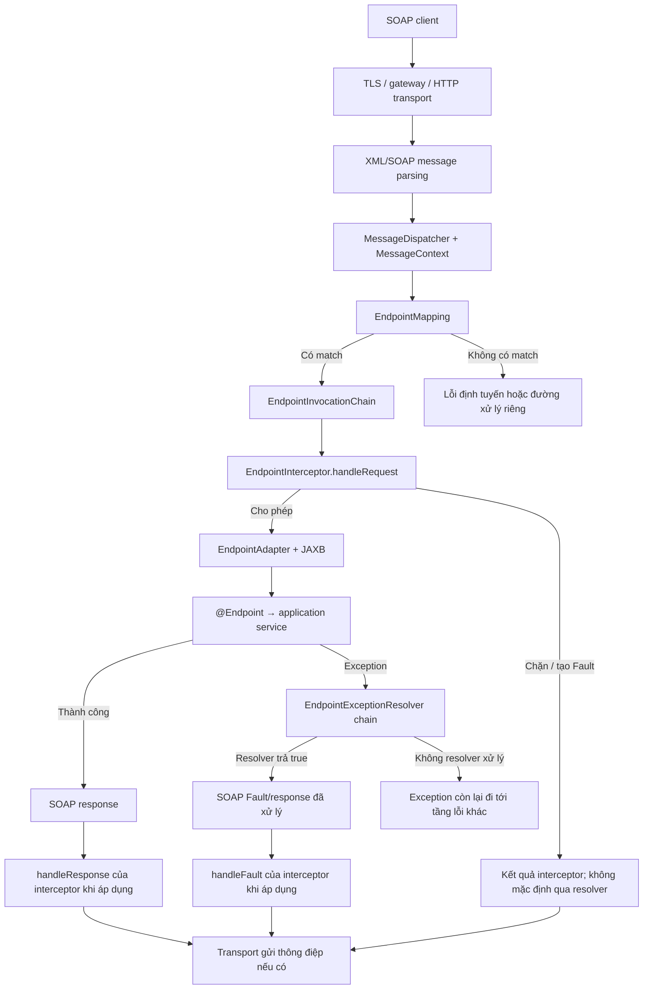

# EndpointExceptionResolver và ranh giới xử lý ngoại lệ của endpoint

## Mục tiêu học tập

Trong chương **SOAP Fault** của module **SPRING_WEB_SERVICES**, bài học này phân tích cách Spring Web Services (Spring-WS) biến một số ngoại lệ phát sinh khi xử lý SOAP endpoint thành phản hồi lỗi theo hợp đồng. Nội dung đặt trong bối cảnh **contract-first**: XSD/WSDL định nghĩa dữ liệu và operation, JAXB ánh xạ XML thành Java, `MessageDispatcher` điều phối endpoint, interceptor xử lý các chính sách chung, còn SOAP client cần nhận response hoặc Fault có thể giải mã ổn định.

Sau bài học, bạn có thể:

1. Giải thích `EndpointExceptionResolver` nằm ở đâu trong vòng đời `MessageDispatcher` và khác với `EndpointMapping`, `EndpointAdapter`, `EndpointInterceptor` như thế nào.
2. Hiểu chữ ký `resolveException(MessageContext, Object, Exception)` và ngữ nghĩa **`true` = đã xử lý**, **`false` = chưa xử lý**.
3. Nhận diện các resolver có sẵn: `SoapFaultMappingExceptionResolver`, `SoapFaultAnnotationExceptionResolver`, `SimpleSoapExceptionResolver` và cơ chế kết hợp/thứ tự.
4. Phân biệt Fault **SOAP 1.1** và **SOAP 1.2**, đặc biệt `Client/Server` so với `Sender/Receiver`, cấu trúc `Code/Reason` và `detail`.
5. Thiết kế ngoại lệ nghiệp vụ độc lập với giao thức, ánh xạ sang Fault code/reason an toàn và thêm **typed fault detail** đúng XSD/WSDL khi cần.
6. Chỉ ra ranh giới của resolver: HTTP/TLS, XML parsing, request quá lớn, không có endpoint mapping, interceptor bảo mật và các lỗi không đi qua dispatcher thông thường.
7. Tránh lộ exception message, stack trace, SQL, token, khóa/chứng chỉ hoặc thông tin tài nguyên không được phép xem qua SOAP Fault.
8. Cấu hình thứ tự resolver để mapping chuyên biệt được ưu tiên trước fallback, và phân biệt trường hợp đã tạo Fault với trường hợp còn exception chưa xử lý.
9. Kiểm thử unit, SOAP dispatcher qua `MockWebServiceClient` và tích hợp qua HTTPS/gateway/client thực; đánh giá khả năng tương thích Fault giữa các phiên bản WSDL.

## 1. Vì sao SOAP endpoint cần một ranh giới xử lý ngoại lệ?

Xét một SOAP operation `GetOrder`. Client gửi mã đơn hàng; server có thể:

- Trả `GetOrderResponse` nếu yêu cầu hợp lệ và đơn hàng được phép truy cập.
- Phát hiện mã yêu cầu sai XSD trước khi gọi endpoint.
- Gọi application service và nhận `OrderNotFoundException`.
- Bị database timeout hoặc downstream SOAP client trả lỗi.
- Từ chối vì chữ ký WS-Security sai hoặc chứng chỉ không đáng tin.
- Gặp HTTP request quá lớn khiến gateway từ chối trước khi Spring-WS nhìn thấy SOAP message.

Nếu các lỗi trên đều được xử lý bằng `catch (Exception)` trong từng method `@Endpoint`, hệ thống sẽ có nhiều nhược điểm: trùng code, lộ thông tin nội bộ, khó thống nhất SOAP Fault detail và khó thay đổi hợp đồng WSDL.

**`EndpointExceptionResolver` giải quyết một phạm vi cụ thể:** khi exception đi vào cơ chế xử lý exception của Spring-WS dispatcher, resolver có cơ hội **chuyển exception thành SOAP response/Fault theo chính sách**. Nó không phải bộ lọc HTTP toàn cục và không thay thế security, XML parser hoặc gateway.

### 1.1. Ba trách nhiệm phải phân biệt

| Câu hỏi | Thành phần chính | Ví dụ |
| --- | --- | --- |
| “Bản tin này gọi thao tác nào?” | `EndpointMapping` | QName `{urn:example:orders:v1}GetOrderRequest` chọn `getOrder(...)`. |
| “Gọi method ấy bằng cách nào?” | `EndpointAdapter`, JAXB/argument resolver | Chuyển XML thành `GetOrderRequest`, chạy method, tạo response. |
| “Exception đang được dispatcher xử lý sẽ thành phản hồi gì?” | **`EndpointExceptionResolver`** | `OrderNotFoundException` → SOAP Fault với code, reason, detail theo hợp đồng. |

**`EndpointInterceptor`** thực hiện những chính sách trước/sau lời gọi endpoint, gồm validation, tracing, WS-Security hoặc quan sát SOAP Fault. Nó có thể tự dừng chuỗi hoặc tạo Fault theo logic riêng. Do đó, việc có exception resolver **không bảo đảm** mọi lỗi của interceptor đều được chuyển qua resolver.

## 2. Đường đi khái niệm từ SOAP request đến Fault



Sơ đồ là **mô hình trách nhiệm**, không phải cam kết mỗi lỗi sẽ đi qua mọi ô. Khi một request bị từ chối tại TLS, proxy hoặc XML parser trước khi `MessageContext` tồn tại, không thể dựa vào `EndpointExceptionResolver` để tạo SOAP Fault.

### 2.1. Lỗi thuộc “endpoint boundary” là gì?

“Ranh giới endpoint” trong bài này gồm hoạt động dispatcher phối hợp mapping, interceptor, adapter và lời gọi endpoint trong một lần xử lý SOAP. Thư viện Spring-WS định nghĩa `EndpointExceptionResolver` để giải quyết exception trong quá trình thực thi endpoint; tham số `endpoint` còn có thể là `null` nếu chưa chọn được endpoint tại thời điểm lỗi.

Tuy nhiên, **khả năng có `endpoint=null` trong API không chứng minh mọi lỗi mapping hoặc parsing đều tự đi qua resolver**. Khi đánh giá một sự cố, phải quan sát điểm exception thực sự phát sinh và cơ chế Spring-WS/transport của phiên bản đang dùng.

### 2.2. Lỗi nghiệp vụ nên đi qua ranh giới rõ ràng

Ví dụ application service ném `OrderNotFoundException`, endpoint không nên tự tạo SOAP XML bằng nối chuỗi. Hãy để SOAP adapter/resolver quyết định Fault nào phù hợp contract. Nhờ đó, cùng một use case có thể được tái sử dụng cho REST, batch hoặc message consumer mà không phụ thuộc lớp `SoapMessage`.

## 3. Hợp đồng API của `EndpointExceptionResolver`

Interface nằm tại:

```java
package org.springframework.ws.server;

import org.springframework.ws.context.MessageContext;

public interface EndpointExceptionResolver {

    boolean resolveException(
            MessageContext messageContext,
            Object endpoint,
            Exception ex);
}
```

Đây là chữ ký rút gọn để học, không phải interface bạn cần tự khai báo trong project.

Ý nghĩa từng tham số:

- **`messageContext`**: request/response và properties của một lần trao đổi Web Services mà dispatcher đang xử lý.
- **`endpoint`**: endpoint đã được chọn/thực thi; **có thể `null`** khi chưa có endpoint tại thời điểm exception.
- **`ex`**: exception cần giải quyết.

### 3.1. `true` và `false` không đồng nghĩa “thành công/thất bại nghiệp vụ”

| Return | Ý nghĩa của resolver | Hệ quả |
| --- | --- | --- |
| `true` | “Tôi **đã xử lý** exception này.” | Dispatcher không cần thử resolver tiếp theo cho cùng exception. Resolver thường đã tạo SOAP Fault. |
| `false` | “Tôi **chưa xử lý** exception này.” | Dispatcher có thể thử resolver kế tiếp. |
| Không resolver nào xử lý | Exception vẫn còn ở cấp dispatcher/transport. | Cách phản hồi phụ thuộc cơ chế lỗi của stack; không cam kết có SOAP Fault. |
| Resolver tự ném exception | Chính việc xử lý lỗi thất bại. | Có nguy cơ mất Fault dự kiến hoặc xuất hiện lỗi hạ tầng; cần kiểm thử fallback và logging. |

**Quan trọng:** `true` không có nghĩa client đã nhận được bytes trên network. Nó cũng không bảo đảm Fault hợp lệ theo WSDL nếu code tạo detail sai schema. Đây chỉ là **kết quả xử lý exception trong pipeline**.

### 3.2. Không tự gọi resolver từ mỗi endpoint

Anti-pattern:

```java
@PayloadRoot(namespace = NS, localPart = "GetOrderRequest")
@ResponsePayload
public GetOrderResponse getOrder(
        @RequestPayload GetOrderRequest request) {
    try {
        return mapper.toResponse(
                service.findById(request.getOrderId()));
    } catch (Exception ex) {
        resolver.resolveException(messageContext, this, ex);
        return new GetOrderResponse(); // Sai ý nghĩa phản hồi.
    }
}
```

Đoạn trên **cố ý sai**: `messageContext` không xuất hiện tự nhiên trong method, response rỗng có thể không valid theo XSD, và xử lý exception bị lặp tại endpoint. Khi sử dụng Spring-WS, hãy để `MessageDispatcher` điều phối resolver và endpoint chỉ chịu trách nhiệm gọi use case.

## 4. Cấu trúc của SOAP Fault 1.1 và 1.2

SOAP Fault là phần tử lỗi của **SOAP Envelope**, khác với HTTP status và khác với một response nghiệp vụ có trường `status="FAILED"`.

### 4.1. SOAP 1.1

Ví dụ lỗi client gửi order ID không hợp lệ:

```xml
<?xml version="1.0" encoding="UTF-8"?>
<soap:Envelope
    xmlns:soap="http://schemas.xmlsoap.org/soap/envelope/">
    <soap:Body>
        <soap:Fault>
            <faultcode>soap:Client</faultcode>
            <faultstring>Invalid order request</faultstring>
        </soap:Fault>
    </soap:Body>
</soap:Envelope>
```

Các thành phần:

- `faultcode`: phân loại lỗi SOAP, ví dụ `Client` hoặc `Server`.
- `faultstring`: diễn giải cho người đọc; **không** dùng chứa stack trace hay secret.
- `faultactor`: tùy chọn, chỉ actor gây Fault.
- `detail`: tùy chọn tùy trường hợp, chứa thông tin lỗi ứng dụng có cấu trúc.

SOAP 1.1 định nghĩa các Fault code chuẩn như `VersionMismatch`, `MustUnderstand`, `Client` và `Server`.

### 4.2. SOAP 1.2

Một Fault có ý nghĩa tương đương nhưng **cấu trúc khác**:

```xml
<?xml version="1.0" encoding="UTF-8"?>
<env:Envelope
    xmlns:env="http://www.w3.org/2003/05/soap-envelope"
    xmlns:xml="http://www.w3.org/XML/1998/namespace">
    <env:Body>
        <env:Fault>
            <env:Code>
                <env:Value>env:Sender</env:Value>
            </env:Code>
            <env:Reason>
                <env:Text xml:lang="en">Invalid order request</env:Text>
            </env:Reason>
        </env:Fault>
    </env:Body>
</env:Envelope>
```

SOAP 1.2 có `Code/Value`, có thể có `Subcode`, `Reason/Text`, `Node`, `Role` và `Detail`. Các mã thường tương ứng với SOAP 1.1 là **`Sender`** và **`Receiver`**.

### 4.3. Quy tắc chọn Fault code

| Bản chất lỗi | SOAP 1.1 thường xét | SOAP 1.2 thường xét | Ghi chú |
| --- | --- | --- | --- |
| Thông điệp có vấn đề do phía gửi | `Client` | `Sender` | Ví dụ dữ liệu sai contract. |
| Lỗi phía xử lý/tài nguyên server | `Server` | `Receiver` | Ví dụ timeout hệ thống ngoài. |
| SOAP header bắt buộc không được hiểu | `MustUnderstand` | `MustUnderstand` | Theo quy tắc header/role. |
| Sai SOAP version | `VersionMismatch` | `VersionMismatch` | Có thể bị phát hiện trước endpoint. |
| Lỗi nghiệp vụ như “không tìm thấy đơn” | **Tùy hợp đồng** | **Tùy hợp đồng** | Không mặc định mọi `NotFound` phải dùng `Client/Sender`. |

**Không xem bảng là chuẩn tuyệt đối cho mọi domain exception.** Đối tác có thể yêu cầu fault detail hoặc profile xử lý riêng. Điều bắt buộc là có **quy ước ổn định, được WSDL/profile và test tích hợp xác minh**.

### 4.4. Vì sao client dễ hỏng khi đổi SOAP version?

Một client SOAP 1.1 có thể tìm `faultcode` và `faultstring`; nếu server đổi sang SOAP 1.2 mà client vẫn parser theo XPath đó, client sẽ không đọc đúng Fault. Thay đổi SOAP version còn liên quan Envelope namespace, Content-Type và binding, không chỉ thay tên hai thẻ XML.

## 5. Phân loại lỗi theo tầng, đừng chuyển tất cả thành một resolver

Bảng dưới đây giúp xác định **ranh giới xử lý** trước khi viết code.

| Nguồn lỗi | Vị trí thường phát hiện | Vai trò `EndpointExceptionResolver` |
| --- | --- | --- |
| HTTP request body vượt giới hạn proxy | API gateway/Servlet/HTTP server | Thường **không chạy**; có thể HTTP 413. |
| TLS/mTLS handshake thất bại | TLS stack/gateway | **Không có SOAP MessageContext**; không thể chờ SOAP Fault. |
| SOAP Envelope không well-formed | XML parser/message factory | Có thể thất bại **trước** dispatcher/endpoint. |
| Envelope namespace sai SOAP version | SOAP parser/protocol | Có thể tạo `VersionMismatch` theo stack; không phải domain resolver. |
| Payload QName không có endpoint | `EndpointMapping`/dispatcher | Không cam kết resolver nghiệp vụ được gọi. |
| SOAPAction, WS-A Action không phù hợp policy | Mapping/protocol/interceptor | Xử lý theo routing/header policy; không tự động do domain resolver. |
| Request well-formed nhưng sai XSD | `PayloadValidatingInterceptor` nếu được bật | Interceptor có thể tạo/chặn Fault trước method; thường không đi qua domain resolver. |
| WS-Security token/signature/timestamp sai | WSS4J/security interceptor | Có thể tạo Fault bảo mật riêng hoặc bị chặn ở transport. |
| Adapter không xử lý JAXB method type | `EndpointAdapter`/argument resolver | Có thể xuất hiện exception trong dispatch; cần kiểm tra phiên bản/đường xử lý. |
| Application service không tìm thấy order | `@Endpoint` gọi service | **Trường hợp rõ nhất** cho resolver domain. |
| Business rule không cho hủy order | Domain/application service | Resolver có thể map thành Fault nghiệp vụ. |
| Database hoặc SOAP downstream timeout | Infrastructure/service | Resolver có thể map thành Fault an toàn khi exception đi đến dispatcher. |
| Mapper trả response sai XSD | Return handling/response validation | Tùy giai đoạn/cách interceptor xử lý; không chắc domain resolver được gọi. |
| Client mất mạng sau khi server tạo response | HTTP/network delivery | Resolver không chứng minh/khắc phục việc client không nhận được. |

**Bài học:** khi hỏi “Vì sao `EndpointExceptionResolver` không bắt lỗi này?”, hãy xác định exception đã xuất hiện **trước, trong hay sau** một lần endpoint invocation và có thực sự được dispatcher chuyển vào resolver chain hay không.

## 6. Thiết kế contract-first cho lỗi nghiệp vụ

Ta xây dựng ví dụ `GetOrder` với ba global elements: `GetOrderRequest`, `GetOrderResponse` và `OrderNotFoundFault`.

### 6.1. XSD nguồn

**`src/main/resources/xsd/orders-v1.xsd`**:

```xml
<?xml version="1.0" encoding="UTF-8"?>
<xs:schema
    xmlns:xs="http://www.w3.org/2001/XMLSchema"
    xmlns:tns="urn:example:orders:v1"
    targetNamespace="urn:example:orders:v1"
    elementFormDefault="qualified">

    <xs:simpleType name="OrderIdType">
        <xs:restriction base="xs:string">
            <xs:pattern value="ORD-[0-9]{6}"/>
        </xs:restriction>
    </xs:simpleType>

    <xs:element name="GetOrderRequest">
        <xs:complexType>
            <xs:sequence>
                <xs:element name="orderId" type="tns:OrderIdType"/>
            </xs:sequence>
        </xs:complexType>
    </xs:element>

    <xs:element name="GetOrderResponse">
        <xs:complexType>
            <xs:sequence>
                <xs:element name="orderId" type="tns:OrderIdType"/>
                <xs:element name="status" type="xs:string"/>
            </xs:sequence>
        </xs:complexType>
    </xs:element>

    <xs:element name="OrderNotFoundFault">
        <xs:complexType>
            <xs:sequence>
                <xs:element name="code" type="xs:string"/>
                <xs:element name="message" type="xs:string"/>
            </xs:sequence>
        </xs:complexType>
    </xs:element>
</xs:schema>
```

`OrderNotFoundFault` là **global element** dành cho `detail`. Ví dụ cố tình không gửi tên database, tenant ID hoặc giá trị nhạy cảm của order trong Fault.

### 6.2. Phần WSDL khai báo typed fault

WSDL 1.1 có thể khai báo:

```xml
<wsdl:message name="GetOrderInput">
    <wsdl:part name="parameters" element="tns:GetOrderRequest"/>
</wsdl:message>

<wsdl:message name="GetOrderOutput">
    <wsdl:part name="parameters" element="tns:GetOrderResponse"/>
</wsdl:message>

<wsdl:message name="OrderNotFoundMessage">
    <wsdl:part name="fault" element="tns:OrderNotFoundFault"/>
</wsdl:message>

<wsdl:portType name="OrdersPortType">
    <wsdl:operation name="GetOrder">
        <wsdl:input message="tns:GetOrderInput"/>
        <wsdl:output message="tns:GetOrderOutput"/>
        <wsdl:fault name="OrderNotFound"
                    message="tns:OrderNotFoundMessage"/>
    </wsdl:operation>
</wsdl:portType>
```

Đây là **trích đoạn** dùng trong một tài liệu `wsdl:definitions` đầy đủ, nơi `wsdl` và `tns` được khai báo; còn cần SOAP binding cho operation và `wsdl:fault` tương ứng, `wsdl:service/port`. Việc có `wsdl:fault` trong `portType` **không tự làm** Spring-WS sinh đúng Fault detail. Runtime phải thực sự ghi phần tử theo QName và XSD đó.

### 6.3. XML Fault có typed detail

Ví dụ SOAP 1.1:

```xml
<soap:Envelope
    xmlns:soap="http://schemas.xmlsoap.org/soap/envelope/"
    xmlns:ord="urn:example:orders:v1">
    <soap:Body>
        <soap:Fault>
            <faultcode>soap:Client</faultcode>
            <faultstring>Order not available</faultstring>
            <detail>
                <ord:OrderNotFoundFault>
                    <ord:code>ORDER_NOT_FOUND</ord:code>
                    <ord:message>Order not available</ord:message>
                </ord:OrderNotFoundFault>
            </detail>
        </soap:Fault>
    </soap:Body>
</soap:Envelope>
```

Khi client sinh stub/proxy từ WSDL, nó có thể mong đợi **typed fault detail** để ánh xạ thành exception phía client. Nếu service chỉ tạo `faultcode/faultstring` mà bỏ `OrderNotFoundFault`, client vẫn có thể nhận SOAP Fault nhưng **không giải mã được lỗi nghiệp vụ theo kiểu đã công bố**.

**Phân biệt:** SOAP Fault **vỏ ngoài** (code/reason) và **chi tiết lỗi ứng dụng** (QName, field, kiểu XSD) là hai hợp đồng cần kiểm thử riêng.

## 7. Giữ exception của domain độc lập SOAP

### 7.1. Model domain

```java
package com.example.orders.domain;

public final class OrderNotFoundException extends RuntimeException {

    public OrderNotFoundException() {
        super("Order was not found");
    }
}
```

Không gắn `@SoapFault` vào class domain trong thiết kế này. Domain chỉ mô tả một kết quả use case bất thường; **SOAP adapter** sẽ quyết định cách phản hồi cho client SOAP. Nếu ứng dụng có thêm REST endpoint, REST adapter có thể map exception này theo quy ước HTTP mà không kéo Spring-WS vào domain.

Một exception khác:

```java
package com.example.orders.domain;

public final class InvalidOrderStateException
        extends RuntimeException {

    public InvalidOrderStateException() {
        super("Invalid order state");
    }
}
```

Các message trên được viết **cố định, an toàn** trong ví dụ. Tuy nhiên không nên dựa vào `ex.getMessage()` để làm public Fault text của mọi exception, vì về sau message có thể chứa dữ liệu nhạy cảm.

### 7.2. Application service

**`OrderLookupService.java`:**

```java
package com.example.orders.application;

public interface OrderLookupService {
    String getStatus(String orderId);
}
```

**`DefaultOrderLookupService.java`:**

```java
package com.example.orders.application;

import com.example.orders.domain.OrderNotFoundException;

public final class DefaultOrderLookupService
        implements OrderLookupService {

    private final OrderRepository repository;

    public DefaultOrderLookupService(OrderRepository repository) {
        this.repository = repository;
    }

    @Override
    public String getStatus(String orderId) {
        return repository.findStatus(orderId)
                .orElseThrow(OrderNotFoundException::new);
    }
}
```

Đây là ví dụ kiến trúc, giả định `OrderRepository` có method `findStatus(String)` trả `Optional<String>`. Implementation thật có thể là Spring `@Service` với DI, transaction và authorization. Phần domain/application **không tạo SOAP Fault**.

### 7.3. Endpoint gọn

Giả sử JAXB/XJC sinh ra lớp request/response:

```java
package com.example.orders.soap;

import org.springframework.ws.server.endpoint.annotation.Endpoint;
import org.springframework.ws.server.endpoint.annotation.PayloadRoot;
import org.springframework.ws.server.endpoint.annotation.RequestPayload;
import org.springframework.ws.server.endpoint.annotation.ResponsePayload;

import com.example.orders.application.OrderLookupService;
import com.example.orders.contract.GetOrderRequest;
import com.example.orders.contract.GetOrderResponse;

@Endpoint
public final class OrderEndpoint {

    private static final String NS = "urn:example:orders:v1";
    private final OrderLookupService service;

    public OrderEndpoint(OrderLookupService service) {
        this.service = service;
    }

    @PayloadRoot(namespace = NS, localPart = "GetOrderRequest")
    @ResponsePayload
    public GetOrderResponse getOrder(
            @RequestPayload GetOrderRequest request) {

        String status = service.getStatus(request.getOrderId());

        GetOrderResponse response = new GetOrderResponse();
        response.setOrderId(request.getOrderId());
        response.setStatus(status);
        return response;
    }
}
```

Endpoint không `catch` ngoại lệ nghiệp vụ. `MessageDispatcher` phối hợp resolver, còn code application xử lý quy tắc của order. JAXB/adapter chịu trách nhiệm chuyển XML payload thành Java theo XSD.

**Giới hạn ví dụ:** Các class generated, `OrderRepository`, bean registration, WSDL publication và SOAP transport chưa được triển khai đầy đủ trong bài này. Khi dùng thật, kiểm tra package/`@XmlRootElement`/`ObjectFactory` của mã JAXB được sinh.

## 8. Cấu hình `SoapFaultMappingExceptionResolver`

Đây là resolver hữu ích khi cần ánh xạ **exception class** thành code/reason mà không buộc exception domain mang annotation Spring-WS.

### 8.1. Bean ánh xạ nghiệp vụ

```java
package com.example.orders.soap.fault;

import java.util.Properties;

import org.springframework.context.annotation.Bean;
import org.springframework.context.annotation.Configuration;
import org.springframework.ws.soap.server.endpoint.SoapFaultMappingExceptionResolver;

import com.example.orders.domain.OrderNotFoundException;
import com.example.orders.domain.InvalidOrderStateException;

@Configuration
public class DomainFaultConfiguration {

    @Bean
    public SoapFaultMappingExceptionResolver domainFaultResolver() {
        Properties mappings = new Properties();

        mappings.setProperty(
                OrderNotFoundException.class.getName(),
                "CLIENT,Order not available,en");

        mappings.setProperty(
                InvalidOrderStateException.class.getName(),
                "CLIENT,Invalid order state,en");

        SoapFaultMappingExceptionResolver resolver =
                new SoapFaultMappingExceptionResolver();
        resolver.setExceptionMappings(mappings);
        resolver.setOrder(0);
        return resolver;
    }
}
```

Với SOAP 1.1, `CLIENT` tương ứng mã `Client`; với SOAP 1.2, Spring-WS dùng ý nghĩa `Sender` phù hợp qua abstraction Fault. Cần kiểm tra phản hồi thực tế theo SOAP version của message factory.

**Định dạng mapping:** `faultCode,faultString,locale`. Chỉ `faultCode` là bắt buộc, nhưng **trong production nên ghi reason công khai ổn định** để không rơi về exception message có thể nhạy cảm.

**Điểm cần hiểu về scope:** Bean này chỉ khai báo exception mappings; không đặt `defaultFault`. Nó nên trả không xử lý với những exception không thuộc phạm vi, cho resolver chuyên biệt khác hoặc fallback tiếp tục.

### 8.2. Lý do dùng tên exception class đầy đủ

`SoapFaultMappingExceptionResolver` cho phép mapping key là class name hoặc chuỗi khớp tương ứng và chọn mapping theo độ sâu kế thừa. Việc dùng `OrderNotFoundException.class.getName()` làm rõ chính xác loại exception cần ánh xạ, tránh cấu hình quá rộng bằng một key mơ hồ.

Không dùng một mapping `Exception=CLIENT,...` để bắt mọi lỗi hệ thống như lỗi đầu vào. Nếu lỗi DB timeout lại được chuyển thành Client/Sender, client có thể sửa request vô ích trong khi lỗi thật thuộc server.

### 8.3. Chú ý lựa chọn Fault code “NotFound”

Bài này dùng `Client/Sender` như **quy ước ví dụ**: bên nhận không thể đáp ứng truy vấn đã yêu cầu. Một hợp đồng khác có thể dùng Fault code khác, Fault detail định danh nghiệp vụ, hoặc một response `found=false`. Không thay đổi hành vi tùy hứng: **WSDL và tài liệu giao tiếp với đối tác** quyết định client phải xử lý trường hợp này thế nào.

## 9. Cấu hình fallback không làm lộ lỗi nội bộ

`SimpleSoapExceptionResolver` là resolver đơn giản tạo Fault phía server và mặc định lấy **exception message** làm Fault reason. Điều này hữu ích lúc học hoặc debug nhưng có thể làm lộ `SQLException`, tên host, câu lệnh SQL, token hoặc đường dẫn nội bộ.

### 9.1. Fallback với lý do an toàn cố định

Một resolver fallback có thể dùng `SoapFaultDefinition`:

```java
package com.example.orders.soap.fault;

import java.util.Locale;

import org.springframework.context.annotation.Bean;
import org.springframework.context.annotation.Configuration;
import org.springframework.ws.soap.server.endpoint.SoapFaultDefinition;
import org.springframework.ws.soap.server.endpoint.SoapFaultMappingExceptionResolver;

@Configuration
public class FallbackFaultConfiguration {

    @Bean
    public SoapFaultMappingExceptionResolver safeFallbackResolver() {
        SoapFaultDefinition fallback = new SoapFaultDefinition();
        fallback.setFaultCode(SoapFaultDefinition.SERVER);
        fallback.setFaultStringOrReason("Internal service error");
        fallback.setLocale(Locale.ENGLISH);

        SoapFaultMappingExceptionResolver resolver =
                new SoapFaultMappingExceptionResolver();
        resolver.setDefaultFault(fallback);
        resolver.setOrder(100);
        return resolver;
    }
}
```

Ở đây:

- `domainFaultResolver` có order `0`, được thử **trước** fallback `100`.
- `safeFallbackResolver` trả lời cho exception chưa được xử lý với reason cố định.
- Nếu bạn có thêm resolver theo annotation, phải đặt thứ tự rõ ràng để nó được xét trước fallback.
- Log lỗi thật ở kênh server được bảo vệ, không sao chép exception message vào response public.

**Không coi `fallback` là phương án bắt mọi lỗi transport.** Nó chỉ áp dụng khi exception thực sự đi qua resolver chain của `MessageDispatcher`.

### 9.2. Rủi ro của defaultFault ở resolver quá sớm

Nếu gắn `setDefaultFault(...)` ngay vào resolver đầu tiên với `HIGHEST_PRECEDENCE`, nó có thể nhận **mọi exception**, làm resolver khai báo `@SoapFault`, custom typed detail hoặc resolver riêng không bao giờ được chạy.

Thứ tự nên là:

```text
1. Resolver đặc thù cho typed business faults.
2. Resolver dựa trên @SoapFault, nếu sử dụng.
3. Resolver mapping cho các lỗi có contract khác.
4. Fallback an toàn dành cho lỗi còn lại.
```

Thứ tự thực tế do `Ordered`/`setOrder(...)` và bean configuration quyết định. Spring-WS 4.1.x còn có `CompositeEndpointExceptionResolver`; khi thay đổi cấu hình, kiểm tra bean nào được dispatcher thu nhận và thứ tự nào được áp dụng.

## 10. Phương án khác: `@SoapFault` trên exception

Nếu dự án chọn cho phép một lớp exception thuộc **SOAP adapter module** mang thông tin Fault, có thể dùng annotation:

```java
package com.example.orders.soap.fault;

import org.springframework.ws.soap.server.endpoint.annotation.FaultCode;
import org.springframework.ws.soap.server.endpoint.annotation.SoapFault;

@SoapFault(
    faultCode = FaultCode.CLIENT,
    faultStringOrReason = "Invalid order request",
    locale = "en")
public final class InvalidOrderSoapException
        extends RuntimeException {

    public InvalidOrderSoapException() {
        super("Invalid order request");
    }
}
```

Để annotation này có hiệu lực, cần `SoapFaultAnnotationExceptionResolver` trong ApplicationContext theo cấu hình Spring-WS được sử dụng:

```java
import org.springframework.context.annotation.Bean;
import org.springframework.ws.soap.server.endpoint.SoapFaultAnnotationExceptionResolver;

@Bean
SoapFaultAnnotationExceptionResolver annotationFaultResolver() {
    SoapFaultAnnotationExceptionResolver resolver =
            new SoapFaultAnnotationExceptionResolver();
    resolver.setOrder(10); // Sau resolver đặc thù order 0, trước fallback 100.
    return resolver;
}
```

### 10.1. Khi nào dùng annotation?

- Ứng dụng nhỏ, exception gắn riêng với SOAP adapter và Fault code/reason đơn giản.
- Không cần tạo typed Fault detail phức tạp.
- Không phải tái sử dụng cùng exception cho nhiều giao thức khác nhau.

### 10.2. Khi nào nên tránh?

- Domain exception được dùng chung bởi SOAP, REST, batch, queue: gắn `@SoapFault` làm domain phụ thuộc Spring-WS.
- Fault reason cần được quốc tế hóa theo người gọi hoặc hợp đồng phức tạp.
- WSDL yêu cầu typed detail; annotation code/reason **không tự tạo** `detail`.
- Cần thay mapping tại deploy time mà không sửa exception class.

**Không gắn đồng thời annotation và mapping cho cùng exception rồi bỏ mặc precedence.** Hãy quyết định một nơi chịu trách nhiệm chính cho mỗi fault type.

## 11. Tạo typed Fault detail bằng `customizeFault(...)`

Khi WSDL có `OrderNotFoundFault`, chỉ đặt `CLIENT,Order not available,en` mới đáp ứng **vỏ SOAP Fault**, chưa tạo typed detail.

`AbstractSoapFaultDefinitionExceptionResolver` cung cấp hook:

```java
protected void customizeFault(
        Object endpoint, Exception ex, SoapFault fault);
```

`SoapFaultMappingExceptionResolver` kế thừa hook này. Ta có thể viết một subclass cho Fault nghiệp vụ.

### 11.1. Resolver có detail theo XSD

**`OrderFaultResolver.java`**:

```java
package com.example.orders.soap.fault;

import javax.xml.transform.TransformerException;
import javax.xml.transform.TransformerFactory;

import org.springframework.ws.soap.SoapFault;
import org.springframework.ws.soap.SoapFaultDetail;
import org.springframework.ws.soap.server.endpoint.SoapFaultMappingExceptionResolver;
import org.springframework.xml.transform.StringSource;

import com.example.orders.domain.OrderNotFoundException;

public final class OrderFaultResolver
        extends SoapFaultMappingExceptionResolver {

    @Override
    protected void customizeFault(
            Object endpoint,
            Exception ex,
            SoapFault fault) {

        if (!(ex instanceof OrderNotFoundException)) {
            return;
        }

        // XML cố định, KHÔNG nối trực tiếp dữ liệu từ exception.
        String xml = """
            <ord:OrderNotFoundFault
                xmlns:ord="urn:example:orders:v1">
                <ord:code>ORDER_NOT_FOUND</ord:code>
                <ord:message>Order not available</ord:message>
            </ord:OrderNotFoundFault>
            """;

        SoapFaultDetail detail = fault.addFaultDetail();

        try {
            TransformerFactory.newInstance()
                    .newTransformer()
                    .transform(
                            new StringSource(xml),
                            detail.getResult());
        } catch (TransformerException transformationError) {
            throw new IllegalStateException(
                    "Unable to create SOAP fault detail",
                    transformationError);
        }
    }
}
```

Ví dụ chỉ sinh detail **cố định** cho `OrderNotFoundException`. Đối với dữ liệu động, nên dùng **JAXB marshalling từ lớp fault đã sinh bởi XJC** vào `detail.getResult()`, hoặc xây XML bằng API có xử lý escaping an toàn. Không nối các chuỗi từ user/exceptions thành thẻ XML thủ công.

Một bean `OrderFaultResolver` được cấu hình với `setExceptionMappings(...)` giống mục 8, chỉ thay class resolver được tạo và giữ order `0`. Đừng tạo cả hai resolver domain cho **cùng exception** nếu không có chủ đích; hãy **thay** bean mapping ở mục 8 bằng resolver có detail.

### 11.2. Vì sao không chỉ dùng `fault.addFaultDetail()`?

Phương thức này chỉ tạo container `detail`. Muốn đáp ứng WSDL:

1. Tạo phần tử `{urn:example:orders:v1}OrderNotFoundFault`.
2. Chứa `code` và `message` đúng namespace, thứ tự và kiểu theo `xs:sequence`.
3. Bảo đảm không đưa dữ liệu nhạy cảm vào Fault detail.
4. Kiểm tra response bằng XPath/schema và client được sinh từ WSDL.
5. Đảm bảo phiên bản SOAP và WSDL binding tương thích.

Một Fault có `<detail/>` rỗng **không tương đương** typed fault hợp lệ.

### 11.3. Về ngoại lệ phát sinh khi đang tạo Fault

Nếu `Transformer`/JAXB marshaller gặp lỗi, bạn đang ở **đường xử lý lỗi của lỗi khác**. Không nên tiếp tục vòng lặp “resolver ném exception → cố tạo Fault mới” vô hạn. Hãy:

- Giữ logic tạo detail đơn giản, ổn định, test kỹ.
- Cấu hình fallback hợp lý nhưng không giả định nó bắt mọi lỗi trong resolver trước.
- Đo/log lỗi nội bộ một cách an toàn.
- Tránh đưa dữ liệu chưa kiểm chứng qua parser, TransformerFactory hoặc XML schema remote.
- Bảo vệ XML parser chống XXE/external entities khi xử lý tài liệu không tin cậy; ví dụ trên dùng **XML cố định do ứng dụng định nghĩa**, không phải user-supplied XML.

## 12. Phân biệt `SoapFaultMappingExceptionResolver` và `SimpleSoapExceptionResolver` khi cần customize detail

Cả hai đều có khả năng tạo SOAP Fault, nhưng **hook override không giống nhau**:

| Base class | Hook thích hợp | Ghi chú |
| --- | --- | --- |
| `AbstractSoapFaultDefinitionExceptionResolver` / `SoapFaultMappingExceptionResolver` | `customizeFault(Object endpoint, Exception ex, SoapFault fault)` | Không có `MessageContext` trong hook này. |
| `SimpleSoapExceptionResolver` | `customizeFault(MessageContext context, Object endpoint, Exception ex, SoapFault fault)` | Có `MessageContext`; mặc định reason lấy exception message. |

Một lỗi code thường gặp là copy chữ ký hook của `SimpleSoapExceptionResolver` sang subclass `SoapFaultMappingExceptionResolver` rồi thêm `@Override`: code **không biên dịch** vì chữ ký khác.

Nếu cần `MessageContext` trong custom lỗi có detail, hãy cân nhắc sử dụng đúng base class/hook hoặc thiết kế riêng một `EndpointExceptionResolver` phù hợp. Đừng cố lấy `MessageContext` từ static holder hoặc thread-local một cách không kiểm soát.

## 13. Phân biệt HTTP status, SOAP Fault và response nghiệp vụ

SOAP/HTTP có **hai tầng phản hồi**:

1. **HTTP**: status code, headers và transport body.
2. **SOAP**: Envelope, Body, Fault hoặc response payload.

Một request có thể nhận HTTP 500 kèm SOAP 1.1 Fault; một lỗi handshake mTLS lại có thể khiến không nhận được SOAP Envelope nào. Gateway từ chối request lớn có thể trả HTTP 413 theo cấu hình.

### 13.1. Không tự “sửa” mọi lỗi bằng HTTP 200

Anti-pattern:

```java
try {
    return getOrderResponse(request);
} catch (Exception ex) {
    httpResponse.setStatus(200);
    return new GetOrderResponse(); // Rỗng, sai contract và che mất lỗi!
}
```

Trong SOAP contract-first, nếu WSDL cam kết SOAP Fault thì trả một `GetOrderResponse` rỗng không tương đương Fault. Client có thể hiểu nhầm thao tác thành công hoặc lỗi JAXB khi unmarshal.

### 13.2. Không hard-code duy nhất HTTP status để nhận biết Fault

Một client SOAP nên phân tích **SOAP message và SOAP Fault** qua stack phù hợp, chứ không chỉ dựa vào `status==500` hay `status==200`. Hành vi HTTP cụ thể phụ thuộc SOAP version, binding, message sender và gateway.

Với các lỗi **trước** SOAP parsing (TLS, HTTP body size, proxy), client cũng phải xử lý **transport exception** riêng.

### 13.3. SOAPAction có ảnh hưởng gì?

SOAPAction của SOAP 1.1 nằm ở HTTP binding và có thể được sử dụng để chọn operation, nhưng **không chứng minh danh tính** và không tự quyết định Fault nghiệp vụ. Nếu SOAPAction mâu thuẫn payload QName, cần quy tắc routing/conformance phù hợp; domain `OrderNotFoundException` không phải nơi xử lý mâu thuẫn protocol đó.

## 14. Ranh giới với interceptor và `EndpointAdapter`

### 14.1. Validation interceptor

`PayloadValidatingInterceptor` có thể từ chối XML request sai XSD **trước khi endpoint được gọi**. Trong ví dụ, `ORD-42` không khớp `ORD-[0-9]{6}`.

Nếu test `OrderNotFoundException` bằng request `ORD-42` trong môi trường có validator, bạn có thể nhận **schema validation Fault** thay vì Fault nghiệp vụ. Muốn test resolver domain, hãy gửi order ID **hợp lệ theo XSD nhưng không tồn tại**, ví dụ `ORD-999999`.

### 14.2. Security interceptor

`Wss4jSecurityInterceptor` có thể xác minh WS-Security token, timestamp, chữ ký và chứng chỉ theo policy. Lỗi security có thể được security stack tự chuyển thành Fault/chặn request.

**Không** map chung mọi lỗi WS-Security thành `OrderNotFoundException`, vì nó sẽ che mất nguyên nhân bảo mật và gây khó phát hiện tấn công. Cần phân loại authentication, authorization, schema và domain errors rõ ràng.

### 14.3. EndpointAdapter/JAXB

`DefaultMethodEndpointAdapter` và argument/return-value handlers làm việc với JAXB/XML. Nếu thiếu JAXB runtime, class không có root mapping hoặc method parameter không được hỗ trợ, lỗi có thể xuất hiện **trước khi code nghiệp vụ chạy**.

Đừng chữa lỗi JAXB bằng cách chuyển mọi exception thành `Client,Invalid order`. Phải điều tra annotation `@RequestPayload`, `@ResponsePayload`, `ObjectFactory`, namespace và dependency Jakarta trước.

### 14.4. EndpointInterceptor.handleFault

`handleFault` là callback **quan sát/xử lý một SOAP Fault đã được tạo** trong chain phù hợp. Nó không đồng nghĩa với `resolveException`:

- Resolver biến exception thành response/Fault.
- Interceptor `handleFault` có thể đo metrics, bổ sung correlation metadata an toàn hoặc thực hiện xử lý cắt ngang.
- Nếu lỗi xảy ra trước khi endpoint chain tồn tại, callback có thể không chạy.
- Nếu interceptor tự tạo Fault và dừng request sớm, nó có thể không qua exception resolver như một exception nghiệp vụ.

## 15. Bảo mật và chính sách thông tin trong SOAP Fault

Một hệ thống doanh nghiệp cần quyết định **client được biết đến mức nào** khi có lỗi.

### 15.1. Thông tin nên công khai

- Fault code/reason **ổn định và đã được thỏa thuận**.
- Mã lỗi nghiệp vụ như `ORDER_NOT_FOUND` nếu hợp đồng cho phép.
- Correlation ID do server tạo, nếu cần hỗ trợ đối tác báo sự cố.
- Chỉ dữ liệu thật sự cần để client quyết định retry, sửa yêu cầu hoặc liên hệ hỗ trợ.

### 15.2. Thông tin không nên công khai

- Stack trace, class name nội bộ, package, đường dẫn file.
- SQL query, tên bảng, hostname database, URL dịch vụ nội bộ.
- WS-Security UsernameToken, password digest, nonce, access token, private key hoặc keystore password.
- Thông tin chứng chỉ không cần thiết hoặc nguyên nhân truststore chi tiết.
- Việc một đơn hàng thuộc tenant khác có tồn tại hay không.
- Dữ liệu nhạy cảm trong XML payload, SOAP Header hoặc attachment.

### 15.3. Authentication không đồng nghĩa authorization

Một client có thể ký SOAP message hợp lệ nhưng gửi `tenantId`/`orderId` không thuộc quyền. Application service phải kiểm tra **authenticated principal + operation + tenant + resource** trước khi trả dữ liệu.

Nếu caller không có quyền, Fault nên được thiết kế để **không tiết lộ** dữ liệu hay việc tài nguyên tồn tại. Một trường hợp “không tồn tại” ở client có thể được che để tránh enumeration theo chính sách, nhưng server cần log loại lỗi thật ở kênh được bảo vệ.

### 15.4. Fault detail cũng có thể phải được ký

Nếu hợp đồng WS-Security yêu cầu **response signature**, Fault (kể cả detail) có thể cần được bảo vệ theo security profile. Đừng cho một interceptor tùy tiện sửa signed parts sau khi ký.

Với XML security, bảo đảm parser an toàn chống XXE/entity expansion và kết quả xác minh chữ ký tương ứng đúng phần SOAP Body/Header mà application thực sự xử lý. Fault resolver **không thay thế** các kiểm tra này.

## 16. Logging, metrics và correlation trên đường Fault

Lỗi không nên biến mất vì đã được resolver xử lý thành công.

### 16.1. Ghi log nội bộ có kiểm soát

Một mẫu vận hành:

```text
requestId      = 83c9...
operation      = GetOrder
outcome        = SOAP_FAULT
publicCode     = ORDER_NOT_FOUND
exceptionType  = OrderNotFoundException
durationMs     = 27
```

Không cần ghi nguyên SOAP Envelope. Nếu muốn log exception stack trace ở server, phải có chính sách retention, masking, quyền truy cập và sampling phù hợp.

### 16.2. Phân loại metric

| Chỉ số | Nguồn hợp lý | Rủi ro đo sai |
| --- | --- | --- |
| SOAP Fault nghiệp vụ | Resolver + `handleFault` khi áp dụng | Nếu chỉ đếm exception chưa xử lý, sẽ bỏ sót Fault đã được resolver xử lý. |
| Request XSD invalid | Validation interceptor | Có thể chưa gọi endpoint/service. |
| WS-Security invalid | Security interceptor/stack | Có thể bị chặn trước resolver nghiệp vụ. |
| HTTP 413, TLS failure, gateway timeout | Gateway/transport | `handleFault` của endpoint không quan sát được. |
| Exception hệ thống | Server logging/metrics | Không đưa exception message raw ra client. |
| Operation latency | Dispatcher/interceptor/HTTP metrics | Completion callback không chứng minh client nhận response. |

### 16.3. Correlation ID

Nếu trả `X-Request-ID` ở HTTP header hoặc SOAP Header, phải phân biệt **server-generated ID** với client-provided correlation ID. Không dùng ID do client tự đặt làm bằng chứng xác thực hoặc chống replay.

Với Fault sau khi endpoint được xử lý, interceptor có thể đọc `MessageContext` để gắn trace. Với lỗi xảy ra trước dispatcher, cần tạo ID sớm hơn tại gateway/Servlet filter nếu muốn quan sát cả đường đó.

## 17. Unit test: business exception độc lập SOAP

Đầu tiên kiểm tra application service, không cần server hay SOAP Envelope.

Ví dụ Mockito/JUnit:

```java
import static org.junit.jupiter.api.Assertions.assertThrows;
import static org.mockito.Mockito.when;

import java.util.Optional;

import org.junit.jupiter.api.Test;
import org.junit.jupiter.api.extension.ExtendWith;
import org.mockito.Mock;
import org.mockito.junit.jupiter.MockitoExtension;

@ExtendWith(MockitoExtension.class)
class OrderLookupServiceTest {

    @Mock
    OrderRepository repository;

    @Test
    void throwsWhenOrderNotFound() {
        when(repository.findStatus("ORD-999999"))
                .thenReturn(Optional.empty());

        DefaultOrderLookupService service =
                new DefaultOrderLookupService(repository);

        assertThrows(
                OrderNotFoundException.class,
                () -> service.getStatus("ORD-999999"));
    }
}
```

Đoạn test giả định các lớp application/domain từ mục 7 đã có và được import tương ứng. Test này xác nhận business behavior, **không khẳng định SOAP Fault code/reason/detail**.

### 17.1. Unit test trực tiếp endpoint

Có thể tạo `OrderEndpoint` bằng constructor injection:

```java
OrderLookupService fakeService = orderId -> {
    throw new OrderNotFoundException();
};

OrderEndpoint endpoint = new OrderEndpoint(fakeService);
GetOrderRequest request = new GetOrderRequest();
request.setOrderId("ORD-999999");

assertThrows(
        OrderNotFoundException.class,
        () -> endpoint.getOrder(request));
```

Kết quả chứng minh endpoint **không nuốt exception**. Không có `MessageDispatcher` nên `EndpointExceptionResolver` chưa được gọi. Để kiểm tra SOAP Fault, chuyển sang test integration của Spring-WS.

## 18. Test Fault qua `MockWebServiceClient`

`MockWebServiceClient` đưa payload vào `MessageDispatcher` trong Spring ApplicationContext, nhờ đó kiểm tra mapping, adapter/JAXB, resolver và SOAP response **đã được cấu hình** mà không cần HTTP socket thật.

### 18.1. Test configuration

Ví dụ test dùng Spring Test, JUnit 5 và Spring-WS Test:

```java
package com.example.orders.soap;

import static org.springframework.ws.test.server.RequestCreators.withPayload;
import static org.springframework.ws.test.server.ResponseMatchers.clientOrSenderFault;
import static org.springframework.ws.test.server.ResponseMatchers.xpath;

import org.junit.jupiter.api.Test;
import org.springframework.beans.factory.annotation.Autowired;
import org.springframework.context.ApplicationContext;
import org.springframework.context.annotation.Bean;
import org.springframework.context.annotation.Configuration;
import org.springframework.context.annotation.Import;
import org.springframework.test.context.junit.jupiter.SpringJUnitConfig;
import org.springframework.ws.config.annotation.EnableWs;
import org.springframework.ws.test.server.MockWebServiceClient;
import org.springframework.xml.transform.StringSource;

import com.example.orders.application.OrderLookupService;
import com.example.orders.domain.OrderNotFoundException;

@SpringJUnitConfig(classes = OrderSoapFaultTest.Config.class)
class OrderSoapFaultTest {

    @Autowired
    ApplicationContext context;

    @Configuration
    @EnableWs
    @Import({OrderEndpoint.class, OrderFaultConfiguration.class})
    static class Config {

        @Bean
        OrderLookupService orderLookupService() {
            return id -> {
                throw new OrderNotFoundException();
            };
        }
    }

    @Test
    void createsTypedFaultForMissingOrder() {
        String payload = """
            <ord:GetOrderRequest xmlns:ord="urn:example:orders:v1">
                <ord:orderId>ORD-999999</ord:orderId>
            </ord:GetOrderRequest>
            """;

        MockWebServiceClient client =
                MockWebServiceClient.createClient(context);

        client.sendRequest(
                withPayload(new StringSource(payload)))
              .andExpect(clientOrSenderFault("Order not available"))
              .andExpect(
                xpath(
                  "//*[local-name()='OrderNotFoundFault'" +
                  " and namespace-uri()='urn:example:orders:v1']" +
                  "/*[local-name()='code']/text()"
                ).evaluatesTo("ORDER_NOT_FOUND"));
    }
}
```

Ở đây `OrderFaultConfiguration` là một bean configuration **giả định** tạo `OrderFaultResolver` theo mục 11, có mapping cho `OrderNotFoundException` và order thích hợp. Nó **thay cho** `DomainFaultConfiguration` nếu cả hai cùng xử lý exception này; đừng import trùng rồi phụ thuộc thứ tự không xác định.

Ví dụ dùng XPath dựa trên `local-name()/namespace-uri()` để không lệ thuộc tiền tố XML cụ thể, nhưng trong test production nên xác minh namespace **cho cả các child elements** theo XSD hoặc dùng namespace mapping tường minh. Có thể dùng `ResponseMatchers.xpath(String, Map<String,String>)` cùng `evaluatesTo(...)`.

### 18.2. Bean config cho test typed fault

Để biến `OrderFaultConfiguration` trong test thành cấu hình thực tế, dùng:

```java
@Configuration
public class OrderFaultConfiguration {

    @Bean
    public OrderFaultResolver orderFaultResolver() {
        Properties mappings = new Properties();
        mappings.setProperty(
                OrderNotFoundException.class.getName(),
                "CLIENT,Order not available,en");

        OrderFaultResolver resolver = new OrderFaultResolver();
        resolver.setExceptionMappings(mappings);
        resolver.setOrder(0);
        return resolver;
    }
}
```

Các imports của `Properties`, `Bean`, `Configuration`, `OrderNotFoundException` và `OrderFaultResolver` theo package ví dụ đã có ở phần trước. Đây là bean **thay thế** cho mapping domain của mục 8 khi cần typed detail.

### 18.3. Test các trường hợp phủ định

Nên có ít nhất các case:

- Request `ORD-000042` hợp lệ và service trả status → **không có SOAP Fault**.
- Request `ORD-999999` hợp lệ theo XSD nhưng service không tìm thấy → **typed OrderNotFoundFault**.
- Request `ORD-42` sai XSD và schema validator bật → **validation failure**, không gọi business service.
- Service ném exception hệ thống bất ngờ → **fallback Fault** với reason an toàn, không chứa stack trace.
- Chữ ký/timestamp WS-Security không hợp lệ → **security rejection** trước nghiệp vụ nếu policy yêu cầu.
- Payload QName không khớp `@PayloadRoot` → kiểm tra lỗi mapping; không giả định domain resolver chạy.
- SOAP 1.2 test riêng → `Sender/Receiver`, `Code/Reason` đúng binding.
- Có WSDL typed fault → client codegen từ WSDL giải mã được Fault detail.

### 18.4. Mock dispatcher không phải HTTP/TLS test

`MockWebServiceClient` kiểm tra pipeline Spring-WS trong context, nhưng không đủ để xác minh:

- TLS/mTLS handshake và certificate trust.
- Servlet mapping, reverse proxy, Content-Type/SOAPAction thực và HTTP status theo binding.
- Message size limit, timeout và kết nối mạng.
- WS-Security security profile đã triển khai đúng trên gateway nếu test context không có interceptor.
- Interoperability với SOAP client của đối tác (JAX-WS, .NET/WCF hoặc stack khác).

Vì vậy, cần thêm **integration test qua HTTPS** và test với client thực được tạo từ WSDL khi yêu cầu enterprise interoperability.

## 19. Thứ tự resolver, transaction và lỗi sau commit

Một response SOAP Fault có thể được tạo sau khi application service đã thực hiện thay đổi dữ liệu. **Fault không tự rollback giao dịch.**

### 19.1. Lỗi thường gặp

```text
SubmitOrder() bắt đầu
  → lưu order vào DB, commit
  → gọi SOAP downstream, timeout
  → EndpointExceptionResolver tạo Server Fault
  → client không biết order đã được tạo
  → client retry, có thể tạo order thứ hai
```

Đây là bài toán **consistency và idempotency**, không thể giải quyết chỉ bằng `SoapFaultMappingExceptionResolver`.

### 19.2. Thiết kế an toàn hơn

- Xác định transaction boundary tại application service.
- Áp dụng idempotency key cho thao tác ghi, gắn với authenticated principal/tenant và request scope.
- Kiểm tra retry semantics và timeout đối tác.
- Với side effect hệ thống ngoài, cân nhắc outbox/saga hoặc quy trình hòa giải trạng thái.
- Thiết kế Fault code/detail đủ ổn định để client phân biệt “có thể retry”, “không nên retry” và “trạng thái chưa xác định”, **không để exception message quyết định**.
- Không coi HTTP 500 hay `Server Fault` là bằng chứng transaction chắc chắn rollback.

**Quan trọng:** Có thể request đã hoàn tất ở DB nhưng response bị mất trên network. Resolver chỉ xử lý ngoại lệ đi qua pipeline; không cung cấp exactly-once delivery.

## 20. Quản lý phiên bản và tương thích của SOAP Fault

Một thay đổi nhỏ ở schema Fault có thể làm hỏng client dù operation vẫn có request/response giống cũ.

### 20.1. Những thay đổi có tác động

| Thay đổi | Rủi ro |
| --- | --- |
| Đổi namespace `OrderNotFoundFault` | Client codegen từ WSDL cũ không nhận typed detail. |
| Đổi thứ tự `code` và `message` trong `xs:sequence` | XSD validation của client có thể từ chối. |
| Xóa một trường Fault bắt buộc | Client có thể không unmarshal được. |
| Đổi `code` enum hoặc ý nghĩa retry | Logic client có thể xử lý sai. |
| Đổi SOAP 1.1 sang SOAP 1.2 | Khác Envelope namespace, Fault structure và binding. |
| Chỉ đổi Java package của exception | Có thể ảnh hưởng code Java nội bộ, nhưng XML contract chưa chắc đổi. |
| Chuyển Fault thành normal response “status=ERROR” | Thay đổi logic điều khiển của client và WSDL semantics. |
| Bật WS-Security bắt buộc trên Fault response | Client cũ có thể không xác minh/giải mã đúng nếu profile khác. |

### 20.2. Kế hoạch tương thích

1. Version hóa XSD/WSDL và cả Fault elements.
2. Tạo **golden SOAP Fault XML** cho bản cũ/mới.
3. Kiểm tra QName, order, kiểu và namespace bằng XSD validation.
4. Tạo client từ WSDL để kiểm tra typed fault handling.
5. Test server mới → client cũ và client mới → server cũ khi hỗ trợ song song.
6. Nếu thay đổi breaking, cân nhắc namespace/endpoint/WSDL version mới hoặc giai đoạn dual support.
7. Ghi rõ phần nào là **Fault hợp đồng** và phần nào là lỗi transport ngoài SOAP.

**Không coi “Java exception vẫn cùng tên” là bằng chứng contract tương thích.** Hợp đồng SOAP nằm trên wire XML/WSDL.

## 21. Chẩn đoán lỗi thường gặp

| Triệu chứng | Nguyên nhân có thể | Hướng kiểm tra |
| --- | --- | --- |
| Domain exception làm HTTP lỗi, không có Fault | Resolver không được đăng ký, không match hoặc exception không đi qua chain. | Kiểm tra ApplicationContext, order và logs dispatcher. |
| Fault luôn là `Server/Internal error` | Fallback bắt mọi exception trước resolver domain. | Kiểm tra `setOrder`, `setDefaultFault` và scope mapping. |
| Annotation `@SoapFault` không có tác dụng | Thiếu `SoapFaultAnnotationExceptionResolver` hoặc bị resolver khác bắt trước. | Đăng ký bean/precedence; test riêng. |
| Fault có code/reason nhưng thiếu `detail` | Resolver cơ bản không tự sinh typed detail. | Hook `customizeFault`, XSD/WSDL, XPath test. |
| Fault detail bị nhân đôi root element | Marshaller ghi XML không đúng Result/container. | Kiểm tra `detail.getResult()` và XML thực trên wire. |
| Client codegen không hiểu Fault detail | QName/namespace/WSDL fault part không khớp. | So sánh XSD global element, WSDL binding/fault và response. |
| Request invalid không vào domain resolver | XSD validator chặn sớm. | Test validation layer và use case layer riêng. |
| Lỗi chữ ký không vào domain resolver | WS-Security interceptor xử lý riêng. | Kiểm tra WSS4J/security config và negative test. |
| XML malformed không có SOAP Fault | Parser/message factory thất bại trước endpoint. | Phân biệt lỗi transport/parse với endpoint invocation. |
| SOAP 1.2 client không đọc được `faultstring` | Client vẫn parse theo SOAP 1.1. | Kiểm tra binding/namespace/Code/Reason. |
| Fault reason lộ SQL hoặc token | Default exception message được đưa ra client. | Dùng reason cố định, fallback an toàn, kiểm tra log/response. |
| Ứng dụng có Fault nhưng order vẫn được lưu | Transaction đã commit trước exception. | Ranh giới giao dịch, retry/idempotency/outbox. |
| Fault bị sửa làm chữ ký invalid | Interceptor/security signing sai thứ tự. | Kiểm tra signed parts và SOAP response thực. |
| Test Mockito pass nhưng HTTP client không giải mã Fault | Chỉ test method Java, chưa test WSDL/transport. | Thêm MockWebServiceClient và integration conformance. |

### 21.1. Cách điều tra có hệ thống

```text
SOAP client thấy lỗi
   ↓
Lỗi HTTP/TLS/transport hay có SOAP Envelope?
   ↓
Nếu SOAP: Envelope version và Fault structure đúng chưa?
   ↓
Spring-WS có chọn được EndpointMapping/EndpointAdapter?
   ↓
Lỗi phát sinh tại interceptor, JAXB hay business service?
   ↓
Exception có đi vào EndpointExceptionResolver chain?
   ↓
Resolver nào trả true? Resolver nào trả false?
   ↓
SOAP Fault code, reason, detail có khớp WSDL/XSD?
   ↓
Response có bị security interceptor/gateway chỉnh/sửa/chặn?
   ↓
Client đối tác có giải mã và xử lý đúng không?
```

Không bắt đầu bằng việc đổi tất cả exception thành `RuntimeException` hoặc catch mọi lỗi trong endpoint; hãy xác định **lớp đầu tiên lệch trách nhiệm**.

## 22. Checklist trước khi phát hành SOAP Fault contract

- [ ] Mỗi lỗi nghiệp vụ quan trọng có quy ước rõ về normal response hay SOAP Fault.
- [ ] WSDL/XSD có typed fault detail khi client cần giải mã lỗi theo kiểu.
- [ ] SOAP 1.1/1.2 binding và Fault code/reason được kiểm thử đúng phiên bản.
- [ ] Domain exception không phụ thuộc SOAP nếu ứng dụng có nhiều adapter/giao thức.
- [ ] `EndpointExceptionResolver` được đăng ký đúng ApplicationContext và có thứ tự rõ ràng.
- [ ] Resolver đặc thù không bị fallback bắt trước; không có defaultFault quá rộng ở resolver đầu tiên.
- [ ] Reason/detail công khai ổn định, không chứa exception message/raw stack trace/SQL/token.
- [ ] Custom `customizeFault` tạo đúng XML root QName, field, kiểu và thứ tự theo XSD.
- [ ] Resolver xử lý detail không tự ném exception khi gặp dữ liệu bình thường.
- [ ] Request invalid được schema validator xử lý đúng mà không nhầm domain exception.
- [ ] WS-Security/TLS failures được phân loại riêng, không chuyển thành lỗi domain tùy tiện.
- [ ] Không dựa vào resolver để xử lý HTTP 413, TLS handshake hoặc parsing trước dispatcher.
- [ ] Unit tests cho service và endpoint; `MockWebServiceClient` cho Fault code/reason/detail.
- [ ] Có integration tests HTTPS/gateway/client được sinh từ WSDL.
- [ ] Có negative tests xác nhận không tiết lộ tài nguyên của tenant khác.
- [ ] Có metrics/logging cho Fault, lỗi trước mapping và lỗi transport.
- [ ] Có chính sách retry/idempotency/transaction cho thao tác ghi khi Fault xảy ra sau side effect.
- [ ] Khi sửa WSDL/XSD, có đánh giá backward/forward compatibility của Fault.
- [ ] Các endpoint mới được security/validation interceptors bảo vệ đúng phạm vi.
- [ ] Không ghi trực tiếp SOAP XML từ catch block trong từng `@Endpoint`.

## 23. Bài tập thực hành và đáp án

### Bài 1 — Phân biệt nhiệm vụ

Client gửi `GetOrderRequest` đúng QName. `OrderLookupService` ném `OrderNotFoundException`. Thành phần nào chọn endpoint, thành phần nào gọi method, thành phần nào có thể tạo SOAP Fault từ exception?

**Đáp án:** `EndpointMapping` chọn endpoint, `EndpointAdapter` gọi method và xử lý JAXB, còn `EndpointExceptionResolver` xử lý exception khi nó đi qua resolver chain. Không phải `EndpointMapping` tự tạo Fault nghiệp vụ.

### Bài 2 — `true`/`false`

Resolver A trả `false` với `OrderNotFoundException`; resolver B nhận cùng exception và tạo Fault. Có thể nói A đã xử lý lỗi không?

**Đáp án:** Không. `false` nghĩa là A chưa xử lý, cho phép cơ chế thử resolver tiếp theo; B trả `true` khi đã giải quyết lỗi. Giá trị này không biểu thị “nghiệp vụ thành công”.

### Bài 3 — Missing schema validation

`orderId=ORD-42` sai pattern XSD, nhưng JAXB vẫn tạo được một Java String. Tại sao?

**Đáp án:** JAXB unmarshalling không tự thực thi mọi XSD facet nếu không cấu hình validation. Bật `PayloadValidatingInterceptor` hoặc schema validation theo chính sách; lỗi dữ liệu có thể bị chặn trước endpoint và không ném `OrderNotFoundException`.

### Bài 4 — Resolver precedence

Bean fallback có `setDefaultFault(SERVER)` và order `-100`. Resolver domain có order `0` nhưng không bao giờ thấy exception. Vì sao?

**Đáp án:** Fallback được thử trước và nhận mọi exception nhờ defaultFault. Hãy đặt resolver đặc thù trước fallback và test precedence.

### Bài 5 — Typed detail

WSDL khai báo `OrderNotFoundFault`, nhưng response chỉ có `faultcode` và `faultstring`. Đã đủ contract chưa?

**Đáp án:** Chưa, nếu WSDL/client yêu cầu typed fault detail. Resolver phải ghi `<ord:OrderNotFoundFault>` theo XSD và test QName/children. `@SoapFault` không tự tạo phần detail này.

### Bài 6 — SOAP 1.2

Client SOAP 1.2 dùng XPath tìm `faultcode`/`faultstring` và không thấy lỗi. Lý do?

**Đáp án:** SOAP 1.2 dùng `env:Fault/env:Code/env:Value` và `env:Reason/env:Text`. Cần dùng đúng SOAP version/message factory/client binding.

### Bài 7 — Lỗi TLS

mTLS handshake thất bại trước khi tạo SOAP message. `EndpointExceptionResolver` có thể chắc chắn tạo SOAP Fault không?

**Đáp án:** Không. Lỗi ở TLS/transport boundary trước `MessageContext`; client có thể chỉ nhận network/handshake failure. Cần kiểm thử và xử lý ở transport.

### Bài 8 — Security Fault

WSS4J từ chối chữ ký không hợp lệ; application service chưa chạy. Có nên map lỗi này thành `ORDER_NOT_FOUND` cho đơn giản không?

**Đáp án:** Không. Phải giữ ranh giới security/authorization khác lỗi domain và không tiết lộ chi tiết kiểm chứng, đồng thời xác nhận nghiệp vụ không có side effect.

### Bài 9 — Lộ thông tin

`SimpleSoapExceptionResolver` trả `faultstring="SQLException: connection to db-prod.internal failed"`. Rủi ro và sửa thế nào?

**Đáp án:** Fault lộ hạ tầng nội bộ; dùng fallback reason cố định an toàn và log exception chi tiết ở server, có kiểm soát quyền truy cập.

### Bài 10 — Transaction

Client nhận `Server Fault` sau khi service đã commit đơn hàng, rồi retry tạo bản ghi trùng. Fault có đảm bảo rollback không?

**Đáp án:** Không. Resolver không kiểm soát transaction đã commit hay network delivery. Cần idempotency key, transaction boundary, outbox/saga hoặc kiểm tra trạng thái trước retry.

### Bài 11 — Custom hook

Một subclass `SoapFaultMappingExceptionResolver` viết `customizeFault(MessageContext, Object, Exception, SoapFault)` và dùng `@Override`. Vì sao không biên dịch?

**Đáp án:** Chữ ký đó thuộc kiểu hook của `SimpleSoapExceptionResolver`; `SoapFaultMappingExceptionResolver` kế thừa `customizeFault(Object, Exception, SoapFault)` không có `MessageContext`.

### Bài 12 — Test đúng ranh giới

Unit test gọi trực tiếp `new OrderEndpoint(fakeService).getOrder(request)` và thấy `OrderNotFoundException`. Có thể kết luận WSDL Fault đã đúng không?

**Đáp án:** Không. Test direct call không chạy dispatcher/resolver/serialization. Cần `MockWebServiceClient` xác nhận SOAP Fault code/reason/detail và client conformance qua HTTP/TLS thật.

## 24. Tài liệu tham khảo chính thức

Những API/khái niệm trong bài được đối chiếu với Spring Web Services **4.1.4**. Khi dự án dùng phiên bản khác (chẳng hạn 5.x), cần kiểm tra Java/Jakarta baseline, package, behavior và migration notes trước khi áp dụng code.

1. [Spring-WS 4.1.4 Reference — Handling Exceptions](https://docs.spring.io/spring-ws/docs/4.1.4/reference/html/#server-endpoint-exception-resolver) — vòng đời xử lý exception, mapping, annotation, SOAP Fault.
2. [EndpointExceptionResolver API](https://docs.spring.io/spring-ws/docs/4.1.4/api/org/springframework/ws/server/EndpointExceptionResolver.html) — `resolveException` và ngữ nghĩa boolean.
3. [AbstractEndpointExceptionResolver API](https://docs.spring.io/spring-ws/docs/4.1.4/api/org/springframework/ws/server/endpoint/AbstractEndpointExceptionResolver.html) — `setOrder`, `setMappedEndpoints`, resolver template.
4. [SoapFaultMappingExceptionResolver API](https://docs.spring.io/spring-ws/docs/4.1.4/api/org/springframework/ws/soap/server/endpoint/SoapFaultMappingExceptionResolver.html) — mapping exception class name.
5. [AbstractSoapFaultDefinitionExceptionResolver API](https://docs.spring.io/spring-ws/docs/4.1.4/api/org/springframework/ws/soap/server/endpoint/AbstractSoapFaultDefinitionExceptionResolver.html) — `setDefaultFault`, `customizeFault`.
6. [SoapFaultDefinition và SoapFaultDefinitionEditor](https://docs.spring.io/spring-ws/docs/4.1.4/api/org/springframework/ws/soap/server/endpoint/SoapFaultDefinitionEditor.html) — format `faultCode,faultString,locale` và mã chuẩn.
7. [SoapFaultAnnotationExceptionResolver API](https://docs.spring.io/spring-ws/docs/4.1.4/api/org/springframework/ws/soap/server/endpoint/SoapFaultAnnotationExceptionResolver.html) — `@SoapFault`.
8. [SoapFault API](https://docs.spring.io/spring-ws/docs/4.1.4/api/org/springframework/ws/soap/SoapFault.html) và [SoapFaultDetail API](https://docs.spring.io/spring-ws/docs/4.1.4/api/org/springframework/ws/soap/SoapFaultDetail.html) — Fault code/reason/detail, `getResult()`.
9. [ResponseMatchers API](https://docs.spring.io/spring-ws/docs/4.1.4/api/org/springframework/ws/test/server/ResponseMatchers.html) — `clientOrSenderFault`, `serverOrReceiverFault`, XPath/Envelope expectations.
10. [W3C SOAP 1.2 Part 1 — Messaging Framework](https://www.w3.org/TR/soap12-part1/) — Fault structure, Sender/Receiver và Header processing.
11. [W3C WSDL 1.1](https://www.w3.org/TR/wsdl11/) — `message`, `portType`, `binding`, `fault` và `service`.
12. [Spring-WS — Security](https://docs.spring.io/spring-ws/docs/4.1.4/reference/html/#security) — WS-Security, chứng chỉ, token, timestamp và exception handling theo security stack.

**Ghi chú về khả năng chạy ví dụ:** Các đoạn code application/JAXB/Spring context là một ví dụ kiến trúc phân tách trách nhiệm. Bài không tạo một Spring Boot project đầy đủ, chưa chạy Maven/JUnit ở workspace; cần generated classes từ XSD, imports và dependency đúng phiên bản, WSDL/Servlet/test configuration trước khi triển khai.

## Tổng kết

**`EndpointExceptionResolver` là ranh giới chuyển ngoại lệ phát sinh trong đường thực thi endpoint thành SOAP response/Fault khi exception được đưa đến resolver chain.** `resolveException(...)` trả `true` nếu đã xử lý, `false` nếu nhường resolver khác. Các implementation như `SoapFaultMappingExceptionResolver`, `SoapFaultAnnotationExceptionResolver` và `SimpleSoapExceptionResolver` giúp cấu hình code/reason; **typed fault detail theo XSD/WSDL phải được tạo và kiểm thử riêng**.

Không nhầm ranh giới này với lỗi TLS, gateway, XML parser, XSD validation, WS-Security hay HTTP delivery. Một dịch vụ SOAP contract-first ổn định cần **exception nghiệp vụ độc lập giao thức**, **resolver có precedence rõ**, **Fault an toàn không lộ thông tin**, **kiểm thử SOAP 1.1/1.2 cùng typed detail**, và **thiết kế giao dịch/idempotency** để Fault không che giấu side effect. Khi đó client có thể phân biệt lỗi hợp đồng, lỗi nghiệp vụ và lỗi transport, còn server duy trì khả năng tích hợp doanh nghiệp an toàn và tương thích.

