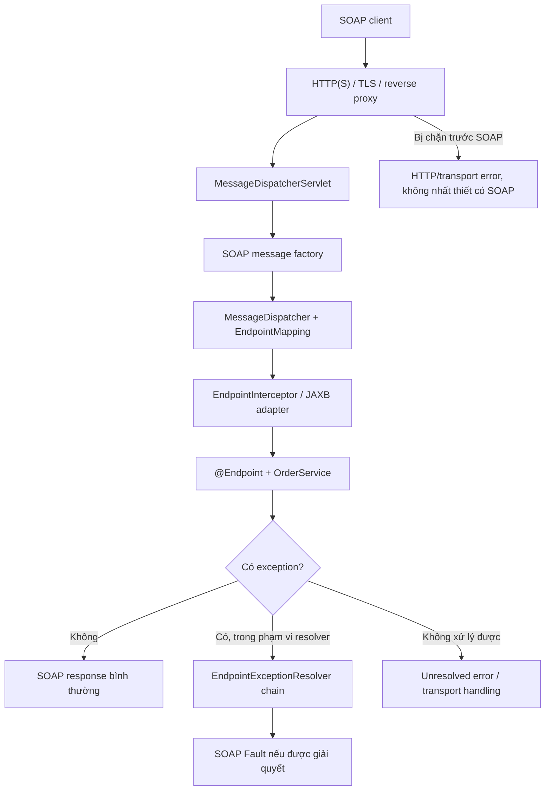
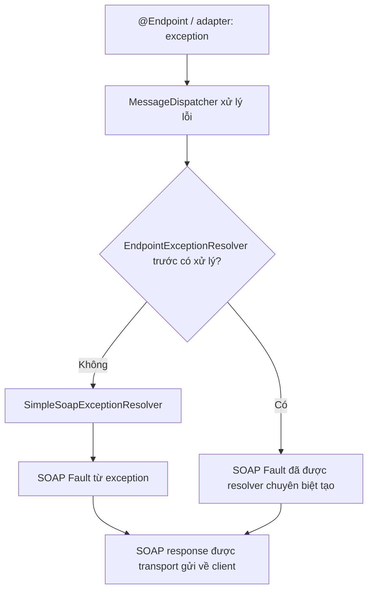
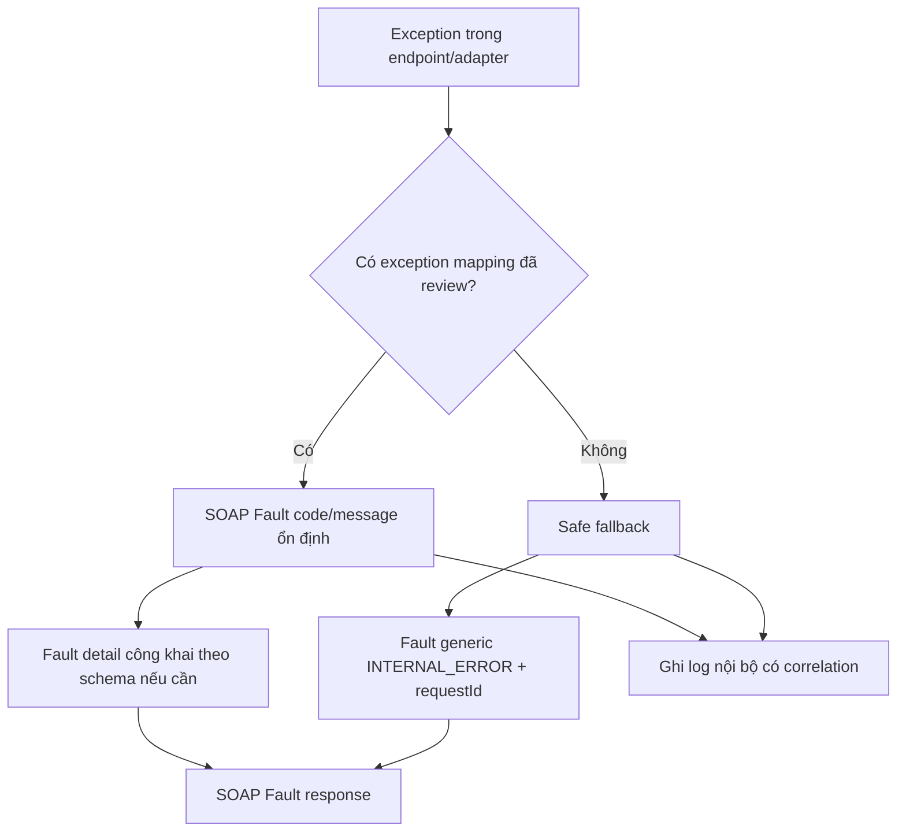

# SimpleSoapExceptionResolver và kiểm soát thông tin được công bố

## 1. Bài toán: lỗi nội bộ có thể bị lộ qua SOAP Fault như thế nào?

Trong một dịch vụ SOAP **contract-first** được xây dựng bằng **Spring Web Services (Spring-WS)**, client gửi `GetOrderRequest` để đọc trạng thái đơn hàng. Một lỗi có thể đến từ dữ liệu đầu vào sai, đơn hàng không tồn tại, thiếu quyền truy cập, cơ sở dữ liệu ngắt kết nối hoặc lỗi lập trình. Server cần trả phản hồi giúp client xử lý đúng, nhưng **không được công bố những chi tiết chỉ dành cho hệ thống nội bộ**.

Giả sử một repository ném exception mang thông điệp:

```text
SQLState 28000: authentication failed for user orders_prod
on jdbc:postgresql://db-internal:5432/orders
```

Nếu toàn bộ `exception.getMessage()` vô tình trở thành `faultstring` của SOAP response, đối tác có thể nhìn thấy hostname nội bộ, tên tài khoản database và chi tiết triển khai. Khi lỗi có dữ liệu cá nhân, token, câu SQL hoặc đường dẫn file, hậu quả còn lớn hơn.

Spring-WS cung cấp **`SimpleSoapExceptionResolver`** như một cơ chế cơ bản để chuyển exception thành SOAP Fault. Chính sự đơn giản đó khiến nó phù hợp để học luồng lỗi hoặc làm fallback trong bối cảnh có kiểm soát, nhưng cần thận trọng khi dùng làm **cơ chế xuất bản lỗi mặc định ra Internet**.

Bài học thuộc chương **SOAP Fault** của module `SPRING_WEB_SERVICES`. Mục tiêu là hiểu rõ `SimpleSoapExceptionResolver`, trách nhiệm kiểm soát **fault code, reason/faultstring, detail, HTTP response và logs**, cũng như cách kết hợp các resolver khác để bảo vệ hợp đồng XSD/WSDL và khả năng tương thích của SOAP client.

### Kết quả học tập

Sau bài này, bạn có thể:

1. Phân biệt SOAP Fault với HTTP error và exception Java nội bộ.
2. Giải thích vai trò của `SimpleSoapExceptionResolver` trong pipeline Spring-WS.
3. Nhận diện dữ liệu nhạy cảm có nguy cơ lộ qua fault text hoặc fault detail.
4. Thiết kế quy tắc công bố lỗi **client-visible** khác với dữ liệu phục vụ chẩn đoán nội bộ.
5. Cấu hình lỗi đã biết bằng `SoapFaultMappingExceptionResolver` hoặc cơ chế tương đương, và xây dựng **fallback an toàn** cho lỗi chưa phân loại.
6. Phân biệt SOAP 1.1 `Client/Server` với SOAP 1.2 `Sender/Receiver`.
7. Ghi log nội bộ qua correlation ID mà không đưa stack trace, SQL hay secrets cho đối tác.
8. Viết kiểm thử xác minh SOAP Fault thực tế, không chỉ kiểm tra Java exception.

## 2. Ba lớp lỗi không được đánh đồng



| Lớp | Ví dụ | Điều client có thể nhận |
| --- | --- | --- |
| **Transport/HTTP** | TLS handshake lỗi, proxy trả 502, HTTP 401 do filter | HTTP error, connection exception hoặc body không phải SOAP |
| **SOAP protocol** | Envelope sai phiên bản, `mustUnderstand` không được xử lý | SOAP Fault theo giao thức khi node có thể tạo Fault |
| **Application/endpoint** | Đơn hàng không tồn tại, validation hoặc service ném exception | SOAP Fault theo hợp đồng nếu resolver/interceptor xử lý |

Không phải bất kỳ `RuntimeException` nào cũng đi qua `SimpleSoapExceptionResolver`. Exception có thể xuất hiện **trước khi endpoint được mapping** hoặc ngoài phạm vi dispatcher, chẳng hạn lỗi TLS, servlet routing, HTTP authentication và một số lỗi parsing XML. Khi gặp lỗi hãy xác định nó xảy ra ở **tầng nào** trước khi chỉnh fault resolver.

### 2.1. Exception Java không phải SOAP Fault

```text
OrderRepository.findById(...)
   -> SQLException / DataAccessException
   -> Exception trong service/endpoint
   -> EndpointExceptionResolver xử lý được?
         yes -> SoapFault trong SOAP response
         no  -> lỗi tiếp tục đi lên theo cấu hình server
```

Exception là sự kiện trong Java process. SOAP Fault là **thông điệp XML theo đặc tả SOAP**, được gửi cho bên gọi. Bước chuyển từ exception sang Fault là một **quyết định về hợp đồng, bảo mật và cách vận hành**, không phải chỉ là “serialize exception sang XML”.

### 2.2. HTTP status không đủ để kết luận là SOAP Fault

Một SOAP 1.1 Fault qua HTTP thường đi với `500 Internal Server Error` theo SOAP 1.1 HTTP binding. Tuy nhiên HTTP 500 cũng có thể do gateway, container hoặc lỗi ứng dụng không tạo SOAP Envelope:

```http
HTTP/1.1 500 Internal Server Error
Content-Type: text/html

<html><body>Gateway error</body></html>
```

Đây **không** phải SOAP Fault. Client cần kiểm tra cả HTTP status, `Content-Type` và XML Envelope/Fault; server cần ghi log tách biệt transport errors và SOAP application errors.

## 3. SOAP Fault 1.1 có thể công bố những gì?

SOAP Fault là một phần tử trong SOAP Body. Ví dụ SOAP 1.1 khi request không hợp lệ:

```xml
<?xml version="1.0" encoding="UTF-8"?>
<soap:Envelope
    xmlns:soap="http://schemas.xmlsoap.org/soap/envelope/">
    <soap:Body>
        <soap:Fault>
            <faultcode>soap:Client</faultcode>
            <faultstring>Yêu cầu không hợp lệ</faultstring>
            <detail>
                <err:OrderError
                    xmlns:err="urn:example:orders:fault:v1">
                    <err:code>INVALID_ORDER_ID</err:code>
                    <err:requestId>req-42</err:requestId>
                </err:OrderError>
            </detail>
        </soap:Fault>
    </soap:Body>
</soap:Envelope>
```

Trong SOAP 1.1:

| Thành phần | Vai trò | Nguy cơ khi dùng sai |
| --- | --- | --- |
| `faultcode` | Phân loại lỗi ở cấp SOAP, như `Client`, `Server` | Dùng sai hướng khiến client retry không phù hợp |
| `faultstring` | Mô tả lỗi để người/ứng dụng hiểu ở mức phù hợp | **Lộ exception message**, hostname, đường dẫn, truy vấn SQL |
| `faultactor` | Tùy chọn, xác định node phát sinh Fault trong SOAP processing | Công bố topology/định danh nội bộ không cần thiết |
| `detail` | Tùy chọn, chứa chi tiết application fault theo contract | Lộ dữ liệu cá nhân/secrets hoặc cấu trúc nội bộ |

Không nên ghi Java exception class, Java stack trace, SQL statement hoặc raw request payload vào `detail`. Nếu client cần mã lỗi có cấu trúc, hãy **thiết kế XSD của fault detail** để chỉ công bố các trường đã phê duyệt.

### 3.1. `Client` và `Server` trong SOAP 1.1

- `soap:Client` thường chỉ vấn đề liên quan message được gửi hoặc cách message phù hợp hợp đồng, chẳng hạn thiếu trường bắt buộc, sai payload, thiếu tham số mà client phải sửa.
- `soap:Server` thường chỉ lỗi khi node xử lý request mà không thể hoàn tất vì điều kiện phía server, chẳng hạn lỗi hạ tầng tạm thời.

Đây là **phân loại cấp SOAP**, không thay thế business error code cụ thể. Một `OrderNotFound` có thể được biểu diễn theo chính sách API bằng Client Fault hoặc mã lỗi nghiệp vụ khác đã được mô tả; cần nhất quán để client xử lý.

**Tránh suy diễn:** Client Fault không tự chứng minh request không bao giờ được xử lý một phần; Server Fault cũng không tự có nghĩa retry là an toàn. Với operation có side effect, khả năng retry còn phụ thuộc idempotency và trạng thái transaction.

### 3.2. SOAP 1.2 dùng cấu trúc Fault khác

SOAP 1.2 có Envelope namespace:

```text
http://www.w3.org/2003/05/soap-envelope
```

Một Fault tương ứng có dạng:

```xml
<env:Envelope
    xmlns:env="http://www.w3.org/2003/05/soap-envelope"
    xmlns:err="urn:example:orders:fault:v1">
    <env:Body>
        <env:Fault>
            <env:Code>
                <env:Value>env:Sender</env:Value>
            </env:Code>
            <env:Reason>
                <env:Text xml:lang="vi">Yêu cầu không hợp lệ</env:Text>
            </env:Reason>
            <env:Detail>
                <err:OrderError>
                    <err:code>INVALID_ORDER_ID</err:code>
                    <err:requestId>req-42</err:requestId>
                </err:OrderError>
            </env:Detail>
        </env:Fault>
    </env:Body>
</env:Envelope>
```

SOAP 1.2 dùng `Sender`/`Receiver` thay vì cách gọi `Client`/`Server` của SOAP 1.1; `Code`/`Reason`/`Detail` cũng khác cấu trúc `faultcode`/`faultstring`/`detail`. Không kết hợp SOAP 1.2 Fault body với SOAP 1.1 Envelope/media type.

| Khía cạnh | SOAP 1.1 | SOAP 1.2 |
| --- | --- | --- |
| Envelope namespace | `http://schemas.xmlsoap.org/soap/envelope/` | `http://www.w3.org/2003/05/soap-envelope` |
| Fault code phổ biến | `Client` / `Server` | `Sender` / `Receiver` |
| Mô tả | `faultstring` | `Reason/Text` kèm `xml:lang` |
| Chi tiết ứng dụng | `detail` | `Detail` |
| HTTP Content-Type thường dùng | `text/xml` | `application/soap+xml` |

`SimpleSoapExceptionResolver` và các resolver Spring-WS làm việc với **SOAP abstraction**; việc có thể tạo Fault đúng SOAP version phụ thuộc message factory/transport và cấu hình stack. Luôn kiểm thử trên đúng SOAP version mà WSDL công bố.

## 4. `SimpleSoapExceptionResolver` là gì?

Spring-WS cung cấp class:

```java
org.springframework.ws.soap.server.endpoint.SimpleSoapExceptionResolver
```

Nó là một `EndpointExceptionResolver` đơn giản: xử lý exception thuộc phạm vi mà dispatcher đưa cho resolver bằng cách tạo SOAP Fault, thường dùng fault code **Server/Receiver** và sử dụng **thông điệp exception** làm mô tả Fault theo hành vi mặc định của triển khai.

Đặc điểm cần đặc biệt lưu ý:

1. Nó không tự phân loại tất cả exception nghiệp vụ thành các error codes khác nhau.
2. Nó không hiểu XSD/WSDL fault detail contract của hệ thống chỉ nhờ có một exception.
3. Nếu nội dung exception message chứa chi tiết nhạy cảm, việc biến message thành fault text có thể **công bố thông tin nội bộ cho client**.
4. Nó không tự biến lỗi TLS/proxy/servlet bên ngoài SOAP dispatcher thành Fault.
5. Là một resolver rộng, nếu được xét trước resolver đặc thù, nó có thể xử lý exception quá sớm khiến mapping chi tiết hơn không còn cơ hội chạy.

**Không nên hiểu tên “Simple” là “tự động an toàn”.** Đây là công cụ đơn giản hóa việc chuyển exception thành Fault; chính sách công bố nội dung vẫn là trách nhiệm của ứng dụng.

### 4.1. Cấu hình cơ bản để minh họa

Ví dụ dưới đây dùng cho môi trường học hoặc hệ thống mà nội dung exception đã được kiểm soát:

```java
import org.springframework.context.annotation.Bean;
import org.springframework.context.annotation.Configuration;
import org.springframework.core.Ordered;
import org.springframework.ws.soap.server.endpoint.SimpleSoapExceptionResolver;

@Configuration
public class SimpleFaultConfiguration {

    @Bean
    public SimpleSoapExceptionResolver simpleSoapExceptionResolver() {
        SimpleSoapExceptionResolver resolver =
            new SimpleSoapExceptionResolver();

        resolver.setOrder(Ordered.LOWEST_PRECEDENCE);
        return resolver;
    }
}
```

Đặt thứ tự thấp trong chuỗi resolver giúp **nhường cơ hội** cho những resolver chuyên biệt được ưu tiên hơn, nếu chúng thực sự được đăng ký. Tuy nhiên, nếu một resolver khác ở phía trước đã có default Fault rộng và xử lý mọi exception, `SimpleSoapExceptionResolver` phía sau có thể không được gọi.

**Cảnh báo cho production:** ví dụ này **chưa có cơ chế che giấu faultstring**. Không nên triển khai ra môi trường Internet chỉ vì nó compile được. Cần đánh giá nội dung exception message, resolver order, bảo mật và contract fault trước khi dùng.

### 4.2. Luồng tạo Fault từ exception



Đây là mô hình logic về **nhánh exception mà resolver được gọi**. Không phải mọi lỗi xảy ra trước endpoint mapping hay mọi exception từ interceptor đều chắc chắn theo đúng chuỗi này; cần xác minh error path của phiên bản Spring-WS thực tế.

### 4.3. Nguy cơ công bố trực tiếp exception message

Giả sử code viết:

```java
throw new IllegalStateException(
    "DB connection to db-internal:5432 failed; " +
    "user=orders_prod; orderId=ORD-100"
);
```

Nếu resolver trả `ex.getMessage()` cho client, đối tác có thể nhận Fault:

```xml
<soap:Fault
    xmlns:soap="http://schemas.xmlsoap.org/soap/envelope/">
    <faultcode>soap:Server</faultcode>
    <faultstring>
        DB connection to db-internal:5432 failed;
        user=orders_prod; orderId=ORD-100
    </faultstring>
</soap:Fault>
```

Đây là **ví dụ minh họa hậu quả**, không phải tuyên bố định dạng serialization byte-for-byte của mọi phiên bản resolver. Trong thực tế, Fault cũng nằm trong SOAP Body/Envelope và cách biểu diễn whitespace/namespace có thể khác. Vấn đề ở đây là **nội dung lỗi**, không phải prefix XML.

### 4.4. Không phải cứ sửa exception message là đã có hợp đồng lỗi tốt

Một nhóm có thể tránh lộ hostname bằng cách thay mọi exception message thành “Error”. Điều đó giảm rò rỉ nhưng chưa giải quyết:

- Client cần phân biệt lỗi đầu vào và lỗi server tạm thời.
- Client cần mã lỗi nghiệp vụ ổn định để xử lý.
- Fault detail phải đúng XSD/WSDL nếu công bố contract.
- Log nội bộ cần giữ root cause để debug.
- Operation có side effect cần quy tắc retry/idempotency.

Thiết kế tốt tách **public error contract** khỏi **internal exception diagnostics**, thay vì chỉ chỉnh chuỗi exception theo cảm tính.

## 5. Quy tắc công bố thông tin: public fault và internal diagnostics

Để tích hợp doanh nghiệp ổn định, mỗi lỗi nên có **hai biểu diễn**:

- **Biểu diễn công khai (public)**: mô tả ngắn, mã lỗi ổn định, dữ liệu thực sự cần cho client để sửa request hoặc liên hệ hỗ trợ.
- **Biểu diễn nội bộ (internal)**: exception class, stack trace, root cause, kết quả query, dependency call, timing và metadata kỹ thuật phục vụ vận hành, được bảo vệ bởi quyền truy cập logs/tracing.

Ví dụ:

| Thông tin | SOAP Fault gửi cho đối tác? | Log/tracing nội bộ? |
| --- | --- | --- |
| `errorCode=ORDER_NOT_FOUND` | Có, nếu contract cho phép | Có |
| `requestId=req-42` | Có, nếu không mang dữ liệu bí mật | Có |
| “Không tìm thấy đơn hàng” | Có, nếu không tạo enumeration leak trái policy | Có |
| Exception class `DataAccessResourceFailureException` | Không | Có |
| Host database `db-internal:5432` | Không | Có khi cần, trong log được bảo vệ |
| SQL statement đầy đủ | Không | Chỉ khi chính sách cho phép và đã redaction |
| Password, bearer token, private key | **Không** | **Không log** |
| Java stack trace | Không | Có trong error logs nội bộ có kiểm soát |
| Raw SOAP Body có dữ liệu cá nhân | Không | Không log mặc định; chỉ thu thập theo chính sách bảo mật |
| Trạng thái transaction/idempotency | Có thể có mã/trạng thái tối thiểu theo contract | Có chi tiết an toàn |

### 5.1. Những trường public hữu ích

Một hợp đồng Fault được kiểm soát có thể công bố:

```text
faultCode     = soap:Server hoặc soap:Client
faultString   = "Không xử lý được yêu cầu"
detail.code   = INTERNAL_ERROR
detail.requestId = req-42
```

Với lỗi được phân loại rõ:

```text
faultCode     = soap:Client
faultString   = "Yêu cầu không hợp lệ"
detail.code   = INVALID_ORDER_ID
detail.requestId = req-43
```

Client có thể dựa vào **`detail.code` ổn định** để định tuyến xử lý; `faultstring`/`Reason` nên dành cho mô tả mức người dùng/diagnostic, không làm khóa logic vì ngôn ngữ và câu chữ có thể thay đổi.

### 5.2. Không dùng `requestId` làm mật khẩu hoặc token

`requestId` giúp hỗ trợ kỹ thuật đối chiếu logs, nhưng nó không phải credential, không được dùng một mình để truy xuất thông tin nhạy cảm. Cần:

- Sinh ID khó gây trùng theo quy tắc phù hợp.
- Giới hạn độ dài, ký tự và nguồn tin cậy nếu nhận ID từ client.
- Không công bố private identifiers hoặc dữ liệu cá nhân trong ID.
- Bảo vệ log và API tra cứu theo authentication/authorization.

### 5.3. Dùng mã lỗi ổn định thay vì tên Java exception

**Không nên:**

```xml
<err:code>org.springframework.dao.DataIntegrityViolationException</err:code>
```

Đây là tên implementation có thể đổi khi refactor hoặc nâng framework.

**Nên dùng** mã thuộc hợp đồng:

```xml
<err:code>ORDER_CONFLICT</err:code>
```

Sau đó service định nghĩa bảng ánh xạ giữa business exception categories và mã public. Một exception nội bộ vẫn có thể có nhiều nguyên nhân chi tiết mà client không cần biết.

### 5.4. Có nên luôn trả cùng thông điệp?

Không phải mọi lỗi đều cần “Internal error”. Một request thiếu `orderId` có thể nhận `INVALID_ORDER_ID` rõ ràng mà không lộ thông tin nhạy cảm. Ngược lại, lỗi database, filesystem, cấu hình hoặc thư viện nên có Fault tổng quát để không tiết lộ topology và bí mật.

Chính sách phân loại hợp lý:

| Loại | Fault công khai được đề xuất | Vì sao? |
| --- | --- | --- |
| XML sai XSD | `INVALID_REQUEST` | Client sửa định dạng |
| Thiếu trường bắt buộc | `MISSING_FIELD` hoặc `INVALID_REQUEST` | Client sửa dữ liệu |
| Đơn hàng không tồn tại | `ORDER_NOT_FOUND` nếu policy cho phép | Client có thể điều chỉnh yêu cầu |
| Không được phép truy cập đơn | `ACCESS_DENIED` hoặc thông điệp tổng quát theo policy | Tránh tiết lộ tài nguyên của người khác |
| Đơn đã chuyển trạng thái không thể hủy | `ORDER_CONFLICT` | Client xử lý nghiệp vụ |
| Database/queue tạm thời lỗi | `SERVICE_UNAVAILABLE` hoặc `INTERNAL_ERROR` | Giấu hạ tầng, client dựa vào retry policy |
| NullPointerException/lỗi lập trình | `INTERNAL_ERROR` | Không để lộ class, stack trace |
| XML security/WS-Security sai | Security Fault theo profile/contract | Không lộ thông tin xác thực nhạy cảm |

Các mã trên là **mã do API ví dụ định nghĩa**, không phải SOAP Fault codes chuẩn. Chúng có thể được mang trong `detail` nếu contract quy định; không tự thay thế `soap:Client`/`soap:Server` hoặc `env:Sender`/`env:Receiver`.

## 6. Contract-first: định nghĩa Fault detail trong XSD/WSDL

SOAP Fault mang thông tin protocol, còn **Fault detail nghiệp vụ** nên được thiết kế trong XSD để các client có thể xử lý ổn định.

### 6.1. XSD mẫu cho OrderError

Giả sử `src/main/resources/xsd/order-errors.xsd`:

```xml
<?xml version="1.0" encoding="UTF-8"?>
<xs:schema
    xmlns:xs="http://www.w3.org/2001/XMLSchema"
    xmlns:err="urn:example:orders:fault:v1"
    targetNamespace="urn:example:orders:fault:v1"
    elementFormDefault="qualified">

    <xs:simpleType name="OrderErrorCodeType">
        <xs:restriction base="xs:string">
            <xs:enumeration value="INVALID_REQUEST"/>
            <xs:enumeration value="ORDER_NOT_FOUND"/>
            <xs:enumeration value="ORDER_CONFLICT"/>
            <xs:enumeration value="ACCESS_DENIED"/>
            <xs:enumeration value="INTERNAL_ERROR"/>
        </xs:restriction>
    </xs:simpleType>

    <xs:complexType name="OrderErrorType">
        <xs:sequence>
            <xs:element name="code"
                        type="err:OrderErrorCodeType"/>
            <xs:element name="requestId"
                        type="xs:string"/>
        </xs:sequence>
    </xs:complexType>

    <xs:element name="OrderError"
                type="err:OrderErrorType"/>
</xs:schema>
```

Trong ví dụ này, `OrderError` là **global element QName `{urn:example:orders:fault:v1}OrderError`**. Nó mô tả một **application fault detail**, không thay thế cấu trúc `soap:Fault`/`env:Fault`.

Không có trường `stackTrace`, `sql`, `internalHostname` hay `exceptionClass`. Đó là quyết định có chủ ý: những trường này thuộc chẩn đoán nội bộ, không thuộc public contract.

### 6.2. Trích đoạn WSDL 1.1 mô tả fault

Ví dụ một operation `GetOrder` có thể công bố Fault message:

```xml
<!-- Trích đoạn; giả sử prefix wsdl/soap/tns/err được khai báo
     và XSD OrderError đã được import trong wsdl:types. -->

<wsdl:message name="GetOrderFault">
    <wsdl:part name="detail" element="err:OrderError"/>
</wsdl:message>

<wsdl:portType name="OrdersPortType">
    <wsdl:operation name="GetOrder">
        <wsdl:input message="tns:GetOrderInput"/>
        <wsdl:output message="tns:GetOrderOutput"/>
        <wsdl:fault name="OrderFault"
                    message="tns:GetOrderFault"/>
    </wsdl:operation>
</wsdl:portType>

<wsdl:binding name="OrdersSoap11Binding"
              type="tns:OrdersPortType">
    <soap:binding
        style="document"
        transport="http://schemas.xmlsoap.org/soap/http"/>
    <wsdl:operation name="GetOrder">
        <soap:operation
            soapAction="urn:example:orders:v1:GetOrder"/>
        <wsdl:input>
            <soap:body use="literal"/>
        </wsdl:input>
        <wsdl:output>
            <soap:body use="literal"/>
        </wsdl:output>
        <wsdl:fault name="OrderFault">
            <soap:fault name="OrderFault" use="literal"/>
        </wsdl:fault>
    </wsdl:operation>
</wsdl:binding>
```

Đây là **trích đoạn WSDL**, chưa đủ `definitions`, `types`, import XSD, `service` và các message input/output khác để chạy độc lập. Giá trị `soap:operation/@soapAction` cũng là lựa chọn minh họa; đối tác phải đọc giá trị trong WSDL thực tế.

### 6.3. WSDL mô tả Fault không đồng nghĩa runtime tự phát đúng detail

Nếu chỉ công bố `wsdl:fault` và XSD, Spring-WS không tự động biến mọi exception Java thành `OrderError`. Ứng dụng còn cần:

1. Phân loại exception thành error code công khai.
2. Tạo SOAP Fault đúng SOAP version.
3. Đính kèm `OrderError` vào `detail` nếu contract yêu cầu.
4. Bảo đảm namespace, thứ tự phần tử và dữ liệu khớp XSD.
5. Kiểm thử với client sinh mã từ WSDL và client độc lập.

`SimpleSoapExceptionResolver` rất hữu ích để minh họa cơ chế Fault, nhưng **không tự dựng `OrderError` từ WSDL**. Muốn fault detail có cấu trúc cần resolver tùy biến, cơ chế mapping phù hợp hoặc logic tạo Fault chuyên dụng.

### 6.4. Tương thích khi thay đổi mã lỗi

Nếu XSD dùng enum `OrderErrorCodeType`, thêm giá trị `PAYMENT_PENDING` có thể khiến một client JAXB cũ không unmarshal được hoặc xử lý sai tùy runtime. Vì vậy error-code versioning cũng cần quản lý như request/response schema.

Thay Fault detail QName, đổi namespace hoặc thay các trường bắt buộc có thể là breaking change cho client. Không nên chỉ test request thành công mà bỏ qua dữ liệu lỗi.

## 7. Phân loại exception trước khi chọn resolver

Nên tách **exception nghiệp vụ có dự kiến** khỏi **lỗi kỹ thuật bất ngờ**.

Ví dụ domain exception:

```java
public final class OrderNotFoundException extends RuntimeException {
    public OrderNotFoundException() {
        super("Order not found"); // Mô tả nội bộ tối thiểu.
    }
}

public final class InvalidOrderRequestException
        extends RuntimeException {
    public InvalidOrderRequestException() {
        super("Invalid order request");
    }
}
```

Đây là các class riêng biệt; trong Java thực tế đặt mỗi public top-level class vào file tương ứng. Khi gọi service, lỗi kỹ thuật có thể giữ cause:

```java
try {
    return repository.findOrder(orderId);
} catch (DataAccessException e) {
    throw new OrderStorageException(
        "Order storage is unavailable", e
    );
}
```

Đoạn thứ hai là **mảnh code ứng dụng**, giả định `repository`, `DataAccessException` và `OrderStorageException` được định nghĩa/import thích hợp. Root cause `e` có thể được ghi vào logs an toàn nhưng **không nên được serialize nguyên vẹn vào SOAP Fault**.

### 7.1. Một exception có thể có public metadata và internal cause

Ví dụ ý tưởng:

```java
public final class PublicOrderFaultException
        extends RuntimeException {

    private final String errorCode;

    public PublicOrderFaultException(
            String errorCode,
            String publicMessage,
            Throwable cause) {
        super(publicMessage, cause);
        this.errorCode = errorCode;
    }

    public String getErrorCode() {
        return errorCode;
    }
}
```

Với mô hình này:

- `errorCode` và `publicMessage` phải được chọn từ danh sách công khai đã review.
- `cause` chỉ nên dùng để log/tracing nội bộ.
- Không có nghĩa `SimpleSoapExceptionResolver` tự đọc `getErrorCode()` để tạo `detail`; cần resolver/cơ chế riêng.
- Phải tránh để exception này bị tạo trực tiếp từ chuỗi do client kiểm soát mà không lọc.

### 7.2. Vì sao không bắt tất cả exception rồi trả `ex.toString()`?

`ex.toString()` thường chứa cả class name và message. `Throwable.getStackTrace()` có thể tiết lộ source path, method và cấu trúc thư viện. Các thông tin đó:

- Không ổn định cho client.
- Không thuộc XSD/WSDL contract.
- Có thể tiết lộ đường dẫn/cấu trúc hệ thống.
- Có thể chứa thông tin nhạy cảm qua exception message/cause.

Chúng thuộc **log nội bộ có kiểm soát**, không phải `faultstring` hoặc public `detail`.

## 8. Chiến lược resolver: lỗi đã biết và fallback an toàn

Một cấu trúc phù hợp:



### 8.1. Có thể dùng `SoapFaultMappingExceptionResolver` cho lỗi đã biết

Spring-WS có `SoapFaultMappingExceptionResolver`, cho phép ánh xạ các exception classes tới `SoapFaultDefinition` theo cấu hình. Một cấu hình minh họa với các mapping có thông điệp **tĩnh, đã kiểm duyệt**:

```java
import java.util.Properties;
import org.springframework.context.annotation.Bean;
import org.springframework.context.annotation.Configuration;
import org.springframework.ws.soap.server.endpoint.SoapFaultDefinition;
import org.springframework.ws.soap.server.endpoint.SoapFaultMappingExceptionResolver;

@Configuration
public class PublicFaultMappingConfiguration {

    @Bean
    public SoapFaultMappingExceptionResolver publicFaultResolver() {
        SoapFaultMappingExceptionResolver resolver =
            new SoapFaultMappingExceptionResolver();

        Properties mappings = new Properties();
        mappings.setProperty(
            OrderNotFoundException.class.getName(),
            "CLIENT,Không tìm thấy đơn hàng"
        );
        mappings.setProperty(
            InvalidOrderRequestException.class.getName(),
            "CLIENT,Yêu cầu không hợp lệ"
        );

        resolver.setExceptionMappings(mappings);
        resolver.setOrder(0);
        return resolver;
    }
}
```

Chuỗi mapping `"CLIENT,..."` là dạng cấu hình thường dùng cho `SoapFaultDefinition` theo quy ước parser của Spring-WS; hãy đối chiếu tài liệu và test với **phiên bản Spring-WS đang sử dụng**, nhất là SOAP version và locale. Quan trọng hơn cú pháp là **mỗi thông điệp client nhìn thấy phải là giá trị có chủ đích**, không lấy từ raw exception.

Các mapping trên chỉ tạo Fault-level message; nếu cần XSD `OrderError` trong `detail`, phải bổ sung resolver/detail generation được kiểm soát. Cấu hình này cũng chưa bao phủ ngoại lệ ngoài danh sách, trừ khi có resolver fallback thích hợp.

### 8.2. Default Fault tổng quát trong mapping resolver

Nếu muốn một resolver đã biết chịu trách nhiệm cả lỗi không phân loại, có thể thiết lập một `SoapFaultDefinition` mặc định:

```java
SoapFaultDefinition fallback = new SoapFaultDefinition();
fallback.setFaultCode(SoapFaultDefinition.SERVER);
fallback.setFaultStringOrReason(
    "Không thể xử lý yêu cầu. Vui lòng cung cấp mã giao dịch cho hỗ trợ."
);

resolver.setDefaultFault(fallback);
```

Đây là đoạn cấu hình **gắn vào bean resolver tương ứng**, không phải Java class hoàn chỉnh. Nếu default Fault này xử lý mọi exception, một `SimpleSoapExceptionResolver` đặt sau nó trong chain có thể **không bao giờ chạy**. Đó là hành vi mong muốn nếu ứng dụng muốn tránh resolver đơn giản làm lộ raw exception message.

Nếu muốn trả request ID theo XSD fault detail, cần resolver tạo `detail` riêng; đoạn cấu hình `SoapFaultDefinition` trên không tự sinh `requestId`.

### 8.3. Không nên đặt Simple resolver ưu tiên cao hơn mapping chuyên biệt

Giả sử có:

```text
SimpleSoapExceptionResolver order=0
SoapFaultMappingExceptionResolver order=10
```

Nếu Simple resolver xử lý exception trước, mapping đặc thù có thể không có cơ hội áp dụng message/code công khai. Cấu hình nên xác định **chính sách precedence**:

```text
Specific mapping / typed fault policy
             |
         Safe fallback
             |
      Response to client
```

**Lưu ý:** Spring-WS dùng thứ tự các resolver theo cơ chế đã đăng ký; số `order` nhỏ hơn thường được ưu tiên trước với những resolver hỗ trợ `Ordered`. Phải kiểm tra runtime beans/auto-configuration để tránh duplicate resolver hoặc order mặc định ngoài dự kiến.

### 8.4. Khi nào không cần Simple resolver trong production?

Nếu đã có `SoapFaultMappingExceptionResolver` với default Fault được kiểm soát hoặc custom safe fallback đủ xử lý các lỗi mong muốn, **không cần** đăng ký thêm `SimpleSoapExceptionResolver` chỉ để “chắc chắn có Fault”. Một fallback rộng thứ hai có thể làm chính sách lỗi khó chẩn đoán.

Hãy giữ Simple resolver chủ yếu khi phù hợp với môi trường học, tương thích legacy đã đánh giá hoặc chỉ xử lý exception message đã được đảm bảo an toàn. Với endpoint công khai, cần chứng minh qua test rằng client **không thể nhận raw internal message**.

## 9. Tạo safe fallback resolver thay vì công bố raw exception

Trong trường hợp ứng dụng cần kiểm soát chắc chắn lỗi không phân loại, một resolver tùy chỉnh có thể **tự tạo Fault với văn bản cố định**, chỉ ghi root cause vào log nội bộ. Điều này minh họa ranh giới “public response khác internal diagnostics”.

### 9.1. Ví dụ `AbstractEndpointExceptionResolver`

Đoạn Java sau tập trung vào **lỗi chưa có mapping chuyên biệt**:

```java
import java.util.Locale;
import org.slf4j.Logger;
import org.slf4j.LoggerFactory;
import org.springframework.core.Ordered;
import org.springframework.ws.WebServiceMessage;
import org.springframework.ws.context.MessageContext;
import org.springframework.ws.server.endpoint.AbstractEndpointExceptionResolver;
import org.springframework.ws.soap.SoapBody;
import org.springframework.ws.soap.SoapMessage;

public final class SafeFallbackExceptionResolver
        extends AbstractEndpointExceptionResolver {

    private static final Logger log =
        LoggerFactory.getLogger(SafeFallbackExceptionResolver.class);

    public SafeFallbackExceptionResolver() {
        setOrder(Ordered.LOWEST_PRECEDENCE);
    }

    @Override
    protected boolean resolveExceptionInternal(
            MessageContext context,
            Object endpoint,
            Exception exception) {

        Object requestIdValue =
            context.getProperty("orders.requestId");
        String requestId =
            requestIdValue instanceof String id
                ? id
                : "unavailable";

        // Log nội bộ; không copy exception hoặc stack trace
        // vào SOAP Fault response.
        log.error(
            "SOAP request failed; requestId={}",
            requestId,
            exception
        );

        WebServiceMessage response = context.getResponse();
        if (!(response instanceof SoapMessage soap)) {
            return false;
        }

        SoapBody body = soap.getSoapBody();
        if (body.hasFault()) {
            return true; // Không thêm Fault lần thứ hai.
        }

        body.addServerOrReceiverFault(
            "Không thể xử lý yêu cầu. Vui lòng liên hệ hỗ trợ.",
            Locale.forLanguageTag("vi-VN")
        );

        return true;
    }
}
```

Đây là **ví dụ về nguyên tắc fallback**, cần ghép với config, test và error policy thực tế. Class sử dụng Java hỗ trợ `instanceof` pattern matching. Trong phiên bản Spring-WS cụ thể, hãy xác minh API của `AbstractEndpointExceptionResolver`, `SoapBody` và hành vi tạo response.

Một số lưu ý không được bỏ qua:

- `log.error(..., exception)` dùng cho **sink log nội bộ có phân quyền và redaction**, không phải stdout công khai. Exception message vẫn có thể chứa secrets nên chính sách log phải kiểm soát cả dữ liệu trong root cause.
- `requestId` phải được sinh hoặc validate/truncate trước khi đưa vào `MessageContext`. Đừng nhận một chuỗi dài do client gửi rồi log nguyên văn.
- `context.getResponse()` và message factory phải hỗ trợ SOAP response phù hợp. Nếu response không phải `SoapMessage`, resolver trả `false`, để lỗi tiếp tục được xử lý theo cơ chế còn lại.
- Nếu SOAP Body đã có Fault, ví dụ không ghi đè. Trong production cần quy định rõ có được giữ Fault đã có hay không và test các trường hợp đó.
- Mã này chưa tạo XSD `OrderError`. Nếu contract yêu cầu detail, cần thêm bước tạo detail an toàn và hợp schema.

### 9.2. Đăng ký bean và kiểm soát thứ tự

Nếu mapping resolver xử lý lỗi đã biết mà **không đặt default fault**, có thể dùng custom fallback ở cuối:

```java
import org.springframework.context.annotation.Bean;
import org.springframework.context.annotation.Configuration;
import org.springframework.core.Ordered;

@Configuration
public class FallbackFaultConfiguration {

    @Bean
    public SafeFallbackExceptionResolver safeFallbackResolver() {
        return new SafeFallbackExceptionResolver();
    }
}
```

`SafeFallbackExceptionResolver` đã thiết lập order thấp nhất trong constructor. Khi cấu hình các resolvers khác, phải bảo đảm chúng có precedence cao hơn, ví dụ `order=0` cho mapping chuyên biệt.

Không đăng ký **đồng thời** `SimpleSoapExceptionResolver` và safe fallback cùng mức ưu tiên như hai catch-all resolvers rồi kỳ vọng hành vi ổn định. Hãy quyết định một owner cho fallback, kiểm tra danh sách resolver beans runtime và chạy regression tests.

### 9.3. Một cách an toàn khác không cần custom fallback

Nếu `SoapFaultMappingExceptionResolver` hỗ trợ `setDefaultFault(...)` và bạn không cần detail phức tạp, có thể dùng một resolver duy nhất:

```text
OrderNotFoundException       -> CLIENT / "Không tìm thấy đơn hàng"
InvalidOrderRequestException -> CLIENT / "Yêu cầu không hợp lệ"
Các exception còn lại        -> SERVER / "Không thể xử lý yêu cầu"
```

Ưu điểm là ít code hơn; hạn chế là thông tin nghiệp vụ trong `detail` và correlation ID cần xử lý bổ sung. Cũng phải đảm bảo exception được log nội bộ ở nơi thích hợp mà không ảnh hưởng Fault response.

### 9.4. Tránh “fallback phơi lộ” khi error handling của mapper không bắt được

Một thiết kế có resolver chuyên biệt rồi Simple resolver cuối có thể tưởng là an toàn, nhưng nếu chuyên biệt chỉ map vài loại exception, **mọi exception còn lại vẫn có thể đi tới Simple resolver và công bố message**. Đây chính là lý do cần một **safe fallback**, không chỉ một specialized resolver.

Trong quá trình review, thử cố ý ném `NullPointerException`, `IllegalStateException`, `DataAccessException` và exception có message chứa chuỗi giả lập như `SECRET_DO_NOT_EXPOSE`. Nếu chuỗi này xuất hiện ở SOAP response, chính sách chưa đạt.

## 10. Tạo `detail` có cấu trúc mà không lộ root cause

Với client doanh nghiệp, `faultstring` tổng quát có thể chưa đủ. Hợp đồng có thể cần:

```xml
<detail>
    <err:OrderError xmlns:err="urn:example:orders:fault:v1">
        <err:code>INTERNAL_ERROR</err:code>
        <err:requestId>req-42</err:requestId>
    </err:OrderError>
</detail>
```

### 10.1. Dữ liệu được phép đưa vào detail

Ví dụ `OrderError` từ XSD mục 6 chỉ có:

- `code`: một giá trị enum trong bộ mã lỗi công khai.
- `requestId`: mã theo dõi hợp lệ và không nhạy cảm.

**Không** thêm:

```xml
<!-- Anti-pattern: không công bố những trường này -->
<err:exceptionClass>java.sql.SQLException</err:exceptionClass>
<err:sql>SELECT * FROM orders WHERE ...</err:sql>
<err:databaseUrl>jdbc:postgresql://db-internal</err:databaseUrl>
<err:stackTrace>at org.example.orders...</err:stackTrace>
```

Việc XSD **cho phép** thêm nhiều trường không có nghĩa việc công bố chúng **an toàn**. Khi thiết kế schema Fault, chỉ đưa dữ liệu tối thiểu mà client được phép sử dụng.

### 10.2. Phác thảo cơ chế tạo detail

Trong một resolver hoặc handler SOAP Fault phù hợp:

```text
1. Xác định publicErrorCode từ nhóm exception đã review
2. Lấy requestId đã được tạo/kiểm tra trong MessageContext
3. Tạo SoapFault với code + reason công khai
4. Thêm SoapFaultDetail theo global element:
   {urn:example:orders:fault:v1}OrderError
5. Ghi hai child elements đúng namespace:
   {urn:example:orders:fault:v1}code
   {urn:example:orders:fault:v1}requestId
6. Validate Fault XML (hoặc test đúng schema) trước phát hành
7. Giữ raw exception/cause chỉ trong log nội bộ
```

Spring-WS cung cấp các abstraction như `SoapFault` và `SoapFaultDetail`; bạn có thể thêm detail bằng API XML thích hợp hoặc JAXB object được sinh từ XSD. Với JAXB, cần tạo **đúng root QName** qua `ObjectFactory`/`JAXBElement` hoặc class có `@XmlRootElement` phù hợp.

Đặc biệt, `<detail>` của SOAP 1.1 và `<env:Detail>` của SOAP 1.2 là phần **cấu trúc SOAP**, còn `err:OrderError` là phần tử **ứng dụng**. Không viết một element `OrderError` không có namespace rồi mong client nhận đúng XSD.

### 10.3. Có nên thêm nguyên `exception.getCause()` vào detail?

Không. Cause có thể là object lớn, chứa tham chiếu bí mật hoặc thông tin hạ tầng, và không có contract XML ổn định. Nếu muốn trace lỗi:

```text
Client nhận:
  code=INTERNAL_ERROR
  requestId=req-42

Server log:
  requestId=req-42
  exception=DataAccessResourceFailureException
  cause=...
  stackTrace=...
```

Nhân viên vận hành tra cứu logs theo request ID sau khi đã xác thực và có quyền truy cập. Client không nhận stack trace.

## 11. Tương tác với `@SoapFault` và resolver theo annotation

Một cơ chế khác trong Spring-WS là annotation `@SoapFault` trên exception class, được xử lý bởi resolver phù hợp như `SoapFaultAnnotationExceptionResolver`.

Ví dụ về ý tưởng:

```java
import org.springframework.ws.soap.server.endpoint.annotation.SoapFault;
import org.springframework.ws.soap.server.endpoint.annotation.FaultCode;

@SoapFault(
    faultCode = FaultCode.CLIENT,
    faultStringOrReason = "Yêu cầu không hợp lệ"
)
public final class InvalidOrderRequestException
        extends RuntimeException {
}
```

Đây là cách khai báo thông điệp **tĩnh, có chủ đích** trên loại exception. Để hoạt động, ứng dụng cần resolver hỗ trợ annotation được đăng ký và đủ ưu tiên trong chain; bản thân annotation không tự xử lý Fault ở mọi cấu hình.

### 11.1. Ba cơ chế nên so sánh

| Cơ chế | Ưu điểm | Rủi ro/giới hạn |
| --- | --- | --- |
| `SimpleSoapExceptionResolver` | Cấu hình đơn giản, minh họa chuyển exception thành SOAP Fault | Có thể công bố raw exception message; không có mapping/detail contract chi tiết |
| `SoapFaultMappingExceptionResolver` | Mapping exception → Fault definition theo cấu hình, public string tĩnh | Cần kiểm soát mapping/default fault/order; detail cần bổ sung |
| `SoapFaultAnnotationExceptionResolver` | Lỗi có thể mang metadata Fault ở loại exception | Cần resolver được đăng ký, tránh ép domain layer phụ thuộc SOAP quá sâu |
| Custom `EndpointExceptionResolver` | Kiểm soát toàn bộ Fault, detail, logging và redaction | Cần test nhiều nhánh và bảo trì cẩn thận |

Không nhất thiết dùng tất cả. Khi module hệ thống có nhiều endpoint, hãy chọn một **chiến lược lỗi nhất quán** và chỉ sử dụng nhiều resolver khi có lý do rõ, thứ tự được tài liệu hóa.

### 11.2. Có nên đặt annotation SOAP trong domain model?

Một ứng dụng cần phục vụ cả REST và SOAP có thể không muốn domain exception phụ thuộc `org.springframework.ws`. Khi đó:

- Domain layer ném exception có ý nghĩa nghiệp vụ độc lập transport.
- SOAP adapter/resolver ánh xạ exception → SOAP Fault.
- REST adapter/handler ánh xạ exception → HTTP/JSON error.

Cách tách này giúp cùng một `OrderService` phục vụ hai contract mà không rò rỉ SOAP annotation vào toàn bộ nghiệp vụ.

## 12. Fault resolver với `EndpointInterceptor` và JAXB

### 12.1. Lỗi nào được chặn trước khi vào endpoint?

Một `PayloadValidatingInterceptor` có thể từ chối XML không khớp XSD **trước** khi adapter unmarshal, nếu đã cấu hình đúng. `Wss4jSecurityInterceptor` có thể từ chối SOAP Header token/chữ ký không hợp lệ trước nghiệp vụ.

```text
HTTP POST + SOAP Envelope
    -> EndpointMapping
    -> Security/validation interceptors
         -> Request bị từ chối? Fault/policy ở đây
    -> EndpointAdapter + JAXB
    -> @Endpoint
         -> Exception nghiệp vụ?
    -> EndpointExceptionResolver nếu nhánh lỗi thuộc phạm vi
    -> SOAP response/Fault
```

Không phải Fault nào cũng được tạo bởi `SimpleSoapExceptionResolver`:

- XSD validation interceptor có thể tự viết Fault.
- Security interceptor/WS-Security stack có thể tạo security Fault.
- SOAP processor có thể tạo `MustUnderstand`/VersionMismatch Fault.
- Endpoint exception resolver tạo Fault từ Java exception phù hợp.

Chính sách công bố thông tin phải **bao phủ tất cả con đường tạo Fault**, không chỉ thay một resolver.

### 12.2. Phân biệt `return false` và exception trong interceptor

`EndpointInterceptor.handleRequest` trả `false` để ngừng request chain; nó **không tự xác định Fault text, code hoặc detail**. Interceptor có thể đã tạo Fault hoặc response trước khi trả `false`. Nếu interceptor ném exception, cách resolver bao phủ lỗi phải được xác minh theo runtime.

Đừng cho rằng resolver Simple luôn xử lý cả lỗi xảy ra ở mọi callback, nhất là lỗi ngoài dispatcher hoặc trước endpoint mapping. Viết integration tests cho chính các nhánh đó.

### 12.3. JAXB failure khác schema validation failure

Client gửi `GetOrderRequest` đúng QName nhưng thiếu `orderId`. Kết quả có thể khác tùy:

- `PayloadValidatingInterceptor` đã bật XSD validation hay chưa.
- JAXB runtime/adapter có từ chối hay vẫn tạo Java object thiếu field.
- Business layer có tự kiểm tra giá trị hay không.

Một lỗi schema được phát hiện có chủ đích nên được chuyển thành public `INVALID_REQUEST`, không công bố tên class JAXB, property path nội bộ hay stack trace.

### 12.4. Khi resolver tạo Fault, interceptor response/fault có thể được gọi

Một SOAP Fault được tạo khi xử lý exception có thể đi qua `EndpointInterceptor.handleFault` của các interceptor đủ điều kiện trong vòng xử lý. Tuy nhiên chi tiết callback khi lỗi xảy ra ở request interceptor, adapter hoặc giai đoạn trước mapping khác nhau; test từng nhánh.

Không dùng `afterCompletion(ex == null)` như bằng chứng client nhận response thành công: exception đã được resolver giải quyết có thể không còn được truyền ra như một exception chưa xử lý.

### 12.5. Phải tránh sửa SOAP response sau khi ký

Trong hệ thống có WS-Security, nếu Fault được ký hoặc phần Header/Body được bảo vệ, một interceptor sau đó thay đổi XML có thể làm chữ ký không hợp lệ. Thiết kế thứ tự response/fault interceptors theo chiều chạy thực tế và kiểm thử liên thông với client đối tác.

## 13. Dữ liệu nhạy cảm thường lọt vào exception message từ đâu?

### 13.1. Hạ tầng và cấu hình

Ví dụ:

```text
Connection refused to internal-db-01:5432
Could not load /opt/app/secrets/partner-prod.p12
No such file: C:\company\certs\client-key.pem
Key alias 'prod-signing-key' not found
```

Ngay cả khi không có password, hostname, file path, alias và tên service vẫn có thể là dữ liệu hệ thống không nên công bố.

### 13.2. Dữ liệu do client cung cấp

Một exception có thể vô tình đưa nguyên input vào message:

```java
throw new IllegalArgumentException(
    "Invalid customerId=" + customerId
);
```

Nếu `customerId` là PII hoặc chứa ký tự điều khiển/log injection, việc trả raw message qua Fault gây rủi ro. Không phản chiếu trực tiếp body/header của request trong `faultstring`.

### 13.3. Dữ liệu từ các dịch vụ phụ thuộc

Một external SOAP/REST client hoặc database driver có thể ném exception chứa:

- URL/tên tenant hoặc endpoint nội bộ;
- Mã xác thực hoặc một phần token;
- Response body của upstream chứa dữ liệu người dùng;
- HTTP headers;
- Thông tin phiên bản thư viện và cấu hình.

Không tin rằng exception của thư viện bên thứ ba luôn “đã sạch”. Đó là lý do fallback nên **dùng thông điệp tĩnh**, không serialize trực tiếp message của dependency.

### 13.4. Fault Detail có thể lộ dữ liệu dù faultstring an toàn

Ví dụ faultstring là “Internal error”, nhưng detail lại chứa:

```xml
<err:debugData>SELECT * FROM credit_cards...</err:debugData>
```

Khi đó lỗi vẫn nghiêm trọng. Chính sách kiểm soát phải áp dụng cho **toàn bộ SOAP Envelope**, bao gồm Header, Body, Fault Detail và mọi extension fields, không chỉ một chuỗi faultstring.

## 14. Phía SOAP client nhận và phân loại Fault như thế nào?

Ở phía Spring-WS client, `WebServiceTemplate` thường thực hiện:

```text
Java request
   -> Jaxb2Marshaller
   -> SOAP Envelope
   -> HTTP message sender
   -> server SOAP response/Fault
   -> WebServiceTemplate fault/response handling
   -> Java object hoặc client exception
```

Với Fault, client có thể nhận `SoapFaultClientException` hoặc exception từ transport/client handler tùy phiên bản và cấu hình `WebServiceTemplate`.

### 14.1. `SoapFaultClientException` không phải exception gốc của server

Đối tác có thể nhìn thấy:

```java
import org.springframework.ws.soap.client.SoapFaultClientException;

try {
    Object response =
        webServiceTemplate.marshalSendAndReceive(
            endpointUrl, requestRoot
        );
} catch (SoapFaultClientException fault) {
    // Phân loại Fault theo fault code và public contract.
    // Không suy Java exception class gốc của server.
}
```

Đây là đoạn minh họa client, với `webServiceTemplate`, `endpointUrl` và `requestRoot` đã được cấu hình trước đó. Client không được kỳ vọng server gửi cả Java exception object hoặc nguyên stack trace, trừ khi service được thiết kế sai.

### 14.2. Phân loại client-side

| Tình huống | Gợi ý xử lý client |
| --- | --- |
| HTTP connection timeout trước khi nhận response | Kiểm tra trạng thái operation; không retry mù với side effect |
| TLS certificate không được tin cậy | Sửa trust/certificate, không retry vô hạn |
| SOAP Fault `Sender/Client` do input sai | Sửa payload, không lặp lại request y hệt |
| SOAP Fault `Receiver/Server` và `INTERNAL_ERROR` | Ghi correlation ID; retry theo backoff/idempotency policy nếu phù hợp |
| SOAP Fault `ORDER_NOT_FOUND` | Xử lý nghiệp vụ theo contract |
| HTTP 500 body HTML | Phân loại lỗi gateway/transport, không parse thành SOAP Fault |
| HTTP 200 nhưng response JAXB không unmarshal được | Kiểm tra QName/namespace, WSDL/XSD version và JAXB model |

**Không chỉ dựa vào HTTP status hoặc một câu faultstring** để quyết định retry. Một server có thể trả Fault trong khi giao dịch đã có side effect một phần; thiết kế idempotency và transaction boundary mới quyết định có thể gọi lại an toàn hay không.

### 14.3. Fault detail theo XSD là hợp đồng client thực sự cần

Ví dụ client dựa vào `OrderError.code`:

```text
INVALID_REQUEST  -> yêu cầu caller sửa payload
ORDER_NOT_FOUND  -> thông báo không có đơn theo quyền người dùng
ORDER_CONFLICT   -> đọc lại trạng thái trước thao tác khác
ACCESS_DENIED    -> không tự retry, kiểm tra quyền
INTERNAL_ERROR   -> dùng requestId liên hệ hỗ trợ
```

Client không cần biết server ném `SQLException` hay `NullPointerException`. Giữ nguyên thông tin nội bộ trong log server giúp server có thể đổi database, Java package hoặc repository mà **không phá public SOAP fault contract**.

## 15. Logging, tracing và correlation khi có lỗi

### 15.1. Một request nên có cùng ID ở mọi tầng

Trong một luồng SOAP hợp lệ, một correlation ID có thể được tạo tại gateway hoặc server và lưu vào `MessageContext`:

```java
messageContext.setProperty(
    "orders.requestId", "req-42"
);
```

Ở resolver:

```java
String requestId = (String)
    messageContext.getProperty("orders.requestId");
```

Đây là **thuộc tính trong Spring-WS MessageContext**, không tự biến thành SOAP Header/Fault Detail. Nếu client cần nhìn thấy ID, resolver hoặc response interceptor phải chủ động công bố nó theo XSD/WSDL đã thiết kế.

### 15.2. Ví dụ log nội bộ

```text
time=2026-11-27T02:00:00Z
requestId=req-42
operation=GetOrder
payloadQName={urn:example:orders:v1}GetOrderRequest
publicErrorCode=INTERNAL_ERROR
errorCategory=DEPENDENCY_UNAVAILABLE
exception=DataAccessResourceFailureException
durationMs=76
```

Đây là **định dạng log minh họa**, không phải Spring-WS tự phát đủ các trường. Chi tiết exception stack có thể nằm ở error log nội bộ, nhưng phải áp dụng phân quyền, thời hạn lưu, masking và chính sách bảo mật. Không ghi password, private key, token WS-Security hoặc nguyên SOAP Body chứa dữ liệu cá nhân.

### 15.3. Vì sao không ghi Fault text làm log chính?

Một Fault text công khai thường ngắn và ít thông tin: “Không thể xử lý yêu cầu”. Nó phù hợp client nhưng không đủ để debug. Log nội bộ cần nguyên nhân có cấu trúc và root cause theo chính sách.

Ngược lại, một log nội bộ như “SQL connection refused…” không phải text phù hợp công bố cho đối tác. Hai biểu diễn có mục tiêu khác nhau, nên cần **separate concerns** rõ ràng.

### 15.4. Không tin tuyệt đối request ID do client gửi

Nếu client gửi:

```xml
<meta:CorrelationId xmlns:meta="urn:example:meta:v1">
    corr-42
</meta:CorrelationId>
```

server nên validate QName, giới hạn kích thước/ký tự và chọn quy tắc chống duplicate. Một client ác ý có thể gửi ID giả mạo hoặc chứa ký tự điều khiển để phá log. Không dùng ID do client tự khai để xác thực hay phân quyền.

### 15.5. Đừng tạo thêm rò rỉ ở HTTP headers

Một số server/proxy có thể tự thêm response headers mang stack trace hoặc internal host nếu debug/error page được bật. Kiểm tra cả:

- SOAP Envelope/Fault XML;
- HTTP response status và headers;
- body HTML/JSON error khi SOAP không xử lý được;
- tracing headers công khai;
- reverse proxy errors.

Che raw exception trong `SimpleSoapExceptionResolver` không có ích nếu cùng dữ liệu vẫn bị lộ qua một HTTP error page khác.

## 16. Kiểm thử SOAP Fault từ phía server

Một kiểm thử tốt phải **kiểm tra response mà client thực sự nhận**, thay vì chỉ assert rằng Java method ném exception.

### 16.1. Một endpoint test có chủ đích

Giả sử endpoint `GetOrder` và `OrderService`:

```java
import org.springframework.ws.server.endpoint.annotation.Endpoint;
import org.springframework.ws.server.endpoint.annotation.PayloadRoot;
import org.springframework.ws.server.endpoint.annotation.RequestPayload;

@Endpoint
public class OrdersEndpoint {

    private static final String NS =
        "urn:example:orders:v1";

    private final OrderService orders;

    public OrdersEndpoint(OrderService orders) {
        this.orders = orders;
    }

    @PayloadRoot(namespace = NS, localPart = "GetOrderRequest")
    public void getOrder(
            @RequestPayload javax.xml.transform.Source request) {

        // Ví dụ cho bài học: OrderService sẽ ném
        // OrderNotFoundException hoặc lỗi kỹ thuật theo test fixture.
        orders.getOrderForTest();
    }
}
```

Đây là **khung endpoint minh họa**, không phải hợp đồng production hoàn chỉnh. Method không trả response payload và không sử dụng JAXB ở đây để tập trung vào nhánh exception; `OrderService.getOrderForTest()` là test fixture giả định.

### 16.2. `MockWebServiceClient` kiểm thử Fault

Spring-WS có `MockWebServiceClient` để gửi SOAP message qua dispatcher mà không cần socket HTTP thật. Ví dụ cấu trúc test:

```java
import org.junit.jupiter.api.Test;
import org.springframework.beans.factory.annotation.Autowired;
import org.springframework.boot.test.context.SpringBootTest;
import org.springframework.context.ApplicationContext;
import org.springframework.xml.transform.StringSource;
import org.springframework.ws.test.server.MockWebServiceClient;

import static org.springframework.ws.test.server.RequestCreators.withPayload;
import static org.springframework.ws.test.server.ResponseMatchers.serverOrReceiverFault;

@SpringBootTest
class OrdersFaultTest {

    @Autowired
    ApplicationContext applicationContext;

    @Test
    void unexpectedFailureReturnsServerFault() {
        MockWebServiceClient client =
            MockWebServiceClient.createClient(applicationContext);

        StringSource request = new StringSource("""
            <GetOrderRequest xmlns="urn:example:orders:v1">
                <orderId>ORD-100</orderId>
            </GetOrderRequest>
            """);

        client.sendRequest(withPayload(request))
              .andExpect(serverOrReceiverFault());
    }
}
```

Đây là **test skeleton**: cần `spring-ws-test`, JUnit, Spring test context, bean resolver/endpoint và `OrderService` tạo ra exception được kiểm soát theo fixture. Test trên chỉ chứng minh **fault code ở mức Server/Receiver**; nó **chưa kiểm tra faultstring có lộ thông tin nhạy cảm hay không**.

Với Spring-WS versions hỗ trợ fault-string matchers, có thể assert thêm reason. Nếu dùng API khác, tự kiểm tra SOAP Fault trong `WebServiceMessage` bằng QName và body XML của response.

### 16.3. Test “không lộ thông tin” là test bắt buộc

Cho server cố ý ném một exception với message:

```text
SECRET_DO_NOT_EXPOSE db-internal:5432 user=orders_prod
```

Sau đó gửi SOAP request và assert:

```text
Response:
  SOAP Fault có code phù hợp
  faultstring/Reason = public message đã định nghĩa
  detail chỉ có code và requestId hợp lệ
  không chứa SECRET_DO_NOT_EXPOSE
  không chứa db-internal
  không chứa orders_prod
  không chứa java.lang / org.postgresql / stack trace

Server log:
  có requestId
  có nguyên nhân đủ để chẩn đoán theo policy
  không ghi credentials/secrets
```

Không chỉ assert không có một chuỗi: cần đảm bảo response được sinh theo **allowlist fields**, vì còn nhiều dạng rò rỉ chưa biết trước. Với các error classes mới, test regression lại fault behavior.

### 16.4. So sánh Simple resolver và safe fallback

| Test | Chỉ dùng `SimpleSoapExceptionResolver` mặc định | Dùng safe fallback có kiểm soát |
| --- | --- | --- |
| Endpoint ném exception có message nhạy cảm | Có nguy cơ faultstring chứa raw message | Fault text phải là chuỗi công khai cố định |
| Exception thuộc loại nghiệp vụ đã map | Nếu Simple resolver bắt trước có thể che mất mapping | Mapping chuyên biệt xử lý theo precedence |
| Exception chưa phân loại | Có thể trả message kỹ thuật | Trả `INTERNAL_ERROR` hoặc generic Server Fault |
| XSD Fault Detail | Không tự sinh detail hợp đồng | Có thể tự tạo từ allowlist |
| Log nguyên nhân | Cần log application-side riêng | Log nội bộ gắn request ID |
| Rủi ro leak sau nâng dependency | Message mới của thư viện có thể lộ | Fallback không sao chép message |

Chạy test này trong môi trường sandbox, dùng dữ liệu giả lập. Không cố ý đưa mật khẩu/token thật vào exception để “test rò rỉ”.

### 16.5. Test thứ tự resolver

Tạo hai exception:

```text
OrderNotFoundException
    -> mong CLIENT / "Không tìm thấy đơn hàng"

UnexpectedDataAccessException
    -> mong SERVER / "Không thể xử lý yêu cầu"
```

Sau đó kiểm tra:

1. Cả hai được dispatcher đưa vào resolver chain phù hợp.
2. Exception nghiệp vụ được xử lý bởi mapping/annotation resolver trước.
3. Exception kỹ thuật được xử lý bởi safe fallback.
4. Chỉ có **một SOAP Fault** được tạo và client nhìn thấy.
5. Message nội bộ không xuất hiện trong response.
6. Thứ tự resolver không đổi ngoài dự kiến sau nâng framework.

Nếu một catch-all resolver có precedence cao hơn mapping, test loại exception nghiệp vụ sẽ phát hiện vì Fault code/text không đúng mong đợi.

## 17. Kiểm thử HTTP end-to-end và SOAP client độc lập

`MockWebServiceClient` tốt để kiểm tra dispatcher/endpoint/resolver, nhưng chưa kiểm chứng HTTP servlet mapping, TLS, proxy, Content-Type hoặc SOAP version ngoài runtime.

### 17.1. Gửi SOAP request qua HTTP

Lưu `get-order.xml`:

```xml
<?xml version="1.0" encoding="UTF-8"?>
<soap:Envelope
    xmlns:soap="http://schemas.xmlsoap.org/soap/envelope/"
    xmlns:ord="urn:example:orders:v1">
    <soap:Body>
        <ord:GetOrderRequest>
            <ord:orderId>ORD-100</ord:orderId>
        </ord:GetOrderRequest>
    </soap:Body>
</soap:Envelope>
```

Giả sử ứng dụng chạy tại `localhost:8080` và URL SOAP là `/ws`:

```bash
curl -i -X POST "http://localhost:8080/ws" \
  -H "Content-Type: text/xml; charset=utf-8" \
  -H 'SOAPAction: "urn:example:orders:v1:GetOrder"' \
  --data-binary @get-order.xml
```

Đây là URL và action **giả định**; khi tích hợp thật cần đọc `soap:address` và `soap:operation/@soapAction` từ WSDL public. Trên Windows PowerShell, dùng `curl.exe` và cách tiếp dòng phù hợp.

Với fixture cố ý tạo một lỗi, đọc:

1. HTTP status, Content-Type.
2. SOAP Envelope namespace và Fault XML.
3. Fault code.
4. Fault string hoặc `Reason/Text`.
5. Fault detail QName và các giá trị theo XSD.
6. Sự vắng mặt của mọi dữ liệu nhạy cảm.
7. Request ID tương ứng trong logs nội bộ.

### 17.2. Test SOAP 1.2 riêng

Nếu WSDL/stack hỗ trợ SOAP 1.2, dùng:

```http
Content-Type: application/soap+xml; charset=utf-8
```

và Envelope namespace:

```text
http://www.w3.org/2003/05/soap-envelope
```

Kiểm tra Fault `Sender/Receiver`, `Reason` có `xml:lang`, `Detail`, HTTP binding và khả năng client đọc được. **Không** chỉ thay Content-Type của SOAP 1.1 rồi coi đó là test SOAP 1.2 hợp lệ.

### 17.3. WSDL công bố được không chứng minh Fault runtime đúng

Một `GET /ws/orders.wsdl` thành công chỉ xác nhận metadata publishing. Để chứng minh Fault contract đúng, phải gửi **SOAP POST gây lỗi** và kiểm tra `detail` thực tế. Nếu WSDL khai báo `OrderError` mà response lại chứa lỗi khác QName hoặc chỉ generic text, client JAXB sinh từ WSDL có thể không xử lý như dự kiến.

### 17.4. Fault qua proxy và từ service phụ thuộc

Nếu client nhận HTTP `502 Bad Gateway` với HTML từ reverse proxy, server SOAP có thể chưa xử lý request hoặc response bị chặn trên đường về. Đừng báo thành “`SimpleSoapExceptionResolver` đã trả lỗi Server” khi proxy mới là nguồn lỗi.

Với một operation có side effect, gateway timeout không chứng minh server chưa commit. Client cần cơ chế idempotency, truy vấn trạng thái và transaction correlation trước khi quyết định retry.

## 18. Bảng chẩn đoán lỗi SOAP Fault và lộ thông tin

| Triệu chứng | Nguyên nhân khả dĩ | Bước xử lý |
| --- | --- | --- |
| Fault text chứa hostname database | Raw exception message bị công bố | Dùng static public Fault text và safe fallback |
| Fault chứa Java exception class | `ex.toString()` hoặc serializer nội bộ được dùng | Không đưa exception class vào public contract |
| Fault detail chứa stack trace | Custom resolver thêm `getStackTrace()` | Chỉ dùng allowlist fields từ XSD |
| Mọi lỗi nghiệp vụ thành Server Fault | Simple resolver bắt trước mapping | Kiểm tra resolver precedence |
| Exception không được chuyển thành SOAP Fault | Lỗi ngoài dispatcher/resolver hoặc resolver không match | Xác định lỗi phát sinh ở tầng nào |
| SOAP 1.1 Fault được client SOAP 1.2 từ chối | SOAP version/media type không nhất quán | Kiểm tra message factory và WSDL binding |
| Fault detail QName sai | XML root không đúng namespace | So expanded QName với XSD global element |
| Client cũ không đọc được error code mới | Thay enumeration trong XSD | Versioning, compatibility tests |
| HTTP 500 HTML, không có SOAP Body | Proxy/servlet/transport error | Xem gateway và HTTP logs |
| Client thấy generic Fault, server không log cause | Resolver che nội dung nhưng thiếu logging | Log root cause nội bộ theo request ID |
| Client thấy internal path trong Fault nhưng message đã generic | Rò rỉ qua detail hoặc HTTP header | Kiểm tra toàn bộ response Envelope/headers |
| Validator trả lỗi chi tiết XSD nhạy cảm | Interceptor/exception resolver đang echo parse diagnostics | Sanitize validation error, giới hạn dữ liệu |
| WS-Security Fault lộ thông tin xác thực | Security handler trả lý do quá chi tiết | Áp dụng policy/security fault an toàn |
| Lỗi client không thấy được trong resolver logs | TLS/HTTP filter/mapping đã chặn trước resolver | Tracing end-to-end qua các tầng |
| SOAP Fault xuất hiện hai lần | Nhiều handlers/resolvers đều viết Fault | Xác định owner và kiểm tra `hasFault()` |
| Server trả generic Fault nhưng client retry lặp | Retry policy dựa vào Server Fault mà không xét idempotency | Thiết kế mã lỗi, backoff và transaction state |

## 19. Bài thực hành có đáp án

### Bài 1. Nhận diện thông tin có thể bị lộ

Một SOAP endpoint ném:

```java
throw new IllegalStateException(
    "Could not connect to jdbc:postgresql://db-prod:5432/orders"
);
```

Ứng dụng chỉ đăng ký `SimpleSoapExceptionResolver` theo cấu hình cơ bản.

**Câu hỏi:** Rủi ro nào cần kiểm tra trước khi triển khai Internet?

**Đáp án:** `SimpleSoapExceptionResolver` có thể sử dụng message của exception cho SOAP Fault text, khiến hostname `db-prod` và URL database xuất hiện trong response. Cần kiểm tra response thật, thay bằng Fault text an toàn và áp dụng safe fallback hoặc mapping có kiểm soát; giữ root cause trong log nội bộ có phân quyền.

### Bài 2. SOAP Fault hay HTTP error?

Client nhận:

```http
HTTP/1.1 500 Internal Server Error
Content-Type: text/html

<html><body>Upstream connection failed</body></html>
```

**Câu hỏi:** Có thể kết luận `SimpleSoapExceptionResolver` đã tạo Server Fault không?

**Đáp án:** Không. Đây là HTTP error với HTML body, không phải SOAP Envelope chứa `soap:Fault`. Phải kiểm tra proxy, servlet container và logs; có thể request chưa vào Spring-WS dispatcher.

### Bài 3. SOAP 1.1 và 1.2

Fault SOAP 1.1 dùng `soap:Client` và `faultstring`. Đối tác chuyển sang SOAP 1.2.

**Đáp án:** SOAP 1.2 sử dụng Envelope namespace khác, Fault `Code/Value=env:Sender`, `Reason/Text` có language, và `Detail` theo cấu trúc mới. Không chỉ thay `Client` thành `Sender` trong một SOAP 1.1 Envelope cũ; cần đồng bộ SOAP message factory, WSDL binding và HTTP Content-Type.

### Bài 4. Cùng một lỗi, hai biểu diễn

Lỗi từ service:

```text
DataAccessResourceFailureException:
connection refused to internal-db-01:5432
```

**Câu hỏi:** Client nên nhận gì, log nội bộ nên lưu gì?

**Đáp án:** Client nên nhận Fault `Server/Receiver` với message công khai tổng quát, mã `INTERNAL_ERROR` và request ID nếu contract cho phép. Log nội bộ ghi request ID, exception type, stack/cause cần thiết theo chính sách và che secrets. Không đưa hostname và stack trace vào SOAP Fault.

### Bài 5. Resolver nào được thử trước?

Cấu hình:

```text
SimpleSoapExceptionResolver order=0
SoapFaultMappingExceptionResolver order=10
```

Endpoint ném `OrderNotFoundException` đã có mapping riêng.

**Đáp án:** Resolver có số order thấp hơn thường được thử trước. Nếu Simple resolver xử lý exception, mapping chuyên biệt có thể không được gọi, dẫn đến Server Fault hoặc raw exception message thay vì public `ORDER_NOT_FOUND`. Phải sắp thứ tự chuyên biệt trước fallback và test runtime.

### Bài 6. Mapping có default fault và Simple fallback

`SoapFaultMappingExceptionResolver` đã được cấu hình `setDefaultFault(...)` cho mọi lỗi chưa match. `SimpleSoapExceptionResolver` đặt sau.

**Câu hỏi:** Simple resolver còn bắt buộc phải chạy không?

**Đáp án:** Không. Nếu mapping resolver đã xử lý mọi exception thuộc phạm vi, Simple resolver phía sau có thể không được gọi. Điều này có thể là chủ đích để tránh công bố raw message. Nên giữ **một owner rõ ràng** cho fallback.

### Bài 7. Fault detail có cần XSD không?

WSDL công bố một Fault có `OrderError` gồm `code` và `requestId`. Server chỉ trả `faultstring="Order not found"`.

**Đáp án:** Chưa đáp ứng đầy đủ fault detail contract nếu client cần `OrderError`. `SimpleSoapExceptionResolver` không tự tạo detail từ WSDL. Cần logic tạo `detail` đúng QName/schema, rồi test client codegen/interop.

### Bài 8. Enum lỗi mới có tương thích không?

Client cũ sinh enum chỉ gồm `INVALID_REQUEST`, `ORDER_NOT_FOUND`, `INTERNAL_ERROR`. Server bổ sung `ORDER_CONFLICT`.

**Đáp án:** Client JAXB cũ có thể không biểu diễn được mã mới hoặc xử lý không như dự kiến. Cần đánh giá thay đổi XSD enumeration, version contract và kiểm thử tương thích, không giả định thêm error code là luôn backward compatible.

### Bài 9. Lỗi validation xảy ra trước endpoint

`PayloadValidatingInterceptor` từ chối request thiếu `orderId` trước khi gọi method. Không có exception nghiệp vụ.

**Câu hỏi:** Có thể khẳng định `SimpleSoapExceptionResolver` đã tạo Fault không?

**Đáp án:** Không. Validation interceptor có thể tạo Fault riêng hoặc dùng cơ chế lỗi phù hợp với cấu hình. Cần xem log, Fault code/detail và callback thực tế. Chính sách tránh rò rỉ thông tin phải áp dụng cho cả validation path.

### Bài 10. `return false` có tự tạo Fault không?

Một `EndpointInterceptor` kiểm tra chữ ký thất bại và thực hiện:

```java
return false;
```

**Đáp án:** Không tự bảo đảm có SOAP Fault hoàn chỉnh. `return false` điều khiển việc tiếp tục interceptor/endpoint invocation; interceptor hoặc resolver/security stack phải tạo response lỗi phù hợp. Test SOAP response thật và bảo đảm endpoint không chạy.

### Bài 11. `requestId` trong MessageContext

Code:

```java
context.setProperty("orders.requestId", "req-42");
```

**Câu hỏi:** Client có tự nhìn thấy `req-42` trong Fault detail không?

**Đáp án:** Không. `MessageContext` property là dữ liệu vòng xử lý phía server. Muốn công bố, resolver phải chủ động ghi vào SOAP Fault Detail hoặc Header theo contract đã định nghĩa, sau khi bảo đảm giá trị an toàn.

### Bài 12. Fault text an toàn nhưng Detail lộ dữ liệu

`faultstring` chỉ ghi “Internal error”. `detail` chứa `<err:sql>SELECT * FROM customers...</err:sql>`.

**Đáp án:** Vẫn là lỗi rò rỉ thông tin. Kiểm soát công bố phải áp dụng cho **toàn bộ SOAP response** chứ không chỉ Fault text. XSD detail nên giới hạn vào public fields như code và request ID.

### Bài 13. Có nên gửi Java stack trace trong Fault không?

Nhóm phát triển đề xuất thêm `<err:stackTrace>` để đối tác tự debug.

**Đáp án:** Không nên. Stack trace làm lộ source path, tên class/library và cấu trúc ứng dụng, lại không ổn định như contract. Cung cấp request ID cho đối tác, lưu stack trace trong logs nội bộ có kiểm soát để nhân viên hỗ trợ tra cứu.

### Bài 14. An toàn khi retry `CancelOrder`

Client gửi `CancelOrderRequest`. Server commit việc hủy đơn nhưng lỗi khi marshal SOAP response và trả Server Fault.

**Câu hỏi:** Client có nên retry ngay chỉ vì Fault là `Server` không?

**Đáp án:** Không. Transaction có thể đã thành công dù response lỗi. Cần idempotency key hoặc tra cứu trạng thái theo operation/transaction ID trước khi retry. Phân loại Fault không thay thế transaction semantics.

### Bài 15. SOAP Fault và Java exception class

Client viết:

```text
if faultstring contains "DataAccessException"
   then retry();
```

**Đáp án:** Đây là cách phụ thuộc implementation và khuyến khích công bố dữ liệu nội bộ. Client nên sử dụng public error code và retry policy được công bố theo contract, kết hợp idempotency. Không dùng Java class name hoặc faultstring text tự do làm API behavior.

### Bài 16. Null exception message

Một `NullPointerException` không có message, server dùng resolver đơn giản.

**Đáp án:** Không được kỳ vọng Fault string tự giải thích đủ ý nghĩa. Một safe fallback cần cung cấp message công khai cố định, vẫn log exception root cause có kiểm soát. Test cả trường hợp exception có `null`/message rỗng và message chứa chuỗi bí mật.

### Bài 17. Lỗi WS-Security trước endpoint

Client có SOAP Header `wsse:Security` nhưng chữ ký không hợp lệ; security interceptor từ chối request.

**Đáp án:** Không nên cho request vào nghiệp vụ. Fault phải theo security profile/policy, không tiết lộ private key, token hoặc lý do xác thực quá chi tiết. `SimpleSoapExceptionResolver` không phải nơi mặc định xử lý toàn bộ WS-Security errors; test security path riêng.

### Bài 18. Dùng chung OrderService cho REST và SOAP

`OrderService` ném `OrderNotFoundException`. REST adapter trả JSON error, SOAP adapter trả SOAP Fault.

**Đáp án:** Đây là kiến trúc hợp lý nếu domain exception độc lập transport, mỗi adapter có error mapping riêng. Không nhất thiết gắn `@SoapFault` vào domain class nếu domain phải phục vụ nhiều giao thức. Cả hai public contracts vẫn phải kiểm soát dữ liệu công bố.

### Bài 19. Exception mới từ dependency

Sau khi nâng thư viện database, cùng một lỗi kết nối có message mới chứa private host/credential alias. Các test nghiệp vụ happy path vẫn pass.

**Đáp án:** Nếu fallback dùng raw exception message, dữ liệu mới có thể bị lộ. Một safe fallback với message tĩnh giảm nguy cơ này. Cần regression tests cố ý ném unknown exceptions và assert SOAP Envelope không chứa các sentinel secrets.

### Bài 20. Phân biệt Fault do service và lỗi gateway

SOAP client nhận xen kẽ hai kết quả:

```text
A. HTTP 500 + text/xml + SOAP Fault
B. HTTP 502 + text/html + gateway message
```

**Đáp án:** A là Fault từ SOAP processing (cần đọc code/reason/detail); B là lỗi HTTP/gateway (không có SOAP Fault theo dữ liệu đã thấy). Cần chẩn đoán theo tầng và kết hợp tracing, không đếm hai loại thành một “Java exception resolver failure”.

## 20. Checklist triển khai trước production

| Nhóm | Câu hỏi cần xác minh |
| --- | --- |
| Resolver ownership | Có những `EndpointExceptionResolver` nào, order ra sao, có duplicate catch-all không? |
| Simple resolver | Nếu dùng, exception message có thể lọt ra `faultstring` không? Đã có test chứng minh an toàn? |
| Known exceptions | Có ánh xạ ổn định từ domain errors sang public SOAP Fault code/message không? |
| Unknown exceptions | Có safe fallback static message, không echo raw cause không? |
| WSDL/XSD | Fault detail QName, mã lỗi, các field công khai được mô tả và versioned không? |
| SOAP version | Có kiểm tra SOAP 1.1 vs SOAP 1.2, Fault code và Reason structure đúng không? |
| HTTP | Có phân biệt HTTP filter/proxy errors với SOAP Fault không? |
| Fault Detail | Có allowlist fields? Không có stack trace, SQL, nội bộ hostname, secrets? |
| Logging | Root cause được log nội bộ có kiểm soát, redaction và retention policy? |
| Correlation | Request ID có được validate/sinh, ghi log và công bố tối thiểu đúng contract không? |
| Security | WS-Security, TLS, mTLS và authorization errors có policy an toàn riêng? |
| Validation | Lỗi XSD/JAXB có được chuyển thành public error hợp đồng, không lộ diagnostic parse? |
| Interceptors | Request/response/fault interceptors có làm thay đổi hoặc vô tình lộ lỗi không? |
| Transactions | Operation có side effect có idempotency và khả năng tra cứu trạng thái? |
| Client behavior | Client dựa vào mã lỗi có cấu trúc, không parse Java exception name/faultstring tự do? |
| Compatibility | Client cũ có xử lý mã lỗi mới, schema mới và Fault detail mới không? |
| Test | Có mock message-level và HTTP end-to-end cho known/unknown/security/validation errors? |
| Non-disclosure | Có test `SECRET_DO_NOT_EXPOSE` và các trường nhạy cảm giả lập? |
| Observability | Log và metrics phân loại Fault theo error code, không leak message? |
| Deployment | WSDL public, reverse proxy, forwarded headers, SOAP version và certificate thực tế có đúng? |

## 21. Tổng kết: Simple là điểm khởi đầu, không phải chính sách bảo mật hoàn chỉnh

- `SimpleSoapExceptionResolver` cung cấp cách đơn giản để chuyển exception thành SOAP Fault, nhưng **cần kiểm soát nguy cơ công bố exception message**.
- SOAP Fault là hợp đồng XML; Java exception và HTTP error không tự đồng nghĩa với SOAP Fault.
- Với SOAP 1.1, `faultcode`, `faultstring` và `detail` có vai trò khác nhau; với SOAP 1.2 dùng `Code`, `Reason` và `Detail`.
- **Dữ liệu client nhìn thấy phải được chọn có chủ đích**: mã lỗi ổn định, thông điệp tổng quát và request ID an toàn. Không đưa hostname, SQL, token, credentials hoặc stack trace ra public response.
- Resolver chuyên biệt như `SoapFaultMappingExceptionResolver` hoặc `SoapFaultAnnotationExceptionResolver` có thể quản lý lỗi đã biết. Một **safe fallback** xử lý lỗi bất ngờ mà không sao chép raw exception.
- Thứ tự resolver rất quan trọng. Catch-all Simple resolver đặt quá sớm có thể làm mất mapping chuyên biệt; default Fault của resolver trước có thể khiến Simple resolver phía sau không còn được gọi.
- WSDL/XSD có thể công bố fault detail contract, nhưng **runtime phải tự tạo đúng detail QName và dữ liệu**.
- Interceptor validation/security có thể tạo Fault bằng nhánh riêng, nên policy chống lộ dữ liệu phải bao phủ **mọi đường xử lý lỗi**.
- Log nội bộ giữ nguyên nhân thích hợp theo chính sách, liên kết qua correlation ID; SOAP client chỉ nhận **mô tả công khai và mã lỗi ổn định**.
- Kiểm thử phải bao gồm unknown exceptions, Fault structure, leak sentinel strings, HTTP proxy errors, client codegen và khả năng retry của operation có side effect.

Mô hình quyết định:

```text
Exception hoặc lỗi có thể tạo SOAP Fault
  |
  +-- Lỗi đã biết, đã phân loại
  |      -> Fault code/message đã review
  |      -> Detail theo XSD nếu contract yêu cầu
  |
  +-- Lỗi chưa phân loại
         -> Generic Server/Receiver Fault
         -> Không công bố exception.getMessage()/stackTrace
         -> Ghi root cause nội bộ + requestId
  |
  v
Client nhận SOAP Fault nhất quán, không chứa bí mật
```

**Kết luận thực hành:** đừng dùng tính đơn giản của resolver làm lý do bỏ qua thiết kế lỗi. Một SOAP service doanh nghiệp tốt cần vừa **có ích cho client**, vừa **an toàn về thông tin công bố**, và có **diagnostics đủ sâu bên trong hệ thống**.

### Tài liệu tham khảo

- [Spring Web Services — Reference Documentation](https://docs.spring.io/spring-ws/docs/current/reference/html/).
- [Spring Web Services — API Documentation](https://docs.spring.io/spring-ws/docs/current/api/).
- [Spring Framework — Ordering](https://docs.spring.io/spring-framework/docs/current/javadoc-api/org/springframework/core/Ordered.html).
- [W3C — SOAP 1.1](https://www.w3.org/TR/2000/NOTE-SOAP-20000508/).
- [W3C — SOAP Version 1.2 Part 1: Messaging Framework](https://www.w3.org/TR/soap12-part1/).
- [W3C — SOAP Version 1.2 Part 2: Adjuncts](https://www.w3.org/TR/soap12-part2/).
- [W3C — Web Services Description Language (WSDL) 1.1](https://www.w3.org/TR/2001/NOTE-wsdl-20010315).
- [W3C — XML Schema Part 1: Structures](https://www.w3.org/TR/xmlschema-1/).
- [OASIS — Web Services Security](https://www.oasis-open.org/committees/tc_home.php?wg_abbrev=wss).
