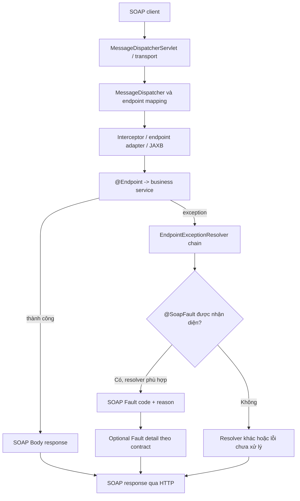
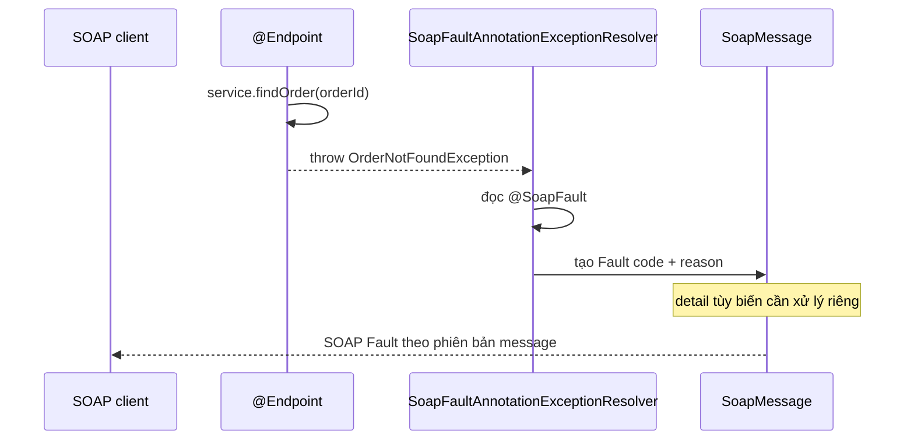
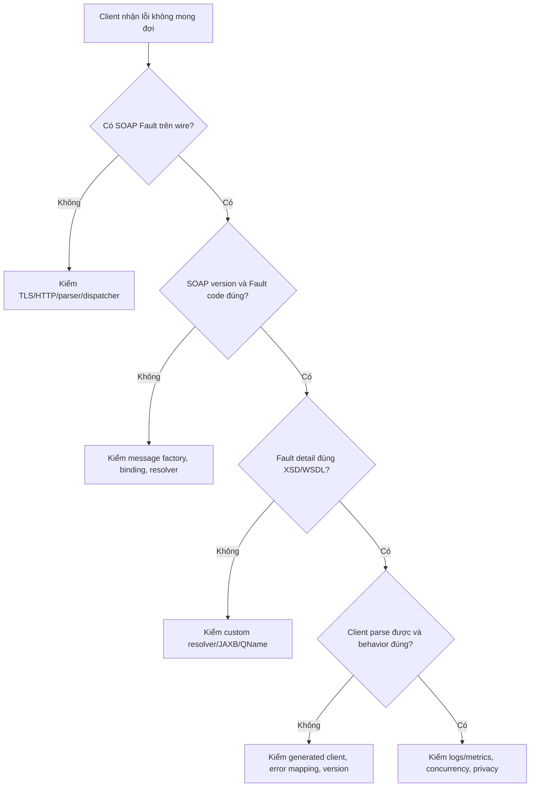

# @SoapFault và SoapFaultAnnotationExceptionResolver

Trong Spring Web Services (Spring-WS), một endpoint SOAP có thể chạy đúng với các request hợp lệ nhưng vẫn không tương thích với đối tác khi xảy ra lỗi. Lý do là **exception Java**, **SOAP Fault trên wire** và **lỗi được công bố trong WSDL** là ba khái niệm khác nhau. Ví dụ `OrderNotFoundException` là lỗi được ném trong Java; đối tác lại chỉ nhìn thấy `soap:Fault` có fault code, fault reason và có thể có `detail` XML theo XSD.

Bài học thuộc chương **SOAP Fault** của module **SPRING_WEB_SERVICES**, tập trung vào hai thành phần:

- **`@SoapFault`**: annotation đánh dấu loại exception Java và cung cấp thông tin để tạo SOAP Fault.
- **`SoapFaultAnnotationExceptionResolver`**: một `EndpointExceptionResolver` của Spring-WS đọc metadata `@SoapFault` khi exception từ endpoint cần được ánh xạ sang SOAP Fault.

Hai cơ chế này đặc biệt hữu ích trong phát triển SOAP **contract-first**, nơi XSD/WSDL định nghĩa tên phần tử, cấu trúc lỗi và giao diện tích hợp trước khi Java endpoint được viết. Nhưng annotation **không tự làm tất cả**: nó không tự sinh `wsdl:fault`, không tự bảo đảm `detail` XML theo XSD, không xử lý mọi lỗi xảy ra ở TLS/parser/interceptor, và không thay thế XML security, WS-Security hay chính sách bảo mật dữ liệu.

Bài viết xây dựng ví dụ tra cứu trạng thái đơn hàng, minh họa SOAP 1.1/1.2, resolver order, tùy biến Fault detail, xử lý lỗi từ các tầng khác nhau và bộ kiểm thử đảm bảo client đọc được kết quả theo hợp đồng.

## 1. Mục tiêu học tập

Sau bài này, bạn có thể:

1. Phân biệt exception Java với SOAP Fault và lỗi được khai báo trong WSDL 1.1.
2. Giải thích các thành phần SOAP Fault trong SOAP 1.1 và SOAP 1.2, đặc biệt fault code, reason và detail.
3. Dùng `@SoapFault` để ánh xạ một exception nghiệp vụ thành lỗi SOAP có mã và thông điệp ổn định.
4. Giải thích vai trò, phạm vi và thứ tự của `SoapFaultAnnotationExceptionResolver` trong chuỗi resolver Spring-WS.
5. Nhận biết giới hạn của `@SoapFault`: lý do tĩnh, detail XML tùy biến, lỗi không vào endpoint và tính tương thích của mã lỗi.
6. Thiết kế WSDL/XSD khai báo lỗi có cấu trúc và xử lý JAXB/QName đúng.
7. Phân biệt lỗi client/sender, server/receiver, schema validation, SOAP protocol, WS-Security và transport.
8. Kiểm thử SOAP Fault trực tiếp từ `MockWebServiceClient`, trên HTTP thật và từ SOAP client.
9. Xây dựng chính sách thông điệp lỗi không tiết lộ stack trace, thông tin nội bộ hay dữ liệu nhạy cảm.

## 2. Bức tranh tổng thể: exception → resolver → SOAP Fault

Khi Spring-WS đã nhận một SOAP request hợp lệ về mặt giao thức và tìm thấy endpoint phù hợp, phần xử lý nghiệp vụ có thể ném exception.



Đây là sơ đồ **chức năng**, không phải lời bảo đảm mọi lỗi đi qua cùng các callback. Với request sai Envelope, không well-formed, TLS handshake fail, không tìm được endpoint hoặc bị HTTP security chặn, luồng có thể dừng **trước khi** `SoapFaultAnnotationExceptionResolver` có cơ hội xử lý.

Các lớp nên được tách riêng:

| Lớp | Chức năng | Ví dụ |
|---|---|---|
| **Java exception** | Biểu diễn lỗi trong code server | `OrderNotFoundException` |
| **Exception resolver** | Quyết định chuyển exception thành SOAP Fault | `SoapFaultAnnotationExceptionResolver` |
| **SOAP Fault** | Thông điệp lỗi SOAP trên wire | `soap:Client`, `faultstring`, `detail` |
| **XSD fault element** | Kiểu XML nghiệp vụ trong `detail` | `ord:OrderNotFoundFault` |
| **WSDL fault declaration** | Công bố lỗi của operation | `wsdl:fault name="OrderNotFound"` |
| **HTTP status** | Kết quả HTTP transport | Thường là lỗi HTTP cho SOAP Fault nhưng phụ thuộc binding |
| **SOAP client exception** | Cách client Java biểu diễn Fault nhận về | `SoapFaultClientException` |

**Quy tắc quan trọng:** WSDL công bố một lỗi không khiến Spring tự phát đúng Fault detail; ngược lại, Spring có thể tạo SOAP Fault cho exception mà WSDL không khai báo rõ. Một hệ thống contract-first cần kiểm tra **cả thông điệp thực tế và hợp đồng**.

## 3. Cấu trúc SOAP Fault 1.1

SOAP 1.1 có namespace Envelope:

```text
http://schemas.xmlsoap.org/soap/envelope/
```

Ví dụ một lỗi yêu cầu tham chiếu đến đơn hàng không tồn tại:

```xml
<soap:Envelope
    xmlns:soap="http://schemas.xmlsoap.org/soap/envelope/"
    xmlns:ord="urn:example:orders:v1">
    <soap:Body>
        <soap:Fault>
            <faultcode>soap:Client</faultcode>
            <faultstring>Requested order was not found</faultstring>
            <detail>
                <ord:OrderNotFoundFault>
                    <ord:code>ORDER_NOT_FOUND</ord:code>
                    <ord:orderId>ORD-404</ord:orderId>
                </ord:OrderNotFoundFault>
            </detail>
        </soap:Fault>
    </soap:Body>
</soap:Envelope>
```

Các thành phần chính:

| Thành phần | Ý nghĩa | Điểm cần kiểm |
|---|---|---|
| `soap:Fault` | Phần tử SOAP Fault trong Body | Thuộc namespace SOAP 1.1 |
| `faultcode` | QName chỉ loại lỗi | Ví dụ `soap:Client` hoặc `soap:Server` |
| `faultstring` | Mô tả lỗi cho người/ứng dụng | Không trả stack trace, SQL, token |
| `faultactor` | Node gây lỗi nếu được cung cấp theo SOAP 1.1 | Không phải field nghiệp vụ |
| `detail` | Chi tiết XML cho lỗi liên quan Body khi thích hợp | Cần đúng XSD/WSDL nếu contract công bố |
| `ord:OrderNotFoundFault` | Phần tử lỗi nghiệp vụ, nằm trong `detail` | QName từ XSD, không tự phát sinh từ annotation |

**Đừng nhầm** `soap:Fault` là thành phần giao thức với `ord:OrderNotFoundFault` là element nghiệp vụ. Kể cả hai dùng chữ “Fault”, chúng có namespace và trách nhiệm khác nhau.

### 3.1. Fault code của SOAP 1.1

Các code chuẩn phổ biến gồm:

- `VersionMismatch`: không hiểu hoặc không hỗ trợ namespace SOAP Envelope nhận được.
- `MustUnderstand`: node xử lý không hiểu header bắt buộc mà nó phải xử lý.
- `Client`: thông điệp bên gửi không hợp lệ/không phù hợp để xử lý theo mô hình lỗi của SOAP 1.1.
- `Server`: phía nhận không thể xử lý do lỗi phía máy chủ hoặc lỗi không thuộc loại `Client`.

Không phân loại mọi `RuntimeException` thành `Client` chỉ vì client đã gửi request. Ví dụ lỗi database, timeout nội bộ hoặc bug không nên bị quy trách nhiệm sang caller. Ngược lại, `OrderNotFound` là lỗi nghiệp vụ, có thể được mô hình hóa thành SOAP Fault thuộc nhóm Client/Sender hoặc response nghiệp vụ thông thường tùy contract đã thống nhất.

### 3.2. Fault code không đồng nghĩa business error code

Trong ví dụ:

```text
SOAP faultcode:          soap:Client
Business fault code:     ORDER_NOT_FOUND
Business detail QName:   {urn:example:orders:v1}OrderNotFoundFault
```

`soap:Client` cho biết **nhóm lỗi theo SOAP**; `ORDER_NOT_FOUND` là **mã lỗi ổn định cho tích hợp nghiệp vụ**. Không nên bắt client suy ra mã nghiệp vụ từ văn bản `faultstring` được viết tự do.

## 4. Cấu trúc SOAP Fault 1.2

SOAP 1.2 sử dụng namespace Envelope:

```text
http://www.w3.org/2003/05/soap-envelope
```

Với lỗi tương đương, cấu trúc Fault **khác** SOAP 1.1:

```xml
<env:Envelope
    xmlns:env="http://www.w3.org/2003/05/soap-envelope"
    xmlns:ord="urn:example:orders:v1">
    <env:Body>
        <env:Fault>
            <env:Code>
                <env:Value>env:Sender</env:Value>
            </env:Code>
            <env:Reason>
                <env:Text xml:lang="en">Requested order was not found</env:Text>
            </env:Reason>
            <env:Detail>
                <ord:OrderNotFoundFault>
                    <ord:code>ORDER_NOT_FOUND</ord:code>
                    <ord:orderId>ORD-404</ord:orderId>
                </ord:OrderNotFoundFault>
            </env:Detail>
        </env:Fault>
    </env:Body>
</env:Envelope>
```

So sánh:

| Ý nghĩa | SOAP 1.1 | SOAP 1.2 |
|---|---|---|
| Namespace Envelope | `http://schemas.xmlsoap.org/soap/envelope/` | `http://www.w3.org/2003/05/soap-envelope` |
| Lỗi phía gửi | `Client` | `Sender` |
| Lỗi phía nhận | `Server` | `Receiver` |
| Fault code | `faultcode` | `Code/Value`, có thể có `Subcode` |
| Lời giải thích | `faultstring` | `Reason/Text` có `xml:lang` |
| Chi tiết | `detail` | `Detail` |
| HTTP content type thường gặp | `text/xml` | `application/soap+xml` |

Một `@SoapFault` không cho phép “đổi SOAP 1.1 thành SOAP 1.2” chỉ bằng cách đổi enum code trong annotation. SOAP version là quyết định của **message factory, binding và transport**. Cấu trúc Fault phát ra phải theo version của thông điệp, và client phải hỗ trợ version đó.

## 5. Hợp đồng XSD cho operation và lỗi có cấu trúc

Xét dịch vụ tra cứu trạng thái đơn hàng có namespace nghiệp vụ `urn:example:orders:v1`. Một XSD tối giản có đủ request, response và fault element:

```xml
<?xml version="1.0" encoding="UTF-8"?>
<xs:schema
    xmlns:xs="http://www.w3.org/2001/XMLSchema"
    xmlns:ord="urn:example:orders:v1"
    targetNamespace="urn:example:orders:v1"
    elementFormDefault="qualified">

    <xs:simpleType name="OrderIdType">
        <xs:restriction base="xs:token">
            <xs:minLength value="1"/>
            <xs:maxLength value="64"/>
        </xs:restriction>
    </xs:simpleType>

    <xs:element name="GetOrderStatusRequest">
        <xs:complexType>
            <xs:sequence>
                <xs:element name="orderId" type="ord:OrderIdType"/>
            </xs:sequence>
        </xs:complexType>
    </xs:element>

    <xs:element name="GetOrderStatusResponse">
        <xs:complexType>
            <xs:sequence>
                <xs:element name="orderId" type="ord:OrderIdType"/>
                <xs:element name="status" type="xs:string"/>
            </xs:sequence>
        </xs:complexType>
    </xs:element>

    <xs:element name="OrderNotFoundFault">
        <xs:complexType>
            <xs:sequence>
                <xs:element name="code" type="xs:string"/>
                <xs:element name="orderId" type="ord:OrderIdType"/>
            </xs:sequence>
        </xs:complexType>
    </xs:element>
</xs:schema>
```

Các expanded QName quan trọng:

```text
Request: {urn:example:orders:v1}GetOrderStatusRequest
Response:{urn:example:orders:v1}GetOrderStatusResponse
Detail:  {urn:example:orders:v1}OrderNotFoundFault
```

Dấu cách và prefix `ord` trong XML chỉ là cách trình bày. Khi JAXB marshal Fault detail, prefix có thể khác nhưng namespace URI/local name và cấu trúc con phải khớp XSD.

### 5.1. XSD khai báo detail, chưa công bố SOAP Fault

XSD đơn độc không nói operation nào có thể phát `OrderNotFoundFault`. WSDL phải nối element vào một `wsdl:message` dùng cho `wsdl:fault`. Nếu dùng code Java có `@SoapFault` nhưng bỏ qua WSDL, đối tác sinh client từ WSDL có thể không nhận biết typed fault tương ứng.

### 5.2. Vì sao dùng business code thay cho exception message?

Một client có thể xử lý:

```text
code == ORDER_NOT_FOUND
```

ổn định hơn nhiều so với:

```text
faultstring == "Requested order was not found"
```

Văn bản reason có thể đổi theo ngôn ngữ, chính sách bảo mật hoặc phiên bản server. Đối tác nên dựa trên mã/kiểu lỗi đã công bố và đúng QName của `detail`, không phụ thuộc văn bản tự do.

## 6. WSDL 1.1 khai báo lỗi của operation

WSDL 1.1 kết nối request/response và lỗi nghiệp vụ với schema. Đoạn sau minh họa các `wsdl:message`, `wsdl:portType` và `wsdl:binding` liên quan:

```xml
<wsdl:definitions
    xmlns:wsdl="http://schemas.xmlsoap.org/wsdl/"
    xmlns:soap="http://schemas.xmlsoap.org/wsdl/soap/"
    xmlns:ord="urn:example:orders:v1"
    xmlns:tns="urn:example:orders:wsdl:v1"
    targetNamespace="urn:example:orders:wsdl:v1">

    <!-- Trong WSDL hoàn chỉnh, wsdl:types import XSD tương ứng. -->

    <wsdl:message name="GetOrderStatusInput">
        <wsdl:part name="parameters"
                   element="ord:GetOrderStatusRequest"/>
    </wsdl:message>

    <wsdl:message name="GetOrderStatusOutput">
        <wsdl:part name="parameters"
                   element="ord:GetOrderStatusResponse"/>
    </wsdl:message>

    <wsdl:message name="OrderNotFoundMessage">
        <wsdl:part name="fault"
                   element="ord:OrderNotFoundFault"/>
    </wsdl:message>

    <wsdl:portType name="OrdersPortType">
        <wsdl:operation name="GetOrderStatus">
            <wsdl:input message="tns:GetOrderStatusInput"/>
            <wsdl:output message="tns:GetOrderStatusOutput"/>
            <wsdl:fault name="OrderNotFound"
                        message="tns:OrderNotFoundMessage"/>
        </wsdl:operation>
    </wsdl:portType>

    <wsdl:binding name="OrdersSoapBinding"
                  type="tns:OrdersPortType">
        <soap:binding
            style="document"
            transport="http://schemas.xmlsoap.org/soap/http"/>

        <wsdl:operation name="GetOrderStatus">
            <soap:operation
                soapAction="urn:example:orders:GetOrderStatus"/>
            <wsdl:input>
                <soap:body use="literal"/>
            </wsdl:input>
            <wsdl:output>
                <soap:body use="literal"/>
            </wsdl:output>
            <wsdl:fault name="OrderNotFound">
                <soap:fault name="OrderNotFound" use="literal"/>
            </wsdl:fault>
        </wsdl:operation>
    </wsdl:binding>
</wsdl:definitions>
```

Đây là **trích đoạn WSDL**, chưa có `wsdl:types` hoàn chỉnh, `wsdl:service`, `wsdl:port` và `soap:address`. Hãy công bố WSDL/XSD đủ các import và URL thực tế.

Bảng liên kết:

| Thành phần WSDL | Tham chiếu | Ý nghĩa |
|---|---|---|
| `wsdl:operation GetOrderStatus` | Input/Output/Fault | Hợp đồng của một operation |
| `wsdl:input` | `GetOrderStatusInput` | SOAP Body request |
| `wsdl:output` | `GetOrderStatusOutput` | SOAP Body response bình thường |
| `wsdl:fault OrderNotFound` | `OrderNotFoundMessage` | Lỗi được công bố của operation |
| `wsdl:part element="ord:OrderNotFoundFault"` | Global XSD element | Nội dung chi tiết nghiệp vụ trong SOAP Fault |
| `soap:fault use="literal"` | Binding SOAP 1.1 | Cách ràng buộc Fault trên wire |

**Một lỗi thực thi không khai báo trong WSDL** vẫn có thể xảy ra (ví dụ lỗi server nội bộ). Tuy nhiên, không nên biến ngẫu nhiên mọi exception thành Fault detail có QName tự tạo; typed faults công khai cần được thiết kế và versioning có chủ đích.

## 7. `@SoapFault` là gì?

`@SoapFault` là annotation của Spring-WS đặt lên **lớp exception Java** để khai báo metadata cần dùng khi lỗi ấy trở thành SOAP Fault.

Ví dụ khai báo:

```java
package org.example.orders.fault;

import org.springframework.ws.soap.server.endpoint.annotation.FaultCode;
import org.springframework.ws.soap.server.endpoint.annotation.SoapFault;

@SoapFault(
    faultCode = FaultCode.CLIENT,
    faultStringOrReason = "Requested order was not found",
    locale = "en"
)
public class OrderNotFoundException extends RuntimeException {

    private final String orderId;

    public OrderNotFoundException(String orderId) {
        super("Order not found");
        this.orderId = orderId;
    }

    public String getOrderId() {
        return orderId;
    }
}
```

Ở đây:

- `@SoapFault` gắn trên **exception type**, không gắn lên `@Endpoint` method như `@PayloadRoot`.
- `faultCode` chỉ loại lỗi SOAP ở mức protocol.
- `faultStringOrReason` cung cấp một lời giải thích ổn định, không phải raw `Exception.getMessage()` từ mọi hệ thống nội bộ.
- `locale` liên quan ngôn ngữ của reason khi dùng cách biểu diễn phù hợp; ý nghĩa trên wire có khác biệt theo SOAP version.
- `orderId` được giữ trong exception để xử lý logic nội bộ; **annotation một mình không serialize `orderId` thành Fault detail**.
- Dùng `getOrderId()` không có nghĩa JAXB đã biết cách marshal exception; exception Java không phải XML data contract.

**Lưu ý phiên bản:** ví dụ sử dụng API annotation của Spring-WS thuộc stack hiện đại. Khi áp dụng vào project, kiểm tra đúng package `FaultCode` và thuộc tính annotation theo phiên bản Spring-WS mà Maven/Gradle đã resolve, không trộn API của thế hệ `javax`/`jakarta` không tương thích.

### 7.1. Tại sao reason nên cố định và an toàn?

Không làm:

```java
throw new RuntimeException(
    "SQL error for user=" + customerEmail
        + " password=" + secret
);
```

rồi đẩy nguyên message vào SOAP Fault. Exception message có thể chứa email, SQL, đường dẫn, host nội bộ hoặc nội dung không được phép tiết lộ.

`faultStringOrReason` trên annotation phù hợp với một mô tả **cố định, đã thẩm định** cho loại lỗi. Nếu cần reason phụ thuộc ngôn ngữ hoặc business code/ID động, hãy thiết kế **resolver tùy biến** hoặc lớp error mapping rõ ràng, không concat tùy tiện dữ liệu thô vào fault reason.

### 7.2. `@SoapFault` không phải `@ResponseStatus` hay `@ExceptionHandler`

| Cơ chế | Nơi thường dùng | Mục đích |
|---|---|---|
| `@SoapFault` | Exception class cho Spring-WS | Metadata để tạo SOAP Fault |
| `SoapFaultAnnotationExceptionResolver` | Spring-WS server infrastructure | Ánh xạ exception có annotation thành SOAP Fault |
| `@ExceptionHandler` | Spring MVC controller advice/model | Xử lý exception trong HTTP/MVC, không mặc nhiên là SOAP Fault |
| `@ResponseStatus` | Spring MVC/HTTP | Trạng thái HTTP, không tự tạo SOAP Fault XML |
| `@PayloadRoot` | Spring-WS endpoint method | Định tuyến SOAP Body payload theo QName |

Một ứng dụng có cả REST và SOAP cần **hai tầng exception handling được thiết kế riêng**. Không kỳ vọng `@ControllerAdvice` của REST tự xử lý mọi exception từ `@Endpoint`.

## 8. `SoapFaultAnnotationExceptionResolver`: trách nhiệm và phạm vi

`SoapFaultAnnotationExceptionResolver` là một resolver của Spring-WS chuyên tra metadata `@SoapFault` trên loại exception phù hợp để tạo SOAP Fault.

Quy trình khái quát:



Nó không làm những việc sau theo mặc định chỉ vì exception có annotation:

- Sinh `wsdl:fault` hoặc sửa XSD/WSDL đã công bố.
- Tạo `ord:OrderNotFoundFault` có đầy đủ `code` và `orderId` từ getter exception.
- Tự xác định business code chuẩn hóa theo contract nếu code đó chưa được cấu hình.
- Bảo đảm HTTP status hoặc chuỗi reason giống nhau ở mọi SOAP version.
- Xác thực XML Signature hoặc UsernameToken của request.
- Xử lý lỗi xảy ra khi kết nối TLS chưa được thiết lập.
- Thay thế `PayloadValidatingInterceptor` để kiểm mọi ràng buộc XSD.

Đặc biệt, `@SoapFault` cần một resolver thích hợp trong **Spring application context**; chỉ thêm annotation vào exception không đủ nếu resolver đó không được đăng ký hoặc bị một resolver khác xử lý trước.

## 9. Cấu hình resolver trong Spring-WS

Giả sử ứng dụng dùng `@EnableWs`, `MessageDispatcherServlet` hoặc auto-configuration tương thích và đã đăng ký `@Endpoint`.

Một cấu hình rõ ràng có thể khai báo:

```java
package org.example.orders.config;

import org.springframework.context.annotation.Bean;
import org.springframework.context.annotation.Configuration;
import org.springframework.ws.soap.server.endpoint.SoapFaultAnnotationExceptionResolver;

@Configuration
public class SoapFaultConfiguration {

    @Bean
    public SoapFaultAnnotationExceptionResolver
            soapFaultAnnotationExceptionResolver() {

        SoapFaultAnnotationExceptionResolver resolver =
            new SoapFaultAnnotationExceptionResolver();

        resolver.setOrder(1);
        return resolver;
    }
}
```

`setOrder(1)` chỉ minh họa cơ chế thứ tự. **Không có số thứ tự tốt cho mọi ứng dụng**: phải biết những resolver khác trong context và thứ tự ưu tiên mà chúng dùng. Nếu stack Spring-WS hiện tại đã auto-register một `SoapFaultAnnotationExceptionResolver` phù hợp, **không đăng ký trùng**; thay vào đó xác minh cấu hình và điều chỉnh theo cách framework khuyến nghị.

### 9.1. Đừng nhầm `@EnableWs` với mọi bean Fault resolver

`@EnableWs` phục vụ hạ tầng xử lý Spring-WS theo annotation. Mức độ auto-registration các resolver/strategy có thể phụ thuộc version và cấu hình. Vì vậy, khi một exception không tạo đúng SOAP Fault:

1. Xác nhận method `@Endpoint` thực sự được gọi.
2. Xác nhận exception đã được ném đến tầng dispatch, không bị business code bắt rồi chuyển thành loại khác.
3. Xác nhận resolver phù hợp có mặt trong context.
4. Kiểm tra resolver khác có nhận exception trước và tạo Fault khác hay không.
5. Kiểm tra exception class thực tế có `@SoapFault` đúng metadata hay không.
6. Kiểm tra SOAP version và message factory.
7. Test SOAP XML thực tế, không chỉ assert một exception trong unit test Java.

Không nên giải quyết mọi lỗi bằng cách thêm nhiều `@Bean SoapFaultAnnotationExceptionResolver`; có thể tạo ưu tiên không mong muốn.

### 9.2. Scope của resolver

Resolver là thành phần Spring thường dùng chung, vì vậy code tùy biến **không giữ currentRequest/currentFault/currentException trong instance field mutable**. Các method xử lý request phải tạo detail, correlation ID và thông tin xử lý riêng cho từng lần gọi.

## 10. Resolver order và tương tác với các loại resolver khác

Spring-WS có thể có nhiều `EndpointExceptionResolver`; một loại lỗi có thể phù hợp với nhiều resolver khác nhau.

Một số cơ chế thường gặp:

| Resolver | Cách xác định Fault | Trường hợp sử dụng |
|---|---|---|
| `SoapFaultAnnotationExceptionResolver` | Đọc `@SoapFault` trên exception type | Lỗi nghiệp vụ đơn giản, fault code/reason ổn định |
| `SoapFaultMappingExceptionResolver` | Khai báo mapping exception → FaultDefinition | Tập trung cấu hình lỗi, không cần annotation mọi class |
| `SimpleSoapExceptionResolver` | Fallback biến exception thành server Fault | Lỗi không có mapping nghiệp vụ cụ thể |
| Custom `EndpointExceptionResolver` | Logic riêng dựa trên exception/context | Typed Fault detail, business error code/metadata đặc thù |

Một chuỗi resolver minh họa:

```text
Exception từ endpoint
    |
    v
Resolver nghiệp vụ chuyên biệt (nếu có)
    |
    +-- xử lý được --> SOAP Fault có detail theo XSD
    |
    v
SoapFaultAnnotationExceptionResolver
    |
    +-- nhận @SoapFault --> Fault code/reason
    |
    v
Fallback resolver
    |
    +-- server error --> Fault chung, không lộ nội bộ
```

**Thứ tự ưu tiên** có thể là điểm quyết định. Trong cơ chế Spring `Ordered`, giá trị order nhỏ hơn thường có ưu tiên cao hơn; tuy nhiên danh sách strategy thực tế cần được kiểm tra ở context. Một fallback quá rộng, chạy trước annotation resolver, có thể “nuốt” tất cả exception và khiến `@SoapFault` dường như không hoạt động.

### 10.1. Mapping lỗi cụ thể trước fallback

Nên tách các nhóm:

- **Business contract faults**: `OrderNotFoundException`, `InvalidOrderStateException` nếu WSDL công bố kiểu lỗi tương ứng.
- **Validation/request faults**: payload sai XSD hoặc policy dữ liệu; có thể được interceptor xử lý.
- **Security faults**: token/chữ ký/authorization sai; xử lý ở security/transport layer theo policy.
- **Unexpected server faults**: timeout database, lỗi hệ thống, bug; trả thông điệp chung, log nội bộ an toàn.

Không dùng resolver “bắt tất cả” để biến mọi exception thành `soap:Client`/`env:Sender`. Điều đó gây sai phân loại, ảnh hưởng retry và có thể che vấn đề hệ thống.

### 10.2. Chưa có endpoint thì resolver nào chạy?

Nếu `@PayloadRoot` không tìm được endpoint vì namespace sai, đường lỗi có thể **không phải** exception do method endpoint ném. `EndpointExceptionResolver` dành cho exception trong quá trình endpoint dispatch không được bảo đảm xử lý mọi lỗi trước đó.

Với các tình huống “No endpoint mapping found”, malformed XML, SOAP version mismatch hoặc TLS 401/403, cần kiểm log/metrics ở lớp tương ứng, thay vì chỉ sửa `@SoapFault`.

## 11. Xây dựng endpoint ném lỗi nghiệp vụ

Ví dụ service tra cứu được inject vào SOAP endpoint:

```java
import org.springframework.ws.server.endpoint.annotation.Endpoint;
import org.springframework.ws.server.endpoint.annotation.PayloadRoot;
import org.springframework.ws.server.endpoint.annotation.RequestPayload;
import org.springframework.ws.server.endpoint.annotation.ResponsePayload;

@Endpoint
public final class OrderEndpoint {

    private static final String ORDER_NS =
        "urn:example:orders:v1";

    private final OrderQueryService service;

    public OrderEndpoint(OrderQueryService service) {
        this.service = service;
    }

    @PayloadRoot(
        namespace = ORDER_NS,
        localPart = "GetOrderStatusRequest"
    )
    @ResponsePayload
    public GetOrderStatusResponse getStatus(
            @RequestPayload GetOrderStatusRequest request) {

        String orderId = request.getOrderId();

        return service.findStatus(orderId)
            .orElseThrow(
                () -> new OrderNotFoundException(orderId)
            );
    }
}
```

Đây là ví dụ về **logic endpoint**, giả định:

- `OrderQueryService.findStatus(orderId)` trả `Optional<GetOrderStatusResponse>`.
- `GetOrderStatusRequest`/`GetOrderStatusResponse` là lớp JAXB sinh theo XSD và được endpoint adapter hỗ trợ.
- `OrderNotFoundException` được import từ package nghiệp vụ ở mục 7.
- Hạ tầng `@EnableWs`, servlet mapping, JAXB runtime và resolver đã được cấu hình.

Điểm cần nắm: exception được ném tại **ranh giới nghiệp vụ**, không phải bằng cách trả một object Java `Exception` rồi hy vọng JAXB serialize thành SOAP Fault.

### 11.1. Không biến mọi lỗi thành `OrderNotFoundException`

Không làm:

```java
try {
    return service.findStatus(orderId).orElseThrow();
} catch (Exception ex) {
    throw new OrderNotFoundException(orderId);
}
```

Cách bắt quá rộng sẽ biến lỗi database, permission, bug và timeout thành “không tìm thấy đơn”. Client có thể quyết định không retry, trong khi lỗi thực tế là server đang hỏng. Chỉ chuyển exception khi hiểu **chính xác ngữ nghĩa lỗi gốc**.

### 11.2. Lỗi domain có thể là response bình thường

Không phải mọi trạng thái “không tìm thấy” bắt buộc là SOAP Fault. Nếu hợp đồng định nghĩa:

```xml
<ord:GetOrderStatusResponse>
    <ord:found>false</ord:found>
</ord:GetOrderStatusResponse>
```

thì đây có thể là **business response**, không phải Fault. Hãy dựa vào semantics và WSDL/XSD đã phê duyệt, tránh áp đặt ý tưởng HTTP 404 trực tiếp lên SOAP mà không thống nhất với đối tác.

## 12. `@SoapFault` trả Fault code/reason; còn `detail` thì sao?

Giới hạn quan trọng nhất là: `@SoapFault` mô tả Fault ở mức code/reason, **không tự marshal các field trong exception thành XML detail**.

Nếu WSDL khai báo:

```xml
<xs:element name="OrderNotFoundFault">
    <xs:complexType>
        <xs:sequence>
            <xs:element name="code" type="xs:string"/>
            <xs:element name="orderId" type="xs:string"/>
        </xs:sequence>
    </xs:complexType>
</xs:element>
```

thì client kỳ vọng một entry trong `detail` có dạng:

```xml
<ord:OrderNotFoundFault xmlns:ord="urn:example:orders:v1">
    <ord:code>ORDER_NOT_FOUND</ord:code>
    <ord:orderId>ORD-404</ord:orderId>
</ord:OrderNotFoundFault>
```

Chỉ dùng:

```java
@SoapFault(
    faultCode = FaultCode.CLIENT,
    faultStringOrReason = "Requested order was not found"
)
```

**không đủ** để bảo đảm entry trên được tạo. Cần một resolver tùy biến/extension point phù hợp để thêm XML detail, hoặc dùng một handler SOAP Fault chuyên biệt.

### 12.1. Hai thiết kế hợp lệ nhưng khác nhau

**Thiết kế A — Fault đơn giản không có typed detail:** hợp đồng chỉ dựa trên Fault code và reason chung, không công bố lỗi nghiệp vụ có cấu trúc. Dùng `@SoapFault` phù hợp khi các bên chấp nhận điều đó. Ưu điểm ít code; hạn chế client khó phân biệt lỗi nghiệp vụ bằng mã ổn định nếu không có detail.

**Thiết kế B — WSDL declared fault có typed detail:** contract công bố global element `OrderNotFoundFault` và `wsdl:fault`; server tạo detail có QName, thứ tự, datatype đúng schema. Ưu điểm client mạnh hơn trong xử lý lỗi; đổi lại phải triển khai, version và test lỗi như một phần API.

Không viết WSDL theo B rồi triển khai chỉ A mà tuyên bố đã tuân hợp đồng.

### 12.2. Vì sao không dùng `faultstring` để nhét JSON/XML?

Ví dụ phản mẫu:

```text
faultstring = "{code:ORDER_NOT_FOUND,orderId:ORD-404}"
```

Lý do không nên:

- `faultstring` là **text reason**, không phải typed XML element theo XSD.
- Client WSDL-generated không có class typed fault để đọc cấu trúc này.
- Ký tự, escape, bản địa hóa và format lỗi dễ biến đổi.
- Có thể đưa lộ dữ liệu nhạy cảm nếu concatenate exception message.
- Không phải SOAP 1.1/1.2 fault detail đúng contract.

Nếu cần machine-readable fields, đặt chúng trong `detail` với QName và XSD rõ ràng.

## 13. Tùy biến `SoapFaultAnnotationExceptionResolver` để thêm Fault detail

Trong một số phiên bản Spring-WS, `SoapFaultAnnotationExceptionResolver` kế thừa các điểm mở rộng của `AbstractSoapFaultDefinitionExceptionResolver`, điển hình là `customizeFault(Object endpoint, Exception ex, SoapFault fault)`.

Một **khung minh họa**:

```java
import org.springframework.ws.soap.SoapFault;
import org.springframework.ws.soap.server.endpoint.SoapFaultAnnotationExceptionResolver;

public class ContractSoapFaultResolver
        extends SoapFaultAnnotationExceptionResolver {

    @Override
    protected void customizeFault(
            Object endpoint, Exception ex, SoapFault fault) {

        if (!(ex instanceof OrderNotFoundException orderEx)) {
            return;
        }

        // Tạo detail theo XSD của OrderNotFoundFault.
        // Không dùng exception.getMessage() làm XML/raw log.
        writeOrderNotFoundDetail(fault, orderEx.getOrderId());
    }

    private void writeOrderNotFoundDetail(
            SoapFault fault, String orderId) {

        // Pseudocode: dùng SoapFaultDetail + JAXB
        // hoặc XML writer có namespace-aware mapping.
        // Mục tiêu trên wire:
        // <ord:OrderNotFoundFault>
        //   <ord:code>ORDER_NOT_FOUND</ord:code>
        //   <ord:orderId>...</ord:orderId>
        // </ord:OrderNotFoundFault>
    }
}
```

**Chú ý:** method `writeOrderNotFoundDetail` ở ví dụ là **placeholder có chủ đích** cho code phụ thuộc mô hình JAXB/XSD và API SOAP detail thực tế; đoạn trên chưa phải resolver hoàn chỉnh để đưa vào production. Đây là bước mở rộng phải được hiện thực và kiểm thử, không phải hành vi có sẵn của annotation.

Có thể dùng các API liên quan:

```java
org.springframework.ws.soap.SoapFault
org.springframework.ws.soap.SoapFaultDetail
org.springframework.ws.soap.SoapFaultDetailElement
jakarta.xml.bind.Marshaller
javax.xml.namespace.QName
```

Ý tưởng triển khai chuẩn:

1. **Chỉ thêm detail** cho exception đã được ánh xạ thành lỗi nghiệp vụ đã công bố.
2. Tạo một `SoapFaultDetail` cho response hiện tại.
3. Tạo/marshal global element `OrderNotFoundFault` với QName chính xác `{urn:example:orders:v1}OrderNotFoundFault`.
4. Điền `code` và `orderId` qua JAXB/DOM/StAX namespace-aware với dữ liệu đã chuẩn hóa, không string-concatenate XML từ input không tin cậy.
5. Đảm bảo **một lớp wrapper detail** đúng XSD, các child theo `xs:sequence`.
6. Không thêm detail vào một `SoapFault` đã có detail theo cách tạo nhiều element ngoài ý muốn.
7. Test output bằng XML parser namespace-aware và XSD, không so raw prefix XML.
8. Không dùng field singleton như `lastOrderId` để lưu dữ liệu của exception hiện tại.

### 13.1. Đừng tạo cấu trúc detail sai tầng

Sai về hợp đồng nếu client mong wrapper `ord:OrderNotFoundFault`:

```xml
<detail>
    <ord:code xmlns:ord="urn:example:orders:v1">
        ORDER_NOT_FOUND
    </ord:code>
    <ord:orderId xmlns:ord="urn:example:orders:v1">
        ORD-404
    </ord:orderId>
</detail>
```

Ví dụ trên có hai entry trực tiếp ở `detail`, không có element wrapper `OrderNotFoundFault` như XSD/WSDL đã công bố. Client generated có thể không parse được thành typed fault.

Đúng:

```xml
<detail>
    <ord:OrderNotFoundFault xmlns:ord="urn:example:orders:v1">
        <ord:code>ORDER_NOT_FOUND</ord:code>
        <ord:orderId>ORD-404</ord:orderId>
    </ord:OrderNotFoundFault>
</detail>
```

**Cần chú ý:** `detail` nằm trong cấu trúc SOAP 1.1; ở SOAP 1.2 tương ứng là `env:Detail`. Thư viện SOAP API nên tạo phần cấu trúc giao thức, code nghiệp vụ chỉ chịu trách nhiệm detail đúng XSD.

### 13.2. Cấu hình resolver tùy biến

Khi cần dùng class `ContractSoapFaultResolver` ở trên thay resolver annotation mặc định:

```java
import org.springframework.context.annotation.Bean;
import org.springframework.context.annotation.Configuration;

@Configuration
public class ContractFaultConfiguration {

    @Bean
    public ContractSoapFaultResolver contractSoapFaultResolver() {
        ContractSoapFaultResolver resolver =
            new ContractSoapFaultResolver();

        resolver.setOrder(1);
        return resolver;
    }
}
```

Chọn **một chiến lược resolver rõ ràng**, tránh đăng ký một resolver mặc định chạy trước và xử lý exception rồi khiến `customizeFault` của resolver tùy biến không bao giờ được gọi.

Khung ví dụ chỉ minh họa extension point; trong code thực, bổ sung logic marshal detail, dependency/serializer được inject, test exception mapping và cấu hình thứ tự với các resolver khác. Đừng bỏ qua việc hoàn thiện method còn trống mà báo service đã hỗ trợ typed faults.

## 14. Exception có nhiều tầng và lỗi bị bọc

Trong hệ thống doanh nghiệp, exception thường đi qua service, transaction proxy và endpoint adapter. Ví dụ:

```text
OrderEndpoint
    -> OrderService
       -> Repository
          -> DataAccessException
```

Một exception ở tầng dưới có thể bị wrap thành `RuntimeException` hoặc exception có cause, làm mất type `OrderNotFoundException` vốn được gắn `@SoapFault`.

Đừng mặc định resolver annotation sẽ **luôn duyệt toàn bộ chuỗi `getCause()`** và lấy annotation ở exception nguyên thủy. Behavior có thể phụ thuộc implementation và version. Tốt hơn:

- Giữ **exception domain cụ thể** khi đi qua lớp service nếu đó thực sự là lỗi có thể công bố.
- Định nghĩa policy chuyển lỗi ở ranh giới service/endpoint và giữ cause nội bộ khi cần chẩn đoán.
- Test trường hợp exception được bọc để biết resolver nhận loại nào.
- Không unwrap mọi exception rồi trả raw message, đặc biệt lỗi database/security.
- Đừng dùng một exception có `@SoapFault(faultCode=CLIENT)` làm wrapper chung cho cả lỗi nghiệp vụ lẫn lỗi server.

Ví dụ:

```java
throw new OrderNotFoundException(orderId);
```

đúng nếu không tồn tại đơn. Nhưng:

```java
throw new IllegalStateException(
    "Cannot read database", repositoryFailure
);
```

nên được xử lý như lỗi phía server bởi fallback/error policy, không phải tự đổi thành “Order not found”.

## 15. Fault từ XSD validation và interceptor có đi qua resolver không?

Một nhầm lẫn phổ biến là nghĩ: “Tôi đã annotate `InvalidPayloadException` bằng `@SoapFault`, vậy mọi XML sai schema sẽ trở thành Fault đó.” Thực tế, XML có thể bị từ chối **trước khi endpoint Java được gọi**.

Trong Spring-WS, `PayloadValidatingInterceptor` có thể xác thực Body payload theo XSD:

```java
import java.util.List;

import org.springframework.context.annotation.Configuration;
import org.springframework.ws.config.annotation.WsConfigurer;
import org.springframework.ws.server.EndpointInterceptor;
import org.springframework.ws.soap.server.endpoint.interceptor.PayloadValidatingInterceptor;
import org.springframework.xml.xsd.XsdSchema;

@Configuration
public class SoapValidationConfiguration implements WsConfigurer {

    private final XsdSchema schema;

    public SoapValidationConfiguration(XsdSchema schema) {
        this.schema = schema;
    }

    @Override
    public void addInterceptors(List<EndpointInterceptor> list) {
        PayloadValidatingInterceptor validator =
            new PayloadValidatingInterceptor();

        validator.setXsdSchema(schema);
        validator.setValidateRequest(true);
        validator.setValidateResponse(true);
        list.add(validator);
    }
}
```

Khi request có root QName đúng nhưng thiếu `orderId` hoặc sai namespace child, interceptor có thể tạo Fault theo behavior của nó mà **không ném `OrderNotFoundException`**. Do đó `@SoapFault` của exception nghiệp vụ không quyết định nội dung lỗi validation.

Trường hợp khác:

| Trường hợp | Lớp xử lý đầu tiên có thể chịu trách nhiệm | Có chắc `SoapFaultAnnotationExceptionResolver` nhận? |
|---|---|---|
| `OrderNotFoundException` từ method endpoint | Endpoint exception resolution | **Có thể**, nếu resolver áp dụng và không bị resolver khác xử lý trước |
| XSD Body validation failure | Validation interceptor | **Không chắc**, có thể tự tạo SOAP Fault |
| SOAP Header `mustUnderstand` không được xử lý | SOAP processing/message factory | **Không chắc**, protocol Fault |
| SOAP Envelope sai version | SOAP parser/message factory | **Không chắc**, trước endpoint |
| Root QName sai, không tìm endpoint | Endpoint mapping | **Không chắc**, chưa có endpoint để resolve |
| WS-Security Signature invalid | Security interceptor | **Không chắc**, security policy xử lý |
| HTTP 401/403 hoặc mTLS fail | Transport/security filter | **Không**, có thể chưa có SOAP message |
| Backend timeout trong service | Endpoint exception resolution hoặc fallback | Tùy error handling chain |

**Không buộc mọi đường lỗi đi qua một resolver annotation.** Thiết kế một **error taxonomy** chung, nhưng triển khai ở tầng phù hợp và test Fault trên wire cho từng tầng.

## 16. Lỗi SOAP Header, MustUnderstand và WS-Security

SOAP Header chứa các block tùy chọn hoặc bắt buộc, ví dụ `wsa:Action` và `wsse:Security`. Một header có `mustUnderstand="1"` được nhắm tới node mà node không xử lý theo yêu cầu thường dẫn tới **MustUnderstand Fault** ở mức protocol.

Ví dụ SOAP 1.1:

```xml
<soap:Header
    xmlns:soap="http://schemas.xmlsoap.org/soap/envelope/"
    xmlns:ctx="urn:example:context:v1">
    <ctx:CriticalPolicy soap:mustUnderstand="1">
        <ctx:mode>strict</ctx:mode>
    </ctx:CriticalPolicy>
</soap:Header>
```

Nếu node nhận không hiểu `ctx:CriticalPolicy` nhưng có trách nhiệm xử lý nó, việc phản hồi không chỉ là ném tùy tiện `OrderNotFoundException`. Phải tuân theo SOAP processing model và Fault code `MustUnderstand` tương ứng.

Với WS-Security, cần tách:

- **Xác thực token**: UsernameToken, certificate, authentication callback.
- **Toàn vẹn**: XML Signature, signed parts, canonicalization, key/trust policy.
- **Thời gian và replay**: Timestamp, nonce, clock skew, replay cache.
- **Phân quyền nghiệp vụ**: identity đã xác thực có được truy cập order/tenant đó hay không.

`@SoapFault` không thay WS-Security interceptor/WSS4J và không làm chữ ký hợp lệ. Một request có XML/XSD hợp lệ nhưng chữ ký sai vẫn phải bị chặn trước khi có side effect nghiệp vụ.

### 16.1. Không lộ chi tiết lỗi bảo mật

Đối với security failure, việc trả về “private key alias X chưa được nạp”, “expected signature digest là Y” hoặc token đầu vào có thể giúp attacker. Policy thường nên phản hồi lỗi an toàn ở mức khái quát, trong khi log nội bộ được bảo vệ chứa code/correlation ID để điều tra.

Không sử dụng chung `OrderNotFoundException` để che mọi lỗi security: như vậy có thể làm client hiểu sai trạng thái và triệt tiêu cảnh báo cần thiết.

## 17. SoapFaultAnnotationExceptionResolver và concurrency

Resolver thường là bean singleton được nhiều thread gọi trong thời gian server phục vụ đồng thời. Vì thế thiết kế extension như `ContractSoapFaultResolver` phải không giữ **request state** ở field.

Sai:

```java
public class UnsafeFaultResolver
        extends SoapFaultAnnotationExceptionResolver {

    private String lastOrderId;

    // Một request ghi lastOrderId, request khác ghi đè.
    // Fault detail có thể chứa ID của khách hàng khác.
}
```

Đúng về nguyên tắc:

```java
@Override
protected void customizeFault(
        Object endpoint, Exception ex, SoapFault fault) {

    if (ex instanceof OrderNotFoundException notFound) {
        String orderId = notFound.getOrderId();
        // Tạo một detail element mới cho fault hiện tại,
        // dùng biến cục bộ orderId.
    }
}
```

Với các helper:

- JAXB `JAXBContext` có thể dùng lại metadata; JAXB `Marshaller`/`Unmarshaller` không nên chia sẻ cùng instance đồng thời.
- Spring `Jaxb2Marshaller` có thể dùng như bean đã cấu hình, nếu adapter/listener phụ thuộc an toàn.
- XML `Source`/`Result`, writer, buffer và detail XML thuộc lời gọi hiện tại.
- `ThreadLocal` cần cleanup đầy đủ khi dùng thread pool, không là nguồn thông tin request lâu dài.
- Correlation ID nên được truyền qua message/request context phù hợp, không lưu `currentCorrelationId` trong resolver singleton.
- Không cache một `SoapFaultDetailElement` mutable rồi tái sử dụng cho nhiều response.

Một SOAP Fault sai `orderId` có thể là **rò dữ liệu chéo khách hàng**, không chỉ là lỗi nội dung thông thường.

## 18. Bảo mật nội dung SOAP Fault: trả cái gì và giấu cái gì?

Một Fault hữu ích với đối tác cần **đủ thông tin để xử lý**, nhưng không cần toàn bộ chi tiết hệ thống.

| Nên trả khi phù hợp contract | Không nên trả |
|---|---|
| SOAP fault code chuẩn | Java stack trace |
| Reason ổn định, an toàn | SQL query, schema nội bộ |
| Business error code như `ORDER_NOT_FOUND` | Password, token, private key |
| Field/path đã chuẩn hóa nếu cần | Raw request body chứa PII |
| Correlation ID đã kiểm soát format | Host nội bộ, filesystem path, thông tin khai thác |
| Typed Fault detail theo XSD | Exception class name/chain tùy ý |
| Mã retryability theo policy nếu công bố | Nội dung database exception thô |

### 18.1. Không phản hồi toàn bộ `ex.getMessage()`

Thông điệp exception thường được viết để debug nội bộ, không phải API contract. Trong thực tế nó có thể chứa email, order ID của tenant khác hoặc chuỗi do database/library trả về.

Nếu muốn reason có ngữ cảnh, chỉ đưa **dữ liệu có chủ đích được phép công bố**; còn nếu client cần xử lý bằng máy, đặt dữ liệu trong typed `detail` và quy định access control.

### 18.2. Logging Fault cũng cần kiểm soát

`PayloadLoggingInterceptor` hoặc `SoapEnvelopeLoggingInterceptor` có thể ghi payload/Envelope ở những giai đoạn nhất định. SOAP Fault detail có thể mang dữ liệu nghiệp vụ hoặc đầu vào lỗi. Không bật raw Fault logging toàn hệ thống production chỉ để chẩn đoán.

Vận hành nên ghi mã lỗi, operation/QName đã xác định, correlation ID đã lọc, duration và nơi phát sinh (validation/business/security/server) thay vì raw XML. Với sự cố nghiêm trọng, thực hiện chụp thông điệp có kiểm soát, giới hạn thời gian và retention.

## 19. Kiểm thử `@SoapFault` và resolver ở cấp Spring-WS

Unit test một phương thức Java chỉ xác minh exception được ném; nó **không chứng minh** SOAP Fault đúng cấu trúc. Cần test qua Spring-WS dispatcher.

### 19.1. Kiểm tra Fault code qua `MockWebServiceClient`

Giả sử Spring application context có:

- `@EnableWs` và endpoint `OrderEndpoint`.
- Resolver annotation hoặc custom resolver phù hợp.
- JAXB/OXM mapping cho `GetOrderStatusRequest`.
- Service trả empty result với `ORD-404`.

Test mức ý tưởng:

```java
import static org.springframework.ws.test.server.RequestCreators.withPayload;
import static org.springframework.ws.test.server.ResponseMatchers.clientOrSenderFault;

import org.junit.jupiter.api.Test;
import org.springframework.beans.factory.annotation.Autowired;
import org.springframework.context.ApplicationContext;
import org.springframework.xml.transform.StringSource;
import org.springframework.ws.test.server.MockWebServiceClient;

class OrderFaultTest {

    @Autowired
    private ApplicationContext applicationContext;

    @Test
    void missingOrderBecomesClientOrSenderFault() {

        MockWebServiceClient client =
            MockWebServiceClient.createClient(applicationContext);

        StringSource request = new StringSource("""
            <ord:GetOrderStatusRequest
                xmlns:ord="urn:example:orders:v1">
                <ord:orderId>ORD-404</ord:orderId>
            </ord:GetOrderStatusRequest>
            """);

        client.sendRequest(withPayload(request))
              .andExpect(clientOrSenderFault());
    }
}
```

Ví dụ thể hiện **phương thức test lõi**; cần cấu hình Spring test context (chẳng hạn `@SpringBootTest` hoặc `@ContextConfiguration`), bean nghiệp vụ và các dependency phù hợp. Tên matcher `clientOrSenderFault()` biểu đạt kiểm tra nhóm lỗi phía gửi tương ứng SOAP 1.1/1.2; hãy dùng đúng API của Spring-WS version đang chạy.

**Assertion này chưa đủ** cho typed Fault detail. Nếu WSDL khai báo `OrderNotFoundFault`, cần kiểm tra thêm:

1. `soap:Fault` thuộc namespace đúng version.
2. `faultcode` hoặc `Code/Value` thuộc loại đã công bố.
3. Reason được kiểm theo chính sách (không chứa dữ liệu nội bộ).
4. `detail` chứa **một root element đúng QName** `{urn:example:orders:v1}OrderNotFoundFault`.
5. Các child `code`/`orderId` có đúng QName, thứ tự và giá trị.
6. `detail` hợp lệ với XSD liên quan.
7. Business service không ghi side effect khi request lỗi.

### 19.2. Kiểm thử Fault dành cho lỗi server

Tạo một service test ném lỗi nội bộ và xác nhận:

- Không trả `OrderNotFoundFault` chỉ vì cùng operation.
- Không phân loại thành Client/Sender khi lỗi thật thuộc server.
- Không lộ `ex.getMessage()` hoặc stack trace.
- Client nhận được một Fault chung/response lỗi phù hợp với binding.
- Metrics/log phân loại đúng server error, hỗ trợ tracing nội bộ.

Có thể dùng matcher nhóm `serverOrReceiverFault()` nếu version Spring-WS test library hỗ trợ, nhưng vẫn phải xác minh SOAP XML và fault reason.

### 19.3. Ma trận test đề xuất

| ID | Điều kiện | Kỳ vọng |
|---|---|---|
| P01 | Order tồn tại | SOAP response hợp lệ, không Fault |
| P02 | `OrderNotFoundException` có annotation | SOAP Fault Client/Sender theo cấu hình |
| P03 | Resolver custom tạo typed detail | QName `OrderNotFoundFault` và fields đúng XSD |
| P04 | Prefix `ord` đổi thành `x`, URI giữ nguyên | Client/parser vẫn hiểu cùng QName |
| P05 | Client SOAP 1.2 nếu service hỗ trợ | Fault Code/Reason/Detail đúng version |
| N01 | Exception không có annotation | Không bị tùy tiện biến thành `OrderNotFoundFault` |
| N02 | Resolver fallback chạy trước annotation resolver | Test phát hiện Fault bị thay bằng fallback |
| N03 | `OrderNotFoundException` bị wrap | Test behavior thực; không mặc định annotation được tìm ở cause |
| N04 | XSD validation fail trước endpoint | Kiểm lỗi validation riêng, không ép qua exception domain |
| N05 | Body QName sai, không tìm thấy endpoint | Kiểm tầng mapping, không giả định resolver chạy |
| N06 | WS-Security Signature sai | Chặn ở security policy, không gọi business service |
| N07 | TLS/mTLS fail | Không giả định có SOAP Fault trên wire |
| N08 | Lỗi database/server nội bộ | Fault server an toàn, không tiết lộ stack trace |
| N09 | Fault detail sai namespace/thứ tự | Contract test thất bại |
| N10 | Hai request lỗi đồng thời có orderId khác | Fault detail không lẫn dữ liệu |
| N11 | Response 200 nhưng Body là Fault ngoài policy | Test HTTP/SOAP binding, không dựa status một mình |
| N12 | Client cũ tiêu thụ WSDL lỗi | Kiểm tương thích client khi schema/Fault thay đổi |

Mỗi ca nên xác nhận đúng **lớp chịu trách nhiệm** và những side effects bị ngăn. Không chỉ assert HTTP 500, vì một bug server ngẫu nhiên cũng có thể tạo HTTP 500 mà không hề đáp ứng SOAP contract.

## 20. Kiểm thử tích hợp với SOAP client thực

`WebServiceTemplate` thường phát hiện SOAP Fault khi gọi service và có thể báo lỗi bằng `SoapFaultClientException` theo cơ chế của Spring-WS client.

Ví dụ khái niệm:

```java
import org.springframework.ws.client.core.WebServiceTemplate;
import org.springframework.ws.soap.client.SoapFaultClientException;

public final class OrderSoapClient {

    private final WebServiceTemplate template;

    public OrderSoapClient(WebServiceTemplate template) {
        this.template = template;
    }

    public Object getStatus(Object request) {
        try {
            return template.marshalSendAndReceive(request);
        } catch (SoapFaultClientException fault) {
            // Đọc fault code/reason/detail theo API và contract.
            // Không xử lý bằng cách tìm text "not found" trong message.
            throw fault;
        }
    }
}
```

Đây là ví dụ luồng, không phải một client typed hoàn chỉnh: `WebServiceTemplate` cần marshaller, unmarshaller, endpoint URI, message sender/TLS và SOAP version phù hợp; object request phải là JAXB root hợp lệ.

Một client có generated WSDL classes có thể có cơ chế typed exceptions riêng. Dù dùng cách nào, hãy xác định:

1. Client có đọc được SOAP Fault **đúng version** không?
2. Có nhận đúng fault code và reason không?
3. Có thể parse `detail` thành typed fault theo XSD/WSDL không?
4. Client có phân biệt lỗi client/sender với server/receiver để quyết định retry không?
5. Khi lỗi transport không có SOAP Fault, client có báo loại lỗi khác không?
6. Có vô tình log raw Fault chứa PII/token không?

Đừng coi `SoapFaultClientException.getMessage()` là giao diện ổn định cho business logic. Hãy dùng code/QName trong Fault detail hoặc một abstraction mapping lỗi được thiết kế rõ ràng.

## 21. Versioning và khả năng tương thích của Fault

Đổi WSDL/XSD fault contract có thể phá client cũ ngay cả khi request/response bình thường không thay đổi.

| Thay đổi | Tác động |
|---|---|
| Đổi QName `OrderNotFoundFault` | Client generated fault binding có thể không nhận diện detail mới |
| Đổi thứ tự child trong `xs:sequence` | XSD validation/typed unmarshalling có thể thất bại |
| Thêm child bắt buộc vào detail | Client/server cũ có thể không đáp ứng contract mới |
| Đổi business code `ORDER_NOT_FOUND` | Logic phân nhánh lỗi của client có thể bị hỏng |
| Đổi fault code Client/Sender thành Server/Receiver | Chính sách retry/alerting có thể thay đổi |
| Đổi `faultStringOrReason` | Có thể ảnh hưởng UI/log; không nên là key nghiệp vụ |
| Chuyển SOAP 1.1 sang SOAP 1.2 | Đổi Envelope/Fault structure và binding/Content-Type |
| Đổi namespace contract `v1` → `v2` | QName của Fault detail có thể thay đổi |
| Bỏ `wsdl:fault` nhưng vẫn phát detail | Client sinh từ WSDL mới có thể không được typed fault |
| Bổ sung lỗi nghiệp vụ mới | Consumer cũ cần fallback cho unknown faults |

Không kiểm mỗi WSDL mới bằng việc sinh Java thành công rồi coi là tương thích. Cần chạy **cặp client cũ/server mới**, **client mới/server cũ** khi hỗ trợ, cùng golden SOAP Fault messages và test schema trên `detail`.

Nếu muốn thêm thông tin không phá client cũ, xem xét versioning và extension point đã thỏa thuận trong XSD; không tự nhét phần tử lạ vào Fault detail rồi mặc định client bỏ qua được.

## 22. Chẩn đoán khi exception có `@SoapFault` nhưng client không nhận Fault mong đợi

Bắt đầu từ lỗi thực tế, không từ giả định annotation đã đủ:



Quy trình cụ thể:

1. **Transport**: HTTP status, Content-Type, TLS/mTLS, proxy, SOAPAction; có thật là SOAP response không?
2. **SOAP version**: kiểm Envelope namespace của Fault, SOAP 1.1 hay SOAP 1.2.
3. **Endpoint routing**: SOAP Body request có QName khớp `@PayloadRoot` và endpoint bean có được scan không?
4. **Exception thực**: method endpoint ném loại exception nào? Có bị catch/wrap không?
5. **Resolver presence**: `SoapFaultAnnotationExceptionResolver` có trong context không, có bean trùng không?
6. **Order**: resolver fallback/custom có chạy trước và xử lý exception không?
7. **Annotation**: exception class có `@SoapFault` đúng `FaultCode`/reason không?
8. **Fault code/reason**: phản hồi trên wire có đúng loại? Có bị lỗi SOAP version ảnh hưởng không?
9. **Fault detail**: QName wrapper/child, namespace, `xs:sequence`, XSD validation, declared `wsdl:fault`.
10. **Security**: chữ ký, token, timestamp có làm lỗi xảy ra sớm hơn endpoint không?
11. **Privacy**: Fault có lộ message backend, SQL, token hay dữ liệu tenant khác không?
12. **Compatibility**: một SOAP client sinh từ WSDL thật có đọc được lỗi không?

Log gợi ý ở dạng metadata:

```text
event=soap_fault_created
operation=GetOrderStatus
faultCategory=BUSINESS
faultCode=CLIENT_OR_SENDER
businessErrorCode=ORDER_NOT_FOUND
correlationId=corr-4e21
soapVersion=1.1
durationMs=18
```

Đây là **format gợi ý của ứng dụng**, không phải dòng log mặc định của Spring-WS. Không log nguyên Fault detail hoặc `Exception.toString()` của một exception chưa được lọc trong production.

## 23. Bài thực hành: thiết kế resolver theo hợp đồng

**Bối cảnh:** một đối tác tích hợp SOAP operation `GetOrderStatus` với XSD/WSDL ở mục 5–6. Dịch vụ phải trả:

- Bình thường: `GetOrderStatusResponse` với trạng thái.
- Không tìm thấy đơn: SOAP Fault có `OrderNotFoundFault` detail đúng QName, business code `ORDER_NOT_FOUND`.
- Request sai XSD: lỗi validation, không gọi service.
- Lỗi database: SOAP Server/Receiver Fault chung, không lộ nội bộ.
- Lỗi chữ ký: security layer từ chối, không gọi business service.
- Lỗi TLS trước SOAP: transport error, không hứa có SOAP Fault.

### 23.1. Nhiệm vụ triển khai

1. Sinh JAXB từ XSD, xác minh các global elements `GetOrderStatusRequest`, `GetOrderStatusResponse` và `OrderNotFoundFault`.
2. Triển khai `OrderQueryService` trả kết quả hoặc ném `OrderNotFoundException` rõ ràng.
3. Gắn `@SoapFault(faultCode=FaultCode.CLIENT, faultStringOrReason=...)` vào exception domain.
4. Bảo đảm có `SoapFaultAnnotationExceptionResolver` trong context và không bị fallback resolver chạy trước.
5. Viết resolver tùy biến thêm **typed Fault detail** thay vì chỉ trả code/reason.
6. Validate `detail` theo XSD và kiểm QName chính xác, không phụ thuộc prefix `ord`.
7. Dùng `PayloadValidatingInterceptor` cho Body request/response, giữ riêng chính sách lỗi validation.
8. Dùng HTTP/TLS và WS-Security interceptor theo policy, bảo đảm lỗi security không vào nghiệp vụ.
9. Viết `MockWebServiceClient` tests cho happy path, business Fault, validation Fault và server Fault.
10. Gửi request từ một SOAP client độc lập tiêu thụ WSDL, xác minh typed fault được nhận.
11. Kiểm không có raw XML/stack trace/token trong log/Fault production.
12. Kiểm thử đồng thời hai request `ORD-404` và `ORD-405`, xác nhận detail không lẫn ID.

### 23.2. Câu hỏi tự kiểm tra

1. `@SoapFault` được đặt lên class endpoint hay class exception?
2. `SoapFaultAnnotationExceptionResolver` dùng metadata nào để chọn fault code/reason?
3. Chỉ đặt `@SoapFault` có tự tạo `ord:OrderNotFoundFault` trong `detail` không?
4. `wsdl:fault` và `soap:fault` thuộc lớp nào của WSDL?
5. SOAP 1.1 `faultstring` tương ứng thành phần nào trong SOAP 1.2?
6. Khi database lỗi, vì sao không nên chuyển thành `soap:Client`?
7. Vì sao lỗi XSD validation có thể không đi qua `OrderNotFoundException`?
8. Nếu `@PayloadRoot` không match QName, resolver annotation có chắc được gọi không?
9. Vì sao `FaultCode.CLIENT` không nên dùng để phân biệt `ORDER_NOT_FOUND` với `INVALID_ORDER_STATE`?
10. Tại sao client không nên parse `exception.getMessage()` hay `faultstring` bằng regex?
11. Hai resolver cùng xử lý được exception có thể gây vấn đề gì?
12. Nếu typed detail XML có hai child trực tiếp dưới `detail` thay vì wrapper XSD, có tương thích không?
13. Khi SOAP client dùng SOAP 1.2, có thể trả nguyên XML Fault 1.1 không?
14. Nếu một resolver singleton giữ `lastOrderId`, rủi ro nào xuất hiện khi hai thread chạy đồng thời?
15. Một request bị chặn ở TLS trước servlet có bắt buộc tạo SOAP Fault không?

### 23.3. Đáp án tham khảo

1. Trên **exception class**.
2. Loại exception và annotation `@SoapFault` (cùng thứ tự resolver/config thực tế).
3. **Không**; cần logic tạo detail riêng.
4. `wsdl:fault` mô tả lỗi ở interface/operation, `soap:fault` mô tả binding SOAP.
5. `env:Reason/env:Text`.
6. Sai phân loại client/server và có thể ảnh hưởng retry; phải trả server Fault an toàn.
7. Interceptor có thể chặn XML trước endpoint Java.
8. **Không**; mapping có thể thất bại sớm.
9. FaultCode chỉ phân loại **protocol error**, business codes nằm ở typed detail.
10. String không phải typed contract, dễ thay đổi, mất i18n và có thể chứa dữ liệu nhạy cảm.
11. Resolver chạy trước có thể xử lý lỗi và ngăn resolver mong muốn được gọi.
12. **Không** nếu XSD/WSDL yêu cầu một wrapper `OrderNotFoundFault`.
13. **Không**; SOAP version thay đổi Envelope và Fault structure.
14. Fault của khách hàng A có thể chứa ID của B, gây data leakage.
15. Không; transport chưa hình thành SOAP message.

### 23.4. Thử thách mở rộng

Thêm lỗi `InvalidOrderStateException` với mã nghiệp vụ `INVALID_STATE` và quyết định nó có được công bố trong `wsdl:fault` hay không. Sau đó:

- Thiết kế XSD detail riêng hoặc một loại business fault thống nhất có discriminator rõ ràng.
- Cân nhắc tương thích client cũ khi thêm fault mới.
- Test một resolver chỉ xử lý đúng exception type, fallback cho lỗi lạ.
- Kiểm rằng `faultStringOrReason` không chứa giá trị do client tự gửi.
- Kiểm thao tác retry khác nhau giữa lỗi Client/Sender và Server/Receiver theo policy.

## 24. Tổng kết

**`@SoapFault`** là metadata trên loại exception giúp Spring-WS biết nên phản hồi SOAP Fault với **fault code** và **fault reason** nào. **`SoapFaultAnnotationExceptionResolver`** là thành phần đọc annotation đó trong quá trình xử lý exception ở endpoint. Bộ đôi này phù hợp với những lỗi nghiệp vụ có phân loại ổn định nhưng **không tự bảo đảm** Typed Fault detail, WSDL declaration, XML validation, SOAP version, WS-Security hoặc transport error handling.

Một dịch vụ SOAP **contract-first** đáng tin cậy cần bắt đầu bằng XSD/WSDL, xác định rõ lỗi nghiệp vụ được công bố, dùng exception domain phù hợp, cấu hình resolver order có chủ đích, bổ sung Fault detail có QName và cấu trúc XML chính xác khi cần, rồi kiểm thử qua `MockWebServiceClient` và client tiêu thụ WSDL thật. Phân loại lỗi sớm ở tầng parser/validation/security/transport, ngăn rò dữ liệu trong Fault và logging, bảo đảm an toàn đồng thời và tương thích giữa các phiên bản SOAP sẽ giúp hệ thống tích hợp doanh nghiệp xử lý lỗi một cách rõ ràng, ổn định và an toàn.
