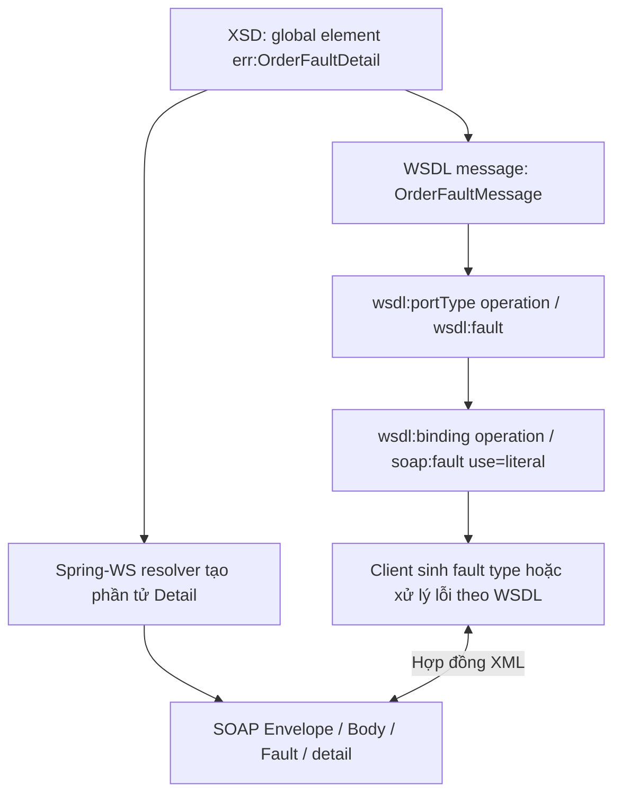
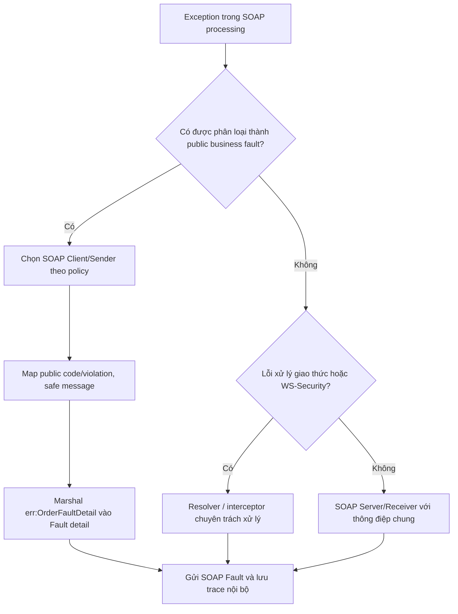
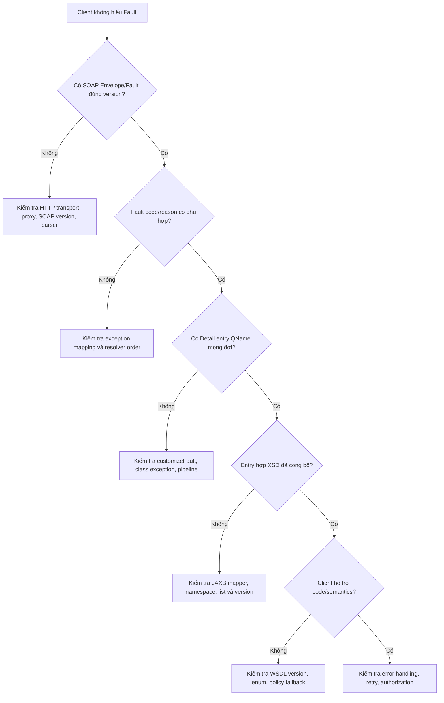

# Tạo phần detail có cấu trúc theo schema nghiệp vụ

## 1. Vì sao SOAP Fault cần phần detail có cấu trúc?

Trong một dịch vụ **Spring Web Services (Spring-WS)** phát triển theo hướng **contract-first**, XSD/WSDL không chỉ mô tả các request và response thành công. Tích hợp doanh nghiệp còn cần thống nhất **máy gọi dịch vụ sẽ hiểu và xử lý lỗi ra sao**. Một SOAP Fault chỉ mang chuỗi `"Something went wrong"` rất khó phân loại: client không biết cần sửa dữ liệu, hiển thị thông báo, dừng xử lý hay thử lại sau.

Ví dụ, dịch vụ `GetOrder` có thể từ chối yêu cầu vì:

- Mã đơn hàng không đúng định dạng.
- Đơn không tồn tại hoặc người gọi không được phép biết nó tồn tại.
- Trạng thái đơn không cho phép thao tác `CancelOrder`.
- Một phụ thuộc hạ tầng đang tạm gián đoạn.

Những trường hợp này có thể cùng xuất hiện dưới dạng SOAP Fault, nhưng **ý nghĩa nghiệp vụ** khác nhau. Để client có thể xử lý có kiểm soát, hãy đặt một **phần tử XML có QName rõ ràng**, được **XSD định nghĩa**, vào phần `detail` của SOAP Fault. Ví dụ:

```xml
<err:OrderFaultDetail xmlns:err="https://example.com/orders/fault/v1">
    <err:code>ORDER_INVALID</err:code>
    <err:message>Yêu cầu không hợp lệ</err:message>
    <err:correlationId>req-20261127-a17</err:correlationId>
    <err:violation>
        <err:field>orderId</err:field>
        <err:issue>INVALID_FORMAT</err:issue>
    </err:violation>
</err:OrderFaultDetail>
```

Khi được nhúng vào SOAP Fault đúng chuẩn, phần tử này là **dữ liệu hợp đồng** chứ không phải một đoạn XML tự do. Bên gọi có thể kiểm tra `code`, hiển thị thông điệp an toàn, đối chiếu `correlationId` và xử lý danh sách lỗi trường theo quy tắc đã thống nhất.

**Chủ đề chính của bài:** cách **thiết kế XSD cho Fault detail, công bố trong WSDL, tạo nó từ exception qua Spring-WS, unmarshalling ở SOAP client và kiểm thử tính tương thích/bảo mật**. Đây là một phần của chương **SOAP Fault** thuộc module `SPRING_WEB_SERVICES`, nối tiếp các kiến thức XSD/WSDL, JAXB, endpoint, interceptor, XML security, WS-Security và chứng chỉ.

### 1.1. Mục tiêu học tập

Sau bài học, bạn có thể:

1. Phân biệt **SOAP Fault code/reason** với **business detail** có QName theo schema.
2. Thiết kế một phần tử `OrderFaultDetail` bằng XSD gồm mã lỗi ổn định, thông điệp an toàn, trace ID và các lỗi trường có giới hạn.
3. Hiểu sự khác nhau giữa `<detail>` của SOAP 1.1 và `<env:Detail>` của SOAP 1.2.
4. Mô tả fault message trong WSDL 1.1 và hiểu giới hạn của cách sinh WSDL tự động theo hậu tố.
5. Dùng `SoapFaultMappingExceptionResolver`/`customizeFault` và JAXB `Jaxb2Marshaller` để ghi một XML detail đúng QName.
6. Phân biệt public business exception, lỗi validation, lỗi hạ tầng và lỗi WS-Security.
7. Đọc typed detail ở SOAP client, kiểm thử schema/contract, tránh rò PII hoặc stack trace và giữ tương thích client cũ.

## 2. Cấu trúc SOAP Fault: phần nào thuộc giao thức, phần nào thuộc nghiệp vụ?

**SOAP Fault** là cơ chế giao thức báo lỗi khi xử lý một SOAP message. Nó nằm trong `SOAP Body` thay cho nội dung response thành công. Các thành phần của nó có vai trò khác nhau.

| Thành phần | Ý nghĩa | Do ai định nghĩa? |
| --- | --- | --- |
| **Fault code** | Nhóm lỗi cấp giao thức, ví dụ `Client`/`Server` của SOAP 1.1 hoặc `Sender`/`Receiver` của SOAP 1.2. | Đặc tả SOAP và chính sách fault mapping. |
| **Fault string / Reason** | Mô tả dễ đọc cho con người, có thể bản địa hóa. | SOAP version, server policy. |
| **Actor / Role / Node** | Thông tin về SOAP node liên quan khi áp dụng. | Cơ chế SOAP tương ứng. |
| **Detail** | Dữ liệu bổ sung có cấu trúc để giải thích lỗi khi xử lý nội dung thông điệp, thường là phần tử nghiệp vụ. | **XSD/WSDL và contract doanh nghiệp**. |

Không dùng mã Fault giao thức để chứa mọi mã nghiệp vụ. Ví dụ `soap:Client` có nghĩa rộng rằng thông điệp từ phía gửi có vấn đề, nhưng không nói riêng trường nào sai; trong khi `err:code=ORDER_INVALID` là mã **ứng dụng**.

### 2.1. SOAP 1.1: phần tử detail

```xml
<?xml version="1.0" encoding="UTF-8"?>
<soap:Envelope
    xmlns:soap="http://schemas.xmlsoap.org/soap/envelope/"
    xmlns:err="https://example.com/orders/fault/v1">
    <soap:Body>
        <soap:Fault>
            <faultcode>soap:Client</faultcode>
            <faultstring>Order request rejected</faultstring>
            <detail>
                <err:OrderFaultDetail>
                    <err:code>ORDER_INVALID</err:code>
                    <err:message>Yêu cầu không hợp lệ</err:message>
                    <err:correlationId>req-20261127-a17</err:correlationId>
                    <err:violation>
                        <err:field>orderId</err:field>
                        <err:issue>INVALID_FORMAT</err:issue>
                    </err:violation>
                </err:OrderFaultDetail>
            </detail>
        </soap:Fault>
    </soap:Body>
</soap:Envelope>
```

Với **SOAP 1.1**, các phần tử `faultcode`, `faultstring` và `detail` trong cấu trúc Fault chuẩn được viết **không có namespace prefix** như ví dụ; phần tử nghiệp vụ `err:OrderFaultDetail` có **namespace riêng**. Đừng nhầm namespace của SOAP Envelope với namespace của detail nghiệp vụ.

Fault code `soap:Client` ở đây được dùng vì request có lỗi dữ liệu. Một lỗi hạ tầng không mong muốn thường được ánh xạ sang `soap:Server` với thông điệp công khai an toàn, **không đưa stack trace vào detail**.

### 2.2. SOAP 1.2: Code, Reason, Detail

```xml
<?xml version="1.0" encoding="UTF-8"?>
<env:Envelope
    xmlns:env="http://www.w3.org/2003/05/soap-envelope"
    xmlns:err="https://example.com/orders/fault/v1">
    <env:Body>
        <env:Fault>
            <env:Code>
                <env:Value>env:Sender</env:Value>
            </env:Code>
            <env:Reason>
                <env:Text xml:lang="vi">Yêu cầu không hợp lệ</env:Text>
            </env:Reason>
            <env:Detail>
                <err:OrderFaultDetail>
                    <err:code>ORDER_INVALID</err:code>
                    <err:message>Yêu cầu không hợp lệ</err:message>
                    <err:correlationId>req-20261127-a17</err:correlationId>
                </err:OrderFaultDetail>
            </env:Detail>
        </env:Fault>
    </env:Body>
</env:Envelope>
```

**SOAP 1.2** dùng `env:Code/Value`, `env:Reason/Text` và `env:Detail` thuộc **namespace SOAP 1.2**. Mã tương ứng với lỗi phía gửi là `Sender`, không phải `Client`. Mã lỗi hạ tầng phía nhận thường dùng `Receiver`; SOAP 1.2 còn hỗ trợ `Subcode` khi policy cần phân cấp lỗi giao thức.

| Thuộc tính | SOAP 1.1 | SOAP 1.2 |
| --- | --- | --- |
| Envelope namespace | `http://schemas.xmlsoap.org/soap/envelope/` | `http://www.w3.org/2003/05/soap-envelope` |
| Lỗi phía gửi | `Client` | `Sender` |
| Lỗi phía nhận | `Server` | `Receiver` |
| Mô tả con người | `faultstring` | `Reason/Text`, yêu cầu `xml:lang`. |
| Chi tiết lỗi | `detail` | `env:Detail` |
| Mã phân cấp | Không có cấu trúc `Subcode` tương đương | `Code/Subcode` khi phù hợp. |
| XML nghiệp vụ trong detail | Global element `err:OrderFaultDetail` | Có thể dùng **cùng XSD/QName** của phần tử nghiệp vụ. |

**Điểm thiết kế:** cùng một XSD cho `err:OrderFaultDetail` có thể được dùng trong cả SOAP 1.1 và 1.2 nếu hợp đồng cho phép, nhưng **không được tái sử dụng nguyên cấu trúc SOAP Fault bao ngoài** giữa hai version. SOAP client cần hiểu đúng Envelope/HTTP binding.

### 2.3. Vì sao không đặt các trường lỗi trực tiếp vào SOAP Body?

Ví dụ không nên thay response lỗi bằng một phần tử `GetOrderResponse` thiếu trường thành công và thêm `errorCode` tùy ý:

```xml
<!-- Phản diện khi WSDL đã định nghĩa GetOrderResponse là success payload. -->
<ord:GetOrderResponse xmlns:ord="https://example.com/orders/v1">
    <ord:errorCode>ORDER_INVALID</ord:errorCode>
</ord:GetOrderResponse>
```

Nó có thể phá vỡ XSD response, khiến client coi lỗi là thành công hoặc mất khả năng dùng SOAP Fault resolver mặc định. Nếu nhóm lựa chọn mô hình **business result có trạng thái lỗi thay vì SOAP Fault**, đó phải là một **thiết kế hợp đồng riêng**. Trong bài này, chúng ta thiết kế lỗi dưới dạng **SOAP Fault với typed detail** để client xử lý nhất quán.

## 3. Thiết kế schema nghiệp vụ cho Fault detail

Phần detail nên là một **global element** của XSD có **QName công khai cố định**. Không nên biến `ex.getMessage()`, tên Java exception hoặc một `HashMap` tự do thành hợp đồng XML.

### 3.1. Những trường nào đáng đưa vào?

| Trường | Kiểu/ý nghĩa | Lưu ý |
| --- | --- | --- |
| `code` | Mã lỗi ổn định, ưu tiên enum hoặc danh mục có quản lý. | Client **rẽ nhánh theo code**, không parse câu tiếng Việt/Anh. |
| `message` | Thông điệp ngắn **đã được duyệt để công khai**. | Không chứa exception nội bộ, SQL, account secret hoặc dữ liệu cá nhân. |
| `correlationId` | Mã truy vết dùng để đối chiếu log/incident. | Không phải credential; giới hạn độ dài và nguồn tạo/chuẩn hóa. |
| `violation` | Danh sách lỗi trường theo `field` và `issue`. | Đặt `maxOccurs` hữu hạn; tránh trả `rejectedValue` chứa PII. |
| `retryable` | Gợi ý khả năng thử lại ở mức lỗi, nếu hợp đồng cần. | Không thay thế retry policy/idempotency; có thể vắng mặt. |

**Không nên công bố mặc định:** stack trace, Java class name, package, SQL, đường dẫn file, host nội bộ, token, khóa bí mật, số tài khoản, mật khẩu, XML request đầy đủ, ID người dùng không cần thiết hoặc giá trị trường đã bị từ chối.

### 3.2. XSD hoàn chỉnh cho một phần tử OrderFaultDetail

File ví dụ `src/main/resources/xsd/order-fault-v1.xsd`:

```xml
<?xml version="1.0" encoding="UTF-8"?>
<xs:schema xmlns:xs="http://www.w3.org/2001/XMLSchema"
           xmlns:err="https://example.com/orders/fault/v1"
           targetNamespace="https://example.com/orders/fault/v1"
           elementFormDefault="qualified">

    <xs:simpleType name="ErrorCodeType">
        <xs:restriction base="xs:string">
            <xs:enumeration value="ORDER_INVALID"/>
            <xs:enumeration value="ORDER_NOT_FOUND"/>
            <xs:enumeration value="ORDER_CONFLICT"/>
            <xs:enumeration value="SERVICE_UNAVAILABLE"/>
        </xs:restriction>
    </xs:simpleType>

    <xs:simpleType name="IssueCodeType">
        <xs:restriction base="xs:string">
            <xs:enumeration value="REQUIRED"/>
            <xs:enumeration value="INVALID_FORMAT"/>
            <xs:enumeration value="OUT_OF_RANGE"/>
            <xs:enumeration value="INVALID_STATE"/>
        </xs:restriction>
    </xs:simpleType>

    <xs:simpleType name="PublicMessageType">
        <xs:restriction base="xs:string">
            <xs:maxLength value="160"/>
        </xs:restriction>
    </xs:simpleType>

    <xs:simpleType name="CorrelationIdType">
        <xs:restriction base="xs:string">
            <xs:pattern value="[A-Za-z0-9_-]{1,64}"/>
        </xs:restriction>
    </xs:simpleType>

    <xs:simpleType name="PublicFieldPathType">
        <xs:restriction base="xs:string">
            <xs:maxLength value="100"/>
        </xs:restriction>
    </xs:simpleType>

    <xs:complexType name="FieldViolationType">
        <xs:sequence>
            <xs:element name="field" type="err:PublicFieldPathType"/>
            <xs:element name="issue" type="err:IssueCodeType"/>
        </xs:sequence>
    </xs:complexType>

    <xs:element name="OrderFaultDetail">
        <xs:complexType>
            <xs:sequence>
                <xs:element name="code" type="err:ErrorCodeType"/>
                <xs:element name="message" type="err:PublicMessageType"/>
                <xs:element name="correlationId"
                            type="err:CorrelationIdType"
                            minOccurs="0"/>
                <xs:element name="violation"
                            type="err:FieldViolationType"
                            minOccurs="0"
                            maxOccurs="20"/>
                <xs:element name="retryable"
                            type="xs:boolean"
                            minOccurs="0"/>
            </xs:sequence>
        </xs:complexType>
    </xs:element>
</xs:schema>
```

Các lựa chọn trên có chủ đích:

1. **Namespace riêng `.../fault/v1`** phân biệt fault detail với request/response nghiệp vụ và tạo không gian versioning rõ ràng.
2. `OrderFaultDetail` là **global element** để có QName dùng được trong WSDL fault message và JAXB root.
3. Mã lỗi là **danh mục đóng**; mỗi giá trị có ý nghĩa ổn định. Khi muốn thêm mã, cần kiểm tra consumer cũ vì JAXB enum của họ có thể từ chối giá trị mới.
4. `message` có độ dài tối đa nhưng XSD **không biết** đâu là PII: ứng dụng phải chỉ chọn thông điệp đã được phê duyệt.
5. `violation` không bắt buộc và tối đa **20** để bảo vệ khỏi payload lỗi quá lớn. Nếu có hơn 20 lỗi, phía server có chính sách chọn một tập đại diện; không được tự thêm phần tử thứ 21.
6. `field` là một **đường dẫn công khai theo hợp đồng** như `orderId` hoặc `items[2].quantity`, không phải tên cột `orders.customer_id` hay Java private field. XSD chỉ giới hạn độ dài; ứng dụng nên dùng allowlist các tên công khai được phép xuất hiện.
7. `retryable` tùy chọn, không mang nghĩa “hãy retry ngay”; thời gian chờ và số lần retry phải theo vận hành/client policy và tính idempotent của operation.

### 3.3. Mã lỗi ứng dụng và mã SOAP không phải một

| Tình huống | SOAP Fault cấp giao thức thường gặp | `err:code` | Việc client nên làm |
| --- | --- | --- | --- |
| `orderId` sai định dạng | SOAP 1.1 `Client` / SOAP 1.2 `Sender` | `ORDER_INVALID` | Sửa dữ liệu trước khi gửi lại. |
| Đơn không tồn tại (hoặc cần che giấu việc tồn tại) | `Client` / `Sender` theo hợp đồng | `ORDER_NOT_FOUND` | Không retry liên tục cùng ID; hiển thị lỗi an toàn. |
| Đơn đang ở trạng thái không thể hủy | `Client` / `Sender` | `ORDER_CONFLICT` | Kiểm tra trạng thái nghiệp vụ, không tự động lặp thao tác. |
| Phụ thuộc hạ tầng tạm không đáp ứng | `Server` / `Receiver` | `SERVICE_UNAVAILABLE` nếu có chính sách công bố | Backoff/circuit breaker theo contract; xem idempotency. |
| Lỗi lập trình hoặc exception không xác định | `Server` / `Receiver` | Có thể **không có business detail** | Báo lỗi an toàn, đối chiếu correlationId ở telemetry phía server. |

**Không lập quy tắc máy móc** rằng “mọi exception kiểm tra dữ liệu là SOAP Client, mọi exception khác là SOAP Server”. Phải phân biệt lỗi do input không phù hợp, trạng thái domain, quyền, lỗi phụ thuộc và bug, sau đó công bố mapping để các đối tác sử dụng ổn định.

### 3.4. Không trộn field violations với raw validation messages

Một lỗi XSD validator có thể chứa văn bản phụ thuộc parser như `cvc-pattern-valid` hoặc XPath nội bộ. Không nên đưa nguyên câu từ `SAXParseException.getMessage()` vào Fault công khai, vì:

- Nội dung thay đổi theo JAXP provider/version.
- Có thể bao gồm trích đoạn dữ liệu bị từ chối.
- Không phải một mã lỗi ổn định để client lập trình.
- Đôi khi chứa đường dẫn/schemaLocation hoặc thông tin cấu hình.

Thay vào đó, **ánh xạ bằng bảng mã lỗi công khai**. Với lỗi ở trường `orderId`, công bố `field=orderId`, `issue=INVALID_FORMAT` và `code=ORDER_INVALID`. Chỉ làm vậy khi hệ thống có đủ thông tin **đáng tin cậy** để xác định trường và loại lỗi; nếu không, trả lỗi tổng quát không có `violation`.

## 4. Công bố typed detail trong WSDL 1.1

Chỉ thêm `OrderFaultDetail` vào XSD chưa chắc đã đủ để đối tác biết **operation nào có thể phát sinh fault này**. Với một dịch vụ dùng **WSDL 1.1**, hãy mô tả fault trong **message**, **portType operation** và **SOAP binding** theo hợp đồng.

### 4.1. Phân biệt XSD element, WSDL message và SOAP Fault runtime



| Thành phần | Trách nhiệm | Những điều không tự làm |
| --- | --- | --- |
| **XSD global element** | Định nghĩa QName và cấu trúc `OrderFaultDetail`. | Không tự chọn Fault code hoặc tạo exception Java. |
| **WSDL fault message** | Mô tả dữ liệu lỗi gắn với operation. | Không bắt server tự sinh đúng detail khi ném exception. |
| **Spring-WS exception resolver** | Chọn Fault cấp SOAP và tạo nội dung detail lúc runtime. | Không thay thế WSDL/XSD hoặc thẩm định hợp đồng. |
| **JAXB marshaller** | Chuyển Java detail object thành XML trong `detail`. | Không tự quyết định lỗi này được phép công bố ra ngoài. |
| **SOAP client** | Nhận Fault và hiểu typed detail theo contract. | Không nên đoán nghĩa lỗi bằng việc parse `faultstring`. |

### 4.2. Trích đoạn WSDL minh họa

Giả sử một WSDL 1.1 có `targetNamespace="https://example.com/orders/service/v1"`, prefix `tns` cho namespace dịch vụ và `err` cho namespace lỗi, cùng các `GetOrderRequestMessage`/`GetOrderResponseMessage` đã được định nghĩa. Phần fault có thể được khai báo:

```xml
<!-- Trích đoạn bên trong wsdl:definitions; các namespace,
     request/response messages và wsdl:service được khai báo ở ngoài. -->
<wsdl:message name="OrderFaultMessage">
    <wsdl:part name="fault"
               element="err:OrderFaultDetail"/>
</wsdl:message>

<wsdl:portType name="OrdersPort">
    <wsdl:operation name="GetOrder">
        <wsdl:input message="tns:GetOrderRequestMessage"/>
        <wsdl:output message="tns:GetOrderResponseMessage"/>
        <wsdl:fault name="OrderFault"
                    message="tns:OrderFaultMessage"/>
    </wsdl:operation>
</wsdl:portType>

<wsdl:binding name="OrdersSoapBinding" type="tns:OrdersPort">
    <soap:binding
        style="document"
        transport="http://schemas.xmlsoap.org/soap/http"/>
    <wsdl:operation name="GetOrder">
        <soap:operation
            soapAction="https://example.com/orders/GetOrder"/>
        <wsdl:input>
            <soap:body use="literal"/>
        </wsdl:input>
        <wsdl:output>
            <soap:body use="literal"/>
        </wsdl:output>
        <wsdl:fault name="OrderFault">
            <soap:fault name="OrderFault" use="literal"/>
        </wsdl:fault>
    </wsdl:operation>
</wsdl:binding>
```

**Lưu ý về ví dụ:** đây là trích đoạn, **không phải WSDL độc lập**. WSDL hoàn chỉnh còn cần khai báo namespace của `wsdl`, `soap`, `tns`, `err`; phần `wsdl:types` tham chiếu/import XSD, request/response messages và `wsdl:service`/port/address. Nếu XSD lỗi nằm ở namespace khác XSD nghiệp vụ, phần `wsdl:types` cần đưa schema đó vào mô hình contract theo cách hợp lệ.

**Đọc ba vị trí của fault trong WSDL:**

1. `wsdl:message` tham chiếu **global element** `err:OrderFaultDetail`, không tham chiếu tùy tiện một kiểu Java.
2. `wsdl:portType/wsdl:operation/wsdl:fault` gắn fault với một operation cụ thể.
3. `wsdl:binding/wsdl:operation/wsdl:fault/soap:fault` khai báo cách SOAP binding truyền fault bằng literal XML.

Tên `OrderFault` ở WSDL và QName `err:OrderFaultDetail` **không phải cùng một tên**: tên thứ nhất định danh WSDL fault, QName thứ hai định danh phần tử XML trong SOAP Detail.

### 4.3. DefaultWsdl11Definition có thể nhận diện hậu tố Fault

Spring-WS cung cấp `DefaultWsdl11Definition` để sinh WSDL từ XSD theo quy ước hậu tố. Các thuộc tính như `requestSuffix`, `responseSuffix` và **`faultSuffix`** ảnh hưởng việc phát hiện message/operation tương ứng.

Ví dụ:

```java
DefaultWsdl11Definition wsdl = new DefaultWsdl11Definition();
wsdl.setPortTypeName("OrdersPort");
wsdl.setTargetNamespace("https://example.com/orders/v1");
wsdl.setLocationUri("/ws");
wsdl.setSchema(ordersSchema);
wsdl.setFaultSuffix("Fault");
```

Đây là một **cấu hình minh họa** (giả định đã có bean `ordersSchema` và các import cần thiết). Nếu fault element được đặt tên `GetOrderFault` hoặc theo quy ước nhất quán mà bộ provider hiểu, nó có thể được phát hiện khi sinh WSDL. **`OrderFaultDetail` không kết thúc bằng `Fault`**, vì vậy đừng tự giả định cấu hình trên sẽ sinh đúng `wsdl:fault` cần thiết.

Với hợp đồng nhiều schema/namespace hoặc đã được đối tác phê duyệt, nên:

- Xem WSDL **thực sự được công bố** tại URL public.
- Kiểm tra tên `wsdl:fault`, `wsdl:part element`, SOAP binding và tất cả import.
- Dùng **WSDL tĩnh đã quản trị** hoặc provider/configuration phù hợp khi suy luận theo hậu tố không biểu diễn đúng fault contract.
- Có **contract test cho WSDL**, không chỉ test class Java đã khởi tạo.

`DefaultWsdl11Definition` không tự tạo typed detail ở runtime. Dù WSDL khai báo fault đúng, server vẫn cần một **exception resolver** tạo SOAP Fault với `OrderFaultDetail` thực tế.

## 5. Ranh giới exception nội bộ và mã lỗi công khai

Trước khi triển khai resolver, cần **quy ước lỗi nào được phép xuất ra như business detail**.

### 5.1. Đừng serialize exception trực tiếp

Ví dụ cần tránh:

```java
// Phản diện: message có thể chứa SQL, ID, token hoặc đường dẫn nội bộ.
String publicMessage = exception.getMessage();

// Phản diện: stack trace và tên class Java là chi tiết triển khai.
String publicDetail = exception.toString();
```

Những thông tin này không ổn định theo thời gian, gây lộ dữ liệu và buộc client phụ thuộc vào stack Java. Thay vào đó, tầng ứng dụng nên tạo một lỗi **đã phân loại** với mã lỗi nội bộ được ánh xạ sang mã lỗi của hợp đồng.

### 5.2. Xây kiểu lỗi nghiệp vụ tường minh

Ví dụ Java 17+:

```java
import java.util.List;
import java.util.Objects;

public enum PublicOrderError {
    ORDER_INVALID,
    ORDER_NOT_FOUND,
    ORDER_CONFLICT
}

public enum PublicIssue {
    REQUIRED,
    INVALID_FORMAT,
    OUT_OF_RANGE,
    INVALID_STATE
}

public record PublicFieldViolation(
        String publicField,
        PublicIssue issue) {
    public PublicFieldViolation {
        Objects.requireNonNull(publicField);
        Objects.requireNonNull(issue);
    }
}

public final class PublicOrderFaultException
        extends RuntimeException {

    private final PublicOrderError publicError;
    private final List<PublicFieldViolation> violations;

    public PublicOrderFaultException(
            PublicOrderError publicError,
            List<PublicFieldViolation> violations) {
        super("Order request rejected");
        this.publicError = Objects.requireNonNull(publicError);
        this.violations = List.copyOf(violations);
    }

    public PublicOrderError publicError() {
        return publicError;
    }

    public List<PublicFieldViolation> violations() {
        return violations;
    }
}
```

Đây là các **khai báo loại Java riêng biệt** (thực tế đặt vào nhiều file Java cùng package), không phải một file `.java` chứa nhiều public top-level types. Các kiểu này minh họa cách đưa mã lỗi và danh sách violation qua ranh giới application/service; chúng **không phải JAXB contract classes**.

**Lưu ý an toàn:**

- Chỉ cho phép các giá trị `PublicOrderError` đã được thẩm định, không nhận `code` tùy ý từ input.
- `publicField` phải đến từ **allowlist tên trường XML công khai**, ví dụ `orderId`, không lấy trực tiếp một chuỗi người dùng hoặc tên trường persistence.
- Giới hạn số violation và độ dài trường khi ánh xạ, không tin mọi exception chứa dữ liệu an toàn.
- Không dùng `getMessage()` của bất kỳ exception chưa phân loại làm `err:message`.
- Những lỗi nội bộ như JDBC, lỗi TLS, timeout dependency hoặc `NullPointerException` không được tùy tiện bọc thành `PublicOrderFaultException` với detail tiết lộ nguyên nhân.

### 5.3. Phân nhóm lỗi trước khi xuất XML



Nếu nghiệp vụ yêu cầu phân biệt một số lỗi tạm thời (`SERVICE_UNAVAILABLE`), hãy thêm **exception type/mapping công khai có kiểm soát** và thử retry policy phù hợp. Đừng mặc định mọi exception phía server phải có typed detail; đôi khi **không có detail** là lựa chọn an toàn hơn để tránh rò thông tin triển khai.

## 6. Spring-WS: dùng resolver để tạo Fault detail có JAXB

Spring-WS có các thành phần chuyên xử lý exception thành SOAP Fault:

| Thành phần | Điểm mạnh | Giới hạn |
| --- | --- | --- |
| `SimpleSoapExceptionResolver` | Sinh Fault cơ bản, có callback `customizeFault(MessageContext, Object, Exception, SoapFault)`. | Không tự hiểu mã lỗi nghiệp vụ; mặc định có thể dựa vào exception message. |
| `SoapFaultMappingExceptionResolver` | Map exception class sang Fault code/string/reason; callback `customizeFault(Object, Exception, SoapFault)` có thể thêm detail. | Phải tự xây payload detail, kiểm soát lỗi không được công bố. |
| `SoapFaultAnnotationExceptionResolver` | Dùng annotation `@SoapFault` trên exception để chọn fault definition. | Annotation không tự tạo XML detail nghiệp vụ; có thể kết hợp tùy chỉnh resolver/hạ tầng. |
| `PayloadValidatingInterceptor` | Kiểm tra request/response XML theo XSD, xử lý lỗi validation ở chuỗi interceptor. | Lỗi validation có thể được xử lý **ngoài** exception resolver của nghiệp vụ. |
| WS-Security interceptor / SOAP protocol layer | Xử lý lỗi chữ ký, token, `mustUnderstand`, SOAP version theo trách nhiệm tương ứng. | Không nên ép các lỗi này đi qua business detail bằng mọi giá. |

Với chủ đề **typed detail do business exception tạo ra**, `SoapFaultMappingExceptionResolver` là một lựa chọn dễ minh họa: nó cấu hình Fault code chung, sau đó callback `customizeFault` tạo XML detail từ JAXB object.

### 6.1. Cấu hình JAXB cho fault schema

Giả sử XJC sinh các lớp từ `order-fault-v1.xsd` vào `com.example.orders.fault.v1`, với các class/enum minh họa:

```text
com/example/orders/fault/v1/
  OrderFaultDetail.java
  ErrorCodeType.java
  IssueCodeType.java
  FieldViolationType.java
  ObjectFactory.java
  package-info.java
```

Tên chính xác phụ thuộc bản XJC và binding customization; với global element chứa anonymous complex type như schema mục 3, `OrderFaultDetail` thường có `@XmlRootElement`. Nếu XJC sinh root dưới dạng `JAXBElement<OrderFaultType>`, phải dùng `ObjectFactory` tương ứng khi marshal.

Một Spring bean `Jaxb2Marshaller`:

```java
import org.springframework.context.annotation.Bean;
import org.springframework.context.annotation.Configuration;
import org.springframework.oxm.jaxb.Jaxb2Marshaller;

@Configuration
public class FaultBindingConfiguration {
    @Bean
    public Jaxb2Marshaller orderFaultMarshaller() {
        Jaxb2Marshaller binding = new Jaxb2Marshaller();
        binding.setContextPath("com.example.orders.fault.v1");
        return binding;
    }
}
```

`setContextPath` yêu cầu package JAXB/XJC có metadata phù hợp như `ObjectFactory` hoặc `jaxb.index`. Với tập class JAXB viết tay, `setClassesToBeBound(...)` cũng có thể phù hợp. **JAXB API/runtime phải cùng thế hệ**: Spring Framework 6 / các bản Spring-WS Jakarta dùng `jakarta.xml.bind.*`, trong khi code JAXB 2.x cũ dùng `javax.xml.bind.*`. Không sửa generated source bằng cách thay chuỗi package thủ công.

### 6.2. Dùng SoapFaultDetail.getResult() để marshal root element

Spring-WS cung cấp `SoapFault.addFaultDetail()`, và `SoapFaultDetail.getResult()` là một `javax.xml.transform.Result` có thể dùng để **marshal trực tiếp phần tử lỗi nghiệp vụ vào bên trong Detail**.

Đây là khác biệt quan trọng giữa:

```text
SOAP Fault (giao thức)
    └── detail / Detail (container)
          └── err:OrderFaultDetail (root JAXB từ XSD)
                ├── err:code
                ├── err:message
                ├── err:correlationId
                └── err:violation ...
```

Không nên vừa tự tạo `detail.addFaultDetailElement(QName("OrderFaultDetail"))` **rồi** marshal một `OrderFaultDetail` có root cùng tên vào `getResult()` của element đó: cách làm này có nguy cơ tạo **hai lớp root lồng nhau**. Hãy chọn **một** trong hai cách:

1. **Typed JAXB root:** gọi `fault.addFaultDetail().getResult()` rồi marshal nguyên phần tử `OrderFaultDetail` vào container.
2. **Xây element thủ công:** gọi `detail.addFaultDetailElement(QName)` rồi ghi **nội dung con** của element qua API/XML Result tương ứng, không marshal thêm một root trùng tên.

### 6.3. Custom resolver với JAXB

Đoạn sau minh họa một resolver hoàn chỉnh ở lớp **business SOAP fault**, giả định có `PublicOrderFaultException` từ mục 5, JAXB classes sinh từ XSD và một bean `CorrelationIdProvider` trả về ID đã được tạo/chuẩn hóa an toàn:

```java
import org.springframework.oxm.jaxb.Jaxb2Marshaller;
import org.springframework.ws.soap.SoapFault;
import org.springframework.ws.soap.SoapFaultDetail;
import org.springframework.ws.soap.server.endpoint.SoapFaultMappingExceptionResolver;

import com.example.orders.fault.v1.ErrorCodeType;
import com.example.orders.fault.v1.FieldViolationType;
import com.example.orders.fault.v1.IssueCodeType;
import com.example.orders.fault.v1.OrderFaultDetail;

public final class OrderDetailFaultResolver
        extends SoapFaultMappingExceptionResolver {

    private final Jaxb2Marshaller marshaller;
    private final CorrelationIdProvider ids;

    public OrderDetailFaultResolver(
            Jaxb2Marshaller marshaller,
            CorrelationIdProvider ids) {
        this.marshaller = marshaller;
        this.ids = ids;
    }

    @Override
    protected void customizeFault(
            Object endpoint, Exception exception, SoapFault fault) {

        if (!(exception instanceof PublicOrderFaultException error)) {
            return; // Fault chung, không tiết lộ exception nội bộ.
        }

        OrderFaultDetail payload = new OrderFaultDetail();
        payload.setCode(toWireCode(error.publicError()));
        payload.setMessage(safePublicMessage(error.publicError()));
        payload.setCorrelationId(ids.currentId());

        for (PublicFieldViolation violation : error.violations()) {
            if (payload.getViolation().size() >= 20) {
                break;
            }
            FieldViolationType item = new FieldViolationType();
            item.setField(allowlistedField(violation.publicField()));
            item.setIssue(toWireIssue(violation.issue()));
            payload.getViolation().add(item);
        }

        SoapFaultDetail detail = fault.addFaultDetail();
        marshaller.marshal(payload, detail.getResult());
    }

    private static ErrorCodeType toWireCode(PublicOrderError error) {
        return switch (error) {
            case ORDER_INVALID -> ErrorCodeType.ORDER_INVALID;
            case ORDER_NOT_FOUND -> ErrorCodeType.ORDER_NOT_FOUND;
            case ORDER_CONFLICT -> ErrorCodeType.ORDER_CONFLICT;
        };
    }

    private static IssueCodeType toWireIssue(PublicIssue issue) {
        return switch (issue) {
            case REQUIRED -> IssueCodeType.REQUIRED;
            case INVALID_FORMAT -> IssueCodeType.INVALID_FORMAT;
            case OUT_OF_RANGE -> IssueCodeType.OUT_OF_RANGE;
            case INVALID_STATE -> IssueCodeType.INVALID_STATE;
        };
    }

    private static String safePublicMessage(PublicOrderError code) {
        return switch (code) {
            case ORDER_INVALID -> "Yêu cầu không hợp lệ";
            case ORDER_NOT_FOUND -> "Không tìm thấy đơn hàng";
            case ORDER_CONFLICT -> "Không thể thực hiện ở trạng thái hiện tại";
        };
    }

    private static String allowlistedField(String candidate) {
        return switch (candidate) {
            case "orderId", "quantity", "requestedAt" -> candidate;
            default -> throw new IllegalArgumentException(
                "Tên trường lỗi không được công bố");
        };
    }
}
```

`CorrelationIdProvider` là **abstraction do ứng dụng định nghĩa**, không phải interface dựng sẵn của Spring-WS; ví dụ có thể định nghĩa:

```java
public interface CorrelationIdProvider {
    String currentId();
}
```

Implementation cần trả một ID đã được server tạo hoặc kiểm tra và chuẩn hóa, khớp pattern `[A-Za-z0-9_-]{1,64}` của XSD; không lấy nguyên giá trị không giới hạn từ SOAP Header hoặc HTTP header.

**Điểm phải hiểu đúng trong mã:**

- `customizeFault` nhận **Fault đã được resolver tạo**, nên không tự tạo SOAP Envelope.
- Chỉ exception `PublicOrderFaultException` được chuyển thành **business detail**; lỗi không nhận diện được không có detail nghiệp vụ.
- `payload.getViolation().add(...)` phù hợp dạng **JAXB live list** thường được XJC sinh cho `maxOccurs>1`.
- `marshaller.marshal(payload, detail.getResult())` tạo đúng root `err:OrderFaultDetail` theo JAXB metadata. Không xây XML bằng nối chuỗi.
- Các helper ánh xạ **mã nội bộ → enum hợp đồng** và **thông điệp công khai cố định**; không dùng `exception.getMessage()`.
- Nếu marshalling detail lỗi, exception resolver có thể lỗi ngay khi đang xử lý một exception khác. Vì vậy cần test schema/binding và fallback xử lý phù hợp; không coi `customizeFault` là vùng chắc chắn không ném lỗi.

**Lưu ý về code:** Các class Java trong mục 5–6 là **những ví dụ tách file** của một ứng dụng dùng Java 17+/Spring-WS/Jakarta JAXB tương thích; chưa bao gồm toàn bộ import bean, component scanning, mã service, package declaration và HTTP setup. Không ghi đè lớp Java do XJC sinh để bổ sung những trường ngoài XSD.

### 6.4. Đăng ký resolver và định nghĩa Fault code an toàn

Để `OrderDetailFaultResolver` được dispatcher sử dụng, đăng ký nó như một bean Spring và khai báo mapping cho exception công khai:

```java
import java.util.Properties;
import org.springframework.beans.factory.annotation.Qualifier;
import org.springframework.context.annotation.Bean;
import org.springframework.context.annotation.Configuration;
import org.springframework.oxm.jaxb.Jaxb2Marshaller;
import org.springframework.ws.soap.server.endpoint.SoapFaultDefinition;

@Configuration
public class OrderFaultResolverConfiguration {

    @Bean
    public OrderDetailFaultResolver orderDetailFaultResolver(
            @Qualifier("orderFaultMarshaller")
            Jaxb2Marshaller faultMarshaller,
            CorrelationIdProvider correlationIds) {

        OrderDetailFaultResolver resolver =
            new OrderDetailFaultResolver(
                faultMarshaller, correlationIds);

        Properties mappings = new Properties();
        mappings.setProperty(
            PublicOrderFaultException.class.getName(),
            "CLIENT,Order request rejected"
        );
        resolver.setExceptionMappings(mappings);

        SoapFaultDefinition fallback = new SoapFaultDefinition();
        fallback.setFaultCode(SoapFaultDefinition.SERVER);
        fallback.setFaultStringOrReason(
            "Service temporarily unavailable");
        resolver.setDefaultFault(fallback);

        resolver.setOrder(0);
        return resolver;
    }
}
```

Đoạn trên minh họa **SOAP 1.1 Fault code `Client`/`Server`** qua Spring-WS mapping editor. Với SOAP 1.2, cần kiểm tra hạ tầng đã chọn đúng `Sender`/`Receiver` và Reason/Detail theo version trước khi đưa vào production. `resolver.setOrder(0)` chỉ định vị trí trong danh sách exception resolvers; nếu ứng dụng còn resolver khác, thứ tự thực tế và danh sách exception mà mỗi resolver xử lý phải được kiểm thử.

**Giải thích hành vi:**

- Exception `PublicOrderFaultException` được ánh xạ sang Fault phía client/sender và có `OrderFaultDetail`.
- Exception khác không thuộc loại này đi theo **default fault** với thông điệp chung và **không có business detail**.
- `FaultDefinition` quyết định code và reason; phần tử XML bên trong detail được tạo ở `customizeFault`, không đến từ `faultstring`.
- Bean `CorrelationIdProvider` phải được cấu hình thực sự. Có thể lấy ID từ một ngữ cảnh request đáng tin cậy và đã chuẩn hóa. Không đặt một biến `currentId` mutable vào singleton resolver để lưu trạng thái từng request.
- Khi application dùng nhiều bộ JAXB cho các namespace khác nhau, qualifier giúp tránh inject nhầm marshaller của **success payload** vào **fault detail**.

**Không coi cấu hình này là “bắt mọi exception rồi public hết detail”**. Một số lỗi phát sinh trong parsing, validation, SOAP Header/WS-Security hoặc trước endpoint mapping có thể được xử lý ở tầng khác, không đi qua resolver này. Phải thử nhiều đường lỗi để biết kết quả thật.

### 6.5. Endpoint nghiệp vụ phát sinh lỗi ra sao?

Ví dụ rút gọn:

```java
import java.util.List;
import org.springframework.ws.server.endpoint.annotation.Endpoint;
import org.springframework.ws.server.endpoint.annotation.PayloadRoot;
import org.springframework.ws.server.endpoint.annotation.RequestPayload;
import org.springframework.ws.server.endpoint.annotation.ResponsePayload;

@Endpoint
public class OrderEndpoint {
    private static final String NS = "https://example.com/orders/v1";
    private final OrderQueryService queryService;
    private final OrderContractMapper mapper;

    public OrderEndpoint(OrderQueryService queryService,
                         OrderContractMapper mapper) {
        this.queryService = queryService;
        this.mapper = mapper;
    }

    @PayloadRoot(namespace = NS, localPart = "GetOrderRequest")
    @ResponsePayload
    public GetOrderResponse getOrder(
            @RequestPayload GetOrderRequest request) {

        String id = request.getOrderId();
        if (id == null || !id.matches("ORD-[0-9]{6}")) {
            throw new PublicOrderFaultException(
                PublicOrderError.ORDER_INVALID,
                List.of(new PublicFieldViolation(
                    "orderId", PublicIssue.INVALID_FORMAT)));
        }

        OrderSummary order = queryService.findVisibleOrder(id);
        if (order == null) {
            throw new PublicOrderFaultException(
                PublicOrderError.ORDER_NOT_FOUND,
                List.of());
        }
        return mapper.toGetOrderResponse(order);
    }
}
```

Ví dụ dùng **validation bổ sung để minh họa mapping exception**, không phải lý do bỏ XSD validation. `OrderQueryService.findVisibleOrder` được giả định lọc đơn hàng theo danh tính **đã xác thực và được cấp quyền**; request chứa ID đúng pattern không chứng minh người dùng có quyền. `GetOrderRequest`/`GetOrderResponse` là mô hình JAXB/XJC của hợp đồng **thành công**, khác `OrderFaultDetail` ở namespace lỗi.

Ở dự án thật, nên tách validation/domain policy khỏi endpoint, để application service phát sinh lỗi được phân loại. Đối với trường hợp cần che giấu một tài nguyên, có thể trả cùng mã `ORDER_NOT_FOUND` cho cả “không có” và “không có quyền”, theo chính sách bảo mật đã chọn; không phát hiện trạng thái tồn tại bí mật qua message khác nhau.

### 6.6. Lỗi XSD validation và lỗi WS-Security không nhất thiết đi qua business resolver

Một request thiếu `orderId` có thể bị `PayloadValidatingInterceptor` chặn **trước khi gọi endpoint**. Khi đó `PublicOrderFaultException` của ví dụ chưa hề được tạo, nên `customizeFault` không được gọi chỉ vì request sai XSD.

Nếu muốn lỗi validation cũng có một typed detail thống nhất, cần **thiết kế riêng đường chuyển đổi lỗi validation** (ví dụ mở rộng interceptor/exception resolver phù hợp với phiên bản Spring-WS), chuyển một tập lỗi **đã rút gọn và loại thông tin nhạy cảm** thành `ORDER_INVALID` và kiểm thử đầy đủ. Không mặc định `PayloadValidatingInterceptor` sẽ tự sử dụng `OrderDetailFaultResolver` ở trên.

Tương tự, lỗi chữ ký XML, timestamp, token hoặc `mustUnderstand` có thể do security/giao thức tạo SOAP Fault theo quy tắc riêng. Không tự ý thay lỗi bảo mật thành `ORDER_INVALID` chỉ để giữ một hình dạng `detail` cho tất cả trường hợp.

### 6.7. Ghi XML bằng tay khi không dùng JAXB

Spring-WS cũng có API `SoapFaultDetail.addFaultDetailElement(QName)`. Khi một ứng dụng không dùng JAXB cho Fault schema, có thể:

1. Tạo một detail entry `{https://example.com/orders/fault/v1}OrderFaultDetail` bằng `addFaultDetailElement(...)`.
2. Ghi các phần tử con `code`, `message`, `correlationId` và `violation` bằng DOM, StAX hoặc transformer vào `SoapFaultDetailElement.getResult()`.
3. Đảm bảo thứ tự, QName, cardinality và escaping đúng XSD; validate XML tạo ra bằng XSD.

Ví dụ chỉ tạo phần tử container và một text **không đủ** diễn tả `OrderFaultDetail` đầy đủ:

```java
import javax.xml.namespace.QName;
import org.springframework.ws.soap.SoapFaultDetail;
import org.springframework.ws.soap.SoapFaultDetailElement;

SoapFaultDetail detail = fault.addFaultDetail();
SoapFaultDetailElement entry = detail.addFaultDetailElement(
    new QName(
        "https://example.com/orders/fault/v1",
        "OrderFaultDetail"
    )
);

// entry.getResult() nhận XML con do serializer ghi vào.
// KHÔNG marshal tiếp một OrderFaultDetail root trùng tên vào đây.
```

Với contract nhiều trường như ví dụ, **marshaller JAXB** thường ít lỗi thủ công hơn. Nếu cần xây DOM/StAX, hãy kiểm tra namespace đầy đủ và dùng XML writer thay vì nối chuỗi `"<err:code>" + userInput + "</err:code>"`. Data từ client phải được escape và giảm thiểu, kể cả khi chỉ ghi vào Fault detail.

## 7. SOAP client đọc typed detail ra sao?

Phần detail chỉ hữu ích khi consumer biết **phân loại lỗi một cách máy đọc được**. Với `WebServiceTemplate`, cấu hình fault resolver thông dụng có thể ném `SoapFaultClientException` khi nhận SOAP Fault. Khi đó, code client đọc `SoapFault` và những detail entries.

### 7.1. Không dựa vào faultstring để rẽ nhánh nghiệp vụ

Ví dụ phản diện:

```java
// Dễ hỏng khi server đổi câu chữ hoặc ngôn ngữ.
if (ex.getFaultStringOrReason().contains("order not found")) {
    // ...
}
```

Fault string/Reason nhằm mô tả cho con người; văn bản có thể được bản địa hóa. Client nên quyết định theo **QName `OrderFaultDetail` + `code`** và các mã `issue` đã được hợp đồng hóa.

### 7.2. Đọc detail entry và unmarshal JAXB

Ví dụ logic xử lý một `SoapFaultClientException`:

```java
import java.util.Iterator;
import javax.xml.namespace.QName;

import org.springframework.oxm.jaxb.Jaxb2Marshaller;
import org.springframework.ws.soap.SoapFault;
import org.springframework.ws.soap.SoapFaultDetail;
import org.springframework.ws.soap.SoapFaultDetailElement;
import org.springframework.ws.soap.client.SoapFaultClientException;

import com.example.orders.fault.v1.OrderFaultDetail;

public final class OrderClientFaultReader {
    private static final QName DETAIL_QNAME = new QName(
        "https://example.com/orders/fault/v1",
        "OrderFaultDetail"
    );

    private final Jaxb2Marshaller faultUnmarshaller;

    public OrderClientFaultReader(Jaxb2Marshaller faultUnmarshaller) {
        this.faultUnmarshaller = faultUnmarshaller;
    }

    public OrderFaultDetail readOrNull(
            SoapFaultClientException exception) {

        SoapFault fault = exception.getSoapFault();
        SoapFaultDetail detail = fault.getFaultDetail();
        if (detail == null) {
            return null;
        }

        Iterator<SoapFaultDetailElement> entries =
            detail.getDetailEntries();
        while (entries.hasNext()) {
            SoapFaultDetailElement entry = entries.next();
            if (!DETAIL_QNAME.equals(entry.getName())) {
                continue;
            }

            Object decoded =
                faultUnmarshaller.unmarshal(entry.getSource());

            if (decoded instanceof OrderFaultDetail result) {
                return result;
            }
            if (decoded instanceof jakarta.xml.bind.JAXBElement<?> wrapper
                    && wrapper.getValue() instanceof OrderFaultDetail result) {
                return result;
            }
            throw new IllegalStateException(
                "Order fault detail có binding không mong đợi");
        }
        return null;
    }
}
```

`SoapFaultDetailElement.getSource()` là XML của **detail entry**, không phải của toàn SOAP Envelope. Đoạn code giả định `Jaxb2Marshaller` đã được cấu hình với **fault contract package** và khởi tạo đúng. Với hệ JAXB 2.x cũ, kiểu `JAXBElement` ở `javax.xml.bind`; không trộn code sinh từ JAXB 2.x với runtime Jakarta XML Binding của Spring stack mới.

Trong production, consumer phải:

- Chỉ chấp nhận **QName đã được hợp đồng hóa**.
- **Validate XSD** của detail, đặc biệt khi nhận dữ liệu từ server ngoài; unmarshal thành công không chứng minh các facet như `maxOccurs` hay `maxLength` đã được kiểm tra.
- Giới hạn byte, số detail entries, số violation và độ dài văn bản trước khi log/hiển thị.
- Kiểm tra mã `code` và `issue`; nếu gặp mã lạ hoặc namespace mới, dùng **fallback có kiểm soát**, không cho request được coi là thành công.
- Không hiển thị nguyên detail nếu chứa thông tin không được phép đưa cho người dùng cuối.
- Phân biệt lỗi SOAP từ server với **transport failure** (timeout, DNS, TLS) và lỗi parse/contract violation.

### 7.3. Phân loại lỗi để xử lý trong SOAP gateway

```text
WebServiceTemplate nhận SOAP response
        │
        ├── Success payload
        │      └── JAXB/Source → application result
        │
        └── SOAP Fault (SoapFaultClientException)
               ├── Detail QName + schema hợp lệ
               │      ├── ORDER_INVALID → sửa input
               │      ├── ORDER_NOT_FOUND → báo kết quả không thấy
               │      ├── ORDER_CONFLICT → xử lý trạng thái nghiệp vụ
               │      └── SERVICE_UNAVAILABLE → retry policy có giới hạn
               ├── Detail lạ hoặc sai XSD → upstream contract error
               └── Không có detail → general SOAP fault handling
```

**`retryable=true` không phải lệnh retry vô điều kiện.** Với `CancelOrder` hoặc operation có side effect, trước khi retry phải xét idempotency key, trạng thái request trước đó, timeout/HTTP ambiguity, backoff và giới hạn số lần. Tùy hợp đồng, retry sai có thể thực hiện lại một tác vụ hoặc gây double charge.

### 7.4. Vì sao cùng Fault code có thể có nhiều detail entries?

SOAP Fault detail có thể chứa **nhiều entry** từ những namespace khác nhau theo đặc tả/stack. Với hợp đồng ở bài này, nên quy định **chính xác một** entry `err:OrderFaultDetail` cho một business fault, còn mọi extension khác phải có chính sách rõ.

Client không nên duyệt theo giả định “entry đầu tiên luôn là business detail”; phải kiểm tra QName của từng entry và xử lý khi có entry lạ/duplicate:

- **Không có** entry công khai → fallback.
- **Một** `OrderFaultDetail` hợp lệ → decode.
- **Hai** entry `OrderFaultDetail` → có thể là lỗi hợp đồng; không chọn ngẫu nhiên cái đầu nếu chúng mâu thuẫn.
- Entry QName khác namespace/phiên bản → không ép cast thành v1.

Ví dụ `readOrNull(...)` chỉ minh họa cách tìm và decode entry. Khi sản xuất, bổ sung kiểm tra số lượng và duplicate theo chính sách đã thỏa thuận.

## 8. Schema validation cho Fault detail: không chỉ JAXB marshal thành công

Khi `OrderFaultDetail` được tạo từ JAXB class, ứng dụng có thể vô tình sinh `message` quá dài, mã lỗi không được schema cho phép, `violation` vượt 20 phần tử hoặc `correlationId` chứa ký tự ngoài pattern. JAXB tạo XML thành công **không tự chứng minh** mọi facet của XSD đều được thực thi.

### 8.1. Validate đúng phần tử nghiệp vụ, không phải toàn Envelope

XSD `order-fault-v1.xsd` mô tả một **global element `err:OrderFaultDetail`**. Nếu muốn kiểm tra Fault response với schema này:

1. Xác nhận SOAP Envelope/Fault theo đúng **SOAP version**.
2. Lấy `SoapFaultDetail` từ `SoapFault`.
3. Tìm entry theo QName `{https://example.com/orders/fault/v1}OrderFaultDetail`.
4. Dùng **JAXP `Validator`** kiểm tra XML **của entry đó** theo XSD lỗi.
5. Kiểm tra số lượng detail entries và chính sách duplicate/unknown namespace.

**Đừng** dùng XSD chỉ mô tả `OrderFaultDetail` để validate **toàn bộ SOAP Envelope**, vì Envelope thuộc namespace SOAP, không phải root của schema lỗi. Và đừng dùng XSD của `GetOrderResponse` để xác thực một SOAP Fault: thành công và lỗi có cấu trúc Body khác nhau.

### 8.2. Dùng JAXP SchemaFactory và Validator trong test

Ví dụ helper kiểm tra một fragment `OrderFaultDetail`:

```java
import java.io.InputStream;
import java.io.StringReader;
import javax.xml.XMLConstants;
import javax.xml.transform.stream.StreamSource;
import javax.xml.validation.Schema;
import javax.xml.validation.SchemaFactory;
import javax.xml.validation.Validator;

public final class FaultDetailSchemaValidator {
    private final Schema schema;

    public FaultDetailSchemaValidator() throws Exception {
        SchemaFactory factory = SchemaFactory.newInstance(
            XMLConstants.W3C_XML_SCHEMA_NS_URI);
        factory.setFeature(
            XMLConstants.FEATURE_SECURE_PROCESSING, true);
        factory.setProperty(
            XMLConstants.ACCESS_EXTERNAL_DTD, "");
        factory.setProperty(
            XMLConstants.ACCESS_EXTERNAL_SCHEMA, "");

        try (InputStream xsd = getClass().getResourceAsStream(
                "/xsd/order-fault-v1.xsd")) {
            if (xsd == null) {
                throw new IllegalStateException(
                    "Không có order-fault-v1.xsd");
            }
            schema = factory.newSchema(new StreamSource(xsd));
        }
    }

    public void validate(String detailXml) throws Exception {
        Validator validator = schema.newValidator();
        validator.setProperty(
            XMLConstants.ACCESS_EXTERNAL_DTD, "");
        validator.setProperty(
            XMLConstants.ACCESS_EXTERNAL_SCHEMA, "");
        validator.validate(
            new StreamSource(new StringReader(detailXml)));
    }

    public Schema schema() {
        return schema;
    }
}
```

Ví dụ dùng **JAXP chuẩn** và giả định XSD đơn lẻ không cần import từ URL ngoài. Nếu schema có `xs:import`/`xs:include`, cần dùng resource resolver/catalog **được kiểm soát**, base URI thích hợp và chính sách hardening nhất quán. Nếu JAXP provider không hỗ trợ các thuộc tính an toàn cần thiết, nên xử lý **fail closed** hoặc chuyển sang provider phù hợp, không im lặng bỏ qua.

`Schema` có thể được tái sử dụng theo cơ chế API; `Validator` chứa state phục vụ lần validate và **không được chia sẻ tùy tiện giữa các thread**. Đoạn code tạo `Validator` mới cho mỗi lần gọi.

### 8.3. Positive và negative schema fixtures

**Hợp lệ**:

```xml
<err:OrderFaultDetail
    xmlns:err="https://example.com/orders/fault/v1">
    <err:code>ORDER_CONFLICT</err:code>
    <err:message>Không thể thực hiện ở trạng thái hiện tại</err:message>
    <err:correlationId>req-20261127-b42</err:correlationId>
    <err:violation>
        <err:field>orderId</err:field>
        <err:issue>INVALID_STATE</err:issue>
    </err:violation>
    <err:retryable>false</err:retryable>
</err:OrderFaultDetail>
```

**Không hợp lệ** vì mã lỗi không thuộc enum:

```xml
<err:OrderFaultDetail
    xmlns:err="https://example.com/orders/fault/v1">
    <err:code>SQL_ERROR_42</err:code>
    <err:message>Internal driver failure</err:message>
</err:OrderFaultDetail>
```

**Không hợp lệ** vì thứ tự `xs:sequence`:

```xml
<err:OrderFaultDetail
    xmlns:err="https://example.com/orders/fault/v1">
    <err:message>Yêu cầu không hợp lệ</err:message>
    <err:code>ORDER_INVALID</err:code>
</err:OrderFaultDetail>
```

Các trường hợp sai khác cần có fixture riêng: thiếu `code`, thiếu `message`, `correlationId` dài 65 ký tự, `violation` vượt 20, `issue` ngoài enum, `field` dài hơn 100, `retryable=yes` (không phải lexical space của `xs:boolean`), QName v2, root không có namespace, `xsi:nil` ở trường không `nillable`.

### 8.4. Có nên bật schema validation trong Jaxb2Marshaller?

Một bean OXM có thể được cấu hình:

```java
import org.springframework.core.io.ClassPathResource;
import org.springframework.oxm.jaxb.Jaxb2Marshaller;

Jaxb2Marshaller marshaller = new Jaxb2Marshaller();
marshaller.setContextPath("com.example.orders.fault.v1");
marshaller.setSchema(
    new ClassPathResource("xsd/order-fault-v1.xsd"));
```

Khi Spring quản lý bean và khởi tạo đúng, schema này có thể dùng để validate dữ liệu marshal/unmarshal qua **chính marshaller**. Nó rất hữu ích trong **test/integration environment** để phát hiện sai cấu trúc trước phát hành.

Tuy nhiên, trong đường sản xuất **đang xử lý một exception**, nếu marshaller báo lỗi schema ngay lúc tạo Fault thì chính cơ chế lỗi có thể thất bại. Vì vậy cần:

- Bảo đảm mapper công khai được test trước, kiểm soát độ dài/danh mục/giới hạn.
- Đo thử đúng đường lỗi khi schema validation thất bại để có fallback an toàn.
- Quy định rõ có bật runtime validation cho mọi Fault hay kiểm tra chặt ở CI/staging và tự bảo vệ qua kiểu/map khi production.
- Tránh đưa JAXB object sinh từ nguồn không tin cậy vào Fault mà không có bước sanitize.

**Giới hạn:** `PayloadValidatingInterceptor` thường được cấu hình để validate **payload request/response nghiệp vụ**, nhưng Fault detail là phần tử khác nằm trong SOAP Fault. Không mặc định interceptor đó sẽ tự validate mọi `detail`; cần test/validator chuyên biệt cho `OrderFaultDetail`.

## 9. Kiểm thử Spring-WS server phát đúng Fault detail

### 9.1. Test một business exception qua MockWebServiceClient

`MockWebServiceClient` từ `spring-ws-test` cho phép gửi request qua dispatcher trong Spring test context, không cần chạy HTTP server. Giả sử endpoint, resolver, `@EnableWs`, SOAP message factory và mock service đã được cấu hình:

```java
import javax.xml.namespace.QName;
import javax.xml.validation.Schema;
import org.springframework.xml.transform.StringSource;
import org.springframework.ws.soap.SoapMessage;
import org.springframework.ws.soap.SoapFault;
import org.springframework.ws.soap.SoapFaultDetail;
import org.springframework.ws.soap.SoapFaultDetailElement;
import org.springframework.ws.test.server.MockWebServiceClient;
import org.xml.sax.SAXException;

import static org.junit.jupiter.api.Assertions.*;
import static org.springframework.ws.test.server.RequestCreators.withPayload;
import static org.springframework.ws.test.server.ResponseMatchers
    .clientOrSenderFault;

MockWebServiceClient client =
    MockWebServiceClient.createClient(applicationContext);

StringSource request = new StringSource("""
    <ord:GetOrderRequest xmlns:ord="https://example.com/orders/v1">
      <ord:orderId>ORD-123456</ord:orderId>
    </ord:GetOrderRequest>
    """);

Schema faultSchema = new FaultDetailSchemaValidator().schema();
QName expectedQName = new QName(
    "https://example.com/orders/fault/v1",
    "OrderFaultDetail");

client.sendRequest(withPayload(request))
    .andExpect(clientOrSenderFault())
    .andExpect((sentRequest, response) -> {
        assertInstanceOf(SoapMessage.class, response);
        SoapFault fault =
            ((SoapMessage) response).getSoapBody().getFault();
        assertNotNull(fault);
        SoapFaultDetail detail = fault.getFaultDetail();
        assertNotNull(detail);

        var entries = detail.getDetailEntries();
        assertTrue(entries.hasNext());
        SoapFaultDetailElement entry = entries.next();
        assertEquals(expectedQName, entry.getName());
        assertFalse(entries.hasNext()); // Hợp đồng: đúng một entry.

        try {
            faultSchema.newValidator().validate(entry.getSource());
        } catch (SAXException invalidDetail) {
            throw new AssertionError(
                "Fault detail không hợp XSD", invalidDetail);
        }
    });
```

Đây là **thân integration test minh họa**, giả định đã có `ApplicationContext`, endpoint và service mock tạo một `PublicOrderFaultException`. `FaultDetailSchemaValidator` được định nghĩa ở mục 8. Trong test thật cần cấu hình test service sao cho request này đi vào nhánh lỗi và có thể bổ sung assert của JAXB detail để kiểm tra `code`, `message` và `violation`.

**Điểm quan trọng:** matcher `clientOrSenderFault()` chỉ kiểm tra **loại Fault**. Đoạn `ResponseMatcher` bổ sung kiểm tra **đúng một detail entry và XSD**, ngăn một Fault code đúng nhưng detail sai cấu trúc vẫn vượt test.

### 9.2. Test exception nội bộ không lộ detail

Tạo test riêng khiến application service ném một exception nội bộ (ví dụ một `IllegalStateException` được kiểm soát trong mock). Kỳ vọng:

- SOAP Fault thuộc nhóm Server/Receiver theo cấu hình.
- `faultstring`/Reason là thông điệp công khai chung, **không chứa** nội dung exception nội bộ.
- Không có `OrderFaultDetail` chứa SQL, stack trace, hostname hoặc thông tin hạ tầng.
- Correlation ID vẫn được ghi **trong log/telemetry nội bộ** để vận hành truy vết.
- Không có SOAP response thành công bị gửi song song với Fault.

Khi một lỗi phát sinh **trước dispatcher** (XML malformed, TLS, SOAP version mismatch), nó có thể không đi qua `OrderDetailFaultResolver`; test phải được phân loại theo tầng thay vì ép mọi lỗi thành cùng một cấu trúc business detail.

### 9.3. Ma trận server-side Fault detail

| Tình huống | Fault nhóm nào? | Detail mong đợi | Kiểm tra bổ sung |
| --- | --- | --- | --- |
| `orderId` không hợp pattern nhưng đi tới service | Client/Sender | `ORDER_INVALID` + `orderId/INVALID_FORMAT` | Không gọi repository nếu bị từ chối sớm. |
| Đơn không thể tìm thấy hoặc không được tiết lộ | Client/Sender theo hợp đồng | `ORDER_NOT_FOUND`, không chứa account data | Không lộ sự tồn tại của tài nguyên bí mật. |
| Hủy đơn ở trạng thái không hợp lệ | Client/Sender | `ORDER_CONFLICT` + issue nếu phù hợp | Không có side effect sai. |
| Lỗi JDBC bất ngờ | Server/Receiver | **Không** business detail công khai | Không lộ SQL/stack trace. |
| XSD interceptor từ chối request | Theo validator policy | Có thể là Fault riêng **không qua business resolver** | Kiểm tra đường lỗi thực tế. |
| WS-Security signature sai | Security/giao thức | Detail theo security policy, không phải `OrderFaultDetail` mặc định | Không vào nghiệp vụ. |
| Request đúng nhưng mapper tạo Fault với enum ngoài XSD | Có thể cùng SOAP Fault code | **Detail bị phát hiện là sai** trong test | Fail test; sửa mapper/contract. |
| Không có endpoint mapping | Dispatcher/transport policy | Không mặc định có business detail | Test kết quả HTTP/SOAP thực tế. |

### 9.4. Test SOAP 1.1 và SOAP 1.2 độc lập

Nếu dịch vụ công bố cả hai SOAP versions, cần chạy ít nhất một ca cho mỗi version để so:

- Envelope namespace đúng.
- Fault code `Client/Server` vs `Sender/Receiver`.
- `faultstring` vs `Reason/Text xml:lang`.
- `detail` vs `env:Detail`.
- **Cùng QName và XSD** của `err:OrderFaultDetail` nếu contract cho phép.
- HTTP `Content-Type`, `SOAPAction`/`action` binding phù hợp.

Không chỉ thay prefix `soap` thành `env` trong fixture rồi xem đó là SOAP 1.2. Cần cấu hình message factory/binding và chạy qua SOAP stack đúng version.

## 10. Kiểm thử SOAP client nhận Fault detail thực tế

Ở client, cần test response từ đối tác **được cấu hình cố ý gửi Fault**, không chỉ response thành công. `MockWebServiceServer` cho phép cung cấp một **SOAP Envelope hoàn chỉnh**, gồm Fault và typed detail.

### 10.1. Mock response là một SOAP Fault hoàn chỉnh

```java
import org.springframework.xml.transform.StringSource;
import org.springframework.ws.test.client.MockWebServiceServer;
import org.springframework.ws.soap.client.SoapFaultClientException;

import static org.junit.jupiter.api.Assertions.assertThrows;
import static org.springframework.ws.test.client.RequestMatchers.payload;
import static org.springframework.ws.test.client.ResponseCreators.withSoapEnvelope;

MockWebServiceServer server =
    MockWebServiceServer.createServer(webServiceTemplate);

StringSource expectedRequest = new StringSource("""
    <ord:GetOrderRequest xmlns:ord="https://example.com/orders/v1">
      <ord:orderId>ORD-123456</ord:orderId>
    </ord:GetOrderRequest>
    """);

StringSource faultEnvelope = new StringSource("""
    <soap:Envelope
        xmlns:soap="http://schemas.xmlsoap.org/soap/envelope/"
        xmlns:err="https://example.com/orders/fault/v1">
      <soap:Body>
        <soap:Fault>
          <faultcode>soap:Client</faultcode>
          <faultstring>Order request rejected</faultstring>
          <detail>
            <err:OrderFaultDetail>
              <err:code>ORDER_NOT_FOUND</err:code>
              <err:message>Không tìm thấy đơn hàng</err:message>
              <err:correlationId>req-20261127-xyz</err:correlationId>
            </err:OrderFaultDetail>
          </detail>
        </soap:Fault>
      </soap:Body>
    </soap:Envelope>
    """);

server.expect(payload(expectedRequest))
    .andRespond(withSoapEnvelope(faultEnvelope));

SoapFaultClientException error = assertThrows(
    SoapFaultClientException.class,
    () -> webServiceTemplate.marshalSendAndReceive(
        "https://api.example.com/ws", orderRequest));

// Bước tiếp theo: gọi OrderClientFaultReader.readOrNull(error),
// kiểm tra mã ORDER_NOT_FOUND, QName, XSD và fallback.
server.verify();
```

Giả định `webServiceTemplate` đã có marshaller cho **request JAXB** và dùng fault resolver mặc định sinh `SoapFaultClientException`; `orderRequest` là `GetOrderRequest` đã tạo. `withSoapEnvelope(...)` dùng một **SOAP Envelope**, không chỉ một `GetOrderResponse` payload. Đoạn code là **phần thân test**, không phải class JUnit hoàn chỉnh.

Với test có `OrderClientFaultReader`, hãy kiểm tra giá trị decode thuộc **namespace và XSD v1**. Nếu detail lạ hoặc sai schema, client phải phân loại là upstream contract violation/generic fault, **không** âm thầm coi lỗi là `ORDER_NOT_FOUND`.

### 10.2. Negative client fixtures

| Response do mock gửi | Kỳ vọng consumer |
| --- | --- |
| Fault có `OrderFaultDetail` đúng QName, `ORDER_INVALID` | Đọc được code và issue, hiển thị lỗi đầu vào an toàn. |
| Fault có `OrderFaultDetail` đúng QName nhưng thiếu `code` | Phát hiện sai schema/fallback, không trả kết quả thành công. |
| Fault có `code=JAVA_NULL_POINTER` ngoài enumeration | Bị coi là detail vi phạm hợp đồng, không coi là public code hợp lệ. |
| Fault detail không có namespace | Không ép kiểu như v1; fallback/contract error. |
| Fault detail ở namespace v2 | Xử lý theo contract v2 nếu đã hỗ trợ; nếu không thì fallback. |
| Fault có **hai** `OrderFaultDetail` | Phát hiện duplicate, không chọn ngẫu nhiên. |
| Fault không có detail | Đọc code/reason cấp SOAP và báo lỗi tổng quát. |
| Fault code `Server` nhưng detail chứa `retryable=true` | Quyết định retry theo hợp đồng, idempotency và backoff, không mù quáng. |
| Trả HTTP lỗi không có SOAP Envelope | Phân loại transport/proxy error, không gọi JAXB Fault unmarshal. |
| Response SOAP 1.2 gửi tới client chỉ hỗ trợ SOAP 1.1 | Từ chối/nhận lỗi version; không đọc nhầm phần `Detail`. |

### 10.3. Kiểm tra contract độc lập với JAXB client

JAXB unmarshal có thể thành công với một số XML sai constraint khi schema validation chưa được bật. Với client xử lý Fault từ hệ thống bên ngoài, hãy kết hợp:

- XSD validator áp dụng trên `SoapFaultDetailElement.getSource()`.
- Kiểm tra QName, số lượng detail entries và giới hạn kích thước.
- Mã `code`/`issue` thuộc tập được hỗ trợ.
- Đối chiếu chữ ký và dữ liệu XML được bảo vệ nếu WS-Security yêu cầu.
- Một tập XML fixtures mô phỏng **client cũ** và **server mới**.

**Client không nên “sửa” nội dung sai hợp đồng bằng cách tự thay mã lỗi hoặc đoán enum**. Nếu đối tác công bố thay đổi mới, xử lý theo quy trình quản trị contract/versioning.

## 11. Bảo mật và an toàn thông tin trong business fault detail

Một **SOAP Fault cũng là dữ liệu được gửi ra ngoài ranh giới tin cậy**. Cấu trúc XSD giúp thống nhất kiểu dữ liệu nhưng không tự ngăn hệ thống tiết lộ thông tin nhạy cảm. Nhiều sự cố bảo mật đến từ việc đưa quá nhiều “chi tiết giúp debug” vào Fault.

### 11.1. Nguyên tắc thiết kế “public trước, internal sau”

| Thông tin | Đưa vào detail công khai? | Hướng xử lý an toàn |
| --- | --- | --- |
| Mã `ORDER_INVALID` hoặc `ORDER_CONFLICT` đã công bố | **Có**, khi đúng trường hợp. | Dùng enum/allowlist và giữ ngữ nghĩa ổn định. |
| Tên field XML công khai `orderId` | **Có**, nếu cần hướng dẫn sửa input. | Dùng allowlist, không lấy tên cột database. |
| `correlationId` server kiểm soát | **Có**, trong giới hạn XSD. | Dùng để đối chiếu sự cố; không dùng làm khóa truy cập. |
| Stack trace / Java exception class | **Không**. | Chỉ giữ trong log nội bộ có kiểm soát quyền. |
| SQL, JDBC URL, table/column nội bộ | **Không**. | Giữ chi tiết ở telemetry server, không gửi đối tác. |
| API key, token, password, private key, certificate secret | **Tuyệt đối không**. | Redact dữ liệu trong cả Fault và log. |
| Raw SOAP Envelope hoặc WS-Security Header | **Không**, trừ hợp đồng rất đặc biệt và được xem xét an toàn. | Không nhúng XML request vào Fault. |
| ID tài nguyên mà người gọi không được biết | **Thông thường không**. | Dùng mã lỗi không tiết lộ sự tồn tại/tài khoản khác. |
| Giá trị field bị từ chối, ví dụ số định danh cá nhân | **Không theo mặc định**. | Chỉ gửi mã issue và public field path. |
| Thông báo đối tác có thể hiển thị cho người dùng | **Có thể**, khi được kiểm duyệt. | Giữ ngắn, không nhúng chi tiết kỹ thuật. |

**Correlating không đồng nghĩa xác thực:** dù có `correlationId`, client không được dùng ID đó thay cho token/authorization. Nếu nhận ID từ request, phải kiểm tra nguồn, giới hạn độ dài và ký tự; cân nhắc tự sinh ID ở server để tránh log injection hoặc tạo label tùy ý.

### 11.2. Thông tin nào nên đưa vào log thay vì Fault?

Một log có cấu trúc trong server có thể chứa:

```text
event=soap_fault
operation=GetOrder
public_code=ORDER_CONFLICT
correlation_id=req-20261127-a17
soap_version=1.1
duration_ms=47
trace_id=...
internal_exception_type=OrderStateTransitionException
```

Ví dụ trên là **các trường log minh họa**, không phải lời khuyên ghi exception đầy đủ hoặc dữ liệu khách hàng vào log. Chi tiết nội bộ có thể được lưu theo chính sách log truy cập hạn chế, retention, masking và quy định bảo vệ dữ liệu.

Khi làm metric, thường nên dùng `public_code` hữu hạn làm nhãn; **không dùng correlation ID hoặc raw message làm metric label** vì cardinality có thể bùng nổ.

### 11.3. Lỗi phân quyền có thể cần che giấu sự tồn tại tài nguyên

Giả sử user A tra cứu đơn của user B. Nếu server trả:

```xml
<err:code>ORDER_OWNED_BY_ANOTHER_USER</err:code>
```

thì ngay cả không trả dữ liệu đơn, lỗi đã tiết lộ **đơn đó tồn tại và thuộc người khác**. Với những nghiệp vụ nhạy cảm, hợp đồng có thể thống nhất trả `ORDER_NOT_FOUND` cho cả “không tồn tại” và “không được tiết lộ”.

Đây là quyết định **security product policy**, không tự áp dụng mù quáng cho mọi tình huống. Một số nghiệp vụ cần trả `ACCESS_DENIED` rõ ràng, nhưng chỉ khi điều đó không tạo kênh rò rỉ dữ liệu trái yêu cầu.

### 11.4. XML security không dừng ở escape ký tự

Dù detail được tạo bằng JAXB, ứng dụng vẫn phải quan tâm:

- **XXE / external entities:** tắt hoặc giới hạn tài nguyên ngoài ở parser/transformer/schema resolver khi nhận XML không tin cậy.
- **XML size/depth/quota:** giới hạn độ dài `message`, số `violation`, kích thước SOAP Envelope, số detail entries và số request đồng thời.
- **QName confusion:** đối chiếu **namespace URI + local name**, không chỉ local name.
- **Signature wrapping:** bảo đảm dữ liệu client đọc chính là node đã được xác minh chữ ký khi policy yêu cầu.
- **WS-Security:** chữ ký/timestamp/token/encryption có thể áp dụng lên Fault response tùy thỏa thuận; client phải tuân thủ policy tương ứng.
- **TLS/mTLS/chứng chỉ:** bảo vệ kênh truyền và/hoặc danh tính transport, **không thay thế** schema validation hoặc phân quyền.
- **Log injection:** không đưa raw dữ liệu từ SOAP Header/Body vào fault message hoặc log không kiểm soát.

Không dùng `StringBuilder` nối XML detail từ giá trị client gửi. Sử dụng JAXB/DOM/StAX writer phù hợp, và vẫn validate đúng XSD/giới hạn trước khi công bố.

### 11.5. WS-Security và Fault response cần quy tắc riêng

Một câu hỏi cần thỏa thuận với đối tác: **response SOAP Fault có cần được ký hoặc mã hóa như response thành công không?** Câu trả lời phụ thuộc WS-SecurityPolicy và bối cảnh lỗi:

- Nếu business Fault được tạo **sau khi xác thực thành công**, hệ thống có thể áp dụng bảo vệ outbound theo policy như các response khác.
- Nếu việc ký/xác thực thất bại **ngay từ đầu**, không nên mặc định server vẫn tạo được Fault đã ký bởi một quy trình gửi thông thường.
- Không đưa token/mật khẩu hoặc chi tiết chữ ký lỗi vào `detail` để “giúp client debug”.
- Client cần xác minh chữ ký trên **đúng phần SOAP Fault/detail** khi hợp đồng yêu cầu, không chỉ kiểm tra có `Signature` bất kỳ.

**Không dùng một cấu hình security interceptor chung để suy luận mọi lỗi đều được ký.** Hãy kiểm thử các tình huống: chữ ký sai, timestamp hết hạn, thiếu token, role không đúng, certificate không được tin cậy và response Fault có/không qua outbound security chain.

### 11.6. Có nên trả retryAfterSeconds trong detail?

Một số hệ thống thêm `retryAfterSeconds` hoặc `retryable` khi gặp lỗi phụ thuộc tạm thời. Điều này hợp lý nếu:

1. **XSD/WSDL** định nghĩa rõ ý nghĩa và đơn vị.
2. Client phân biệt lỗi tạm thời với lỗi input.
3. Operation có **idempotency** hoặc cơ chế tránh trùng side effect khi thử lại.
4. Có giới hạn backoff, jitter, số lần thử và khả năng tạo tải lặp khi server đang yếu.

`retryable=true` không có nghĩa **mọi request an toàn khi retry**. Với một operation ghi dữ liệu, response bị mất sau khi server đã commit có thể khiến client không biết giao dịch có thành công chưa. Cần idempotency key, trạng thái truy vấn hoặc giao thức xử lý bù trừ phù hợp.

## 12. Tiến hóa schema Fault detail và tính tương thích ngược

Schema lỗi có thể được đối tác sử dụng như schema response thành công. Vì vậy việc thêm/xóa/đổi field trong `OrderFaultDetail` phải được kiểm soát.

### 12.1. Các thay đổi thường gặp

| Thay đổi XSD/WSDL | Tác động có thể xảy ra | Đánh giá |
| --- | --- | --- |
| Đổi namespace `.../fault/v1` sang `.../fault/v2` | QName root thay đổi; client JAXB v1 có thể không decode. | **Breaking** nếu không có hỗ trợ song song. |
| Đổi tên `OrderFaultDetail` | Client kiểm tra QName sẽ không nhận entry. | **Breaking**. |
| Thêm mã enum `ORDER_LOCKED` | Client cũ có enum đóng, có thể không parse được. | Có **rủi ro breaking**; thử thực tế. |
| Thêm `violation` optional | Client strict theo XSD cũ có thể từ chối phần tử mới. | Không tự khẳng định backward compatible. |
| Tăng `maxOccurs` của `violation` từ 20 lên 100 | Client cũ validate strict có thể từ chối khi có hơn 20. | Cần test client cũ và giới hạn bảo vệ. |
| Đổi `message` sang bắt buộc dài hơn | Hành vi schema và UI có thể đổi. | Xem ràng buộc cũ, client cụ thể. |
| Bỏ `code` hoặc đổi từ enum thành số | Client mất khóa phân nhánh nghiệp vụ. | **Breaking**. |
| Đổi thứ tự `xs:sequence` | Client strict/XSD validator có thể từ chối. | **Breaking** đối với wire format hiện hữu. |
| Đổi `retryable` từ optional sang required | Fault cũ thiếu trường, consumer mới có thể từ chối. | Hai chiều compatibility cần thử. |
| Đổi SOAP 1.1 sang SOAP 1.2 | Cấu trúc Fault, HTTP binding và code/reason khác. | Chuyển đổi giao thức, không chỉ schema detail. |
| Thay `wsdl:fault` name/message/part | Generated clients có thể thay exception type/handler. | Test lại WSDL codegen và runtime. |

Một vấn đề đặc biệt: **“Thêm một trường optional vào schema mới” không đồng nghĩa “client cũ chấp nhận XML chứa trường đó”**. Nếu XSD v1 không có wildcard, client validate strict hoặc JAXB sinh từ v1 có thể từ chối response mới.

### 12.2. Tách public fault schema khỏi internal exceptions

Không nên để mỗi lần refactor tên exception Java đều đổi QName của Fault detail:

```text
Internal exceptions:
  OrderNotFoundException
  DomainStateConflict
  RepositoryTimeout
  OptimisticLockFailure
         ↓
   Error classification + safe mapping
         ↓
Public fault contract:
  err:OrderFaultDetail
  code = ORDER_NOT_FOUND / ORDER_CONFLICT / ...
         ↓
SOAP client Java/.NET/legacy
```

Điều này cho phép thay cấu trúc domain, persistence hay tên class mà **không đổi XML trên dây**. JAXB classes sinh từ XSD chỉ ở ranh giới transport/integration; không đưa `@Entity`/domain logic vào fault classes.

### 12.3. Khi cần v2, chọn một trong các chiến lược rõ ràng

- **Giữ v1:** tiếp tục trả `OrderFaultDetail` ở namespace v1 với tập mã lỗi cũ đã công bố, ánh xạ nghiệp vụ mới về những trường hợp v1 biểu diễn hợp lệ.
- **Công bố v2:** dùng namespace `.../fault/v2` và WSDL fault message tương ứng, triển khai client/server support có kiểm soát.
- **Song song v1/v2:** chọn contract theo endpoint/operation version đã thỏa thuận, **không quyết định bằng một trường tự do do client gửi**.
- **Dự kiến khả năng mở rộng trước:** dùng `xs:any` hoặc cấu trúc extension có chính sách `namespace`/`processContents`/`maxOccurs` rõ, song vẫn cần client compatibility tests.

Không âm thầm đổi mã `ORDER_CONFLICT` thành một ngữ nghĩa khác vì “tên vẫn giống nhau”. **Tính tương thích là cả cấu trúc XML lẫn ý nghĩa của mã lỗi**.

### 12.4. Ma trận compatibility producer/consumer

| Producer SOAP Fault | Consumer | Cần kiểm tra |
| --- | --- | --- |
| Server v1 | Client sinh từ WSDL/XSD v1 | Kết quả chuẩn, QName/code/violation. |
| Server v1.1 | **Client v1 chưa regenerate** | Giá trị enum mới/trường optional có bị từ chối không? |
| Server v1 | Client mới v1.1 | Client có đọc được `retryable` vắng mặt hoặc thông điệp cũ không? |
| Server v2 | Client v1 | Có giữ endpoint/fault v1 riêng? Fallback khi gặp namespace v2? |
| Server Java Spring-WS | Client .NET/legacy | `wsdl:fault`, SOAP binding, QName, nil, code/reason có được hiểu tương đương không? |
| Server lỗi WS-Security trước nghiệp vụ | Client mọi version | Client có xử lý Fault không business detail theo chính sách không? |

**Không regenerate mọi client lên WSDL mới rồi coi là đã chứng minh backward compatibility.** Kiểm thử đúng phải dùng **client và XML fixtures đã phát hành trước thay đổi**.

## 13. Những lỗi triển khai thường gặp và cách chẩn đoán

| Triệu chứng | Nguyên nhân có thể | Hướng xử lý |
| --- | --- | --- |
| SOAP Fault xuất hiện nhưng không có `OrderFaultDetail` | Resolver khác bắt exception, `customizeFault` không được gọi hoặc lỗi xảy ra trước endpoint. | Kiểm tra thứ tự resolvers, exception type và tầng gây lỗi. |
| Detail bị lồng `OrderFaultDetail/OrderFaultDetail` | Tạo entry thủ công rồi marshal root JAXB cùng tên vào entry. | Dùng `fault.addFaultDetail().getResult()` để marshal **một root**, hoặc ghi con thủ công. |
| JAXB báo thiếu `@XmlRootElement` | Root do XJC sinh là `JAXBElement` cho named complex type. | Dùng `ObjectFactory`/`JAXBElement` đúng QName; không sửa generated code. |
| JAXB context không tạo được | `contextPath` sai, thiếu `ObjectFactory`, provider không tương thích hoặc trộn `javax`/`jakarta`. | Kiểm tra XJC/JAXB API/runtime và compiled classpath. |
| Fault có code SOAP Client nhưng client không đọc detail | QName sai, thiếu phần tử global trong XSD/WSDL, namespace/format không khớp. | So QName đầy đủ và WSDL part, validate XML của entry. |
| Response `faultstring` chứa SQL/stack trace | Sử dụng exception message mặc định. | Dùng safe static messages + fallback, rà resolver mặc định/thứ tự. |
| Field violation làm lộ dữ liệu | Dùng rejected value hoặc raw parser exception. | Chỉ xuất `field` đã allowlist, `issue` công khai; redaction. |
| XML detail lớn bất thường | Không giới hạn `message` hoặc `violation`, parser log quá nhiều. | Giới hạn XSD, input size, số entries và runtime quota. |
| Client cũ lỗi sau thêm một error code | Enum đóng trong client v1 không nhận mã mới. | Test version cũ; giữ mã v1 hoặc phát hành fault v2. |
| WSDL không chứa `wsdl:fault` dù XSD có OrderFaultDetail | Tên global element không khớp convention `faultSuffix` hoặc WSDL chưa cấu hình đúng. | Kiểm tra generated WSDL; dùng static WSDL hoặc provider tùy chỉnh. |
| `Client/Sender` và `Server/Receiver` bị nhầm | Code fault được hard-code cho sai SOAP version hoặc classification sai. | Test SOAP 1.1/1.2 và từng loại lỗi. |
| Interceptor validation tạo Fault khác format | Validation interceptor xử lý trước khi business resolver chạy. | Thiết kế riêng validation mapping; không giả định interceptor gọi `customizeFault`. |
| Fault do chữ ký sai lại chứa dữ liệu business | Security Fault bị ánh xạ/trang trí sai. | Giữ ranh giới security, không công bố domain data trước xác thực. |
| Fault có nhiều detail entries trùng QName | Nhiều tầng cùng thêm detail hoặc serializer lặp. | Kiểm tra chain, ép policy một business entry và test duplicate. |
| HTTP 500 nhưng client không tìm thấy SOAP Fault | Lỗi gateway/transport/timeout hoặc SOAP response bị cắt dở. | Chẩn đoán HTTP và SOAP tách biệt; không mặc định mọi 500 có SOAP Envelope. |

### 13.1. Quy trình chẩn đoán



Một câu log chỉ chứa `correlationId` và QName/code có thể đủ để chẩn đoán lỗi contract. Không nên log nguyên Fault/Envelope chứa PII hoặc token nếu không có quy trình kiểm soát phù hợp.

## 14. Case study: hủy đơn không hợp trạng thái

Một đối tác gửi `CancelOrderRequest` cho đơn `ORD-123456` đã được giao. Domain service phát hiện trạng thái không cho phép hủy.

**Không nên trả:**

```xml
<detail>
    <exception>com.acme.orders.domain.StateTransitionException</exception>
    <debug>UPDATE orders SET status=... FAILED</debug>
</detail>
```

Lý do: phần tử không có schema công khai; lộ Java class, SQL và logic nội bộ; client không có mã lỗi ổn định để xử lý.

**Nên trả một Fault theo contract**, ví dụ SOAP 1.1:

```xml
<soap:Envelope
    xmlns:soap="http://schemas.xmlsoap.org/soap/envelope/"
    xmlns:err="https://example.com/orders/fault/v1">
    <soap:Body>
        <soap:Fault>
            <faultcode>soap:Client</faultcode>
            <faultstring>Order request rejected</faultstring>
            <detail>
                <err:OrderFaultDetail>
                    <err:code>ORDER_CONFLICT</err:code>
                    <err:message>Không thể thực hiện ở trạng thái hiện tại</err:message>
                    <err:correlationId>req-20261127-c41</err:correlationId>
                    <err:violation>
                        <err:field>orderId</err:field>
                        <err:issue>INVALID_STATE</err:issue>
                    </err:violation>
                    <err:retryable>false</err:retryable>
                </err:OrderFaultDetail>
            </detail>
        </soap:Fault>
    </soap:Body>
</soap:Envelope>
```

### 14.1. Bốn lớp test cho case study

1. **Domain test:** thao tác hủy không thay đổi trạng thái đơn đã giao; exception được phân loại thành `ORDER_CONFLICT`.
2. **Mapper test:** exception công khai tạo đúng enum, message cố định, violation có allowlist và giới hạn; không chép raw exception message.
3. **Spring-WS integration test:** server trả Fault phía gửi, đúng một `OrderFaultDetail`, QName và XSD hợp lệ; không có success response.
4. **SOAP client test:** client đã sinh theo WSDL v1 đọc được `ORDER_CONFLICT` và không retry tự động vì `retryable=false`; nếu không hỗ trợ mã/namespace, dùng fallback.

Thêm kiểm thử **authorization**: một người gọi không được xem đơn có thể không được biết trạng thái đơn. Khi đó server phải áp dụng policy `ORDER_NOT_FOUND` hoặc lỗi quyền phù hợp, thay vì tiết lộ “đơn đã giao” qua `ORDER_CONFLICT`.

### 14.2. Vì sao fault detail phải có version riêng?

Sau một năm, team muốn thêm trường `currentStatus` để đối tác hiển thị. Nếu giá trị này có thể làm lộ thông tin hoặc client v1 validate strict, chỉ thêm optional vào `fault/v1` không có nghĩa an toàn. Cần thẩm định security và compatibility. Có thể công bố `fault/v2` cho những consumer hỗ trợ trường mới và giữ `fault/v1` cho consumer cũ.

Đây là lợi ích của contract-first: team **thỏa thuận schema rồi mới triển khai**, thay vì để cấu trúc exception Java vô tình quyết định XML gửi ra ngoài.

## 15. Bài tập thực hành

Hãy bổ sung Fault detail cho một dịch vụ SOAP `GetOrder`/`CancelOrder` viết bằng Spring-WS:

1. Tạo XSD `OrderFaultDetail` với namespace riêng, code enum `ORDER_INVALID`, `ORDER_NOT_FOUND`, `ORDER_CONFLICT`, `SERVICE_UNAVAILABLE`.
2. Đặt ràng buộc an toàn cho `message`, `correlationId`, danh sách `violation` và các mã `issue`; giải thích vì sao không chứa `rejectedValue`.
3. Tạo WSDL fault message tham chiếu global element và gắn `wsdl:fault`/`soap:fault` vào operation tương ứng. Nếu dùng `DefaultWsdl11Definition`, kiểm tra kết quả generated WSDL khi element lỗi không theo hậu tố mặc định.
4. Sinh JAXB classes từ XSD bằng XJC tương thích Java/Spring-WS/Jakarta JAXB của dự án.
5. Cấu hình `Jaxb2Marshaller` cho **fault contract package** và tạo `SoapFaultMappingExceptionResolver` mở rộng `customizeFault`.
6. Gây lỗi `ORDER_INVALID` với `orderId` sai định dạng; trả SOAP Fault có typed detail và `field=orderId`, `issue=INVALID_FORMAT`.
7. Gây lỗi `ORDER_CONFLICT` khi hủy đơn đã giao; kiểm tra **không có side effect** và không lộ trạng thái nội bộ nếu principal thiếu quyền.
8. Gây một exception không mong đợi; kiểm tra SOAP Fault thông báo chung, **không có business detail nhạy cảm**.
9. Dùng JAXP `Validator` kiểm tra element `OrderFaultDetail`; thử từng mutation: sai enum, thiếu `code`, dài `correlationId`, sai thứ tự, hơn 20 violations.
10. Dùng `MockWebServiceClient` kiểm tra Fault code/Reason, QName detail, số entries và XSD. Dùng `MockWebServiceServer` kiểm tra client decode typed detail và fallback.
11. Chạy ca SOAP 1.1 và SOAP 1.2 riêng; xác nhận XML nghiệp vụ trong detail vẫn đúng namespace nhưng **Fault wrapper** khác.
12. Thử client sinh từ WSDL/XSD v1 và server có thêm mã lỗi mới; ghi lại kết quả, quyết định giữ v1 hay phát hành v2.
13. Kiểm tra WS-Security, TLS/chứng chỉ, parser limits và chính sách log ở môi trường tích hợp phù hợp.

**Tiêu chí hoàn thành:** server trả một **SOAP Fault đúng protocol** với **một XML detail nghiệp vụ đúng XSD**, WSDL công bố được phần tử lỗi, client đọc được mã ổn định, không lộ exception nội bộ, có test cả lỗi data/security/transport và có chiến lược tương thích client cũ.

## 16. Checklist khi phát hành typed SOAP Fault detail

- [ ] Phần tử root `OrderFaultDetail` có **QName/namespace riêng** và được XSD định nghĩa.
- [ ] `wsdl:message`, `wsdl:portType/wsdl:fault` và `soap:fault` thể hiện đúng hợp đồng; WSDL thực tế được kiểm tra.
- [ ] Danh mục `code` và `issue` ổn định, không phụ thuộc tên class/exception Java.
- [ ] `message` công khai được phê duyệt, giới hạn độ dài và không chứa PII/SQL/stack trace.
- [ ] `correlationId` được tạo/chuẩn hóa an toàn, có thể đối chiếu log nhưng không dùng như thông tin xác thực.
- [ ] `violation` có giới hạn cardinality và tên trường thuộc allowlist công khai.
- [ ] JAXB root/`JAXBElement` được cấu hình đúng; không marshal lồng trùng `OrderFaultDetail`.
- [ ] `SoapFaultMappingExceptionResolver` được đăng ký đúng order, có fallback an toàn cho lỗi chưa phân loại.
- [ ] Lỗi XSD, SOAP protocol và WS-Security được xử lý theo đúng tầng; không mặc định chúng đi qua business resolver.
- [ ] SOAP Fault 1.1/1.2 được test riêng về Envelope, code, reason, Detail và HTTP binding.
- [ ] XSD validation của **detail entry** đã được chạy độc lập với JAXB.
- [ ] Mock server/client tests kiểm tra QName, Fault code, typed detail, unknown code và duplicate entries.
- [ ] Client phân biệt contract fault với transport timeout/TLS failure và không retry vô điều kiện.
- [ ] WS-Security policy, chữ ký trên Fault/detail và certificate trust đã được kiểm thử khi hợp đồng yêu cầu.
- [ ] Parser/transformer/schema resolver bảo vệ khỏi XXE, dữ liệu quá lớn và external resources.
- [ ] Không tiết lộ sự tồn tại của tài nguyên không được phép thông qua mã lỗi hoặc message.
- [ ] Có test với **client đã sinh từ WSDL cũ** để đánh giá tương thích ngược.
- [ ] Các XML fixtures và tài liệu mã lỗi được version hóa cùng XSD/WSDL.

## 17. Câu hỏi tự kiểm tra

1. SOAP Fault code và `err:code` khác nhau ở phạm vi và ý nghĩa nào?
2. SOAP 1.1 dùng phần tử `detail` khác SOAP 1.2 dùng `env:Detail` như thế nào?
3. Tại sao `OrderFaultDetail` nên là **global XSD element** thay vì chỉ là một class Java?
4. Trong WSDL 1.1, `wsdl:message`, `wsdl:portType/wsdl:fault` và `soap:fault` có nhiệm vụ gì?
5. Tại sao `DefaultWsdl11Definition.setFaultSuffix("Fault")` không chắc nhận diện phần tử tên `OrderFaultDetail`?
6. Khi nào dùng `SoapFaultMappingExceptionResolver` và `customizeFault` thay vì chỉ dùng `@SoapFault` annotation?
7. Vì sao không nên marshal một `OrderFaultDetail` JAXB root vào `SoapFaultDetailElement.getResult()` khi element đã được tạo sẵn cùng QName?
8. Nếu JAXB unmarshal `OrderFaultDetail` thành công, đã chắc chắn `message maxLength` và `violation maxOccurs` được validate chưa?
9. Vì sao client không nên parse `faultstring` để quyết định retry hoặc sửa input?
10. Lỗi `PayloadValidatingInterceptor` có chắc chắn đi qua `OrderDetailFaultResolver` không? Vì sao?
11. Trong trường hợp nào server nên **không** trả business detail mà chỉ trả một Fault công khai chung?
12. Tại sao một `correlationId` hữu ích để điều tra nhưng không phải bằng chứng danh tính?
13. Khi thêm enum code vào XSD mới, vì sao client JAXB cũ có thể lỗi?
14. WS-Security, XML Signature và TLS/mTLS liên quan đến việc bảo vệ SOAP Fault detail thế nào?
15. Nếu server đã commit thao tác hủy nhưng client chỉ nhận timeout, có nên dựa vào `retryable=true` để tự gửi lại ngay không?
16. Những phép thử nào xác nhận `OrderFaultDetail` do server tạo đúng QName, XSD và an toàn thông tin?

## 18. Tham khảo API

Các nguồn chính thức có ích khi đối chiếu với **phiên bản Spring-WS thực tế**:

- [Spring Web Services reference: exception handling và SOAP Fault](https://docs.spring.io/spring-ws/docs/4.1.4/reference/html/) — mô tả `SimpleSoapExceptionResolver` và `SoapFaultMappingExceptionResolver`.
- [SoapFault API](https://docs.spring.io/spring-ws/docs/4.1.x/api/org/springframework/ws/soap/SoapFault.html) — `addFaultDetail()` và truy cập Fault.
- [SoapFaultDetail API](https://docs.spring.io/spring-ws/docs/4.1.x/api/org/springframework/ws/soap/SoapFaultDetail.html) — `getResult()`, `addFaultDetailElement(...)`, `getDetailEntries()`.
- [AbstractSoapFaultDefinitionExceptionResolver API](https://docs.spring.io/spring-ws/docs/4.1.x/api/org/springframework/ws/soap/server/endpoint/AbstractSoapFaultDefinitionExceptionResolver.html) — callback `customizeFault(...)`.
- [DefaultWsdl11Definition API](https://docs.spring.io/spring-ws/docs/4.1.x/api/org/springframework/ws/wsdl/wsdl11/DefaultWsdl11Definition.html) — các hậu tố request/response/fault.
- [SoapFaultClientException API](https://docs.spring.io/spring-ws/docs/4.1.x/api/org/springframework/ws/soap/client/SoapFaultClientException.html) — đọc Fault ở client.
- [MockWebServiceClient và ResponseMatchers](https://docs.spring.io/spring-ws/docs/4.1.x/api/org/springframework/ws/test/server/ResponseMatchers.html) — kiểm thử Fault response phía server.

Các liên kết trên là tài liệu tham khảo API, không có nghĩa dự án đang dùng bản 4.1.x. Nếu dự án dùng Spring-WS/JAXB khác thế hệ, hãy đối chiếu method signatures, package `javax`/`jakarta` và thử SOAP message trên đúng runtime được khóa phiên bản.

## 19. Tổng kết

Phần `detail` của SOAP Fault là **cơ hội công bố một hợp đồng lỗi có cấu trúc**: QName rõ, XSD định nghĩa các trường, WSDL gắn Fault với operation, Spring-WS resolver tạo XML đúng schema, và SOAP client dùng mã lỗi ổn định thay vì đoán từ thông điệp văn bản.

Trong dịch vụ Spring Web Services contract-first, quy trình bền vững là **thiết kế public error model trước**, tách biệt nó khỏi exception/domain/persistence nội bộ, dùng JAXB/OXM hoặc XML writer có kiểm soát để tạo `OrderFaultDetail`, rồi kiểm thử cả SOAP 1.1/1.2, Fault code/Reason, detail QName, schema validation, WS-Security, chứng chỉ và client compatibility.

**Ghi nhớ:** SOAP Fault đúng giao thức nhưng **detail sai XSD**, **mã lỗi thay nghĩa** hoặc **lộ dữ liệu nội bộ** vẫn là một lỗi tích hợp nghiêm trọng. Một typed detail tốt phải **đọc được bằng máy, an toàn để công bố và ổn định qua các phiên bản hợp đồng**.
