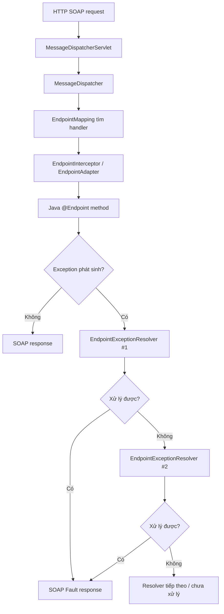

# Tùy chỉnh resolver và thứ tự áp dụng khi có nhiều resolver

## 1. Vấn đề cần giải quyết trong một SOAP server

Trong **Spring Web Services (Spring-WS)** theo hướng **contract-first**, XSD/WSDL là hợp đồng giữa SOAP provider và các consumer. Endpoint Java có thể phát sinh nhiều kiểu lỗi: sai quy tắc hủy đơn, không tìm thấy đơn hàng, timeout từ hệ thống đối tác hoặc sự cố nội bộ. Server cần chuyển lỗi thành **SOAP Fault** đúng phiên bản SOAP, ổn định và không tiết lộ thông tin nhạy cảm.

Một ứng dụng có thể cùng lúc đăng ký:

- `SoapFaultMappingExceptionResolver` để ánh xạ exception class sang mã và reason của SOAP Fault.
- `SoapFaultAnnotationExceptionResolver` để đọc metadata từ `@SoapFault`.
- Resolver tùy chỉnh để tạo `detail` có QName và cấu trúc tuân thủ XSD/WSDL.
- Resolver dự phòng để trả lỗi server chung với exception chưa được phân loại.

**Nếu nhiều resolver cùng xử lý được một exception, thứ tự áp dụng quyết định kết quả**. Đặt một fallback bắt mọi lỗi ở đầu có thể khiến resolver nghiệp vụ hoặc resolver annotation không bao giờ chạy; client nhận fault chung và mất error code đã công bố.

Bài này trình bày cách thiết kế tập resolver theo thứ tự rõ ràng, cách tùy chỉnh Fault Detail và phương pháp kiểm thử. Ví dụ xuyên suốt là operation `CancelOrder` thuộc namespace XML `https://example.org/orders/v1`. Địa chỉ này minh họa QName trong hợp đồng, **không phải HTTP endpoint thực**.

### Mục tiêu học tập

Sau khi học, bạn có thể:

1. Phân biệt Java exception, SOAP Fault, HTTP status và typed Fault Detail trong WSDL.
2. Hiểu hợp đồng `EndpointExceptionResolver.resolveException(...)` và cơ chế xử lý lần lượt theo `Ordered`.
3. Dùng `SoapFaultMappingExceptionResolver`, `SoapFaultAnnotationExceptionResolver` và resolver tự viết một cách có chủ đích.
4. Tùy chỉnh SOAP Fault code/reason/detail mà không lộ exception message nội bộ.
5. Đặt resolver chuyên biệt trước, fallback cuối và tránh hai mapping chồng chéo.
6. Phân biệt SOAP 1.1 `Client/Server` với SOAP 1.2 `Sender/Receiver`.
7. Nhận ra lỗi parsing, XSD hoặc WS-Security có thể **không** đi qua chuỗi endpoint exception resolvers.
8. Viết kiểm thử precedence, JAXB/XML detail, SOAP Fault và interoperability với client độc lập.

## 2. SOAP Fault là cấu trúc XML chuẩn hóa, không phải stack trace

Java exception biểu diễn sự cố ở trong JVM. SOAP Fault là thông điệp được gửi trên wire theo SOAP version đã thỏa thuận.

### 2.1. Ví dụ SOAP 1.1

```xml
<soap:Envelope
    xmlns:soap="http://schemas.xmlsoap.org/soap/envelope/"
    xmlns:ord="https://example.org/orders/v1">
  <soap:Body>
    <soap:Fault>
      <faultcode>soap:Client</faultcode>
      <faultstring>Order cancellation was rejected</faultstring>
      <detail>
        <ord:BusinessFault>ORDER_ALREADY_CANCELLED</ord:BusinessFault>
      </detail>
    </soap:Fault>
  </soap:Body>
</soap:Envelope>
```

| Phần SOAP 1.1 | Vai trò |
|---|---|
| `faultcode` | Phân loại lỗi giao thức như `Client`, `Server`, `VersionMismatch`, `MustUnderstand` |
| `faultstring` | Mô tả lỗi an toàn cho consumer; không phải stack trace |
| `faultactor` | Xác định tác nhân gây lỗi trong các trường hợp phù hợp |
| `detail` | Thông tin ứng dụng có cấu trúc; có thể được ràng buộc với XSD/WSDL |

Trong ví dụ, `ORDER_ALREADY_CANCELLED` là **business error code** ổn định. Nó không nên được thay bằng thông điệp Java thô hoặc nội dung SQL.

### 2.2. Ví dụ SOAP 1.2

```xml
<env:Envelope
    xmlns:env="http://www.w3.org/2003/05/soap-envelope"
    xmlns:ord="https://example.org/orders/v1">
  <env:Body>
    <env:Fault>
      <env:Code><env:Value>env:Sender</env:Value></env:Code>
      <env:Reason>
        <env:Text xml:lang="en">
          Order cancellation was rejected
        </env:Text>
      </env:Reason>
      <env:Detail>
        <ord:BusinessFault>ORDER_ALREADY_CANCELLED</ord:BusinessFault>
      </env:Detail>
    </env:Fault>
  </env:Body>
</env:Envelope>
```

SOAP 1.2 sử dụng `Code/Value`, `Reason/Text`, `Detail`; code `Sender`/`Receiver` thay cho `Client`/`Server`. SOAP 1.1 và 1.2 không chỉ khác một chữ trong mã lỗi: Envelope namespace, media type, HTTP binding, SOAP action và cấu trúc fault đều cần phù hợp WSDL.

**Không tự nối XML SOAP 1.1 rồi trả nó từ service đang dùng SOAP 1.2.** Hãy sử dụng API `SoapMessage` và `SoapFault` của Spring-WS để framework tạo message theo SOAP version đang cấu hình.

### 2.3. HTTP status không phải đủ để phân loại Fault

Trong SOAP over HTTP, một lỗi xử lý SOAP thường đi cùng HTTP 500, nhưng không được suy luận ngược rằng **mọi** HTTP 500 đều là SOAP Fault: reverse proxy có thể trả HTML, upstream có thể đóng kết nối hoặc TLS handshake có thể thất bại trước HTTP.

Cũng không tự định nghĩa quy tắc «mọi lỗi nghiệp vụ phải trả HTTP 400» khi chưa đối chiếu SOAP version và binding. Client cần đọc SOAP Fault code và Detail, đồng thời xử lý lỗi HTTP transport **riêng**.

## 3. `EndpointExceptionResolver` nằm ở đâu trong pipeline?

Luồng khái niệm:



Đây là sơ đồ mục đích. Một số exception có thể xuất hiện khi framework đang xử lý endpoint, và một số lỗi xảy ra **trước khi endpoint được chọn**. Không mặc định parser error hoặc TLS error sẽ đi đúng luồng trên.

### 3.1. Hợp đồng resolver

API của Spring-WS có dạng:

```java
boolean resolveException(
    MessageContext messageContext,
    Object endpoint,
    Exception exception
);
```

- Trả `true`: exception đã được resolver xử lý; các resolver sau **không tiếp tục nhận** exception đó.
- Trả `false`: resolver không xử lý; dispatcher có thể thử resolver tiếp theo.
- Resolver ném lỗi khi đang xây Fault: hệ thống gặp lỗi xử lý Fault, không được mặc nhiên dựa vào fallback có thể sửa mọi thứ.

**Thứ tự càng quan trọng khi hai resolver có điều kiện khớp nhau.** Một resolver trả handled trước sẽ quyết định Fault response.

### 3.2. `Ordered`: số nhỏ được ưu tiên trước

Các resolver thuộc họ `AbstractEndpointExceptionResolver` hỗ trợ cấu hình order, ví dụ:

```java
resolver.setOrder(100);
```

Quy ước:

```text
order=0                    Business resolver
order=100                  Annotation resolver
order=200                  Integration resolver
order=LOWEST_PRECEDENCE    Safe fallback
```

Số **nhỏ hơn** được xét **trước**. Không nên để hai resolver có cùng thứ tự và dựa vào thứ tự component scan hay tên bean, vì đó không phải một chính sách đáng tin để bảo vệ WSDL fault contract. Với ứng dụng cụ thể, xác nhận resolver beans thực sự được dispatcher nạp và sắp xếp trên Spring-WS version đang chạy.

Có thể gặp `@Order` hoặc interface `Ordered` trong hệ sinh thái Spring; nếu resolver có `setOrder(...)` thì setter tường minh làm cấu hình dễ review và test.

### 3.3. Có `defaultFault` nghĩa là gì?

Một resolver mapping không nhận diện exception và **không có** fallback có thể để resolver sau xử lý. Nhưng một resolver có `defaultFault` sẽ có khả năng tạo Fault cho các lỗi ngoài danh sách mapping của nó.

Ví dụ xấu:

```text
order=0:    MappingResolver + defaultFault=SERVER
order=100:  AnnotationResolver
order=200:  PartnerResolver
```

Nếu resolver ở order 0 áp dụng default Fault cho ngoại lệ không khớp mapping, hai resolver sau có thể **không bao giờ được hỏi**. Vì vậy, **đặt catch-all cuối**.

## 4. Phân loại lỗi trước khi đặt precedence

Một thiết kế tốt bắt đầu từ taxonomy chứ không phải code resolver.

| Nhóm | Exception ví dụ | Fault mong muốn | Ai chịu trách nhiệm? |
|---|---|---|---|
| Nghiệp vụ đã biết | `OrderRuleViolation` | Sender/Client + typed BusinessFault | Domain → SOAP adapter |
| Hợp đồng API bị từ chối có chủ đích | `UnsupportedContractVersionException` | Sender/Client với reason công khai | SOAP boundary |
| Đối tác upstream không sẵn sàng | `PartnerUnavailableException` | Receiver/Server chung, không lộ URL | Integration adapter |
| Lỗi nội bộ chưa biết | `IllegalStateException`, `NullPointerException` | Receiver/Server generic | Safe fallback |
| XML sai cú pháp | Parser/message factory | Lỗi protocol/transport | Tầng nhận XML |
| SOAP Body sai XSD | `PayloadValidatingInterceptor` | Schema fault theo config | Validation layer |
| WS-Security sai | `Wss4jSecurityInterceptor` | Security fault/từ chối phù hợp policy | Security layer |
| Không đủ quyền | Authorization policy | Fault hoặc transport rejection theo policy | Security/domain |

Một cách chia trách nhiệm dễ hiểu:

1. **Business resolver:** chỉ nhận ngoại lệ nghiệp vụ đã được mã hóa.
2. **Annotation resolver:** nhận exception chuyên biệt có `@SoapFault`.
3. **Integration resolver:** nhận timeout/lỗi kết nối đã được wrap thành exception có nghĩa.
4. **Fallback resolver:** nhận những exception chưa được phân loại và trả thông báo chung an toàn.

Không bắt buộc mọi project đều cần đủ bốn bean. Với ứng dụng ít lỗi, có thể đơn giản hơn; nhưng luôn phải biết **mỗi resolver bắt loại lỗi nào** và điều gì xảy ra với lỗi còn lại.

### 4.1. Tại sao không phản chiếu exception message ra client?

Một exception có thể chứa:

```text
"Partner call to https://internal-host:8443/orders failed;
 X509 path validation failed for alias ...; order=..."
```

Nội dung đó không thuộc hợp đồng SOAP và có thể làm lộ topology, certificate hoặc dữ liệu cá nhân. Fault public chỉ nên chứa mã lỗi đã phê duyệt, reason chung và metadata an toàn như correlation ID nếu hợp đồng có.

## 5. Thiết kế Fault Detail bằng XSD/WSDL

Trong contract-first, client tích hợp ổn định nhờ có phần dữ liệu lỗi **được công bố**, không phải vì đọc text exception do server tự phát ra.

### 5.1. Global element lỗi trong XSD

```xml
<?xml version="1.0" encoding="UTF-8"?>
<xs:schema xmlns:xs="http://www.w3.org/2001/XMLSchema"
           xmlns:ord="https://example.org/orders/v1"
           targetNamespace="https://example.org/orders/v1"
           elementFormDefault="qualified">

  <xs:simpleType name="OrderFaultCodeType">
    <xs:restriction base="xs:token">
      <xs:enumeration value="ORDER_NOT_FOUND"/>
      <xs:enumeration value="ORDER_ALREADY_CANCELLED"/>
      <xs:enumeration value="CANCELLATION_WINDOW_CLOSED"/>
    </xs:restriction>
  </xs:simpleType>

  <xs:element name="BusinessFault" type="ord:OrderFaultCodeType"/>
</xs:schema>
```

Dữ liệu lỗi:

```xml
<ord:BusinessFault xmlns:ord="https://example.org/orders/v1">
  ORDER_ALREADY_CANCELLED
</ord:BusinessFault>
```

QName phải là `{https://example.org/orders/v1}BusinessFault`. Ở ví dụ này element có **simple content** (chính mã lỗi), nên không tự ý thay bằng complex element chứa `code` và `message` nếu XSD chưa định nghĩa.

### 5.2. Fragment WSDL 1.1

```xml
<!-- Trong wsdl:definitions, khai báo xmlns tương ứng -->
<wsdl:message name="BusinessFaultMessage">
  <wsdl:part name="fault" element="ord:BusinessFault"/>
</wsdl:message>

<!-- Bên trong wsdl:portType/wsdl:operation name="CancelOrder" -->
<wsdl:fault name="BusinessFault"
            message="tns:BusinessFaultMessage"/>

<!-- Bên trong wsdl:binding/wsdl:operation name="CancelOrder" -->
<wsdl:fault name="BusinessFault">
  <soap:fault name="BusinessFault" use="literal"/>
</wsdl:fault>
```

Đây chỉ là **các fragment minh họa**, không phải WSDL hoàn chỉnh. WSDL thật phải có `wsdl:definitions`, namespace bindings, operation/input/output, SOAP binding, `service/port` và `soap:address` phù hợp. Tài liệu được phát hành cần kiểm chứng bởi client bên ngoài.

Nếu dự án đang dùng WSDL đã ký duyệt, thêm typed fault là **thay đổi hợp đồng**, không chỉ là đổi cấu hình resolver. Cần versioning và đánh giá client compatibility.

### 5.3. Lợi ích và giới hạn của enum error code

Mã lỗi `ORDER_ALREADY_CANCELLED` ổn định hơn text tiếng Việt/tiếng Anh. Tuy nhiên, thêm một enum code mới cũng có thể ảnh hưởng client sinh kiểu enum tĩnh từ XSD. Khi thay mã lỗi, cần test công cụ client hiện hữu và quy trình phát hành.

Mỗi resolver phải tạo Fault Detail **đúng QName và schema**, không tự tạo raw XML bằng phép nối chuỗi từ message người dùng.

## 6. Tạo exception domain có public code rõ ràng

Thay vì cho SOAP layer phân tích chuỗi exception, tạo error type mang mã đã được kiểm soát:

```java
package org.example.orders.domain;

public enum OrderErrorCode {
    ORDER_NOT_FOUND,
    ORDER_ALREADY_CANCELLED,
    CANCELLATION_WINDOW_CLOSED
}
```

```java
package org.example.orders.domain;

public final class OrderRuleViolation extends RuntimeException {
    private final OrderErrorCode code;

    public OrderRuleViolation(
            OrderErrorCode code, String internalExplanation) {
        super(internalExplanation);
        this.code = code;
    }

    public OrderErrorCode code() {
        return code;
    }
}
```

Ném lỗi từ service:

```java
if (order.isCancelled()) {
    throw new OrderRuleViolation(
        OrderErrorCode.ORDER_ALREADY_CANCELLED,
        "Cancellation rejected: already cancelled");
}
```

Phần `internalExplanation` chỉ dành cho việc chẩn đoán có kiểm soát. SOAP Fault Detail sẽ dùng `code().name()` đã nằm trong enum; không dùng `getMessage()`.

Giữ domain exception không phụ thuộc trực tiếp SOAP giúp cùng một service được dùng bởi REST, batch hoặc message consumers khác.

## 7. `SoapFaultMappingExceptionResolver`: ánh xạ class sang Fault

Đây là resolver thông dụng cho trường hợp một exception class tương ứng một fault code/reason cố định.

### 7.1. Ví dụ đơn giản

```java
import java.util.Properties;
import org.springframework.context.annotation.Bean;
import org.springframework.context.annotation.Configuration;
import org.springframework.ws.soap.server.endpoint.SoapFaultMappingExceptionResolver;

@Configuration
public class OrderFaultConfiguration {

    @Bean
    public SoapFaultMappingExceptionResolver businessMappingResolver() {
        SoapFaultMappingExceptionResolver resolver =
            new SoapFaultMappingExceptionResolver();

        Properties mappings = new Properties();
        mappings.setProperty(
            "org.example.orders.domain.OrderRuleViolation",
            "CLIENT,Order cancellation was rejected");

        resolver.setExceptionMappings(mappings);
        resolver.setOrder(0);
        return resolver;
    }
}
```

Cách đọc:

- Key là exception class name; nên dùng FQCN chính xác.
- Value là khai báo Fault code và string/reason theo định dạng mapping của Spring-WS.
- `setOrder(0)` đưa resolver nghiệp vụ lên đầu.
- **Không gắn defaultFault ở resolver này** nếu mong đợi resolver annotation/integration phía sau xử lý exception khác.

Khi có subclass hoặc exception wrapping, quy tắc mapping phải được kiểm thử trên version Spring-WS cụ thể. Không giả định framework sẽ tự unwrap mọi cause sâu bên trong một RuntimeException.

### 7.2. Hạn chế: chưa có typed Fault Detail

Một resolver mapping thuần có thể tạo mã và reason, nhưng Fault Detail như `BusinessFault` trong XSD cần được bổ sung riêng. Không nên tạo thêm một resolver thứ hai với cùng exception mapping chỉ để viết detail: resolver đầu có thể xử lý rồi khiến resolver thứ hai không chạy.

Giải pháp tốt hơn là **kế thừa mapping resolver và tùy chỉnh fault ngay trong chính resolver đó**.

## 8. Tùy chỉnh `SoapFaultMappingExceptionResolver` để tạo Fault Detail

### 8.1. Custom resolver

```java
package org.example.orders.soap.fault;

import javax.xml.namespace.QName;
import org.example.orders.domain.OrderRuleViolation;
import org.springframework.ws.soap.SoapFault;
import org.springframework.ws.soap.SoapFaultDetail;
import org.springframework.ws.soap.SoapFaultDetailElement;
import org.springframework.ws.soap.server.endpoint.SoapFaultMappingExceptionResolver;

public final class BusinessFaultResolver
        extends SoapFaultMappingExceptionResolver {

    private static final String NS =
        "https://example.org/orders/v1";

    @Override
    protected void customizeFault(
            Object endpoint, Exception ex, SoapFault fault) {

        if (!(ex instanceof OrderRuleViolation rule)) {
            return;
        }

        SoapFaultDetail detail = fault.addFaultDetail();
        SoapFaultDetailElement entry =
            detail.addFaultDetailElement(new QName(NS, "BusinessFault"));

        // Chỉ xuất bản enum code đã được XSD phê duyệt.
        entry.addText(rule.code().name());
    }
}
```

`customizeFault(...)` là extension hook trong họ `AbstractSoapFaultDefinitionExceptionResolver`. Spring-WS xây dựng SOAP Fault theo cấu hình/message version, còn class này bổ sung ứng dụng detail.

**Hook chỉ được gọi khi resolver này thực sự xử lý lỗi.** Một Fault được tạo trực tiếp bởi validation hoặc WS-Security interceptor có thể không đi qua method đó.

### 8.2. Bean thay thế mapping resolver ở mục 7

```java
@Bean
public BusinessFaultResolver businessFaultResolver() {
    BusinessFaultResolver resolver = new BusinessFaultResolver();

    Properties mappings = new Properties();
    mappings.setProperty(
        OrderRuleViolation.class.getName(),
        "CLIENT,Order cancellation was rejected");

    resolver.setExceptionMappings(mappings);
    resolver.setOrder(0);
    return resolver;
}
```

Đây là **phương án thay thế**, không phải một bean phải đăng ký cùng với `businessMappingResolver()` ở mục 7. Một project chỉ cần một resolver chịu trách nhiệm chính cho `OrderRuleViolation`.

### 8.3. Định dạng detail phụ thuộc hợp đồng

Với `BusinessFault` simple type, cách dùng `entry.addText(...)` là phù hợp. Nhưng nếu schema thật quy định:

```xml
<ord:BusinessFault>
  <ord:code>ORDER_ALREADY_CANCELLED</ord:code>
  <ord:correlationId>...</ord:correlationId>
</ord:BusinessFault>
```

thì phải dùng XML writer hoặc JAXB theo đúng complex type; **không** thể lấy class ở trên rồi giả định Fault Detail đã hợp lệ. Hãy schema-validate detail từ response thực trước khi giao cho đối tác.

### 8.4. Không làm resolver trở thành nơi xử lý nghiệp vụ

Resolver không nên gọi database, xác nhận tồn kho, retry đối tác hoặc thay trạng thái đơn hàng. Nó nên nhận exception **đã được phân loại**, ánh xạ nhanh sang Fault và hoàn tất. Giữ resolver đơn giản làm giảm khả năng lỗi khi đang tạo lỗi.

## 9. `SoapFaultAnnotationExceptionResolver`: áp dụng metadata trên exception

Với một exception chỉ thuộc SOAP boundary, bạn có thể công bố Fault bằng annotation:

```java
import org.springframework.ws.soap.server.endpoint.annotation.FaultCode;
import org.springframework.ws.soap.server.endpoint.annotation.SoapFault;

@SoapFault(
    faultCode = FaultCode.CLIENT,
    faultStringOrReason = "Unsupported contract version")
public final class UnsupportedContractVersionException
        extends RuntimeException {
}
```

Đăng ký resolver:

```java
import org.springframework.context.annotation.Bean;
import org.springframework.ws.soap.server.endpoint.SoapFaultAnnotationExceptionResolver;

@Bean
public SoapFaultAnnotationExceptionResolver annotationFaultResolver() {
    SoapFaultAnnotationExceptionResolver resolver =
        new SoapFaultAnnotationExceptionResolver();
    resolver.setOrder(100);
    return resolver;
}
```

Điểm cần nhớ:

- Annotation trên exception không tự đảm bảo resolver được nạp vào SOAP dispatcher đúng context.
- Nếu một resolver order thấp hơn đã xử lý exception, annotation resolver không được gọi.
- Annotation phù hợp cho code/reason cố định; lỗi cần typed detail hoặc multi-field logic nên dùng mapping/custom resolver.
- Một domain exception dùng chung giữa nhiều giao diện có thể không nên phụ thuộc `@SoapFault`; mapping ở SOAP adapter giúp tách tầng.

### 9.1. Trường hợp hai resolver cùng quan tâm một exception

Giả sử exception `OrderRuleViolation` vừa có `@SoapFault` vừa được map trong business resolver:

```text
businessFaultResolver   order=0      matches OrderRuleViolation
annotationFaultResolver order=100    sees @SoapFault
```

Business resolver chạy trước; nếu nó xử lý xong, annotation resolver không được hỏi. Đây không phải fallback ngẫu nhiên, mà là **quy tắc precedence**. Tuy nhiên, nên tránh khai báo hai nguồn fault policy mâu thuẫn, trừ khi điều đó được quyết định rõ và có regression tests.

## 10. Resolver cho lỗi tích hợp đối tác

Một timeout ở SOAP partner không phải lỗi cú pháp request của consumer. Gói lỗi transport thành exception có ý nghĩa trong integration adapter:

```java
package org.example.orders.integration;

public final class PartnerUnavailableException
        extends RuntimeException {
    public PartnerUnavailableException(Throwable cause) {
        super("External dependency unavailable", cause);
    }
}
```

Mapping:

```java
@Bean
public SoapFaultMappingExceptionResolver integrationFaultResolver() {
    SoapFaultMappingExceptionResolver resolver =
        new SoapFaultMappingExceptionResolver();

    Properties mappings = new Properties();
    mappings.setProperty(
        PartnerUnavailableException.class.getName(),
        "SERVER,Service temporarily unavailable");

    resolver.setExceptionMappings(mappings);
    resolver.setOrder(200);
    return resolver;
}
```

Lỗi này thường thuộc nhóm **Server/Receiver**, khác với business fault `Client/Sender`. Không đưa hostname, URL nội bộ, certificate, username hoặc root cause string vào SOAP Fault. Nếu partner timeout trong quá trình xử lý transaction có khả năng đã commit ở upstream, retry phải tuân theo idempotency và quy trình phục hồi, không chỉ nhìn fault code rồi gọi lại vô hạn.

SOAP 1.2 cần biểu diễn receiver fault theo cấu trúc/version của message factory. Hãy test cả hai version nếu WSDL service cung cấp cả hai binding.

## 11. Safe fallback resolver phải ở cuối

Một exception chưa biết (bug, `IllegalStateException`, lỗi database chưa được phân loại) cần phản hồi chung, không làm lộ nội bộ.

### 11.1. Cấu hình fallback

```java
import org.springframework.core.Ordered;
import org.springframework.context.annotation.Bean;
import org.springframework.ws.soap.server.endpoint.SoapFaultDefinition;
import org.springframework.ws.soap.server.endpoint.SoapFaultMappingExceptionResolver;

@Bean
public SoapFaultMappingExceptionResolver safeFallbackFaultResolver() {
    SoapFaultMappingExceptionResolver resolver =
        new SoapFaultMappingExceptionResolver();

    SoapFaultDefinition defaultFault =
        new SoapFaultDefinition();
    defaultFault.setFaultCode(SoapFaultDefinition.SERVER);
    defaultFault.setFaultStringOrReason("Internal processing error");

    resolver.setDefaultFault(defaultFault);
    resolver.setOrder(Ordered.LOWEST_PRECEDENCE);
    return resolver;
}
```

Resolver này **không khai báo exceptionMappings chuyên biệt**; nó có `defaultFault` để nhận các lỗi chưa được resolver trước xử lý trong phạm vi exception resolution.

Tại sao dùng `LOWEST_PRECEDENCE`?

- Business resolver có cơ hội tạo detail.
- Annotation resolver có cơ hội tạo reason từ `@SoapFault`.
- Integration resolver có cơ hội phân loại upstream error.
- Fallback chỉ nhận phần còn lại.

### 11.2. Không dùng message của exception trong fallback

Đây là cách thiết kế nguy hiểm:

```java
defaultFault.setFaultStringOrReason(exception.getMessage());
```

Đây chỉ là **anti-pattern minh họa**, không phải code có sẵn biến `exception` trong method cấu hình. Raw exception message có thể chứa stack trace detail, SQL, file path, URL nội bộ, PII hoặc thông tin chứng chỉ.

Reason nên là text an toàn, ổn định. Có thể cung cấp correlation ID theo contract nếu được cho phép và đã chuẩn hóa, còn thông tin nguyên nhân được ghi vào hệ thống logging/trace có phân quyền.

### 11.3. Fallback không thay thế transport error handling

Một SOAP Envelope không parse được, TLS handshake thất bại hoặc proxy trả HTML error có thể không tới đoạn xử lý EndpointExceptionResolver. Do đó fallback giúp **endpoint-processing exceptions** có Fault an toàn, không bảo đảm mọi lỗi mạng đều thành SOAP XML.

## 12. Một cấu hình tổng hợp bốn resolver

Để tránh việc đăng ký các bean trùng nhau từ snippets rải rác, hãy chọn **một** cấu hình tổng hợp sau. Business resolver có custom detail từ mục 8.

```java
import java.util.Properties;
import org.springframework.context.annotation.Bean;
import org.springframework.context.annotation.Configuration;
import org.springframework.core.Ordered;
import org.springframework.ws.soap.server.endpoint.SoapFaultDefinition;
import org.springframework.ws.soap.server.endpoint.SoapFaultMappingExceptionResolver;
import org.springframework.ws.soap.server.endpoint.SoapFaultAnnotationExceptionResolver;
import org.example.orders.domain.OrderRuleViolation;
import org.example.orders.integration.PartnerUnavailableException;
import org.example.orders.soap.fault.BusinessFaultResolver;

@Configuration
public class SoapFaultResolversConfiguration {

    @Bean
    public BusinessFaultResolver businessFaultResolver() {
        BusinessFaultResolver resolver = new BusinessFaultResolver();
        Properties mappings = new Properties();
        mappings.setProperty(
            OrderRuleViolation.class.getName(),
            "CLIENT,Order cancellation was rejected");
        resolver.setExceptionMappings(mappings);
        resolver.setOrder(0);
        return resolver;
    }

    @Bean
    public SoapFaultAnnotationExceptionResolver annotationFaultResolver() {
        SoapFaultAnnotationExceptionResolver resolver =
            new SoapFaultAnnotationExceptionResolver();
        resolver.setOrder(100);
        return resolver;
    }

    @Bean
    public SoapFaultMappingExceptionResolver integrationFaultResolver() {
        SoapFaultMappingExceptionResolver resolver =
            new SoapFaultMappingExceptionResolver();
        Properties mappings = new Properties();
        mappings.setProperty(
            PartnerUnavailableException.class.getName(),
            "SERVER,Service temporarily unavailable");
        resolver.setExceptionMappings(mappings);
        resolver.setOrder(200);
        return resolver;
    }

    @Bean
    public SoapFaultMappingExceptionResolver safeFallbackFaultResolver() {
        SoapFaultMappingExceptionResolver resolver =
            new SoapFaultMappingExceptionResolver();
        SoapFaultDefinition defaultFault =
            new SoapFaultDefinition();
        defaultFault.setFaultCode(SoapFaultDefinition.SERVER);
        defaultFault.setFaultStringOrReason(
            "Internal processing error");
        resolver.setDefaultFault(defaultFault);
        resolver.setOrder(Ordered.LOWEST_PRECEDENCE);
        return resolver;
    }
}
```

Đây là code config theo nhóm, cần có exception classes và `BusinessFaultResolver` đã định nghĩa. **Không sao chép thêm tất cả các `@Bean` đơn lẻ ở mục 7–11 vào cùng application context**, vì sẽ tạo nhiều resolver xử lý cùng exception.

### 12.1. Ma trận precedence dự kiến

| Bean | Order | Default fault? | Nhóm lỗi |
|---|---:|---|---|
| `businessFaultResolver` | 0 | Không | OrderRuleViolation |
| `annotationFaultResolver` | 100 | Không | Exception có `@SoapFault` |
| `integrationFaultResolver` | 200 | Không | PartnerUnavailableException |
| `safeFallbackFaultResolver` | LOWEST | Có | Lỗi chưa phân loại |

Các bean resolver khác do framework/module thêm vào có thể ảnh hưởng thứ tự. Đừng chỉ kiểm tra danh sách trong class config; hãy xác nhận **runtime ApplicationContext mà SOAP servlet sử dụng** và kết quả các test lỗi đặc thù.

### 12.2. Tránh cùng order

Khi nhiều resolver có cùng order, kết quả có thể phụ thuộc chi tiết sắp xếp và cấu hình môi trường. Không đặt precedence nghiệp vụ dựa trên thứ tự scan của Spring components. Chọn các mốc khác nhau (0, 100, 200, LOWEST) để có khoảng dành cho resolver tương lai.

## 13. Resolver bean và interceptor bean không được đăng ký giống nhau

Spring-WS có hai nhóm extension points thường bị nhầm:

- `EndpointInterceptor`: có callback `handleRequest`, `handleResponse`, `handleFault` và `afterCompletion`, được gắn vào endpoint mapping.
- `EndpointExceptionResolver`: được dispatcher sử dụng để **giải quyết exception** trên đường endpoint processing.

Vì thế:

```java
@Override
public void addInterceptors(List<EndpointInterceptor> interceptors) {
    interceptors.add(payloadValidatingInterceptor);
}
```

đây là ví dụ đăng ký interceptor, **không phải** nơi thêm `SoapFaultMappingExceptionResolver`. Resolver là bean thuộc cơ chế exception resolution của dispatcher; việc có bean trong một `ApplicationContext` không đồng nghĩa servlet ở context khác sẽ nhìn thấy.

### 13.1. Spring Boot cùng context

Một ứng dụng Boot phổ biến có thể dùng `@EnableWs`, `MessageDispatcherServlet`, endpoint và các resolver beans trong cùng Spring web application context.

```java
@Configuration
@EnableWs
public class SoapServerConfig {
    @Bean
    public ServletRegistrationBean<MessageDispatcherServlet> soapServlet(
            ApplicationContext context) {
        MessageDispatcherServlet servlet =
            new MessageDispatcherServlet();
        servlet.setApplicationContext(context);
        servlet.setTransformWsdlLocations(false);
        return new ServletRegistrationBean<>(servlet, "/ws/*");
    }
}
```

Ví dụ là phương án **manual servlet registration**. Nếu Spring Boot starter đã auto-register `MessageDispatcherServlet`, không đăng ký thêm một servlet thứ hai chồng mapping. Cần kiểm tra bootstrap thực tế trên phiên bản Boot được dùng.

### 13.2. WAR root/child context

Với WAR truyền thống:

```text
Root ApplicationContext:
  OrdersService, repository, shared infrastructure

SOAP child WebApplicationContext:
  @Endpoint, @EnableWs / mapping / adapter
  EndpointExceptionResolver beans
  EndpointInterceptor beans
  Wsdl11Definition / XsdSchema
```

Một resolver chỉ nằm trong sibling MVC child context không tự trở thành resolver của SOAP servlet. Với parent/child, phải hiểu quy tắc bean visibility và cách dispatcher tìm resolver trong context. Đặt các cấu hình SOAP chuyên biệt ở đúng SOAP context giúp hành vi nhất quán.

### 13.3. WSDL publication không quyết định resolver precedence

`SimpleWsdl11Definition` công bố bản WSDL tĩnh; `DefaultWsdl11Definition` có thể sinh WSDL từ schema. Chúng không tạo hay sắp xếp exception resolvers. Một bản WSDL hợp lệ không chứng minh typed Fault Detail của runtime đúng; cần gửi request gây lỗi rồi so sánh SOAP Fault thật.

## 14. Exception mapping chồng nhau và bốn bẫy thường gặp

### 14.1. Catch-all chạy trước exception chuyên biệt

**Sai:**

```text
order=0:   fallback defaultFault=SERVER
order=100: business exception mapping
order=200: partner integration mapping
```

Khi domain ném `OrderRuleViolation`, fallback có thể trả generic `Internal processing error` trước. Client mất `BusinessFault` chi tiết.

**Sửa:** chỉ fallback cuối và có test bắt buộc kiểm tra QName/code của typed fault.

### 14.2. Mapping và annotation cùng nhận một exception

Nếu một exception vừa được map thành `CLIENT,Order rejected` vừa có `@SoapFault(faultCode=SERVER)`, kết quả phụ thuộc resolver order. Không đặt hai cấu hình mâu thuẫn nếu không có chủ đích; ưu tiên một nguồn policy.

### 14.3. Subclass và wrapper exception

Ví dụ:

```text
OrderRuleViolation
  -> subclass CancellationWindowViolation
PartnerUnavailableException
  -> wrapped by RuntimeException in another layer
```

Subclass có thể được mapping theo exception superclass tùy rule matching của resolver; nhưng wrapper là **một exception khác**. Nếu framework nhận `RuntimeException` bên ngoài, mapping cho `PartnerUnavailableException` ở cause sâu bên trong có thể không được chọn.

Giải pháp là kiểm tra **type exception thực sự tới resolver**, định nghĩa chính sách unwrapping khi cần và test các trường hợp. Không unwrap bừa rồi chuyển một lỗi server thành lỗi Client chỉ vì cause chain chứa một domain exception ở đâu đó.

### 14.4. Exception khi viết Fault Detail

Nếu `customizeFault(...)` ném lỗi do QName sai, generated JAXB class thiếu hoặc writer bị hỏng, SOAP Fault có thể không được xây thành công. Không dựa vào fallback để chữa lỗi bên trong một resolver đã bắt đầu tạo response.

Để phòng tránh:

- Giữ custom detail writer tối giản.
- Xác nhận QName và XSD bằng unit test độc lập.
- Không gọi database hoặc network trong fault writer.
- Ghi metric/log có kiểm soát khi Fault serialization thất bại.
- Không xuất raw exception trong trường hợp xử lý lỗi kép.

## 15. Lỗi nào có thể không tới `EndpointExceptionResolver`?

Đây là giới hạn quan trọng nhất ngoài precedence.

### 15.1. Malformed XML trước mapping

Nếu request XML thiếu thẻ đóng hoặc SOAP Envelope không parse được, lỗi có thể xảy ra ngay tại message factory. Ứng dụng có thể **chưa chọn được endpoint**, nên không thể mặc định `EndpointExceptionResolver` sẽ nhận exception.

Cần transport-level handling và test malformed requests riêng.

### 15.2. `PayloadValidatingInterceptor`

`PayloadValidatingInterceptor` có thể tạo SOAP Fault do request không hợp lệ theo XSD mà không cần ném domain exception. Khi đó business resolver chỉ map `OrderRuleViolation` sẽ không chạy, và đó là hành vi hợp lý.

Nếu muốn điều chỉnh schema-validation fault format, phải tìm đúng extension point của validation interceptor/framework, không giả định thêm mapping `SAXParseException` sẽ bao phủ mọi schema failure.

### 15.3. `Wss4jSecurityInterceptor` và bảo mật

WS-Security có thể từ chối request vì chữ ký X.509 sai, timestamp hết hạn, token không hợp lệ hoặc XML Signature Wrapping policy. Lỗi này phải được giải quyết bởi security pipeline tương ứng, không tự đổi thành `ORDER_NOT_FOUND` hoặc business fault thông thường.

TLS/mTLS handshake error cũng có thể xảy ra **trước** khi có SOAP message, nên không có SOAP Fault XML để resolver tạo.

### 15.4. Interceptor short-circuit

Nếu một `EndpointInterceptor.handleRequest(...)` trả `false`, normal endpoint dispatch có thể dừng. Việc dừng không tự ném một Java exception tương ứng. Interceptor phải thiết lập SOAP Fault hoặc phản hồi phù hợp nếu nó muốn từ chối request.

### 15.5. SOAP response đã commit

Khi response đã được gửi một phần qua HTTP, lỗi xảy ra muộn có thể không còn khả năng thay bằng SOAP Fault sạch. Cần giảm side effects, test transport behavior và quan sát lỗi qua logs/metrics.

## 16. Khi nào nên tự viết resolver từ lớp cơ sở?

`SoapFaultMappingExceptionResolver` đủ cho nhiều trường hợp. Nhưng đôi khi cần phân loại theo domain code, endpoint, phiên bản WSDL hoặc client error profile. Spring-WS cung cấp `AbstractSoapFaultDefinitionExceptionResolver` để tùy biến fault definition.

Ví dụ skeleton:

```java
import org.springframework.ws.soap.server.endpoint.AbstractSoapFaultDefinitionExceptionResolver;
import org.springframework.ws.soap.server.endpoint.SoapFaultDefinition;

public class FineGrainedFaultResolver
        extends AbstractSoapFaultDefinitionExceptionResolver {

    @Override
    protected SoapFaultDefinition getFaultDefinition(
            Object endpoint, Exception exception) {

        if (!(exception instanceof OrderRuleViolation rule)) {
            return null; // Cho resolver khác cơ hội xử lý.
        }

        SoapFaultDefinition definition = new SoapFaultDefinition();
        definition.setFaultCode(SoapFaultDefinition.CLIENT);
        definition.setFaultStringOrReason(
            "Order cancellation was rejected");
        return definition;
    }
}
```

Code có thể mở rộng bằng `customizeFault(...)` để tạo detail. Nếu dùng phương án này, **không đăng ký song song** với business mapping resolver có cùng phạm vi trừ khi có chính sách fallback nội bộ.

### 16.1. Lọc theo endpoint object

Resolver nhận một `Object endpoint`. Với annotation endpoint, đó có thể là `MethodEndpoint`; với interface endpoint hoặc các lỗi sớm, object có thể khác hoặc không có. Nếu cần dựa vào endpoint để chọn fault contract:

```java
if (!(endpoint instanceof MethodEndpoint methodEndpoint)) {
    return null;
}
```

Đây chỉ là **fragment lựa chọn scope**; phải định nghĩa rõ cách xử lý các endpoint styles khác. Không ép kiểu không kiểm tra rồi vô tình ném `ClassCastException` ngay trong resolver.

### 16.2. Không chọn resolver theo dữ liệu không đáng tin

SOAPAction, HTTP header hay một field client khai không tự chứng minh identity hoặc quyền. Nếu ánh xạ Fault phụ thuộc tenant/security, lấy identity từ security context đã xác minh, không lấy giá trị header thô làm quyền quyết định.

### 16.3. Khi nào tách resolver theo hợp đồng v1/v2?

Nếu fault detail QName khác giữa v1/v2, có thể cần resolver dùng endpoint/version metadata để tạo đúng XML. Nhưng nên bắt đầu từ một domain taxonomy ổn định, adapter ánh xạ sang từng contract và test client v1/v2. Không tách hàng chục resolver chỉ vì tên Java method khác nhau.

## 17. SOAP Fault và transaction/idempotency

Fault mapping chỉ quyết định **cách thông báo lỗi**, không quyết định **trạng thái giao dịch**.

Giả sử `CancelOrder` gọi một partner, upstream đã xử lý hủy nhưng connection reset trước khi nhận response. Nếu server trả `PartnerUnavailableException` → `SERVER` fault, consumer retry có thể tạo hành động trùng. Cần idempotency key, transaction/outbox, optimistic locking và cơ chế tra cứu trạng thái theo thiết kế tích hợp.

Một business fault như `ORDER_ALREADY_CANCELLED` cũng cần phân biệt giữa từ chối do trạng thái sai và phản hồi an toàn cho retry idempotent. Đó là quyết định nghiệp vụ; resolver không tự giải quyết.

**Không biến lỗi hệ thống không biết thành lỗi Client** chỉ để ngăn retry; cũng không khuyến khích retry vô hạn mọi Server Fault. API contract phải làm rõ retry policy.

## 18. Kiểm thử thứ tự bằng `MockWebServiceClient`

Mục tiêu kiểm thử không phải chỉ là «có SOAP Fault», mà là **resolver đúng đã tạo lỗi đúng hợp đồng**.

### 18.1. Ma trận lỗi và resolver mong đợi

| Test case | Đầu vào / exception | Resolver dự kiến | Assertion chính |
|---|---|---|---|
| Business violation | `OrderRuleViolation(ORDER_ALREADY_CANCELLED)` | Business order=0 | Client/Sender + BusinessFault QName/code |
| Annotated exception | `UnsupportedContractVersionException` | Annotation order=100 | Client/Sender + reason công khai |
| Partner timeout | `PartnerUnavailableException` | Integration order=200 | Server/Receiver + reason không lộ host |
| Unknown runtime exception | `IllegalStateException` | Fallback cuối | Generic Server/Receiver |
| Exception subclass | `CancellationWindowViolation` | Theo mapping hierarchy | Đúng domain code hoặc policy fallback |
| Exception wrapper | `RuntimeException(cause=PartnerUnavailableException)` | Theo policy unwrap | Không sai phân loại |
| Annotation + mapping overlap | Exception có hai rules | Resolver ưu tiên đã định | Không bị rule thấp ghi đè |
| Fallback cố ý đặt sớm | Error nghiệp vụ | Fallback nhận trước | Negative test phát hiện mất typed Detail |
| XML malformed | XML parser | Không mặc định business resolver | Endpoint service không được gọi |
| XSD-invalid | Schema validator | Không mặc định business resolver | Invalid request bị chặn |
| WS-Security invalid | Security interceptor | Không mặc định domain resolver | Không vào business method |
| SOAP 1.2 | SOAP 1.2 message factory | Resolver cùng policy | Correct Code/Reason/Detail XML |
| Fault writer sai QName | Business resolver | Test lỗi tạo Fault | Không coi là pass |
| Interoperability | Client sinh mã từ WSDL | Contract-specific | Client đọc typed detail được |

### 18.2. Test skeleton

```java
import org.junit.jupiter.api.Test;
import org.springframework.beans.factory.annotation.Autowired;
import org.springframework.boot.test.context.SpringBootTest;
import org.springframework.context.ApplicationContext;
import org.springframework.ws.test.server.MockWebServiceClient;
import org.springframework.xml.transform.StringSource;

import static org.springframework.ws.test.server.RequestCreators.withPayload;
import static org.springframework.ws.test.server.ResponseMatchers.clientOrSenderFault;

@SpringBootTest
class BusinessFaultResolutionTest {

    @Autowired
    ApplicationContext context;

    @Test
    void alreadyCancelledOrderHasClientFault() {
        MockWebServiceClient client =
            MockWebServiceClient.createClient(context);

        String request = """
            <ord:CancelOrderRequest
              xmlns:ord="https://example.org/orders/v1">
              <ord:orderId>ORD-000123</ord:orderId>
            </ord:CancelOrderRequest>
            """;

        client.sendRequest(withPayload(new StringSource(request)))
            .andExpect(clientOrSenderFault());
    }
}
```

**Điều kiện để test có ý nghĩa:** Spring context phải có endpoint và resolver beans đúng; service test fixture phải thực sự ném `OrderRuleViolation(ORDER_ALREADY_CANCELLED)`; JAXB binding/XSD input phải phù hợp. Đoạn trên kiểm tra Fault class, **chưa chứng minh detail QName/code**.

### 18.3. Thêm matcher SOAP Fault Detail

Có thể dùng một custom response matcher:

```java
client.sendRequest(withPayload(new StringSource(request)))
    .andExpect(messageContext -> {
        SoapMessage response =
            (SoapMessage) messageContext.getResponse();

        SoapFault fault = response.getSoapBody().getFault();
        assertNotNull(fault);
        assertNotNull(fault.getFaultDetail());

        // Tiếp theo đọc Detail bằng XML API namespace-aware:
        // QName phải là {https://example.org/orders/v1}BusinessFault,
        // text phải là ORDER_ALREADY_CANCELLED.
        // Kiểm tra reason an toàn và validate Detail theo XSD.
    });
```

Ví dụ cần imports `org.springframework.ws.soap.SoapMessage`, `SoapFault` và JUnit assertions, và biến `request` từ fixture. Đây là **skeleton cho assertions**, không coi là test Detail hoàn chỉnh. Phần tối quan trọng cần bổ sung là đọc actual Fault Detail và so sánh QName/code, không chỉ `assertNotNull`.

### 18.4. Kiểm thử resolver order bằng negative configuration

Tạo test-only configuration cố ý đổi fallback thành order=0. Khi đó business fault có thể bị generic fallback che khuất. Regression test phải fail vì thiếu `BusinessFault`, rồi trở lại cấu hình chuẩn.

Một cách khác là spy resolver để đếm invocation và xác nhận resolver sau **không được gọi** khi resolver trước đã handled, nhưng vẫn phải giữ XML-level assertions để đảm bảo dữ liệu wire đúng.

### 18.5. Kiểm thử SOAP 1.1 và SOAP 1.2 riêng

SOAP 1.1 `faultcode/faultstring/detail` khác SOAP 1.2 `Code/Reason/Detail`. Nếu product hỗ trợ cả hai, cần hai message factories/bindings trong test phù hợp; không đổi một text assertion rồi giả định SOAP version đúng.

## 19. HTTP integration và client interoperability

Với SOAP 1.1, lưu request tại `cancel-order-soap11.xml`:

```xml
<soap:Envelope
    xmlns:soap="http://schemas.xmlsoap.org/soap/envelope/"
    xmlns:ord="https://example.org/orders/v1">
  <soap:Body>
    <ord:CancelOrderRequest>
      <ord:orderId>ORD-000123</ord:orderId>
    </ord:CancelOrderRequest>
  </soap:Body>
</soap:Envelope>
```

Lệnh POSIX shell minh họa:

```bash
curl -i -X POST "http://localhost:8080/ws" \
  -H 'Content-Type: text/xml; charset=utf-8' \
  -H 'SOAPAction: "urn:example:orders:CancelOrder"' \
  --data-binary @cancel-order-soap11.xml
```

Trong dự án thật, SOAPAction phải đúng `soap:operation@soapAction` của WSDL, không suy ra từ Java method. Nếu endpoint yêu cầu WS-Security, request không có chữ ký/token sẽ có thể bị từ chối trước domain, và không thể dùng nó để chứng minh resolver nghiệp vụ sai.

Kiểm tra:

1. HTTP request vào đúng `MessageDispatcherServlet`.
2. Operation mapping chọn đúng `@PayloadRoot`.
3. Domain ném exception đã được phân loại.
4. SOAP Fault có code, reason, Detail đúng SOAP version.
5. WSDL/XSD mô tả đúng typed fault mà client nhận.
6. Reverse proxy không thay SOAP response bằng HTML error.
7. TLS/mTLS/WS-Security và chứng chỉ hoạt động theo policy.
8. Không có internal exception message hoặc stack trace trong body.
9. Consumer khác công nghệ có thể đọc typed error code.
10. Retry và idempotency không gây side effects ngoài dự kiến.

`MockWebServiceClient` là kiểm thử Spring-WS pipeline bên trong context; nó **không thay thế** HTTP/TLS/gateway interoperability test.

## 20. Bảng chẩn đoán lỗi nhiều resolver

| Triệu chứng | Nguyên nhân thường gặp | Cách kiểm tra |
|---|---|---|
| Mọi exception thành generic Server Fault | Fallback bắt tất cả quá sớm | `setOrder`, `defaultFault` |
| Không thấy Fault Detail nghiệp vụ | Mapping resolver thuần chạy trước custom resolver | Đăng ký một resolver nghiệp vụ duy nhất |
| `@SoapFault` bị bỏ qua | Resolver mapping hoặc fallback đã handled trước | Order và mapping overlap |
| Business Fault detail sai QName | Namespace/local name không khớp XSD | XPath namespace-aware, XSD validation |
| Partner timeout thành Client Fault | Phân loại exception sai | Integration mapping và wrapper types |
| Unknown exception lộ nội bộ | Fallback dùng raw `getMessage()` | Reason cố định, logging có che dữ liệu |
| Fault SOAP 1.2 không đúng | Hard-code SOAP 1.1 XML | Dùng SoapFault API, test message factory |
| Fault không được tạo khi XML malformed | Lỗi xảy ra trước endpoint processing | Parser/transport handling |
| Schema validation fault không đi custom resolver | Interceptor tạo Fault trực tiếp | Tùy chỉnh đúng validation layer |
| Security fault không đi domain resolver | WS-Security xử lý trước endpoint | Test security pipeline riêng |
| Thêm resolver mới làm đổi kết quả | Order trùng hoặc default fallback | Runtime bean list + precedence tests |
| Error code detail không được client đọc | WSDL fault element khác response XML | XSD/WSDL và client interoperability |
| Resolver bean tồn tại nhưng không chạy | Bean ở sai servlet ApplicationContext | Root/child context, dispatcher |
| Fault writer ném lỗi | Custom XML/JAXB không hợp lệ | Test `customizeFault` và XSD |
| Fault chỉ xuất hiện sau khi nghiệp vụ đã commit | Transaction/outbox sai hoặc error mapping muộn | Domain transaction và idempotency |
| HTTP 500 nhưng không có SOAP XML | Proxy/servlet trả HTML hoặc transport failure | HTTP response headers/body và gateway |

### Quy trình tìm nguyên nhân

1. Xác định lỗi xảy ra trước endpoint mapping, trong endpoint, interceptor, hay sau response commit.
2. Nếu lỗi là Java exception trong endpoint, ghi nhận **type exception thật** đã được redact.
3. Liệt kê các resolver mà SOAP servlet context sử dụng, kiểm tra order.
4. Xem resolver nào có `defaultFault` và liệu nó có che resolver chuyên biệt không.
5. Xem class mapping, `@SoapFault`, subclass/wrapper và policy có trùng nhau không.
6. Kiểm tra SOAP Fault code, reason, Detail QName và text.
7. Validate Detail với XSD đã phê duyệt.
8. Test trên SOAP 1.1 và SOAP 1.2 nếu cả hai được hỗ trợ.
9. Thêm regression test cho lỗi precedence và fault detail writer.

## 21. Bài thực hành

Giả sử `OrdersService.cancel(orderId)` có thể: hủy thành công, báo đơn đã hủy, hoặc báo đối tác unavailable.

1. Thiết kế `BusinessFault` trong XSD với mã lỗi enum.
2. Thêm typed fault vào WSDL 1.1 theo quy trình contract review.
3. Tạo `OrderRuleViolation` chứa `OrderErrorCode`, giữ message nội bộ riêng.
4. Tạo `BusinessFaultResolver` kế thừa `SoapFaultMappingExceptionResolver` và override `customizeFault(...)`.
5. Đăng ký resolver business order=0 và không có defaultFault.
6. Tạo một exception SOAP-boundary gắn `@SoapFault`; đăng ký annotation resolver order=100.
7. Tạo `PartnerUnavailableException`; map sang SERVER reason an toàn với order=200.
8. Thêm generic fallback với `defaultFault` và `LOWEST_PRECEDENCE`.
9. Gửi request làm domain ném exception nghiệp vụ; kiểm tra typed Detail đúng enum.
10. Gửi request dẫn đến annotated exception; xác minh annotation resolver.
11. Gửi request dẫn đến partner timeout; xác minh integration fault không lộ host/cert.
12. Gửi request tạo exception lạ; xác minh generic fallback.
13. Cố tình đặt fallback lên order=0 trong test-only config và quan sát mất detail.
14. Thử một exception bị wrap và subclass để xác nhận exception mapping.
15. Gửi malformed XML, XSD-invalid request và WS-Security-invalid request; xác minh đúng layer phản hồi.
16. Kiểm thử SOAP 1.1/1.2, HTTP transport và client ngoài Spring-WS.
17. Đưa ma trận lỗi/precedence vào CI và theo dõi số lần fault theo error code.

### Câu hỏi tự kiểm tra

1. Vì sao `resolveException(...)` trả true khiến các resolver phía sau không được hỏi?
2. `defaultFault` ở resolver order=0 gây rủi ro gì?
3. Vì sao nên đặt fallback ở `Ordered.LOWEST_PRECEDENCE`?
4. `@SoapFault` khác exception mapping bằng `Properties` ở điểm nào?
5. Khi nào cần override `customizeFault(...)`?
6. Tại sao Fault Detail phải tuân theo QName và XSD/WSDL?
7. SOAP 1.1 `Client/Server` khác SOAP 1.2 `Sender/Receiver` ra sao?
8. Vì sao lỗi `PartnerUnavailableException` thường không nên mang Client Fault?
9. Khi XML parser không dựng được SOAP Envelope, resolver nghiệp vụ có chắc được gọi không?
10. Vì sao test chỉ `clientOrSenderFault()` chưa đủ để chứng minh precedence?
11. Một exception bọc trong RuntimeException có luôn match mapping của cause không?
12. Một exception vừa có `@SoapFault` vừa được mapping thì resolver nào thắng?
13. Vì sao không nên trả `ex.getMessage()` cho consumer?
14. Resolver có thể bảo đảm transaction rollback hoặc idempotency không?
15. Nếu SOAP Fault Detail đã đúng XSD nhưng enum mới được thêm, client cũ có thể gặp điều gì?

## 22. Definition of Done

- [ ] Đã phân loại lỗi business, contract, integration, internal, validation, security và transport.
- [ ] Resolver chuyên biệt chỉ nhận exception thuộc phạm vi của mình.
- [ ] Các resolver có order tường minh; không dựa vào component scan order.
- [ ] Resolver có `defaultFault` chạy sau mọi resolver chuyên biệt.
- [ ] Không tồn tại mapping và `@SoapFault` chồng chéo vô tình.
- [ ] Typed Fault Detail có QName, enum và cấu trúc đúng XSD/WSDL.
- [ ] Không xuất stack trace, raw exception message, secret, SQL hoặc partner internal URL.
- [ ] SOAP 1.1/1.2 Fault code và reason đúng binding.
- [ ] Unknown exceptions được xử lý an toàn trong phạm vi endpoint resolution.
- [ ] Lỗi XML parsing, XSD và WS-Security được xử lý ở đúng pipeline riêng.
- [ ] Resolver beans nằm trong Spring context mà `MessageDispatcherServlet` sử dụng.
- [ ] Có test business, annotated, integration, fallback, overlap, subclass và wrapper.
- [ ] Có HTTP integration và client interoperability tests, không chỉ unit tests.
- [ ] Có logging/metrics correlation ID phù hợp, không lộ dữ liệu nhạy cảm.
- [ ] Domain vẫn bảo đảm authorization, transaction, concurrency và idempotency.

**Ghi nhớ:** khi nhiều `EndpointExceptionResolver` cùng tồn tại, **resolver ưu tiên cao nhất có khả năng xử lý sẽ quyết định SOAP Fault**, còn fallback an toàn phải ở cuối. Tùy chỉnh `detail` không chỉ là viết XML: đó là thay đổi hoặc thực thi một phần **hợp đồng XSD/WSDL**. Hãy chứng minh cấu hình bằng các lỗi thật và kiểm thử SOAP wire-level.

## 23. Tài liệu tham khảo

- [Spring Web Services — Reference Documentation](https://docs.spring.io/spring-ws/docs/current/reference/html/): SOAP Fault, endpoint exception resolvers và SOAP contract-first.
- [Spring Web Services — EndpointExceptionResolver API](https://docs.spring.io/spring-ws/docs/current/api/org/springframework/ws/server/EndpointExceptionResolver.html): phương thức `resolveException(...)`.
- [Spring Web Services — AbstractEndpointExceptionResolver API](https://docs.spring.io/spring-ws/docs/current/api/org/springframework/ws/server/endpoint/AbstractEndpointExceptionResolver.html): order và cơ chế giải quyết exception.
- [Spring Web Services — SoapFaultMappingExceptionResolver API](https://docs.spring.io/spring-ws/docs/current/api/org/springframework/ws/soap/server/endpoint/SoapFaultMappingExceptionResolver.html): exceptionMappings và defaultFault.
- [Spring Web Services — SoapFaultAnnotationExceptionResolver API](https://docs.spring.io/spring-ws/docs/current/api/org/springframework/ws/soap/server/endpoint/SoapFaultAnnotationExceptionResolver.html): metadata từ `@SoapFault`.
- [Spring Web Services — AbstractSoapFaultDefinitionExceptionResolver API](https://docs.spring.io/spring-ws/docs/current/api/org/springframework/ws/soap/server/endpoint/AbstractSoapFaultDefinitionExceptionResolver.html): mở rộng getFaultDefinition/customizeFault.
- [Spring Web Services — SoapFault API](https://docs.spring.io/spring-ws/docs/current/api/org/springframework/ws/soap/SoapFault.html): Fault code, reason và detail.
- [Spring Web Services — MockWebServiceClient API](https://docs.spring.io/spring-ws/docs/current/api/org/springframework/ws/test/server/MockWebServiceClient.html): kiểm thử SOAP server pipeline.
- [W3C — SOAP 1.1](https://www.w3.org/TR/2000/NOTE-SOAP-20000508/) và [SOAP 1.2 Part 1](https://www.w3.org/TR/soap12-part1/): cấu trúc và ý nghĩa Fault.
- [W3C — WSDL 1.1](https://www.w3.org/TR/wsdl.html) và [XML Schema Structures](https://www.w3.org/TR/xmlschema-1/): hợp đồng lỗi typed fault/detail.
- [OWASP — Web Service Security Cheat Sheet](https://cheatsheetseries.owasp.org/cheatsheets/Web_Service_Security_Cheat_Sheet.html): chống lộ thông tin và bảo mật SOAP/web services.
