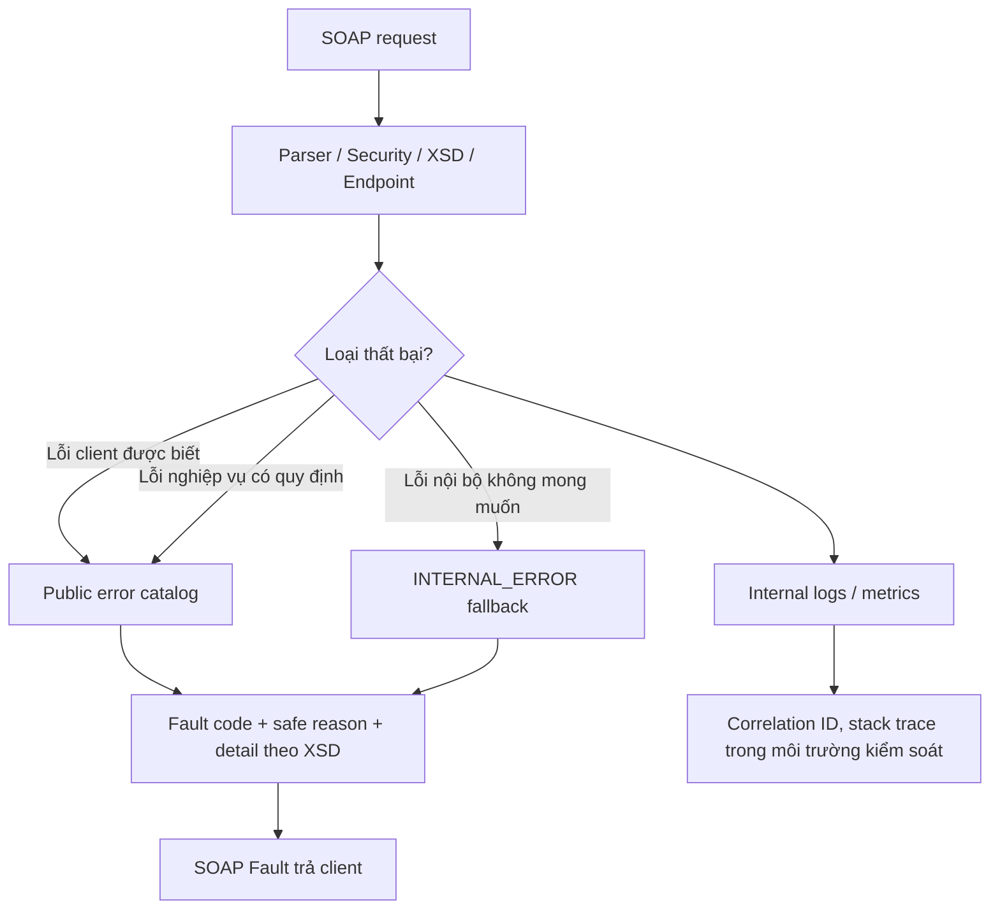
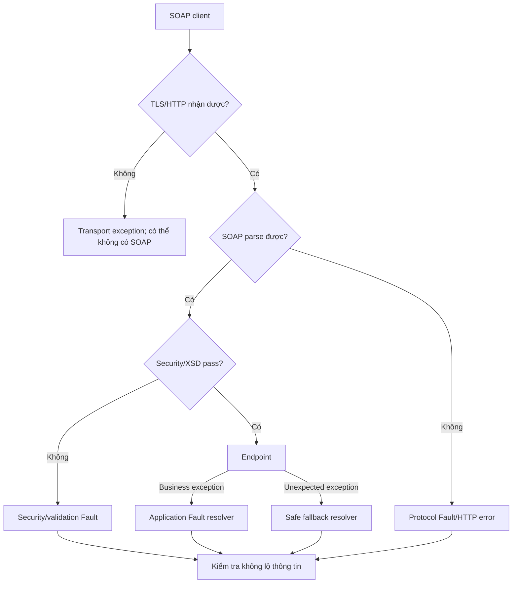

# Che thông tin nội bộ và kiểm chứng lỗi theo hợp đồng

Khi một dịch vụ SOAP gặp lỗi, nó phải cho hệ thống đối tác biết **điều gì đã thất bại và cần xử lý thế nào**. Nhưng một SOAP Fault thiếu kiểm soát cũng có thể làm lộ tên bảng SQL, chuỗi kết nối, tên máy nội bộ, stack trace Java, đường dẫn file, dữ liệu cá nhân, token WS-Security hoặc chi tiết chứng chỉ. Mục tiêu không phải giấu mọi lỗi bằng một thông điệp vô nghĩa, mà là công bố **lỗi có cấu trúc, ổn định và đủ hữu ích theo hợp đồng**, đồng thời giữ phần chẩn đoán nhạy cảm bên trong hệ thống.

Bài thuộc chương **SOAP Fault** của module **SPRING_WEB_SERVICES**. Trong dịch vụ Spring Web Services (Spring-WS) phát triển theo hướng **contract-first**, XSD/WSDL mô tả dữ liệu và lỗi trao đổi; JAXB/Spring OXM ánh xạ payload; endpoint và SOAP client thực thi nghiệp vụ; interceptor, XML security, WS-Security và chứng chỉ bảo vệ luồng tích hợp. Bài này tập trung vào hai trách nhiệm:

1. **Che thông tin nội bộ:** không cho exception ngẫu nhiên quyết định nội dung Fault công khai.
2. **Kiểm chứng lỗi theo hợp đồng:** mọi Fault được thiết kế phải đúng SOAP version, Fault code, QName detail, XSD/WSDL, quy tắc bảo mật và cách xử lý của client.

Các ví dụ dùng SOAP 1.1 document/literal, Spring-WS hiện đại thuộc hệ Jakarta với Java 17+. SOAP 1.2 được so sánh riêng. URI `example.org`, mã lỗi và SOAPAction chỉ mang tính minh họa; khi tích hợp thật phải lấy từ WSDL/XSD và thỏa thuận giữa các bên.

## 1. SOAP Fault là một thông điệp có cấu trúc, không phải stack trace

SOAP Fault mô tả tình trạng xử lý một **SOAP message** không thành công. Nó được truyền qua SOAP Body theo dạng được SOAP version định nghĩa.

Ví dụ một SOAP 1.1 Fault đơn giản:

```xml
<soap:Envelope
    xmlns:soap="http://schemas.xmlsoap.org/soap/envelope/">
    <soap:Body>
        <soap:Fault>
            <faultcode>soap:Client</faultcode>
            <faultstring>Request is invalid</faultstring>
        </soap:Fault>
    </soap:Body>
</soap:Envelope>
```

Một số điểm cần phân biệt:

| Thành phần | Ý nghĩa | Có nên đưa dữ liệu nội bộ vào? |
| --- | --- | --- |
| `faultcode` | Nhóm lỗi theo SOAP 1.1 như `Client`, `Server`, `MustUnderstand`, `VersionMismatch` | Không; dùng QName/code giao thức đúng |
| `faultstring` | Diễn giải ngắn để con người hiểu lỗi | Không; chỉ dùng thông điệp công khai đã duyệt |
| `faultactor` | Node SOAP liên quan trong những trường hợp thích hợp | Không chèn hostname/đường dẫn nội bộ để tiện debug |
| `detail` | Dữ liệu lỗi có cấu trúc dành cho client theo hợp đồng | Chỉ các field XSD/WSDL cho phép, không đưa exception thô |

**SOAP Fault khác HTTP error và Java exception.** Java `SQLException` có thể gây ra Fault; SOAP client nhận được Fault do service tạo, không nhất thiết nhận chính exception ấy. Một lỗi TLS handshake, timeout trước khi SOAP được parse hoặc API Gateway trả HTML 502 có thể **không chứa SOAP Fault** dù client vẫn thấy request thất bại.

### 1.1. Những dữ liệu đặc biệt không nên lộ

- Tên class exception nội bộ: `org.postgresql.util.PSQLException`, `NullPointerException`, lớp repository, tên package.
- SQL statement, tên bảng/cột nhạy cảm, tham số truy vấn, chuỗi kết nối và thông tin tài khoản database.
- Đường dẫn máy chủ: `/srv/app/secrets/...`, `C:\\deploy\\...`, hostname hoặc IP nội bộ.
- Stack trace, source file, số dòng, classloader và phiên bản thư viện dùng để khai thác.
- Access token, password, API key, private key, nội dung WS-Security Header hoặc chữ ký.
- Thông tin khách hàng/đơn hàng/tenant không được phép tiết lộ cho người gọi.
- Nguyên văn nội dung XML đầu vào hoặc dữ liệu attachment không cần thiết cho xử lý lỗi.

**Chặn tại lớp tạo response** tốt hơn việc hy vọng mọi developer tự nhớ xóa chuỗi nhạy cảm trước khi trả về.

## 2. Phân biệt các loại thất bại trước khi tạo Fault

Một chính sách lỗi công khai nên phân nhóm theo **nguyên nhân và hành động tiếp theo của client**:

| Nhóm | Ví dụ | Cách phân loại và thông điệp công khai |
| --- | --- | --- |
| Sai hợp đồng XML | Thiếu `orderId`, sai namespace, `xs:sequence` | `INVALID_REQUEST`: sửa request theo XSD |
| Vi phạm quy tắc nghiệp vụ | Đơn hàng ở trạng thái không cho hủy | `ORDER_STATE_CONFLICT`: kiểm tra trạng thái |
| Không tìm thấy tài nguyên | `orderId` hợp lệ nhưng chưa tồn tại | `ORDER_NOT_FOUND` nếu được phép tiết lộ sự tồn tại |
| Không được phép truy cập | Principal không có quyền xem tenant | `ACCESS_DENIED` hoặc phản hồi che giấu sự tồn tại theo chính sách |
| Lỗi bảo mật SOAP | Chữ ký sai, timestamp hết hạn | Fault bảo mật theo WS-Security policy, không nêu bí mật xác minh |
| Không hiểu SOAP Header | Header `mustUnderstand` không được xử lý | SOAP Fault `MustUnderstand` |
| Sai SOAP version | Envelope SOAP 1.2 vào service chỉ nhận SOAP 1.1 | SOAP Fault `VersionMismatch` hoặc lỗi giao thức tương ứng |
| Lỗi hệ thống bất ngờ | Database down, thiếu provider, bug server | `INTERNAL_ERROR`: thông điệp chung và correlation ID |
| Quá tải hoặc timeout | Dependency chậm hoặc không sẵn sàng | Mã lỗi ổn định về khả năng thử lại, nếu policy cho phép |

**Không phân loại theo thông điệp exception thô.** Một exception cấp thấp có thể chứa nhiều chi tiết hoặc thay đổi giữa phiên bản thư viện. Cần xác định loại lỗi **theo điều kiện có kiểm soát** và ánh xạ nó sang mã lỗi công khai ổn định.

### 2.1. SOAP 1.1 và SOAP 1.2 dùng cấu trúc Fault khác nhau

| Tiêu chí | SOAP 1.1 | SOAP 1.2 |
| --- | --- | --- |
| Envelope namespace | `http://schemas.xmlsoap.org/soap/envelope/` | `http://www.w3.org/2003/05/soap-envelope` |
| Lỗi phía sender | `Client` | `Sender` |
| Lỗi phía receiver | `Server` | `Receiver` |
| Header không được hiểu | `MustUnderstand` | `MustUnderstand` |
| Fault code | `faultcode` | `Code/Value` và có thể có `Subcode` |
| Thông điệp dễ đọc | `faultstring` | `Reason/Text`, có `xml:lang` |
| Chi tiết cấu trúc | `detail` | `Detail` |
| Node liên quan | `faultactor` | `Node` và `Role` theo ngữ nghĩa SOAP 1.2 |

Ví dụ SOAP 1.2:

```xml
<env:Envelope
    xmlns:env="http://www.w3.org/2003/05/soap-envelope"
    xmlns:e="https://example.org/orders/errors/v1">
    <env:Body>
        <env:Fault>
            <env:Code>
                <env:Value>env:Sender</env:Value>
            </env:Code>
            <env:Reason>
                <env:Text xml:lang="vi">
                    Yêu cầu không hợp lệ
                </env:Text>
            </env:Reason>
            <env:Detail>
                <e:ServiceError>
                    <e:code>INVALID_REQUEST</e:code>
                    <e:message>Request does not match the contract</e:message>
                </e:ServiceError>
            </env:Detail>
        </env:Fault>
    </env:Body>
</env:Envelope>
```

Không chuyển SOAP 1.1 sang SOAP 1.2 bằng cách chỉ đổi tên `Client` thành `Sender`; cả Envelope, cấu trúc Fault, HTTP binding, media type/action và WSDL binding phải tương thích.

## 3. Thiết kế XSD cho Fault detail theo contract-first

Một Fault detail hữu ích cần có **QName ổn định**, mã lỗi cho máy xử lý, mô tả công khai và metadata giới hạn. Giả sử xây dựng một lỗi chung tên `ServiceError` trong namespace tách khỏi nghiệp vụ:

```xml
<?xml version="1.0" encoding="UTF-8"?>
<xs:schema xmlns:xs="http://www.w3.org/2001/XMLSchema"
           targetNamespace="https://example.org/orders/errors/v1"
           xmlns:e="https://example.org/orders/errors/v1"
           elementFormDefault="qualified">

    <xs:simpleType name="ErrorCodeType">
        <xs:restriction base="xs:string">
            <xs:enumeration value="INVALID_REQUEST"/>
            <xs:enumeration value="ORDER_NOT_FOUND"/>
            <xs:enumeration value="ORDER_STATE_CONFLICT"/>
            <xs:enumeration value="ACCESS_DENIED"/>
            <xs:enumeration value="INTERNAL_ERROR"/>
            <xs:enumeration value="TEMPORARILY_UNAVAILABLE"/>
        </xs:restriction>
    </xs:simpleType>

    <xs:element name="ServiceError">
        <xs:complexType>
            <xs:sequence>
                <xs:element name="code" type="e:ErrorCodeType"/>
                <xs:element name="message" type="xs:string"/>
                <xs:element name="correlationId"
                            type="xs:string" minOccurs="0"/>
            </xs:sequence>
        </xs:complexType>
    </xs:element>
</xs:schema>
```

Tên `ServiceError` và các trường là hợp đồng minh họa. Nếu client đã sinh JAXB classes từ XSD, việc **thêm giá trị enum mới** có thể ảnh hưởng consumer cũ tùy generated binding; cần quản lý version và kiểm thử tương thích. Có thể chọn `xs:string` với danh mục mã lỗi được version hóa ngoài schema nếu muốn mở rộng mã thường xuyên, nhưng điều đó giảm bảo đảm compile-time và yêu cầu client xử lý mã lạ an toàn.

### 3.1. Ví dụ Fault detail công khai

```xml
<soap:Envelope
    xmlns:soap="http://schemas.xmlsoap.org/soap/envelope/"
    xmlns:e="https://example.org/orders/errors/v1">
    <soap:Body>
        <soap:Fault>
            <faultcode>soap:Client</faultcode>
            <faultstring>Request does not match the contract</faultstring>
            <detail>
                <e:ServiceError>
                    <e:code>INVALID_REQUEST</e:code>
                    <e:message>Please correct the request</e:message>
                    <e:correlationId>req-2026-501</e:correlationId>
                </e:ServiceError>
            </detail>
        </soap:Fault>
    </soap:Body>
</soap:Envelope>
```

Ở đây:

- `faultcode` phục vụ **phân loại SOAP protocol**.
- `ServiceError/code` phục vụ **phân loại nghiệp vụ/cấu trúc cho client**.
- `ServiceError/message` là thông điệp công khai, **không** lấy từ `exception.getMessage()` của lỗi bất kỳ.
- `correlationId` giúp support tìm sự kiện tương ứng trong hệ thống giám sát mà không phải phơi bày stack trace.

Phần `detail` ở SOAP 1.1 có thể chứa một hay nhiều phần tử ứng dụng; hợp đồng phải nói rõ số lượng/QName và ý nghĩa. Nên dùng **một cấu trúc lỗi chính ổn định** khi có thể, tránh trả tùy tiện nhiều format theo code path.

### 3.2. Có nên đưa tên field vi phạm vào Fault?

Có thể, nhưng phải **giới hạn và chuẩn hóa**. Ví dụ một schema bổ sung `fieldErrors` chứa danh sách tên trường công khai như `orderId`, `quantity`. Tuy nhiên:

- Không sao chép nguyên `SAXParseException#getMessage()` vì có thể chứa nội dung XML nhạy cảm, giá trị input hoặc đường dẫn schema.
- Không xuất XPath tùy ý có namespace, attribute/value nhạy cảm, tên class JAXB hay đường dẫn file server.
- Chỉ trả tên trường **được công bố trong XSD** theo allowlist.
- Giới hạn số lỗi trả về để không tạo response khổng lồ hoặc tiết lộ mọi quy tắc kiểm tra nội bộ.
- Với lỗi bảo mật/ủy quyền, có thể **không trả chi tiết field** để giảm lộ thông tin.

**Thông điệp đủ hữu ích** không đồng nghĩa phản hồi toàn bộ thông tin chẩn đoán của parser.

## 4. WSDL 1.1 công bố Fault có kiểu như thế nào?

XSD định nghĩa element `e:ServiceError`; WSDL 1.1 cần mô tả **message part**, **abstract operation fault** và **concrete SOAP fault binding** khi muốn lỗi trở thành một phần chính thức của hợp đồng.

Ví dụ fragment có các khai báo namespace tương ứng ở `wsdl:definitions`:

```xml
<!-- Các prefix wsdl, soap, tns, e, o được khai báo ở tài liệu WSDL. -->

<wsdl:message name="GetOrderInput">
    <wsdl:part name="parameters" element="o:GetOrderRequest"/>
</wsdl:message>

<wsdl:message name="GetOrderOutput">
    <wsdl:part name="parameters" element="o:GetOrderResponse"/>
</wsdl:message>

<wsdl:message name="ServiceErrorMessage">
    <wsdl:part name="error" element="e:ServiceError"/>
</wsdl:message>

<wsdl:portType name="OrdersPortType">
    <wsdl:operation name="GetOrder">
        <wsdl:input message="tns:GetOrderInput"/>
        <wsdl:output message="tns:GetOrderOutput"/>
        <wsdl:fault name="ServiceError"
                    message="tns:ServiceErrorMessage"/>
    </wsdl:operation>
</wsdl:portType>

<wsdl:binding name="OrdersSoap11Binding"
              type="tns:OrdersPortType">
    <soap:binding style="document"
                  transport="http://schemas.xmlsoap.org/soap/http"/>
    <wsdl:operation name="GetOrder">
        <soap:operation soapAction="urn:example:orders:GetOrder"/>
        <wsdl:input>
            <soap:body use="literal"/>
        </wsdl:input>
        <wsdl:output>
            <soap:body use="literal"/>
        </wsdl:output>
        <wsdl:fault name="ServiceError">
            <soap:fault name="ServiceError" use="literal"/>
        </wsdl:fault>
    </wsdl:operation>
</wsdl:binding>
```

Đây là **fragment**, không phải WSDL độc lập: còn cần `wsdl:definitions`, phần `types` import/nhúng XSD, đầy đủ namespaces và `wsdl:service/port`. Khi tài liệu hoàn chỉnh, consumer có thể sinh kiểu exception/chi tiết lỗi tùy công cụ và binding.

**WSDL fault khai báo là hợp đồng, không tự viết code ném Fault.** Server vẫn phải ánh xạ exception thành Fault chứa đúng `e:ServiceError`. Ngược lại, nếu server trả một `detail` ngẫu nhiên không xuất hiện trong WSDL/XSD đã duyệt, client có thể không parse được hoặc bỏ qua dữ liệu quan trọng.

### 4.1. Cẩn trọng với WSDL được sinh tự động

`DefaultWsdl11Definition` có thể tạo WSDL từ quy ước XSD, nhưng không nên giả định nó tự biểu diễn đầy đủ mọi **typed fault**, policy bảo mật và binding tùy chỉnh của đối tác. Khi cần kiểm soát rõ `wsdl:fault`/`soap:fault` và versioning, **WSDL tĩnh do dự án quản lý** thường dễ đối chiếu với hợp đồng đã được phê duyệt.

## 5. Thiết kế chính sách Fault công khai

Thay vì để mỗi endpoint tự chọn message, hãy xây một **bảng ánh xạ được kiểm soát**:

| Mã công khai | Điều kiện | Fault code SOAP 1.1 | Message cho client | Thử lại? |
| --- | --- | --- | --- | --- |
| `INVALID_REQUEST` | XSD/đầu vào không hợp lệ | `Client` | `Request is invalid` | Không, trước khi sửa |
| `ORDER_NOT_FOUND` | Order không tồn tại, được phép thông báo | `Client` hoặc kiểu hợp đồng quy định | `Order was not found` | Thường không |
| `ORDER_STATE_CONFLICT` | Thao tác trái trạng thái | `Client` theo quy ước | `Operation is not allowed in current state` | Sau khi trạng thái đổi |
| `ACCESS_DENIED` | Principal không có quyền | `Client` hoặc Fault bảo mật riêng | `Access denied` | Không, trừ khi quyền thay đổi |
| `TEMPORARILY_UNAVAILABLE` | Dependency tạm thời không sẵn sàng | `Server` | `Service temporarily unavailable` | Chỉ khi idempotency/retry policy cho phép |
| `INTERNAL_ERROR` | Lỗi bất ngờ | `Server` | `Internal processing error` | Theo policy, không tự động |

Đây là **chính sách ví dụ**, không phải ánh xạ bắt buộc trong chuẩn SOAP. Quyết định mã lỗi nghiệp vụ còn phụ thuộc WSDL, cách phân loại exception và yêu cầu bảo mật của service.

### 5.1. Không để retry gây tác dụng phụ

Khi client nhận `Server` hoặc `TEMPORARILY_UNAVAILABLE`, **không tự suy luận server chưa thực hiện nghiệp vụ**. Với operation tạo đơn hàng, server có thể đã commit dữ liệu trước khi mất kết nối lúc gửi response.

Do đó:

- Thiết kế **idempotency key** hoặc cơ chế tra cứu kết quả khi operation có side effect.
- Công bố rõ mã lỗi nào có thể thử lại và điều kiện retry.
- Dùng backoff, giới hạn số lần thử và circuit-breaker theo nhu cầu.
- Không khuyên retry mù quáng chỉ vì nhìn thấy SOAP Fault `Server` hoặc HTTP 500.

Đây là một phần quan trọng của **hợp đồng lỗi**, không chỉ là hành vi client sau khi nhận Fault.

### 5.2. Quy tắc tránh lộ sự tồn tại của tài nguyên

Một đối tác không có quyền với `ORD-1001` có thể không được phép biết đơn hàng đó tồn tại. Vì vậy cùng yêu cầu:

- Người gọi có quyền: `ORDER_NOT_FOUND` nếu đơn hàng thực sự không tồn tại.
- Người gọi không có quyền: trả `ACCESS_DENIED` hoặc một lỗi cố ý không tiết lộ sự tồn tại theo policy.

Đừng trả thông điệp như “Order ORD-1001 belongs to customer X” chỉ để hỗ trợ debug. Mã lỗi và độ chi tiết phải tuân theo **authorization**, không chỉ loại exception từ repository.

## 6. Kiến trúc ánh xạ exception thành Fault

Một thiết kế rõ ràng phân loại exception ở **boundary** thay vì gửi trực tiếp message của exception ra client:



**Hai kênh phải tách biệt**:

1. **Kênh public:** SOAP Fault ổn định, đã kiểm soát thông tin.
2. **Kênh nội bộ:** logs, traces và alert phục vụ vận hành, có chính sách truy cập/retention/redaction riêng.

Không dùng một chuỗi lỗi duy nhất vừa để gửi client vừa log chi tiết, vì nhu cầu và quyền truy cập của hai kênh khác nhau.

### 6.1. Exception nghiệp vụ có mã lỗi, không mang thông điệp debug ra wire

```java
public enum PublicErrorCode {
    INVALID_REQUEST,
    ORDER_NOT_FOUND,
    ORDER_STATE_CONFLICT,
    ACCESS_DENIED,
    INTERNAL_ERROR,
    TEMPORARILY_UNAVAILABLE
}

public final class BusinessFaultException extends RuntimeException {
    private final PublicErrorCode code;

    public BusinessFaultException(
            PublicErrorCode code, String internalDescription) {
        super(internalDescription);
        this.code = code;
    }

    public PublicErrorCode getCode() {
        return code;
    }
}
```

Hai lớp `public` trong block là **hai file Java riêng** khi đưa vào dự án. `internalDescription` là thông tin cho server log, **không dùng trực tiếp cho `faultstring` hoặc `ServiceError/message`**. Trong production, chỉ dùng một mã công khai từ tập cố định, còn văn bản công khai lấy từ catalog:

```java
public final class PublicErrorMessages {
    private PublicErrorMessages() { }

    public static String safeMessage(PublicErrorCode code) {
        return switch (code) {
            case INVALID_REQUEST -> "Request is invalid";
            case ORDER_NOT_FOUND -> "Order was not found";
            case ORDER_STATE_CONFLICT ->
                    "Operation is not allowed in current state";
            case ACCESS_DENIED -> "Access denied";
            case TEMPORARILY_UNAVAILABLE ->
                    "Service temporarily unavailable";
            case INTERNAL_ERROR -> "Internal processing error";
        };
    }
}
```

Một điều kiện phải kiểm tra là **kẻ gọi có được phép biết loại lỗi cụ thể hay không**. Không phải exception nào có kiểu `BusinessFaultException` cũng tự động an toàn để công bố: lập trình viên phải ánh xạ code theo chính sách, không nhét exception cause, SQL hoặc chi tiết tenant vào error code/message.

## 7. Ánh xạ SOAP Fault bằng Spring-WS

Spring-WS có các cơ chế giải quyết exception ở server như `SoapFaultMappingExceptionResolver`, `SoapFaultAnnotationExceptionResolver` và lớp nền `AbstractSoapFaultDefinitionExceptionResolver`. Tùy cấu hình, một exception từ endpoint có thể được chuyển thành `SoapFault`.

### 7.1. Ánh xạ exception với `SoapFaultMappingExceptionResolver`

Ví dụ cấu hình code/server message **an toàn, cố định**:

```java
import java.util.Properties;
import org.springframework.context.annotation.Bean;
import org.springframework.context.annotation.Configuration;
import org.springframework.ws.soap.server.endpoint.SoapFaultDefinition;
import org.springframework.ws.soap.server.endpoint.SoapFaultMappingExceptionResolver;

@Configuration
public class SoapFaultResolverConfig {

    @Bean
    public SoapFaultMappingExceptionResolver faultResolver() {
        SoapFaultMappingExceptionResolver resolver =
                new SoapFaultMappingExceptionResolver();

        Properties mappings = new Properties();
        mappings.setProperty(
                BusinessFaultException.class.getName(),
                "CLIENT,Request could not be completed");
        resolver.setExceptionMappings(mappings);

        SoapFaultDefinition fallback = new SoapFaultDefinition();
        fallback.setFaultCode(SoapFaultDefinition.SERVER);
        fallback.setFaultStringOrReason("Internal processing error");
        resolver.setDefaultFault(fallback);
        resolver.setOrder(1);
        return resolver;
    }
}
```

Code trên minh họa **Fault code và reason**. `mappings` chỉ có một message chung cho cả lớp `BusinessFaultException`; nó **chưa tạo detail `e:ServiceError` chứa từng code nghiệp vụ**, chưa xử lý role/locale và không đảm bảo đã bao phủ mọi lỗi nằm ngoài exception resolver chain.

Để trả `ServiceError` đúng XSD, cần triển khai phần **customize SOAP Fault detail** qua extension point thích hợp (chẳng hạn subclass resolver và override cơ chế tùy chỉnh Fault tương ứng phiên bản Spring-WS), hoặc dùng một cơ chế xử lý lỗi chuyên biệt do ứng dụng kiểm soát. Trong phần tùy chỉnh:

1. Phân loại exception bằng `instanceof`/error code từ tập cho phép.
2. Dùng catalog để lấy `faultstring`/`message` công khai.
3. Tạo `detail` có **đúng QName `e:ServiceError`**, theo `xs:sequence` của XSD.
4. Giới hạn metadata: chỉ thêm correlation ID đã chuẩn hóa, không thêm `Throwable#getMessage()` hay stack trace.
5. Đảm bảo fallback dùng `INTERNAL_ERROR` khi exception chưa được phân loại.

**Không coi đoạn bean resolver trên là một ví dụ đầy đủ về typed fault**. Cần kiểm thử Fault XML thực được phát ra sau khi custom detail và xác minh WSDL/XSD; chỉ khai báo resolver không đủ chứng minh typed fault đã có mặt.

### 7.2. `@SoapFault` cho trường hợp tĩnh

Spring-WS còn hỗ trợ annotation `@SoapFault` trên exception ở những cấu hình được hỗ trợ:

```java
import org.springframework.ws.soap.server.endpoint.annotation.SoapFault;
import org.springframework.ws.soap.server.endpoint.annotation.FaultCode;

@SoapFault(
        faultCode = FaultCode.CLIENT,
        faultStringOrReason = "Request is invalid")
public class InvalidOrderRequestException extends RuntimeException {
    public InvalidOrderRequestException() {
        super("Internal order validation failed");
    }
}
```

Lưu ý annotation này cần resolver `SoapFaultAnnotationExceptionResolver` được đăng ký/vận hành phù hợp; nó không tự giải quyết việc **điền Fault detail có kiểu**, cấu hình thứ tự resolver hoặc mọi lỗi đến từ transport/security. Giá trị `faultStringOrReason` phải là chuỗi an toàn, không nhúng raw input.

### 7.3. Thứ tự exception resolver và fallback

Khi nhiều resolver tồn tại, một resolver đặc thù có thể xử lý trước resolver chung. Cần kiểm soát:

- Resolver nào chịu trách nhiệm lỗi đã biết?
- Resolver nào là **fallback cuối cùng** cho exception chưa được ánh xạ?
- Một resolver khác có đang trả nguyên `exception.getMessage()` ra Fault không?
- Lỗi trong interceptor/parser/WS-Security có đi qua cùng resolver không?
- Nếu xử lý lỗi **tự ném exception**, client thực sự nhìn thấy gì?

Đừng đặt fallback “che lỗi nội bộ” rồi giả định mọi code path đều an toàn. Cần test end-to-end từ góc nhìn SOAP consumer, bao gồm lỗi xảy ra trước endpoint.

Khi JAXB/Spring OXM ném `org.springframework.oxm.XmlMappingException` hoặc exception ánh xạ tương tự, **không mặc nhiên coi đó là lỗi request của client**: nguyên nhân có thể là input XML không hợp lệ, nhưng cũng có thể là JAXB model/server configuration sai hoặc marshal **response** thất bại. Hãy phân loại theo giai đoạn xử lý và validation đã thực hiện; nếu chưa xác định được nguyên nhân an toàn, dùng fallback phía server thay vì tiết lộ cause hoặc gán nhầm lỗi cho client.

## 8. Không tiết lộ dữ liệu qua `faultstring`, `detail` và SOAP Header

Che thông tin cần được kiểm tra trên **toàn bộ SOAP response**, không chỉ một trường:

| Vị trí trên wire | Nguy cơ | Phòng ngừa |
| --- | --- | --- |
| SOAP `faultstring`/`Reason` | Exception message lộ SQL/file path | Catalog message cố định |
| SOAP `detail`/`Detail` | Object debug/stack trace được serialize | XSD detail allowlist, mapper chuyên biệt |
| SOAP Header phản hồi | Token cũ, thông tin principal nội bộ | Chỉ header đã thỏa thuận và cần thiết |
| HTTP response headers | `Server`, debug header, hostname hoặc routing info | Cấu hình gateway/server phù hợp |
| HTML/plaintext error page | Stack trace do servlet container/proxy | Cấu hình error handler toàn bộ stack |
| Logging/tracing export | Body/header được log qua interceptor | Redaction, quyền truy cập, retention |

**Không bảo đảm chỉ Spring-WS resolver là đủ** nếu lỗi trước khi dispatcher tạo SOAP response. Khi có gateway/API proxy, cần kiểm tra response HTTP 4xx/5xx ngoài SOAP nữa.

### 8.1. Dùng mã tương quan thay vì stack trace công khai

Để hỗ trợ vận hành, Fault có thể trả `correlationId`:

```xml
<e:ServiceError xmlns:e="https://example.org/orders/errors/v1">
    <e:code>INTERNAL_ERROR</e:code>
    <e:message>Internal processing error</e:message>
    <e:correlationId>req-2026-501</e:correlationId>
</e:ServiceError>
```

Server log dùng cùng ID để liên kết exception:

```java
log.error(
    "SOAP processing failed, code={}, correlationId={}",
    PublicErrorCode.INTERNAL_ERROR,
    correlationId,
    exception);
```

Đoạn code giả định các biến `log`, `correlationId`, `exception` được khai báo trong thành phần logging. Log có stack trace **chỉ trong kênh nội bộ bảo vệ thích hợp**; không đẩy nguyên log/exception vào Fault. Bản thân log cũng cần lọc PII, secret và kiểm soát quyền truy cập.

Một correlation ID do client gửi phải được giới hạn độ dài, ký tự và nguồn tin cậy trước khi ghi log; nếu không hợp lệ, có thể sinh ID ở server. Correlation ID **không phải credential** và không được dùng để tra cứu thông tin nhạy cảm mà không xác thực.

### 8.2. Thông điệp lỗi có cần đa ngôn ngữ?

SOAP 1.2 `Reason/Text` có `xml:lang`; SOAP 1.1 `faultstring` cũng có thể mang quy tắc ngôn ngữ theo profile/hợp đồng. Nếu cần tiếng Việt/tiếng Anh:

- Giữ **`code` ổn định** để client lập trình logic.
- Chỉ dịch **`message` công khai** từ catalog, không dịch mã lỗi.
- Chọn locale theo chính sách/thỏa thuận, không tin header locale vô hạn.
- Có fallback locale mặc định, kiểm thử encoding UTF-8/XML.

Đừng dùng phần text đã dịch làm key điều khiển retry hoặc phân loại lỗi.

## 9. Lỗi dữ liệu XSD và business validation

Spring-WS có thể dùng `PayloadValidatingInterceptor` để chặn payload sai XSD trước khi endpoint xử lý. Với JAXB/Spring OXM, `Jaxb2Marshaller#setSchema(...)` cũng có thể validate ở lúc marshal/unmarshal khi bean đó thực sự được dùng.

Các lỗi điển hình:

```xml
<!-- XSD quy định orderId phải trước quantity;
     ví dụ dưới đây cố ý sai thứ tự. -->
<o:CreateOrderRequest
    xmlns:o="https://example.org/orders/v1">
    <o:quantity>2</o:quantity>
    <o:orderId>ORD-1001</o:orderId>
</o:CreateOrderRequest>
```

Khi validator phát hiện sai XSD:

1. Không để nghiệp vụ chạy với input chưa hợp lệ theo contract.
2. Trả lỗi phù hợp SOAP version, ví dụ lỗi request.
3. Có thể cung cấp `INVALID_REQUEST` trong detail **nếu pipeline tạo được typed Fault**.
4. Không phản chiếu nguyên dòng lỗi của SAX/XSD parser vào Fault công khai.
5. Lưu đủ thông tin nội bộ để chẩn đoán và tương quan, có redaction.

**PayloadValidatingInterceptor không mặc nhiên tạo detail `e:ServiceError` theo XSD ví dụ.** Nếu yêu cầu mọi lỗi validation phải có cùng fault detail, cần cấu hình/mở rộng xử lý validation errors hoặc lớp response fault chuyên trách để giữ đúng hợp đồng.

### 9.1. Validation ở nhiều tầng có gây Fault trùng hoặc sai ngữ nghĩa?

Một request có thể đi qua XSD validation, JAXB unmarshalling và business validation. Nếu cả interceptor và JAXB đều validate cùng payload với cùng schema, có thể tốn thêm chi phí mà không tăng đảm bảo nhiều. Tuy nhiên, các tầng có nhiệm vụ khác nhau:

- XSD: cấu trúc XML hợp đồng.
- JAXB: ánh xạ kiểu và dữ liệu Java.
- Business: trạng thái/luật nghiệp vụ.
- Security: danh tính, chữ ký và quyền.

Cần **chọn điểm kiểm tra chính cho mỗi boundary**, nhưng không bỏ kiểm tra bảo mật hoặc nghiệp vụ chỉ để giảm CPU.

### 9.2. Business Fault với dữ liệu động

Một lỗi như `ORDER_STATE_CONFLICT` có thể được công bố mà không kèm trạng thái nội bộ quá chi tiết:

```xml
<e:ServiceError xmlns:e="https://example.org/orders/errors/v1">
    <e:code>ORDER_STATE_CONFLICT</e:code>
    <e:message>Operation is not allowed in current state</e:message>
    <e:correlationId>req-2026-501</e:correlationId>
</e:ServiceError>
```

Nếu một state cụ thể được công bố trong WSDL/business contract và người gọi có quyền xem, có thể thêm trường có kiểu rõ. Nhưng không biến Fault detail thành bản sao toàn bộ entity/database record.

## 10. Lỗi WS-Security, chứng chỉ và cách che thông tin nhạy cảm

Trong dịch vụ tích hợp doanh nghiệp, một SOAP Header có thể chứa WS-Security token, XML Signature, XML Encryption, timestamp hoặc thông tin chứng chỉ.

**Phân biệt trách nhiệm:**

| Kiểm tra | Nơi thường thực hiện | Phần có thể công bố |
| --- | --- | --- |
| Token không hợp lệ/hết hạn | Security interceptor/WSS4J | Mã lỗi bảo mật chung theo policy |
| Chữ ký XML không khớp | WS-Security verification | Không tiết lộ key, signed bytes hoặc thuật toán cụ thể nếu không cần |
| Timestamp quá hạn/replay | WS-Security policy | Không tiết lộ cửa sổ chống replay/chi tiết nonce nội bộ |
| Certificate không được tin | TLS stack hoặc WS-Security trust validation | Lỗi kết nối/Fault bảo mật phù hợp |
| Caller thiếu quyền tenant | Authorization layer | `ACCESS_DENIED` hoặc lỗi không tiết lộ sự tồn tại |
| XML payload sai XSD | XSD validator | `INVALID_REQUEST` khi lỗi không phải security |

**SOAP Fault không phải nơi hiển thị raw certificate chain, subject DN, private key alias, truststore path, token, password, exception của WSS4J hoặc cấu hình policy nội bộ.**

Với lỗi TLS handshake, đôi khi **không thể trả SOAP Fault** vì kênh TLS chưa được thiết lập; client nhận exception ở transport. Với lỗi WS-Security sau khi SOAP được parse, security interceptor có thể tạo Fault theo chính sách. Không đánh đồng hai tình huống.

### 10.1. `mustUnderstand` và Fault bảo mật

Header `wsse:Security` có thể có `mustUnderstand="1"`. Nếu node không hiểu header bắt buộc, SOAP có quy tắc Fault `MustUnderstand`. Nếu node có security processor và header được hiểu nhưng signature sai, đó là **security validation failure**, không nên ngụy trang mặc định thành “không hiểu header”.

Không viết `SoapEndpointInterceptor#understands(...)` trả `true` cho mọi header chỉ để tránh lỗi `MustUnderstand`; làm vậy có thể bỏ qua chính sách bảo mật quan trọng. Phải cấu hình component thực sự xác minh WS-Security.

### 10.2. Chặn XML Signature wrapping và thay đổi dữ liệu đã ký

Một parser có thể nhìn thấy nhiều element cùng tên trong SOAP Body/Header. Không chọn tùy tiện một element `GetOrderRequest` rồi dùng nó cho nghiệp vụ khi security stack đã xác minh chữ ký trên một element khác. Cần dùng kết quả và **signed-part policy** do thư viện bảo mật cung cấp.

Chuyển XML qua JAXB/DOM rồi serialize lại có thể làm thay đổi cấu trúc; XML canonicalization chỉ chuẩn hóa những khác biệt nhất định. **Lỗi chữ ký không được sửa bằng cách bỏ bước xác minh hoặc chấp nhận payload khác với phần đã được ký.**

## 11. Đừng rò thông tin qua SOAP Fault từ interceptor

Nhiều lỗi không phát sinh trong `@Endpoint`:

- `PayloadValidatingInterceptor` chặn request vì XSD.
- `Wss4jSecurityInterceptor` từ chối signature/token.
- `SoapEndpointInterceptor` không hiểu header bắt buộc.
- Message factory từ chối Envelope/Content-Type không tương thích.
- HTTP transport không thiết lập được kết nối.

Do đó, việc đặt `SoapFaultMappingExceptionResolver` chỉ cho một vài exception nghiệp vụ là **chưa đủ** để che lỗi trên mọi tuyến. Cần kiểm thử:

| Vị trí lỗi | Đường xử lý | Điều cần xác minh |
| --- | --- | --- |
| Business endpoint | Exception resolver | Không lộ exception text; đúng typed Fault |
| Endpoint adapter/JAXB | Marshalling/unmarshalling error | Safe fallback và mã lỗi phù hợp |
| XSD interceptor | Validation Fault | Fault công khai được chuẩn hóa nếu policy yêu cầu |
| Security interceptor | Security Fault | Không lộ token/cert/crypto details |
| SOAP dispatcher | `MustUnderstand`, mapping lỗi | Đúng Fault protocol; không dính trace nội bộ |
| SOAP message factory | XML parse/version mismatch | Response có thể là Fault/HTTP error; không bật debug page |
| Servlet container/gateway | 404/413/502/503 hoặc lỗi TLS | Response ngoài SOAP cũng không chứa debug/secret |

### 11.1. Khi interceptor tự dừng request

Một `EndpointInterceptor#handleRequest(...)` trả `false` có nghĩa dừng xử lý phía sau; **nó không tự cam kết đã tạo SOAP Fault có cấu trúc chuẩn**. Nếu từ chối do policy, cần chuẩn bị Fault hợp lệ hoặc dùng đường xử lý exception đã được kiểm thử trên đúng Spring-WS version.

Đừng chỉ ném `RuntimeException("token=" + token)` rồi hi vọng resolver sẽ lọc sạch. Dữ liệu nhạy cảm có thể xuất hiện trong Fault, logs hoặc error pages tùy stack.

## 12. Kiểm chứng hợp đồng lỗi bằng test tự động

Một bài test đúng không chỉ khẳng định “server trả Fault”. Nó cần chứng minh **Fault chứa đúng những gì hợp đồng cho phép** và **không chứa những gì bị cấm**.

### 12.1. Kiểm tra cấu trúc

Với mỗi lỗi đã công bố, xác nhận:

1. SOAP version và Envelope namespace đúng binding.
2. SOAP Body chứa đúng **một Fault phù hợp**.
3. Fault code là QName chuẩn của SOAP version.
4. Fault reason công khai từ catalog.
5. `detail` có root QName `{https://example.org/orders/errors/v1}ServiceError` nếu lỗi được đặc tả như vậy.
6. Thứ tự và kiểu các trường trong `detail` hợp lệ theo XSD.
7. `code` nằm trong tập mã công khai của hợp đồng.
8. `correlationId` nếu có là chuỗi đã chuẩn hóa/giới hạn và liên kết được với server logs.
9. Không tồn tại field phụ do framework hoặc mapper tự thêm.

Sử dụng **XML-aware assertions**: namespace URI, local name, cấu trúc, schema. Không so sánh XML byte-for-byte vì prefix, whitespace và khai báo namespace có thể khác mà vẫn tương đương.

### 12.2. XSD validation cho Fault detail

Với một SOAP 1.1 Fault đã được parse, lấy phần tử `e:ServiceError` **bên trong `detail`** rồi dùng JAXP `Schema/Validator` hoặc JAXB có schema để kiểm tra cấu trúc:

```java
import javax.xml.XMLConstants;
import javax.xml.transform.dom.DOMSource;
import javax.xml.validation.Schema;
import javax.xml.validation.SchemaFactory;
import javax.xml.validation.Validator;
import org.w3c.dom.Element;

// 'trustedErrorSchema' là tài nguyên XSD đáng tin từ ứng dụng.
SchemaFactory factory = SchemaFactory.newInstance(
        XMLConstants.W3C_XML_SCHEMA_NS_URI);
factory.setFeature(XMLConstants.FEATURE_SECURE_PROCESSING, true);
factory.setProperty(XMLConstants.ACCESS_EXTERNAL_DTD, "");
factory.setProperty(XMLConstants.ACCESS_EXTERNAL_SCHEMA, "");

Schema schema = factory.newSchema(trustedErrorSchema);
Validator validator = schema.newValidator();
validator.validate(new DOMSource(serviceErrorElement));
```

Đoạn code là **phần lõi của test**, giả định `trustedErrorSchema`, `serviceErrorElement` đã được tạo từ nguồn được kiểm soát với XML parser an toàn. Khi kiểm tra toàn SOAP Envelope, không áp `errors.xsd` trực tiếp lên Envelope; schema này định nghĩa **phần tử detail**, không định nghĩa SOAP message. Nếu XSD lỗi có import/include, phải cấu hình resolver cho nguồn đáng tin thay vì mở truy cập mạng tùy ý.

### 12.3. Kiểm tra danh sách thông tin bị cấm

Một lớp kiểm thử an toàn có thể xét nội dung SOAP response:

```java
import static org.junit.jupiter.api.Assertions.*;

void assertNoInternalDetails(String soapXml) {
    assertFalse(soapXml.contains("java.lang."));
    assertFalse(soapXml.contains("SQLException"));
    assertFalse(soapXml.contains("jdbc:"));
    assertFalse(soapXml.contains("at com.example.internal."));
    assertFalse(soapXml.contains("/srv/app/"));
    assertFalse(soapXml.contains("BEGIN PRIVATE KEY"));
}
```

Đây chỉ là **smoke test cho một số mẫu bị cấm**, không phải bộ lọc dữ liệu nhạy cảm đầy đủ; secret có thể xuất hiện dưới nhiều dạng. Cơ chế đáng tin cậy hơn là **schema allowlist + public error catalog + kiểm thử nhiều mẫu lỗi thật**. Không ghi dữ liệu bí mật thực vào test fixture hoặc test output.

### 12.4. Kiểm thử SOAP server bằng `MockWebServiceClient`

Với Spring-WS Test, có thể dựng payload và kiểm tra nhánh Fault:

```java
import org.springframework.xml.transform.StringSource;
import static org.springframework.ws.test.server.RequestCreators.*;
import static org.springframework.ws.test.server.ResponseMatchers.*;

String xml = """
        <o:CreateOrderRequest
            xmlns:o="https://example.org/orders/v1">
            <o:orderId>ORD-1001</o:orderId>
            <o:quantity>-2</o:quantity>
        </o:CreateOrderRequest>
        """;

mockClient.sendRequest(withPayload(new StringSource(xml)))
          .andExpect(clientOrSenderFault());
```

Ví dụ giả định `mockClient` đã tạo từ `ApplicationContext` có endpoint, interceptor và schema phù hợp, và XSD thực sự từ chối dữ liệu trên. Matcher `clientOrSenderFault()` chỉ chứng minh nhánh Fault code phù hợp, **chưa xác minh `detail` theo XSD hay thông tin không bị rò**; phải bổ sung assertions về XML response cụ thể.

### 12.5. Kiểm thử SOAP client nhận Fault

Một SOAP client Spring-WS dùng `WebServiceTemplate` có thể nhận `SoapFaultClientException` khi server trả Fault theo cơ chế mặc định tương ứng. Client cần:

- Đọc Fault code và detail **theo hợp đồng**.
- Phân loại lỗi thành hành động: sửa request, xử lý business conflict, chặn truy cập, hoặc retry có điều kiện.
- Không parse `faultstring` bằng regex để quyết định nghiệp vụ.
- Có fallback khi detail thiếu, code lạ, SOAP version khác hoặc server trả lỗi ngoài SOAP.
- Không log SOAP Header WS-Security hoặc response Body nhạy cảm khi bắt exception.

Một Fault **đúng schema nhưng không có mã lỗi mà client biết** vẫn cần nhánh an toàn; không crash vì một `switch` không xử lý mã lạ trong phiên bản hợp đồng cho phép mở rộng.

## 13. Ma trận test negative và regression

| Tình huống | Kỳ vọng về Fault và bảo mật |
| --- | --- |
| Request hợp lệ | Response thành công, không có Fault |
| Thiếu trường bắt buộc trong XSD | `INVALID_REQUEST` hoặc Fault request đã quy định, endpoint không chạy |
| Sai namespace hoặc thứ tự `xs:sequence` | XSD validation phát hiện; không lộ SAX parser trace |
| Order không tồn tại với caller có quyền | `ORDER_NOT_FOUND` đúng hợp đồng, không lộ database |
| Caller không có quyền tenant | Lỗi che thông tin theo authorization policy |
| Order ở trạng thái không cho thay đổi | `ORDER_STATE_CONFLICT`, không tiết lộ state nội bộ không cần thiết |
| Exception SQL chứa query/connection string | Public `INTERNAL_ERROR`, không có raw exception text |
| `NullPointerException` bất ngờ trong endpoint | Fallback an toàn, mã lỗi ổn định |
| JAXB marshal response bị lỗi | Server-side Fault an toàn, không lộ class/package |
| Header lạ `mustUnderstand=true` | SOAP `MustUnderstand`, không bỏ qua |
| SOAP version không phù hợp | Lỗi giao thức/Fault theo SOAP version, không HTML debug page |
| Chữ ký WS-Security sai | Security rejection, không lộ key/certificate/algorithm debug |
| Chứng chỉ TLS không tin cậy | TLS failure, không giả định có SOAP Fault |
| XSD schema import hỏng khi khởi tạo server | Fail startup hoặc lỗi cấu hình rõ trong internal logs, không tiết lộ path ra client |
| Exception trong interceptor | Fallback/response được kiểm thử, không phát tán stack trace |
| Proxy trả 502 hoặc container 500 | Không có trang debug chứa cấu hình nội bộ |
| Fault detail sai QName hoặc thiếu field | Contract test thất bại |
| Fault detail có trường lạ | Schema/allowlist test thất bại |
| Error code mới thêm | Client cũ xử lý an toàn hoặc versioning được áp dụng |
| Response có correlation ID | ID hợp lệ, không phải credential, tra cứu log được |
| Client retry request có side effect | Idempotency/retry policy được tuân thủ |

Đặc biệt cần chạy test với **lỗi cố ý ném từ mỗi tầng**: endpoint, OXM, XSD interceptor, security interceptor, message factory và gateway. Nhiều hệ thống chỉ viết test cho `OrderNotFoundException` nên bỏ sót lỗi nguy hiểm nhất là stack trace từ lỗi không dự kiến.

### 13.1. Kiểm thử tương thích giữa phiên bản hợp đồng

Khi thay đổi `ServiceError` XSD hoặc danh sách mã:

1. Giữ các mã lỗi cũ có ý nghĩa ổn định; không âm thầm đổi ý nghĩa `INVALID_REQUEST`.
2. Kiểm tra SOAP client đã sinh từ WSDL/XSD cũ khi nhận detail mới.
3. Kiểm tra QName namespace, thứ tự phần tử và `minOccurs`.
4. Đảm bảo client có fallback với mã không nhận diện nếu hợp đồng cho phép mở rộng.
5. Nếu thay đổi không tương thích, version hóa namespace/WSDL/endpoint theo chiến lược tích hợp đã chọn.

Đừng nghĩ “chỉ đổi thông điệp lỗi” luôn là thay đổi không ảnh hưởng client: một đối tác có thể kiểm tra error code, QName, kiểu detail hoặc fault binding cụ thể.

## 14. Trường hợp Fault có thể bị tạo ở tầng khác

**Không phải mọi lỗi đều do `SoapFaultMappingExceptionResolver` quyết định.** Sơ đồ luồng:



Vì các nhánh khác nhau, cần thiết kế hai lớp chính sách:

- **Lớp SOAP:** Fault code/detail theo WSDL và security policy cho các lỗi sau khi có SOAP message.
- **Lớp HTTP/gateway/servlet:** error handling riêng cho 404/413/502/TLS/proxy và lỗi trước SOAP; không lộ debug pages, request dump, container stack trace.

Một client có thể cần phân biệt **SOAP Fault** với **SOAP transport exception**, và fallback khi response không phải SOAP XML. Đừng ép parse HTML error page như SOAP Fault rồi gọi đó là “server lỗi schema”.

## 15. Quan sát vận hành mà không lộ bí mật

Tổ chức logging/tracing theo nguyên tắc **dữ liệu tối thiểu cần thiết**:

| Dữ liệu log | Nên ghi? | Lý do |
| --- | --- | --- |
| Correlation ID do server cấp/đã chuẩn hóa | Có | Liên kết yêu cầu–Fault–hệ thống phụ thuộc |
| Operation QName | Có nếu không nhạy cảm | Xác định đường nghiệp vụ |
| Public error code | Có | Báo cáo tần suất lỗi |
| Thời gian, kết quả và tên dependency | Có giới hạn | Chẩn đoán latency và outage |
| Exception class và stack trace | Trong nội bộ có kiểm soát | Phục vụ điều tra nguyên nhân |
| Raw SOAP Body/Header | Mặc định không | Có thể chứa PII, token, chữ ký, giao dịch |
| SQL với giá trị parameter | Không hoặc chỉ sau redaction chặt | Rò dữ liệu và schema nội bộ |
| Private key/truststore password | Không bao giờ | Bí mật hệ thống |
| Certificate metadata chi tiết | Chỉ khi thật cần và được kiểm soát | Có thể làm lộ cấu trúc trust nội bộ |

### 15.1. Tránh log injection

Ngay cả correlation ID cũng có thể do client gửi. Nếu dữ liệu chưa kiểm tra chứa dấu xuống dòng, control characters hoặc chuỗi JSON lạ, nó có thể phá cấu trúc log. Cần giới hạn format/length và sử dụng structured logging khi phù hợp. Không dùng header thô làm key của bảng metric không giới hạn cardinality.

### 15.2. Metrics phân loại theo mã lỗi công khai

Một số metric có ích:

- Số SOAP Fault theo `publicErrorCode` và SOAP operation.
- Tỷ lệ `Client/Sender` so với `Server/Receiver`.
- Lỗi validation XSD, lỗi WS-Security và lỗi transport.
- P95/P99 latency của operation; tỷ lệ timeout khi gọi dependency.
- Lỗi fallback `INTERNAL_ERROR` cần điều tra.

Không dùng `correlationId`, `orderId` hoặc raw exception message làm label metric vì dễ gây cardinality cao và rò dữ liệu.

## 16. Các sai lầm thường gặp và cách sửa

| Sai lầm | Hệ quả | Cách sửa |
| --- | --- | --- |
| `faultstring = ex.getMessage()` | Lộ SQL/stacktrace/config | Dùng public message catalog |
| Serialize nguyên exception vào `detail` | Chi tiết nội bộ lộ qua XML | Dùng XSD error DTO allowlist |
| Để default resolver khác trả message thô | Lỗi ngoài dự kiến bị rò | Kiểm tra resolver ordering và safe fallback |
| Dùng SOAP `Server` cho mọi lỗi | Client không phân biệt sửa request/retry | Phân nhóm SOAP + application error code |
| Trả `ORDER_NOT_FOUND` cho caller không có quyền | Tiết lộ sự tồn tại dữ liệu | Xây policy authorization-aware |
| Thêm error code mà không kiểm tra client cũ | JAXB enum/codegen client hỏng | Compatibility tests và versioning |
| Chỉ test `faultcode`, không test `detail` | Typed contract bị lệch | XSD/QName assertions cho detail |
| Chỉ che ở endpoint resolver | Interceptor/gateway vẫn lộ debug | Test các tầng lỗi độc lập |
| Dùng regex để parse `faultstring` | Phụ thuộc ngôn ngữ và text dễ đổi | Dùng mã lỗi có kiểu ổn định |
| Retry mọi HTTP 500/SOAP Server Fault | Tạo đơn hàng trùng/tác dụng phụ | Idempotency và retry policy |
| Copy token/soap header vào logs | Lộ thông tin bảo mật | Redaction, structured logging, access control |
| Dùng lỗi XML parser thô làm field path | Lộ schema/path/input | Chỉ xuất field allowlist |

## 17. Bài tập tự kiểm tra

**Câu 1.** Một `SQLException` có message chứa `jdbc:postgresql://db.internal`. Có nên dùng `exception.getMessage()` làm `faultstring` cho SOAP client?

**Đáp án:** Không. Đây là thông tin triển khai nội bộ. Trả một public code như `INTERNAL_ERROR`, message chung và correlation ID; lưu exception vào log nội bộ đã kiểm soát.

**Câu 2.** Vì sao chỉ khai báo `SoapFaultMappingExceptionResolver` chưa chứng minh server trả `e:ServiceError` đúng XSD?

**Đáp án:** Resolver mặc định có thể mới ánh xạ Fault code/reason; typed `detail` cần được tạo bằng extension hoặc logic riêng, đúng QName/thứ tự/schema và được test trên wire.

**Câu 3.** XSD của lỗi định nghĩa `code` rồi `message` rồi `correlationId`. Response đảo `message` và `code` có hợp lệ không?

**Đáp án:** Không nếu schema dùng `xs:sequence` với thứ tự đã nêu. Cần validate `ServiceError` element theo XSD trong contract test.

**Câu 4.** Một SOAP Fault có `faultcode=soap:Server` có nghĩa client nên retry ngay không?

**Đáp án:** Không. Operation có thể đã commit, response có thể bị mất ở giai đoạn sau. Retry phải dựa vào mã lỗi ứng dụng, idempotency và chính sách đã thỏa thuận.

**Câu 5.** Một request sai chữ ký WS-Security nhưng XML đúng XSD. Có thể trả `INVALID_REQUEST` và ghi rõ certificate alias trong Fault không?

**Đáp án:** Không nên tiết lộ chi tiết chứng chỉ/alias. Đây là security failure cần security policy riêng. XSD-valid không thay thế xác minh chữ ký.

**Câu 6.** Có cần SOAP Fault khi TLS handshake thất bại vì client không tin chứng chỉ server?

**Đáp án:** Không nhất thiết, và thường không thể gửi SOAP Fault vì kênh TLS chưa được thiết lập. Client nhận transport/TLS exception; cần xử lý phân biệt với Fault ở SOAP Body.

**Câu 7.** Vì sao một mã `ORDER_NOT_FOUND` có thể không phù hợp cho mọi caller?

**Đáp án:** Nó có thể tiết lộ sự tồn tại hoặc không tồn tại của tài nguyên. Mức chi tiết công khai phải tuân thủ quyền truy cập và chính sách chống enumeration.

**Câu 8.** Vì sao unit test assert `clientOrSenderFault()` chưa đủ?

**Đáp án:** Nó mới kiểm tra loại Fault SOAP. Cần kiểm tra QName/detail XSD, mã lỗi ứng dụng, message an toàn, absence của stack trace/secret và việc endpoint không chạy nếu request không hợp lệ.

**Câu 9.** Nếu client cũ sinh enum từ XSD và server thêm mã `RATE_LIMITED`, điều gì cần kiểm tra?

**Đáp án:** Client cũ có thể không nhận biết enum và lỗi parse. Cần compatibility test, fallback hoặc chiến lược versioning XSD/WSDL.

**Câu 10.** Một SOAP response có Fault detail đúng hợp đồng nhưng HTTP gateway trả thêm trang HTML debug ở trường hợp timeout. Có thể kết luận hệ thống đã che thông tin nội bộ đầy đủ không?

**Đáp án:** Không. Cần kiểm thử và cấu hình cả tầng SOAP, servlet/container và gateway/transport, vì lỗi trước SOAP hoặc ngoài dispatcher vẫn có thể làm lộ dữ liệu.

## Ghi nhớ

- **SOAP Fault là hợp đồng trao đổi lỗi, không phải kênh debug.** Không đưa `Throwable#getMessage()`, stack trace, SQL, token, chứng chỉ hoặc raw SOAP vào response công khai.
- **Định nghĩa typed Fault detail bằng XSD/WSDL**, dùng QName và mã lỗi ổn định; kiểm chứng Fault code, cấu trúc XML, namespace và tính tương thích consumer.
- **Phân loại lỗi theo tầng:** SOAP protocol, XSD, JAXB/OXM, business, WS-Security, TLS/HTTP và lỗi hệ thống có cách xử lý khác nhau.
- **Spring-WS exception resolver phải có safe fallback**, nhưng không đủ nếu lỗi phát sinh trước endpoint hoặc trong security/message factory/gateway.
- **Correlation ID liên kết Fault công khai với log nội bộ**, không là credential; log/metric cũng cần redaction, giới hạn dữ liệu và quyền truy cập.
- **Một Fault `Server` không bảo đảm operation chưa thực hiện.** Client phải tuân thủ idempotency và retry policy, nhất là với thao tác có side effect.
- **Kiểm thử negative ở nhiều tầng**, bao gồm contract detail XSD, lỗi không dự kiến, bảo mật, SOAP 1.1/1.2, phiên bản client và response HTTP ngoài SOAP.
