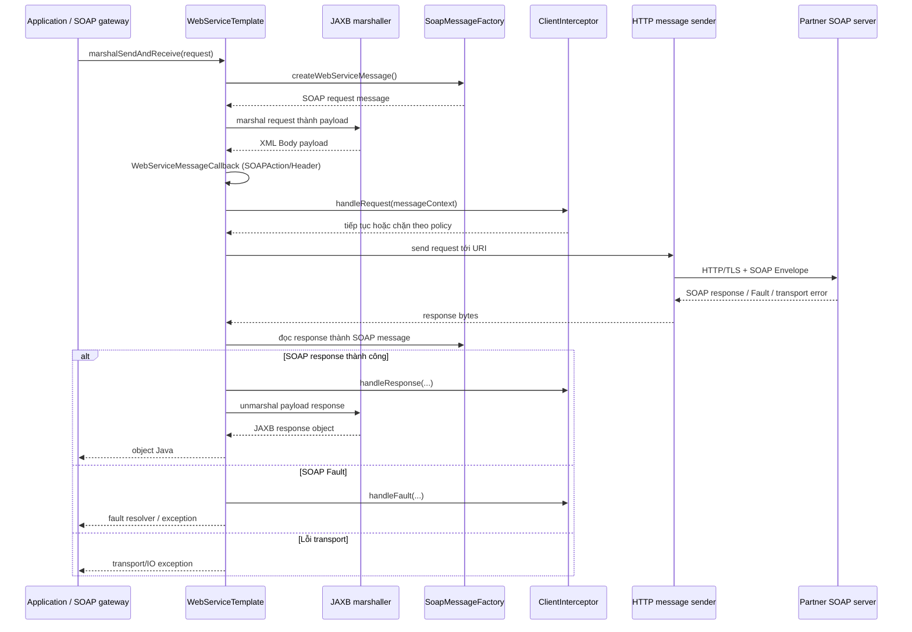
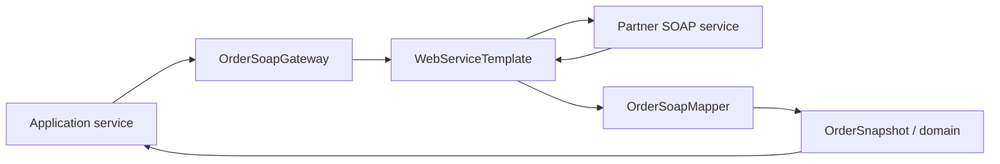
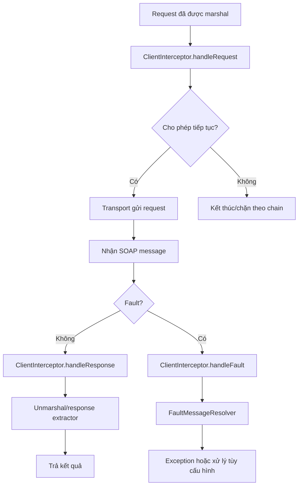
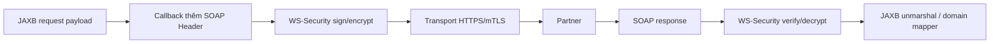
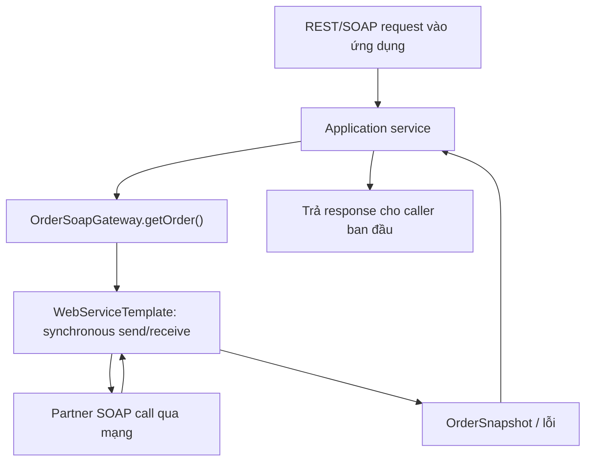
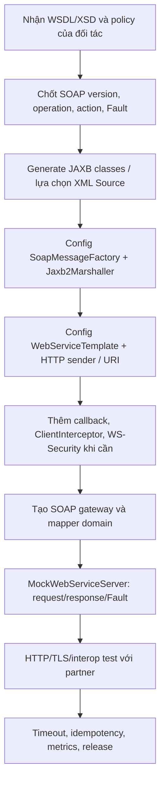

# WebServiceTemplate và vòng đời một lời gọi SOAP đồng bộ

## 1. Tình huống tích hợp: ứng dụng Java gọi hệ thống SOAP của đối tác

Giả sử một ứng dụng quản lý kho viết bằng Spring Boot phải tra cứu trạng thái đơn hàng từ hệ thống ERP của đối tác. ERP chỉ công bố **SOAP/WSDL**, không có REST API. Bên đối tác cung cấp:

- WSDL mô tả operation `GetOrder` và binding SOAP 1.1 qua HTTPS.
- XSD mô tả `GetOrderRequest`, `GetOrderResponse` và một số loại lỗi nghiệp vụ.
- Địa chỉ service, yêu cầu `SOAPAction`, timeout và chính sách bảo mật.
- Có thể yêu cầu xác thực mTLS, WS-Security UsernameToken hoặc XML Signature.

Ứng dụng cần tạo một SOAP request hợp lệ, gửi đi, chờ response, chuyển XML thành Java object rồi trả kết quả cho application service. Một cách tiếp cận là tự nối XML và gọi HTTP client; nhưng cách đó dễ sai namespace, SOAP Envelope, HTTP headers, Fault, certificate và xử lý XML.

**`WebServiceTemplate`** của **Spring Web Services (Spring-WS)** giải quyết phần lớn vòng đời đó. Nó là API client đồng bộ điều phối **message factory, marshaller, transport, callback, interceptor, response extraction và SOAP Fault handling**.

Ví dụ một lời gọi ở tầng ứng dụng có thể trông như:

```java
OrderSnapshot order = orderGateway.getOrder("ORD-1001");
```

Phía sau `orderGateway`, SOAP client dùng generated JAXB request/response theo hợp đồng, chứ domain service không cần tự tạo `<soap:Envelope>`.

Trong module **SPRING_WEB_SERVICES**, bài thuộc chương **Máy khách Spring-WS**. Trọng tâm là **`WebServiceTemplate và vòng đời một lời gọi SOAP đồng bộ`**, liên hệ trực tiếp với thiết kế XSD/WSDL theo hướng contract-first, ánh xạ JAXB, endpoint phía server, SOAP Fault, interceptor, XML security, WS-Security, chứng chỉ và kiểm thử tương thích để tích hợp doanh nghiệp ổn định.

Sau bài học, bạn có thể:

1. Phân tích một lời gọi `marshalSendAndReceive(...)` từ lúc tạo request đến khi đọc response hoặc lỗi.
2. Cấu hình `WebServiceTemplate` cùng JAXB marshaller, `SaajSoapMessageFactory`, URI và HTTP message sender.
3. Phân biệt callback, `ClientInterceptor`, transport, marshaller/unmarshaller và fault resolver.
4. Cấu hình SOAPAction/namespace/SOAP version đúng WSDL, không ghép XML tùy tiện.
5. Xử lý SOAP Fault, lỗi HTTP/TLS, timeout và vấn đề retry/idempotency một cách tường minh.
6. Kiểm thử client bằng `MockWebServiceServer` và bổ sung kiểm thử HTTP/WS-Security thực tế.

## 2. `WebServiceTemplate` là gì và không phải là gì?

`org.springframework.ws.client.core.WebServiceTemplate` là thành phần client phía **Spring-WS**. Nó hỗ trợ nhiều kiểu gọi SOAP, phổ biến nhất:

- Gửi object Java bằng JAXB/OXM rồi nhận lại object Java với `marshalSendAndReceive(...)`.
- Gửi XML payload dưới dạng `Source` và nhận kết quả vào `Result` khi cần kiểm soát XML trực tiếp.
- Dùng callback và response extractor để can thiệp ở mức SOAP message.

Nó xử lý **một lần trao đổi thông điệp đồng bộ trên thread gọi**, không tự trở thành một client bất đồng bộ hoặc reactive chỉ vì ứng dụng dùng Spring Boot.

| Thành phần | Trách nhiệm | Không nên giao nhầm |
|---|---|---|
| `WebServiceTemplate` | Điều phối request–response SOAP từ client | Không tự định nghĩa hợp đồng XSD/WSDL |
| `WebServiceMessageFactory` | Tạo và đọc thông điệp SOAP | Không thực thi nghiệp vụ, không tự kiểm tra quyền |
| `SaajSoapMessageFactory` | Implementation message factory dùng SAAJ | Không phải JAXB marshaller |
| `Jaxb2Marshaller` | Java object ↔ XML payload bằng JAXB | Không tự tạo HTTP connection hay xác thực mTLS |
| `WebServiceMessageSender` | Kết nối/gửi/nhận thông điệp qua transport | Không đổi payload sang domain object |
| `WebServiceMessageCallback` | Chỉnh request message trước khi gửi | Không phải callback chạy nền sau response |
| `ClientInterceptor` | Logic xuyên suốt trước/sau lời gọi và khi có Fault | Không thay thế việc validate nghiệp vụ |
| `FaultMessageResolver` | Diễn giải SOAP Fault phía client | Không xử lý mọi lỗi TCP/DNS/TLS |
| Mapper/domain gateway | Chuyển generated SOAP DTO ↔ model ứng dụng | Không phụ thuộc vào prefix SOAP Envelope |

Một `WebServiceTemplate` **không tự sinh các Java classes từ WSDL**. Đối với thiết kế contract-first, nhóm có thể dùng XJC/JAXB generate classes từ XSD, hoặc dùng `Source` khi không cần JAXB. Thông tin SOAP version, endpoint và action phải xuất phát từ **WSDL binding và policy của đối tác**.

### 2.1. Vì sao gọi là “Template”?

Theo kiểu thiết kế *template*, thư viện sở hữu trình tự chung:

1. Chuẩn bị message.
2. Điền payload và thông tin giao thức.
3. Cho interceptor xử lý.
4. Mở/ sử dụng connection để gửi.
5. Nhận response.
6. Phân loại response, Fault hoặc lỗi.
7. Đọc nội dung và giải phóng tài nguyên kết nối.

Ứng dụng chỉ cần cung cấp phần thay đổi theo use case, ví dụ JAXB object, URI, callback hoặc response extractor.

## 3. Hợp đồng mẫu: tra cứu đơn hàng qua SOAP 1.1

Trước khi viết client, cần biết **chính xác XML payload** mà đối tác chấp nhận. Giả sử một XSD đã được review:

```xml
<?xml version="1.0" encoding="UTF-8"?>
<xs:schema xmlns:xs="http://www.w3.org/2001/XMLSchema"
           xmlns:ord="urn:example:orders:v1"
           targetNamespace="urn:example:orders:v1"
           elementFormDefault="qualified">

  <xs:element name="GetOrderRequest">
    <xs:complexType>
      <xs:sequence>
        <xs:element name="orderId" type="xs:string"/>
      </xs:sequence>
    </xs:complexType>
  </xs:element>

  <xs:element name="GetOrderResponse">
    <xs:complexType>
      <xs:sequence>
        <xs:element name="orderId" type="xs:string"/>
        <xs:element name="state" type="xs:string"/>
        <xs:element name="updatedAt" type="xs:dateTime"/>
      </xs:sequence>
    </xs:complexType>
  </xs:element>
</xs:schema>
```

SOAP request minh họa:

```xml
<soap:Envelope xmlns:soap="http://schemas.xmlsoap.org/soap/envelope/"
               xmlns:ord="urn:example:orders:v1">
  <soap:Header/>
  <soap:Body>
    <ord:GetOrderRequest>
      <ord:orderId>ORD-1001</ord:orderId>
    </ord:GetOrderRequest>
  </soap:Body>
</soap:Envelope>
```

SOAP response:

```xml
<soap:Envelope xmlns:soap="http://schemas.xmlsoap.org/soap/envelope/"
               xmlns:ord="urn:example:orders:v1">
  <soap:Body>
    <ord:GetOrderResponse>
      <ord:orderId>ORD-1001</ord:orderId>
      <ord:state>CONFIRMED</ord:state>
      <ord:updatedAt>2026-11-27T09:30:00+07:00</ord:updatedAt>
    </ord:GetOrderResponse>
  </soap:Body>
</soap:Envelope>
```

Với request–response thông thường, **SOAP Body chỉ chứa phần tử nghiệp vụ đã được công bố** hoặc một Fault khi có lỗi. Application không cần ghép Envelope thủ công nếu dùng `Jaxb2Marshaller` và `WebServiceTemplate`.

### 3.1. Một phần WSDL binding liên quan trực tiếp đến client

```xml
<!-- Đoạn trích minh họa, không phải WSDL hoàn chỉnh. -->
<wsdl:binding name="OrdersSoap11Binding" type="tns:OrdersPortType">
  <soap:binding style="document"
                transport="http://schemas.xmlsoap.org/soap/http"/>
  <wsdl:operation name="GetOrder">
    <soap:operation soapAction="urn:example:orders:GetOrder"/>
    <wsdl:input><soap:body use="literal"/></wsdl:input>
    <wsdl:output><soap:body use="literal"/></wsdl:output>
  </wsdl:operation>
</wsdl:binding>
```

Đoạn này giả định `wsdl` là `http://schemas.xmlsoap.org/wsdl/`, `soap` là `http://schemas.xmlsoap.org/wsdl/soap/` và `tns` là namespace của WSDL. Nó cho biết **operation là document/literal SOAP 1.1** và có action `urn:example:orders:GetOrder`. Đây là **URI minh họa**: client thực tế phải dùng action được công bố.

**Hợp đồng cần đọc đủ cả hai phần:** XSD quyết định QName/data type của Body, WSDL binding quyết định giao thức, SOAP action, endpoint và các Fault. Chỉ nhìn generated Java getter không đủ để cấu hình một client tương thích.

## 4. Vòng đời đầy đủ của một lần `marshalSendAndReceive`

Giả sử application gọi:

```java
Object result = webServiceTemplate.marshalSendAndReceive(
        request,
        new SoapActionCallback("urn:example:orders:GetOrder"));
```

Ở mức khái niệm, Spring-WS thực hiện các bước:



Đây là **sơ đồ trách nhiệm**, không ràng buộc từng lệnh nội bộ của mọi phiên bản Spring-WS. Connection có thể được chuẩn bị ở giai đoạn sớm hơn việc marshal, response/fault/error có nhánh riêng và interceptor có hook kết thúc. Khi debug phải dựa trên version framework đang sử dụng.

### 4.1. Bước 1 — Chọn URI đích

`WebServiceTemplate` có thể dùng:

- `setDefaultUri("https://partner.example.org/soap")` để cung cấp địa chỉ mặc định.
- Overload có tham số URI như `marshalSendAndReceive(String uri, Object request, WebServiceMessageCallback callback)` để chọn đích cụ thể cho lời gọi.

`defaultUri` là **địa chỉ gửi**, không thay thế `targetNamespace` của XSD. URI ở cấu hình HTTP và namespace URI trong XML có thể rất khác nhau.

Không dùng URI do client cuối trực tiếp cung cấp để gọi tùy ý; điều đó có thể tạo rủi ro **SSRF**. Nếu cần nhiều partner, quản lý danh sách endpoint được cho phép theo cấu hình và identity đã xác minh.

### 4.2. Bước 2 — Tạo SOAP request message

`WebServiceTemplate` sử dụng `WebServiceMessageFactory` (ví dụ `SaajSoapMessageFactory`) để có một message rỗng phù hợp SOAP 1.1/1.2. Message factory quyết định cấu trúc Envelope/Header/Body và hỗ trợ các thao tác cấp SOAP.

Không nên đưa `<soap:Envelope>` vào JAXB request DTO: JAXB sẽ marshal DTO như **payload**, còn message factory bao nó trong Body.

### 4.3. Bước 3 — Marshal request Java sang XML payload

`Jaxb2Marshaller` chuyển `GetOrderRequest` thành XML đúng QName, namespace và element structure mà generated JAXB binding thể hiện.

Ví dụ:

```java
GetOrderRequest request = new GetOrderRequest();
request.setOrderId("ORD-1001");
```

Chỉ khi JAXB class/binding phù hợp, XML mới có dạng:

```xml
<ord:GetOrderRequest xmlns:ord="urn:example:orders:v1">
  <ord:orderId>ORD-1001</ord:orderId>
</ord:GetOrderRequest>
```

Việc marshal thành công **không đảm bảo XSD facets đã được kiểm tra**, trừ khi schema validation đã được cấu hình/áp dụng. Khi integration với bên ngoài, nên validate theo hợp đồng hoặc thực hiện validation phù hợp ở boundary.

### 4.4. Bước 4 — Chạy request callback

`WebServiceMessageCallback` cho phép sửa message **trước khi gửi**: đặt SOAPAction, tạo một SOAP Header theo hợp đồng hoặc gắn correlation ID. Callback không tự gửi HTTP.

Một số tác vụ request callback thường gặp:

- `new SoapActionCallback("...")`: đặt action theo cơ chế của Spring-WS.
- Viết SOAP Header như `CorrelationId` hoặc WS-Addressing metadata.
- Gắn thông tin request-local cần cho chính message hiện tại.

Nếu message có XML Signature, thứ tự **marshal → thêm Header → ký → gửi** phải phù hợp security policy. Không thay đổi nội dung đã ký sau bước ký.

### 4.5. Bước 5 — Các `ClientInterceptor` xử lý request

Các interceptor có thể thêm logging an toàn, metrics, policy hoặc WS-Security xử lý outbound. Thứ tự đăng ký quan trọng, đặc biệt khi một interceptor biến đổi payload còn một interceptor ký XML.

Không coi một interceptor chỉ là đối tượng "được gọi trước API". Nó có thể có các hook cho response, SOAP Fault và cleanup; trong đường đi bình thường client-side interceptor được áp dụng theo quy tắc chain của Spring-WS.

### 4.6. Bước 6 — Transport gửi HTTP/TLS

`WebServiceMessageSender` quản lý kết nối tới server. Với SOAP over HTTP, sender quyết định cách xử lý HTTP connection, timeout và TLS tùy implementation. `WebServiceTemplate` không phải một HTTP connection pool.

Ví dụ SOAP 1.1 qua HTTP:

```http
POST /soap HTTP/1.1
Host: partner.example.org
Content-Type: text/xml; charset=utf-8
SOAPAction: "urn:example:orders:GetOrder"

<soap:Envelope xmlns:soap="http://schemas.xmlsoap.org/soap/envelope/"
               xmlns:ord="urn:example:orders:v1">
  <soap:Body>
    <ord:GetOrderRequest>
      <ord:orderId>ORD-1001</ord:orderId>
    </ord:GetOrderRequest>
  </soap:Body>
</soap:Envelope>
```

HTTP metadata do stack gửi thực tế có thể khác ở thứ tự, prefix và charset. Quan trọng là **media type/Envelope/action phải khớp với binding**.

### 4.7. Bước 7 — Nhận và phân loại response

Response có thể là:

1. SOAP response bình thường chứa `GetOrderResponse`.
2. SOAP Fault chứa `soap:Fault`.
3. HTTP error không phải SOAP, ví dụ HTML từ API gateway hoặc `415 Unsupported Media Type`.
4. Không nhận được response do timeout, mất kết nối, lỗi TLS/DNS.

Không phải mọi HTTP 500 đều là cùng một exception. SOAP over HTTP có thể trả Fault với HTTP 500, trong khi gateway cũng có thể trả HTTP 500 không có SOAP Body. Client cần phân biệt **Fault thuộc protocol** và **lỗi transport**.

### 4.8. Bước 8 — Unmarshal response hoặc ném lỗi

Khi message là response bình thường, unmarshaller đọc payload XML và tạo JAXB result. Nếu là SOAP Fault, fault resolver của template thường xử lý theo chính sách đã cấu hình, ví dụ mặc định tạo `SoapFaultClientException`.

Lời gọi **đồng bộ** hoàn tất bằng một trong các cách:

- Trả một JAXB/domain object.
- Trả `null` trong một số API/trường hợp response không có payload.
- Ném exception được caller xử lý.

Thread caller chờ qua các bước mạng/parse/unmarshal tương ứng; với API request–response này không có `CompletableFuture` được trả tự động.

## 5. Cài đặt và cấu hình cơ bản trong Spring Boot

Đối với stack Spring Boot hiện đại, một project thường dùng **`spring-boot-starter-web-services`**, JAXB runtime/provider và các generated classes tương thích với Spring-WS. Không nên trộn API JAXB `javax.xml.bind.*` của các stack cũ với runtime Jakarta `jakarta.xml.bind.*` trong các phiên bản mới.

Một cách tổ chức:

```text
src/main/
  java/com/example/orders/
    application/OrderQueryService.java
    domain/OrderSnapshot.java
    integration/soap/OrderSoapGateway.java
    integration/soap/OrderSoapConfiguration.java
    integration/soap/OrderSoapMapper.java
  resources/
    contracts/orders/v1/orders.xsd
    application.yml
target/generated-sources/jaxb/
  com/example/orders/soap/generated/v1/
    GetOrderRequest.java
    GetOrderResponse.java
    ObjectFactory.java
```

Đây là cấu trúc minh họa. Folder generated sources là **output của build**, không nơi để chỉnh sửa setter/annotation thủ công. Nếu thay XSD hoặc JAXB binding, regenerate và chạy contract tests.

### 5.1. Cấu hình JAXB và message factory

```java
package com.example.orders.integration.soap;

import org.springframework.context.annotation.Bean;
import org.springframework.context.annotation.Configuration;
import org.springframework.core.io.ClassPathResource;
import org.springframework.oxm.jaxb.Jaxb2Marshaller;
import org.springframework.ws.soap.SoapVersion;
import org.springframework.ws.soap.saaj.SaajSoapMessageFactory;

@Configuration
public class OrderSoapBindingConfiguration {

    @Bean
    public Jaxb2Marshaller ordersMarshaller() {
        Jaxb2Marshaller marshaller = new Jaxb2Marshaller();
        marshaller.setContextPath(
                "com.example.orders.soap.generated.v1");
        // Chỉ bật khi schema và import/include được đóng gói an toàn.
        marshaller.setSchema(new ClassPathResource(
                "contracts/orders/v1/orders.xsd"));
        return marshaller;
    }

    @Bean
    public SaajSoapMessageFactory ordersSoap11Factory() {
        SaajSoapMessageFactory factory = new SaajSoapMessageFactory();
        factory.setSoapVersion(SoapVersion.SOAP_11);
        return factory;
    }
}
```

Các bean được Spring quản lý vòng đời khởi tạo. Nếu tạo `SaajSoapMessageFactory` thủ công bên ngoài container, phải bảo đảm quy trình initialization của factory trước khi sử dụng.

`Jaxb2Marshaller#setContextPath(...)` kỳ vọng generated package có metadata JAXB cần thiết, thường là `ObjectFactory` hoặc `jaxb.index`. Nếu classpath/generator thay đổi, cần kiểm tra generated output thực tế thay vì chỉ đổi chuỗi package.

**Lưu ý về XSD:** khi bật `marshaller.setSchema(...)`, schema cần truy cập được và resolver external schema/DTD phải được kiểm soát. Runtime không nên tự tải `xs:import` từ URL tùy ý; nếu có nhiều XSD, đóng gói đầy đủ và cấu hình resource resolution đúng.

### 5.2. Tạo `WebServiceTemplate`

```java
package com.example.orders.integration.soap;

import org.springframework.beans.factory.annotation.Qualifier;
import org.springframework.context.annotation.Bean;
import org.springframework.context.annotation.Configuration;
import org.springframework.oxm.jaxb.Jaxb2Marshaller;
import org.springframework.ws.client.core.WebServiceTemplate;
import org.springframework.ws.soap.saaj.SaajSoapMessageFactory;

@Configuration
public class OrderSoapClientConfiguration {

    @Bean
    public WebServiceTemplate ordersWebServiceTemplate(
            @Qualifier("ordersSoap11Factory")
            SaajSoapMessageFactory messageFactory,
            @Qualifier("ordersMarshaller")
            Jaxb2Marshaller marshaller) {

        WebServiceTemplate template =
                new WebServiceTemplate(messageFactory);
        template.setMarshaller(marshaller);
        template.setUnmarshaller(marshaller);
        template.setDefaultUri("https://partner.example.org/soap");
        return template;
    }
}
```

Địa chỉ chỉ là ví dụ; ứng dụng thật lấy từ configuration đã được kiểm soát. Với nhiều partner, đặt tên/qualifier cho `WebServiceTemplate` và marshaller theo hợp đồng riêng để tránh tiêm nhầm SOAP version, package JAXB hoặc URI.

Ở môi trường production, cần cấu hình thêm **HTTP sender, timeout, TLS/mTLS, authentication và interceptors**. Việc chỉ khởi tạo template đủ để minh họa luồng, chưa thể coi là cấu hình client production.

### 5.3. Không để bean cấu hình trở thành nơi giữ dữ liệu của lời gọi

`WebServiceTemplate` có thể được chia sẻ giữa các request Java **sau khi đã cấu hình xong**, theo cách sử dụng thông thường của Spring-WS. Các cấu hình như message factory, marshaller, URI và interceptor list nên ổn định sau initialization.

Tránh:

```java
// ANTI-PATTERN: một template dùng chung bị đổi đích tùy lời gọi.
webServiceTemplate.setDefaultUri(uriOfCurrentPartner);
Object reply = webServiceTemplate.marshalSendAndReceive(request);
```

Khi hai thread đổi `defaultUri`, request có thể bị gửi nhầm hệ thống. Nếu phải chọn đích khác, dùng overload có URI **đã được allowlist** cho từng invocation hoặc tạo adapter/template cấu hình cố định theo partner. Không đưa header/request-specific token vào mutable field của singleton gateway/interceptor.

## 6. Viết một SOAP gateway và mapper độc lập nghiệp vụ

### 6.1. Domain model không phụ thuộc JAXB

```java
package com.example.orders.domain;

import java.time.Instant;

public record OrderSnapshot(
        String orderId,
        String state,
        Instant updatedAt) {
}
```

Ứng dụng chỉ cần biết `OrderSnapshot`; không cần import `SoapMessage`, `JAXBElement` hoặc `XMLGregorianCalendar`.

### 6.2. Mapper JAXB response sang domain

```java
package com.example.orders.integration.soap;

import com.example.orders.domain.OrderSnapshot;
import com.example.orders.soap.generated.v1.GetOrderResponse;
import java.time.OffsetDateTime;
import javax.xml.datatype.DatatypeConstants;
import javax.xml.datatype.XMLGregorianCalendar;
import org.springframework.stereotype.Component;

@Component
public class OrderSoapMapper {

    public OrderSnapshot toDomain(GetOrderResponse response) {
        if (response == null || response.getOrderId() == null) {
            throw new IllegalArgumentException(
                    "Invalid partner response: missing order id");
        }
        XMLGregorianCalendar xml = response.getUpdatedAt();
        if (xml == null ||
                xml.getTimezone() == DatatypeConstants.FIELD_UNDEFINED) {
            throw new IllegalArgumentException(
                    "Partner updatedAt requires a UTC offset");
        }

        return new OrderSnapshot(
                response.getOrderId(),
                response.getState(),
                OffsetDateTime.parse(xml.toXMLFormat()).toInstant());
    }
}
```

Hợp đồng ví dụ giả định `updatedAt` bắt buộc có offset. XSD `xs:dateTime` trong XSD 1.0 nói chung **có thể không có timezone**; nếu policy nghiệp vụ bắt buộc offset, phải ghi rõ và kiểm tra trong schema/rule hoặc validator. Không chuyển thời gian thiếu offset bằng `ZoneId.systemDefault()`.

`XMLGregorianCalendar` vẫn thuộc package `javax.xml.datatype` của JDK ngay cả trong stack Jakarta JAXB. Nó không phải bằng chứng rằng project đang trộn hai hệ JAXB.

### 6.3. Client adapter sử dụng template

```java
package com.example.orders.integration.soap;

import com.example.orders.domain.OrderSnapshot;
import com.example.orders.soap.generated.v1.GetOrderRequest;
import com.example.orders.soap.generated.v1.GetOrderResponse;
import org.springframework.beans.factory.annotation.Qualifier;
import org.springframework.stereotype.Component;
import org.springframework.ws.client.core.WebServiceTemplate;
import org.springframework.ws.soap.client.core.SoapActionCallback;

@Component
public class OrderSoapGateway {
    private static final String GET_ORDER_ACTION =
            "urn:example:orders:GetOrder";

    private final WebServiceTemplate template;
    private final OrderSoapMapper mapper;

    public OrderSoapGateway(
            @Qualifier("ordersWebServiceTemplate") WebServiceTemplate template,
            OrderSoapMapper mapper) {
        this.template = template;
        this.mapper = mapper;
    }

    public OrderSnapshot getOrder(String orderId) {
        if (orderId == null || orderId.isBlank()) {
            throw new IllegalArgumentException("orderId is required");
        }

        GetOrderRequest request = new GetOrderRequest();
        request.setOrderId(orderId);

        Object raw = template.marshalSendAndReceive(
                request,
                new SoapActionCallback(GET_ORDER_ACTION));

        if (!(raw instanceof GetOrderResponse response)) {
            throw new IllegalStateException(
                    "Unexpected SOAP payload type from partner");
        }
        return mapper.toDomain(response);
    }
}
```

Trong hệ thống thật, `GetOrderRequest` có thể được sinh dưới dạng root class có `@XmlRootElement` hoặc cần `ObjectFactory` bọc vào `JAXBElement<GetOrderRequest>`; response cũng có thể cần unwrap. Chữ ký minh họa giả định generated root classes từ XSD ở phần 3. **Hãy đọc mã XJC sinh ra**, đừng sửa tay generated Java để ép nó hợp với ví dụ.

Phần mapper và gateway chịu trách nhiệm chuyển đổi tại **SOAP boundary**, giữ application/domain độc lập đối tác. Một gateway khác có thể dùng SOAP v2 với JAXB package khác mà vẫn trả cùng `OrderSnapshot` khi semantics tương thích.

### 6.4. Vì sao không trả JAXB DTO trực tiếp cho application?

Nếu application phụ thuộc `GetOrderResponse` generated, thay đổi XSD có thể lan tới nhiều business service. Ngoài ra, xử lý `XMLGregorianCalendar`, namespace, optional/nil và Fault sẽ bị phân tán.

Kiến trúc rõ ràng:



## 7. `marshalSendAndReceive` và các API gửi/nhận khác

`WebServiceTemplate` có các lựa chọn dựa trên mức trừu tượng cần dùng.

| API/kiểu gọi | Input | Output | Khi nào dùng |
|---|---|---|---|
| `marshalSendAndReceive(request)` | JAXB/OXM object | Unmarshalled object | Hợp đồng rõ, DTO được sinh từ XSD |
| `marshalSendAndReceive(request, callback)` | JAXB object + callback | Object | Cần SOAPAction hoặc SOAP Header theo hợp đồng |
| `marshalSendAndReceive(uri, request, callback)` | JAXB object + URI per-call | Object | Nhiều endpoint được allowlist |
| `sendSourceAndReceiveToResult(...)` | `Source` XML payload | Ghi response vào `Result` | Chuyển XML trực tiếp, XSLT hoặc gateway |
| `sendAndReceive(callback, extractor)` | Callback chỉnh SOAP message | Giá trị do extractor trả | Cần kiểm soát SOAP Header/Body/Fault chi tiết |

Tùy overload cụ thể và bản Spring-WS, API có các kiểu checked exception/generic khác nhau; nên dựa trên Javadoc chính xác của dependency đã khóa. Các dạng gọi trên đều hoạt động trong mô hình **đồng bộ** khi dùng `WebServiceTemplate`.

### 7.1. Dùng `Source` khi cần xử lý XML trực tiếp

Với một đối tác legacy không muốn generate JAXB DTO hoặc cần XSLT, có thể gửi payload XML như `Source`:

```java
import org.springframework.xml.transform.StringResult;
import org.springframework.xml.transform.StringSource;

String requestXml = """
    <o:GetOrderRequest xmlns:o="urn:example:orders:v1">
      <o:orderId>ORD-1001</o:orderId>
    </o:GetOrderRequest>
    """;

StringResult reply = new StringResult();
boolean received = template.sendSourceAndReceiveToResult(
        new StringSource(requestXml), reply);

if (received) {
    String responseXml = reply.toString();
    // Parse/validate response XML an toàn, không dùng xử lý chuỗi ad-hoc.
}
```

`sendSourceAndReceiveToResult` xử lý **payload**, không yêu cầu cung cấp `soap:Envelope` trong `StringSource`. Ví dụ này là một đoạn lệnh được đặt trong class/method có sẵn `template`. Với dữ liệu không tin cậy, phải áp dụng XML parser hardening và schema validation; cách tạo `StringSource` không tự chứng minh an toàn XXE.

Nếu cần thao tác XML phức tạp, cân nhắc JAXB + mapper hoặc một transformer đã được kiểm chứng, thay vì nối chuỗi XML từ dữ liệu do user nhập.

### 7.2. Callback và extractor khác gì nhau?

`WebServiceMessageCallback` nhận **request SOAP message** và có thể chỉnh nó trước khi gửi. `WebServiceMessageExtractor<T>` nhận **response message** sau khi đã nhận; nó tạo một giá trị kết quả theo nhu cầu.

Ví dụ callback có thể gắn header, trong khi extractor đọc SOAP Header từ response. Không nên dùng một callback request như một cơ chế nhận kết quả tương lai; request/response vẫn xảy ra trong chính lần gọi đồng bộ.

### 7.3. Có cần `WebServiceGatewaySupport` không?

Spring-WS còn có `WebServiceGatewaySupport` cho cách viết client kế thừa một lớp hỗ trợ chứa `WebServiceTemplate`. Cả hai cách đều hợp lệ:

- **Inject `WebServiceTemplate` trực tiếp:** dễ test, ít inheritance, phù hợp cấu trúc gateway theo interface.
- **Extend `WebServiceGatewaySupport`:** tiện trong các codebase dùng sẵn quy ước đó.

Chúng không làm thay đổi giao thức hay semantics: phần quan trọng vẫn là message factory, URI, marshaller, sender, interceptor và cách xử lý lỗi.

## 8. SOAPAction, SOAP Header và WS-Addressing

### 8.1. SOAPAction của SOAP 1.1

Với WSDL SOAP 1.1 có `soapAction="urn:example:orders:GetOrder"`, callback:

```java
import org.springframework.ws.soap.client.core.SoapActionCallback;

new SoapActionCallback("urn:example:orders:GetOrder");
```

cung cấp cách đặt action cho `WebServiceTemplate`. Việc truyền action hợp lệ phải kiểm tra cùng SOAP version và binding; **tên Java method `getOrder` không tự suy ra action**.

### 8.2. SOAP 1.2 khác SOAP 1.1 ở transport

| Yếu tố | SOAP 1.1 | SOAP 1.2 |
|---|---|---|
| Namespace Envelope | `http://schemas.xmlsoap.org/soap/envelope/` | `http://www.w3.org/2003/05/soap-envelope` |
| HTTP Content-Type thường gặp | `text/xml` | `application/soap+xml` |
| Action | `SOAPAction` HTTP header theo SOAP 1.1 binding | Thường qua tham số `action` của `application/soap+xml` theo binding |
| Fault | `faultcode`, `faultstring` | `Code`, `Reason`, `Detail` |

Chọn SOAP 1.2 bằng factory phù hợp, ví dụ:

```java
SaajSoapMessageFactory factory = new SaajSoapMessageFactory();
factory.setSoapVersion(SoapVersion.SOAP_12);
```

Trong mã nguồn thực tế, cần import `SaajSoapMessageFactory` và `SoapVersion`; factory được Spring quản lý initialization. **Đổi một factory mà không cập nhật WSDL binding/client action/transport là chưa đủ**. Nếu ứng dụng gọi nhiều đối tác SOAP 1.1 và SOAP 1.2, hãy cấu hình template riêng cho từng hợp đồng.

### 8.3. SOAP Header không phải HTTP header

Giả sử đối tác yêu cầu một `CorrelationId` trong SOAP Header:

```xml
<soap:Header xmlns:soap="http://schemas.xmlsoap.org/soap/envelope/"
             xmlns:ctx="urn:example:context:v1">
  <ctx:CorrelationId>req-20261127-001</ctx:CorrelationId>
</soap:Header>
```

Callback có thể viết header:

```java
import java.util.UUID;
import javax.xml.namespace.QName;
import org.springframework.ws.WebServiceMessageCallback;
import org.springframework.ws.soap.SoapMessage;
import org.springframework.ws.soap.SoapHeaderElement;

String correlationId = UUID.randomUUID().toString();

WebServiceMessageCallback callback = message -> {
    if (!(message instanceof SoapMessage soapMessage)) {
        throw new IllegalStateException("SOAP message required");
    }
    soapMessage.setSoapAction("urn:example:orders:GetOrder");
    QName name = new QName(
            "urn:example:context:v1", "CorrelationId", "ctx");
    SoapHeaderElement header = soapMessage.getSoapHeader()
            .addHeaderElement(name);
    header.setText(correlationId);
};

Object result = template.marshalSendAndReceive(request, callback);
```

Đây là ví dụ khi code nằm trong method có `request`/`template` tương ứng. Tạo correlation ID **mới theo invocation**, không lưu nó trong instance field singleton. SOAP Header có thể cần `mustUnderstand` hoặc role/actor theo hợp đồng; không tự ý gắn các thuộc tính đó khi đối tác không yêu cầu.

**Header không phải identity:** một `PartnerId` do client điền không được tin làm thông tin xác thực nếu chưa được ký/kiểm tra qua security policy. Correlation ID cũng không phải idempotency key hoặc WS-Security timestamp.

### 8.4. `wsa:Action` khác SOAPAction

Nếu đối tác sử dụng WS-Addressing, họ có thể yêu cầu `wsa:Action` trong SOAP Header. Nó khác vị trí với HTTP `SOAPAction` hoặc tham số `action` của SOAP 1.2 media type. Nhiều policy yêu cầu chúng tương thích về giá trị, nhưng không thể cho rằng một callback đặt SOAPAction tự sinh đầy đủ WS-Addressing headers.

Khi tích hợp WS-Addressing, cần cấu hình rõ `To`, `Action`, `MessageID` và tham chiếu response theo WSDL/policy, sử dụng extension/client interceptor phù hợp.

## 9. `ClientInterceptor` và những điểm mở rộng trong pipeline

`org.springframework.ws.client.support.interceptor.ClientInterceptor` cung cấp các hook xử lý request, response và SOAP Fault phía **client**. Nó khác `EndpointInterceptor` phía server.

Một interceptor có thể:

- Gắn/đọc correlation metadata hoặc các trường theo contract.
- Ghi số liệu thời gian, counter, metrics.
- Áp dụng WS-Security outbound/inbound theo policy.
- Quan sát SOAP Fault và phân loại lỗi ở mức hạ tầng.

### 9.1. Vòng đời interceptor



Chú ý: xử lý lỗi transport có thể xảy ra trước khi nhận được SOAP message, nên **không được giả định `handleFault` luôn chạy khi HTTP request thất bại**. Hook lỗi SOAP khác với lỗi không kết nối được server.

### 9.2. Đăng ký interceptor vào template

```java
import org.springframework.ws.client.support.interceptor.ClientInterceptor;

template.setInterceptors(new ClientInterceptor[] {
    correlationInterceptor,
    securityInterceptor
});
```

Hai biến trên là các interceptor đã được tạo theo project. `setInterceptors(...)` thay danh sách interceptor của template trong giai đoạn cấu hình; không nên mutate mảng/danh sách hoặc các interceptor dùng chung ngay giữa nhiều lời gọi.

**Thứ tự có tác động hai chiều.** Khi có interceptor biến đổi payload và interceptor ký SOAP, phải chắc chắn body đã được marshal/chuyển đổi trước khi ký và chữ ký được verify đúng thời điểm bên nhận. Các hook response/fault có quy tắc thứ tự riêng của chain; kiểm tra qua test integration của bản Spring-WS đang chạy.

### 9.3. Singleton interceptor phải stateless theo request

Ví dụ sai:

```java
@Component
class UnsafeClientInterceptor {
    private String currentCorrelationId; // SAI: shared request data
}
```

Nếu hai request đồng thời dùng template chung, correlation ID có thể bị trộn. Hãy giữ metadata trong biến local, callback theo invocation, `MessageContext` của invocation hoặc object bất biến truyền qua adapter. Với MDC/ThreadLocal phục vụ logging, cần cleanup và context propagation đúng nếu có async.

## 10. Cấu hình HTTP connection, timeout và TLS

`WebServiceTemplate` điều phối SOAP; **message sender** quyết định cách kết nối mạng. Một stack có thể dùng sender dựa trên `HttpURLConnection`, Apache HttpClient hoặc implementation khác tùy version/dependencies.

### 10.1. Hai timeout dễ bị nhầm

| Timeout | Ý nghĩa thực tế |
|---|---|
| **Connect timeout** | Giới hạn thời gian thiết lập kết nối tới endpoint, bao gồm các bước liên quan theo sender |
| **Read/response timeout** | Giới hạn chờ dữ liệu phản hồi hoặc đọc từ connection |
| **Connection pool acquisition timeout** | Có thể cần nếu sender sử dụng pool HTTP connections |
| **End-to-end deadline** | Giới hạn tổng thời gian một operation theo SLO, có thể gồm retries và nhiều network calls |

**Connect timeout + read timeout không tự tạo end-to-end deadline tuyệt đối.** Nếu client có retry, DNS, TLS handshake, nhiều redirects hoặc nhiều lần đọc, tổng thời gian có thể dài hơn một phép cộng đơn giản.

### 10.2. Cấu hình sender theo phiên bản thư viện

Ví dụ về ý tưởng wiring:

```java
@Bean
public WebServiceTemplate ordersTemplate(
        SaajSoapMessageFactory messageFactory,
        Jaxb2Marshaller marshaller,
        WebServiceMessageSender ordersSender) {

    WebServiceTemplate template =
            new WebServiceTemplate(messageFactory);
    template.setMarshaller(marshaller);
    template.setUnmarshaller(marshaller);
    template.setMessageSender(ordersSender);
    template.setDefaultUri("https://partner.example.org/soap");
    return template;
}
```

`ordersSender` là một bean được cấu hình riêng cho sender implementation đang dùng. Các setter cụ thể cho timeout/proxy/SSL **khác nhau giữa `HttpUrlConnectionMessageSender`, Apache HttpClient 4/5 và các phiên bản Spring-WS**. Không copy tên setter hoặc đơn vị millisecond từ một stack khác mà chưa kiểm tra Javadoc; dùng cấu hình được hỗ trợ trong phiên bản đã khóa.

Một profile cấu hình minh họa:

```yaml
partner:
  orders:
    uri: https://partner.example.org/soap
    connect-timeout: 3s
    read-timeout: 10s
    # Chứng chỉ/secret được tham chiếu qua secret manager;
    # không commit password/private key vào file này.
```

Các tên property `partner.orders.*` **là cấu hình tùy chỉnh của ứng dụng**, không phải auto-config keys mặc định của Spring-WS. Cần code đọc/bind các property này rồi áp dụng vào sender phù hợp.

### 10.3. HTTPS, truststore và mTLS

Với HTTPS:

1. Client phải kiểm tra **chứng chỉ server**, trust chain và hostname.
2. Nếu đối tác yêu cầu **mTLS**, client cần certificate/private key hợp lệ và thiết lập client authentication trong HTTP sender/TLS stack.
3. Chứng chỉ X.509 dùng để **ký SOAP XML** trong WS-Security có thể là cùng hoặc khác với chứng chỉ mTLS; đây là hai lớp bảo vệ độc lập.
4. Tránh dùng trust-all certificate manager hoặc tắt hostname verification để “cho chạy”; như vậy làm mất bảo đảm xác thực máy chủ.
5. Quản lý key/truststore bằng cơ chế secrets an toàn, rotation và test expiry/revocation theo chính sách.

SOAP version cũng độc lập TLS version: **SOAP 1.2 không tự mang HTTPS bảo mật hơn SOAP 1.1**.

### 10.4. Kết nối HTTP không tạo idempotency

Một timeout đọc phản hồi không cho biết chắc request đã được xử lý hay chưa. Server có thể đã ghi đơn hàng vào database, nhưng response bị rớt trên đường về.

Nếu client retry operation tạo/sửa dữ liệu, cần:

- Idempotency key do **hợp đồng nghiệp vụ** quy định.
- Server lưu kết quả xử lý theo key và xử lý request lặp lại nhất quán.
- Chính sách retry theo loại lỗi, không retry vô hạn.
- Timeout/deadline và số lần thử được giới hạn.
- Correlation ID để tracing, không dùng thay idempotency key nếu không có thỏa thuận.

Với query chỉ đọc như `GetOrder`, retry có thể ít nguy cơ side effect hơn, nhưng vẫn phải kiểm tra rate limit và tính nhất quán. `WebServiceTemplate` không tự bảo đảm mọi operation SOAP an toàn để thử lại.

## 11. SOAP Fault và ngoại lệ phía client

Khi server trả:

```xml
<soap:Envelope xmlns:soap="http://schemas.xmlsoap.org/soap/envelope/">
  <soap:Body>
    <soap:Fault>
      <faultcode>soap:Client</faultcode>
      <faultstring>Unknown order</faultstring>
      <detail>
        <e:code xmlns:e="urn:example:errors:v1">
          ORDER_NOT_FOUND
        </e:code>
      </detail>
    </soap:Fault>
  </soap:Body>
</soap:Envelope>
```

đó là **SOAP Fault**, không phải `GetOrderResponse` bình thường. `WebServiceTemplate` có thể nhận diện Fault và dùng `FaultMessageResolver` để xử lý.

### 11.1. Ba nhóm lỗi cần tách

| Nhóm lỗi | Ví dụ | Hướng xử lý |
|---|---|---|
| **SOAP Fault** | `ORDER_NOT_FOUND`, request không hợp lệ, security fault | Đọc Fault code/reason/detail, map sang exception domain/integration phù hợp |
| **Lỗi transport** | DNS, TCP reset, timeout, TLS trust error, HTTP response không phải SOAP | Theo dõi hạ tầng, retry có điều kiện, không coi là business Fault |
| **Lỗi mapping/contract** | XML response sai QName, thiếu field, unmarshalling fail | Dừng/đánh dấu incompatibility, không tự làm mất dữ liệu |

`SoapFaultClientException` là exception phổ biến từ fault resolver mặc định trong Spring-WS; transport có thể tạo các loại `WebServiceIOException` hoặc transport exception khác. Các kiểu exception và cách phát hiện cụ thể phụ thuộc API/version đang dùng.

### 11.2. Ví dụ xử lý Fault có kiểm soát

```java
import org.springframework.ws.soap.client.SoapFaultClientException;
import org.springframework.ws.client.WebServiceIOException;

public OrderSnapshot getOrderSafely(String orderId) {
    try {
        return gateway.getOrder(orderId);
    } catch (SoapFaultClientException fault) {
        // Đọc code/reason và typed detail theo WSDL, không chỉ faultstring.
        throw new PartnerSoapFaultException(
                "Partner returned SOAP Fault", fault);
    } catch (WebServiceIOException transport) {
        // Có thể request đã được xử lý: cân nhắc retry/idempotency.
        throw new PartnerCommunicationException(
                "Partner SOAP transport failed", transport);
    }
}
```

`PartnerSoapFaultException` và `PartnerCommunicationException` là exception **do ứng dụng tự định nghĩa**. Đoạn này là khung để phân loại, không phải implementation parser fault detail đầy đủ.

**Không nên** biến tất cả Fault thành `OrderSnapshot(null, "FAILED", null)` hoặc trả một giá trị mặc định trông giống thành công. Điều đó che lỗi và có thể làm application tiếp tục thao tác nghiệp vụ trên dữ liệu không đáng tin.

### 11.3. Khi cần typed SOAP Fault

Một đối tác có thể công bố fault detail schema, ví dụ mã `ORDER_NOT_FOUND` và `retryable=false`. Client cần đọc QName/detail theo WSDL/XSD, tránh chỉ tìm text trong `faultstring` hoặc `Reason`.

Có thể cấu hình `FaultMessageResolver` riêng hoặc xử lý `SoapFaultClientException` một cách có cấu trúc. Dù chọn cách nào, cần:

- Bảo vệ chống XML parser/XXE khi đọc detail.
- Không log raw token/headers.
- Phân loại business retryable và non-retryable dựa trên contract.
- Test SOAP 1.1 và SOAP 1.2 Fault đúng với binding thực tế.

## 12. HTTP status, Content-Type và lỗi trước SOAP

Không nên coi HTTP status là toàn bộ kết quả SOAP.

| Quan sát | Ý nghĩa có thể |
|---|---|
| HTTP 200 + response SOAP bình thường | Operation thành công ở lớp SOAP; vẫn cần kiểm tra nghiệp vụ |
| HTTP 500 + `soap:Fault` | SOAP Fault hợp lệ theo binding, resolver có thể xử lý |
| HTTP 400/415 + HTML hoặc text | Gateway/servlet từ chối trước SOAP endpoint |
| HTTP 200 + Envelope sai version | Transport thành công nhưng protocol/contract không tương thích |
| HTTP 502/503/504 từ proxy | Lỗi upstream/gateway, có thể không có SOAP Envelope |
| Không nhận response sau send | Trạng thái xử lý phía server **không chắc chắn** |

### 12.1. Kiểm tra SOAP version trên cả request và response

Với SOAP 1.1:

```text
Envelope:     http://schemas.xmlsoap.org/soap/envelope/
Content-Type: text/xml; charset=utf-8
SOAPAction:   "urn:example:orders:GetOrder"
```

Với SOAP 1.2:

```text
Envelope:     http://www.w3.org/2003/05/soap-envelope
Content-Type: application/soap+xml; charset=utf-8; action="..."
```

Media type có tham số; đừng so nguyên chuỗi `Content-Type == "application/soap+xml"`. Với MTOM/XOP, outer Content-Type có thể là `multipart/related` và cần kiểm tra root MIME part cùng binding.

Việc chuyển SOAP 1.1 sang 1.2 không chỉ là thay `SoapVersion` ở client; phải có WSDL binding tương ứng và test response/Fault với đối tác.

## 13. XML security và WS-Security trên SOAP client

`WebServiceTemplate` không phải một security appliance. Nó có thể tích hợp các interceptor/transport thích hợp, nhưng **nếu không cấu hình**, một client gọi SOAP vẫn có thể thiếu các yêu cầu bảo mật quan trọng.

### 13.1. Các lớp cần phân biệt

| Lớp | Trách nhiệm |
|---|---|
| HTTPS/mTLS | Mã hóa kênh, kiểm tra server certificate và tùy policy xác thực client certificate |
| XML parser security | Chặn external entities/DTD không cần, giới hạn XML size/depth và entity expansion |
| JAXB/XSD validation | Xác minh payload tuân các ràng buộc XSD |
| WS-Security | XML Signature, encryption, UsernameToken, timestamp, anti-replay theo policy |
| Authorization | Server quyết định client/partner có quyền đối với order nào |
| Application resilience | Timeout, retry policy, idempotency, circuit breaking và observability |

**`wsu:Timestamp`** trong SOAP Header dùng cho security freshness; nó không tự đồng nghĩa với `updatedAt` của đơn hàng. **Chữ ký XML** có thể bảo vệ body và một số headers theo policy, nhưng không tự cấp quyền thao tác nghiệp vụ.

### 13.2. Thứ tự xử lý thông điệp được ký

Ở phía outbound, payload JAXB và các header liên quan cần hoàn thiện **trước khi ký**. Ở inbound, signature phải được kiểm tra trước khi client tin nội dung response theo policy.



Đây là một **trình tự bảo mật mong muốn**, không khẳng định mọi interceptor đều thực hiện đúng các bước đó theo mặc định. Cần cấu hình WSS4J/interceptors, certificate/truststore, policy và thứ tự, sau đó test chữ ký/timestamp thực tế.

Nếu có request callback sửa SOAP Body sau khi security interceptor ký, chữ ký có thể sai. Hãy kiểm tra pipeline thực tế thay vì sửa node XML sau khi ký để “chữa” sai namespace.

### 13.3. Parser XML và XXE

Khi đọc SOAP response từ đối tác, dữ liệu XML vẫn là **dữ liệu bên ngoài**. Hãy:

- Cập nhật dependency Spring-WS, JAXB, SAAJ và XML parser phù hợp.
- Cấu hình chặn DTD/external entities ở lớp parser/provider thực sự sử dụng.
- Không mở `ACCESS_EXTERNAL_DTD` hay external schema resolution chỉ để “cho parse chạy”.
- Giới hạn kích thước response, attachment và timeout.
- Validate XSD và các giá trị nghiệp vụ sau unmarshalling.
- Không đưa XML chưa kiểm chứng vào code XPath/XSLT cho phép `document()`/external URI tùy ý.

Không có một thuộc tính duy nhất của `WebServiceTemplate` bảo đảm phòng chống toàn bộ XXE/DoS. Phải kiểm tra provider, HTTP ingress/egress và thử payload độc hại trong môi trường cách ly.

## 14. Đồng bộ, thread safety và quản lý trạng thái per-call

Một lời gọi `marshalSendAndReceive` thường **chặn thread gọi** trong khi chờ network response. Nếu application chạy trên servlet worker thread, những SOAP calls lâu có thể chiếm thread và ảnh hưởng throughput.

### 14.1. Các nguyên tắc an toàn khi dùng chung template

1. Cấu hình `WebServiceTemplate`, message factory, marshaller và interceptor trước khi nhận request; tránh thay đổi setter trong runtime.
2. Tạo JAXB request object mới theo lời gọi; không tái sử dụng một object mutable cho nhiều thread.
3. Không giữ `currentOrderId`, `currentPartner` hoặc `currentCorrelationId` trong field singleton client.
4. Dùng callback theo invocation để ghi SOAP Header cần thiết.
5. Nếu dùng các instance HTTP sender có pool, chọn pool sizing và max concurrent connections phù hợp, không mặc định pooled theo tên template.
6. Phân biệt application request deadline và riêng read/connect timeout.

`Jaxb2Marshaller` của Spring được thiết kế để sử dụng như một bean chia sẻ sau khi cấu hình; trong quá trình marshal/unmarshal, implementation quản lý các instance JAXB marshaller/unmarshaller phù hợp. Tuy nhiên mọi custom JAXB adapter, listener hay interceptor tự viết vẫn phải tuân thủ thread safety.

### 14.2. Synchronous call trong application flow



Nếu ERP mất 8 giây để trả lời, application thread có thể chờ gần 8 giây cộng các chi phí liên quan. Đo thời gian end-to-end và kích thước thread pool. Cân nhắc bulkhead/circuit breaker/queue khi kiến trúc thực sự cần, nhưng **đừng tự biến một SOAP command chưa có idempotency thành thao tác retry nền không kiểm soát**.

### 14.3. Timeout không chứng minh server chưa xử lý

Giả sử client gửi `SubmitOrderRequest` rồi timeout khi chờ response. Server có thể đã tạo order thành công. Nếu caller gửi lại một request khác thiếu idempotency key, có thể tạo trùng.

Phân biệt:

- `correlationId`: nhận dạng luồng log/tracing.
- `clientRequestId`/idempotency key: nhận dạng một command logic qua retry.
- `orderId`: nhận dạng entity nghiệp vụ.
- `wsu:Timestamp`: metadata bảo mật trong message.

Chính sách xử lý lỗi mạng phải xuất phát từ ngữ nghĩa operation, không chỉ từ exception class.

## 15. Kiểm thử client bằng `MockWebServiceServer`

Spring-WS cung cấp **`MockWebServiceServer`** trong `spring-ws-test` để mô phỏng một server SOAP phía đối tác mà không gửi HTTP thật. Nó gắn với `WebServiceTemplate` của client và xác minh:

- Payload XML được gửi có đúng QName/nội dung không.
- SOAP action/header có được thiết lập theo kỳ vọng không (nếu matcher được hỗ trợ/cấu hình).
- Client unmarshalling response và trả domain object đúng không.
- Khi đối tác trả Fault, client có phân loại lỗi đúng không.

**Phân biệt:** `MockWebServiceClient` dùng để kiểm thử **inbound Spring-WS @Endpoint**, còn `MockWebServiceServer` dùng để kiểm thử **outbound WebServiceTemplate**. Dùng đúng công cụ để kiểm tra nơi cần.

### 15.1. Happy-path test có payload request/response

Ví dụ test giả định có bean `OrderSoapGateway`, `ordersWebServiceTemplate` và JAXB classes của phần 3:

```java
import static org.junit.jupiter.api.Assertions.assertEquals;
import static org.springframework.ws.test.client.RequestMatchers.payload;
import static org.springframework.ws.test.client.ResponseCreators.withPayload;

import com.example.orders.domain.OrderSnapshot;
import java.time.Instant;
import org.junit.jupiter.api.Test;
import org.springframework.beans.factory.annotation.Autowired;
import org.springframework.beans.factory.annotation.Qualifier;
import org.springframework.boot.test.context.SpringBootTest;
import org.springframework.ws.client.core.WebServiceTemplate;
import org.springframework.ws.test.client.MockWebServiceServer;
import org.springframework.xml.transform.StringSource;

@SpringBootTest
class OrderSoapGatewayTest {

    @Autowired
    private OrderSoapGateway gateway;

    @Autowired
    @Qualifier("ordersWebServiceTemplate")
    private WebServiceTemplate template;

    @Test
    void sendsContractPayloadAndMapsResponse() {
        String expectedRequest = """
            <o:GetOrderRequest xmlns:o="urn:example:orders:v1">
              <o:orderId>ORD-1001</o:orderId>
            </o:GetOrderRequest>
            """;

        String partnerResponse = """
            <o:GetOrderResponse xmlns:o="urn:example:orders:v1">
              <o:orderId>ORD-1001</o:orderId>
              <o:state>CONFIRMED</o:state>
              <o:updatedAt>2026-11-27T09:30:00+07:00</o:updatedAt>
            </o:GetOrderResponse>
            """;

        MockWebServiceServer server =
                MockWebServiceServer.createServer(template);
        server.expect(payload(new StringSource(expectedRequest)))
              .andRespond(withPayload(new StringSource(partnerResponse)));

        OrderSnapshot result = gateway.getOrder("ORD-1001");

        assertEquals("ORD-1001", result.orderId());
        assertEquals("CONFIRMED", result.state());
        assertEquals(
                Instant.parse("2026-11-27T02:30:00Z"),
                result.updatedAt());
        server.verify();
    }
}
```

Điểm cần lưu ý:

1. `MockWebServiceServer` kiểm tra **SOAP payload**, không yêu cầu cung cấp cả Envelope trong `StringSource`.
2. JAXB XML prefix có thể khác `o`; matcher XML-aware theo khả năng thư viện, không nên viết assert dựa chỉ vào byte prefix.
3. XSD ở ví dụ định nghĩa `updatedAt` bắt buộc, mapper yêu cầu offset; test dùng dữ liệu phù hợp.
4. Đây là test tích hợp với Spring context, giả định các bean/fixture đầy đủ; không phải ví dụ chạy độc lập khi thiếu generated sources.
5. `MockWebServiceServer` không khẳng định TLS, HTTP Content-Type hoặc timeout thực vì **không có network round-trip thật**.

### 15.2. Fault test

Client phải có bài test cho SOAP Fault, không chỉ response thành công.

```java
import static org.junit.jupiter.api.Assertions.assertThrows;
import static org.springframework.ws.test.client.ResponseCreators.withServerOrReceiverFault;
import java.util.Locale;
import org.springframework.ws.soap.client.SoapFaultClientException;

@Test
void propagatesPartnerFault() {
    MockWebServiceServer server =
            MockWebServiceServer.createServer(template);

    String expectedRequest = """
        <o:GetOrderRequest xmlns:o="urn:example:orders:v1">
          <o:orderId>ORD-1001</o:orderId>
        </o:GetOrderRequest>
        """;

    server.expect(payload(new StringSource(expectedRequest)))
          .andRespond(withServerOrReceiverFault(
                  "ERP unavailable", Locale.ENGLISH));

    assertThrows(
            SoapFaultClientException.class,
            () -> gateway.getOrder("ORD-1001"));
    server.verify();
}
```

Đây là **phần trích của một test method** đặt trong class `OrderSoapGatewayTest` ở phần trước, nơi đã có các field `template` và `gateway`. Các imports cho `MockWebServiceServer`, `StringSource`, `RequestMatchers.payload` và `@Test` được dùng lại từ class đó. Tùy SOAP version, Fault code có thể khác: SOAP 1.1 dùng `Server`, SOAP 1.2 dùng `Receiver`.

### 15.3. Test callback SOAPAction

Nên kiểm tra action bằng matcher của `spring-ws-test` khi phiên bản cung cấp `soapAction(...)` hoặc bằng message-level callback verification. Ví dụ về ý định:

```text
Expected SOAPAction: urn:example:orders:GetOrder
Expected payload QName: {urn:example:orders:v1}GetOrderRequest
Expected response QName: {urn:example:orders:v1}GetOrderResponse
```

**Không suy ra action từ payload QName.** Hai giá trị được quy định ở hai phần khác nhau của WSDL binding. Nếu đối tác yêu cầu giá trị action rỗng, test phải phản ánh hợp đồng thật chứ không dùng action ví dụ.

## 16. Test HTTP/TLS/interoperability ngoài mock

Mock server rất hữu ích cho phần JAXB/gateway logic nhưng không thể thay thế kiểm thử network với hệ thống thực hoặc môi trường đối tác.

### 16.1. Ma trận kiểm thử các lớp

| Mức test | Cần xác nhận |
|---|---|
| Mapper unit test | `XMLGregorianCalendar` → `Instant` đúng offset; missing data bị từ chối |
| JAXB schema test | Request/response đúng QName và XSD; không chỉ well-formed |
| `MockWebServiceServer` | Payload, SOAPAction, normal response, SOAP Fault và client adapter |
| Local HTTP test | `Content-Type`, SOAP version, HTTP headers, error status, timeouts |
| TLS/mTLS test | Truststore, hostname verification, client certificate, rotation/expiry |
| WS-Security test | Signature, timestamp, encryption, UsernameToken theo policy |
| WSDL interop | Client Java/.NET khác công nghệ đọc WSDL và trao đổi payload/Fault |
| Load test | Throughput, pool exhaustion, heap, GC, p95/p99 latency, retry load |
| Negative XML test | XXE/external entity, namespace sai, payload quá lớn, invalid schema |

### 16.2. Dùng curl quan sát SOAP request qua HTTP ở môi trường thử nghiệm

Lưu payload SOAP 1.1 vào `get-order-soap11.xml` rồi:

```bash
curl -i --request POST "http://localhost:8080/ws" \
  --header 'Content-Type: text/xml; charset=utf-8' \
  --header 'SOAPAction: "urn:example:orders:GetOrder"' \
  --data-binary @get-order-soap11.xml
```

Lệnh này dùng để quan sát **raw HTTP** trên endpoint thử nghiệm; nó không chạy `WebServiceTemplate`. Có thể đối chiếu headers/body với request được Java client tạo. Với HTTPS/mTLS, cần dùng chứng chỉ test hợp lệ và không tắt xác minh server certificate.

`curl -i` hiển thị status, headers và body. Nếu HTTP response là HTML từ gateway, không được cố JAXB-unmarshal nó như một SOAP response.

### 16.3. WSDL công bố qua proxy

Địa chỉ nội bộ của backend có thể khác public URL của đối tác. Hãy đọc WSDL tại chính URL public và kiểm tra `soap:address`, binding, action, XSD imports và certificate trust. `setDefaultUri` của client phải trỏ đúng địa chỉ truy cập, không mặc định dùng URL minh họa trong tài liệu.

## 17. Chẩn đoán sự cố theo từng giai đoạn vòng đời

| Triệu chứng | Giai đoạn thường liên quan | Hướng kiểm tra |
|---|---|---|
| `No SAAJ provider` | Tạo message factory | Kiểm tra API/provider Jakarta SAAJ và dependency runtime |
| `JAXBException`: class không được nhận diện | Marshal request | Kiểm tra context path, `ObjectFactory`, JAXB runtime/generator |
| Request XML có namespace sai | JAXB/XML payload | So generated binding với targetNamespace XSD |
| Đối tác báo 415 | HTTP transport | SOAP 1.1/1.2, `Content-Type`, MTOM root MIME |
| Endpoint đối tác không nhận operation | WSDL action/QName | So `SOAPAction`, WSDL binding và payload QName |
| TLS handshake thất bại | HTTP sender/TLS | Trust chain, hostname, cipher/protocol, mTLS cert |
| Timeout nhưng ERP có thể đã cập nhật | Network/read timeout | Kiểm tra idempotency, trạng thái server và retry policy |
| HTTP 500 nhưng client không thấy SOAP Fault | Gateway hoặc parser | Phân biệt raw HTTP error với SOAP Fault envelope |
| `SoapFaultClientException` | SOAP Fault resolver | Parse fault code/reason/detail, map theo contract |
| Unmarshal trả sai type | JAXB response | Xem `JAXBElement`, context package và QName response |
| Response có ngày giờ lệch | Domain mapper | Offset/timezone, `xs:dateTime` semantics |
| Request B gửi tới URI của A | Shared template mutated | Không `setDefaultUri` per call, chọn URI có allowlist |
| Correlation Header của A xuất hiện ở B | Singleton callback/interceptor giữ state | Context per-call, immutable values, không shared mutable field |
| Signature mismatch | Security pipeline | Chỉnh payload/header sau khi ký, sai canonicalization/policy |
| Tăng đột biến heap/latency | SOAP/JAXB/HTTP | SAAJ DOM, attachments, HTTP connection pool, validation/logging |
| Mock test pass, production fail | Network/security ngoài mock | Test TLS, HTTP headers, proxy, WSDL và provider thực |

### 17.1. Một quy trình debug có hiệu quả

Đi theo thứ tự thay vì sửa ngẫu nhiên code:

1. **Kiểm tra hợp đồng:** WSDL binding, XSD, action và SOAP version.
2. **Kiểm tra Java payload:** generated request type, JAXB context, root QName.
3. **Kiểm tra outbound message:** SOAPAction, Header, Envelope namespace, XML validation.
4. **Kiểm tra HTTP/TLS:** Content-Type, URI, certificates, timeout, proxy/gateway.
5. **Kiểm tra inbound response:** HTTP status, SOAP Envelope/Fault, security verification.
6. **Kiểm tra unmarshal và domain mapping:** null/nil, offset, enum, schema version.
7. **Kiểm tra retry/concurrency:** idempotency key, pooled connections, shared mutable state.

Ghi log **metadata** như operation, correlation ID, SOAP version, endpoint alias, status, latency và fault category. Không ghi raw UsernameToken, private key, HTTP Authorization, WS-Security signatures hoặc dữ liệu cá nhân trong payload.

## 18. Những sai lầm thiết kế thường gặp

| Sai lầm | Hậu quả | Cách đúng |
|---|---|---|
| Tự dựng SOAP Envelope bằng nối chuỗi | Sai namespace, escaping, header, Fault | JAXB `marshalSendAndReceive` hoặc Source API phù hợp |
| Dùng DTO JAXB làm domain model | XSD thay đổi lan sang business code | Dùng gateway/mapper sang domain model |
| Sửa file generated JAXB để thêm setter | Mất thay đổi khi regenerate | Dùng XJB/XmlAdapter/mapper đúng tầng |
| Gọi SOAP 1.2 bằng factory SOAP 1.1 | VersionMismatch/415 | Đồng bộ factory, WSDL, Envelope và media type |
| Không đặt SOAPAction theo WSDL | Đối tác từ chối operation | Dùng callback theo action đã công bố |
| Cấu hình template nhưng quên sender/timeouts | Request chờ dài hoặc TLS sai | Cấu hình transport riêng và end-to-end deadline |
| Tin XML response vì unmarshalling thành công | Facets/security có thể chưa được kiểm | Bật XSD validation, xác minh WS-Security và domain rules |
| Retry mọi exception | Tạo duplicate command | Idempotency key, bounded retry và phân loại lỗi |
| Xóa/hạ thấp lỗi Fault bằng default object | Business xử lý trên trạng thái giả | Map Fault sang lỗi rõ ràng |
| Ghi token hoặc SOAP raw vào log | Lộ dữ liệu nhạy cảm | Redaction và observability metadata |
| Lưu current URI/partner/correlation trong singleton | Trộn request khi chạy đồng thời | Callback và data per invocation |
| Chỉ test mock server | Bỏ qua TLS, HTTP headers, proxy | Bổ sung live HTTP/security/interop |
| Không kiểm tra SOAP Fault schema | Client cũ không parse typed fault | Contract test cả response và Fault |
| Bỏ qua `JAXBElement` | ClassCastException / unexpected response | Dựa trên generated binding thực tế |

## 19. Quy trình triển khai client SOAP đồng bộ trong dự án



Một quy trình thực dụng:

1. **Lấy WSDL/XSD chính thức:** lưu version, operation, action, fault detail và security policy.
2. **Xác định nhu cầu ứng dụng:** chỉ đọc/query hay tạo command có side effect, đồng bộ bao lâu, timeout bao nhiêu.
3. **Generate JAXB** theo toolchain tương thích; không sửa generated classes.
4. **Cấu hình message factory** theo SOAP 1.1/1.2 và JAXB marshaller đúng package/schema.
5. **Cấu hình template/sender:** endpoint URI theo môi trường, timeout, TLS/mTLS, proxy/pool khi cần.
6. **Thêm callback/interceptors:** SOAPAction, header, WS-Security theo policy; giữ data per-call.
7. **Viết SOAP gateway:** một operation rõ ràng, tạo request mới, map response sang domain và phân loại lỗi.
8. **Mock tests:** payload, header/action, SOAP Fault, invalid XML, unexpected JAXB type.
9. **Kiểm thử thật:** HTTPS, WSDL binding, chứng chỉ, interop, timeout/partial failure và load.
10. **Đưa vào vận hành:** correlation/metrics an toàn, alert timeout/fault, rotation certificate và đánh giá retry/idempotency.

### Checklist trước khi kết nối production

- [ ] WSDL/XSD và SOAP action lấy từ hợp đồng đã được duyệt, không đoán.
- [ ] Generated JAXB package, root element, `ObjectFactory` và namespace khớp XSD.
- [ ] `SaajSoapMessageFactory` đúng SOAP 1.1/1.2 của đối tác.
- [ ] `Jaxb2Marshaller`/unmarshaller được cấu hình đúng và có validation theo policy.
- [ ] `WebServiceTemplate` có URI hợp lệ, sender và timeout phù hợp.
- [ ] URI per call không lấy từ đầu vào không tin cậy; không mutate singleton template.
- [ ] SOAP Header, correlation và SOAPAction đúng binding.
- [ ] TLS/mTLS, truststore, hostname verification và WS-Security đúng policy.
- [ ] SOAP Fault, HTTP error, timeout và JAXB errors được phân loại rõ.
- [ ] Retry chỉ thực hiện khi an toàn; command có idempotency key theo hợp đồng.
- [ ] Có `MockWebServiceServer` tests và HTTP/security/interoperability tests.
- [ ] Log không tiết lộ token, chứng chỉ riêng tư, payload nhạy cảm.

## 20. Bài tập thực hành

### Bài tập 1 — Vẽ vòng đời lời gọi

Cho lời gọi:

```java
GetOrderResponse reply = (GetOrderResponse)
        template.marshalSendAndReceive(
                request,
                new SoapActionCallback("urn:example:orders:GetOrder"));
```

Hãy vẽ sơ đồ từ `GetOrderRequest` Java đến `GetOrderResponse` Java, đánh dấu:

- Tạo SOAP message bằng factory.
- Marshal JAXB request.
- Request callback và client interceptors.
- HTTP sender/TLS.
- Đọc response, phân loại Fault, unmarshal và trả kết quả.

Giải thích vì sao lời gọi là **đồng bộ**, và trường hợp timeout không cho biết chắc server đã thực hiện command chưa.

### Bài tập 2 — Viết SOAP gateway không để rò JAXB vào domain

Dựa trên XSD ở phần 3, tạo `OrderSoapGateway` và `OrderSoapMapper`:

1. Trả `OrderSnapshot` thay cho JAXB `GetOrderResponse`.
2. Kiểm tra `updatedAt` phải có offset trước khi chuyển `Instant`.
3. Từ chối response thiếu `orderId`.
4. Xử lý trường hợp XJC dùng `JAXBElement`.
5. Không lưu `currentOrderId` hoặc `currentPartner` trong field singleton.

### Bài tập 3 — Kiểm thử bằng `MockWebServiceServer`

Tạo ba kịch bản:

- Happy path: gửi `GetOrderRequest` và nhận `GetOrderResponse`, assert domain value.
- SOAP Fault: ERP trả `ORDER_NOT_FOUND` hoặc `Server` Fault; assert error được phân loại đúng.
- Response không tương thích: sai QName hoặc thiếu `updatedAt`; assert gateway không trả object thành công giả.

Thêm test SOAPAction theo API matcher phù hợp version đã chọn. Giải thích tại sao test mock không đủ chứng minh Content-Type/mTLS/HTTPS.

### Bài tập 4 — Cấu hình hai đối tác khác SOAP version

Đối tác A dùng SOAP 1.1, đối tác B dùng SOAP 1.2. Thiết kế hai bộ:

- Message factory.
- JAXB context/schema.
- Template + HTTP sender.
- SOAPAction/action policy.
- Gateway/domain mapper.

Kiểm tra không đổi `setSoapVersion` hay `setDefaultUri` trên singleton template trong lúc nhiều request chạy đồng thời.

### Bài tập 5 — Timeout, retry và idempotency

Đối tác nhận operation `CreateOrder` nhưng response có thể bị mất sau khi commit. Thiết kế:

1. `clientRequestId` bền vững cho cùng command logic.
2. Timeout và retry có giới hạn, có logging correlation.
3. Quy tắc xử lý response thành công, SOAP Fault retryable và non-retryable.
4. Cách truy vấn trạng thái sau timeout để tránh tạo trùng đơn.
5. Kiểm thử hai request retry đồng thời với cùng idempotency key.

### Bài tập 6 — Security và interop

Thiết lập môi trường test có HTTPS/mTLS và WS-Security theo policy, thực hiện:

- Client với chứng chỉ hợp lệ/không hợp lệ.
- SOAP Header/WS-Security có chữ ký hợp lệ và signature sai.
- Timestamp hết hạn hoặc message bị phát lại theo chính sách.
- SOAP request sai XSD hoặc namespace.
- SOAP Fault có detail đúng contract.
- Kiểm tra không có password, token, private key hoặc dữ liệu cá nhân trong log.

## 21. Tổng kết

**`WebServiceTemplate` là trung tâm của SOAP client đồng bộ trong Spring-WS:** nó tạo message qua factory, marshal payload, chạy callback/interceptors, gửi request bằng transport, nhận response, xử lý Fault và unmarshal kết quả. Một lời gọi `marshalSendAndReceive` trông ngắn gọn nhưng thực chất đi qua nhiều lớp có trách nhiệm rõ ràng.

Với hướng **contract-first**, giữ **XSD/WSDL là nguồn hợp đồng**, dùng **JAXB** cho payload XML, cấu hình đúng **SOAP version, action, sender, HTTPS và WS-Security**, rồi đưa kết quả qua **gateway/mapper** sang domain. Kiểm thử cả response bình thường, SOAP Fault, lỗi mạng, timeout và concurrency; không coi việc mock pass là đủ cho tương thích liên hệ thống.

Khi vòng đời request–response được hiểu tường minh và mọi lỗi được phân loại đúng, một SOAP client Java có thể tích hợp ổn định với ERP, ngân hàng hoặc các hệ thống doanh nghiệp khác mà không làm rò chi tiết SOAP vào nghiệp vụ.
