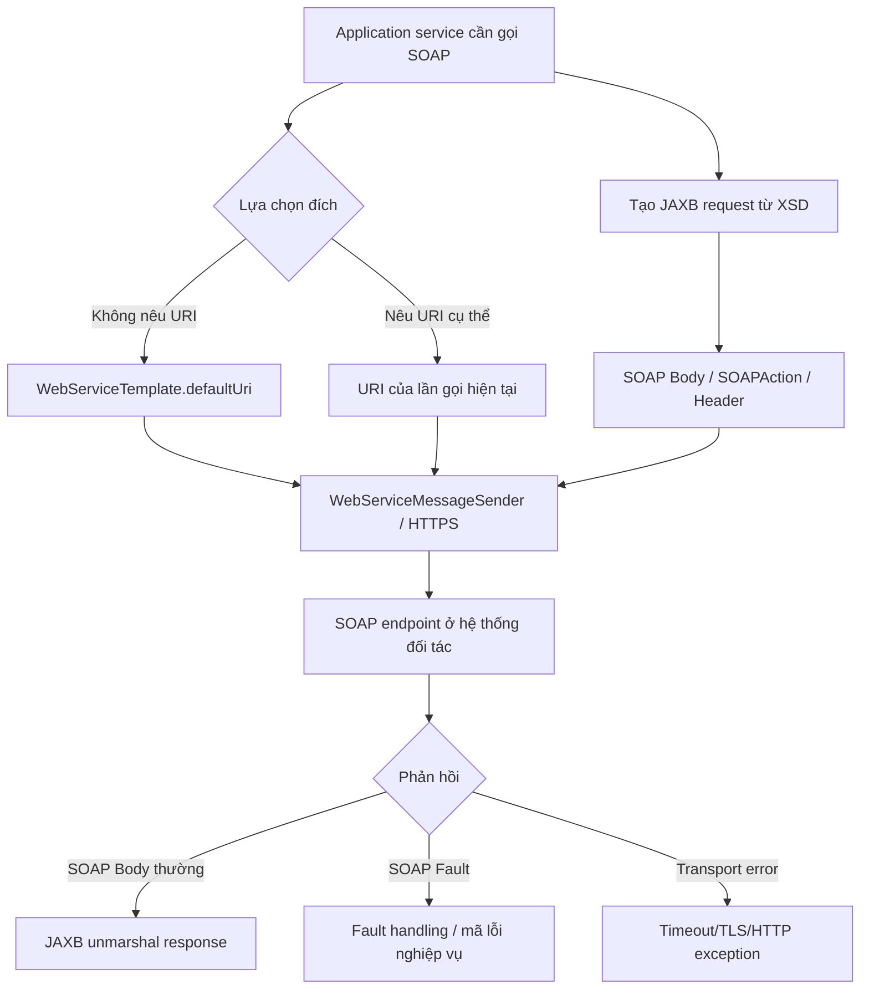
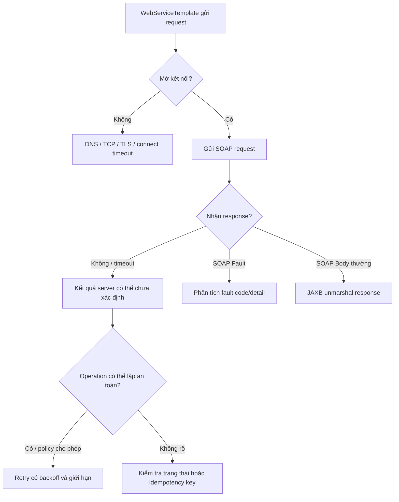

# Cấu hình URI mặc định và lựa chọn đích cho từng lời gọi

Trong ứng dụng tích hợp SOAP theo hướng **contract-first**, client Java thường có một hợp đồng XSD/WSDL ổn định nhưng phải gọi nhiều môi trường: phát triển, kiểm thử, production, vùng dự phòng hoặc những đối tác khác nhau. Với **Spring Web Services (Spring-WS)**, `WebServiceTemplate` hỗ trợ hai cách chọn điểm đến: cấu hình **URI mặc định** cho nhiều lời gọi và truyền **URI cụ thể** tại từng lần gọi. Chọn đúng cơ chế giúp code đơn giản, dễ kiểm thử, nhưng cần hiểu rõ các ảnh hưởng lên bảo mật, định tuyến, timeout và khả năng tương thích SOAP.

Bài thuộc chương **Máy khách Spring-WS** trong module `SPRING_WEB_SERVICES`. Nội dung đi từ vai trò của `defaultUri` và các overload `marshalSendAndReceive` đến cách xây một client dùng JAXB, thiết kế danh mục endpoint được phép gọi, tránh thay đổi trạng thái shared bean, điều phối `SOAPAction`/WS-Addressing, xử lý SOAP Fault, kiểm thử URI thật và vận hành sau reverse proxy, TLS, chứng chỉ và WS-Security.

> **Ghi nhớ:** URI của `WebServiceTemplate` là **địa chỉ gửi thông điệp SOAP**, thông thường bằng HTTP POST. Nó **không phải** URL GET tài liệu WSDL, không phải QName của payload và cũng không tự quyết định operation.

## 1. Một SOAP client phải quyết định những gì trước khi gửi?

Khi client gửi yêu cầu `GetOrderRequest`, tối thiểu cần có bốn quyết định độc lập:

1. **Đến đâu?** URI đích, ví dụ `https://orders.partner.example/ws`.
2. **Gửi gì?** SOAP Body có phần tử đầu vào đúng QName và cấu trúc XSD, ví dụ `{https://example.com/orders/v1}GetOrderRequest`.
3. **Gọi operation nào?** SOAPAction của SOAP 1.1, action của SOAP 1.2 hoặc `wsa:Action` nếu profile/WSDL quy định; các giá trị này không được suy bừa từ URI.
4. **Gửi an toàn thế nào?** Transport/message sender, TLS, chứng chỉ, xác thực, WS-Security, giới hạn thời gian và chính sách retry.



**Chọn endpoint không tự chọn hợp đồng.** Hai URI có thể cung cấp cùng operation và namespace; nhưng hai endpoint khác phiên bản WSDL, khác SOAPAction hoặc yêu cầu WS-Security khác nhau không thể hoán đổi chỉ bằng sửa URL.

## 2. Phân biệt SOAP endpoint URI, WSDL URL và XSD URL

Ví dụ một đối tác công bố:

| Tài nguyên | URI minh họa | Cách sử dụng |
| --- | --- | --- |
| **SOAP endpoint** | `https://api.partner.example/orders/ws` | Client gửi SOAP Envelope bằng POST |
| **WSDL document** | `https://api.partner.example/orders/ws/orders.wsdl` | GET để đọc hợp đồng operation, binding và `soap:address` |
| **XSD document** | `https://api.partner.example/orders/ws/orders.xsd` | Schema phục vụ sinh mã, validate XML và giải quyết import |
| **SOAPAction** | `urn:partner:orders:v1:GetOrder` | Giá trị action của operation, **không** phải URL để POST |
| **Payload QName** | `{https://example.com/orders/v1}GetOrderRequest` | Tên phần tử XML trong SOAP Body |

Trong WSDL 1.1, địa chỉ để gọi dịch vụ có thể xuất hiện ở `soap:address`:

```xml
<wsdl:service name="OrdersService"
    xmlns:wsdl="http://schemas.xmlsoap.org/wsdl/"
    xmlns:soap="http://schemas.xmlsoap.org/wsdl/soap/"
    xmlns:tns="https://example.com/ws/orders/v1">
    <wsdl:port name="OrdersPort" binding="tns:OrdersSoapBinding">
        <soap:address
            location="https://api.partner.example/orders/ws"/>
    </wsdl:port>
</wsdl:service>
```

Đây chỉ là **fragment WSDL minh họa**; binding và các phần khác phải được khai báo trong WSDL hoàn chỉnh. Trong cấu hình client, `defaultUri` thường được đặt thành **`soap:address/@location` thực sự có thể truy cập**, chứ không phải URL tải `orders.wsdl`.

### URI trong WSDL có phải lúc nào cũng dùng nguyên vẹn?

Không. WSDL ở staging có thể mô tả hostname nội bộ hoặc một endpoint chung, trong khi client cần gọi qua gateway public. Một số hệ thống cho phép override endpoint URI bằng cấu hình triển khai. Nhưng khi override phải xác nhận:

- Host và đường dẫn mới thực sự nhận cùng SOAP operation.
- XSD, namespace, SOAP binding và action không khác phiên bản.
- Chính sách HTTPS, mTLS và WS-Security đáp ứng yêu cầu của đối tác.
- Không trỏ nhầm sang endpoint của tenant/đối tác khác.

**`WebServiceTemplate` không tự GET WSDL, chọn `soap:address` và sinh JAXB model ở từng lần gửi.** Đây là một SOAP message template; code và cấu hình client đã phải biết hợp đồng và đích phù hợp.

## 3. `WebServiceTemplate#setDefaultUri` là gì?

`WebServiceTemplate` thuộc gói `org.springframework.ws.client.core` và là thành phần phổ biến của Spring-WS client. Khi cấu hình URI mặc định, những thao tác gửi **không truyền URI cụ thể** sẽ sử dụng đích mặc định được cấu hình phù hợp.

```java
import org.springframework.ws.client.core.WebServiceTemplate;

WebServiceTemplate template = new WebServiceTemplate();
template.setDefaultUri("https://api.partner.example/orders/ws");

// Khi marshaller/unmarshaller đã được cấu hình đúng:
// Object response = template.marshalSendAndReceive(jaxbRequest);
```

Đoạn code mới minh họa lựa chọn URI; để gọi `marshalSendAndReceive` thực sự, cần gắn marshaller/unmarshaller và chuẩn bị request JAXB có root mapping đúng hợp đồng.

Các dạng gọi cần phân biệt:

| API sử dụng | URI được dùng | Ghi chú |
| --- | --- | --- |
| `marshalSendAndReceive(request)` | URI mặc định hoặc cơ chế cung cấp destination tương ứng | Cần có một đích khả dụng |
| `marshalSendAndReceive(request, callback)` | URI mặc định | Callback thường dùng để thêm SOAPAction/Header |
| `marshalSendAndReceive(uri, request)` | **URI được truyền cho lời gọi này** | Không cần thay cấu hình mặc định |
| `marshalSendAndReceive(uri, request, callback)` | **URI của lời gọi này** | Kết hợp override đích và metadata SOAP |

Các overload gửi `Source` hoặc dùng `WebServiceMessageCallback` cũng tuân theo ý tưởng tách **đích mặc định** và **đích cung cấp cho operation** khi API cụ thể hỗ trợ. Hãy tham khảo signature của phiên bản Spring-WS đang dùng nếu dự án sử dụng những nhóm overload khác.

### Thứ tự ưu tiên

Với các overload ở bảng trên, nếu truyền một URI tường minh, **lời gọi đó không dùng `defaultUri` để quyết định đích**. Những lời gọi khác không truyền URI tiếp tục dùng mặc định. Việc override **không làm thay đổi giá trị cấu hình chung**.

```text
Client template:
  defaultUri = https://orders-primary.example/ws

Call A: marshalSendAndReceive(request)
        -> https://orders-primary.example/ws

Call B: marshalSendAndReceive(
            "https://orders-secondary.example/ws", request)
        -> https://orders-secondary.example/ws

Call C: marshalSendAndReceive(request)
        -> https://orders-primary.example/ws
```

Nếu template chưa có URI mặc định và lời gọi không cung cấp đích qua một cơ chế tương ứng, client sẽ không có nơi gửi. Tránh phụ thuộc một exception cụ thể để phát hiện trường hợp đó; nên kiểm tra cấu hình đầu vào khi ứng dụng khởi động.

## 4. Ví dụ hợp đồng XSD cho SOAP client

Giả sử đối tác công bố dịch vụ tra cứu đơn hàng ở namespace `https://example.com/orders/v1`. XSD rút gọn:

```xml
<?xml version="1.0" encoding="UTF-8"?>
<xs:schema xmlns:xs="http://www.w3.org/2001/XMLSchema"
           xmlns:ord="https://example.com/orders/v1"
           targetNamespace="https://example.com/orders/v1"
           elementFormDefault="qualified">

    <xs:element name="GetOrderRequest">
        <xs:complexType>
            <xs:sequence>
                <xs:element name="orderId" type="xs:positiveInteger"/>
            </xs:sequence>
        </xs:complexType>
    </xs:element>

    <xs:element name="GetOrderResponse">
        <xs:complexType>
            <xs:sequence>
                <xs:element name="orderId" type="xs:positiveInteger"/>
                <xs:element name="status" type="xs:string"/>
            </xs:sequence>
        </xs:complexType>
    </xs:element>
</xs:schema>
```

SOAP Body request phải chứa QName `{https://example.com/orders/v1}GetOrderRequest`. Một SOAP 1.1 message đầy đủ:

```xml
<soap:Envelope
    xmlns:soap="http://schemas.xmlsoap.org/soap/envelope/"
    xmlns:ord="https://example.com/orders/v1">
    <soap:Header/>
    <soap:Body>
        <ord:GetOrderRequest>
            <ord:orderId>42</ord:orderId>
        </ord:GetOrderRequest>
    </soap:Body>
</soap:Envelope>
```

Từ XSD có thể dùng XJC tạo Java model trong package `com.acme.orders.soap.v1`. Ví dụ tiếp theo **giả định** đã có `GetOrderRequest`, `GetOrderResponse` với getter/setter tương ứng và root mapping như thường gặp khi XSD định nghĩa global element với anonymous complex type.

Nếu XJC sinh named complex type mà **không có `@XmlRootElement`**, request có thể cần bọc trong `JAXBElement<T>` qua `ObjectFactory`. Điều này phụ thuộc binding JAXB, **không phụ thuộc URI đích**.

## 5. Cấu hình `Jaxb2Marshaller` và URI mặc định trong Spring

Một cấu hình Spring Boot/Spring-WS có thể cung cấp marshaller và template như các bean singleton:

```java
import org.springframework.beans.factory.annotation.Value;
import org.springframework.context.annotation.Bean;
import org.springframework.context.annotation.Configuration;
import org.springframework.oxm.jaxb.Jaxb2Marshaller;
import org.springframework.ws.client.core.WebServiceTemplate;

@Configuration
public class OrdersClientConfiguration {

    @Bean
    public Jaxb2Marshaller ordersMarshaller() {
        Jaxb2Marshaller marshaller = new Jaxb2Marshaller();
        marshaller.setContextPath("com.acme.orders.soap.v1");
        return marshaller;
    }

    @Bean
    public WebServiceTemplate ordersWebServiceTemplate(
            Jaxb2Marshaller ordersMarshaller,
            @Value("${integration.orders.default-uri}") String defaultUri) {

        WebServiceTemplate template = new WebServiceTemplate();
        template.setMarshaller(ordersMarshaller);
        template.setUnmarshaller(ordersMarshaller);
        template.setDefaultUri(defaultUri);
        return template;
    }
}
```

Ví dụ cấu hình ngoài code:

```yaml
integration:
  orders:
    default-uri: https://orders-test.partner.example/ws
```

Ở production, giá trị `integration.orders.default-uri` có thể đến từ môi trường, secret/config management hoặc profile triển khai, theo quy ước dự án. **Không hard-code hostname production vào logic nghiệp vụ** và không dùng một biến cấu hình cho cả đích SOAP lẫn URL tải WSDL.

Để cấu hình thực sự hoạt động:

1. Spring application phải nạp bean `OrdersClientConfiguration`.
2. Package JAXB phải tồn tại và có thông tin cần cho `JAXBContext`.
3. JAXB API/runtime phải tương thích với phiên bản Spring đang dùng: `jakarta.xml.bind` ở nhánh hiện đại, `javax.xml.bind` ở nhánh cũ.
4. URI cấu hình phải là đích được phép sử dụng và có transport/message sender hỗ trợ.
5. Client gọi **đúng bean** `ordersWebServiceTemplate`, không tạo một `new WebServiceTemplate()` khác mà quên cấu hình.

`setDefaultUri` chỉ chọn địa chỉ. Nó không thiết lập thời gian kết nối, chứng chỉ TLS, HTTP authentication, SOAPAction, WS-Security hoặc schema validation; các thành phần đó phải được cấu hình riêng.

## 6. Sử dụng URI mặc định với `marshalSendAndReceive`

Ví dụ Spring service gửi SOAP request dựa trên template đã cấu hình:

```java
import java.math.BigInteger;
import org.springframework.ws.client.core.WebServiceTemplate;
import org.springframework.ws.soap.client.core.SoapActionCallback;

public final class OrdersClient {
    private static final String GET_ORDER_ACTION =
            "urn:example:orders:v1:GetOrder";

    private final WebServiceTemplate template;

    public OrdersClient(WebServiceTemplate template) {
        this.template = template;
    }

    public GetOrderResponse getOrder(long orderId) {
        if (orderId <= 0) {
            throw new IllegalArgumentException("orderId must be positive");
        }

        GetOrderRequest request = new GetOrderRequest();
        request.setOrderId(BigInteger.valueOf(orderId));

        Object result = template.marshalSendAndReceive(
                request,
                new SoapActionCallback(GET_ORDER_ACTION));

        return (GetOrderResponse) result;
    }
}
```

Code giả định kiểu `orderId` được XJC sinh là `BigInteger` (một cách ánh xạ thường gặp cho `xs:positiveInteger`) và response root có thể unmarshal trực tiếp thành `GetOrderResponse`. Nếu binding khác, thay bằng kiểu thực tế được sinh hoặc giải bọc `JAXBElement` đúng cách; không cast mù quáng trong ứng dụng thật.

**Lời gọi trên không chứa URI**, vì vậy nó dùng destination mặc định của template. `SoapActionCallback` đặt action theo hợp đồng SOAP 1.1; nó **không thay URI**. Mã `GetOrderRequest` và giá trị SOAPAction phải khớp WSDL/XSD của endpoint.

Khi client cần gửi SOAP 1.2 hoặc WS-Addressing, việc đặt action sẽ phụ thuộc binding/profile và message factory; không thể chỉ đổi URI sang cùng host rồi coi SOAP 1.1 callback đáp ứng mọi cơ chế.

## 7. Lựa chọn đích tường minh cho một lời gọi

Nếu chỉ một số lời gọi cần chuyển sang endpoint khác có **cùng hợp đồng**, dùng overload nhận URI:

```java
public GetOrderResponse getOrderAt(
        String endpointUri, long orderId) {

    GetOrderRequest request = new GetOrderRequest();
    request.setOrderId(BigInteger.valueOf(orderId));

    Object result = template.marshalSendAndReceive(
            endpointUri,
            request,
            new SoapActionCallback("urn:example:orders:v1:GetOrder"));

    return (GetOrderResponse) result;
}
```

Đoạn này minh họa **overload API**, không phải hướng dẫn chấp nhận trực tiếp `endpointUri` từ người dùng hoặc từ SOAP Header. Trong code sản xuất, URI phải được lấy từ **danh sách đích đã duyệt** hoặc cấu hình đáng tin cậy. Đồng thời hàm phải kiểm tra `orderId > 0` như ví dụ trước, và xử lý lỗi/cast phù hợp binding.

### Vì sao không thay `defaultUri` trước mỗi lần gửi?

Phản ví dụ:

```java
// KHÔNG nên làm khi WebServiceTemplate là bean dùng chung.
template.setDefaultUri(uriForRequestA);
template.marshalSendAndReceive(requestA);

// Một thread khác có thể thay đổi defaultUri ở giữa hai dòng.
template.setDefaultUri(uriForRequestB);
template.marshalSendAndReceive(requestB);
```

Khi `WebServiceTemplate` được chia sẻ, thay đổi cấu hình trong lúc xử lý các request đồng thời có thể khiến lời gọi A đi nhầm đích B. Đây là **lỗi trạng thái chia sẻ**, đặc biệt nguy hiểm khi hệ thống có nhiều tenant, vùng dữ liệu hoặc đối tác.

**Giải pháp:** cấu hình mặc định **một lần** khi khởi tạo và dùng overload `marshalSendAndReceive(uri, ...)` để thay đích ở **mỗi lời gọi**, hoặc tạo các template/client riêng biệt được cấu hình bất biến cho từng endpoint cố định.

## 8. `WebServiceGatewaySupport` là lớp tiện ích, không phải một HTTP route

Spring-WS có `WebServiceGatewaySupport` để triển khai client gateway bao quanh `WebServiceTemplate`. Nó giúp gom phần cấu hình marshaller/unmarshaller, template và các phương thức thao tác nghiệp vụ.

Ví dụ:

```java
import org.springframework.ws.client.core.support.WebServiceGatewaySupport;
import org.springframework.ws.soap.client.core.SoapActionCallback;

public class OrdersGateway extends WebServiceGatewaySupport {

    public Object getOrder(GetOrderRequest request) {
        return getWebServiceTemplate().marshalSendAndReceive(
                request,
                new SoapActionCallback("urn:example:orders:v1:GetOrder"));
    }

    public Object getOrderAt(
            String destination, GetOrderRequest request) {
        return getWebServiceTemplate().marshalSendAndReceive(
                destination,
                request,
                new SoapActionCallback("urn:example:orders:v1:GetOrder"));
    }
}
```

Cấu hình gateway theo mô hình thông dụng:

```java
@Bean
public OrdersGateway ordersGateway(Jaxb2Marshaller marshaller) {
    OrdersGateway gateway = new OrdersGateway();
    gateway.setDefaultUri("https://orders-test.partner.example/ws");
    gateway.setMarshaller(marshaller);
    gateway.setUnmarshaller(marshaller);
    return gateway;
}
```

Đoạn `@Bean` nằm trong class `@Configuration` phù hợp. Cần lựa chọn **một cách tổ chức client** nhất quán: dùng gateway hoặc inject template trực tiếp, tránh tạo nhiều template với cấu hình security khác nhau mà không biết. `WebServiceGatewaySupport` **không phải endpoint server** và không tự tạo một URI để hệ thống khác gọi.

## 9. Thiết kế danh mục đích được phép thay vì nhận URL tùy ý

Một yêu cầu nghiệp vụ phổ biến là: “Nếu site chính không hoạt động, gửi đến site dự phòng”, hoặc “Tenant thuộc khu vực EU phải gọi endpoint EU”. Không nên cho UI/API nhận trực tiếp một chuỗi URL bất kỳ rồi truyền vào `marshalSendAndReceive(uri, ...)`, vì điều đó tạo nguy cơ **Server-Side Request Forgery (SSRF)**.

Thay vào đó, ứng dụng chọn từ tập đích đã được quản trị:

```java
import java.net.URI;
import java.util.Map;
import java.util.Objects;

public final class OrdersDestinationRegistry {
    public enum Site { PRIMARY, DISASTER_RECOVERY }

    private final Map<Site, URI> endpoints = Map.of(
            Site.PRIMARY,
            URI.create("https://orders-primary.partner.example/ws"),
            Site.DISASTER_RECOVERY,
            URI.create("https://orders-dr.partner.example/ws")
    );

    public String resolve(Site site) {
        URI uri = Objects.requireNonNull(
                endpoints.get(site), "Unsupported SOAP destination");

        if (!uri.isAbsolute()
                || !"https".equalsIgnoreCase(uri.getScheme())
                || uri.getHost() == null
                || uri.getUserInfo() != null
                || uri.getFragment() != null) {
            throw new IllegalStateException("Invalid configured SOAP URI");
        }
        return uri.toASCIIString();
    }
}
```

Đây là code minh họa một registry **tĩnh và do ứng dụng quản lý**. Trong production, danh mục thường nằm ở cấu hình triển khai và phải được **xác thực khi nạp**; việc kiểm tra scheme trong code **không đủ** nếu cho phép tự do nhập hostname. Cần giới hạn host/port/path, chính sách DNS/egress, redirect và security policy tương ứng.

Khi gọi:

```java
String destination = registry.resolve(
        OrdersDestinationRegistry.Site.PRIMARY);

Object response = template.marshalSendAndReceive(
        destination,
        request,
        new SoapActionCallback("urn:example:orders:v1:GetOrder"));
```

**Ranh giới tin cậy:** input bên ngoài nên chỉ chọn một **mã đích nghiệp vụ** đã được phép dùng, không cung cấp raw URI. Nếu client có quyền chọn region hoặc tenant, phải kiểm tra **principal–tenant–operation–region** trước khi chọn. Cùng một hợp đồng SOAP không đồng nghĩa bất kỳ caller nào cũng có quyền gửi dữ liệu sang region khác.

## 10. Lựa chọn nhiều môi trường, khu vực và tenant

Ba bài toán định tuyến không hoàn toàn giống nhau:

| Bài toán | Nên lấy quyết định từ đâu? | Điều cần kiểm tra |
| --- | --- | --- |
| **dev/test/prod** | Cấu hình triển khai, profile/secret management | Tránh production gọi nhầm môi trường test, hoặc ngược lại |
| **Region/site** | Registry chính thức, định tuyến hoạt động được giám sát | Data residency, certificate và contract version tại site |
| **Tenant/đối tác** | Tenant registry server-side và entitlement đã xác minh | Không sử dụng `X-Tenant-ID`/SOAP Header như chỉ thị URL đáng tin |
| **Dự phòng (DR)** | Chính sách failover đã phê duyệt | Idempotency, trạng thái giao dịch sau timeout |
| **Migration từ v1 sang v2** | Versioning có kiểm soát | Namespace XSD, SOAPAction, WSDL và JAXB model có thể đổi |

### Tình huống multi-tenant

Giả sử tài khoản tích hợp có quyền với tenant A và B, nhưng tenant A phải gọi endpoint ở Việt Nam và tenant B gọi endpoint EU. Một cách thiết kế:

1. Xác thực principal và lấy danh sách tenant được phép.
2. Đọc tenant mục tiêu ở nghiệp vụ rồi kiểm tra authorization.
3. Tra tenant → đích SOAP trong **registry đáng tin cậy**, không lấy URL thẳng từ request.
4. Kiểm tra operation đang gọi được hỗ trợ ở region đó với cùng contract/policy.
5. Gọi `marshalSendAndReceive(uri, request, callback)`.
6. Log nội bộ mã đích/region và correlation ID, **không log token** hoặc payload nhạy cảm.

Chỉ cần lỗi chọn đích cũng có thể gây **rò rỉ dữ liệu chéo tenant** dù SOAP Body hoàn toàn hợp lệ theo XSD. Do vậy lựa chọn destination phải là một phần của **chính sách bảo mật và data residency**, không chỉ một tiện ích tiện đường.

## 11. Default URI không phải SOAPAction, QName hoặc WS-Addressing `To`

Bốn giá trị độc lập có thể có mặt trong một SOAP call:

```text
Destination URI: https://orders-primary.partner.example/ws
SOAP 1.1 Action: urn:example:orders:v1:GetOrder
Request QName : {https://example.com/orders/v1}GetOrderRequest
WS-A wsa:To   : URI định tuyến WS-Addressing nếu profile yêu cầu
```

Đặc điểm cần nhớ:

- `defaultUri` hoặc URI của overload xác định **đích transport**.
- `@SoapAction` ở server có thể định tuyến theo action trong binding SOAP 1.1; `SoapActionCallback` bên client hỗ trợ đặt giá trị đó.
- `@PayloadRoot` ở server có thể định tuyến dựa trên QName của request trong SOAP Body.
- `wsa:To` và `wsa:Action` là **SOAP Header của WS-Addressing**, khác HTTP SOAPAction. Khi chuyển endpoint, nếu profile yêu cầu WS-Addressing thì giá trị `To` có thể cần điều chỉnh riêng.
- HTTP `Host`, SNI và TLS certificate xác định/kiểm tra kết nối transport, không thay cho QName nghiệp vụ.

**Đổi URI không tự sửa SOAP Header WS-Addressing, không cập nhật SOAPAction, không thay JAXB namespace.** Nếu những giá trị phải khớp chính sách của một đối tác, client phải cấu hình từng thành phần một cách nhất quán.

### Vì sao không nên “tự động suy SOAPAction từ URL”?

Một SOAP endpoint URL có thể phục vụ nhiều operation như `GetOrder`, `CancelOrder` và `UpdateOrder`. Chúng gửi đến cùng URL nhưng có request QName và SOAPAction khác nhau. Chọn URI theo route không chứng minh đã chọn đúng operation.

Ngược lại, cùng operation `GetOrder` có thể được cung cấp tại hai host độc lập. Trong trường hợp chúng triển khai **cùng hợp đồng**, SOAPAction và payload QName giữ nguyên dù transport URI thay đổi.

## 12. HTTPS, chứng chỉ và message sender đi cùng lựa chọn đích

Một `WebServiceTemplate` sử dụng `WebServiceMessageSender` để gửi SOAP message qua transport được hỗ trợ. Với HTTPS, đích ảnh hưởng đến:

- **TLS hostname verification:** chứng chỉ server phải phù hợp hostname thực sự được kết nối.
- **Truststore:** certificate chain của đích phải được tin cậy theo policy.
- **mTLS:** nếu yêu cầu client certificate, credential dùng với đích phải được kiểm soát; không chia sẻ cùng private key cho đối tác khác nếu chính sách không cho phép.
- **HTTP authentication:** Basic, bearer token, proxy credentials hoặc cơ chế tương ứng cần gắn đúng đích và phạm vi.
- **WS-Security:** chữ ký XML, mã hóa, token và truststore của SOAP Header có thể khác nhau theo đối tác.
- **Proxy/firewall/egress:** endpoint có thể truy cập được từ máy dev nhưng bị chặn ở container hoặc mạng production.

Một template **dùng chung** có thể dùng chung transport/security configuration. Nếu các đích đòi **chứng chỉ hoặc credential khác nhau**, không nên chỉ truyền URI khác vào một template mà bỏ qua security context. Có thể cần **nhiều template/gateway được cấu hình riêng theo đối tác** hoặc một message sender/credential selection được thiết kế và kiểm thử đúng.

Không dùng cách “bỏ kiểm tra certificate” hoặc “trust all HTTPS” để chữa lỗi hostname không khớp. Điều đó khiến client không thể chứng minh mình kết nối đúng server.

### Proxy, forwarded headers và URL public

Một WSDL tải từ `https://partner.example/ws/orders.wsdl` đôi khi công bố `soap:address` nội bộ như `http://orders-internal:8080/ws` nếu reverse proxy cấu hình sai. Client cần sử dụng **URL public được đối tác xác nhận**, không cố gọi hostname nội bộ hoặc tắt TLS vì WSDL ghi HTTP.

Hãy thông báo lỗi WSDL publication cho đối tác, đối chiếu contract và cấu hình URI trong môi trường triển khai. Không tự tin rằng một địa chỉ ngoài WSDL bất kỳ có thể thay thế endpoint chính thức.

## 13. Timeout không phải SOAP Fault; retry cần idempotency

Một lời gọi `marshalSendAndReceive` có thể thất bại ở nhiều thời điểm:



| Lỗi | Nơi phát sinh | Cách xử lý |
| --- | --- | --- |
| Connect timeout | Trước khi kết nối TCP/SSL hoàn tất | Kiểm tra DNS/network; retry theo chính sách nếu an toàn |
| Read timeout | Sau khi gửi/đang chờ response | Không biết chắc server đã thực thi hay chưa |
| TLS handshake failure | Trust/cert/protocol | Sửa cấu hình certificate/trust, không retry mù |
| HTTP 401/403 | Gateway/transport authentication | Kiểm tra credential/quyền |
| SOAP Fault `Sender/Client` | SOAP message đã bị từ chối hoặc không hợp lệ | Thường cần sửa request/policy |
| SOAP Fault `Receiver/Server` | Lỗi bên nhận | Phân biệt lỗi tạm thời với lỗi cấu hình trước khi retry |
| JAXB marshal failure | Client chưa tạo được XML hợp lệ | Sửa model/binding, không thay URI để che lỗi |
| JAXB unmarshal failure | Client không đọc được response | So WSDL/XSD/client version, không mặc định lỗi network |

**Không tự động chuyển sang site DR sau mọi timeout.** Với operation thay đổi trạng thái (đặt hàng, thanh toán, hủy đơn), site chính có thể đã xử lý request trước khi client mất kết nối. Nếu gửi lại site khác mà không có idempotency/distributed coordination, có thể tạo giao dịch trùng hoặc trạng thái mâu thuẫn.

Thời gian kết nối/đọc được cấu hình trên **message sender/HTTP client** tương thích với Spring-WS và version đang dùng, không phải chỉ thông qua `setDefaultUri`. Tên setter và kiểu tham số (số mili giây, `Duration`, HTTP client riêng) có thể thay đổi theo sender/phiên bản; cần kiểm tra API của implementation thực tế.

## 14. Không có URI mặc định hoặc URI không hợp lệ

Có bốn dạng lỗi cấu hình dễ gặp:

**1. URI thiếu hoàn toàn.** Client gọi overload không nhận URI, trong khi không có default destination phù hợp. Nên phát hiện khi startup bằng kiểm tra cấu hình; đừng đợi request production đầu tiên thất bại.

**2. URI trỏ nhầm URL WSDL.** Ví dụ `.../orders.wsdl` có thể trả XML WSDL khi GET, nhưng POST SOAP tới đó không có nghĩa sẽ được dispatcher xử lý.

**3. URI không được sender hỗ trợ.** Một template dùng HTTP sender không thể tùy ý gửi tới `jms:`, `file:` hoặc scheme bất kỳ nếu không có transport sender/adapter tương ứng. Với HTTP, thường chọn URI tuyệt đối `https://...`.

**4. URI hợp lệ về cú pháp nhưng sai đích.** Host/proxy có thể trả HTTP 200 với HTML login page, HTTP 404/405, hoặc SOAP Fault từ một service khác. Cần phân biệt **parse response** và **định tuyến sai**.

### Cần kiểm tra gì ngay khi startup?

- Có giá trị destination cho tất cả các route được sử dụng.
- Scheme, host, port và path phù hợp allowlist/policy.
- Không có user-info hoặc fragment; tránh query string chứa secret.
- Những template dành cho đối tác khác nhau có credential/certificate tương ứng.
- URI của production không lẫn hostname dev/test.
- Với route có nhiều phiên bản, WSDL/XSD và JAXB model khớp đích đã chọn.

**Đừng lấy URI từ một SOAP Header như `ReplyTo` rồi gửi request mới đến đó mà không kiểm soát**; nếu dùng giá trị này để tạo outbound request, nó có thể dẫn đến SSRF. Callback bất đồng bộ cần policy riêng về đích và egress.

## 15. Cách kiểm thử URI mặc định và URI override

Kiểm thử phải chứng minh **đích transport thực sự được chọn**, không chỉ kiểm tra business method trả dữ liệu đúng. Với Spring-WS Test, `MockWebServiceServer` có thể gắn vào `WebServiceTemplate` để xác minh outgoing request và trả payload giả lập.

Một ví dụ minh họa ý tưởng (tùy phiên bản Spring-WS Test có thể cần điều chỉnh matcher/API):

```java
import static org.springframework.ws.test.client.RequestMatchers.connectionTo;
import static org.springframework.ws.test.client.RequestMatchers.payload;
import static org.springframework.ws.test.client.ResponseCreators.withPayload;

import org.springframework.xml.transform.StringSource;
import org.springframework.ws.client.core.WebServiceTemplate;
import org.springframework.ws.test.client.MockWebServiceServer;

// template đã cấu hình JAXB và defaultUri
MockWebServiceServer server =
        MockWebServiceServer.createServer(template);

String requestXml = """
    <ord:GetOrderRequest xmlns:ord="https://example.com/orders/v1">
        <ord:orderId>42</ord:orderId>
    </ord:GetOrderRequest>
    """;
String responseXml = """
    <ord:GetOrderResponse xmlns:ord="https://example.com/orders/v1">
        <ord:orderId>42</ord:orderId>
        <ord:status>PAID</ord:status>
    </ord:GetOrderResponse>
    """;

server.expect(connectionTo("https://orders-test.partner.example/ws"))
      .andExpect(payload(new StringSource(requestXml)))
      .andRespond(withPayload(new StringSource(responseXml)));

// Lệnh không truyền URI: dùng defaultUri.
template.marshalSendAndReceive(validJaxbRequest);

server.verify();
```

`validJaxbRequest` là object JAXB đã được chuẩn bị từ XSD, chưa được định nghĩa trong fragment. Đây là **mẫu kiểm thử**, không phải code độc lập có thể chạy ngay. Cần kiểm tra matcher `connectionTo` và các overload của Spring-WS Test đang dùng, cũng như root QName của generated JAXB class.

Với overload URI tường minh, tạo expectation ở đích mới:

```java
server.expect(connectionTo("https://orders-dr.partner.example/ws"))
      .andExpect(payload(new StringSource(requestXml)))
      .andRespond(withPayload(new StringSource(responseXml)));

template.marshalSendAndReceive(
        "https://orders-dr.partner.example/ws",
        anotherValidJaxbRequest);

server.verify();
```

Đây là **ca độc lập** hoặc phải tạo mock server mới/cấu hình expectation phù hợp theo thứ tự nếu chạy cùng test; không reuse server đã verify từ ví dụ trước mà không quản lý expectations. Một test quan trọng nữa là **sau khi gọi override**, lần gọi kế tiếp không truyền URI vẫn phải đi đích mặc định.

### Mock client không đủ để chứng minh TLS và proxy

`MockWebServiceServer` giúp kiểm tra request URI/payload/action ở cấp client template, nhưng không chạy TLS handshake thật hoặc DNS/proxy của production. Do đó cần thêm **HTTP integration test** tới staging/mock HTTP server có kiểm soát, kiểm tra:

- URL thực tế của request trên wire, method POST và HTTP headers.
- HTTP authentication và scope credential.
- Chứng chỉ TLS/mTLS, hostname verification và truststore.
- SOAPAction, WS-Addressing `To` nếu có.
- SOAP Fault response, HTTP status và unmarshalling.
- Timeout, redirect, failover có idempotency.

Không cho bài kiểm thử chạy tự động vô tình gửi lệnh thay đổi dữ liệu tới production endpoint; dùng môi trường test có isolation và dữ liệu kiểm soát.

## 16. Ma trận kiểm thử lựa chọn destination

| Ca | Tình huống | Kết quả kỳ vọng |
| --- | --- | --- |
| U01 | `defaultUri` hợp lệ, gọi không truyền URI | Request đến đúng URI mặc định |
| U02 | Có `defaultUri`, gọi overload nhận URI khác | Request chỉ đi URI truyền tường minh |
| U03 | Sau U02, gọi lại không truyền URI | Quay về đúng URI mặc định, không bị mutate |
| U04 | Hai request đồng thời tới hai URI khác nhau | Không xảy ra cross-route do shared `setDefaultUri` |
| U05 | Không có đích mặc định nhưng dùng overload không URI | Báo lỗi cấu hình/gửi phù hợp, không gọi đích tùy ý |
| U06 | URI mặc định là URL `.wsdl` | Test phát hiện sai địa chỉ POST SOAP |
| U07 | URI cú pháp sai hoặc thiếu scheme/host | Bị từ chối trước khi gửi theo validation policy |
| U08 | URI dùng scheme không được sender hỗ trợ | Không cố gửi qua transport sai |
| U09 | Registry không có destination cho route | Fail closed, không fallback sang một tenant khác |
| U10 | Raw URL từ client được truyền vào mà không allowlist | Security test phải phát hiện và chặn |
| U11 | Endpoint cùng contract ở site primary và DR | Cùng JAXB QName, SOAPAction, WSDL binding được hiểu |
| U12 | Site DR triển khai schema cũ | Contract test từ chối trước khi bật failover |
| U13 | SOAPAction đúng URI nhưng sai operation | Server không xử lý như request hợp lệ |
| U14 | Override URI nhưng WS-Addressing `wsa:To` vẫn trỏ site cũ | Test phát hiện mismatch nếu profile yêu cầu |
| U15 | HTTPS hostname không khớp certificate | TLS validation thất bại an toàn |
| U16 | Chuyển sang partner khác cần client cert khác | Client dùng đúng cấu hình credential theo đích |
| U17 | HTTP 401 do gateway | Phân loại transport/auth, không nhầm SOAP Fault |
| U18 | SOAP Fault `Sender/Client` ở URI override | Client đọc đúng fault code/detail |
| U19 | SOAP Fault `Receiver/Server` do upstream unavailable | Retry theo policy, không vô hạn |
| U20 | Read timeout khi gọi operation tạo giao dịch | Không retry/failover mù; dùng idempotency/status lookup |
| U21 | Response có QName/schema không khớp JAXB | Unmarshal/validation báo lỗi, không đổi URI để che lỗi |
| U22 | SOAP 1.1/1.2 khác Content-Type/Envelope | Message factory đúng phiên bản theo contract |
| U23 | Reverse proxy trả WSDL có nội bộ hostname | Dùng/công bố URI public được đối tác xác minh |
| U24 | API gateway redirect tới host không allowlist | Không gửi token/credential đến đích ngoài policy |
| U25 | Tenant A cố chọn URI của tenant B | Authorization/registry chặn trước khi gửi |
| U26 | URI đích chứa user-info/query có secret | Startup validation từ chối theo policy |
| U27 | Client Java và .NET gọi cùng WSDL | Payload, action và endpoint interoperable |
| U28 | Production config vô tình trỏ staging | Kiểm tra triển khai cảnh báo/từ chối trước publish |
| U29 | Concurrent load qua nhiều route | Theo dõi latency, pool, timeout và không lẫn credential |
| U30 | Mock test PASS, staging có TLS failure | Integration test phân biệt transport thật với logic template |

**Tối thiểu**, một bài kiểm thử API cần assert đúng URI gửi đi, action/QName và message outcome, không chỉ xác nhận `marshalSendAndReceive` trả một object. Với client nhiều tenant, cần assert **đích được ủy quyền** chứ không chỉ chuỗi URL có trong allowlist.

## 17. Chẩn đoán các lỗi "đã cấu hình URI mà vẫn không gọi được"

| Triệu chứng | Nguyên nhân khả dĩ | Hướng xử lý |
| --- | --- | --- |
| Client báo không có destination | Chưa gọi `setDefaultUri`, sai bean/template | Kiểm tra wiring và overload thực tế |
| Gửi sai host dù đã set default | Lời gọi truyền explicit URI khác | Ghi nhận effective URI ở transport/test |
| Nhiều request đi nhầm môi trường | Mutate `setDefaultUri` trên singleton | Chuyển sang overload URI hoặc template per-target |
| HTTP 404/405 | Sai context path/servlet URL hoặc POST vào WSDL URL | Đối chiếu `soap:address` và method |
| HTTP 200 nhưng JAXB unmarshal hỏng | Nhận HTML login hoặc XML của service khác | Kiểm tra Content-Type, Envelope, QName response |
| `SSLHandshakeException` | Certificate/truststore/TLS version | Sửa trust chain/mTLS, không tắt kiểm tra chứng chỉ |
| Hostname mismatch | URI đang gọi không khớp certificate SAN | Dùng endpoint/certificate đúng |
| Connect timeout | DNS/port/network/proxy | Kiểm tra từ môi trường chạy thực tế |
| Read timeout | Upstream chậm hoặc đã xử lý nhưng chưa trả | Kiểm tra idempotency/status trước retry |
| SOAP Fault `Client/Sender` | Request/schema/action/security sai | Sửa contract/policy, không chỉ đổi URL |
| SOAP Fault `Server/Receiver` | Lỗi upstream/ứng dụng đối tác | Điều tra correlation ID, retry có giới hạn |
| Không gửi SOAPAction đúng | Callback không được truyền hoặc action sai | So WSDL binding và header được gửi |
| Response QName sai sau chuyển site | Site dùng contract version khác | Không failover tới site chưa tương thích |
| Chỉ fail khi qua gateway | Rewrite path/proxy auth/redirect | Kiểm tra URL public và đường đi HTTP |
| Lỗi chỉ khi chạy song song | Shared mutable config/credential context | Dùng immutable routing và per-target security |

### Trình tự điều tra gợi ý

1. Kiểm tra caller thực sự dùng **overload nào**: có truyền URI hay không?
2. Xác minh `defaultUri` được set trên **đúng instance `WebServiceTemplate`** và không bị code khác thay đổi khi runtime.
3. Ghi **effective destination** dưới dạng metadata đã lọc; không log URL chứa credential hoặc toàn SOAP Body.
4. So URI với `soap:address` trong WSDL công bố và route của gateway.
5. Kiểm tra transport: DNS, TLS, certificate, proxy và HTTP status.
6. Kiểm tra SOAP-specific: Content-Type/Envelope, SOAPAction, QName, WS-Security và Fault.
7. Kiểm tra generated JAXB classes, XSD version, response unmarshaller khi kết nối đã thành công.
8. Bổ sung regression test: default, override, concurrent và failover.

## 18. Bài tập: sai route do thay `defaultUri` trong đa luồng

**Bối cảnh:** Một ứng dụng Spring Boot có bean singleton `WebServiceTemplate` với `defaultUri=https://orders-a.example/ws`. Mỗi HTTP request đầu vào chỉ định tenant, code thay `template.setDefaultUri(...)` theo tenant rồi gọi `marshalSendAndReceive(request)`. Dưới tải đồng thời, một số lệnh thuộc tenant A được gửi tới endpoint tenant B.

**Yêu cầu:** tìm nguyên nhân, viết hướng sửa và bộ test tối thiểu.

**Phân tích:**

1. `setDefaultUri` thay đổi **trạng thái chung** của template. Hai thread có thể xen kẽ thay URI giữa bước cấu hình và gửi request.
2. Cách sửa căn bản là **không mutate template trên mỗi request**. Lấy URI qua registry đáng tin và gọi `marshalSendAndReceive(uri, request, callback)`.
3. Nếu mỗi tenant dùng truststore/chứng chỉ hoặc WS-Security khác, tạo gateway/template **theo đối tác hoặc policy** thay vì chỉ override URI trong một template dùng chung.
4. Kiểm tra principal có quyền thao tác trên tenant đã yêu cầu, và đảm bảo registry không cho caller chọn hostname tùy ý.
5. Test song song nhiều request A/B và assert URI đích đúng; test lần gọi override không thay default; test SOAPAction/QName và credential không bị trộn.
6. Với operation thay đổi trạng thái, kiểm tra idempotency và trạng thái giao dịch trước khi thử route dự phòng.

**Điểm học tập:** Lỗi route sai không nhất thiết là bug SOAP protocol. Nó có thể là **race condition ở lớp cấu hình client**, gây hậu quả bảo mật nghiêm trọng khi người gọi thuộc nhiều tenant.

## 19. Checklist triển khai Spring-WS client có lựa chọn URI

1. **Phân biệt SOAP endpoint POST và WSDL/XSD GET**, dùng đúng địa chỉ được đối tác công bố/xác nhận.
2. **Hiểu `setDefaultUri`** là cấu hình mặc định của template, không phải QName, action hoặc WSDL resolver.
3. **Biết overload nào có URI cụ thể** và khi nào lời gọi sử dụng default URI.
4. **Không gọi `setDefaultUri` theo request trên bean dùng chung**; dùng overload `marshalSendAndReceive(uri, ...)`.
5. **Marshaller/unmarshaller JAXB đúng XSD/WSDL**, xử lý `JAXBElement` khi generated model yêu cầu.
6. **URI được chọn từ registry đáng tin cậy**, không từ raw URL, SOAP Header hoặc user input chưa kiểm soát.
7. **Kiểm tra quyền trên tenant/region/operation**, không coi một route tồn tại là quyền được gửi dữ liệu.
8. **Đồng bộ SOAPAction/QName/WS-Addressing** với endpoint được chọn; chọn URI không tự thay chúng.
9. **TLS, mTLS, truststore, credential, WS-Security** đúng theo đối tác và destination thực tế.
10. **Phân biệt lỗi transport, SOAP Fault, JAXB/OXM và contract mismatch** trong xử lý ngoại lệ.
11. **Timeout và retry được cấu hình ở message sender/client policy**, không suy từ URI hoặc faultcode.
12. **Không failover mù quáng operation thay đổi trạng thái**; cần idempotency/status reconciliation.
13. **Có test URI default và explicit**, gồm test sau override, đa luồng, route trái quyền và endpoint sai version.
14. **Có integration test qua gateway/proxy/TLS**, không chỉ mock template.
15. **Không log secret, token, SOAP Body nhạy cảm hoặc URL chứa credential**, bảo vệ correlation metadata.
16. **Tái kiểm tra khi nâng cấp Spring-WS/JAXB và thay endpoint**, đặc biệt message sender, HTTP client và SOAP binding version.

**Kết luận:** `WebServiceTemplate#setDefaultUri` phù hợp khi phần lớn SOAP request đi tới một đích ổn định, còn overload nhận URI cho phép chọn **destination riêng theo lời gọi mà không thay cấu hình dùng chung**. Nhưng lựa chọn đích chỉ giải quyết câu hỏi *gửi đến đâu*; contract-first còn cần đúng JAXB/XSD/WSDL, SOAPAction, WS-Addressing, chứng chỉ, WS-Security và Fault handling. Với hệ thống nhiều môi trường, khu vực hay tenant, hãy dùng **registry đích được kiểm soát, cấu hình bảo mật đúng theo endpoint, test default/override và chính sách retry có idempotency** để tránh gửi sai dữ liệu và bảo đảm tích hợp doanh nghiệp ổn định.
