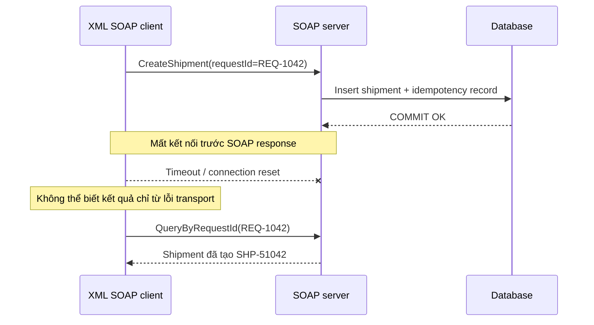

# Gửi Source, nhận Result và xử lý XML không qua mô hình JAXB

## 1. Vì sao Spring-WS client không nhất thiết phải dùng JAXB?

Khi tích hợp hệ thống SOAP bằng **Spring Web Services (Spring-WS)**, cách thường gặp là sinh các Java class từ XSD/WSDL, cấu hình `Jaxb2Marshaller` rồi gọi `WebServiceTemplate.marshalSendAndReceive(...)`. Cách này phù hợp nếu hợp đồng ổn định, kiểu dữ liệu được mô hình hóa rõ và ứng dụng muốn làm việc với các object mạnh kiểu.

Tuy nhiên, có những tình huống cần xử lý **XML trực tiếp**:

- Ứng dụng đóng vai trò gateway/adapter chuyển tiếp một payload theo hợp đồng đã có.
- Một hệ thống cần đọc vài trường trong SOAP response mà không muốn sinh cả bộ JAXB class.
- Đối tác có nhiều phiên bản XSD và client cần kiểm soát chính xác QName, namespace và thứ tự các phần tử.
- Một phần XML mở rộng bằng `xs:any`, `xs:anyType` hoặc các phần tử chưa được biểu diễn thuận tiện bằng model Java.
- Dịch vụ cần thao tác bằng JAXP `DOM`, `StAX`, `SAX` hoặc `Transformer` thay cho JAXB/OXM.

Spring-WS hỗ trợ cách này thông qua `WebServiceTemplate`, với hai hướng đáng chú ý:

- **`sendSourceAndReceiveToResult(...)`**: nhận một `Source` làm SOAP request payload và ghi SOAP response payload vào một `Result`.
- **`sendSourceAndReceive(...)`**: gửi `Source` và dùng `SourceExtractor<T>` để chuyển XML phản hồi thành một giá trị do client quyết định.

**Không sử dụng JAXB không có nghĩa không sử dụng hợp đồng.** XSD/WSDL, SOAP Envelope/Header/Fault, binding, SOAPAction, validation, XML security, WS-Security, TLS/chứng chỉ và kiểm thử tương thích vẫn phải được tuân thủ.

Bài nằm trong chương **Máy khách Spring-WS** của module **SPRING_WEB_SERVICES**, tiếp nối cách thiết kế SOAP theo hướng contract-first và các kiến thức về endpoint, JAXB, interceptor, SOAP Fault và bảo mật XML.

### Mục tiêu

Sau bài này, bạn có thể:

1. Phân biệt `Source`/`Result` JAXP với `WebServiceMessage`, SOAP Envelope và JAXB model.
2. Chọn đúng overload `WebServiceTemplate.sendSourceAndReceiveToResult(...)`; hiểu ý nghĩa giá trị `boolean`.
3. Dùng `StreamSource`/`StreamResult` để thử một lời gọi SOAP không cần marshaller/unmarshaller.
4. Tạo payload an toàn bằng `DOMSource` và đọc response bằng `DOMResult` với kiểm tra QName.
5. Sử dụng `SourceExtractor<T>` để giải mã XML khi kết nối còn mở.
6. Thêm SOAPAction và SOAP Header bằng callback, không nhúng Envelope vào `Source`.
7. Xử lý Fault, timeout, dữ liệu XML không hợp lệ và WS-Security tách biệt.
8. Viết test contract, mock client, bảo mật và interoperability cho tích hợp doanh nghiệp.

## 2. Vị trí của Source/Result trong pipeline Spring-WS client

Luồng xử lý rút gọn:

```mermaid
flowchart LR
    A[Application client] --> B[DOM / XML Source]
    B --> C[WebServiceTemplate]
    C --> D[SOAP message factory]
    D --> E[Client interceptors / security]
    E --> F[HTTPS transport]
    F --> G[SOAP server]
    G --> H[SOAP response]
    H --> I[Fault handling]
    I --> J[Source -> Result / SourceExtractor]
    J --> K[XML adapter / domain result]
```



`WebServiceTemplate` vẫn là thành phần điều phối SOAP: tạo message, gọi callback, chạy client interceptors, gửi/nhận qua transport, phát hiện SOAP Fault, rồi đưa **payload XML** đến `Result` hoặc `SourceExtractor`. Nó không cần một bean `Marshaller`/`Unmarshaller` để thực hiện các method `Source`/`Result` này.

Một lời gọi thường bao gồm:

1. Tạo `Source` từ **phần tử gốc nghiệp vụ** theo XSD.
2. Gọi overload của template, tùy chọn URI và request callback.
3. Spring-WS tạo SOAP message rồi chép XML từ `Source` vào **SOAP Body**.
4. Callback có thể sửa SOAPAction hoặc bổ sung SOAP Header.
5. Client interceptors, transport và security policy được áp dụng theo cấu hình.
6. Khi có response thông thường, framework lấy payload dưới SOAP Body làm `Source` và ghi sang `Result` hoặc gọi extractor.
7. Khi có Fault hoặc lỗi transport, template đi theo nhánh xử lý lỗi, không xem Fault là business response bình thường.

Thứ tự thực tế phụ thuộc phiên bản framework/stack, nhưng ranh giới “**payload XML ≠ toàn bộ SOAP Envelope**” là bất biến quan trọng khi sử dụng API này.

## 3. Source và Result là giao diện JAXP, không phải JAXB

`Source` và `Result` thuộc **Java API for XML Processing (JAXP)**:

```java
import javax.xml.transform.Source;
import javax.xml.transform.Result;
```

Đây vẫn là package `javax.xml.transform` trong Java hiện đại. Đừng đổi thành `jakarta.xml.transform` khi nâng Spring/Jakarta: JAXP nằm trong JDK và khác với JAXB `jakarta.xml.bind`.

| Kiểu | Package | Vai trò | Đặc trưng |
| --- | --- | --- | --- |
| `StreamSource` | `javax.xml.transform.stream` | Nguồn XML từ `Reader`, `InputStream` hoặc URI hệ thống | Gọn, thường dùng cho chuỗi/luồng |
| `DOMSource` | `javax.xml.transform.dom` | Nguồn XML từ DOM `Node` | Dễ kiểm soát namespace, sửa cây XML |
| `SAXSource` | `javax.xml.transform.sax` | Nguồn XML theo SAX parser/`InputSource` | Có thể giảm nhu cầu xây DOM, cần cấu hình parser |
| `StAXSource` | `javax.xml.transform.stax` | Nguồn XML từ StAX reader | Hữu ích khi muốn đọc theo luồng sự kiện |
| `StreamResult` | `javax.xml.transform.stream` | Ghi XML ra `Writer`, `OutputStream` hoặc đích thích hợp | Tiện cho log đã làm sạch, chuỗi XML, file |
| `DOMResult` | `javax.xml.transform.dom` | Ghi XML vào DOM tree | Truy cập phần tử/thuộc tính bằng QName |
| `SAXResult` | `javax.xml.transform.sax` | Chuyển dữ liệu sang SAX handlers | Hữu ích cho pipeline xử lý sự kiện |
| `StAXResult` | `javax.xml.transform.stax` | Ghi XML qua StAX writer | Cần quản lý writer/stream và encoding |

Không phải mọi sự kết hợp đều phù hợp với mọi message factory/Transformer provider. Bắt đầu bằng `StreamSource/StreamResult` hoặc `DOMSource/DOMResult`, sau đó dùng StAX nếu có yêu cầu đo đạc hiệu năng và đã test tương thích.

### 3.1. Source và Result thường dùng một lần

Một `StreamSource` bao quanh `StringReader` hay `InputStream` có **vị trí đọc** và không nên chia sẻ cho nhiều lời gọi hoặc retry đồng thời. Tạo một `Source` mới mỗi request. Tương tự, `DOMResult` hoặc `StreamResult` nên là đối tượng mới cho mỗi response.

Có thể chia sẻ một `WebServiceTemplate` đã cấu hình an toàn giữa nhiều requests, nhưng không tái sử dụng reader/writer/transformer không thread-safe một cách tùy tiện.

## 4. Phân biệt SOAP Envelope và payload Source

Giả sử ứng dụng gọi operation `GetShipmentStatus`, hợp đồng XSD dùng namespace `urn:example:shipment:v1`.

**Payload Source cần gửi:**

```xml
<sh:GetShipmentStatusRequest
    xmlns:sh="urn:example:shipment:v1">
  <sh:shipmentId>SHP-2026-1042</sh:shipmentId>
</sh:GetShipmentStatusRequest>
```

**SOAP request thật trên đường truyền** có thể là:

```xml
<soapenv:Envelope
    xmlns:soapenv="http://schemas.xmlsoap.org/soap/envelope/"
    xmlns:sh="urn:example:shipment:v1">
  <soapenv:Header/>
  <soapenv:Body>
    <sh:GetShipmentStatusRequest>
      <sh:shipmentId>SHP-2026-1042</sh:shipmentId>
    </sh:GetShipmentStatusRequest>
  </soapenv:Body>
</soapenv:Envelope>
```

Hai đoạn không giống nhau vì `WebServiceTemplate` và SOAP message factory chịu trách nhiệm tạo `Envelope`/`Header`/`Body`.

Nếu truyền nguyên đoạn `<soapenv:Envelope>...</soapenv:Envelope>` vào `Source` của `sendSourceAndReceiveToResult`, framework có thể đặt Envelope ấy **bên trong một SOAP Body khác**, tạo payload sai hợp đồng. Không dùng API Source payload để tự vận chuyển Envelope đầy đủ.

### 4.1. QName quan trọng hơn prefix

Các phần tử:

```xml
<a:GetShipmentStatusRequest xmlns:a="urn:example:shipment:v1"/>
```

và

```xml
<x:GetShipmentStatusRequest xmlns:x="urn:example:shipment:v1"/>
```

có cùng QName: `{urn:example:shipment:v1}GetShipmentStatusRequest`.

Đổi prefix không phải đổi contract version. Ngược lại, dùng đúng tên localPart nhưng khác namespace có thể khiến Spring-WS server không tìm thấy `@PayloadRoot` tương ứng.

## 5. Contract-first: XSD và WSDL cho ví dụ

Dù client không sinh JAXB, vẫn cần lấy QName, SOAPAction, output và Fault từ contract.

### 5.1. XSD tối giản

```xml
<?xml version="1.0" encoding="UTF-8"?>
<xs:schema
    xmlns:xs="http://www.w3.org/2001/XMLSchema"
    xmlns:sh="urn:example:shipment:v1"
    targetNamespace="urn:example:shipment:v1"
    elementFormDefault="qualified">

  <xs:simpleType name="ShipmentIdType">
    <xs:restriction base="xs:token">
      <xs:minLength value="1"/>
      <xs:maxLength value="40"/>
    </xs:restriction>
  </xs:simpleType>

  <xs:element name="GetShipmentStatusRequest">
    <xs:complexType>
      <xs:sequence>
        <xs:element name="shipmentId"
                    type="sh:ShipmentIdType"/>
      </xs:sequence>
    </xs:complexType>
  </xs:element>

  <xs:element name="GetShipmentStatusResponse">
    <xs:complexType>
      <xs:sequence>
        <xs:element name="shipmentId"
                    type="sh:ShipmentIdType"/>
        <xs:element name="status" type="xs:string"/>
        <xs:element name="updatedAt"
                    type="xs:dateTime"
                    minOccurs="0"/>
      </xs:sequence>
    </xs:complexType>
  </xs:element>
</xs:schema>
```

Hai global elements này có QName cụ thể. `updatedAt` là optional và `xs:dateTime` không tự buộc timezone trong XSD 1.0; đối tác cần quy tắc thời gian riêng nếu ứng dụng so sánh hoặc lưu thời điểm tuyệt đối.

### 5.2. SOAP response payload

```xml
<sh:GetShipmentStatusResponse
    xmlns:sh="urn:example:shipment:v1">
  <sh:shipmentId>SHP-2026-1042</sh:shipmentId>
  <sh:status>IN_TRANSIT</sh:status>
  <sh:updatedAt>2026-11-27T02:00:00Z</sh:updatedAt>
</sh:GetShipmentStatusResponse>
```

Đây là XML mà `StreamResult` sẽ chứa trong trường hợp phản hồi bình thường. Nó **không** gồm `Envelope`, `Header`, HTTP status, SOAP Fault hay certificate/TLS metadata.

### 5.3. Những phần WSDL cần đối chiếu

Trong WSDL 1.1 document/literal:

```xml
<wsdl:message name="GetShipmentStatusInput">
  <wsdl:part name="parameters"
             element="tns:GetShipmentStatusRequest"/>
</wsdl:message>

<wsdl:message name="GetShipmentStatusOutput">
  <wsdl:part name="parameters"
             element="tns:GetShipmentStatusResponse"/>
</wsdl:message>

<wsdl:portType name="ShipmentPortType">
  <wsdl:operation name="GetShipmentStatus">
    <wsdl:input message="tns:GetShipmentStatusInput"/>
    <wsdl:output message="tns:GetShipmentStatusOutput"/>
  </wsdl:operation>
</wsdl:portType>

<soap:operation
    soapAction="urn:example:shipment:v1/GetShipmentStatus"/>
```

Đây là **trích đoạn minh họa**, giả định các namespace `wsdl`, `soap` và `tns` đã khai báo ở WSDL đầy đủ. WSDL hoàn chỉnh còn có `wsdl:definitions`, `types` import XSD, binding, service address và fault/policy nếu hợp đồng yêu cầu.

Không suy ra SOAPAction bằng cách nối tên Java method nếu WSDL đối tác dùng action khác.

## 6. WebServiceTemplate và các overload Source/Result

`WebServiceTemplate` có các overload `sendSourceAndReceiveToResult` đáng nhớ:

```java
boolean sendSourceAndReceiveToResult(
        Source requestPayload,
        Result responseResult);

boolean sendSourceAndReceiveToResult(
        String uri,
        Source requestPayload,
        Result responseResult);

boolean sendSourceAndReceiveToResult(
        Source requestPayload,
        WebServiceMessageCallback requestCallback,
        Result responseResult);

boolean sendSourceAndReceiveToResult(
        String uri,
        Source requestPayload,
        WebServiceMessageCallback requestCallback,
        Result responseResult);
```

Các chữ ký trên được dùng để mô tả API, không phải các method bạn tự khai báo trong project.

**Ý nghĩa tham số:**

- `requestPayload`: XML document/fragment đại diện **payload của SOAP Body**.
- `responseResult`: nơi Spring-WS ghi **payload phản hồi** nếu có SOAP response thông thường.
- `uri`: endpoint cụ thể khi cần override default URI.
- `requestCallback`: cho phép chỉnh SOAP message **sau khi payload đã được ghi**, ví dụ thêm SOAPAction/Header.
- `boolean`: `true` nếu **nhận được response message**, `false` nếu không có response message.

Các overload không có `uri` cần một **default URI** hoặc destination provider phù hợp đã được cấu hình. Nếu không có, lời gọi thất bại trước khi hoàn thành.

### 6.1. Không lầm `boolean` với “nghiệp vụ thành công”

Giá trị `true` chỉ cho biết có SOAP response được nhận, không bảo đảm:

- Payload đúng XSD.
- `status` là `COMPLETED` hoặc operation nghiệp vụ đã được chấp thuận.
- Caller có quyền trên tài nguyên.
- Response đã được kiểm chữ ký WS-Security.
- Dữ liệu trong `Result` mang đúng root QName mong đợi.

`false` cho biết không có SOAP response message; **không chứng minh** server chưa tiếp nhận hoặc chưa xử lý request. Với command tạo dữ liệu, timeout/no response phải được xử lý như **unknown outcome**, có idempotency hoặc status query.

### 6.2. SOAP Fault không được đổ vào Result như response thường

Theo cơ chế mặc định, `WebServiceTemplate` nhận biết SOAP Fault và sử dụng `FaultMessageResolver`. Client có thể nhận `SoapFaultClientException` thay vì một `boolean true` kèm XML Fault trong `Result`. Nếu custom resolver được cấu hình khác, hành vi cụ thể cần test riêng.

Tương tự, lỗi HTTP/TLS/connection có thể ném transport exception trước khi `Result` được ghi. **Không catch mọi exception rồi trả chuỗi XML trống như một response thành công.**

## 7. Ví dụ đầu tiên: StreamSource → StreamResult

Đây là cách ngắn nhất để thấy API hoạt động **không cần JAXB**.

```java
import java.io.StringReader;
import java.io.StringWriter;

import javax.xml.transform.stream.StreamResult;
import javax.xml.transform.stream.StreamSource;

import org.springframework.ws.client.core.WebServiceTemplate;

public final class ShipmentXmlClient {
    private final WebServiceTemplate template;

    public ShipmentXmlClient(WebServiceTemplate template) {
        this.template = template;
    }

    public String getStatusXml() {
        String xml = """
            <sh:GetShipmentStatusRequest
                xmlns:sh="urn:example:shipment:v1">
              <sh:shipmentId>SHP-2026-1042</sh:shipmentId>
            </sh:GetShipmentStatusRequest>
            """;

        StreamSource source =
                new StreamSource(new StringReader(xml));

        StringWriter output = new StringWriter();
        StreamResult result = new StreamResult(output);

        boolean hasResponse =
                template.sendSourceAndReceiveToResult(source, result);

        if (!hasResponse) {
            throw new IllegalStateException(
                    "No SOAP response message received");
        }

        return output.toString();
    }
}
```

Đoạn code giả định template đã có default URI và message factory/transport phù hợp. Giá trị XML là **literal cố định** để dễ minh họa; không ghép một `shipmentId` do người dùng nhập trực tiếp vào chuỗi XML nếu chưa escape hoặc dùng XML writer.

`StreamResult` chứa **payload response**; nếu server trả Fault, luồng mặc định thường đi qua Fault resolver chứ không trả XML Fault bằng `StringWriter`.

### 7.1. Khi muốn chỉ rõ endpoint URI

```java
String endpoint = "https://soap.example.invalid/ws/shipments";

boolean hasResponse = template.sendSourceAndReceiveToResult(
        endpoint,
        new StreamSource(new StringReader(requestXml)),
        new StreamResult(responseWriter));
```

`example.invalid` là địa chỉ minh họa. Trong production, URI, TLS trust, key stores, proxy, timeout và message sender nên lấy từ configuration theo môi trường, không hardcode secret hay endpoint tùy tiện.

### 7.2. Cấu hình template tối thiểu

```java
import org.springframework.context.annotation.Bean;
import org.springframework.context.annotation.Configuration;
import org.springframework.ws.client.core.WebServiceTemplate;

@Configuration
public class ShipmentClientConfig {

    @Bean
    public WebServiceTemplate shipmentXmlTemplate() {
        WebServiceTemplate template = new WebServiceTemplate();
        template.setDefaultUri(
                "https://soap.example.invalid/ws/shipments");
        return template;
    }
}
```

Đây là **cấu hình tối giản để giải thích API**. Dự án thật cần message factory/transport đúng SOAP version, timeout, pooling, proxy, TLS/mTLS, WS-Security và kiểm thử kết nối. Method `sendSourceAndReceiveToResult` không yêu cầu gọi `setMarshaller`/`setUnmarshaller`.

## 8. Gửi Source kèm SOAPAction

SOAPAction là metadata của SOAP binding, không phải trường Java hay phần tử tự động thêm vào XML Body.

Với SOAP 1.1 binding ví dụ:

```java
import org.springframework.ws.soap.client.core.SoapActionCallback;

boolean hasResponse = template.sendSourceAndReceiveToResult(
        "https://soap.example.invalid/ws/shipments",
        new StreamSource(new StringReader(requestXml)),
        new SoapActionCallback(
            "urn:example:shipment:v1/GetShipmentStatus"),
        new StreamResult(responseWriter));
```

`SoapActionCallback` là một `WebServiceMessageCallback`, được framework chạy sau khi đã chép `requestPayload` vào SOAP Body.

**Lưu ý binding:**

- SOAP 1.1 thường dùng `SOAPAction` HTTP header theo WSDL `soap:operation`.
- SOAP 1.2 dùng media type `application/soap+xml` và cơ chế Action tương ứng với binding.
- Giá trị action có thể khác tên operation và namespace payload.
- `@PayloadRoot` phía Spring-WS server thường định tuyến theo QName Body; không tự xác nhận SOAPAction phù hợp nếu policy không kiểm thêm.

Đừng gửi SOAPAction v2 cùng Body QName v1 mà không có chủ đích; cần test các tình huống action/Body mâu thuẫn.

## 9. Không ghép XML động bằng nối chuỗi

Ví dụ sai:

```java
String xml = "<shipmentId>" + userInput + "</shipmentId>";
```

Nếu `userInput` chứa `&`, `<`, dấu ngoặc hoặc một đoạn XML do attacker kiểm soát, request có thể không well-formed, bị chèn phần tử trái phép hoặc làm sai ý nghĩa dữ liệu.

Đối với payload XML động, cân nhắc:

- **DOM API**: dùng `createElementNS` và `setTextContent`.
- **StAX XMLStreamWriter**: dùng `writeStartElement`/`writeCharacters`.
- **SAX/Transformer pipeline** đã cấu hình an toàn.
- Một thư viện XML chuyên dụng nếu hợp đồng phức tạp, với kiểm thử QName và XSD.

Đừng cố tự viết một hàm replace `&`/`<` thủ công cho mọi trường hợp. Escaping XML là trách nhiệm của XML writer/DOM serializer đúng chuẩn.

## 10. Tạo DOMSource có namespace đúng, không dùng JAXB

Đây là cách tạo request từ `shipmentId` động mà không sinh Java DTO từ XSD:

```java
import javax.xml.parsers.DocumentBuilderFactory;
import javax.xml.XMLConstants;
import javax.xml.transform.dom.DOMSource;
import org.w3c.dom.Document;
import org.w3c.dom.Element;

public final class ShipmentXmlPayloads {
    private static final String NS = "urn:example:shipment:v1";

    public static DOMSource getStatusRequest(String shipmentId)
            throws Exception {

        DocumentBuilderFactory factory =
                DocumentBuilderFactory.newInstance();
        factory.setNamespaceAware(true);

        // newDocument() tạo DOM rỗng; không parse XML ngoài.
        Document doc =
                factory.newDocumentBuilder().newDocument();

        Element root = doc.createElementNS(
                NS, "sh:GetShipmentStatusRequest");
        root.setAttributeNS(
                XMLConstants.XMLNS_ATTRIBUTE_NS_URI,
                "xmlns:sh", NS);

        Element id = doc.createElementNS(NS, "sh:shipmentId");
        id.setTextContent(shipmentId);

        root.appendChild(id);
        doc.appendChild(root);

        return new DOMSource(doc);
    }
}
```

`setTextContent` đưa giá trị vào **text node**, không coi nó là markup XML. Ví dụ `shipmentId` chứa `A&B` sẽ được serialize thành text có escape phù hợp, thay vì tạo XML sai.

### 10.1. Hai quy tắc bắt buộc khi tạo DOM

1. Dùng `createElementNS(namespaceURI, qualifiedName)` thay vì `createElement("sh:...")` khi phần tử thuộc namespace. Tên có prefix nhưng không có namespace binding không đủ tạo QName đúng.
2. Kiểm dữ liệu nghiệp vụ trước khi gửi, ví dụ `shipmentId` không rỗng, độ dài ≤40 theo XSD. Escaping giúp XML an toàn về cấu trúc nhưng **không thay thế** XSD validation, authorization hoặc idempotency.

Trước khi gửi payload, có thể transform DOM thành XML để kiểm tra với XSD trong test. Không nên log nguyên request có dữ liệu nhạy cảm theo mặc định.

## 11. Nhận DOMResult và đọc response bằng QName

`DOMResult` phù hợp khi application muốn truy cập XML theo phần tử và namespace thay vì sinh JAXB model.

Một cách dùng:

```java
import javax.xml.parsers.DocumentBuilderFactory;
import javax.xml.transform.dom.DOMResult;
import javax.xml.transform.dom.DOMSource;
import org.w3c.dom.Document;
import org.w3c.dom.Element;

public final class ShipmentDomGateway {
    private static final String NS = "urn:example:shipment:v1";
    private final WebServiceTemplate template;

    public ShipmentDomGateway(WebServiceTemplate template) {
        this.template = template;
    }

    public String fetchStatus(String shipmentId) throws Exception {
        DOMSource request =
                ShipmentXmlPayloads.getStatusRequest(shipmentId);

        DocumentBuilderFactory factory =
                DocumentBuilderFactory.newInstance();
        factory.setNamespaceAware(true);

        Document responseDoc =
                factory.newDocumentBuilder().newDocument();
        DOMResult result = new DOMResult(responseDoc);

        boolean received = template.sendSourceAndReceiveToResult(
                request,
                new SoapActionCallback(
                    "urn:example:shipment:v1/GetShipmentStatus"),
                result);

        if (!received || responseDoc.getDocumentElement() == null) {
            throw new IllegalStateException(
                    "No response payload received");
        }

        Element root = responseDoc.getDocumentElement();

        if (!NS.equals(root.getNamespaceURI())
                || !"GetShipmentStatusResponse"
                    .equals(root.getLocalName())) {
            throw new IllegalStateException(
                    "Unexpected response payload QName");
        }

        return requiredDirectChildText(root, NS, "status");
    }
}
```

Các types `WebServiceTemplate`, `SoapActionCallback` và `ShipmentXmlPayloads` đã xuất hiện trong các mục trước; hàm `requiredDirectChildText` sẽ được định nghĩa ngay sau đây. Mẫu này **tạo document rỗng**, không parse XML người dùng bằng `DocumentBuilder.parse(...)`.

### 11.1. Đọc phần tử con trực tiếp, tránh nhầm XML lồng nhau

`getElementsByTagName("status")` tìm theo tên và có thể đi sâu vào những phần tử lồng nhau. Với contract phức tạp, một `status` ở dưới `history` có thể bị đọc nhầm thành trạng thái chính.

Một helper rõ ràng hơn:

```java
import org.w3c.dom.Element;
import org.w3c.dom.Node;
import org.w3c.dom.NodeList;

public static String requiredDirectChildText(
        Element parent,
        String namespace,
        String localName) {

    String value = null;
    NodeList children = parent.getChildNodes();

    for (int i = 0; i < children.getLength(); i++) {
        Node child = children.item(i);
        if (!(child instanceof Element element)) {
            continue;
        }
        if (namespace.equals(element.getNamespaceURI())
                && localName.equals(element.getLocalName())) {
            if (value != null) {
                throw new IllegalStateException(
                    "Duplicate XML element: " + localName);
            }
            value = element.getTextContent();
        }
    }

    if (value == null) {
        throw new IllegalStateException(
                "Missing XML element: " + localName);
    }
    return value;
}
```

Trong project thật, đặt helper này trong class XML adapter hoặc utility, không copy top-level method vào file Java. Helper chỉ minh họa **chọn đúng QName và kiểm số lượng**, chưa kiểm toàn bộ schema, attributes, nested complex content hoặc giới hạn kích thước.

### 11.2. Khi nào DOMResult không phù hợp?

- Response chứa danh sách rất lớn, nhiều nghìn node hoặc nhiều MB XML.
- Bạn chỉ cần một giá trị ở gần đầu document nhưng DOM vẫn xây toàn bộ cây.
- Hệ thống có giới hạn memory/GC nghiêm ngặt.
- Có binary attachment/MTOM hoặc SOAP headers cần xử lý đặc biệt.

Khi đó nên cân nhắc StAX hoặc `SourceExtractor` đọc trong connection lifetime; nhưng phải đo hiệu năng và bảo đảm parser security tương đương.

## 12. Một ví dụ đầy đủ: DOMSource → DOMResult → domain result

Thay vì trả chuỗi XML ra tầng nghiệp vụ, có thể định nghĩa một result trung lập:

```java
import java.time.Instant;

public record ShipmentStatusView(
        String shipmentId,
        String status,
        Instant updatedAt) {}
```

Adapter thực hiện:

```java
public ShipmentStatusView parseStatusResponse(Element root) {
    String namespace = "urn:example:shipment:v1";

    if (!namespace.equals(root.getNamespaceURI())
            || !"GetShipmentStatusResponse"
                .equals(root.getLocalName())) {
        throw new InvalidPartnerResponseException(
                "Unexpected SOAP payload root");
    }

    String shipmentId = requiredDirectChildText(
            root, namespace, "shipmentId");
    String status = requiredDirectChildText(
            root, namespace, "status");

    String updated = optionalDirectChildText(
            root, namespace, "updatedAt");

    return new ShipmentStatusView(
            shipmentId,
            status,
            updated == null ? null : Instant.parse(updated));
}
```

`optionalDirectChildText` và `InvalidPartnerResponseException` là phần adapter cần triển khai; helper optional phải kiểm **tối đa một** phần tử matching và phân biệt absent với empty. `Instant.parse(...)` ở ví dụ đòi giá trị thời gian có định dạng nhận được (thường là UTC có `Z`); với offset khác như `+07:00`, dùng `OffsetDateTime.parse(updated).toInstant()` hoặc chính sách tương đương. Không tự diễn giải giá trị `xs:dateTime` thiếu timezone theo giờ máy chủ.

Đây là điểm tách quan trọng: **domain nhận `ShipmentStatusView`**, không nhận `DOMResult` hay `org.w3c.dom.Element`, nên transport/XML code không lan vào các use case khác.

## 13. sendSourceAndReceive với SourceExtractor<T>

`sendSourceAndReceiveToResult` thích hợp nếu đích ghi đã rõ. Khi muốn **chuyển payload thành kiểu kết quả ngay trong callback**, Spring-WS còn có:

```java
<T> T sendSourceAndReceive(
        Source requestPayload,
        SourceExtractor<T> responseExtractor);

<T> T sendSourceAndReceive(
        String uri,
        Source requestPayload,
        SourceExtractor<T> responseExtractor);

<T> T sendSourceAndReceive(
        Source requestPayload,
        WebServiceMessageCallback requestCallback,
        SourceExtractor<T> responseExtractor);

<T> T sendSourceAndReceive(
        String uri,
        Source requestPayload,
        WebServiceMessageCallback requestCallback,
        SourceExtractor<T> responseExtractor);
```

`SourceExtractor<T>` có method `extractData(Source source)` để xử lý **response payload**. Nó có thể trả bất kỳ kiểu `T` nào do ứng dụng quyết định, hoặc `null` nếu được thiết kế như vậy. Khi không có SOAP response message, template cũng có thể trả `null`.

### 13.1. Tại sao extractor phù hợp với dữ liệu streaming?

`Source` có thể đại diện dữ liệu gắn với **kết nối đang mở**. Nếu trả thẳng `Source` ra ngoài, rồi đọc sau khi `WebServiceTemplate` đã đóng kết nối, luồng nguồn có thể không còn sử dụng được.

Javadoc `SourceExtractor` khuyến nghị trích xuất dữ liệu **bên trong callback**, khi message và connection vẫn còn sống. Hãy chuyển thành string/object/domain value cần thiết trước khi method trả về.

### 13.2. Ví dụ trích XML text không qua JAXB

```java
import java.io.StringWriter;
import javax.xml.transform.Source;
import javax.xml.transform.stream.StreamResult;

String responsePayload = template.sendSourceAndReceive(
    ShipmentXmlPayloads.getStatusRequest("SHP-2026-1042"),
    new SoapActionCallback(
        "urn:example:shipment:v1/GetShipmentStatus"),
    (Source source) -> {
        if (source == null) {
            throw new IllegalStateException(
                    "SOAP response contains no payload");
        }

        StringWriter writer = new StringWriter();
        secureTransformer().transform(
                source, new StreamResult(writer));
        return writer.toString();
    }
);

if (responsePayload == null) {
    throw new IllegalStateException(
            "No SOAP response message received");
}
```

Hàm `secureTransformer()` được minh họa ở mục 15. Đây là ví dụ **lưu toàn bộ response payload vào bộ nhớ** để xử lý tiếp, không phải một chiến lược streaming tối ưu cho payload lớn.

### 13.3. Chọn Result hay SourceExtractor?

| Tiêu chí | `sendSourceAndReceiveToResult` | `sendSourceAndReceive` + extractor |
| --- | --- | --- |
| Đầu ra | Ghi vào một `Result` | Trả `T` từ callback |
| Giá trị method | `boolean` | Object/generic `T` hoặc `null` |
| Đọc trực tiếp thành domain type | Cần xử lý Result tiếp | Có thể parse thành domain type ngay trong callback |
| Kết nối sống trong lúc parse | Framework ghi Result khi xử lý response | Extractor chạy trước khi connection đóng |
| Phù hợp | String/DOM/StAX Result, XML transform | Streaming parser, chọn dữ liệu, chuyển đổi |
| Lỗi phổ biến | Tưởng `true` nghĩa business success | Trả `Source` chưa đọc ra ngoài |

Không cần JAXB ở cả hai hướng này. Nhưng cần tự chịu trách nhiệm parsing, validation và mapping kiểu dữ liệu thay vì nhờ generated JAXB model hỗ trợ.

## 14. Khi cần đọc SOAP Envelope/Header thay vì chỉ payload

`sendSourceAndReceiveToResult` làm việc với **SOAP Body payload**. Nếu cần:

- Response SOAP Header `CorrelationId` hoặc WS-Addressing.
- Metadata kỹ thuật của `SoapMessage`.
- SOAP attachment/MTOM.
- Điều chỉnh Envelope/Headers ngoài payload.
- Theo dõi security header hoặc kiểm thử message-level behavior.

thì cân nhắc `WebServiceTemplate.sendAndReceive(...)` với `WebServiceMessageCallback`/`WebServiceMessageExtractor<T>` phù hợp. Ở đó bạn làm việc với `WebServiceMessage`/`SoapMessage` **toàn bộ**, chứ không chỉ `Source`.

### 14.1. SOAPAction và custom SOAP Header

Một request callback có thể thêm Header XML vào SOAP message; ví dụ khung:

```java
String headerXml = """
    <ctx:RequestContext
        xmlns:ctx="urn:example:shipment:context:v1">
      <ctx:CorrelationId>CORR-1042</ctx:CorrelationId>
    </ctx:RequestContext>
    """;

boolean received = template.sendSourceAndReceiveToResult(
        requestSource,
        message -> {
            if (!(message instanceof SoapMessage soap)) {
                throw new IllegalStateException(
                    "SOAP message factory required");
            }

            soap.setSoapAction(
                "urn:example:shipment:v1/GetShipmentStatus");

            secureTransformer().transform(
                new StreamSource(new StringReader(headerXml)),
                soap.getSoapHeader().getResult());
        },
        responseResult);
```

`SoapMessage` là `org.springframework.ws.soap.SoapMessage`. Ví dụ dùng Header XML **literal cố định**; với dữ liệu động, tạo DOM/StAX an toàn hoặc dùng builder có escape đúng. Marshal/transform root header **trực tiếp vào `SoapHeader.getResult()`**; nếu trước đó đã tạo một root element rồi còn transform cả root vào bên trong, dễ tạo hai lớp Header trùng nhau.

### 14.2. WS-Security không phải một custom Header tùy tiện

WS-Security có chính sách signature, encryption, timestamp, token, certificate và replay protection. Không tự xây một `<wsse:Security>` thủ công rồi nghĩ rằng có cùng bảo đảm như WSS4J. Sử dụng security interceptor/stack được cấu hình đúng WSDL/policy; kiểm thử **message đã ký thật** và cả trường hợp chữ ký/timestamp sai.

Nếu có middleware làm thay đổi những phần đã ký **sau khi ký**, XML Signature có thể không hợp lệ. Cần kiểm tra thứ tự callback/interceptor và phạm vi phần tử được ký.

## 15. XML Transformer và parser phải được cấu hình an toàn

Không dùng JAXB không loại bỏ rủi ro **XXE, external entity resolution, XML entity expansion, XSLT extension hoặc tải tài nguyên ngoài**.

### 15.1. Transformer tối thiểu với bảo vệ JAXP

```java
import javax.xml.XMLConstants;
import javax.xml.transform.Transformer;
import javax.xml.transform.TransformerConfigurationException;
import javax.xml.transform.TransformerFactory;

public static Transformer secureTransformer()
        throws TransformerConfigurationException {

    TransformerFactory factory =
            TransformerFactory.newInstance();

    factory.setFeature(
        XMLConstants.FEATURE_SECURE_PROCESSING, true);

    factory.setAttribute(
        XMLConstants.ACCESS_EXTERNAL_DTD, "");
    factory.setAttribute(
        XMLConstants.ACCESS_EXTERNAL_STYLESHEET, "");

    return factory.newTransformer();
}
```

Đây là mẫu với JAXP/provider hỗ trợ các thuộc tính trên. Nếu provider ném exception do không hỗ trợ, hãy **fail closed** và cấu hình parser/Transformer provider phù hợp, đừng bỏ qua rồi âm thầm chạy không bảo vệ. Bản thân Spring-WS message factory cũng phải được harden; việc tạo một transformer an toàn ở adapter không tự thay đổi parser của toàn pipeline.

### 15.2. Parser khi phải đọc XML từ nguồn thiếu tin cậy

Ví dụ định hướng cho `DocumentBuilderFactory`:

```java
import javax.xml.XMLConstants;
import javax.xml.parsers.DocumentBuilderFactory;

DocumentBuilderFactory factory =
        DocumentBuilderFactory.newInstance();

factory.setNamespaceAware(true);
factory.setFeature(XMLConstants.FEATURE_SECURE_PROCESSING, true);
factory.setFeature(
    "http://apache.org/xml/features/disallow-doctype-decl", true);
factory.setFeature(
    "http://xml.org/sax/features/external-general-entities", false);
factory.setFeature(
    "http://xml.org/sax/features/external-parameter-entities", false);
factory.setXIncludeAware(false);
factory.setExpandEntityReferences(false);
factory.setAttribute(XMLConstants.ACCESS_EXTERNAL_DTD, "");
factory.setAttribute(XMLConstants.ACCESS_EXTERNAL_SCHEMA, "");
```

Một số XML feature URIs là provider-specific; kiểm thử trên JDK/XML parser thực tế. Nếu không áp dụng được một thiết lập bảo vệ bắt buộc, **không tự bắt exception và bỏ qua**. Kết hợp giới hạn kích thước request/response, độ sâu XML, thời gian parse, số phần tử và chính sách tài nguyên.

Với `StAX`, cần đặt `XMLInputFactory.SUPPORT_DTD=false`, tắt external entities, và resolver an toàn nếu có dùng. Với `SAX`, cấu hình `XMLReader` tương ứng. Không thể coi “dùng StAX thay DOM” là đã an toàn tự động.

### 15.3. Không dùng XML parser để kiểm chữ ký số

XML parser chỉ đọc và diễn giải XML. Xác minh WS-Security signature đòi hỏi cryptographic verification trên đúng các references, certificate trust, timestamp và replay policy. Không kết luận “đã ký” vì trong XML có phần tử tên `Signature`.

## 16. Kiểm tra dữ liệu trả về khi không có JAXB model

Client làm việc với XML trực tiếp phải **tự** đảm bảo response tuân hợp đồng.

Một kế hoạch kiểm tra tối thiểu:

1. Bắt đúng SOAP version và không nhầm Fault với response thông thường.
2. Xác minh root QName `GetShipmentStatusResponse` ở namespace v1.
3. Validate payload response theo XSD (tại boundary hoặc integration tests).
4. Đọc các phần tử con đúng namespace và cardinality.
5. Chuyển `xs:dateTime` sang kiểu thời gian có timezone rõ; không dùng string comparison.
6. Giới hạn độ dài `status`/IDs và danh sách XML nếu contract cho phép lặp.
7. Không dùng một kết quả parse thành công làm bằng chứng server có quyền trả dữ liệu, hoặc chữ ký WS-Security đã hợp lệ.

### 16.1. XSD validation là một bước riêng

Trong Java, JAXP `SchemaFactory`/`Validator` cho phép kiểm `DOMSource` hoặc `StreamSource` với một XSD đáng tin:

```java
import javax.xml.XMLConstants;
import javax.xml.transform.dom.DOMSource;
import javax.xml.validation.Schema;
import javax.xml.validation.Validator;

Schema schema = loadTrustedShipmentSchema();
Validator validator = schema.newValidator();
validator.setProperty(XMLConstants.ACCESS_EXTERNAL_DTD, "");
validator.setProperty(XMLConstants.ACCESS_EXTERNAL_SCHEMA, "");

validator.validate(new DOMSource(responseDoc));
```

`loadTrustedShipmentSchema()` là helper do ứng dụng định nghĩa để tải XSD phiên bản v1 từ classpath hoặc resources đã kiểm soát, với `SchemaFactory` được cấu hình chống external entity/schema access. Đoạn này chỉ minh họa **đúng vị trí validation**; không copy nguyên như runnable method khi chưa có helper.

Nếu WSDL/XSD có `xs:import`, phải cấu hình resolver/catalog **chỉ đến schema đáng tin**. Không cho một SOAP response chỉ định URL schema tùy ý rồi client tải nó từ Internet theo `xsi:schemaLocation`.

### 16.2. Một cạm bẫy: boolean true + Result rỗng

Một operation có thể có SOAP response message nhưng Body payload rỗng hoặc khác root mà bạn mong đợi. Vì vậy:

```java
boolean got = template.sendSourceAndReceiveToResult(source, result);
if (!got) {
    throw new NoSoapResponseException();
}
if (responseDoc.getDocumentElement() == null) {
    throw new InvalidPartnerResponseException(
        "SOAP response has no expected payload");
}
```

`NoSoapResponseException` và `InvalidPartnerResponseException` là các application/client adapter exception types cần định nghĩa. Test riêng các nhánh không có SOAP message, SOAP Body không có payload và response sai QName.

## 17. SOAP Fault: Source/Result không làm biến mất nhánh lỗi

Mặc dù không dùng JAXB, `WebServiceTemplate` vẫn có cùng cơ chế SOAP Fault handling. Mặc định framework có `SoapFaultMessageResolver`; ứng dụng có thể nhận `SoapFaultClientException` nếu server trả Fault.

Ví dụ:

```java
import org.springframework.ws.soap.client.SoapFaultClientException;
import org.springframework.ws.client.WebServiceIOException;
import org.springframework.ws.client.WebServiceTransportException;

try {
    boolean received =
        template.sendSourceAndReceiveToResult(
            requestSource, soapActionCallback, responseResult);

    if (!received) {
        handleUnknownOutcome();
    }
} catch (SoapFaultClientException fault) {
    // Phân loại Fault code/reason/detail theo SOAP version + WSDL.
    handleSoapFault(fault);
} catch (WebServiceTransportException httpFailure) {
    // Lỗi transport/HTTP theo sender, không nhất thiết là SOAP Fault.
    handleTransportFailure(httpFailure);
} catch (WebServiceIOException ioFailure) {
    // Lỗi gửi/nhận I/O khác, có thể không có SOAP reply.
    handleNetworkFailure(ioFailure);
}
```

Đây là khung xử lý để làm rõ ranh giới; các hàm `handleUnknownOutcome`, `handleSoapFault`, `handleNetworkFailure`, `handleTransportFailure` là logic ứng dụng cần định nghĩa và **không được bỏ trống** trong production. `WebServiceTransportException` kế thừa `WebServiceIOException`, vì vậy nhánh `catch` cụ thể **phải đứng trước** nhánh tổng quát như trên. Tên/loại exception phát sinh thực tế còn phụ thuộc transport sender và version Spring-WS.

### 17.1. Bốn loại lỗi cần phân biệt

| Loại | Ví dụ | Xử lý |
| --- | --- | --- |
| **Contract** | Response sai QName, schema không hợp lệ, SOAPAction mismatch | Sửa contract/version, không retry y nguyên |
| **Business** | Typed Fault `SHIPMENT_NOT_FOUND` hoặc response `REJECTED` | Đọc public code theo WSDL; xử lý ngữ nghĩa |
| **Technical** | SOAP `Receiver/Server` Fault, downstream unavailable | Retry có điều kiện, backoff và quan sát |
| **Security** | Invalid WS-Security signature, expired timestamp, mTLS cert fail | Kiểm policy/certificate; không retry mù |

Lỗi DNS/TLS/timeout có thể không tạo SOAP Fault. Lỗi authorization ở application service có thể được biểu diễn thành SOAP Fault hoặc HTTP/gateway denial theo security policy; không giả định một exception class duy nhất cho mọi deployment.

### 17.2. Không “parse Fault như payload bình thường”

SOAP 1.1 Fault có `faultcode`, `faultstring`, tùy chọn `detail`; SOAP 1.2 Fault có `Code`, `Reason`, `Detail`. Khi client nhận Fault, không kiểm root payload `GetShipmentStatusResponse` rồi kết luận response sai schema: đây là **nhánh lỗi SOAP**.

Nếu cần typed Fault detail, đọc qua SOAP fault/message API hoặc custom `FaultMessageResolver` được thiết kế theo WSDL, với QName và XSD fault version đúng. Không dùng message text để phân loại mã lỗi nghiệp vụ.

## 18. Lỗi transport, retry và unknown outcome

Với operation `GetShipmentStatus` là query thuần, có thể retry một số lỗi tạm thời có giới hạn. Nhưng với operation ghi như `CreateShipment`:



Không có SOAP response **không chứng minh** transaction chưa commit. Retry command cần:

- Giữ nguyên idempotency key và payload.
- Có server-side uniqueness/transaction phù hợp.
- Phân biệt same-key/same-payload với same-key/different-payload.
- Có status query/reconciliation khi kết quả không rõ.
- Retry có giới hạn, backoff và chính sách an toàn theo operation.

`Source`/`Result` không cung cấp exactly-once. Bản chất rủi ro giống khi dùng JAXB.

## 19. SourceExtractor và việc đọc luồng an toàn

Khi làm việc với `SourceExtractor<T>`, **không trả `StreamSource` thô ra khỏi callback** để đọc ở một thời điểm sau mà không biết connection đã đóng.

Cách tốt:

```java
ShipmentStatusView view =
    template.sendSourceAndReceive(
        requestSource,
        new SoapActionCallback(
            "urn:example:shipment:v1/GetShipmentStatus"),
        source -> {
            if (source == null) {
                throw new InvalidPartnerResponseException(
                    "Missing response payload");
            }
            return parseAndValidateWithinCallback(source);
        });
```

`parseAndValidateWithinCallback(Source)` là helper ứng dụng cần triển khai, phải đọc source và tạo một **giá trị Java độc lập connection** trong callback. Có thể parse StAX/DOM, kiểm QName, validate schema và tạo `ShipmentStatusView` mà không dùng JAXB.

Với luồng lớn, cần đặt giới hạn kích thước/độ sâu/thời gian; không vì “streaming” mà cho phép phản hồi vô hạn. Giữ đúng chính sách parser chống external entities và xử lý tài nguyên của XML reader/writer.

### 19.1. Không chia sẻ cùng một Result giữa requests đồng thời

`StreamResult(StringWriter)` và `DOMResult` gắn với một lời gọi cụ thể. Nếu hai threads ghi chung `StringWriter`/DOM node, XML có thể bị trộn hoặc race. Dùng biến local và lifecycle rõ ràng cho từng request.

## 20. So sánh Stream, DOM và StAX trong SOAP client

| Lựa chọn | Khi nên dùng | Ưu điểm | Đánh đổi |
| --- | --- | --- | --- |
| `StreamSource` + `StreamResult` | Bài thử, XML nhỏ, gateway đơn giản | Ít code, không cần JAXB class | Thường tạo chuỗi/buffer; phải parse sau |
| `DOMSource` + `DOMResult` | XML kích thước vừa, cần truy cập nhiều phần tử | API cây XML, chọn theo QName, dễ transform | Bộ nhớ/GC tăng theo kích thước |
| `StAXSource` + `StAXResult` | XML lớn hoặc muốn xử lý tuần tự | Có thể giảm xây DOM và cấp phát | Parser lifecycle phức tạp, dễ sai namespace |
| `SourceExtractor<T>` | Muốn kết quả Java và connection-safe extraction | Trả kiểu ứng dụng trực tiếp, xử lý khi connection còn mở | Cần viết parser/validation rõ |
| JAXB/OXM | Hợp đồng ổn định, typed DTO nhiều trường | Generated model, typing tốt, ít code XML thủ công | Toolchain/codegen, mapping và versioning |

Không có công nghệ nào tự động “nhanh nhất”. Benchmark với **cùng SOAP payload, validation, WS-Security, TLS, số request, heap và concurrency**. Với phần lớn tích hợp doanh nghiệp, độ ổn định contract, tính an toàn và khả năng kiểm thử quan trọng hơn tối ưu vi mô chưa được đo.

### 20.1. Khi dùng StAX

Một XMLStreamReader/Writer phải được tạo và cấu hình theo **một vòng đời rõ**, đóng tài nguyên do client sở hữu, không trộn nhiều requests và không bật DTD/external entities khi không cần. Nếu có `XMLInputFactory`, kiểm provider có tôn trọng `SUPPORT_DTD=false` và `IS_SUPPORTING_EXTERNAL_ENTITIES=false` hay không.

Không suy ra dùng `StAXSource` thì SOAP message factory sẽ luôn giữ streaming end-to-end; stack có thể materialize payload tùy message factory, interceptor hoặc security processing.

## 21. Contract validation và interoperability vẫn bắt buộc

Không dùng JAXB cũng không được bỏ các hợp đồng sau:

| Khía cạnh | Cần kiểm tra |
| --- | --- |
| WSDL 1.1 | Message, operation, binding document/literal, SOAPAction, fault |
| XSD | QName, namespace, `xs:sequence`, cardinality, optional/nil |
| SOAP 1.1/1.2 | Envelope namespace, Content-Type, Action, Fault format |
| XML encoding | UTF-8, escape entities, xử lý ký tự Unicode |
| XML thời gian | Timezone/offset và `xs:dateTime` |
| XML số | `xs:decimal`, scale, currency, số rất lớn |
| Namespace | Prefix khác nhưng URI giống phải tương thích |
| SOAP Header | Custom context, WS-Addressing, mustUnderstand/role |
| Security | TLS/mTLS, WS-Security signature/encryption/token/cert |
| Errors | Typed Fault detail, HTTP-only error, timeout không có response |
| Client đa nền tảng | Java và .NET/ESB/Python hiểu cùng XML được phát hành |

### 21.1. So sánh XML bằng QName, không bằng chuỗi thô

Hai payload cùng nghĩa có thể khác prefix, thứ tự attributes, whitespace và serialization style. Test quá cứng bằng `assertEquals(expectedXmlString, actualXmlString)` sẽ thất bại giả hoặc bỏ sót lỗi namespace nếu đã cố normalize chuỗi không đúng.

Ưu tiên XML-aware comparison, schema validation, XPath namespace-aware hoặc DOM traversal. Với XML Signature, cần tôn trọng canonicalization và references; không tự reserialize rồi dùng string equality thay phép kiểm chữ ký.

## 22. Kiểm thử Spring-WS client không dùng JAXB

Spring-WS cung cấp `MockWebServiceServer` để mô phỏng SOAP server cho một `WebServiceTemplate` đã cấu hình. Ta có thể test đúng `Source` được gửi, `Result` được ghi và các lỗi mà không mở mạng thật.

### 22.1. Test request/response bình thường

```java
import static org.junit.jupiter.api.Assertions.*;
import static org.springframework.ws.test.client.RequestMatchers.payload;
import static org.springframework.ws.test.client.ResponseCreators.withPayload;

import java.io.StringReader;
import java.io.StringWriter;
import javax.xml.transform.stream.StreamResult;
import javax.xml.transform.stream.StreamSource;

import org.junit.jupiter.api.Test;
import org.springframework.ws.client.core.WebServiceTemplate;
import org.springframework.ws.test.client.MockWebServiceServer;
import org.springframework.xml.transform.StringSource;

@Test
void sendsXmlPayloadAndReceivesXmlWithoutJaxb() {
    WebServiceTemplate template = new WebServiceTemplate();
    template.setDefaultUri("https://soap.example.invalid/ws");

    MockWebServiceServer mock =
            MockWebServiceServer.createServer(template);

    String request = """
        <s:GetShipmentStatusRequest
            xmlns:s="urn:example:shipment:v1">
          <s:shipmentId>SHP-2026-1042</s:shipmentId>
        </s:GetShipmentStatusRequest>
        """;
    String response = """
        <s:GetShipmentStatusResponse
            xmlns:s="urn:example:shipment:v1">
          <s:shipmentId>SHP-2026-1042</s:shipmentId>
          <s:status>IN_TRANSIT</s:status>
        </s:GetShipmentStatusResponse>
        """;

    mock.expect(payload(new StringSource(request)))
        .andRespond(withPayload(new StringSource(response)));

    StringWriter output = new StringWriter();
    boolean received = template.sendSourceAndReceiveToResult(
            new StreamSource(new StringReader(request)),
            new StreamResult(output));

    assertTrue(received);
    assertTrue(output.toString().contains("IN_TRANSIT"));
    mock.verify();
}
```

Đoạn này là **mẫu nội dung test method**, cần đặt trong class test phù hợp và có dependencies JUnit/Spring-WS test đúng phiên bản. `StringSource` dùng cho matchers/mock; `StreamSource` dùng thực tế làm request payload. Để test chắc hơn, parse `output.toString()` bằng XML parser an toàn và assert QName + field, không chỉ `contains("IN_TRANSIT")`.

### 22.2. Test SOAP Fault

Sử dụng response creator `withClientOrSenderFault(...)` hoặc `withServerOrReceiverFault(...)` theo version Spring-WS test:

```java
mock.expect(payload(new StringSource(request)))
    .andRespond(
        withClientOrSenderFault(
            "Invalid shipment request", java.util.Locale.ENGLISH));

assertThrows(
    SoapFaultClientException.class,
    () -> template.sendSourceAndReceiveToResult(
            new StreamSource(new StringReader(request)),
            new StreamResult(new StringWriter())));

mock.verify();
```

Ví dụ giả định static imports phù hợp từ `ResponseCreators` và có `MockWebServiceServer` mới cho test này. Một Fault matcher không tự kiểm typed detail hay WS-Security; khi contract công bố chi tiết lỗi, cần inspect SOAP Fault XML và so XSD/WSDL.

### 22.3. Test các trường hợp lỗi khác

- Không có SOAP response message: xác minh behavior `boolean false` hoặc null extractor theo phương thức.
- Có response message nhưng Body không có expected payload: application adapter phải từ chối.
- Response root QName sai: không xử lý như `GetShipmentStatusResponse`.
- XML sai XSD: validation phải phát hiện.
- SOAPAction sai: integration/contract test theo binding.
- WS-Security signature/timestamp invalid: security stack từ chối, không có side effect.
- Timeout sau commit: status query/idempotency, không retry command với key mới.
- Client Java và client .NET gửi cùng message: namespace và typed Fault tương thích.
- Response chứa dữ liệu quá lớn: client dừng/giới hạn tài nguyên theo policy.

### 22.4. Những gì mock chưa chứng minh

`MockWebServiceServer` giúp kiểm payload, SOAP header và lỗi ở mức client template, nhưng không đủ để chứng minh:

- TLS certificate chain/mTLS handshake thực.
- Proxy/load balancer, DNS và HTTP keep-alive.
- Timeout ở mạng thật.
- WS-Security policy interoperable với stack đối tác.
- WSDL/XSD được publish/import đúng URL.
- SOAP 1.1/1.2 binding hoạt động qua hạ tầng production.

Những việc này cần integration/interoperability tests ngoài mock.

## 23. Gỡ lỗi: lỗi nằm ở Source, Result hay SOAP transport?

| Triệu chứng | Nguyên nhân khả dĩ | Hướng kiểm tra |
| --- | --- | --- |
| SOAP Body chứa một `Envelope` lồng bên trong | Đưa cả SOAP Envelope vào `Source` | Chỉ gửi global payload element theo XSD |
| Server trả “No endpoint found” | Root QName/namespace sai | So QName XML với WSDL và `@PayloadRoot` |
| SOAPAction không khớp | Thiếu callback hoặc action sai | Đọc binding WSDL và kiểm HTTP/SOAP message thật |
| `boolean false` | Không có SOAP response message | Kiểm operation one-way, transport và timeout policy |
| `boolean true` nhưng Result rỗng | Response có thể không mang expected payload | Kiểm Body, response QName, XML validation |
| `SoapFaultClientException` | Server trả SOAP Fault | Đọc code/reason/detail đúng SOAP version |
| HTTP 401/403 hoặc TLS error | Gateway/certificate/security policy | Kiểm TLS/mTLS, credential, trust store; không ép thành Fault XML |
| XML parser báo external entity/DTD | XML không an toàn hoặc parser policy từ chối | Không bật DTD tùy tiện; kiểm đầu vào/partner |
| `NamespaceAware=false` dẫn đến không tìm thấy child | DOM parser không namespace-aware | Bật namespace awareness, so namespace URI |
| Trường `updatedAt` parse sai | Format offset/timezone không được xử lý | Dùng `OffsetDateTime`/`Instant` theo contract |
| Test chuỗi XML thất bại dù QName đúng | Prefix/whitespace/attribute order khác | So XML-aware/XPath/XSD |
| OutOfMemoryError với DOMResult | Response XML lớn | Giới hạn payload, cân nhắc StAX/SourceExtractor |
| WS-Security signature invalid | Message bị sửa sau ký/canonicalization/policy mismatch | Kiểm signer, references, interceptor order và client thực |

### 23.1. Không tắt validation để “chạy được”

Nếu server từ chối XML sai QName hoặc schema, đừng sửa bằng cách tắt interceptor hoặc bỏ signature verification. Cần xem lại XSD/WSDL, generated/handwritten XML, version namespace, thứ tự element và security policy.

## 24. Thiết kế client adapter không để XML rò vào domain

Một SOAP adapter nên trả type nghiệp vụ hoặc integration result trung lập:

```java
public interface ShipmentStatusGateway {
    ShipmentStatusView findStatus(String shipmentId);
}
```

Một triển khai XML-only có thể:

1. Tạo `DOMSource` an toàn từ `shipmentId`.
2. Gọi `WebServiceTemplate.sendSourceAndReceiveToResult`.
3. Kiểm không có SOAP Fault/transport error theo framework.
4. Kiểm `boolean` response received.
5. Kiểm QName, schema và đọc `DOMResult`.
6. Chuyển XML fields thành `ShipmentStatusView`.
7. Phân loại lỗi thành exceptions/results ứng dụng.
8. Ghi metrics và correlation ID an toàn.

Domain service không cần biết `StreamSource`, `DOMResult`, `SoapActionCallback`, TLS classes hay SOAP Fault types. Nếu ngày sau chuyển sang JAXB, phần thay đổi chủ yếu nằm ở adapter, không lan qua toàn bộ use case.

### 24.1. Ranh giới riêng cho business rejection

Nếu SOAP response bình thường có `state=REJECTED`, adapter phải đọc state và diễn giải đúng — `boolean true` không có ý nghĩa “thành công” ở tầng nghiệp vụ. Nếu server trả SOAP Fault, xử lý ở fault boundary; không giả làm status `REJECTED` nếu WSDL không định nghĩa như vậy.

## 25. Nên dùng XML Source/Result hay JAXB?

Chọn **Source/Result** khi:

- Payload ít trường và logic XML thực sự đơn giản.
- Cần gateway chuyển tiếp/transform XML theo QName.
- Không muốn sinh model cho nhiều partner schemas chỉ để trích một phần nhỏ.
- Cần kiểm soát DOM/StAX, namespace và extension elements rõ.
- Sẵn sàng chịu trách nhiệm parser security, validation, mapping và testing.

Chọn **JAXB/OXM** khi:

- XSD/WSDL ổn định và nhiều kiểu dữ liệu phức tạp.
- Code nghiệp vụ cần typed DTO và IDE/compiler hỗ trợ.
- Có nhiều operation và contract models lớn.
- Muốn tái sử dụng XJC/JAXB adapters, schema validation và mapping conventions.
- Chi phí duy trì code XML thủ công sẽ lớn hơn chi phí toolchain.

Một ứng dụng có thể dùng **cả hai**: JAXB cho operation lõi, `Source/Result` cho một gateway XML động. Không cần ép toàn bộ hệ thống vào một lựa chọn duy nhất.

## 26. Bài tập thực hành

### Bài tập 1 — StreamSource và StreamResult

Cấu hình `WebServiceTemplate` với default URI thử nghiệm. Gửi literal payload `GetShipmentStatusRequest` bằng `StreamSource`, nhận `StreamResult(StringWriter)`. Ghi lại `boolean`, kiểm response QName và thử trường hợp không có SOAP response.

### Bài tập 2 — DOMSource tránh XML injection

Tạo `DOMSource` từ một `shipmentId` chứa `A&B<42`. Kiểm serializer escape đúng và XML vẫn well-formed. Sau đó kiểm XSD để thấy escaping **không** đồng nghĩa giá trị được phép theo mọi quy tắc nghiệp vụ.

### Bài tập 3 — DOMResult và namespace

Tạo hai SOAP responses có prefix `sh` và `x` nhưng cùng namespace URI. Đọc `status` bằng DOM namespace-aware; chứng minh hai responses được xử lý như nhau. Thử root QName sai hoặc có hai `status` và bảo đảm adapter từ chối.

### Bài tập 4 — SourceExtractor và vòng đời kết nối

Viết `sendSourceAndReceive(..., SourceExtractor<ShipmentStatusView>)` đọc ngay payload thành record Java. So sánh với cách trả thẳng `StreamSource` ra ngoài callback; giải thích vì sao connection lifecycle ảnh hưởng việc đọc luồng.

### Bài tập 5 — SOAPAction và Header

Dùng `SoapActionCallback` để gửi đúng action theo WSDL. Sau đó tạo callback thêm `CorrelationId` vào SOAP Header bằng DOM/Transformer, không dùng JAXB. Kiểm tra Envelope thật không có hai Header roots lồng nhau và Body giữ đúng QName.

### Bài tập 6 — Security và Fault

Mô phỏng SOAP `Client/Sender` Fault, HTTP 401 không có SOAP message, TLS trust failure và WS-Security signature invalid. Viết client adapter phân loại đúng từng nhóm và không log token/certificate secrets.

### Bài tập 7 — Hiệu năng và interoperability

Thử `DOMResult` và StAX/SourceExtractor với XML 10 KB, 1 MB và 10 MB (kích thước chỉ để thiết kế benchmark, phải đặt giới hạn an toàn). Đo latency/GC/heap, đồng thời chạy bộ XML contract test bằng client Java và một stack đối tác khác.

## 27. Checklist triển khai

- [ ] `Source` chỉ chứa payload XML đúng QName, không chứa SOAP Envelope lồng.
- [ ] `Result` được hiểu là đích của response payload, không phải toàn bộ HTTP/SOAP response.
- [ ] Dùng overload có default URI hoặc URI cụ thể đúng cấu hình.
- [ ] `boolean` được hiểu là “nhận SOAP response”, không phải business success.
- [ ] Một `Source/Result` mới được tạo cho mỗi request; không chia sẻ reader/writer/DOM giữa threads.
- [ ] SOAPAction, SOAP 1.1/1.2 binding và Header theo WSDL được kiểm thử.
- [ ] XML động được tạo qua DOM/StAX/escape-safe API, không nối chuỗi thiếu kiểm soát.
- [ ] DOM parser, Transformer, SAX/StAX và schema loader đều có policy XXE/external entity an toàn.
- [ ] XSD validation và QName check không bị bỏ qua chỉ vì không dùng JAXB.
- [ ] Optional/empty/nil, datetime timezone, decimal và field cardinality được xử lý đúng.
- [ ] SOAP Fault được tách khỏi response bình thường; client đọc typed detail theo WSDL khi có.
- [ ] HTTP/TLS/timeout được phân loại riêng, có unknown-outcome/idempotency policy.
- [ ] WS-Security chữ ký, timestamp, token và certificate trust được xác thực bởi security stack.
- [ ] Custom SOAP Header và ký số không bị phá bởi transform sau khi ký.
- [ ] SourceExtractor không trả source gắn với connection ra ngoài để đọc sau.
- [ ] MockWebServiceServer tests kiểm payload/response/Fault/URI; HTTP integration test kiểm TLS/proxy/timeout.
- [ ] Client Java và đối tác .NET/ESB có bộ XML/WSDL interoperability tests.
- [ ] Logs/traces không ghi payload nhạy cảm mặc định hoặc tạo metric labels cardinality cao.
- [ ] Domain nhận result types độc lập SOAP/JAXP; XML code nằm ở client adapter.

## 28. Tài liệu đối chiếu

- [Spring Web Services — WebServiceTemplate Javadoc](https://docs.spring.io/spring-ws/docs/4.0.x/api/org/springframework/ws/client/core/WebServiceTemplate.html): overloads `sendSourceAndReceiveToResult`, `sendSourceAndReceive`, giá trị trả về, Fault handling.
- [Spring Web Services — SourceExtractor Javadoc](https://docs.spring.io/spring-ws/docs/current/api/org/springframework/ws/client/core/SourceExtractor.html): đọc `Source` khi connection còn mở và trả đối tượng ứng dụng.
- [Spring Web Services — MockWebServiceServer và test client](https://docs.spring.io/spring-ws/docs/4.0.x/reference/html/): contract/mocking test cho SOAP client.
- [Oracle Java — javax.xml.transform.Source](https://docs.oracle.com/en/java/javase/17/docs/api/java.xml/javax/xml/transform/Source.html) và [Result](https://docs.oracle.com/en/java/javase/17/docs/api/java.xml/javax/xml/transform/Result.html): JAXP contracts.
- [OWASP — XML External Entity Prevention Cheat Sheet](https://cheatsheetseries.owasp.org/cheatsheets/XML_External_Entity_Prevention_Cheat_Sheet.html): parser security, DTD và external entity protections.
- [W3C — WSDL 1.1](https://www.w3.org/TR/wsdl.html) và [SOAP 1.2 Part 1](https://www.w3.org/TR/soap12-part1/): contract và protocol behavior cần phối hợp với SOAP 1.1/1.2 binding thực tế.

API và dependency cụ thể phải đối chiếu với phiên bản Spring-WS/Java/HTTP sender được sử dụng trong dự án. Các ví dụ chọn Java 17+ để minh họa text blocks và pattern matching, không ngụ ý mọi Spring-WS version đều yêu cầu chính xác Java 17.

## 29. Tổng kết

**`WebServiceTemplate.sendSourceAndReceiveToResult(...)` cho phép gửi SOAP payload bằng `Source` và nhận response payload vào `Result` mà không cần generated JAXB classes hoặc `Marshaller/Unmarshaller`.** `StreamSource/StreamResult` phù hợp để bắt đầu nhanh; `DOMSource/DOMResult` giúp xây và đọc XML theo namespace, còn `SourceExtractor<T>` cho phép trích xuất domain result ngay khi connection còn mở.

Tuy nhiên, bỏ JAXB **không có nghĩa bỏ hợp đồng hoặc bảo mật**. Client phải tiếp tục tuân XSD/WSDL, SOAPAction, SOAP Envelope/Header/Fault, XML parser hardening, TLS/mTLS, WS-Security và quy tắc retry/idempotency. Thiết kế tốt giữ XML ở tầng SOAP client adapter, kiểm tra QName/schema thật, phân biệt Fault và lỗi mạng, rồi trả kết quả Java trung lập cho domain để tích hợp hệ thống doanh nghiệp ổn định.
