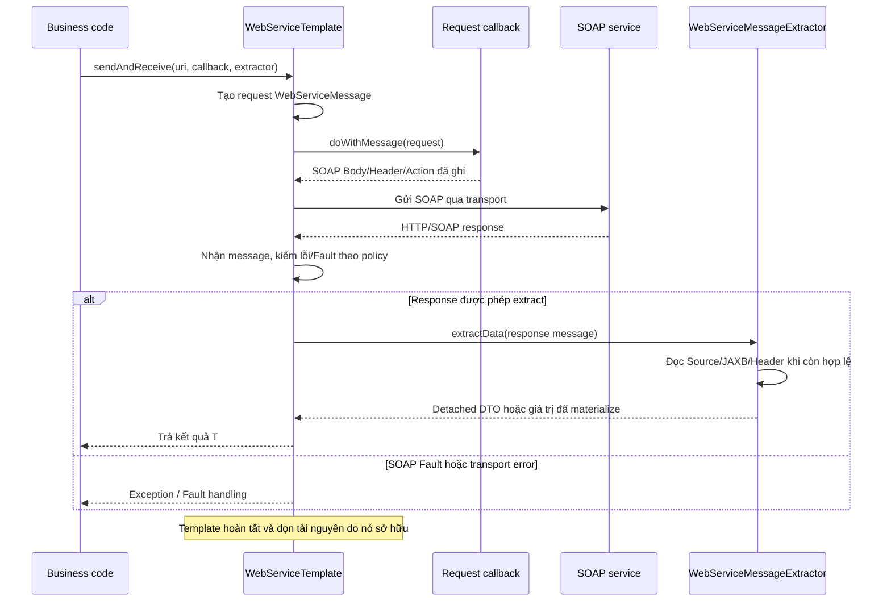

# WebServiceMessageExtractor và đọc phản hồi khi kết nối còn mở

Trong Spring Web Services (Spring-WS), máy khách SOAP thường gọi `WebServiceTemplate.marshalSendAndReceive(...)` và nhận một Java object. Cách này thuận tiện khi cấu trúc phản hồi đã được ánh xạ đầy đủ qua JAXB. Tuy nhiên, khi cần **tự đọc payload**, kiểm tra SOAP Header, xây dựng DTO miền độc lập với JAXB, hoặc tiêu thụ XML theo cách riêng, Spring-WS có một điểm mở rộng quan trọng: **`WebServiceMessageExtractor<T>`**.

Điểm cần hiểu sâu không chỉ là cú pháp của `extractData(...)`, mà còn là **vòng đời của phản hồi và kết nối**. `WebServiceTemplate` quản lý việc gửi request, nhận response, xử lý SOAP Fault và đóng tài nguyên transport. Extractor được gọi trong luồng xử lý đồng bộ khi response vẫn thuộc phạm vi mà template quản lý. Nếu extractor trả về một `Source`, `InputStream` hoặc đối tượng lười đọc XML để xử lý **sau khi method trả về**, dữ liệu có thể không còn đọc được — hoặc hành vi phụ thuộc vào message factory đã buffer toàn bộ nội dung, khiến lỗi chỉ lộ ra ở một môi trường khác.

Bài thuộc chương **Máy khách Spring-WS** của module **SPRING_WEB_SERVICES**, trong bối cảnh phát triển SOAP **contract-first** với XSD/WSDL, JAXB/OXM, endpoint, SOAP Fault, interceptor, XML security, WS-Security, TLS/chứng chỉ và kiểm thử tương thích. Quy tắc bao trùm là:

> **Trong `extractData(WebServiceMessage)`, hãy đọc, xác thực và chuyển phản hồi thành một giá trị có thể sử dụng độc lập. Không chuyển quyền sở hữu stream hoặc message đang do `WebServiceTemplate` quản lý ra khỏi callback.**

## 1. Mục tiêu học tập

Sau bài này, bạn có thể:

1. Phân biệt `WebServiceMessageCallback` và `WebServiceMessageExtractor<T>` trong lời gọi `WebServiceTemplate.sendAndReceive(...)`.
2. Mô tả thời điểm response được nhận, trích xuất, xử lý Fault và kết thúc lời gọi trong Spring-WS.
3. Triển khai extractor dùng JAXB/OXM để trả về DTO bất biến hoặc kết quả nghiệp vụ, không giữ `Source` sau khi kết nối kết thúc.
4. Giải thích vì sao `getPayloadSource()`, `SoapMessage`, `InputStream` hoặc `Attachment` không nên được trả ra ngoài để đọc muộn.
5. Xử lý response thiếu payload, khác QName, sai XSD, SOAP Header bất thường và SOAP Fault đúng tầng.
6. Chọn giữa `marshalSendAndReceive(...)`, extractor tùy biến và streaming parser cho các kích thước phản hồi khác nhau.
7. Phối hợp SOAPAction, HTTP/TLS, WS-Security, timeout và retry mà không làm phát sinh side effect hoặc rò dữ liệu.
8. Viết kiểm thử với `MockWebServiceServer` và kiểm thử transport thật để xác minh dữ liệu được đọc trong vòng đời hợp lệ.

## 2. Vị trí của extractor trong vòng đời một SOAP call

Luồng thông thường:



Sơ đồ biểu diễn **vòng đời logic**. Với một số message factory, phản hồi có thể được buffer thành DOM/SAAJ trước khi extractor chạy; với một số phương án streaming, nguồn XML có thể phụ thuộc trực tiếp vào transport đang mở. Dù implementation cụ thể khác nhau, code ứng dụng **không nên dựa vào việc stream vẫn sống sau khi `sendAndReceive(...)` trả về**.

### Ai sở hữu tài nguyên?

| Tài nguyên | Thường do ai quản lý? | Có nên trả trực tiếp khỏi extractor? |
|---|---|---|
| `WebServiceConnection`/HTTP response body | `WebServiceTemplate` và transport | **Không** |
| `WebServiceMessage` response | Vòng đời xử lý của template | **Không** |
| `Source` trả từ `getPayloadSource()` | Message factory/XML reader | **Không**, trừ khi đã chủ động sao chép thành tài nguyên độc lập |
| Stream của attachment | MIME message/transport hoặc attachment provider | **Không**, cần đọc/copy khi còn hợp lệ |
| JAXB response object đã unmarshal đầy đủ | Code ứng dụng sau khi extractor tạo | **Có**, nếu không còn tham chiếu lazy tới stream |
| DTO immutable chỉ chứa giá trị | Code ứng dụng | **Có** |
| `byte[]`/`String` đã sao chép đầy đủ có giới hạn | Code ứng dụng | Có, khi policy cho phép và kích thước được kiểm soát |

**“Kết nối còn mở”** là cách ghi nhớ rằng extractor chạy **trước pha template hoàn tất/cleanup**, không phải cam kết một TCP socket vật lý luôn mở trong toàn bộ callback. Điều quan trọng là **ngữ cảnh sở hữu message/response chưa kết thúc**.

## 3. Hai giao diện giữ vai trò đối xứng

Spring-WS có hai giao diện quan trọng cho cách gửi–nhận tùy biến:

```java
import org.springframework.ws.WebServiceMessage;
import org.springframework.ws.client.core.WebServiceMessageCallback;
import org.springframework.ws.client.core.WebServiceMessageExtractor;

// Chữ ký khái niệm theo Spring-WS:
// Callback ghi/cấu hình request trước khi gửi.
void doWithMessage(WebServiceMessage message)
    throws java.io.IOException,
           javax.xml.transform.TransformerException;

// Extractor đọc response trong lượt gọi.
T extractData(WebServiceMessage message)
    throws java.io.IOException,
           javax.xml.transform.TransformerException;
```

Đây là **chữ ký minh họa**, không phải file Java có thể biên dịch độc lập vì method đứng ngoài class/interface. Ý nghĩa:

- `WebServiceMessageCallback`: nhận **request message** trước khi gửi; dùng để ghi XML Body, đặt SOAPAction, thêm header theo contract.
- `WebServiceMessageExtractor<T>`: nhận **response message** sau khi template nhận được; dùng để biến XML response thành kiểu `T` có vòng đời độc lập.
- `T` có thể là JAXB object, record domain, `Optional<DomainResult>`, số liệu tổng hợp, hoặc một cấu trúc đã sao chép.
- Extractor không có nhiệm vụ mở/đóng HTTP connection, cũng không sở hữu vòng đời response gốc.

Phương thức thường dùng:

```java
<T> T sendAndReceive(
    String uri,
    WebServiceMessageCallback requestCallback,
    WebServiceMessageExtractor<T> responseExtractor
);
```

Đây là **dạng chữ ký khái quát**; API thực có các overload có/không có URI và các tham số bổ sung tùy phiên bản. Chúng ta sẽ sử dụng overload có URI rõ ràng.

### So với `marshalSendAndReceive(...)`

| Cách gọi | Phần request | Phần response | Khi nên dùng |
|---|---|---|---|
| `marshalSendAndReceive(request)` | Marshaller đã cấu hình | Unmarshaller đã cấu hình | SOAP request/response JAXB thông thường |
| `marshalSendAndReceive(uri, request, callback)` | JAXB + callback bổ sung Header/Action | JAXB | Khi cần thêm SOAP Header, SOAPAction nhưng output vẫn là JAXB |
| `sendAndReceive(uri, callback, extractor)` | Callback tự chuẩn bị request | Extractor tự đọc response | Khi cần chọn lọc dữ liệu, đọc header, parse custom XML hoặc định dạng kết quả |
| SOAP client code tự quản lý HTTP/stream | Tự thực hiện toàn bộ | Tự quản lý toàn bộ | Chỉ khi có yêu cầu đặc biệt; phải tự gánh protocol/security/resource handling |

**Không cần extractor chỉ vì muốn đặt SOAPAction.** Khi JAXB mapping đã đủ, `marshalSendAndReceive(...)` với `WebServiceMessageCallback` thường gọn và ít rủi ro hơn.

## 4. Contract-first: XSD/WSDL xác định điều gì phải được đọc

Giả sử một dịch vụ SOAP công bố operation `GetOrderStatus`. Namespace payload:

```text
urn:example:orders:v1
```

Schema `orders-v1.xsd` rút gọn:

```xml
<?xml version="1.0" encoding="UTF-8"?>
<xs:schema
    xmlns:xs="http://www.w3.org/2001/XMLSchema"
    xmlns:ord="urn:example:orders:v1"
    targetNamespace="urn:example:orders:v1"
    elementFormDefault="qualified">

    <xs:element name="GetOrderStatusRequest">
        <xs:complexType>
            <xs:sequence>
                <xs:element name="requestId" type="xs:string"/>
                <xs:element name="orderId" type="xs:string"/>
            </xs:sequence>
        </xs:complexType>
    </xs:element>

    <xs:element name="GetOrderStatusResponse">
        <xs:complexType>
            <xs:sequence>
                <xs:element name="requestId" type="xs:string"/>
                <xs:element name="orderId" type="xs:string"/>
                <xs:element name="status" type="xs:string"/>
                <xs:element name="note" type="xs:string"
                            minOccurs="0"/>
            </xs:sequence>
        </xs:complexType>
    </xs:element>

    <xs:element name="OrderNotFoundFault">
        <xs:complexType>
            <xs:sequence>
                <xs:element name="code" type="xs:string"/>
                <xs:element name="orderId" type="xs:string"/>
            </xs:sequence>
        </xs:complexType>
    </xs:element>
</xs:schema>
```

Một WSDL document/literal có input message `wsdl:part element="ord:GetOrderStatusRequest"`, output `element="ord:GetOrderStatusResponse"` và có thể khai báo `wsdl:fault` gắn với `ord:OrderNotFoundFault`.

```text
Input QName:
{urn:example:orders:v1}GetOrderStatusRequest

Output QName:
{urn:example:orders:v1}GetOrderStatusResponse

Business fault detail QName:
{urn:example:orders:v1}OrderNotFoundFault
```

**Extractor phải tin hợp đồng đã được xác nhận**, không dựa trên thứ tự thẻ do một đối tác ngẫu nhiên gửi. Nếu response khác QName, thiếu phần tử bắt buộc hoặc sai namespace, ứng dụng cần xử lý như lỗi contract/validation, không tự đoán kết quả.

### Ví dụ SOAP 1.1 response

```xml
<soap:Envelope
    xmlns:soap="http://schemas.xmlsoap.org/soap/envelope/"
    xmlns:ord="urn:example:orders:v1">
    <soap:Body>
        <ord:GetOrderStatusResponse>
            <ord:requestId>REQ-101</ord:requestId>
            <ord:orderId>ORD-200</ord:orderId>
            <ord:status>SHIPPED</ord:status>
            <ord:note>Delivered to carrier</ord:note>
        </ord:GetOrderStatusResponse>
    </soap:Body>
</soap:Envelope>
```

Prefix `ord` chỉ là bí danh cho namespace. Response dùng `x:GetOrderStatusResponse` với `xmlns:x="urn:example:orders:v1"` vẫn có cùng QName và phải được xử lý tương đương.

## 5. Cấu hình một SOAP client với JAXB/OXM

Đối với Spring Boot 3/Spring-WS 4 (stack Jakarta), có thể cấu hình bean `Jaxb2Marshaller` và `WebServiceTemplate`. Dependency tiêu biểu là starter Spring Web Services và JAXB runtime tương thích do BOM quản lý.

```java
package org.example.orders.client;

import org.springframework.context.annotation.Bean;
import org.springframework.context.annotation.Configuration;
import org.springframework.oxm.jaxb.Jaxb2Marshaller;
import org.springframework.ws.client.core.WebServiceTemplate;

@Configuration
public class OrdersClientConfiguration {

    @Bean
    public Jaxb2Marshaller ordersMarshaller() {
        Jaxb2Marshaller marshaller = new Jaxb2Marshaller();
        marshaller.setContextPath("org.example.orders.contract");
        return marshaller;
    }

    @Bean
    public WebServiceTemplate ordersWebServiceTemplate(
            Jaxb2Marshaller ordersMarshaller) {

        WebServiceTemplate template = new WebServiceTemplate();
        template.setMarshaller(ordersMarshaller);
        template.setUnmarshaller(ordersMarshaller);
        template.setDefaultUri(
            "https://partner.example.org/soap/orders"
        );
        return template;
    }
}
```

Giả định package `org.example.orders.contract` chứa model JAXB được sinh từ XSD cùng `ObjectFactory`/`jaxb.index` phù hợp. Nếu dùng `setClassesToBeBound(...)` thay `setContextPath(...)`, hãy bảo đảm mọi global element/binding cần thiết được khai báo. Với JAXB type không có `@XmlRootElement`, XJC có thể sinh `JAXBElement<T>` từ `ObjectFactory`; request callback phải marshal **root element đúng QName**, không phải tự viết tên thẻ từ tên class.

**Quan trọng về bảo mật và vận hành:** đây là cấu hình cơ bản để minh họa JAXB. Một client production còn phải có transport với **connect/read timeout**, TLS truststore/hostname verification, có thể là mTLS client certificate, WS-Security outbound/inbound và chính sách retry. Không hard-code URL, secret hoặc đường dẫn private key trong mã production.

### Không cần `@EnableWs` trên SOAP client thuần

`@EnableWs` thường dùng để kích hoạt hạ tầng **server endpoint annotation**. Một ứng dụng chỉ gọi SOAP qua `WebServiceTemplate` không cần thêm `@EnableWs` chỉ để sử dụng extractor. Đừng trộn cấu hình server SOAP với client SOAP nếu ứng dụng không triển khai endpoint.

## 6. Ví dụ hoàn chỉnh: gửi JAXB request, extract một DTO độc lập

Giả sử XJC sinh `GetOrderStatusRequest` và `GetOrderStatusResponse` có JAXB root mapping phù hợp. Ví dụ này dùng `Jaxb2Marshaller` để **ghi payload request trong callback** và **đọc response ngay trong extractor**.

```java
package org.example.orders.client;

import java.io.IOException;
import javax.xml.transform.Source;

import org.springframework.oxm.jaxb.Jaxb2Marshaller;
import org.springframework.ws.WebServiceMessage;
import org.springframework.ws.client.core.WebServiceMessageCallback;
import org.springframework.ws.client.core.WebServiceMessageExtractor;
import org.springframework.ws.client.core.WebServiceTemplate;
import org.springframework.ws.soap.SoapMessage;

public final class OrderStatusClient {

    private static final String SOAP_ACTION =
        "urn:example:orders:GetOrderStatus";

    private final WebServiceTemplate template;
    private final Jaxb2Marshaller marshaller;
    private final String endpointUri;

    public OrderStatusClient(
            WebServiceTemplate template,
            Jaxb2Marshaller marshaller,
            String endpointUri) {

        this.template = template;
        this.marshaller = marshaller;
        this.endpointUri = endpointUri;
    }

    public OrderStatusSnapshot getStatus(
            GetOrderStatusRequest request) {

        WebServiceMessageCallback callback = message -> {
            marshaller.marshal(
                request,
                message.getPayloadResult()
            );

            if (message instanceof SoapMessage soap) {
                soap.setSoapAction(SOAP_ACTION);
            }
        };

        WebServiceMessageExtractor<OrderStatusSnapshot>
                extractor = message -> {

            Source payload = message.getPayloadSource();
            if (payload == null) {
                throw new IOException(
                    "Expected GetOrderStatusResponse payload"
                );
            }

            Object bound = marshaller.unmarshal(payload);

            // Với JAXB generated code, global element có thể
            // được biểu diễn thành JAXBElement<T>.
            if (bound instanceof jakarta.xml.bind.JAXBElement<?> e) {
                bound = e.getValue();
            }

            if (!(bound instanceof GetOrderStatusResponse result)) {
                throw new IllegalStateException(
                    "Unexpected SOAP response type"
                );
            }

            // Trả snapshot độc lập, không giữ Source/message.
            return new OrderStatusSnapshot(
                result.getRequestId(),
                result.getOrderId(),
                result.getStatus()
            );
        };

        OrderStatusSnapshot snapshot = template.sendAndReceive(
            endpointUri,
            callback,
            extractor
        );

        if (snapshot == null) {
            throw new IllegalStateException(
                "Remote service returned no SOAP response"
            );
        }

        return snapshot;
    }

    public record OrderStatusSnapshot(
        String requestId,
        String orderId,
        String status
    ) {}
}
```

**Giả định biên dịch:** hai lớp JAXB `GetOrderStatusRequest`/`GetOrderStatusResponse` được import từ package generated contract; `OrderStatusSnapshot` là nested record; có Spring-WS/OXM, Jakarta JAXB runtime và package mapping phù hợp. Đoạn này không thể chạy độc lập nếu thiếu model XSD, endpoint URI và bean wiring.

### Những điểm thiết kế đáng chú ý

1. `request` là dữ liệu riêng của một lần gọi, không được tái sử dụng/mutate đồng thời giữa các thread.
2. Callback marshal request vào `message.getPayloadResult()` trong lúc message được template quản lý.
3. SOAPAction được đặt trên `SoapMessage` theo binding, không thêm thẻ `<SOAPAction>` trong SOAP Body.
4. Extractor **đọc `getPayloadSource()` ngay khi được gọi**.
5. JAXB unmarshal xong trước khi lambda trả về; Source không thoát ra ngoài.
6. `JAXBElement<?>` được unwrap vì global element có thể được XJC sinh theo cách đó.
7. Record chỉ chứa các giá trị `String` đã được materialize, không tham chiếu SOAP message/stream.
8. Mã kiểm tra response type thay vì ép kiểu mù rồi làm lộ `ClassCastException` khó chẩn đoán.
9. Với contract yêu cầu response, giá trị `null` từ template bị coi là lỗi thay vì che thành kết quả trống.

**Điều còn thiếu có chủ đích:** validation XSD, kiểm tra correlation ID, xử lý SOAP Fault thành lỗi domain, TLS/WS-Security và integration tests. Các phần sau bổ sung từng lớp mà không làm sai vòng đời message.

## 7. Vì sao không trả trực tiếp `Source` ra khỏi extractor?

Một lỗi ngắn nhưng rất khó thấy trong môi trường test:

```java
Source leakedSource = template.sendAndReceive(
    endpointUri,
    requestCallback,
    response -> response.getPayloadSource()
);

// Nguy hiểm: đang đọc Source sau khi template
// đã hoàn tất và quản lý xong response/connection.
transformer.transform(leakedSource, result);
```

Vấn đề không phải `Source` luôn mất hiệu lực tức thì trong mọi implementation. Vấn đề là **API không cho code caller quyền sở hữu/đảm bảo vòng đời dài hơn của nguồn dữ liệu bên trong response**. Nếu implementation trả một `DOMSource` đã được buffer, test có thể vô tình chạy được; nếu sử dụng parser streaming hoặc attachment/transport khác, nó có thể fail với “stream closed”, thiếu dữ liệu hoặc XML parse error.

### Phân tích theo từng kiểu `Source`

| Dạng nguồn | Đặc điểm | Rủi ro khi đọc sau callback |
|---|---|---|
| `StreamSource` gắn `InputStream`/`Reader` | Có thể đọc một lần, phụ thuộc stream | Stream bị đóng/đã tiêu thụ, lỗi muộn |
| `SAXSource` | Có thể phụ thuộc XMLReader/InputSource | Parser và nguồn dữ liệu không còn sẵn |
| `StAXSource` | Thường liên hệ tới cursor/event reader | Cursor đã đóng/tiêu thụ, không replay được |
| `DOMSource` | Có thể đã buffer toàn bộ cây XML | Có vẻ chạy được nhưng không phải contract sở hữu dữ liệu dài hạn |
| `Source` của custom message factory | Tùy implementation | Không thể suy luận an toàn từ interface |

**Không dùng “đã chạy được với SAAJ” làm bằng chứng an toàn cho mọi message factory.** Viết client theo nguyên tắc dễ mang đi môi trường khác: đọc và chuyển đổi dữ liệu *trong* extractor.

### Một anti-pattern bất đồng bộ

```java
WebServiceMessageExtractor<java.util.concurrent.CompletableFuture<String>>
        badExtractor = message -> {

    Source source = message.getPayloadSource();

    return java.util.concurrent.CompletableFuture.supplyAsync(() -> {
        // Không bảo đảm source còn hợp lệ ở thread này.
        return parseLater(source);
    });
};
```

Đây là **mã phản mẫu**; `parseLater` chưa được định nghĩa, cố ý chỉ ra vấn đề lifetime. Extractor trả về `CompletableFuture` rất nhanh, rồi template có thể kết thúc trước khi worker đọc XML.

Nếu muốn xử lý bất đồng bộ:

1. **Đọc trọn hoặc trích xuất DTO tối thiểu** trong extractor.
2. Trả DTO/snapshot độc lập khỏi message.
3. Mới chuyển DTO đó sang executor/queue khác để xử lý tiếp.
4. Đối với công việc cần bền vững, lưu snapshot/job record ở data store thích hợp, không chuyển reference tới SOAP response.

## 8. Ba cách extract an toàn: typed object, copy XML, streaming aggregation

Không phải mọi ứng dụng cần cùng một dạng kết quả. Dùng **dạng nhẹ nhất đáp ứng nghiệp vụ**.

### 8.1. Cách A — Unmarshal JAXB rồi trả domain snapshot

Đây là cách ưu tiên với contract XSD/WSDL rõ ràng:

```java
WebServiceMessageExtractor<OrderStatusSnapshot> extractor =
    message -> {
        Object value = marshaller.unmarshal(
            message.getPayloadSource()
        );
        if (value instanceof jakarta.xml.bind.JAXBElement<?> e) {
            value = e.getValue();
        }
        GetOrderStatusResponse response =
            (GetOrderStatusResponse) value;

        return new OrderStatusSnapshot(
            response.getRequestId(),
            response.getOrderId(),
            response.getStatus()
        );
    };
```

Ưu điểm: dữ liệu đã được chuyển thành giá trị có vòng đời do ứng dụng sở hữu, dễ test và không giữ transport. Nhược điểm: JAXB có thể materialize cây object lớn; vẫn cần XSD validation nếu contract yêu cầu ràng buộc mà JAXB binding không tự kiểm.

### 8.2. Cách B — Materialize XML thành chuỗi (chỉ khi thật sự cần)

```java
import java.io.StringWriter;
import javax.xml.transform.TransformerFactory;
import javax.xml.transform.stream.StreamResult;

WebServiceMessageExtractor<String> extractor = message -> {
    if (message.getPayloadSource() == null) {
        return "";
    }

    StringWriter writer = new StringWriter();

    TransformerFactory factory =
        TransformerFactory.newInstance();

    // Factory/parser phải được harden khi xử lý dữ liệu
    // không tin cậy theo implementation thực tế.
    factory.newTransformer().transform(
        message.getPayloadSource(),
        new StreamResult(writer)
    );

    return writer.toString();
};
```

Ở đây `String` đã tách khỏi stream. Nhưng giải pháp này **không tự an toàn**:

- Có thể tạo một bản sao XML lớn trong heap, làm tăng GC/latency.
- Chuỗi trả về có thể chứa PII, dữ liệu thanh toán hoặc credential đặt trong Body.
- XML serialization có thể đổi prefix/whitespace mà không đổi QName.
- `TransformerFactory` phải được cấu hình chống truy cập tài nguyên ngoài; không bật XSLT không tin cậy hay resolver tùy tiện.
- Giới hạn kích thước **trước khi** copy và cân nhắc masking/retention nếu còn lưu XML.

Chỉ dùng khi có một mục đích được phê duyệt, ví dụ test interoperability với payload synthetic. Trong production thường nên trả DTO hoặc metadata chọn lọc hơn.

### 8.3. Cách C — Trích số liệu có giới hạn ngay khi stream còn hợp lệ

Một phản hồi báo cáo có hàng nghìn dòng có thể được **streaming parse** để tính tổng/số lượng mà không giữ toàn bộ object graph. Nguyên tắc:

```text
extractData(response):
    source = response.getPayloadSource()
    tạo parser namespace-aware và hardened phù hợp source
    kiểm root QName và giới hạn số node/độ sâu
    trong cùng callback:
        đọc từng phần tử
        cập nhật tổng/đếm vào biến cục bộ
    đóng parser/reader do callback tự tạo nếu sở hữu
    return immutable Summary(count, total)
```

Đây là **thuật toán mô tả**, không phải đoạn code StAX hoàn chỉnh: loại `Source` mà message factory cung cấp quyết định việc có thể dựng StAX reader trực tiếp hay phải dùng một adapter phù hợp. Không chuyển `StAXSource` vào một parser thứ hai rồi giả định cursor có thể được đọc lại.

Nếu dữ liệu là signed/encrypted SOAP, phải để framework/security policy xác minh/giải mã trước khi tin nội dung; streaming custom phải tương thích với thứ tự xử lý security và giới hạn tài nguyên.

## 9. Làm việc với `JAXBElement`, `@XmlRootElement` và QName

XJC có thể sinh mã JAXB theo nhiều hình thức:

- Lớp có `@XmlRootElement`.
- Lớp complex type nhưng **global element** được biểu diễn qua `ObjectFactory` và `JAXBElement<T>`.
- `package-info.java` có `@XmlSchema` xác định namespace mặc định cho JAXB package.
- Những field có `@XmlElement`, `@XmlElementRef` hoặc adapters theo schema.

Extractor nên hiểu rằng **QName root trên wire** mới quyết định payload, không phải tên Java class.

Ví dụ khi global element có `JAXBElement`:

```java
Object bound = marshaller.unmarshal(
    message.getPayloadSource()
);

if (bound instanceof jakarta.xml.bind.JAXBElement<?> element) {
    javax.xml.namespace.QName name = element.getName();

    javax.xml.namespace.QName expected =
        new javax.xml.namespace.QName(
            "urn:example:orders:v1",
            "GetOrderStatusResponse"
        );

    if (!expected.equals(name)) {
        throw new IllegalStateException(
            "Unexpected SOAP payload QName"
        );
    }

    bound = element.getValue();
}
```

Nếu `bound` là object có `@XmlRootElement`, muốn kiểm root QName **trước** khi unmarshal thì cần đọc root từ XML parser hoặc metadata message mà không tiêu thụ stream hai lần. Tránh gọi `getPayloadSource()` để parse thử rồi gọi JAXB trên **cùng streaming Source** nếu parser đầu đã tiêu thụ dữ liệu.

### `javax.xml.namespace.QName` khác `jakarta.xml.bind`

Trên Java 17 / Spring Boot 3 / Spring-WS 4:

- JAXB annotations/runtime sử dụng `jakarta.xml.bind.*`.
- `QName` vẫn ở `javax.xml.namespace.QName` vì đây là API XML của JDK.
- `Source` và `Transformer` vẫn ở `javax.xml.transform.*`.

Không thay mọi package `javax.xml` thành `jakarta.xml` một cách máy móc. Phải quản lý phiên bản library theo BOM và generated code tương thích.

## 10. XSD validation trong hoặc trước extractor

**Đọc thành công không đồng nghĩa XSD-valid.** JAXB có thể unmarshal một số nội dung mà không áp mọi facet `minOccurs`, `maxOccurs`, `pattern` hay thứ tự theo schema nếu chưa cấu hình validation.

Trong Spring OXM, có thể cấu hình `Jaxb2Marshaller` với schema:

```java
@Bean
public Jaxb2Marshaller ordersMarshaller() {
    Jaxb2Marshaller marshaller = new Jaxb2Marshaller();
    marshaller.setContextPath("org.example.orders.contract");
    marshaller.setSchema(
        new org.springframework.core.io.ClassPathResource(
            "xsd/orders-v1.xsd"
        )
    );
    return marshaller;
}
```

`setSchema(...)` giúp OXM sử dụng schema trong các thao tác hỗ trợ validation tương ứng. Cần kiểm hành vi thực với JAXB provider, binding và error handler đã cấu hình; không chỉ xem setter có mặt rồi kết luận mọi SOAP response đều được validate đúng.

Một hướng khác là validation payload bằng JAXP trước khi unmarshal, nhưng cần chú ý:

1. **Không tiêu thụ streaming Source hai lần**. Nếu parse XSD trước rồi JAXB đọc lại, phải có buffer/copy hoặc pipeline hỗ trợ.
2. `Schema` được compile từ XSD tin cậy có thể cache và dùng lại; `Validator` chứa trạng thái xử lý, tạo instance riêng cho mỗi lần validate.
3. Tắt hoặc kiểm soát external DTD/schema access và `xs:import` theo policy.
4. Giới hạn kích thước/depth XML để tránh DoS.
5. XSD chỉ kiểm cấu trúc/dữ liệu, **không xác thực caller** hoặc thay WS-Security Signature.
6. Nếu schema response thay đổi theo version, xác định version từ contract đáng tin và QName, không tự tải schema theo `xsi:schemaLocation` do remote server gửi.

### Trả lỗi contract rõ nghĩa

Nếu provider gửi `{urn:example:orders:v2}GetOrderStatusResponse` trong khi client chỉ hỗ trợ `v1`, nên coi đây là **contract mismatch**, không tự đổi QName rồi tiếp tục. Nếu thiếu phần tử bắt buộc, log category `INVALID_SOAP_RESPONSE`/`SCHEMA_MISMATCH` và gửi metric an toàn; không log toàn XML chứa dữ liệu đối tác.

## 11. Đọc SOAP Header ngay trong extractor

SOAP response có thể chứa `wsa:RelatesTo`, correlation ID hoặc header nghiệp vụ. Nếu cần đọc các header ấy, hãy xử lý **trước khi extractor trả về**, giống payload.

```xml
<soap:Envelope
    xmlns:soap="http://schemas.xmlsoap.org/soap/envelope/"
    xmlns:ctx="urn:example:context:v1"
    xmlns:ord="urn:example:orders:v1">
    <soap:Header>
        <ctx:ServerContext>
            <ctx:correlationId>corr-101</ctx:correlationId>
        </ctx:ServerContext>
    </soap:Header>
    <soap:Body>
        <ord:GetOrderStatusResponse>
            <ord:requestId>REQ-101</ord:requestId>
            <ord:orderId>ORD-200</ord:orderId>
            <ord:status>SHIPPED</ord:status>
        </ord:GetOrderStatusResponse>
    </soap:Body>
</soap:Envelope>
```

Ví dụ helper **chỉ tìm header block**, chưa parse children:

```java
import java.util.Iterator;
import javax.xml.namespace.QName;

import org.springframework.ws.WebServiceMessage;
import org.springframework.ws.soap.SoapHeader;
import org.springframework.ws.soap.SoapHeaderElement;
import org.springframework.ws.soap.SoapMessage;

public static SoapHeaderElement findServerContext(
        WebServiceMessage message) {

    if (!(message instanceof SoapMessage soap)) {
        throw new IllegalStateException(
            "Expected SOAP response"
        );
    }

    SoapHeader header = soap.getSoapHeader();

    QName name = new QName(
        "urn:example:context:v1",
        "ServerContext"
    );

    Iterator<SoapHeaderElement> matches =
        header.examineHeaderElements(name);

    if (!matches.hasNext()) {
        return null;
    }

    SoapHeaderElement element = matches.next();

    if (matches.hasNext()) {
        throw new IllegalStateException(
            "Duplicate ServerContext header"
        );
    }

    return element;
}
```

**Cảnh báo:** helper này trả `SoapHeaderElement`, là view vào response message. **Chỉ gọi và đọc nó bên trong extractor**, không return element ra code bên ngoài. Muốn trả correlation ID, parse value thành `String` có giới hạn rồi đưa vào DTO snapshot.

Ví dụ outline:

```java
WebServiceMessageExtractor<OrderStatusWithContext> extractor =
    message -> {
        SoapHeaderElement contextHeader =
            findServerContext(message);

        String correlationId =
            parseAndValidateCorrelationId(contextHeader);

        GetOrderStatusResponse response =
            unmarshalExpectedResponse(message);

        return new OrderStatusWithContext(
            correlationId,
            response.getRequestId(),
            response.getOrderId(),
            response.getStatus()
        );
    };
```

`parseAndValidateCorrelationId`, `unmarshalExpectedResponse` và `OrderStatusWithContext` là helper/model ứng dụng; đoạn này thể hiện nguyên tắc, không phải file Java độc lập. Header `ServerContext` là ví dụ ngoài XSD Body mục 4; để thành contract thật, cần XSD header element và WSDL `soap:header`/policy phù hợp.

### Header nghiệp vụ khác identity đã xác thực

Một trường `sourceSystem`/`tenantHint` trong SOAP Header có thể bị client tùy ý tự khai. Đừng dùng nó để cấp quyền hoặc xác định caller khi chưa được kiểm qua TLS/mTLS, HTTP authentication, WS-Security và authorization. Extractor là **nơi đọc dữ liệu**, không phải phép chứng minh mọi header đều đáng tin.

## 12. Xử lý SOAP Fault: extractor có được gọi không?

Đây là một khác biệt quan trọng khi dùng `WebServiceTemplate`.

Với cấu hình thông thường và SOAP message factory phù hợp, template **kiểm SOAP Fault** và sử dụng `FaultMessageResolver` (thường là một resolver sinh `SoapFaultClientException`) **trước khi coi response là phản hồi nghiệp vụ bình thường**. Vì vậy, code extractor dùng cho `GetOrderStatusResponse` không nên kỳ vọng luôn được gọi với payload `soap:Fault`.

Ví dụ SOAP 1.1 Fault:

```xml
<soap:Envelope
    xmlns:soap="http://schemas.xmlsoap.org/soap/envelope/"
    xmlns:ord="urn:example:orders:v1">
    <soap:Body>
        <soap:Fault>
            <faultcode>soap:Client</faultcode>
            <faultstring>Order was not found</faultstring>
            <detail>
                <ord:OrderNotFoundFault>
                    <ord:code>ORDER_NOT_FOUND</ord:code>
                    <ord:orderId>ORD-404</ord:orderId>
                </ord:OrderNotFoundFault>
            </detail>
        </soap:Fault>
    </soap:Body>
</soap:Envelope>
```

Nếu client có một logic kiểu:

```java
try {
    OrderStatusSnapshot snapshot =
        orderStatusClient.getStatus(request);
    return snapshot;
} catch (org.springframework.ws.soap.client.SoapFaultClientException ex) {
    // Xử lý SOAP Fault riêng theo contract.
    throw translateFault(ex);
}
```

thì `translateFault(ex)` phải là phần chuyển lỗi domain do ứng dụng xây dựng; không parse `ex.getMessage()` hoặc `faultstring` bằng regex để quyết định business code.

### 12.1. SOAP Fault và HTTP error khác nhau

| Tình huống | Lớp kiểm tra | Kết quả |
|---|---|---|
| SOAP Fault từ server SOAP | SOAP message/Fault resolver | Có thể thành `SoapFaultClientException` |
| HTTP 401/403 | HTTP security/gateway | Có thể không có SOAP Envelope để extract |
| TCP timeout, TLS handshake fail | Transport | Exception kết nối, không có SOAP response hợp lệ |
| HTTP 500 chứa SOAP Fault hợp lệ | SOAP binding/transport + Fault handling | Phải xử lý theo quy tắc SOAP/HTTP, không chỉ nhìn status |
| Response HTTP 200 nhưng Body không đúng QName | Extractor/unmarshaller/contract | Lỗi nội dung dù HTTP thành công |
| XML malformed | XML parser/message factory | Có thể lỗi trước extractor |

Không dùng `HTTP status == 200` làm bằng chứng SOAP response hợp lệ. Ngược lại, không tự giả định mọi HTTP 500 luôn có SOAP Fault; phải phân biệt response body thực.

### 12.2. Có thể dùng FaultMessageResolver riêng không?

Có. Khi cần typed business exceptions, một `FaultMessageResolver` tùy biến có thể nhận SOAP Fault và ánh xạ detail theo XSD. Nhưng resolver đó cũng phải **đọc detail trong vòng đời message hiện tại**, không giữ `SoapFaultDetail` hay `Source` để xử lý muộn.

Không đặt logic nhận diện Fault vào extractor thường rồi vô hiệu hóa Fault handling chỉ để tránh exception. Thay đổi fault resolver là quyết định kiến trúc, cần được test với SOAP 1.1/1.2, fault code/detail, lỗi transport và bảo mật.

## 13. Phản hồi rỗng, one-way và `null`

Một SOAP operation có thể có response nghiệp vụ, output rỗng hoặc mô hình một chiều tùy WSDL. `WebServiceTemplate.sendAndReceive(...)` có thể trả `null` trong các tình huống không có response được extract; logic client không nên ép mọi `null` thành “thành công”.

Phân biệt:

1. **Operation request–response bắt buộc:** WSDL định nghĩa output `GetOrderStatusResponse`. Nếu template trả `null` hoặc extractor không có payload, coi đó là protocol/contract problem.
2. **SOAP Body rỗng nhưng vẫn có SOAP Envelope:** message có thể tồn tại nhưng `getPayloadSource()` không có phần tử nghiệp vụ; phải xử lý theo contract.
3. **One-way operation:** không nên ép extractor đọc một response Body không tồn tại; có thể dùng API gửi một chiều phù hợp khi không cần kết quả SOAP.
4. **HTTP 202 Accepted:** trạng thái transport không tự bảo đảm tác vụ nền đã hoàn thành; cần cơ chế status query/callback nếu nghiệp vụ yêu cầu.
5. **Timeout sau khi server đã thực hiện:** client có thể không biết kết quả dù không nhận SOAP response; retry phải xét idempotency.

Một ví dụ guard:

```java
WebServiceMessageExtractor<OrderStatusSnapshot> extractor =
    message -> {
        if (message.getPayloadSource() == null) {
            throw new java.io.IOException(
                "Expected non-empty SOAP Body"
            );
        }
        // Tiếp tục unmarshal và tạo snapshot ở đây.
        return extractOrderStatus(message);
    };
```

`extractOrderStatus` là helper ứng dụng cần hiện thực. Mục tiêu là **nói rõ kỳ vọng contract**, không âm thầm chuyển response trống thành một object rỗng dễ bị hiểu sai.

## 14. Attachments, MTOM và tài nguyên có vòng đời ngắn

Một số SOAP contract trả file, hình ảnh, báo cáo hoặc tài liệu qua MTOM/SWA. Khi đó payload XML có thể tham chiếu attachment MIME. Nội dung attachment thường có stream/`DataHandler` riêng, nhưng nguồn đó vẫn có thể phụ thuộc vào message/transport do template quản lý.

Phản mẫu:

```java
WebServiceMessageExtractor<java.io.InputStream> extractor =
    message -> {
        // Giả định lấy stream từ một MIME attachment.
        return obtainAttachmentStream(message);
    };

// Đọc stream sau sendAndReceive có thể thất bại.
java.io.InputStream stream =
    template.sendAndReceive(endpointUri, callback, extractor);
```

`obtainAttachmentStream` chỉ là helper giả định minh họa anti-pattern, không phải API của `WebServiceMessage`.

Cách làm phù hợp phụ thuộc kích thước và nhu cầu:

- Với attachment nhỏ, trong extractor **đọc có giới hạn** và trả `byte[]`/DTO nếu chính sách cho phép.
- Với attachment lớn, trong extractor **copy trực tiếp theo stream** vào một đích do ứng dụng sở hữu (ví dụ file tạm đã bảo vệ hoặc storage stream), chỉ trả **path/ID/metadata** sau khi copy và xác minh hoàn tất.
- Không tải toàn bộ file lớn vào heap vì tiện.
- Giới hạn kích thước, content type, checksum, thời gian và số lượng attachment.
- Đối với dữ liệu nhạy cảm, mã hóa lưu trữ, phân quyền truy cập, xóa file tạm và kiểm virus/malware nếu nghiệp vụ cần.
- Không công khai path nội bộ trong SOAP Fault/log.

Nếu có biến thể retry, không ghi đè một file đích đang được đọc đồng thời; dùng tên/ID an toàn và thao tác atomic phù hợp. Việc giải phóng stream **do ứng dụng mở** vẫn là trách nhiệm của ứng dụng; đừng nhầm với việc template đóng transport.

## 15. Kết nối, timeout và thời điểm dọn tài nguyên

`WebServiceTemplate` thường dùng một `WebServiceMessageSender` để giao tiếp qua HTTP hoặc transport khác. Sender chịu trách nhiệm mở kết nối, gửi và nhận; template điều phối việc thực thi rồi **dọn tài nguyên do nó sở hữu**.

```text
[Tạo SOAP request]
      ↓
[Callback ghi request]
      ↓
[Sender mở/chuẩn bị transport, gửi]
      ↓
[Nhận response hoặc Fault]
      ↓
[Extractor xử lý trong phạm vi message]
      ↓
[Template hoàn tất, cleanup transport]
      ↓
[Business code nhận snapshot]
```

**Đừng thực hiện một lời gọi mạng mới bên trong extractor chỉ để “giữ connection mở”.** Điều đó tăng độ phức tạp, rủi ro deadlock/timeout và làm mơ hồ ownership. Extractor nên tập trung vào chuyển response thành kết quả, không điều khiển transport.

### Timeout và đọc response có thể tác động nhau

| Timeout/giới hạn | Mục tiêu | Nếu bỏ qua |
|---|---|---|
| Connect timeout | Giới hạn thời gian thiết lập kết nối | Thread có thể treo chờ network |
| Read/response timeout | Giới hạn chờ/đọc dữ liệu | Lời gọi bị giữ khi remote không trả dữ liệu |
| Tổng deadline của nghiệp vụ | Giới hạn end-to-end gồm parse/extract | XML lớn vẫn gây trễ dù đã nhận response |
| Giới hạn body/attachment size | Tránh tốn heap/disk/CPU | DoS hoặc chi phí không kiểm soát |
| Connection pool giới hạn | Quản lý tài nguyên khi tải cao | Cạn pool, request dồn hàng |
| Retry budget/backoff | Không khuếch đại lỗi remote | Retry storm và side effect trùng |

Cách cấu hình cụ thể phụ thuộc sender: `HttpComponentsMessageSender`, sender dùng Java HTTP stack hoặc transport khác có API timeout/pooling riêng theo Spring-WS/HTTP client version. Không sao chép code cấu hình sender cũ của Apache HttpClient 4 vào stack HttpClient 5 mà không kiểm phiên bản.

### Cancel không đồng nghĩa đã rollback phía server

Nếu client timeout trong lúc extractor đang đọc response, server **có thể đã hoàn thành** transaction nghiệp vụ. Với operation ghi dữ liệu, retry chỉ an toàn khi có idempotency key/transaction/deduplication theo contract. Không dùng một biến `shouldRetry=true` cho mọi SOAP Fault và timeout.

## 16. Thread safety: template dùng chung, dữ liệu mỗi request riêng

Một ứng dụng Spring thường inject `WebServiceTemplate` như bean lâu dài. Điều này có thể phù hợp khi template và các dependency được cấu hình xong trước khi phục vụ đồng thời, nhưng **không bảo đảm** an toàn nếu developer tự thay đổi state của template hoặc chia sẻ callback/extractor mutable giữa thread.

Cách phù hợp:

```java
public final class OrderStatusClient {

    private final WebServiceTemplate template;
    private final Jaxb2Marshaller marshaller;

    // Hai dependency được cấu hình một lần.
    // Mỗi getStatus(request) tạo callback và extractor riêng.
}
```

Tránh:

```java
private WebServiceMessage lastResponseMessage;
private javax.xml.transform.Source currentSource;
private StringWriter sharedWriter;
private GetOrderStatusResponse currentResponse;
```

trong một singleton SOAP client. Những field đó là **trạng thái thuộc từng request**, dễ bị ghi đè khi nhiều thread gọi đồng thời. `volatile`, `AtomicReference` hoặc `synchronized` toàn bộ client thường không phải giải pháp tốt cho sai lầm vòng đời response.

### Các đối tượng phải thận trọng khi dùng đồng thời

- `WebServiceTemplate`: thường có thể dùng lại sau cấu hình; **không mutate** URI, marshaller, interceptors hoặc message sender giữa request nếu không có cơ chế quản lý thay đổi rõ.
- `Jaxb2Marshaller`: có thể dùng như bean được khởi tạo/cấu hình trước khi phục vụ; adapter/listener/customized marshaller properties có trạng thái cần được đánh giá.
- JAXB `Marshaller`/`Unmarshaller` thuần: không chia sẻ cùng instance đồng thời; tạo instance theo thao tác.
- `Transformer`, `Validator`, `XMLStreamReader`, `StringWriter`, `DOM` đang chỉnh sửa: theo từng lời gọi, không dùng chung một instance mutable.
- Message/Source/attachment: thuộc response hiện tại; không cache reference để xử lý sau.
- HTTP client/pool được thư viện quản lý: dùng theo hợp đồng thread-safety của sender, cấu hình pool/timeouts phù hợp.
- Fault resolver/client interceptor custom: không giữ `currentRequestId` hay token trong field singleton.

Một trường hợp dễ mắc: dùng một callback singleton và sửa `callback.currentOrderId` trước mỗi lời gọi. Thread A có thể marshal order ID của B. **Tạo callback/extractor cho mỗi invocation** hoặc truyền trạng thái immutable vào constructor.

## 17. WS-Security, TLS và tính toàn vẹn response

Việc extract được một SOAP response không chứng minh nội dung đó **đáng tin**. Cần phân biệt:

1. **TLS/HTTPS:** bảo vệ kênh và xác minh server certificate/hostname; mTLS có thể xác thực client certificate.
2. **HTTP authentication:** token hoặc credential theo policy endpoint, có thể do gateway xử lý.
3. **WS-Security:** kiểm XML Signature, Timestamp, Token, Encryption và signed parts trên SOAP message.
4. **XSD contract validation:** kiểm cấu trúc XML và kiểu dữ liệu theo schema.
5. **Authorization/business semantics:** xác nhận bên gọi được phép thao tác và kết quả phù hợp domain.

`WebServiceMessageExtractor` **không tự xác minh** certificate, signature hoặc replay. Nếu đối tác yêu cầu WS-Security, cấu hình client-side interceptor/crypto phù hợp để thông điệp được kiểm **trước khi** business code tin kết quả.

### 17.1. SOAP Header phải được hiểu đúng

Một response có thể chứa `wsse:Security`, `wsa:RelatesTo`, `ctx:ServerContext`. Client không được coi mọi header text là identity đã xác thực. Với signed message, cần kiểm chính sách yêu cầu **những phần nào được ký**. Có chữ ký hợp lệ trên một phần tử không tự chứng minh mọi field khác đều có tính toàn vẹn.

Đừng tự chỉnh prefix/namespace/whitespace của signed XML rồi giả định signature vẫn hợp lệ. XML Signature/canonicalization có thể nhạy với biến đổi namespace declarations, ngay cả khi QName nghiệp vụ tương đương.

### 17.2. XML parser và transformer phải được harden

Nếu extractor dùng DOM/SAX/StAX/JAXP custom thay vì JAXB có cấu hình sẵn:

- Không chấp nhận DTD/external entities không được phép.
- Giới hạn size, depth, số node, entity expansion và thời gian xử lý.
- Không tải XSD theo `xsi:schemaLocation` do remote tùy ý cung cấp.
- Kiểm `TransformerFactory`, `XMLInputFactory`, `DocumentBuilderFactory` và resolver thực tế.
- Không log toàn SOAP Body/Envelope, Header chứa token hoặc Fault detail nhạy cảm.
- Tạo parser/transformer per-use nếu API không bảo đảm thread-safe.
- Dùng dữ liệu synthetic trong test, không sao chép credential production vào fixture.

Từ “extractor” không có nghĩa nó được phép bỏ qua chính sách bảo mật chung của SOAP client.

## 18. Callback và extractor có thể kết hợp với SOAPAction/Headers

Với SOAP 1.1 HTTP binding, `SOAPAction` thường là HTTP header. Spring-WS cho phép set qua API `SoapMessage` trong callback:

```java
WebServiceMessageCallback callback = message -> {
    if (!(message instanceof SoapMessage soap)) {
        throw new IllegalStateException(
            "SOAP message required"
        );
    }

    soap.setSoapAction(
        "urn:example:orders:GetOrderStatus"
    );

    marshaller.marshal(
        request,
        soap.getPayloadResult()
    );
};
```

Nếu hợp đồng dùng SOAP 1.2, action được biểu diễn theo SOAP 1.2 binding/content type phù hợp; không chỉ đổi string `SOAPAction` mà giữ nguyên Envelope 1.1.

### Khi cần tạo SOAP Header

```text
Callback:
    ghi JAXB request vào SOAP Body
    ghi ClientContext vào SOAP Header bằng JAXB/XML API
    đặt SOAPAction / addressing action theo binding
    không sửa nội dung sau khi interceptor ký message

Extractor:
    đọc response Body và các header cần thiết ngay
    không lưu SoapMessage/SoapHeaderElement/Source
    trả typed domain snapshot
```

Nếu có WS-Security interceptor outbound, callback và interceptor phải tuân theo thứ tự tạo message/ký/xác minh. Không đưa password, token hoặc private key vào SOAP Header tùy chỉnh không bảo vệ chỉ vì callback có quyền ghi XML.

## 19. Kiểm thử extractor bằng `MockWebServiceServer`

Đối với **SOAP client**, Spring-WS cung cấp `MockWebServiceServer` để giả lập response mà `WebServiceTemplate` nhận. Khác với `MockWebServiceClient` (dùng để test **server endpoint**), công cụ này tập trung kiểm **outbound SOAP client**.

Ví dụ cấu trúc:

```java
import static org.springframework.ws.test.client.RequestMatchers.payload;
import static org.springframework.ws.test.client.ResponseCreators.withPayload;

import org.junit.jupiter.api.Test;
import org.springframework.xml.transform.StringSource;
import org.springframework.ws.test.client.MockWebServiceServer;

class OrderStatusClientTest {

    @Test
    void extractsResponseBeforeTemplateReturns() {
        MockWebServiceServer server =
            MockWebServiceServer.createServer(template);

        StringSource expectedRequest = new StringSource("""
            <o:GetOrderStatusRequest xmlns:o="urn:example:orders:v1">
                <o:requestId>REQ-101</o:requestId>
                <o:orderId>ORD-200</o:orderId>
            </o:GetOrderStatusRequest>
            """);

        StringSource response = new StringSource("""
            <x:GetOrderStatusResponse xmlns:x="urn:example:orders:v1">
                <x:requestId>REQ-101</x:requestId>
                <x:orderId>ORD-200</x:orderId>
                <x:status>SHIPPED</x:status>
            </x:GetOrderStatusResponse>
            """);

        server.expect(payload(expectedRequest))
              .andRespond(withPayload(response));

        OrderStatusSnapshot result = client.getStatus(request);

        org.junit.jupiter.api.Assertions.assertEquals(
            "REQ-101", result.requestId()
        );
        org.junit.jupiter.api.Assertions.assertEquals(
            "ORD-200", result.orderId()
        );
        org.junit.jupiter.api.Assertions.assertEquals(
            "SHIPPED", result.status()
        );

        server.verify();
    }
}
```

Đây là **phương thức test minh họa**, không phải JUnit class standalone: `template`, `client` và `request` cần được khởi tạo trong fixture bằng bean/mock phù hợp; `OrderStatusSnapshot` có thể là nested record trong ví dụ mục 6 và phải tham chiếu đúng tên; XSD/JAXB classes và dependencies phải tồn tại.

Điểm cần kiểm:

- Request XML có QName đúng theo XSD/WSDL.
- Response đổi prefix `ord` → `x` nhưng giữ namespace URI vẫn được parse.
- Extractor trả snapshot chứa **dữ liệu thật đã materialize**.
- Sau khi `client.getStatus` trả về, code đọc các record fields bình thường mà không cần SOAP message.
- Test không dựa vào string prefix cố định.

**Lưu ý:** test này tự thân chưa chứng minh socket/response stream thật bị đóng đúng lúc; mock message thường là object in-memory. Muốn chứng minh lỗi lifetime/streaming phải dùng integration test với transport/message factory cụ thể.

## 20. Ma trận kiểm thử: thành công, Fault, lỗi connection và dữ liệu lớn

| ID | Tình huống | Kỳ vọng |
|---|---|---|
| P01 | SOAP response đúng QName/XSD | Extractor trả immutable snapshot |
| P02 | Response dùng prefix khác cùng namespace | Kết quả tương đương P01 |
| P03 | SOAP Header chứa correlation ID hợp lệ | Đọc trong callback, trả String đã kiểm soát |
| P04 | Response JAXB được bọc `JAXBElement<T>` | Unwrap đúng type/root QName |
| P05 | Nhiều request đồng thời | Snapshot không lẫn requestId/orderId |
| N01 | Body response không có payload cho operation bắt buộc | Báo lỗi contract/protocol, không trả null “thành công” |
| N02 | Response namespace `v2` nhưng client chỉ hỗ trợ `v1` | Contract mismatch, không tự map sang v1 |
| N03 | Response thiếu field XSD bắt buộc | XSD validation/contract test thất bại |
| N04 | SOAP Fault `OrderNotFoundFault` | Fault resolver xử lý riêng, không coi là response bình thường |
| N05 | HTTP 401/403 | Transport/security error, có thể không có SOAP message |
| N06 | TLS handshake/certificate fail | Không gọi business response extractor |
| N07 | Đọc `Source` sau `sendAndReceive` | Test integration phát hiện lifetime bug khi stream-backed |
| N08 | Extractor trả `CompletableFuture` đọc Source muộn | Không chấp nhận thiết kế này; snapshot trước |
| N09 | Attachment 500 MB | Không buffer toàn bộ heap; copy có giới hạn tới storage |
| N10 | XML nhiều node sâu | Parser hạn chế depth/size, không DoS |
| N11 | SOAP version không khớp | Báo protocol/binding error, không trả typed response |
| N12 | WS-Security Signature/Timestamp sai | Security layer từ chối, không tin dữ liệu |
| N13 | Provider timeout sau khi đã ghi dữ liệu | Retry dựa trên idempotency, không tạo side effect trùng |
| N14 | Response chứa secret/PII | Không log raw payload hoặc Fault |
| N15 | Extractor bị gọi với đối tượng không phải SOAP | Kiểm type, không ép cast không có guard |
| N16 | Template trả null do response bị thiếu | Quy định chính sách xử lý theo WSDL, không tự coi thành công |

Một test tốt phải xác nhận **đúng tầng lỗi**, không chỉ assert “có exception”. Ví dụ `SoapFaultClientException` không cùng ý nghĩa với `WebServiceIOException` do timeout, và cả hai khác một `IllegalStateException` do response QName sai.

## 21. Integration test với kết nối thật

`MockWebServiceServer` xác minh logic marshalling/extraction nhưng không chứng minh resource ownership trên **network stack thật**. Với lỗi “stream closed” chỉ xuất hiện ở production, cần kiểm thử gần môi trường triển khai.

### Cách thiết kế test lifetime

1. Dựng một SOAP server test có thể trả HTTP/SOAP response và đóng connection có chủ đích.
2. Dùng message factory/sender giống production nhất có thể.
3. **Ca tốt:** extractor đọc payload đầy đủ trong callback, trả record; sau khi server đóng connection, record vẫn dùng được.
4. **Ca xấu để chứng minh rủi ro:** thử trả `Source` hoặc attachment stream và đọc muộn; chỉ sử dụng trong test cô lập, không deploy code này.
5. Kiểm long response/large payload với giới hạn heap và read timeout.
6. Kiểm response bị cắt giữa chừng, server đóng sớm, hoặc chunked transfer lỗi: phải báo transport/XML error, không trả dữ liệu bán phần như hợp lệ.
7. Kiểm SOAP Fault với HTTP 500 theo SOAP binding thật.
8. Kiểm TLS/mTLS, server certificate, hostname verification và proxy forwarding.
9. Kiểm pooling: sau lỗi parse/timeout, connection có được giải phóng, call tiếp theo còn hoạt động.
10. Kiểm concurrent clients để phát hiện callback/extractor vô tình dùng shared mutable buffers.

Nếu một `DOMSource` tiếp tục đọc được sau method, **không kết luận thiết kế trả Source là đúng**. Mục tiêu là xóa dependency vào implementation và luôn trả kết quả detached.

### Chẩn đoán latency

Đo riêng:

```text
request preparation / marshal
transport connect + send
remote processing + waiting
response receive
extractor unmarshal / parse / copy
business post-processing
```

Một extractor chậm (ví dụ chuyển XML 50 MB thành String rồi parse lại) có thể giữ tài nguyên transport lâu hơn cần thiết. Dùng metrics theo bước, không log toàn SOAP Envelope để đo thời gian.

## 22. Những lỗi phổ biến khi dùng `WebServiceMessageExtractor`

| Triệu chứng | Nguyên nhân có thể có | Cách sửa |
|---|---|---|
| “Stream closed” sau khi method trả | Trả `InputStream`/`Source` từ extractor | Đọc/copy/unmarshal **trong callback** |
| Test mock pass nhưng HTTP thật fail | Mock buffer DOM, production stream-backed | Test integration với sender/message factory thật |
| `ClassCastException` khi unmarshal | JAXB trả `JAXBElement<T>` hoặc sai type | Unwrap và kiểm type/QName |
| “Unexpected element” từ JAXB | Namespace/root khác XSD/JAXB metadata | So expanded QName, package `@XmlSchema` |
| Response null | Không có response, operation one-way, lỗi transport/policy | Đối chiếu WSDL output; xử lý rõ |
| Không vào extractor khi server trả Fault | `WebServiceTemplate` xử lý Fault trước | Dùng `FaultMessageResolver`/`SoapFaultClientException` |
| HTTP 500 không parse thành Fault | Body không phải SOAP hoặc binding/transport khác | Kiểm content type, version, error handling |
| Đọc SOAP Header sau callback lỗi | Giữ `SoapHeaderElement`/`SoapMessage` ra ngoài | Extract metadata thành String/record trong callback |
| XML bị tiêu thụ hai lần | Validate rồi unmarshal trên streaming Source | Một pipeline hoặc buffer có giới hạn |
| Heap tăng mạnh khi response lớn | Convert XML thành String/DOM/JAXB graph | Streaming aggregation hoặc copy vào storage |
| Lỗi chỉ khi tải cao | Dùng chung `StringWriter`/`Unmarshaller` mutable | Instance per-call, template config immutable |
| Không thấy certificate/Signature được kiểm | Chỉ unmarshalling, thiếu security config | TLS/WS-Security interceptor đúng policy |
| Timeout không giải phóng tài nguyên | Sender/pool/timeouts/custom stream xử lý sai | Kiểm transport, close ownership, deadline |
| Retry tạo giao dịch trùng | Operation ghi dữ liệu không idempotent | Idempotency key + DB transaction/dedup |
| SOAPAction đúng nhưng QName sai | Nhầm HTTP header với payload QName | So XSD/WSDL `wsdl:part/@element` |
| Log chứa PII | Raw XML logging trong extractor/interceptor | Metadata-only logs, masking và retention |

### Quy trình debug tuần tự

1. Xác nhận URI, HTTP method, TLS/certificate, proxy và authentication.
2. Đọc WSDL binding: SOAP 1.1 hay 1.2, SOAPAction và output QName?
3. Xác nhận callback đã marshal request đúng và không tiêu thụ message.
4. Kiểm server có trả HTTP/SOAP message hay Fault/error transport.
5. Kiểm extractor có được gọi trong normal response path không.
6. Nếu JAXB lỗi, so QName của response và JAXB context metadata.
7. Nếu thiếu stream sau khi method trả, kiểm ngay chỗ extractor trả `Source`/`InputStream`.
8. Nếu response lớn, đo parse/copy/GC; không bật raw logging production.
9. Nếu security fail, kiểm truststore/mTLS/WS-Security policy trước khi “sửa” XML Body.
10. Thử lại bằng integration test với transport và message factory thực để tái hiện.

## 23. Bài thực hành: xây dựng client đọc response đúng vòng đời

**Bài toán:** đối tác cung cấp SOAP operation `GetOrderStatus`, nhận `requestId` + `orderId` và trả `status`. Có SOAP Fault khi order không tồn tại. Client cần đọc `status`, correlation ID trong SOAP Header (nếu có), xác nhận QName, không giữ stream sau khi method trả và hỗ trợ TLS/WS-Security theo policy.

### Nhiệm vụ

1. Từ XSD/WSDL `v1`, sinh JAXB classes và xác định root QNames request/response.
2. Tạo `Jaxb2Marshaller` tương thích với generated package.
3. Tạo `WebServiceTemplate`, cấu hình message factory và sender theo SOAP binding.
4. Viết `WebServiceMessageCallback` marshal request và đặt SOAPAction.
5. Viết `WebServiceMessageExtractor<OrderStatusSnapshot>` unmarshal trong callback.
6. Nếu root JAXB là `JAXBElement`, kiểm `QName` rồi unwrap.
7. Tách response thành immutable record; không trả `WebServiceMessage`/`Source`/`SoapHeaderElement`.
8. Tùy chọn: đọc `ctx:ServerContext` header trong extractor và trả correlation ID đã validate.
9. Với response không có payload, báo lỗi theo WSDL thay vì nhận `null` thành công.
10. Xử lý `SoapFaultClientException` riêng, ánh xạ typed Fault detail theo XSD khi có.
11. Viết unit/integration tests với `MockWebServiceServer` và HTTP server thật.
12. Bật TLS certificate verification, security interceptor nếu contract yêu cầu.
13. Test timeout, response bị cắt, attachment lớn, concurrency và xử lý tài nguyên.
14. Chỉ log mã operation, outcome, duration, correlation ID đã lọc; không log raw Body.

### Tình huống đánh giá

| Tình huống | Câu hỏi | Kết luận |
|---|---|---|
| A | Extractor trả `message.getPayloadSource()` rồi unmarshal bên ngoài | **Sai vòng đời/ownership** |
| B | Extractor unmarshals và trả `OrderStatusSnapshot` | **Phù hợp** |
| C | Extractor trả `CompletableFuture` để worker đọc Source muộn | **Không an toàn** |
| D | Extractor copy attachment lớn sang storage có giới hạn ngay trong callback | **Phù hợp nếu kiểm tài nguyên và bảo mật** |
| E | SOAP Fault được xử lý qua `SoapFaultClientException` | **Đúng hướng**, cần map theo contract |
| F | Client coi HTTP 200 là dữ liệu hợp lệ, không kiểm QName | **Không đủ** |
| G | JAXB trả `JAXBElement`, client kiểm QName và lấy value | **Phù hợp** |
| H | Test chỉ dùng mock DOM nên kết luận trả Source ra ngoài luôn an toàn | **Sai suy luận** |
| I | Response dùng prefix khác cùng namespace | **Vẫn là cùng QName** |
| J | Request timeout sau khi server có thể đã tạo đơn, client retry mù | **Nguy cơ side effect trùng** |

### Câu hỏi tự kiểm tra

1. Vì sao `WebServiceMessageExtractor<T>` nhận `WebServiceMessage` thay vì chỉ nhận Java DTO?
2. Phân biệt nhiệm vụ của `WebServiceMessageCallback` với `WebServiceMessageExtractor`?
3. Vì sao `StreamSource` từ `getPayloadSource()` có thể không đọc được sau `sendAndReceive`?
4. Nếu DOMSource vẫn đọc được sau method, điều đó có chứng minh bạn có quyền giữ `Source` không?
5. Với SOAP Fault, extractor thường nhận response bình thường hay Fault handling có thể chạy trước?
6. Khi XJC sinh `JAXBElement<T>`, điều gì phải kiểm ngoài Java class type?
7. Khi nào `marshalSendAndReceive(...)` đủ và không cần custom extractor?
8. Có nên mở một thread mới từ extractor để tiếp tục parse trên `Source` cũ?
9. Nếu response SOAP Body trống, có phải operation đã thành công?
10. Nếu SOAP Header mang `tenantHint`, đó có phải danh tính caller đã được xác thực?
11. Với response lớn/MTOM, nên chuyển attachment ra ngoài bằng cách nào?
12. Tại sao retry sau read timeout cần idempotency?
13. Chữ ký WS-Security hợp lệ có bảo đảm toàn bộ SOAP Header đã được ký không?
14. Cần những loại test nào ngoài `MockWebServiceServer` để xác minh behavior của connection/stream?
15. Có nên log raw SOAP Body để debug lỗi “unexpected element” ở production không?

### Đáp án tham khảo

1. Để ứng dụng có thể tự đọc payload/header/metadata từ response message đang được quản lý.
2. Callback **ghi request trước gửi**, extractor **đọc response khi nhận**.
3. Source có thể phụ thuộc stream/reader của message/connection mà template sẽ dọn sau lời gọi.
4. Không; đó là chi tiết implementation, không phải ownership contract.
5. Fault resolver thường xử lý trước normal extractor theo cấu hình thông thường.
6. Kiểm global element QName `namespaceURI + localName` rồi unwrap value.
7. Khi JAXB mapping request/response là đủ, chỉ cần callback bổ sung Header/Action.
8. Không; materialize snapshot trong callback rồi mới chuyển thread.
9. Không; phải căn cứ WSDL output/one-way semantics và transport policy.
10. Không; phải kiểm security/authorization riêng.
11. Copy có giới hạn vào storage an toàn trong callback, trả path/ID/metadata độc lập.
12. Server có thể đã commit side effect trước khi client timeout; cần key dedup/transaction.
13. Không; cần kiểm signed parts theo policy.
14. HTTP/TLS integration test với sender/message factory thật, stream-backed response và concurrency.
15. Không mặc định; ưu tiên QName/correlation/error category đã lọc và test có dữ liệu giả.

## 24. Tổng kết

**`WebServiceMessageExtractor<T>`** là điểm mở rộng Spring Web Services cho phép máy khách đọc response theo cách riêng **trong vòng đời xử lý của `WebServiceTemplate`**. Đối tượng `WebServiceMessage`, `Source`, stream và attachment có thể gắn với tài nguyên transport/message factory, nên **không được mặc định giữ lại để đọc sau khi method trả về**. Hãy unmarshal JAXB, parse XML, copy dữ liệu có giới hạn hoặc tổng hợp số liệu **ngay trong extractor**, rồi trả một DTO/snapshot có thể sử dụng độc lập.

Trong phát triển SOAP **contract-first**, extractor phải tôn trọng output QName và XSD/WSDL; SOAP Fault được xử lý riêng theo fault policy; SOAP Header, SOAPAction, SOAP version và JAXB mapping có trách nhiệm khác nhau. Kết hợp với TLS/chứng chỉ, WS-Security, parser hardening, timeout, retry/idempotency và kiểm thử bằng cả mock lẫn HTTP thực, cách tổ chức này giúp SOAP client đọc phản hồi ổn định, tránh lỗi stream bị đóng và giữ ranh giới sở hữu tài nguyên rõ ràng.
