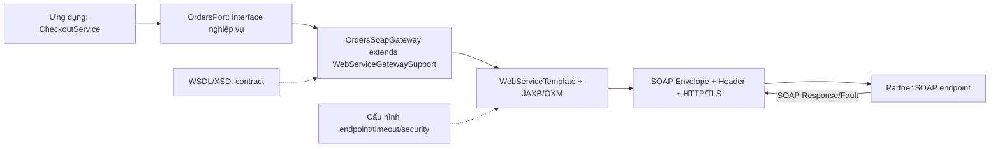
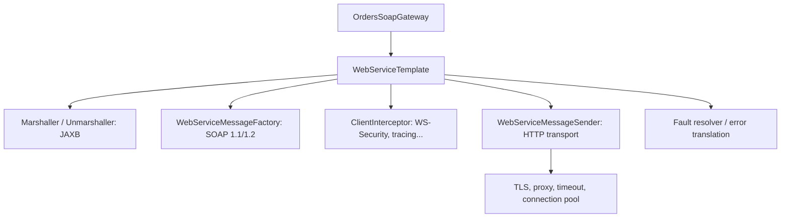

# WebServiceGatewaySupport và đóng gói client theo nghiệp vụ

Một ứng dụng thường phải gọi SOAP service của đối tác để đặt đơn hàng, xác minh thanh toán hoặc đồng bộ thông tin doanh nghiệp. Có thể viết `getWebServiceTemplate().marshalSendAndReceive(...)` ngay trong từng service nghiệp vụ, nhưng khi hệ thống lớn dần, cách này khiến URL, SOAPAction, JAXB, SOAP Header, timeout và xử lý SOAP Fault bị lặp ở nhiều nơi. Chỉ cần đối tác đổi địa chỉ hoặc version WSDL, hàng loạt service phải sửa. Nguy hiểm hơn, mã nghiệp vụ có thể vô tình retry một thao tác tạo đơn hàng và phát sinh giao dịch trùng.

**`WebServiceGatewaySupport`** của Spring Web Services (Spring-WS) là lớp nền thuận tiện để xây dựng một **SOAP gateway chuyên trách**, đóng gói giao thức và trình bày cho ứng dụng một API theo nghiệp vụ như `ordersPort.placeOrder(command)`. Gateway biết WSDL/XSD, JAXB, endpoint URL, message factory và cách ánh xạ lỗi; tầng nghiệp vụ chỉ biết thao tác, kết quả và lỗi có ý nghĩa với nó.

Bài thuộc chương **Máy khách Spring-WS** trong module **SPRING_WEB_SERVICES**. Nội dung đặt trong quy trình phát triển SOAP **contract-first**: thiết kế XSD/WSDL, ánh xạ JAXB, xây dựng endpoint và SOAP client, xử lý SOAP Fault, interceptor, XML security, WS-Security, chứng chỉ và kiểm thử tương thích. Trọng tâm là **vai trò của `WebServiceGatewaySupport`, cách tổ chức gateway theo nghiệp vụ và những ranh giới không nên làm mờ**.

Ví dụ sử dụng Spring Boot 3, Spring Framework 6, Spring-WS thuộc hệ Jakarta, Java 17+, SOAP 1.1 document/literal. Các lớp JAXB, URI, SOAPAction và thuộc tính bên dưới là ví dụ; phải đối chiếu với **WSDL/XSD thực sự** trước khi kết nối đối tác.

## 1. Từ lời gọi SOAP rải rác đến một cổng tích hợp có trách nhiệm

Một thiết kế dễ mắc nợ kỹ thuật:

```java
// Anti-pattern: dịch vụ nghiệp vụ biết trực tiếp transport SOAP.
public class CheckoutService {
    private final WebServiceTemplate template;

    public CheckoutService(WebServiceTemplate template) {
        this.template = template;
    }

    public void checkout(CheckoutCommand command) {
        PlaceOrderRequest xml = new PlaceOrderRequest();
        // Mapping XML, SOAPAction, URL, Fault handling... nằm tại đây.
        Object response = template.marshalSendAndReceive(
                "https://partner.example.org/services/orders", xml);
    }
}
```

Trong ví dụ trên `CheckoutCommand` là kiểu nghiệp vụ minh họa và `PlaceOrderRequest` là JAXB request; đoạn mã chưa phải implementation hoàn chỉnh. Vấn đề nằm ở **sự phụ thuộc sai tầng**: logic checkout phải hiểu chi tiết SOAP, và lỗi kết nối có thể lan ra dưới dạng exception thuộc Spring-WS.

Thiết kế có gateway:



Lợi ích:

- `CheckoutService` gọi `OrdersPort` bằng **command/result của ứng dụng**, không cần biết `WebServiceTemplate`.
- Chỉ gateway ánh xạ DTO nghiệp vụ ↔ JAXB object và biết QName/SOAPAction/endpoint.
- Chỉ lớp adapter/translator biết `SoapFaultClientException` và lỗi transport, rồi đổi thành lỗi có ý nghĩa với nghiệp vụ.
- URL, timeout, TLS và policy được cấu hình tại nơi tích hợp, không hard-code trong service.
- Test nghiệp vụ mock `OrdersPort`; test XML/SOAP của gateway bằng `MockWebServiceServer`; test chứng chỉ/gateway bằng integration test.

Đây là cách áp dụng **ports and adapters** (hay hexagonal architecture) ở mức vừa đủ. Không bắt buộc dự án phải dùng toàn bộ kiến trúc hexagonal mới sử dụng được `WebServiceGatewaySupport`.

## 2. `WebServiceGatewaySupport` và `WebServiceTemplate` khác nhau thế nào?

`WebServiceTemplate` là thành phần **thực thi lời gọi SOAP/XML** từ client: tạo request message, marshal payload, gọi callback/interceptor, gửi qua transport, nhận response, phát hiện Fault và unmarshal dữ liệu trả về.

`WebServiceGatewaySupport` là **lớp nền hỗ trợ** cho một gateway do ứng dụng viết. Nó cung cấp và cấu hình `WebServiceTemplate` để subclass dùng; nó **không** tự biết operation `PlaceOrder`, JAXB classes hay cách biến SOAP Fault thành kết quả nghiệp vụ.

| Tiêu chí | `WebServiceTemplate` | `WebServiceGatewaySupport` |
| --- | --- | --- |
| Mục đích | Thực thi request/response và xử lý message client | Cung cấp nền tảng để viết client gateway chuyên nghiệp vụ |
| Loại API | Các method như `marshalSendAndReceive`, `sendAndReceive` | Getter `getWebServiceTemplate()` và các setter cấu hình |
| Có tự tạo operation Java theo WSDL? | Không | Không |
| Có biết logic đặt hàng/tra cứu? | Không | Không; subclass tự định nghĩa |
| Chịu trách nhiệm JAXB | Dùng marshaller/unmarshaller được cấu hình | Cho phép cấu hình và truy cập thông qua template |
| Phù hợp test bằng `MockWebServiceServer` | Có | Có, thông qua template của gateway |
| Có bắt buộc phải kế thừa? | Không | Không; có thể dùng composition với template |

Khi dùng subclass:

```java
import org.springframework.ws.client.core.support.WebServiceGatewaySupport;

public class OrdersSoapGateway extends WebServiceGatewaySupport {

    public void ping() {
        // Tương tác SOAP thực tế thông qua template đã cấu hình.
        var template = getWebServiceTemplate();
    }
}
```

Đây là đoạn minh họa truy cập template, **không gửi network request**. Một subclass cần method nghiệp vụ cụ thể và cấu hình message factory, marshaller, URI nếu muốn marshal/gửi SOAP.

### 2.1. Những gì lớp hỗ trợ KHÔNG tự làm

Kế thừa `WebServiceGatewaySupport` không có nghĩa là:

- Tự tải WSDL khi khởi động để tạo Java client.
- Tự xác định `soap:address` hoặc SOAPAction cho mọi operation.
- Tự tạo JAXB model hoặc validate XSD dù chưa cấu hình.
- Tự thêm WS-Security token, chữ ký hoặc client certificate.
- Tự đặt timeout, circuit breaker, retry hoặc idempotency.
- Tự tạo exception nghiệp vụ `OrderNotFoundException` từ `wsdl:fault`.
- Tự đồng bộ trạng thái nhiều request hoặc bảo đảm transaction xuyên hai hệ thống.

Những hành vi này phải được cung cấp bằng **configuration, client interceptor, generated model và logic gateway** theo hợp đồng.

### 2.2. Composition cũng là phương án hợp lệ

Có thể viết:

```java
public final class ComposedOrdersSoapClient {
    private final WebServiceTemplate template;

    public ComposedOrdersSoapClient(WebServiceTemplate template) {
        this.template = template;
    }

    // Các method nghiệp vụ sử dụng template ở đây.
}
```

Nếu cần subclass thuận tiện với `setDefaultUri`, `setMarshaller`, `getWebServiceTemplate`, `WebServiceGatewaySupport` rất hợp lý. Nếu ứng dụng ưu tiên constructor injection vào class `final` thuần và một template do Spring quản lý, **composition** cũng đạt được cùng mục tiêu phân lớp. Chọn một cách rõ ràng, tránh trộn cả hai cơ chế cấu hình gây khó kiểm soát.

## 3. Bắt đầu từ hợp đồng XSD/WSDL của đối tác

Giả sử đối tác cung cấp operation `PlaceOrder`. XSD minh họa:

```xml
<?xml version="1.0" encoding="UTF-8"?>
<xs:schema xmlns:xs="http://www.w3.org/2001/XMLSchema"
           targetNamespace="https://example.org/ordering/v1"
           xmlns:o="https://example.org/ordering/v1"
           elementFormDefault="qualified">
    <xs:element name="PlaceOrderRequest">
        <xs:complexType>
            <xs:sequence>
                <xs:element name="clientRequestId" type="xs:string"/>
                <xs:element name="customerId" type="xs:string"/>
                <xs:element name="sku" type="xs:string"/>
                <xs:element name="quantity" type="xs:positiveInteger"/>
            </xs:sequence>
        </xs:complexType>
    </xs:element>

    <xs:element name="PlaceOrderResponse">
        <xs:complexType>
            <xs:sequence>
                <xs:element name="serverOrderId" type="xs:string"/>
                <xs:element name="accepted" type="xs:boolean"/>
            </xs:sequence>
        </xs:complexType>
    </xs:element>
</xs:schema>
```

`clientRequestId` được sử dụng trong ví dụ như **khóa tương quan/idempotency được đối tác chấp nhận theo thỏa thuận riêng**. Việc chỉ thêm một field vào XSD **không tự làm operation idempotent**. Server đối tác phải có semantics phát hiện trùng, cùng quy tắc hiệu lực và trả kết quả khi request lặp.

WSDL 1.1 document/literal định nghĩa binding và SOAPAction tương ứng (fragment):

```xml
<!-- Nằm trong WSDL hoàn chỉnh với wsdl:definitions, namespace,
     message, portType, binding, types và service hợp lệ. -->
<wsdl:binding name="OrderingSoap11Binding"
              type="tns:OrderingPortType">
    <soap:binding
        style="document"
        transport="http://schemas.xmlsoap.org/soap/http"/>
    <wsdl:operation name="PlaceOrder">
        <soap:operation
            soapAction="urn:example:ordering:PlaceOrder"/>
        <wsdl:input>
            <soap:body use="literal"/>
        </wsdl:input>
        <wsdl:output>
            <soap:body use="literal"/>
        </wsdl:output>
    </wsdl:operation>
</wsdl:binding>

<wsdl:service name="OrderingService">
    <wsdl:port name="OrderingPort"
               binding="tns:OrderingSoap11Binding">
        <soap:address
            location="https://partner.example.org/services/orders"/>
    </wsdl:port>
</wsdl:service>
```

Các prefix `wsdl`, `soap` và `tns` phải được khai báo ở tài liệu WSDL hoàn chỉnh. Fragment chỉ minh họa nơi đọc SOAPAction và endpoint.

**Phân biệt ba thông tin:**

- `targetNamespace`/QName: **định danh hợp đồng XML**; không nhất thiết là URL truy cập được.
- `soap:operation soapAction`: giá trị SOAPAction theo binding SOAP 1.1 qua HTTP.
- `soap:address location`: **địa chỉ transport của SOAP service**, khác với URL GET để tải file `.wsdl`.

Gateway không nên suy tên operation, SOAPAction hoặc QName từ tên method Java khi đã có WSDL được đối tác phê duyệt.

## 4. Tách interface nghiệp vụ khỏi JAXB DTO

Tầng nghiệp vụ không cần biết đối tác dùng `BigInteger` cho `xs:positiveInteger` hoặc dùng `JAXBElement` để đóng gói root XML. Ta định nghĩa một **port** gọn:

```java
package com.example.orders.application;

public interface OrdersPort {
    OrderReceipt placeOrder(PlaceOrderCommand command);
}
```

Command của ứng dụng:

```java
package com.example.orders.application;

public record PlaceOrderCommand(
        String clientRequestId,
        String customerId,
        String sku,
        int quantity) {

    public PlaceOrderCommand {
        if (clientRequestId == null || clientRequestId.isBlank()
                || customerId == null || customerId.isBlank()
                || sku == null || sku.isBlank()
                || quantity <= 0) {
            throw new IllegalArgumentException(
                    "Invalid order command");
        }
    }
}
```

Kết quả:

```java
package com.example.orders.application;

public record OrderReceipt(
        String serverOrderId,
        boolean accepted) {
}
```

Ba kiểu Java này là **ba file riêng**. Chúng không có `@XmlRootElement` hay phụ thuộc Spring-WS; người sử dụng port không phải xử lý SOAP Fault, HTTP status hoặc `Source`.

### 4.1. Vì sao không trả trực tiếp `PlaceOrderResponse` do JAXB sinh?

Nếu business service nhận kiểu JAXB:

```java
// Coupling không cần thiết tới DTO hợp đồng bên ngoài:
PlaceOrderResponse placeOrder(PlaceOrderRequest request);
```

thì những thay đổi ở XSD, code generation hoặc phiên bản JAXB dễ lan vào tầng nghiệp vụ. Tách DTO giúp:

- Bảo vệ ứng dụng trước thay đổi biểu diễn XML nhưng không đổi ngữ nghĩa nghiệp vụ.
- Định nghĩa quy tắc input/response rõ với kiểu Java quen thuộc.
- Test nghiệp vụ không cần JAXB context hoặc SOAP connection.
- Hỗ trợ thay adapter SOAP bằng mock, phiên bản đối tác khác hoặc công nghệ khác.

**Không nhất thiết tạo DTO trùng lặp nếu ứng dụng nhỏ và ranh giới tích hợp rõ ràng.** Đây là đánh đổi thiết kế. Với hệ thống doanh nghiệp nhiều thao tác hoặc có vòng đời hợp đồng dài, sự tách biệt thường mang lại lợi ích.

## 5. Cấu trúc mã nguồn gợi ý

Một cách tổ chức:

```text
com.example.orders
├── application/
│   ├── OrdersPort.java
│   ├── PlaceOrderCommand.java
│   ├── OrderReceipt.java
│   └── CheckoutService.java
└── infrastructure/soap/
    ├── OrdersSoapGateway.java
    ├── OrdersSoapConfiguration.java
    ├── OrdersPartnerProperties.java
    ├── OrdersFaultMapper.java
    └── generated/
        ├── PlaceOrderRequest.java
        ├── PlaceOrderResponse.java
        └── ObjectFactory.java

src/main/resources/
└── contracts/ordering-v1/
    ├── ordering.wsdl
    └── ordering.xsd
```

`generated` chứa các lớp JAXB sinh từ hợp đồng, không nên chỉnh tay rồi để lần generate kế tiếp ghi đè. Tùy công cụ sinh mã, có thể có `package-info.java`, `ObjectFactory`, `JAXBElement<?>` và các class khác.

**Không đọc/sửa WSDL runtime một cách tùy tiện để thay địa chỉ môi trường.** Nên giữ contract đã phê duyệt trong source control hoặc artifact registry; endpoint URL được cấu hình riêng theo local, staging, production.

## 6. Triển khai gateway kế thừa `WebServiceGatewaySupport`

Giả định JAXB code generation từ XSD ở mục 3 tạo hai class root `PlaceOrderRequest` và `PlaceOrderResponse` có `@XmlRootElement`. Trong một số hợp đồng khác, generated binding cần `ObjectFactory` tạo `JAXBElement`; phần đó được xử lý ở mục 6.3.

Đầu tiên, tạo error types nội bộ:

```java
package com.example.orders.infrastructure.soap;

public class OrdersPartnerException extends RuntimeException {
    public OrdersPartnerException(String message, Throwable cause) {
        super(message, cause);
    }
}
```

```java
package com.example.orders.infrastructure.soap;

public final class OrdersPartnerProtocolException
        extends OrdersPartnerException {
    public OrdersPartnerProtocolException(
            String message, Throwable cause) {
        super(message, cause);
    }
}
```

```java
package com.example.orders.infrastructure.soap;

public final class OrdersPartnerCommunicationException
        extends OrdersPartnerException {
    public OrdersPartnerCommunicationException(
            String message, Throwable cause) {
        super(message, cause);
    }
}
```

Các lớp trên thuộc các file riêng. Chúng cho phép ứng dụng phân loại lỗi nhưng **không buộc tầng application import exception của Spring-WS**. Một số kiến trúc đặt error types gần `OrdersPort` thay vì hạ tầng để port thuần hơn; chọn vị trí nhất quán với dự án.

### 6.1. Gateway chuyên một nhóm operation

```java
package com.example.orders.infrastructure.soap;

import java.math.BigInteger;
import com.example.orders.application.OrdersPort;
import com.example.orders.application.PlaceOrderCommand;
import com.example.orders.application.OrderReceipt;
import com.example.orders.infrastructure.soap.generated.PlaceOrderRequest;
import com.example.orders.infrastructure.soap.generated.PlaceOrderResponse;
import org.springframework.ws.client.WebServiceClientException;
import org.springframework.ws.client.core.support.WebServiceGatewaySupport;
import org.springframework.ws.soap.client.SoapFaultClientException;
import org.springframework.ws.soap.client.core.SoapActionCallback;

public final class OrdersSoapGateway
        extends WebServiceGatewaySupport implements OrdersPort {

    private static final String PLACE_ORDER_ACTION =
            "urn:example:ordering:PlaceOrder";

    private final OrdersFaultMapper faultMapper;

    public OrdersSoapGateway(OrdersFaultMapper faultMapper) {
        this.faultMapper = faultMapper;
    }

    @Override
    public OrderReceipt placeOrder(PlaceOrderCommand command) {
        PlaceOrderRequest request = new PlaceOrderRequest();
        request.setClientRequestId(command.clientRequestId());
        request.setCustomerId(command.customerId());
        request.setSku(command.sku());
        request.setQuantity(
                BigInteger.valueOf(command.quantity()));

        Object result;
        try {
            result = getWebServiceTemplate().marshalSendAndReceive(
                    request,
                    new SoapActionCallback(PLACE_ORDER_ACTION));
        } catch (SoapFaultClientException fault) {
            throw faultMapper.map(fault);
        } catch (WebServiceClientException transportOrMappingError) {
            throw new OrdersPartnerCommunicationException(
                    "Could not complete orders partner call",
                    transportOrMappingError);
        }

        if (!(result instanceof PlaceOrderResponse response)) {
            throw new OrdersPartnerProtocolException(
                    "Unexpected partner response payload", null);
        }

        return new OrderReceipt(
                response.getServerOrderId(),
                response.isAccepted());
    }
}
```

**Giải thích theo thứ tự thực thi:**

1. Nhận `PlaceOrderCommand` từ application layer, không nhận trực tiếp SOAP XML.
2. Ánh xạ sang JAXB request theo XSD: `quantity` là `BigInteger` vì `xs:positiveInteger`.
3. Dùng `getWebServiceTemplate()` của lớp nền đã được cấu hình.
4. `marshalSendAndReceive` serialize **SOAP Body payload** và gửi request.
5. `SoapActionCallback` đặt action theo WSDL SOAP 1.1, không chèn phần tử `<SOAPAction>` vào SOAP Header.
6. Fault từ server được chuyển qua `OrdersFaultMapper`; lỗi client/transport khác được bọc bởi exception thuộc integration layer.
7. Response JAXB được ánh xạ về `OrderReceipt`, không rò generated DTO tới application.

Ví dụ giả định `PlaceOrderRequest` có `@XmlRootElement` để JAXB marshal trực tiếp, response cũng unmarshal trực tiếp. Nếu công cụ sinh mã dùng `JAXBElement`, thay đổi phần wrapper/unwrapper như mục 6.3. Ngoài ra, `response.isAccepted()` được giả định là getter kiểu boolean do binding tạo; binding cụ thể có thể sinh `Boolean` hoặc tên getter khác và cần điều chỉnh.

**Gateway không cần tự tạo SOAP Envelope** bằng chuỗi XML. `WebServiceTemplate`, message factory và marshaller đảm nhiệm phần đó. Nếu ứng dụng dùng SOAP Header, bổ sung callback/interceptor thay vì ghép chuỗi Envelope trong business service.

### 6.2. Translator tối thiểu cho SOAP Fault

Một implementation tạm thời nhưng **an toàn về API boundary**:

```java
package com.example.orders.infrastructure.soap;

import org.springframework.ws.soap.client.SoapFaultClientException;

public final class OrdersFaultMapper {

    public RuntimeException map(SoapFaultClientException fault) {
        // Không đẩy SOAP faultstring/raw detail ra UI/application.
        // Khi có typed fault contract, thay bằng mapping theo code.
        return new OrdersPartnerException(
                "Orders partner rejected the SOAP request", fault);
    }
}
```

Đây là **fallback bảo thủ**, chưa phân biệt `ORDER_NOT_FOUND`, `INVALID_REQUEST` hay `TEMPORARILY_UNAVAILABLE`. Khi WSDL công bố `ServiceError`, mapper nên đọc Fault detail qua SOAP API/JAXB có schema, kiểm tra QName, rồi chuyển error code được cho phép thành exception/loại kết quả nội bộ. **Không parse `faultstring` bằng regex** để quyết định nghiệp vụ vì nó có thể đổi ngôn ngữ hoặc nội dung.

### 6.3. Khi JAXB trả `JAXBElement<?>`

Một số schema khiến JAXB sinh `ObjectFactory` tạo wrapper:

```java
// Ví dụ khi generated ObjectFactory có method tương ứng:
ObjectFactory factory = new ObjectFactory();
JAXBElement<PlaceOrderRequest> wrappedRequest =
        factory.createPlaceOrderRequest(request);

Object result = getWebServiceTemplate()
        .marshalSendAndReceive(wrappedRequest,
                new SoapActionCallback(PLACE_ORDER_ACTION));
```

Với response:

```java
PlaceOrderResponse response;
if (result instanceof JAXBElement<?> wrapper
        && wrapper.getValue() instanceof PlaceOrderResponse decoded) {
    response = decoded;
} else if (result instanceof PlaceOrderResponse decoded) {
    response = decoded;
} else {
    throw new OrdersPartnerProtocolException(
            "Unexpected partner response root", null);
}
```

Những đoạn này minh họa phần thay thế trong gateway; `ObjectFactory`, `JAXBElement`, `getWebServiceTemplate()` và các biến chỉ tồn tại khi đặt vào class với imports/binding phù hợp. **Không giả định mọi `ObjectFactory` đều có method trả `JAXBElement<PlaceOrderRequest>`**: codegen từ global element có anonymous type có thể tạo class root và factory method trả chính class. Kiểm tra generated classes và dùng đúng cách marshal/unmarshal.

## 7. Cấu hình gateway tập trung trong Spring

Không nên để gateway tự tìm URL từ WSDL mỗi lần gọi hoặc hard-code endpoint trong method. Sử dụng configuration bên ngoài và một bean dùng chung:

```yaml
# application.yml — ví dụ; dùng secret manager cho thông tin nhạy cảm.
partners:
  orders:
    soap:
      endpoint: https://partner.example.org/services/orders
```

Properties:

```java
package com.example.orders.infrastructure.soap;

import java.net.URI;
import org.springframework.boot.context.properties.ConfigurationProperties;

@ConfigurationProperties(prefix = "partners.orders.soap")
public record OrdersPartnerProperties(URI endpoint) {
    public OrdersPartnerProperties {
        if (endpoint == null || !"https".equalsIgnoreCase(
                endpoint.getScheme())) {
            throw new IllegalArgumentException(
                    "Orders SOAP endpoint must use HTTPS");
        }
    }
}
```

Bean configuration:

```java
package com.example.orders.infrastructure.soap;

import org.springframework.boot.context.properties.EnableConfigurationProperties;
import org.springframework.context.annotation.Bean;
import org.springframework.context.annotation.Configuration;
import org.springframework.oxm.jaxb.Jaxb2Marshaller;

@Configuration
@EnableConfigurationProperties(OrdersPartnerProperties.class)
public class OrdersSoapConfiguration {

    @Bean
    public Jaxb2Marshaller ordersJaxbMarshaller() {
        Jaxb2Marshaller oxm = new Jaxb2Marshaller();
        // Package của JAXB classes được sinh từ XSD/WSDL.
        oxm.setContextPath(
                "com.example.orders.infrastructure.soap.generated");
        oxm.setSupportDtd(false);
        oxm.setProcessExternalEntities(false);
        return oxm;
    }

    @Bean
    public OrdersFaultMapper ordersFaultMapper() {
        return new OrdersFaultMapper();
    }

    @Bean
    public OrdersSoapGateway ordersSoapGateway(
            OrdersPartnerProperties config,
            Jaxb2Marshaller ordersJaxbMarshaller,
            OrdersFaultMapper ordersFaultMapper) {

        OrdersSoapGateway gateway =
                new OrdersSoapGateway(ordersFaultMapper);
        gateway.setDefaultUri(config.endpoint().toString());
        gateway.setMarshaller(ordersJaxbMarshaller);
        gateway.setUnmarshaller(ordersJaxbMarshaller);
        return gateway;
    }
}
```

Trong mẫu này `setContextPath` yêu cầu generated package có JAXB context metadata thích hợp (thường `ObjectFactory` hoặc `jaxb.index`). Nếu binding dùng class không nằm trong context path đó, có thể dùng `setClassesToBeBound(...)` hoặc `setPackagesToScan(...)` phù hợp, nhưng đừng trộn nhiều cấu hình chưa được kiểm tra.

### 7.1. Tách endpoint URL khỏi WSDL contract

Ví dụ cùng một gateway được triển khai ở các môi trường:

| Môi trường | `partners.orders.soap.endpoint` |
| --- | --- |
| Local mock | `https://mock.example.org/services/orders` |
| Staging | `https://staging-partner.example.org/services/orders` |
| Production | `https://partner.example.org/services/orders` |

Đây là các địa chỉ **minh họa**. Chọn endpoint bằng configuration profile/secret/config server phù hợp. Các QName, schema và operation của một contract version giữ nguyên, trừ khi đối tác thực sự công bố version mới.

**Không lấy endpoint URL trực tiếp từ input người dùng** để gọi một host bất kỳ: có thể gây SSRF, gửi SOAP Header chứa credential sang nơi khác hoặc bỏ qua allowlist/TLS policy. Endpoint phải được quản lý/kiểm tra bởi cấu hình tin cậy.

### 7.2. Một gateway có thể dùng nhiều operation?

Có. Nếu các operation cùng một SOAP service/binding và quy tắc bảo mật, gateway có thể có `placeOrder`, `getOrder`, `cancelOrder`. Tuy nhiên, nếu:

- Các operation dùng phiên bản XSD khác nhau;
- Endpoint/binding/TLS identity khác nhau;
- Chính sách timeout, retry và security khác biệt;
- Nhóm nghiệp vụ không liên quan;

thì cân nhắc **tách gateway hoặc template/config tương ứng**. Một “MegaSoapClient” chứa tất cả operation đối tác thường khó thay đổi và kiểm thử.

### 7.3. Không mutate template trong mỗi request

`WebServiceGatewaySupport` và `WebServiceTemplate` thường được dùng như bean cấu hình một lần rồi sử dụng cho nhiều lời gọi. Không đổi `setDefaultUri`, `setMarshaller`, interceptors, message sender hoặc authentication state trên bean dùng chung **trong lúc request đang chạy**. Việc cấu hình lại có thể ảnh hưởng các thread khác.

Nếu thật sự cần gửi tới nhiều endpoint đã được cho phép, có thể dùng overload `marshalSendAndReceive(uri, request, callback)` theo URI được chọn từ registry tin cậy, hoặc xây gateway/template riêng cho từng đối tác. Không để business method tùy ý quyết định raw URL.

## 8. Những lớp liên quan trong Spring-WS client



| Thành phần | Trách nhiệm chính | Lưu ý |
| --- | --- | --- |
| `WebServiceGatewaySupport` | Nền để tổ chức gateway và cấu hình template | Không phải WSDL codegen |
| `WebServiceTemplate` | Thực thi send/receive và các callbacks | Không tự định nghĩa domain API |
| `Jaxb2Marshaller` | XML payload ↔ JAXB object | Có thể gắn schema validation, cần đúng JAXB context |
| `WebServiceMessageFactory` | Tạo/đọc SOAP message | Phải phù hợp SOAP version và implementation |
| `WebServiceMessageCallback` | Tùy chỉnh outbound message | Hữu ích đặt SOAPAction và SOAP Header |
| `ClientInterceptor` | Thêm cross-cutting concern trong client pipeline | Không nhầm với server `EndpointInterceptor` |
| `WebServiceMessageSender` | Giao tiếp HTTP hoặc transport khác | Timeout, proxy/TLS phụ thuộc sender |
| `SoapFaultClientException` | Biểu diễn SOAP Fault ở client theo cơ chế mặc định | Không để lộ trực tiếp tới application nếu có adapter boundary |

Khi cần SOAP 1.2, message factory, HTTP `Content-Type`, action và WSDL binding phải thống nhất. Một gateway dùng SOAPAction đúng nhưng vẫn có thể lỗi nếu Envelope version hoặc media type sai.

## 9. SOAP Header và WS-Security trong gateway

Một đối tác có thể yêu cầu SOAP Header `RequestContext` chứa `correlationId` và `clientId`. Hợp đồng nên mô tả QName và, nếu là một phần của WSDL 1.1, `soap:header` binding tương ứng.

Ví dụ message mong muốn:

```xml
<s:Envelope
    xmlns:s="http://schemas.xmlsoap.org/soap/envelope/"
    xmlns:o="https://example.org/ordering/v1"
    xmlns:m="https://example.org/ordering/meta/v1">
    <s:Header>
        <m:RequestContext>
            <m:correlationId>req-2026-601</m:correlationId>
            <m:clientId>checkout-app</m:clientId>
        </m:RequestContext>
    </s:Header>
    <s:Body>
        <o:PlaceOrderRequest>
            <o:clientRequestId>REQ-1001</o:clientRequestId>
            <o:customerId>C-100</o:customerId>
            <o:sku>BOOK-01</o:sku>
            <o:quantity>2</o:quantity>
        </o:PlaceOrderRequest>
    </s:Body>
</s:Envelope>
```

### 9.1. Thêm SOAP Header bằng callback

Nếu một `RequestContext` JAXB class có `@XmlRootElement`:

```java
// Đoạn code nằm trong method gateway; headerMarshaller đã được cấu hình.
Object result = getWebServiceTemplate().marshalSendAndReceive(
        request,
        message -> {
            SoapMessage soap = (SoapMessage) message;
            soap.setSoapAction("urn:example:ordering:PlaceOrder");
            headerMarshaller.marshal(
                    new RequestContext("req-2026-601", "checkout-app"),
                    soap.getSoapHeader().getResult());
        });
```

`RequestContext`, `headerMarshaller` là các thành phần ví dụ, phải có imports/beans tương ứng. Phần tử được marshal vào `SoapHeader#getResult()` là **SOAP Header block**, không phải HTTP Header. Không tự gắn tên prefix rồi suy QName; hãy kiểm tra XML trên wire và WSDL thật. Nếu metadata là tùy chọn hoặc có `mustUnderstand`, client và server phải thống nhất xử lý theo SOAP 1.1/1.2.

### 9.2. Metadata thông thường không thay thế WS-Security

`clientId` do client khai báo trong SOAP Header **không tự xác thực** caller. Khi đối tác yêu cầu WS-Security (UsernameToken, XML Signature, Encryption, Timestamp), sử dụng security interceptor/stack phù hợp, thường là WSS4J trong hệ Spring-WS, thay vì tự tạo token hoặc chữ ký bằng nối chuỗi XML.

**Phải tách hai lớp bảo vệ:**

- **TLS/mTLS:** xác thực host/kênh truyền và certificate/trust chain ở transport.
- **WS-Security:** bảo vệ thành phần SOAP message (token, chữ ký, timestamp, encryption) theo policy.

Một cấu hình mTLS thành công **không tự đáp ứng** yêu cầu XML Signature; một XML Signature hợp lệ cũng **không tự làm chứng chỉ TLS đáng tin**.

Nếu cần ký Header do callback tạo, kiểm tra **thứ tự client interceptors/callback** trên phiên bản sử dụng để bảo đảm phần tử thực sự được ký. Không sửa các phần tử đã ký sau khi security interceptor tính chữ ký. Kiểm thử signed parts bằng công cụ/đối tác thật; đừng chỉ nhìn `wsse:Security` xuất hiện và kết luận an toàn.

## 10. SOAP Fault: chuyển lỗi giao thức thành lỗi có ý nghĩa

Khi server gửi SOAP Fault, cơ chế mặc định của `WebServiceTemplate` thường sử dụng fault resolver tạo `SoapFaultClientException`. Nhưng **SOAP Fault không đồng nghĩa với lỗi kết nối**:

| Tình huống | Dấu hiệu | Cách gateway nên xử lý |
| --- | --- | --- |
| SOAP Fault `Client/Sender` với typed detail `INVALID_REQUEST` | Server đã xử lý SOAP request và từ chối nội dung | Chuyển thành lỗi input/contract, không retry mù |
| SOAP Fault nghiệp vụ `ORDER_STATE_CONFLICT` | Hợp đồng Fault có mã công khai | Chuyển thành lỗi nghiệp vụ rõ |
| SOAP Fault `Server/Receiver` | Lỗi phía server SOAP | Phân loại theo error code/retry policy |
| HTTP timeout/connection reset | Không chắc server đã thực thi request | Tình trạng kết quả không xác định; không tự retry thao tác có side effect |
| TLS certificate/hostname lỗi | Handshake/transport lỗi trước SOAP | Báo lỗi cấu hình/trust, không bypass certificate verification |
| Response XML sai QName/XSD | Không khớp hợp đồng hoặc JAXB binding | Lỗi protocol/compatibility |
| HTTP 502 từ gateway | Có thể không phải SOAP message | Xử lý như transport/gateway error, không ép parse Fault |

### 10.1. Fault detail có cấu trúc

Giả sử WSDL định nghĩa phần tử:

```xml
<e:ServiceError xmlns:e="https://example.org/ordering/errors/v1">
    <e:code>ORDER_STATE_CONFLICT</e:code>
    <e:message>Operation not allowed</e:message>
    <e:correlationId>req-2026-601</e:correlationId>
</e:ServiceError>
```

Gateway nên lấy `SoapFault` từ exception, kiểm tra `faultDetail`, lấy phần tử đúng QName và **unmarshal theo XSD lỗi** nếu contract quy định, rồi ánh xạ `code` tới loại lỗi ứng dụng. **Không** phân tích `faultstring` như một API ổn định, vì văn bản có thể thay đổi ngôn ngữ hoặc bị làm mờ để tránh lộ thông tin nội bộ.

Một translator có thể định nghĩa bảng chính sách:

| Error code từ đối tác | Ý nghĩa cho application | Retry? |
| --- | --- | --- |
| `INVALID_REQUEST` | Request không đúng contract | Không, sửa request |
| `ORDER_STATE_CONFLICT` | Thao tác không hợp lệ trong trạng thái hiện tại | Không retry y nguyên |
| `ORDER_NOT_FOUND` | Đối tượng không tồn tại nếu caller có quyền biết | Theo business policy |
| `TEMPORARILY_UNAVAILABLE` | Đối tác tạm thời không sẵn sàng | Chỉ theo retry/idempotency policy |
| Code không nhận diện/detail thiếu | Không thể phân loại chắc chắn | Fallback an toàn; không suy từ faultstring |

**Không nên map mọi `SoapFaultClientException` thành “đối tác không kết nối được”**: server đã trả một SOAP response có Fault, nên đây là loại kết quả khác với timeout. Ngược lại, không biến mọi lỗi kết nối thành “request bị từ chối”, bởi operation có thể đã được thực hiện.

### 10.2. Thiết kế exception của adapter

Một cách phân loại dùng ở application boundary:

```text
OrdersPort.placeOrder(command)
├── OrderReceipt                 (response đã giải mã thành công)
├── PartnerRejectedException    (SOAP Fault theo mã hợp đồng)
├── PartnerProtocolException    (message lạ, sai XSD/QName)
├── PartnerCommunicationException (connection, timeout, TLS...)
└── UncertainOrderOutcomeException (không biết partner đã commit chưa)
```

Không cần tạo đúng các class tên như trên nếu domain đã có mô hình khác, nhưng phải làm rõ **đã bị từ chối**, **lỗi giao thức** và **không biết kết quả**. Đặc biệt với lệnh đặt hàng, một network timeout không được xem là bằng chứng server **chưa** xử lý.

## 11. Timeout, TLS và connection management

Lớp nền `WebServiceGatewaySupport` không tự đảm bảo timeout thích hợp. HTTP client/message sender và cấu hình môi trường quyết định thời gian kết nối, đọc response và nhiều khả năng khác.

### 11.1. Cấu hình timeout ở đúng tầng

| Thời gian giới hạn | Ý nghĩa | Ví dụ hành vi |
| --- | --- | --- |
| Connect timeout | Thời gian thiết lập kết nối tới server | Kết nối TCP không mở được |
| Read/response timeout | Chờ server trả dữ liệu sau khi request được gửi | Server xử lý lâu, kết quả có thể không xác định |
| Connection pool acquire timeout | Chờ lấy connection từ pool nếu dùng pooling | Pool đang bận/hết slot |
| Tổng hạn thời gian nghiệp vụ | Deadline của operation trong ứng dụng | Không để một checkout chờ vô hạn |

Cụ thể API cấu hình timeout tùy `WebServiceMessageSender` và phiên bản Spring-WS (ví dụ sender dựa trên JDK `HttpURLConnection` hoặc Apache HttpClient). Không copy một setter timeout từ phiên bản cũ sang phiên bản mới mà chưa xác nhận kiểu tham số và chính sách timeout. **Connection timeout khác read timeout**, và cả hai không tự chứng minh lệnh remote chưa được thực thi.

### 11.2. TLS và chứng chỉ

Với production:

- Kiểm tra certificate chain từ CA/truststore được phê duyệt.
- Kiểm tra hostname/SAN khớp public SOAP endpoint.
- Nếu đối tác yêu cầu mTLS, cấu hình **client key material**/certificate riêng và policy xoay vòng chứng chỉ.
- Không dùng trust-all `TrustManager` hay bỏ hostname verification để “chữa lỗi nhanh”.
- Không đưa password của keystore, private key hoặc token vào YAML nguồn; dùng secret management và giới hạn quyền.
- Dùng proxy/tunnel đã được kiểm soát, bảo đảm không chuyển SOAP Header bảo mật tới sai host.

Một HTTP response từ địa chỉ WSDL GET hợp lệ không chứng minh endpoint SOAP POST đang dùng đúng chứng chỉ, path hoặc trust policy. Kiểm thử **địa chỉ runtime được gateway gọi**.

### 11.3. Quản lý connection pool và resource

Nếu sender dùng connection pool, pool thuộc **vòng đời ứng dụng**, không được đóng sau mỗi `placeOrder`. Với template/gateway singleton, khởi tạo sender một lần và tắt theo lifecycle của Spring/container. Nếu một request lỗi, hãy để transport implementation quản lý release connection; đừng giữ `InputStream` hoặc `SoapMessage` qua request sau.

Không lưu SOAP response hoặc JAXB `Unmarshaller` mutable trong field singleton của gateway. Các bean như `Jaxb2Marshaller` có cơ chế quản lý JAXB context phù hợp cho việc dùng chung; không tự chia sẻ một instance `jakarta.xml.bind.Unmarshaller` mutable giữa các thread.

## 12. Retry, idempotency và kết quả không xác định

Giả sử client gửi:

```text
PlaceOrder(clientRequestId=REQ-1001)
  → server nhận, tạo ORD-9001, commit DB
  → mạng đứt trước khi SOAP Response tới client
  → client nhận timeout
```

Nếu client tự gọi lại với **`clientRequestId` mới**, đối tác có thể tạo **đơn hàng thứ hai**. `WebServiceGatewaySupport` không biết business semantics nên không thể tự chọn retry an toàn.

### 12.1. Điều kiện retry có kiểm soát

Chỉ retry khi có **bằng chứng/protocol cho phép**, ví dụ:

1. Operation read-only/idempotent theo hợp đồng.
2. Server hỗ trợ idempotency key với thời hạn, uniqueness và kết quả trả về được quy định.
3. Tầng nghiệp vụ có thể query trạng thái theo `clientRequestId` để xác nhận đã commit.
4. Retry policy phân biệt error code tạm thời với lỗi input/authorization.
5. Có backoff/jitter, giới hạn số lần và deadline tổng thể.

Trong trường hợp timeout/connection reset sau khi gửi request, ưu tiên trạng thái **kết quả chưa xác định** và reconciliation nếu operation có side effect.

### 12.2. Không đặt retry vô điều kiện trên mọi exception

Một retry interceptor có thể hữu ích nhưng phải hiểu **operation**. Retry `INVALID_REQUEST` chỉ tăng tải mà không giúp giải quyết; retry `ACCESS_DENIED` có thể che lỗi cấu hình; retry `PlaceOrder` chưa có idempotency có thể sinh dữ liệu trùng.

Tầng gateway có thể cung cấp category lỗi, còn application service hoặc policy chuyên biệt quyết định retry/reconciliation. Điều này giữ đúng ranh giới giữa **SOAP transport mechanics** và **ngữ nghĩa nghiệp vụ**.

## 13. Client interceptor: tracing, security và quan sát

Spring-WS client sử dụng `org.springframework.ws.client.support.interceptor.ClientInterceptor`, không phải `EndpointInterceptor` của server. Các phương thức callback của client khác về chữ ký và hoạt động trong request-response client lifecycle.

Ví dụ gắn interceptor đã được cấu hình:

```java
import org.springframework.ws.client.support.interceptor.ClientInterceptor;

// 'gateway' đã được khởi tạo và cấu hình qua Spring.
gateway.getWebServiceTemplate().setInterceptors(
        new ClientInterceptor[] { tracingInterceptor, securityInterceptor });
```

Ví dụ là fragment minh họa; `tracingInterceptor` và `securityInterceptor` phải implement `ClientInterceptor` và được cấu hình đúng. Nên thiết lập **một lần khi khởi tạo bean**, không thay array interceptors trên template dùng chung ở từng request.

Các interceptor có thể xử lý:

- Correlation ID và trace context đã chuẩn hóa.
- Thêm/đọc SOAP Header theo hợp đồng.
- WS-Security UsernameToken, timestamp, chữ ký hoặc encryption.
- Metrics theo operation/error code, không dùng correlation ID làm metric label có cardinality cao.
- Logging có redaction; không dump SOAP Body/`wsse:Security` trong production.

**Không dùng interceptor để che trừu tượng lỗi nghiệp vụ hoàn toàn.** Việc chuyển `ORDER_STATE_CONFLICT` sang một outcome/exception có ý nghĩa với checkout thường nằm ở fault translator hoặc gateway, nơi hiểu operation và contract.

### 13.1. SOAP Fault, transport error và log

Thông tin có ích cho log:

| Nên ghi | Không nên ghi mặc định |
| --- | --- |
| Operation/QName và endpoint alias | Toàn bộ URL chứa credential/query nhạy cảm |
| Correlation ID đã chuẩn hóa | Raw SOAP Header/Body có PII và token |
| Latency, error category, public code | Password, private key, certificate secret |
| Trạng thái timeout/HTTP/SoapFault phân biệt | Raw `faultstring` nội bộ chưa redaction |

Với tracing, giữ correlation context theo request, không cất nó vào mutable field của gateway singleton. Nếu dùng MDC/ThreadLocal, quản lý cleanup đúng thread và vòng đời, đặc biệt khi chuyển executor/async.

## 14. Kiểm thử gateway bằng `MockWebServiceServer`

Spring-WS Test hỗ trợ `MockWebServiceServer` để thay thế network trong bài test của `WebServiceTemplate`. Đây là công cụ lý tưởng để xác nhận **đúng SOAP payload**, callback và cách gateway giải mã response.

### 14.1. Ví dụ test request/response thành công

Giả sử đã tạo bean `OrdersSoapGateway` với JAXB marshaller theo ví dụ trên:

```java
package com.example.orders.infrastructure.soap;

import com.example.orders.application.OrderReceipt;
import com.example.orders.application.PlaceOrderCommand;
import static org.junit.jupiter.api.Assertions.*;
import static org.springframework.ws.test.client.RequestMatchers.*;
import static org.springframework.ws.test.client.ResponseCreators.*;

import org.junit.jupiter.api.BeforeEach;
import org.junit.jupiter.api.Test;
import org.springframework.oxm.jaxb.Jaxb2Marshaller;
import org.springframework.ws.test.client.MockWebServiceServer;
import org.springframework.xml.transform.StringSource;

class OrdersSoapGatewayTest {
    private OrdersSoapGateway gateway;

    @BeforeEach
    void setUp() throws Exception {
        Jaxb2Marshaller oxm = new Jaxb2Marshaller();
        oxm.setContextPath(
                "com.example.orders.infrastructure.soap.generated");
        oxm.setSupportDtd(false);
        oxm.setProcessExternalEntities(false);
        oxm.afterPropertiesSet();

        gateway = new OrdersSoapGateway(new OrdersFaultMapper());
        gateway.setDefaultUri(
                "https://mock.example.org/services/orders");
        gateway.setMarshaller(oxm);
        gateway.setUnmarshaller(oxm);
        gateway.afterPropertiesSet();
    }

    @Test
    void placeOrderMapsSoapPayloadToDomainResult() {
        MockWebServiceServer server =
                MockWebServiceServer.createServer(
                        gateway.getWebServiceTemplate());

        String requestXml = """
                <o:PlaceOrderRequest
                    xmlns:o="https://example.org/ordering/v1">
                    <o:clientRequestId>REQ-1001</o:clientRequestId>
                    <o:customerId>C-100</o:customerId>
                    <o:sku>BOOK-01</o:sku>
                    <o:quantity>2</o:quantity>
                </o:PlaceOrderRequest>
                """;

        String responseXml = """
                <o:PlaceOrderResponse
                    xmlns:o="https://example.org/ordering/v1">
                    <o:serverOrderId>ORD-9001</o:serverOrderId>
                    <o:accepted>true</o:accepted>
                </o:PlaceOrderResponse>
                """;

        server.expect(payload(new StringSource(requestXml)))
              .andRespond(withPayload(new StringSource(responseXml)));

        OrderReceipt result = gateway.placeOrder(
                new PlaceOrderCommand(
                        "REQ-1001", "C-100", "BOOK-01", 2));

        assertEquals("ORD-9001", result.serverOrderId());
        assertTrue(result.accepted());
        server.verify();
    }

}
```

Test khởi tạo gateway và JAXB marshaller giống cấu hình chính, sau đó gắn `MockWebServiceServer` vào **chính template của gateway**. Nó yêu cầu generated JAXB classes trong package đã chỉ định, Spring-WS Test và JUnit trong test dependencies. Nếu JAXB codegen trả `JAXBElement<?>` thay vì class root có `@XmlRootElement`, cần điều chỉnh ví dụ gateway/test theo mục 6.3 trước khi chạy.

Matcher `payload(...)` kiểm tra XML request payload ở tầng SOAP; XML namespace/prefix có thể được framework so sánh theo ngữ nghĩa XML. Nếu muốn kiểm tra SOAPAction/Header, thêm matcher/callback phù hợp với Spring-WS Test version đang dùng, và **kiểm tra actual serialized SOAP message** khi security policy quan trọng.

### 14.2. Test SOAP Fault mapping

Với một typed fault được đối tác mô tả, test nên làm:

1. Mock server trả SOAP Fault `Client/Sender` và typed detail `ServiceError` đúng QName.
2. Gateway bắt `SoapFaultClientException` và translator decode error code.
3. `OrdersPort` ném exception/domain outcome đúng với `ORDER_STATE_CONFLICT`.
4. Không để application thấy `SoapFaultClientException`, raw XML hay exception message nhạy cảm nếu boundary đã đặt ra.
5. Trường hợp detail không có hoặc không đúng XSD phải chuyển thành fallback an toàn, **không âm thầm coi là success**.

Một test dùng `withClientOrSenderFault(...)` theo API Spring-WS Test phù hợp chỉ kiểm tra Fault cơ bản; typed detail cần response creator bổ sung hoặc một mock SOAP Fault message có cấu trúc chính xác. Đừng chỉ assert exception class rồi bỏ qua Fault code/QName và thông tin nhạy cảm.

### 14.3. Test network/timeout cần môi trường khác

`MockWebServiceServer` không chứng minh:

- DNS, certificate chain, hostname verification và mTLS.
- Proxy, gateway rewrite hoặc HTTP timeout/read timeout thật.
- Connection pooling, retry khi server đã commit, request replay.
- WS-Security signature/timestamp/truststore với provider thực tế.
- Khả năng code generation/tải import của WSDL/XSD từ môi trường client.

Những ca này cần integration/contract test với test server HTTP/TLS hoặc môi trường tích hợp được kiểm soát.

## 15. Ma trận kiểm thử cho một gateway triển khai production

| Tình huống | Điều cần chứng minh |
| --- | --- |
| Command hợp lệ | XML Body đúng QName, thứ tự XSD, giá trị |
| Command thiếu `customerId` hoặc `quantity <= 0` | Dừng ở boundary nghiệp vụ, không gửi SOAP |
| SOAPAction đúng WSDL | Transport metadata đúng binding SOAP 1.1 |
| Đổi prefix XML nhưng cùng namespace | SOAP server/client vẫn hiểu cùng QName |
| JAXB generated code dùng `JAXBElement` | Wrapper/unwrapper xử lý chính xác |
| SOAP response `accepted=true` | Trả `OrderReceipt` đúng |
| Response sai root QName hoặc thiếu trường | Báo protocol/contract error |
| SOAP Fault `INVALID_REQUEST` | Không retry; trả lỗi đầu vào có ý nghĩa |
| SOAP Fault `ORDER_STATE_CONFLICT` | Phân loại nghiệp vụ đúng |
| SOAP Fault detail không nhận diện | Fallback an toàn, không parse faultstring tùy ý |
| Connect timeout | Lỗi transport được phân loại, không rò Spring-WS exception lên domain nếu đã encapsulate |
| Read timeout sau request có side effect | Kết quả chưa chắc không được thực hiện; policy reconcile |
| Retry với cùng idempotency key | Không tạo trùng nếu **đối tác cam kết** semantics |
| Staging vs production | URI qua config, không hard-code |
| TLS cert hostname sai | Kết nối bị từ chối; không trust-all |
| WS-Security signature/token sai | Không bypass security |
| SOAP 1.2 khi đối tác chỉ SOAP 1.1 | Phát hiện version/binding mismatch |
| Nhiều request đồng thời | Không trộn SOAP Header, correlation ID, mutable JAXB context |
| Gateway nhận mã lỗi mới | Client có fallback/phiên bản hợp đồng rõ |
| Thay schema/WSDL của đối tác | Contract tests phát hiện breaking change |
| Logging Fault | Không lộ XML/token/cert/PII |

## 16. Chẩn đoán lỗi thường gặp

| Triệu chứng | Nguyên nhân thường gặp | Kiểm tra đầu tiên |
| --- | --- | --- |
| `getWebServiceTemplate().marshalSendAndReceive` báo thiếu marshaller | Gateway chưa gọi `setMarshaller`/`setUnmarshaller` hoặc bean khác được inject | Kiểm tra configuration và bean đang dùng |
| `MarshalException` hoặc “missing @XmlRootElement” | Generated class cần `JAXBElement`/`ObjectFactory` | Kiểm tra binding JAXB từ XSD |
| JAXB báo unexpected element | Sai QName namespace/local name, schema version lệch | Đối chiếu SOAP Body response với XSD thật |
| HTTP 404 | Sai SOAP endpoint URI hoặc path qua proxy | Đừng nhầm URL WSDL GET với SOAP POST |
| HTTP 415/VersionMismatch | SOAP 1.1/1.2 media type/envelope sai | Kiểm tra message factory và WSDL binding |
| Remote SOAP Fault `MustUnderstand` | Server không nhận một mandatory SOAP Header | Kiểm tra QName, `actor/role`, policy |
| SOAP Fault từ đối tác bị coi là connection error | Catch quá rộng hoặc sai thứ tự catch | Bắt `SoapFaultClientException` trước, map typed detail |
| `SOAPAction` bị từ chối | Action trong callback không khớp WSDL | Kiểm tra `soap:operation soapAction` |
| Connection đợi vô hạn | Timeout chưa được cấu hình hoặc chưa áp vào sender | Kiểm tra actual `WebServiceMessageSender` |
| TLS handshake thất bại | Hostname, certificate chain, client cert, truststore sai | Kiểm tra TLS từ runtime tới endpoint thật |
| Request đặt hàng bị lặp | Retry không có idempotency semantics | Kiểm tra `clientRequestId` và server policy |
| Test pass nhưng production thiếu WS-Security | Mock server không kiểm thử security stack | Integration test với policy/chữ ký/chứng chỉ thật |
| URL bị đổi giữa các request | Mutate singleton template/URI theo input | Cấu hình bất biến và host allowlist |
| Data race ở SOAP Header | Lưu request state vào field gateway singleton | Dùng callback/object theo từng request |
| WSDL thay đổi nhưng gateway vẫn chạy sai | Generated JAXB code/version chưa đồng bộ | Regenerate từ contract và chạy compatibility tests |

## 17. Các quy tắc thiết kế giúp gateway bền vững

1. **Giữ interface theo nghiệp vụ:** `placeOrder`, `getOrder`, `cancelOrder`; không phơi `marshalSendAndReceive` ra service application.
2. **Tách DTO nội bộ và JAXB DTO** khi hợp đồng đối tác có vòng đời độc lập với domain.
3. **Cấu hình URI, timeout, message sender, marshaller, WS-Security ở một nơi**, không rải trong business method.
4. **Đọc SOAPAction, QName, Fault và binding từ WSDL**, không đoán bằng tên method.
5. **Map SOAP Fault theo typed detail/error code**; không dùng faultstring/exception text thô để ra quyết định.
6. **Phân biệt lỗi rejected, unavailable, protocol error và uncertain outcome**, nhất là thao tác có side effect.
7. **Không retry mù.** Idempotency là cam kết giữa client và server, không phải tính năng tự có của gateway.
8. **Giữ gateway/template cấu hình ổn định khi chạy song song**; không để request sửa global defaultUri hoặc authentication state.
9. **Bảo vệ TLS/WS-Security theo policy**, không disable verification và không log dữ liệu nhạy cảm.
10. **Tách test theo tầng:** unit business port, XML contract gateway, transport/security integration và compatibility với đối tác.

## 18. Bài tập tự kiểm tra

**Câu 1.** `WebServiceGatewaySupport` có tự sinh method `placeOrder(...)` khi đọc WSDL không?

**Đáp án:** Không. Đây là lớp hỗ trợ sở hữu/cấu hình `WebServiceTemplate`; operation nghiệp vụ do subclass hoặc composition của ứng dụng định nghĩa. JAXB classes được tạo bằng công cụ code generation độc lập khi cần.

**Câu 2.** Vì sao application service nên phụ thuộc `OrdersPort` thay vì `WebServiceTemplate`?

**Đáp án:** Để tách business rules khỏi SOAP transport, JAXB DTO, SOAPAction/endpoint URL và lỗi SOAP Fault; service dễ test và ít bị tác động khi contract/transport thay đổi.

**Câu 3.** WSDL được tải qua `https://partner.example.org/ws/ordering.wsdl` nhưng `soap:address` trỏ `https://partner.example.org/services/orders`. Gateway nên POST SOAP tới đâu?

**Đáp án:** Theo endpoint SOAP thực được đối tác công bố/cấu hình, ví dụ `/services/orders`, không phải tự POST tới URL GET WSDL. Phải xét cả gateway/public routing và WSDL binding.

**Câu 4.** Request JAXB thiếu `@XmlRootElement`, nhưng `ObjectFactory` có method tạo `JAXBElement`. Sửa thế nào?

**Đáp án:** Marshal wrapper `JAXBElement` đúng QName theo generated binding, không tự thêm wrapper XML tùy ý; unmarshal response cũng xử lý `JAXBElement<?>` nếu provider trả loại đó.

**Câu 5.** Một SOAP Fault `ORDER_STATE_CONFLICT` có `faultstring` tiếng Anh hôm nay và tiếng Việt ngày mai. Client có nên parse text để ra quyết định không?

**Đáp án:** Không. Dùng structured error code/typed detail theo hợp đồng và fallback khi code lạ; text chỉ để hiển thị/hỗ trợ.

**Câu 6.** Đối tác timeout sau khi nhận `PlaceOrder`. Có được coi là server chưa tạo đơn hàng không?

**Đáp án:** Không. Timeout không chứng minh commit chưa xảy ra. Dùng `clientRequestId` với idempotency semantics được đối tác bảo đảm hoặc reconciliation/truy vấn kết quả trước khi retry.

**Câu 7.** Tại sao không gọi `gateway.setDefaultUri(...)` mỗi lần theo input HTTP của người dùng?

**Đáp án:** Gateway thường là singleton dùng đồng thời, dễ race và có nguy cơ SSRF/chuyển credential tới host lạ. Dùng cấu hình tin cậy hoặc registry/allowlist endpoint được kiểm soát.

**Câu 8.** Có thể dùng `MockWebServiceServer` để xác nhận chứng chỉ client mTLS hợp lệ không?

**Đáp án:** Không. Mock không đi qua handshake thật. Cần integration test HTTPS/mTLS với trust/key material và endpoint tương ứng.

**Câu 9.** Một SOAP Header có `clientId=checkout-app`; có thể coi nó đã được xác thực không?

**Đáp án:** Không. Đó là metadata do phía gửi khai báo. Xác thực dựa vào security token/chữ ký/mTLS và authorization policy phù hợp; SOAP Header tồn tại không phải bằng chứng danh tính.

**Câu 10.** Vì sao cần kiểm thử WSDL/XSD khi gateway chỉ có một method Java?

**Đáp án:** SOAP contract bao gồm QName payload, thứ tự phần tử, binding, SOAPAction, typed Fault và namespace. Java method compile thành công không chứng minh request/response tương thích đối tác.

## Ghi nhớ

- **`WebServiceGatewaySupport` là lớp nền cho SOAP gateway; `WebServiceTemplate` là thành phần thực thi lời gọi**. Cả hai không tự thay thế WSDL/XSD và nghiệp vụ.
- **Gateway triển khai một port theo nghiệp vụ**, chuyển command/result ứng dụng ↔ JAXB DTO, cấu hình SOAPAction/endpoint tập trung và giấu chi tiết Spring-WS khỏi business service.
- **Cấu hình một lần, dùng cho nhiều request**, không mutate `WebServiceTemplate` dùng chung theo input người dùng; bảo vệ endpoint URL, TLS và thông tin xác thực.
- **SOAP Fault và transport error là những kết quả khác nhau**. Typed fault cần map theo code; timeout của thao tác có side effect có thể là kết quả chưa xác định.
- **Retry cần idempotency/reconciliation và policy của đối tác**, không thể do `WebServiceGatewaySupport` tự đoán.
- **Kiểm thử nhiều tầng**: mock `OrdersPort` cho nghiệp vụ, `MockWebServiceServer` cho XML/SOAP gateway, test HTTP/TLS/WS-Security thực cho tích hợp và compatibility test sau khi contract thay đổi.
