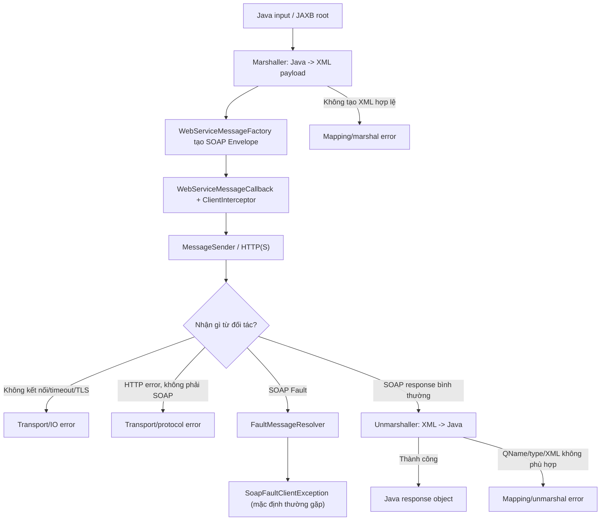
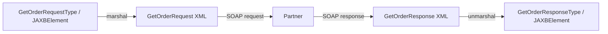
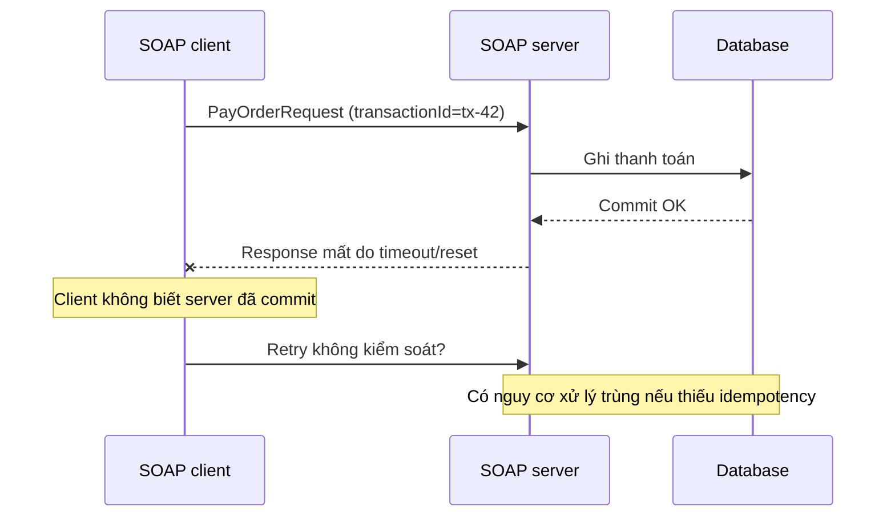
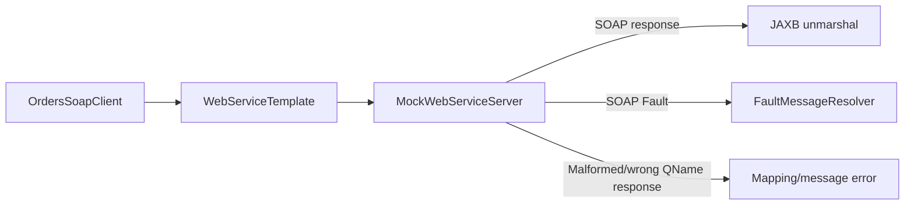

# SoapFaultClientException, lỗi truyền tải và lỗi chuyển đổi dữ liệu

## 1. Tại sao phải phân loại lỗi phía SOAP client?

Giả sử dịch vụ **đơn hàng** của một doanh nghiệp gọi hệ thống đối tác qua SOAP bằng **Spring Web Services (Spring-WS)**. Phía client sử dụng `WebServiceTemplate` và các lớp JAXB sinh từ XSD/WSDL để gửi `GetOrderRequest`, nhận `GetOrderResponse`.

Trong một lần gọi thất bại, ba hiện tượng rất khác nhau có thể xuất hiện:

1. **Server đã gửi một SOAP Fault hợp lệ.** Ví dụ đối tác thông báo mã đơn không tồn tại. Phía Spring-WS client có thể ném `SoapFaultClientException`.
2. **Không trao đổi được thông điệp SOAP như dự kiến.** Ví dụ DNS sai, TLS handshake lỗi, socket timeout, reverse proxy trả HTTP 502. Đây là lỗi **truyền tải hoặc HTTP/protocol**, không nhất thiết có SOAP Fault.
3. **XML và Java object không chuyển đổi được với nhau.** Ví dụ JAXB không marshal được request root hoặc không unmarshal được response vì QName/namespace sai. Đây là lỗi **mapping XML/JAXB**, không phải bằng chứng server đã trả SOAP Fault.

Nếu gom tất cả thành “SOAP call failed, thử lại”, hệ thống có thể retry vô hạn với request sai schema, phơi lộ thông tin nội bộ trong logs, hoặc **gọi lặp một giao dịch đã thực hiện thành công nhưng mất response**.

Bài học thuộc chương **Máy khách Spring-WS** của module `SPRING_WEB_SERVICES`. Nội dung dựa trên phương pháp **contract-first**: XSD/WSDL quyết định cấu trúc XML, JAXB ánh xạ object, `WebServiceTemplate` gửi và nhận SOAP; SOAP Fault, interceptor, WS-Security, TLS/chứng chỉ và kiểm thử tương thích giúp tích hợp hệ thống doanh nghiệp ổn định.

### Mục tiêu học tập

Sau bài học, bạn có thể:

- Phân biệt `SoapFaultClientException`, lỗi transport/HTTP, lỗi marshal và lỗi unmarshal.
- Giải thích `WebServiceTemplate` xử lý request, response, SOAP Fault và lỗi kết nối ở các giai đoạn khác nhau.
- Đọc Fault code, reason/faultstring và detail theo **SOAP 1.1 hoặc SOAP 1.2** mà không phụ thuộc Java exception của server.
- Phân biệt lỗi do **request chưa gửi được**, lỗi do **đã gửi nhưng không rõ kết quả**, và lỗi khi **đã nhận response nhưng không giải mã được**.
- Chẩn đoán XSD/JAXB root QName, namespace và version mismatch.
- Thiết kế error classification, retry, idempotency, correlation ID và logging an toàn.
- Viết kiểm thử client với `MockWebServiceServer` và kiểm thử HTTP/TLS tích hợp.

## 2. Toàn bộ đường đi của `WebServiceTemplate`



Sơ đồ mô tả **trách nhiệm logic**, không khẳng định mọi callback đều chạy theo một thứ tự byte-for-byte ở tất cả phiên bản. Đặc biệt, lỗi HTTP/TLS có thể xảy ra **trước khi client gửi hết request**, còn lỗi unmarshal thường xuất hiện **sau khi response đã được nhận**.

### 2.1. Những lớp quan trọng

| Thành phần | Vai trò trong SOAP client |
| --- | --- |
| `WebServiceTemplate` | Điều phối gửi request/nhận response, kết hợp marshaller, message sender, callback, interceptor và fault resolver |
| `Jaxb2Marshaller` | Ánh xạ JAXB object ↔ XML theo classes sinh từ XSD/WSDL |
| `WebServiceMessageFactory` | Tạo/đọc thông điệp SOAP 1.1/1.2 theo cấu hình |
| `WebServiceMessageCallback` | Điều chỉnh SOAP message trước khi gửi, ví dụ SOAPAction/Header |
| `ClientInterceptor` | Quan sát/can thiệp request, response hoặc SOAP Fault phía client |
| `WebServiceMessageSender` | Gửi/nhận qua HTTP(S) hoặc transport được cấu hình |
| `FaultMessageResolver` | Xử lý một SOAP message được nhận diện là Fault |
| `SoapFaultClientException` | Exception client biểu diễn SOAP Fault server gửi tới |
| `XmlMappingException` và các subclass | Lỗi chuyển đổi dữ liệu XML ↔ object trong Spring OXM/JAXB |

### 2.2. Phân biệt điểm phát sinh lỗi

| Giai đoạn | Ví dụ | Suy ra được gì? |
| --- | --- | --- |
| Trước khi gửi | JAXB không marshal được root request | Chưa có bằng chứng request đã ra khỏi client |
| Mở kết nối | Không phân giải được hostname | Không có SOAP response; cần kiểm tra network/config |
| TLS handshake | Certificate không được trust | Kết nối bảo mật thất bại; server endpoint có thể chưa thấy request |
| Sau khi gửi request | Read timeout | **Không biết chắc** server đã xử lý hay chưa |
| HTTP response | HTTP 502 HTML từ gateway | Không phải SOAP Fault hợp lệ chỉ vì status lỗi |
| SOAP Fault | SOAP Envelope chứa `Fault` | Server/processor SOAP đã công bố lỗi ở mức protocol/application |
| SOAP response | Response root QName không đúng | Có thể đã nhận XML nhưng JAXB client không giải mã được |
| Sau unmarshal | Java object không thỏa business invariant | Lỗi validation/business phía client, không phải XML transport |

Trong bài này, thuật ngữ **transport error** bao gồm các lỗi kết nối, I/O hoặc phản hồi HTTP không đáp ứng SOAP binding; tùy đường đi và phiên bản thư viện, exception Java cụ thể có thể khác.

## 3. SOAP Fault là một thông điệp có cấu trúc, không phải mọi HTTP 500

### 3.1. Ví dụ SOAP 1.1 Fault

Server trả:

```http
HTTP/1.1 500 Internal Server Error
Content-Type: text/xml; charset=utf-8
```

Body:

```xml
<?xml version="1.0" encoding="UTF-8"?>
<soap:Envelope xmlns:soap="http://schemas.xmlsoap.org/soap/envelope/">
    <soap:Body>
        <soap:Fault>
            <faultcode>soap:Client</faultcode>
            <faultstring>Yêu cầu không hợp lệ</faultstring>
            <detail>
                <err:OrderError xmlns:err="urn:example:orders:fault:v1">
                    <err:code>INVALID_ORDER_ID</err:code>
                    <err:requestId>req-42</err:requestId>
                </err:OrderError>
            </detail>
        </soap:Fault>
    </soap:Body>
</soap:Envelope>
```

Đây là **SOAP Fault do server tạo**, thường được Spring-WS client xử lý thông qua `FaultMessageResolver`. Với resolver SOAP mặc định phù hợp, Java code có thể nhận `SoapFaultClientException`.

### 3.2. Ví dụ SOAP 1.2 Fault

SOAP 1.2 dùng Envelope namespace khác và `Code`/`Reason`/`Detail`:

```xml
<env:Envelope
    xmlns:env="http://www.w3.org/2003/05/soap-envelope"
    xmlns:err="urn:example:orders:fault:v1">
    <env:Body>
        <env:Fault>
            <env:Code>
                <env:Value>env:Sender</env:Value>
            </env:Code>
            <env:Reason>
                <env:Text xml:lang="vi">Yêu cầu không hợp lệ</env:Text>
            </env:Reason>
            <env:Detail>
                <err:OrderError>
                    <err:code>INVALID_ORDER_ID</err:code>
                    <err:requestId>req-42</err:requestId>
                </err:OrderError>
            </env:Detail>
        </env:Fault>
    </env:Body>
</env:Envelope>
```

| Đặc điểm | SOAP 1.1 | SOAP 1.2 |
| --- | --- | --- |
| Envelope namespace | `http://schemas.xmlsoap.org/soap/envelope/` | `http://www.w3.org/2003/05/soap-envelope` |
| Fault code thường gặp | `Client` / `Server` | `Sender` / `Receiver` |
| Mô tả cho người đọc | `faultstring` | `Reason/Text` với `xml:lang` |
| Chi tiết ứng dụng | `detail` | `Detail` |
| HTTP Content-Type phổ biến | `text/xml` | `application/soap+xml` |

Không nên cứng hóa logic client là “mọi lỗi phía caller luôn có chuỗi `Client`”. Khi dùng SOAP 1.2, code thường là `Sender`; cần dựa vào QName/code và version thực tế.

### 3.3. Ba sự kiện HTTP dễ bị nhầm

| HTTP response | SOAP body | Phân loại |
| --- | --- | --- |
| `500` + `text/xml` | SOAP 1.1 `Fault` hợp lệ | SOAP Fault |
| `502` + `text/html` | Trang lỗi proxy | Transport/gateway error |
| `200` + `text/xml` | SOAP Envelope bình thường | Response thông thường; vẫn phải unmarshal/validate |

Một số hệ thống không tuân thủ SOAP HTTP binding có thể gửi SOAP Fault với status bất thường như `200` hoặc `400`. Spring-WS có các tùy chọn kiểm tra connection error/fault nhưng **đừng mặc định tắt chúng để “chữa” server sai chuẩn**: thay đổi này tác động semantics lỗi và cần kiểm chứng theo phiên bản/đối tác.

### 3.4. Fault code không tự quyết định retry

SOAP Fault `Server`/`Receiver` có thể phản ánh lỗi tạm thời, nhưng **không chứng minh nghiệp vụ chưa chạy**. Nếu client gửi `PayOrder` rồi nhận Fault vì lỗi khi xây dựng response, thanh toán có thể đã commit.

Với thao tác có side effect, retry phải dựa vào **idempotency key**, transaction ID hoặc cơ chế query trạng thái, không chỉ dựa vào `faultcode` hoặc HTTP 500.

## 4. `SoapFaultClientException` trong Spring-WS

Class thường gặp:

```java
org.springframework.ws.soap.client.SoapFaultClientException
```

`SoapFaultClientException` phản ánh một **SOAP Fault do phía đối tác gửi** và được client-side Fault resolution chuyển thành Java exception. Nó không phải class Java exception mà server đã ném. Server có thể dùng bất kỳ framework/ngôn ngữ nào mà vẫn trả SOAP Fault đúng chuẩn.

### 4.1. Truy cập fault code, fault reason và SOAP Fault

```java
import javax.xml.namespace.QName;
import org.springframework.ws.soap.SoapFault;
import org.springframework.ws.soap.client.SoapFaultClientException;

public final class FaultInspector {

    public static void inspect(SoapFaultClientException exception) {
        QName faultCode = exception.getFaultCode();
        String reason = exception.getFaultStringOrReason();
        SoapFault fault = exception.getSoapFault();

        System.out.println("Fault code: " + faultCode);
        System.out.println("Reason (public): " + reason);
        System.out.println(
            "Has detail: " + (fault.getFaultDetail() != null)
        );
    }
}
```

Đây là ví dụ **đọc cấu trúc Fault**, không phải logging policy production. Không log nguyên `SoapFault` hoặc `detail` khi chưa redaction; có thể chứa dữ liệu nhạy cảm do đối tác gửi. `javax.xml.namespace.QName` là Java XML QName API, kể cả khi JAXB dùng `jakarta.xml.bind`.

### 4.2. Tránh dùng `getMessage()` hoặc fault reason làm mã lỗi

Không nên:

```java
if (exception.getMessage().contains("not found")) {
    // Đoán nghiệp vụ theo chuỗi tiếng Anh tự do.
}
```

Mô tả có thể được dịch, thay dấu câu, thay đổi khi nâng server, hoặc chứa nội dung không ổn định. Client doanh nghiệp nên xử lý theo **mã lỗi có cấu trúc trong Fault detail được công bố bởi XSD/WSDL**, kết hợp Fault code ở cấp SOAP.

### 4.3. `FaultMessageResolver` quyết định hành vi client

`WebServiceTemplate` sử dụng `FaultMessageResolver` để xử lý SOAP Fault. Một triển khai mặc định thường dùng là:

```java
org.springframework.ws.soap.client.core.SoapFaultMessageResolver
```

Nó có thể chuyển SOAP Fault thành `SoapFaultClientException`. Nếu ứng dụng cài một resolver tùy biến, hành vi ném exception hoặc tạo domain error có thể khác. Vì vậy **không đảm bảo mọi SOAP Fault luôn thành `SoapFaultClientException` trong mọi cấu hình**.

Chú ý namespace class:

- `SoapFaultClientException`: `org.springframework.ws.soap.client`.
- `SoapFaultMessageResolver`: `org.springframework.ws.soap.client.core`.

### 4.4. Khi client chỉ nhận HTTP exception

Nếu response không phải SOAP message hợp lệ, `WebServiceTemplate` không nhất thiết có `SoapFault` để tạo `SoapFaultClientException`. Ví dụ HTTP 401 từ gateway không chứa SOAP Envelope, HTTP 502 HTML, hoặc connection bị reset. Khi đó hãy phân loại theo transport/protocol, **không ép body HTML thành SOAP Fault**.

## 5. Cấu hình client JAXB và `WebServiceTemplate`

Ví dụ contract đơn hàng có hai global elements:

```text
{urn:example:orders:v1}GetOrderRequest
{urn:example:orders:v1}GetOrderResponse
```

XJC/JAXB có thể sinh:

```text
GetOrderRequestType
GetOrderResponseType
ObjectFactory.createGetOrderRequest(...)
ObjectFactory.createGetOrderResponse(...)
```

Nếu các global elements sinh ra `JAXBElement`, phải dùng đúng `ObjectFactory` để bảo đảm **root QName trên wire**. Chỉ tạo một `GetOrderRequestType` không chắc tự có `@XmlRootElement`.

### 5.1. Spring configuration tối thiểu

```java
import org.springframework.context.annotation.Bean;
import org.springframework.context.annotation.Configuration;
import org.springframework.oxm.jaxb.Jaxb2Marshaller;
import org.springframework.ws.client.core.WebServiceTemplate;

@Configuration
public class OrdersSoapClientConfiguration {

    @Bean
    public Jaxb2Marshaller ordersMarshaller() {
        Jaxb2Marshaller marshaller = new Jaxb2Marshaller();
        marshaller.setContextPath("org.example.orders.jaxb");
        return marshaller;
    }

    @Bean
    public WebServiceTemplate ordersWebServiceTemplate(
            Jaxb2Marshaller ordersMarshaller) {

        WebServiceTemplate template = new WebServiceTemplate();
        template.setMarshaller(ordersMarshaller);
        template.setUnmarshaller(ordersMarshaller);
        template.setDefaultUri("https://partner.example.org/ws");
        return template;
    }
}
```

Ví dụ dùng package `org.example.orders.jaxb` và URL **giả định**; cần thay bằng JAXB package thực tế và địa chỉ `soap:address` trong WSDL đã xác minh. Cần có dependencies Spring-WS, Spring OXM, JAXB runtime tương thích (các stack hiện đại dùng Jakarta JAXB; stack cũ có thể dùng `javax.xml.bind`).

**Đoạn code chưa cấu hình:** HTTP timeouts, pooling, TLS/mTLS, keystore/truststore, SOAP version/message factory, authentication, WS-Security hoặc client interceptors. Những phần này phải được cấu hình theo yêu cầu thực tế, không được mặc định rằng tạo `WebServiceTemplate` là đã có security phù hợp.

### 5.2. Gửi request JAXB với SOAPAction

```java
import jakarta.xml.bind.JAXBElement;
import org.springframework.ws.client.core.WebServiceTemplate;
import org.springframework.ws.soap.client.core.SoapActionCallback;

public final class OrdersSoapClient {

    private final WebServiceTemplate template;
    private final ObjectFactory objectFactory = new ObjectFactory();

    public OrdersSoapClient(WebServiceTemplate template) {
        this.template = template;
    }

    public GetOrderResponseType getOrder(String orderId) {
        GetOrderRequestType request = new GetOrderRequestType();
        request.setOrderId(orderId);

        JAXBElement<GetOrderRequestType> root =
            objectFactory.createGetOrderRequest(request);

        Object raw = template.marshalSendAndReceive(
            root,
            new SoapActionCallback("urn:example:orders:v1:GetOrder")
        );

        if (!(raw instanceof JAXBElement<?> element) ||
                !(element.getValue() instanceof GetOrderResponseType value)) {
            throw new IllegalStateException(
                "Unexpected JAXB response root or type"
            );
        }
        return value;
    }
}
```

Đây là ví dụ cho **binding sinh `JAXBElement`**; một generator khác có thể sinh class `@XmlRootElement` và trả object trực tiếp. Production phải kiểm tra **QName của response element**, không chỉ Java class, vì hai global elements có thể dùng chung một type. Trên Java version cũ, cú pháp pattern matching `instanceof` cần được viết lại.

`SoapActionCallback` chỉ đặt SOAPAction theo SOAP binding, **không tạo SOAP Header nghiệp vụ hoặc WS-Security token**. Giá trị action phải đối chiếu WSDL thực tế: không tự suy từ Java method name.

### 5.3. Fault xuất hiện ở đâu khi gọi method này?

`marshalSendAndReceive(...)` có thể thất bại:

- Trong **marshal** request, trước khi HTTP được gửi.
- Trong **transport** sau khi marshal.
- Trong **Fault resolution** khi server trả SOAP Fault.
- Trong **unmarshal** response bình thường.
- Trong các **callback/interceptor** phía client.

Vì vậy, một `try/catch (Exception)` duy nhất rồi trả `null` sẽ xóa bỏ rất nhiều thông tin cần thiết để quyết định phục hồi.

## 6. Bắt và phân loại exception mà không làm mất thông tin

Spring-WS và Spring OXM có những nhóm exception khác nhau:

| Nhóm | Các kiểu Java thường gặp | Ý nghĩa chính |
| --- | --- | --- |
| SOAP Fault | `SoapFaultClientException` | Đã nhận Fault từ SOAP processor/server theo resolver hiện hành |
| HTTP/transport | `WebServiceTransportException` | Lỗi phản hồi transport/protocol, ví dụ HTTP status không được nhận là SOAP Fault |
| I/O | `WebServiceIOException` | Lỗi kết nối/ghi/đọc, có thể bọc `IOException` hoặc lỗi tầng thấp |
| Spring-WS client khác | `WebServiceClientException` | Nhóm lỗi khác trong quá trình client gửi/nhận, cần kiểm tra nguyên nhân |
| Object/XML mapping | `XmlMappingException`, `MarshallingFailureException`, `UnmarshallingFailureException` | Không chuyển đổi được Java object ↔ XML |
| JAXB underlying cause | `jakarta.xml.bind.MarshalException`, `UnmarshalException` (hoặc `javax` với stack cũ) | Nguyên nhân thấp hơn có thể được Spring OXM bọc lại |
| Business validation phía client | Exception do ứng dụng tự định nghĩa | Payload đã chuyển đổi nhưng không thỏa quy tắc nghiệp vụ client |

**Lưu ý:** exception cụ thể và quan hệ kế thừa có thể thay đổi theo phiên bản Spring-WS/OXM, message sender và JAXB provider. Bảng là **nhóm chẩn đoán**, không bảo đảm một lỗi nhất định luôn có một class duy nhất ở mọi stack.

### 6.1. Mẫu phân loại ở tầng adapter SOAP

Ví dụ dùng những exception cấp cao ổn định của Spring-WS/OXM:

```java
import org.springframework.oxm.XmlMappingException;
import org.springframework.ws.client.WebServiceClientException;
import org.springframework.ws.client.WebServiceIOException;
import org.springframework.ws.client.WebServiceTransportException;
import org.springframework.ws.soap.client.SoapFaultClientException;

public final class OrdersGateway {

    private final OrdersSoapClient soapClient;

    public OrdersGateway(OrdersSoapClient soapClient) {
        this.soapClient = soapClient;
    }

    public OrderResult findOrder(String orderId) {
        try {
            GetOrderResponseType response = soapClient.getOrder(orderId);
            return OrderResult.success(
                response.getOrderId(), response.getStatus()
            );
        } catch (SoapFaultClientException fault) {
            return OrderResult.soapFault(
                fault.getFaultCode(),
                fault.getFaultStringOrReason()
            );
        } catch (XmlMappingException mapping) {
            return OrderResult.mappingFailure(
                "XML mapping failed"
            );
        } catch (WebServiceClientException clientError) {
            if (clientError instanceof WebServiceIOException) {
                return OrderResult.transportUncertain(
                    "Network or I/O failure"
                );
            }
            if (clientError instanceof WebServiceTransportException) {
                return OrderResult.transportFailure(
                    "HTTP/transport failure"
                );
            }
            return OrderResult.clientFailure(
                "Other Spring-WS client failure"
            );
        }
    }
}
```

`OrderResult` trong ví dụ là **kiểu kết quả do ứng dụng tự thiết kế**, chưa được định nghĩa ở đây. Đoạn code cho thấy **thứ tự bắt và cách phân nhóm**, không phải implementation sẵn có để biên dịch độc lập. Cần kiểm tra phần cause/response có sẵn của exception khi logging, giữ nguyên thông tin phục vụ chẩn đoán nội bộ và không công bố exception message một cách mù quáng.

**Tại sao bắt `SoapFaultClientException` trước?** Vì đây là trường hợp có cấu trúc SOAP Fault rõ ràng; nếu chỉ bắt superclass `WebServiceClientException` rồi gọi chung là network error, ta mất khả năng phân loại server-reported business error.

**Tại sao không retry ngay trong mỗi catch?** Vì nhóm `transportUncertain` có thể xảy ra **sau khi server đã nhận và xử lý request**; quyết định retry cần biết operation có idempotent hay có cơ chế kiểm tra transaction không.

### 6.2. Đừng trả `null` rồi bỏ qua lỗi

Anti-pattern:

```java
try {
    return (GetOrderResponseType)
        template.marshalSendAndReceive(request);
} catch (Exception e) {
    return null;
}
```

Ngoài cast có thể sai với JAXB root `JAXBElement`, code này làm mất phân biệt lỗi client, timeout, SOAP Fault và mapping. Caller có thể hiểu `null` là “không có đơn hàng”, vô tình coi lỗi hạ tầng thành kết quả nghiệp vụ.

Thay vào đó, hoặc trả kiểu result phân loại rõ, hoặc ném các **domain gateway exceptions** khác nhau mà tầng trên có thể xử lý theo policy.

### 6.3. Nguyên tắc giữ nguyên cause

Khi wrap exception:

```java
throw new PartnerTransportException(
    "Không thể hoàn tất kết nối SOAP với đối tác",
    originalException
);
```

`PartnerTransportException` là kiểu ứng dụng tự định nghĩa. Giữ `originalException` làm cause để logging nội bộ, nhưng không serialize nguyên cause, stack trace hoặc HTTP headers vào response công khai cho người dùng cuối.

Một error model hữu ích có thể lưu:

```text
category      = SOAP_FAULT | TRANSPORT | XML_MAPPING | CLIENT_POLICY
phase         = BEFORE_SEND | CONNECTION | AFTER_SEND_UNKNOWN | AFTER_RECEIVE
operation     = GetOrder
requestId     = req-42
partnerErrorCode = INVALID_ORDER_ID (nếu có theo contract)
retryDecision = NEVER | CONDITIONAL | SAFE_WITH_IDEMPOTENCY
internalCause = exception object (chỉ nội bộ)
```

Không cố suy `phase` hoàn toàn từ exception class nếu sender không cung cấp được dấu mốc. Khi không chắc server đã nhận request, phải dùng trạng thái **UNKNOWN**, không bịa thành `BEFORE_SEND`.

## 7. Lỗi truyền tải: DNS, kết nối, TLS, timeout và HTTP gateway

### 7.1. Những tình huống thường gặp

| Sự cố | Dấu hiệu | Nơi bắt đầu kiểm tra |
| --- | --- | --- |
| DNS không phân giải được | Unknown host ở cause chain | Host trong WSDL/URI, DNS, môi trường deploy |
| TCP connection refused | Không kết nối được cổng đích | Host/port, firewall, service có chạy không |
| Connect timeout | Chưa hoàn tất kết nối trong hạn | Network, proxy, connect timeout configuration |
| TLS handshake failure | Chứng chỉ/trust/hostname/algorithm không phù hợp | Certificate chain, truststore, SNI, mTLS |
| Read/response timeout | Đã chờ response quá lâu | Server latency, upstream, read timeout; kết quả nghiệp vụ có thể chưa rõ |
| Connection reset | Socket bị đóng khi trao đổi | Proxy idle timeout, server restart, network, pooling |
| HTTP 401/403 | Authentication/authorization/CSRF/gateway policy | HTTP credentials, certificate, proxy, filters |
| HTTP 404 | Sai endpoint URL/context path | `soap:address` WSDL, reverse proxy rewrite, servlet mapping |
| HTTP 413 | Request SOAP quá lớn | Content length, server/proxy limits, attachments |
| HTTP 415 | Media type hoặc SOAP version không phù hợp | `text/xml` vs `application/soap+xml`, Envelope namespace |
| HTTP 502/503/504 | Reverse proxy/upstream chưa đáp ứng | Gateway logs, health, capacity, backend route |
| HTTP 500 không có SOAP Envelope | Server/proxy lỗi nhưng không phát SOAP Fault đúng | HTTP body, Content-Type, access logs |

Các tình huống này có thể biểu hiện qua `WebServiceIOException`, `WebServiceTransportException` hoặc exception bọc cause khác. **Đừng xác định chính sách retry chỉ bằng chuỗi trong `getMessage()`.**

### 7.2. Connect timeout khác read timeout

```text
Client
  |
  |-- DNS / TCP / TLS establish --|  connect timeout (tùy sender)
  |
  |-- write SOAP request ---------|
  |
  |-- wait response --------------|  read/response timeout
  |
  |-- read response / parse XML --|
```

Một connect timeout thường cho thấy chưa kết nối được đến service. **Read timeout sau khi gửi request** đặc biệt nguy hiểm đối với operation có side effect vì server có thể đã hoàn thành nhưng client không thấy kết quả.

Không phải mọi sender tách chính xác các mốc thời gian như nhau. HTTP connection pooling có thể phát sinh lỗi ở thời điểm lấy connection hoặc dùng lại connection cũ; proxy có thể ngắt sau khi đã forward request. Cần xem trace/cause thực tế, không quy toàn bộ lỗi timeouts về một nguyên nhân.

### 7.3. Cấu hình timeout phụ thuộc message sender/version

`WebServiceTemplate` ủy quyền transport cho `WebServiceMessageSender`. Spring-WS có các sender dựa trên URLConnection hoặc Apache HttpClient tùy phiên bản và dependency. Cấu hình có thể bao gồm:

- Connect timeout.
- Response/read timeout.
- Connection pool size và per-route limits.
- Idle/connection lifetime, stale connection detection.
- TLS/mTLS, keystore/truststore và hostname verification.
- Proxy settings.
- Authentication headers hoặc thông tin xác thực cho transport.

**Không có một snippet timeout duy nhất áp dụng cho mọi Spring-WS 3.x/4.x/5.x và mọi HTTP sender.** Ví dụ `setConnectionTimeout(...)` hoặc `setReadTimeout(...)` có thể nhận kiểu tham số khác nhau tùy API. Hãy cấu hình **đúng sender đang dùng** và xác nhận timeout qua integration test với một server cố ý trì hoãn.

Ví dụ ý tưởng:

```text
connectionTimeout = 3 s   (minh họa)
responseTimeout   = 10 s  (minh họa)
operationDeadline = 15 s  (minh họa)
```

Các giá trị trên **không phải khuyến nghị cố định**; cần chọn theo độ trễ dự kiến, SLA, retry budget và tải hệ thống. Đừng đặt timeout quá ngắn rồi tạo retry storm lên đối tác.

### 7.4. Lỗi TLS và mTLS không phải SOAP Fault

Khi truststore không tin certificate server hoặc hostname không khớp, TLS có thể thất bại trước khi SOAP application xử lý request. Trong tích hợp mTLS, client còn phải cung cấp certificate/private key được phía server chấp nhận.

Những kiểm tra cần thực hiện:

1. Certificate server còn hạn và chain dẫn tới CA đáng tin không?
2. Hostname trong certificate/SAN có khớp URI client gọi không?
3. Truststore và key store client đã được nạp đúng môi trường chưa?
4. Có reverse proxy/TLS termination hoặc SNI làm thay đổi endpoint thực sự không?
5. Có đang dùng chứng chỉ client phù hợp và được phía đối tác tin cậy không?
6. Protocol/cipher suites có tương thích theo security policy không?

**Không tắt hostname verification hoặc trust-all certificates để “sửa nhanh” production.** Làm vậy bỏ qua bảo đảm danh tính máy chủ, có thể đưa dữ liệu SOAP và thông tin xác thực đến bên không đáng tin.

### 7.5. HTTP 401/403 và lỗi xác thực SOAP khác nhau

Ví dụ:

- HTTP Basic hoặc bearer auth bị chặn ở gateway: có thể trả **HTTP 401/403 không kèm SOAP Fault**.
- WS-Security UsernameToken hoặc XML Signature sai: có thể nhận **SOAP security Fault** do SOAP processor tạo nếu request đã đến stack SOAP.
- mTLS thất bại: có thể chỉ nhận **TLS handshake exception**, không có HTTP response.

Đừng dùng một handler `SoapFaultClientException` duy nhất để “xử lý mọi lỗi đăng nhập”, và cũng đừng dùng HTTP status làm nguồn duy nhất để phân biệt WS-Security.

## 8. Đọc HTTP status và SOAP response như hai tín hiệu

### 8.1. HTTP 500 có thể là SOAP 1.1 Fault hợp lệ

Một số HTTP client xử lý non-2xx như lỗi chung, nhưng SOAP 1.1 HTTP binding quy định Fault thường được gửi với HTTP 500. `WebServiceTemplate` có logic nhận diện Fault theo response/message/connection; đừng thay thế nguyên logic bằng `if (status != 200) throw new TransportException()` trước khi SOAP Fault resolver có cơ hội chạy.

### 8.2. Dấu hiệu phản hồi không phải SOAP

Một gateway có thể trả:

```http
HTTP/1.1 502 Bad Gateway
Content-Type: text/html

<html><body>Upstream unavailable</body></html>
```

Body này không có SOAP Envelope; cố unmarshal thành `GetOrderResponseType` sẽ thất bại. Đây là sự cố gateway/transport cần phân loại đúng, không đặt tên “`GetOrderResponse` không hợp XSD” chỉ vì JAXB không đọc được HTML.

### 8.3. Đừng bật tùy chọn kiểm tra Fault theo cảm tính

`WebServiceTemplate` có thể được điều chỉnh qua:

```java
template.setCheckConnectionForError(true);
template.setCheckConnectionForFault(true);
```

Đoạn này chỉ minh họa **sự tồn tại của hai lựa chọn kiểm tra transport-level error/fault**, không khẳng định các giá trị này phù hợp mọi đối tác. Khi phía server trả status không tuân chuẩn, tài liệu Spring-WS có hướng dẫn các flag liên quan; quyết định thay đổi phải dựa trên phiên bản sender/stack và test **cả Fault hợp lệ lẫn HTML error**.

Không nên xử lý một đối tác gửi SOAP Fault trong HTTP 200 bằng cách lập tức tắt mọi kiểm tra lỗi mà không xét hệ quả: lỗi gateway hoặc status bất thường khác có thể bị giải thích sai.

### 8.4. SOAP 1.2 khác SOAP 1.1 ở tầng HTTP

SOAP 1.2 thường dùng `application/soap+xml` và có thể mang action trong tham số content type, thay vì HTTP `SOAPAction` kiểu SOAP 1.1. Message factory, WSDL binding, Envelope namespace, HTTP sender và endpoint phải nhất quán.

Một SOAP 1.2 message đi kèm `Content-Type: text/xml` hoặc Envelope namespace SOAP 1.1 có thể thất bại trước lúc ứng dụng nhận `GetOrderResponse`. Kiểm thử version riêng biệt thay vì chỉ thay HTTP header.

## 9. Lỗi chuyển đổi dữ liệu: phân biệt marshaling và unmarshaling

**Marshaling** là chuyển Java object thành XML để gửi; **unmarshaling** là chuyển XML response thành Java object.



Lỗi có thể xuất hiện ở **cả hai chiều**:

| Lỗi | Thường phát sinh | Điểm kiểm tra |
| --- | --- | --- |
| Không có JAXB root element | Marshal request | `ObjectFactory`, `@XmlRootElement`, `JAXBElement` |
| JAXB context thiếu class/package | Marshal hoặc unmarshal | `setContextPath`, `classesToBeBound`, dependency |
| `javax`/`jakarta` JAXB không tương thích | Khởi tạo context hoặc mapping | Spring/OXM/JAXB version đồng bộ |
| Sai QName response root | Unmarshal response | QName `{namespaceURI}localPart` thực tế |
| Sai XML namespace ở child elements | Unmarshal/validation | `elementFormDefault` và package-info JAXB |
| Unknown enum literal | Unmarshal response hoặc business validation | XSD enum version/client generated model |
| Giá trị không parse được | Unmarshal | `xs:dateTime`, decimal, boolean, adapters |
| Sai thứ tự/nested elements | Unmarshal/validation | XSD `xs:sequence`, `xs:choice` |
| Dùng SOAP 1.1 parser cho SOAP 1.2 | Message parsing trước JAXB | Message factory và Envelope version |
| SOAP Body chứa Fault nhưng client cố map sang response DTO | Fault path bị bỏ qua hoặc custom resolver sai | Fault detection/resolver trước unmarshal |

### 9.1. QName là danh tính đầy đủ của một element

Một JAXB client mong:

```text
{urn:example:orders:v1}GetOrderResponse
```

Nhưng đối tác gửi:

```xml
<GetOrderResponse>
    <orderId>ORD-100</orderId>
    <status>CREATED</status>
</GetOrderResponse>
```

Nếu không có default namespace trong scope, root thực tế là:

```text
{}GetOrderResponse
```

Hai root **không tương đương**. Client có thể nhận lỗi JAXB “unexpected element” mặc dù local name trùng. Cần so QName thật thay vì chỉ so `getLocalName()`.

### 9.2. Prefix không phải nguyên nhân nếu namespace URI đúng

Hai XML sau có cùng root QName:

```xml
<ord:GetOrderResponse
    xmlns:ord="urn:example:orders:v1">
    <ord:orderId>ORD-100</ord:orderId>
    <ord:status>CREATED</ord:status>
</ord:GetOrderResponse>
```

```xml
<x:GetOrderResponse
    xmlns:x="urn:example:orders:v1">
    <x:orderId>ORD-100</x:orderId>
    <x:status>CREATED</x:status>
</x:GetOrderResponse>
```

Nếu client chỉ thất bại vì prefix khác, vấn đề có thể nằm ở code XML xử lý bằng chuỗi/XPath thiếu namespace awareness, **không phải bản chất JAXB QName**.

### 9.3. Root `JAXBElement` khác raw named type

XSD:

```xml
<xs:complexType name="GetOrderResponseType">
    <xs:sequence>
        <xs:element name="orderId" type="xs:string"/>
        <xs:element name="status" type="xs:string"/>
    </xs:sequence>
</xs:complexType>

<xs:element name="GetOrderResponse"
            type="tns:GetOrderResponseType"/>
```

`GetOrderResponseType` là **named type**, còn `GetOrderResponse` là **global element**. Một JAXB `ObjectFactory` có thể tạo `JAXBElement<GetOrderResponseType>` với QName của global element.

Vì vậy, nếu client gọi `marshalSendAndReceive` rồi cast trực tiếp:

```java
GetOrderResponseType response =
    (GetOrderResponseType) template.marshalSendAndReceive(request);
```

thì có thể gặp `ClassCastException` nếu unmarshaller trả `JAXBElement<GetOrderResponseType>`. **ClassCastException** trong trường hợp này là lỗi xử lý object phía ứng dụng, không phải `SoapFaultClientException`.

### 9.4. Unmarshal thành công chưa chứng minh XML hợp toàn bộ XSD

Tùy cấu hình JAXB và schema validation, XML chứa giá trị sai pattern hoặc thiếu element có thể vẫn được chuyển thành một Java object, hoặc có thể bị từ chối trong mapping.

Nếu hợp đồng có ràng buộc như `xs:pattern`, `xs:minOccurs`, `xs:sequence` hoặc `xs:enumeration`, cần bật/kiểm tra XSD validation phù hợp trên request/response. Không mặc định `Jaxb2Marshaller` luôn thực thi đầy đủ schema constraints chỉ vì model sinh từ XSD.

### 9.5. Một lỗi mapping sau response không chứng minh operation thất bại

Server có thể xử lý `CancelOrder` và trả response XML có root QName sai. Client unmarshal thất bại **sau khi server đã hủy đơn**. Gọi lại operation chỉ vì thấy lỗi JAXB có thể tạo side effect trùng nếu service không idempotent.

Khi mapping response lỗi, ưu tiên lưu correlation/transaction ID, kiểm tra WSDL/schema compatibility và tra cứu trạng thái nghiệp vụ nếu operation có tác động, thay vì tự động retry ngay.

## 10. Contract-first XSD/WSDL và các trường hợp response sai

Một ví dụ contract giúp xác định rõ lỗi do **server trả Fault** hay do **server/client không dùng cùng schema**.

### 10.1. XSD đơn giản của operation `GetOrder`

```xml
<?xml version="1.0" encoding="UTF-8"?>
<xs:schema
    xmlns:xs="http://www.w3.org/2001/XMLSchema"
    xmlns:tns="urn:example:orders:v1"
    targetNamespace="urn:example:orders:v1"
    elementFormDefault="qualified">

    <xs:simpleType name="OrderIdType">
        <xs:restriction base="xs:string">
            <xs:pattern value="ORD-[0-9]{3,10}"/>
        </xs:restriction>
    </xs:simpleType>

    <xs:simpleType name="OrderStatusType">
        <xs:restriction base="xs:string">
            <xs:enumeration value="CREATED"/>
            <xs:enumeration value="SHIPPED"/>
            <xs:enumeration value="CANCELLED"/>
        </xs:restriction>
    </xs:simpleType>

    <xs:complexType name="GetOrderRequestType">
        <xs:sequence>
            <xs:element name="orderId"
                        type="tns:OrderIdType"/>
        </xs:sequence>
    </xs:complexType>

    <xs:complexType name="GetOrderResponseType">
        <xs:sequence>
            <xs:element name="orderId"
                        type="tns:OrderIdType"/>
            <xs:element name="status"
                        type="tns:OrderStatusType"/>
        </xs:sequence>
    </xs:complexType>

    <xs:element name="GetOrderRequest"
                type="tns:GetOrderRequestType"/>
    <xs:element name="GetOrderResponse"
                type="tns:GetOrderResponseType"/>
</xs:schema>
```

Hợp đồng này định nghĩa root QName rõ ràng, restriction của `orderId` và các giá trị `status` được phép.

### 10.2. SOAP request/response hợp đồng

Request SOAP 1.1:

```xml
<soap:Envelope
    xmlns:soap="http://schemas.xmlsoap.org/soap/envelope/"
    xmlns:ord="urn:example:orders:v1">
    <soap:Body>
        <ord:GetOrderRequest>
            <ord:orderId>ORD-100</ord:orderId>
        </ord:GetOrderRequest>
    </soap:Body>
</soap:Envelope>
```

Response SOAP 1.1:

```xml
<soap:Envelope
    xmlns:soap="http://schemas.xmlsoap.org/soap/envelope/"
    xmlns:ord="urn:example:orders:v1">
    <soap:Body>
        <ord:GetOrderResponse>
            <ord:orderId>ORD-100</ord:orderId>
            <ord:status>CREATED</ord:status>
        </ord:GetOrderResponse>
    </soap:Body>
</soap:Envelope>
```

Nếu server trả `<ord:GetOrderResult>` thay cho `<ord:GetOrderResponse>` hoặc `<ord:status>PENDING</ord:status>` trong khi enum không hỗ trợ, lỗi sẽ xuất hiện trong mapping/validation hoặc ứng dụng client, tùy cấu hình.

### 10.3. Trích đoạn WSDL 1.1

```xml
<!-- Trích đoạn, giả định đã khai báo các prefix wsdl/tns/soap
     và import XSD đúng trong wsdl:types. -->
<wsdl:message name="GetOrderInput">
    <wsdl:part name="parameters" element="tns:GetOrderRequest"/>
</wsdl:message>
<wsdl:message name="GetOrderOutput">
    <wsdl:part name="parameters" element="tns:GetOrderResponse"/>
</wsdl:message>

<wsdl:portType name="OrdersPortType">
    <wsdl:operation name="GetOrder">
        <wsdl:input message="tns:GetOrderInput"/>
        <wsdl:output message="tns:GetOrderOutput"/>
    </wsdl:operation>
</wsdl:portType>

<wsdl:binding name="OrdersSoap11Binding"
              type="tns:OrdersPortType">
    <soap:binding
        style="document"
        transport="http://schemas.xmlsoap.org/soap/http"/>
    <wsdl:operation name="GetOrder">
        <soap:operation
            soapAction="urn:example:orders:v1:GetOrder"/>
        <wsdl:input>
            <soap:body use="literal"/>
        </wsdl:input>
        <wsdl:output>
            <soap:body use="literal"/>
        </wsdl:output>
    </wsdl:operation>
</wsdl:binding>
```

Đây **không phải WSDL hoàn chỉnh**: còn thiếu `definitions`, schema imports, `service`/`port` và các khai báo bao quanh. Nhưng nó làm rõ hai đặc điểm client cần xác minh:

- `wsdl:part/@element` chỉ tới **global element QName**, không phải Java class name.
- `soap:operation/@soapAction` có thể khác với local name hoặc URI namespace do client tự suy.

Nếu server công bố WSDL bằng `DefaultWsdl11Definition`, giá trị SOAPAction cần được **đọc từ WSDL được xuất bản thực tế**. Không giả định WSDL được sinh từ XSD tự có chuỗi `urn:example:orders:v1:GetOrder`.

### 10.4. Lỗi chuyển đổi theo nhóm schema

| Tình huống XML | XSD liên quan | Triệu chứng phía client |
| --- | --- | --- |
| Root `GetOrderResponse` namespace v2 | `targetNamespace` | Unexpected element / unmarshal mismatch |
| Thiếu `orderId` | `minOccurs` mặc định 1 | XSD validation error hoặc field Java rỗng nếu không validate |
| `status=PROCESSING` | `xs:enumeration` | JAXB enum mapping/validation error hoặc giá trị chưa xử lý |
| Đổi thứ tự `status` trước `orderId` | `xs:sequence` | XSD validation error hoặc provider-specific unmarshalling behavior |
| Thêm element bắt buộc mới | Thay schema | Client cũ có thể không hiểu hoặc không đáp ứng contract |
| Response là SOAP Fault | SOAP envelope Fault | FaultMessageResolver, không phải GetOrderResponseType |

### 10.5. Đừng dùng WSDL download thành công thay cho runtime test

`GET /ws/orders.wsdl` thành công chỉ chứng minh server công bố metadata. Nó **không xác nhận** runtime trả đúng response QName, JAXB serialization hay SOAP Fault detail.

Để phát hiện lỗi mapping, client cần gửi operation thực và lưu một **response sample đã được redaction** để so với schema và generated model.

## 11. Đọc Fault detail theo QName và mã lỗi hợp đồng

Một SOAP Fault có thể chứa detail riêng:

```xml
<detail>
    <err:OrderError xmlns:err="urn:example:orders:fault:v1">
        <err:code>ORDER_NOT_FOUND</err:code>
        <err:requestId>req-42</err:requestId>
    </err:OrderError>
</detail>
```

Client muốn phân loại lỗi ổn định nên:

1. Xác nhận SOAP Fault version và fault code.
2. Tìm **đúng Fault detail entry QName** `{urn:example:orders:fault:v1}OrderError`.
3. Xác thực **chính xác một entry** nếu contract quy định singleton.
4. Parse XML detail theo XSD/JAXB binding hoặc XML parser namespace-aware.
5. Kiểm tra `code` thuộc danh sách lỗi hỗ trợ, `requestId` hợp format.
6. Xử lý unknown code theo fallback an toàn, không ném lỗi phụ làm mất toàn bộ thông tin.

### 11.1. Truy cập Fault detail entries

```java
import java.util.Iterator;
import javax.xml.namespace.QName;
import org.springframework.ws.soap.SoapFault;
import org.springframework.ws.soap.SoapFaultDetail;
import org.springframework.ws.soap.SoapFaultDetailElement;
import org.springframework.ws.soap.client.SoapFaultClientException;

public final class OrderFaultDetailLookup {

    private static final QName ORDER_ERROR = new QName(
        "urn:example:orders:fault:v1", "OrderError"
    );

    public static SoapFaultDetailElement findOrderError(
            SoapFaultClientException faultException) {

        SoapFault soapFault = faultException.getSoapFault();
        SoapFaultDetail detail = soapFault.getFaultDetail();
        if (detail == null) {
            return null;
        }

        SoapFaultDetailElement match = null;
        Iterator<SoapFaultDetailElement> entries =
            detail.getDetailEntries();

        while (entries.hasNext()) {
            SoapFaultDetailElement entry = entries.next();
            if (!ORDER_ERROR.equals(entry.getName())) {
                continue;
            }
            if (match != null) {
                throw new IllegalArgumentException(
                    "Duplicate OrderError fault detail"
                );
            }
            match = entry;
        }
        return match;
    }
}
```

Đây là helper **tìm phần tử**, chưa unmarshal hoặc validate nội dung. Không dùng `getLocalPart().equals("OrderError")` mà bỏ qua namespace, vì một đối tác khác có thể dùng cùng local name. Không tin toàn bộ `Detail` là hợp lệ chỉ vì đã tìm thấy root QName.

### 11.2. Dùng JAXB cho Fault detail khi contract có XSD

Nếu schema định nghĩa global element `OrderError`, XJC có thể sinh:

```text
OrderErrorType
ObjectFactory.createOrderError(OrderErrorType value)
```

Với JAXB có thể unmarshal từ `SoapFaultDetailElement.getSource()`, sử dụng `Jaxb2Marshaller` riêng hoặc JAXB context chứa `OrderError`. Tùy binding, kết quả có thể là `JAXBElement<OrderErrorType>`; cần kiểm tra **QName và type**.

Không nên cast trực tiếp response business DTO `GetOrderResponseType` cho Fault detail: chúng là **hai global elements và hai hợp đồng khác nhau**.

### 11.3. Unknown Fault detail và evolution

Client cũ có thể nhận:

```xml
<err:code>ORDER_RATE_LIMITED</err:code>
```

trong khi generated JAXB enum chỉ hỗ trợ `INVALID_ORDER_ID` và `ORDER_NOT_FOUND`. Đây là vấn đề tương thích schema/version. Client nên có cách xử lý lỗi chưa biết theo chính sách đã thống nhất:

- Lưu metadata công khai an toàn và request ID;
- Phân loại thành `UNKNOWN_PARTNER_FAULT` thay vì coi là success;
- Không retry bừa;
- Ghi nhận sự khác biệt WSDL/XSD để kiểm tra tương thích đối tác.

Nếu enum strict khiến unmarshal Fault detail thất bại, client cần lưu lại **SOAP Fault cấp cao** cùng thông tin transport/operation, không để lỗi parse detail che mất nguồn lỗi ban đầu.

### 11.4. Fault text có thể chứa dữ liệu không đáng tin

Mặc dù Fault đến từ đối tác có TLS, nội dung vẫn có thể chứa dữ liệu mà upstream phản chiếu từ user input. Không ghi nguyên fault reason vào HTML/email/log công khai; cần escape, giới hạn độ dài và redaction.

Một client enterprise nên chỉ ghi:

```text
partnerFaultCode={http://schemas.xmlsoap.org/soap/envelope/}Client
partnerErrorCode=INVALID_ORDER_ID
requestId=req-42
operation=GetOrder
```

Tránh log token, credential, toàn bộ `wsse:Security` và SOAP payload chứa PII.

## 12. Phân loại tình huống và quyết định xử lý

| Tình huống | Nhóm lỗi | Có nên sửa request? | Retry tự động? |
| --- | --- | --- | --- |
| SOAP Fault `INVALID_ORDER_ID` | Fault nghiệp vụ do client input | Có | **Không** với cùng dữ liệu |
| SOAP Fault `ORDER_NOT_FOUND` | Fault nghiệp vụ | Tùy client/authorization | Không mặc định |
| SOAP Fault `INTERNAL_ERROR` | Fault server | Không biết | Có thể theo policy/idempotency |
| SOAP Fault `ACCESS_DENIED` | Fault security | Kiểm tra quyền/credential | Không retry y hệt |
| DNS sai | Transport config | Sửa host/DNS | Không lặp vô hạn |
| TLS certificate không tin cậy | Transport security | Sửa trust/certificate | Không tự bỏ qua bảo mật |
| Connect timeout | Transport/connectivity | Không nhất thiết | Chỉ khi retry budget và operation cho phép |
| Read timeout sau khi gửi `CancelOrder` | Transport uncertain | Không rõ | **Không** nếu thiếu idempotency/status check |
| HTTP 502 HTML | Gateway error | Không rõ | Theo upstream retry policy và idempotency |
| JAXB marshal request root sai | Mapping trước gửi | Sửa client model | Không |
| JAXB unmarshal response root sai | Mapping sau nhận | Sửa WSDL/client/server | Không mặc định |
| Unknown enum trong response | Version compatibility | Nâng contract/client | Không |
| SOAP version mismatch | Protocol/config | Sửa binding/message factory | Không |
| Client interceptor ném exception | Client pipeline | Debug interceptor/callback | Không mặc định |

Quyết định **retry** phụ thuộc thêm đặc tính operation, SLA, giới hạn số lần, jitter/backoff, circuit breaker và hợp đồng với đối tác. Bảng không thay thế policy nghiệp vụ.

### 12.1. Không nên coi mọi Fault `Server` là transient

Một server có thể dùng mã `Server` cho lỗi lập trình lặp lại liên tục. Retry ngay sẽ tăng tải và có thể tạo thác lỗi. Chỉ retry khi contract hoặc evidence cho biết lỗi có thể phục hồi; dùng backoff, giới hạn và quan sát hệ thống.

### 12.2. Không nên coi mọi mapping error là lỗi server

Nếu client marshal sai QName, request có thể chưa được gửi. Nếu server response sai QName, mới có khả năng không tương thích runtime phía đối tác. **Xác định chiều chuyển đổi thất bại** là bước quan trọng để giao đúng đội xử lý.

### 12.3. Error classifier cần giữ cả code và phase

Ví dụ:

```text
category = XML_MAPPING
phase = REQUEST_MARSHAL
operation = GetOrder
retry = NEVER
```

khác với:

```text
category = XML_MAPPING
phase = RESPONSE_UNMARSHAL
operation = CancelOrder
retry = UNKNOWN_UNTIL_STATUS_CHECK
```

Không nên gán phase chỉ từ root cause nếu không có instrumentation rõ; khi thiếu thông tin, trạng thái `UNKNOWN` an toàn hơn đoán.

## 13. Idempotency: xử lý timeout sau khi gửi request có side effect

### 13.1. Một tình huống dễ gây giao dịch trùng



Khi client thấy `WebServiceIOException` do read timeout, không có cơ sở kết luận PayOrder chưa chạy. Tương tự, client nhận `UnmarshallingFailureException` sau khi response được gửi thì operation **có thể đã hoàn thành**.

### 13.2. Dùng transaction ID hoặc idempotency key

Một hợp đồng SOAP có side effect nên cân nhắc:

- `transactionId`/`idempotencyKey` ổn định trong các lần gửi lại cùng yêu cầu;
- Server lưu trạng thái xử lý theo key và kết quả, tránh lặp side effect;
- Operation truy vấn trạng thái giao dịch khi kết quả chưa rõ;
- Quy tắc retry/backoff và thời gian lưu key rõ ràng;
- Chính sách nếu hai request dùng **cùng key nhưng payload khác nhau**.

Nếu operation là `GetOrder` thuần đọc, retry thường ít rủi ro side effect hơn; nhưng vẫn phải tính đến tải, rate limit và consistency requirement.

### 13.3. Ba trạng thái kết quả hữu ích

Thay vì chỉ `success`/`failed`, gateway có thể trả:

```text
SUCCESS:            đã có response và kiểm tra hợp đồng thành công
KNOWN_FAILURE:      đã nhận Fault nghiệp vụ rõ ràng hoặc request bị chặn trước gửi
OUTCOME_UNKNOWN:    đã gửi/không chắc gửi, chưa chứng minh server có commit hay không
```

Với `OUTCOME_UNKNOWN`, hành động đúng có thể là tra cứu trạng thái trước, không phải retry ngay.

### 13.4. Không nhân retry ở nhiều tầng

Nếu HTTP sender tự retry, `WebServiceTemplate` wrapper retry tiếp, message queue consumer cũng redeliver và job scheduler lại gửi, một lỗi duy nhất có thể tạo rất nhiều request. Hãy có **một retry budget chung**, idempotency key xuyên suốt và observability.

## 14. Tùy biến xử lý Fault tại client

Không phải ứng dụng nào cũng muốn ném raw `SoapFaultClientException` lên tầng nghiệp vụ. Có thể dùng `FaultMessageResolver` tùy biến để ánh xạ SOAP Fault thành **gateway-domain error**.

### 14.1. Khi nào cần custom resolver?

- Đối tác có XSD Fault detail với error code ổn định.
- Nhiều operation cần cùng policy phân loại lỗi.
- Không muốn các tầng service/REST biết `SoapFaultClientException`.
- Muốn thêm safe logging, correlation và metric phân loại.
- Cần thay đổi exception type tại ranh giới adapter mà vẫn giữ nguyên SOAP Fault trong logs nội bộ có kiểm soát.

### 14.2. Có thể chọn xử lý tại catch boundary thay vì thay resolver

Một phương án ít xâm lấn là **giữ resolver mặc định** và catch `SoapFaultClientException` tại một `PartnerGateway`. Ở đó:

```text
SoapFaultClientException
    -> đọc code + detail đúng QName
    -> tạo PartnerBusinessException / PartnerTemporaryException
    -> giữ cause nội bộ
    -> không leak raw Fault XML ra client cuối
```

Cách này phù hợp khi muốn giữ nguyên behavior `WebServiceTemplate`. Đừng thay resolver toàn ứng dụng nếu chỉ một đối tác có định dạng Fault riêng.

### 14.3. Phương án cấu hình `FaultMessageResolver`

`WebServiceTemplate` cung cấp điểm cấu hình:

```java
import org.springframework.ws.client.core.FaultMessageResolver;

FaultMessageResolver resolver = message -> {
    // 1. Chỉ xử lý khi message thực sự được nhận là Fault.
    // 2. Kiểm tra message có phải SoapMessage không.
    // 3. Đọc SoapFault code/detail theo QName.
    // 4. Ném gateway exception có mã lỗi đã phân loại.
    throw new PartnerSoapFaultException(
        "Partner returned a SOAP Fault"
    );
};

template.setFaultMessageResolver(resolver);
```

Đây là **khung API minh họa**: `PartnerSoapFaultException` do ứng dụng định nghĩa, còn code mẫu chưa phân tích Fault thực tế. Không copy nguyên vào production như một Fault classifier. Khi thay resolver, những đoạn code catch `SoapFaultClientException` có thể không còn được gọi vì Fault giờ được chuyển sang kiểu exception khác.

Một số Spring-WS versions có hành vi đặc biệt khi **không** cài FaultMessageResolver; đừng vô hiệu hóa resolver bằng `null` để lờ đi SOAP Fault nếu client vẫn mong nhận response JAXB. Nếu cần chấp nhận SOAP Fault như dữ liệu, phải thiết kế contract và xử lý riêng, không coi đó là successful response.

### 14.4. Không parse Fault detail bằng tìm chuỗi

Anti-pattern:

```java
if (rawSoapXml.contains("<code>ORDER_NOT_FOUND</code>")) {
    // Có thể sai namespace, ký tự escaped hoặc text lồng.
}
```

Thay bằng parser namespace-aware, xác nhận SOAP Fault và `OrderError` QName, kiểm tra cardinality, unmarshal theo XSD và xử lý code mới theo fallback.

### 14.5. Fault resolver không sửa được transport failure

`FaultMessageResolver` chỉ xử lý khi client đã có thông điệp được nhận là **Fault**. Nó không chạy khi TLS handshake thất bại, không có HTTP response hoặc marshal request lỗi trước gửi. Không dùng nó làm một global catch-all cho mọi lỗi.

## 15. ClientInterceptor, SOAP Header và phạm vi quan sát

Spring-WS có `ClientInterceptor` để can thiệp quá trình client gửi và nhận SOAP. Đây là **client-side interception**, khác `EndpointInterceptor` trên server.

### 15.1. Vị trí logic của interceptor

```text
Java request
    -> marshal vào SOAP request
    -> ClientInterceptor.handleRequest
    -> send HTTP(S)
    -> receive SOAP message
         -> ClientInterceptor.handleResponse, nếu response thường
         -> ClientInterceptor.handleFault, nếu Fault
    -> unmarshal hoặc fault resolver
    -> client callback/completion cleanup
```

Thứ tự callback chính xác, đặc biệt khi một interceptor trả `false`/ném exception hoặc khi I/O lỗi, phụ thuộc phiên bản/framework. Một `ClientInterceptor` **không tự được gọi khi DNS/TLS hỏng trước khi SOAP message có thể được xử lý ở giai đoạn response**.

### 15.2. Ghi metadata an toàn thay vì log raw SOAP

Một interceptor phục vụ observability có thể:

- Tạo/đọc request ID, đưa vào context hoặc SOAP Header contract.
- Ghi operation, SOAPAction và payload QName đã được lọc.
- Đo duration bằng meter/tracer thích hợp.
- Ghi lỗi đã phân loại: `SOAP_FAULT`, `TRANSPORT`, `XML_MAPPING`.
- Dọn tracing/MDC theo vòng đời được kiểm chứng.

Không log nguyên SOAP Envelope mặc định, vì `soap:Header` có thể chứa `wsse:Security`, token, chữ ký, timestamp hoặc thông tin cá nhân.

### 15.3. Thêm CorrelationId bằng callback

Nếu đối tác yêu cầu SOAP Header:

```xml
<meta:CorrelationId xmlns:meta="urn:example:meta:v1">
    corr-42
</meta:CorrelationId>
```

thì client có thể thêm phần tử này qua `WebServiceMessageCallback` hoặc JAXB header marshalling. Khi làm vậy:

1. Dùng đúng QName `{urn:example:meta:v1}CorrelationId`.
2. Kiểm tra cardinality nếu nhiều interceptors đều có khả năng thêm header.
3. Validate độ dài/ký tự và nguồn ID trước khi ghi.
4. Không coi HTTP header `X-Correlation-ID` là SOAP Header tương đương.
5. Không sửa phần SOAP đã được ký sau khi WS-Security signing hoàn tất.

`SoapActionCallback` chỉ thiết lập SOAPAction, **không tạo CorrelationId** và không tạo WS-Security Header.

### 15.4. Một request bị interceptor từ chối trước khi gửi

Nếu client interceptor dừng request trước khi message sender gửi HTTP, cần phân loại lỗi là **client policy/configuration**, không được coi là đối tác đã nhận và từ chối SOAP. Tùy cách interceptor trả kết quả hoặc ném exception, `WebServiceTemplate` có thể có hành vi khác; hãy viết test cho stop semantics và không dựa vào một boolean mà suy server có Fault.

### 15.5. Không dùng interceptor để thay business authorization phía server

Client có thể kiểm tra trước dữ liệu để tránh gọi sai contract, nhưng server vẫn phải tự xác thực caller, quyền truy cập tài nguyên và chữ ký WS-Security theo policy. Client-side interceptor không tạo ra trust boundary đáng tin cậy ở server.

## 16. WS-Security, certificate và lỗi liên quan

### 16.1. Hai kiểu xác thực khác nhau

| Cơ chế | Vị trí | Dạng lỗi thường gặp |
| --- | --- | --- |
| TLS server identity | TLS handshake | `SSLHandshakeException`/`SSLPeerUnverifiedException` trong cause chain |
| mTLS client identity | TLS handshake | Handshake bị từ chối hoặc proxy/server chặn |
| HTTP Basic/Bearer | HTTP headers/filter | HTTP 401/403 hoặc error response |
| WS-Security UsernameToken | SOAP Header `wsse:Security` | SOAP security Fault nếu server có thể xử lý SOAP |
| XML Signature | SOAP Header/XML Signature processing | Security Fault hoặc xử lý từ chối khi chữ ký/trust sai |
| Message encryption | SOAP message processing | Lỗi giải mã/không phù hợp chính sách WS-Security |

**Không gộp lỗi TLS handshake và SOAP Fault bảo mật**. Với TLS lỗi, SOAP application có thể chưa nhận được request. Với WS-Security Fault, server có thể đã đọc SOAP Envelope và từ chối Header.

### 16.2. Chứng chỉ và truststore

Khi xảy ra TLS error, kiểm tra:

- Endpoint hostname/SAN của certificate server;
- Trusted CA chain và thời hạn chứng chỉ;
- Keystore/truststore được nạp đúng profile;
- Client certificate và private key nếu mTLS;
- TLS protocol, cipher suites và SNI;
- Reverse proxy có terminate TLS và forward đến host khác không.

Đừng tắt certificate validation hoặc trust-all certificates trong production. Đây là lỗi cần sửa **cấu hình trust**, không phải bỏ qua tính xác thực.

### 16.3. WS-Security và thứ tự xử lý client response

Nếu SOAP message được ký/mã hóa, client cần xử lý WS-Security qua thư viện chuyên dụng như WSS4J theo stack hỗ trợ. Lỗi khi xác minh chữ ký response, giải mã, chứng thực certificate của message và kiểm tra timestamp/replay có thể xảy ra trong **client interceptor/message processing**, trước khi unmarshalling response nghiệp vụ.

Một Fault từ đối tác không tự chứng minh Fault cũng được ký hoặc bảo vệ theo cùng chính sách. Khi môi trường yêu cầu message-level integrity, cần kiểm tra **cả normal response và Fault response** theo policy, đặc biệt khi qua nhiều SOAP intermediaries.

### 16.4. Không suy căn nguyên chỉ từ chữ “security”

`AccessDenied` trong SOAP Fault detail có thể là **phân quyền nghiệp vụ**; HTTP 403 có thể do proxy hoặc CSRF; TLS handshake failure là vấn đề connection trust; WS-Security Fault có thể do chữ ký sai. Cách sửa khác nhau. Hãy xác định **tầng báo lỗi đầu tiên**.

## 17. Kiểm thử client bằng `MockWebServiceServer`

Spring-WS cung cấp `MockWebServiceServer` trong `spring-ws-test` để mô phỏng SOAP server **tại client pipeline**, không cần khởi chạy HTTP server thật. Nó có thể kiểm tra request payload và trả response hoặc Fault theo fixture.

### 17.1. Mô hình test client



**Điều test này xác minh:** client marshal request có đúng payload root không, nhận SOAP response/Fault và xử lý JAXB/fault resolver đúng không. **Điều test này không chứng minh:** DNS, TCP, TLS/mTLS, HTTP proxy, sender timeouts hay transport 502 thật.

### 17.2. Test nhận response bình thường

Ví dụ JUnit 5 với `WebServiceTemplate` đã được cấu hình JAXB:

```java
import org.junit.jupiter.api.Test;
import org.springframework.ws.client.core.WebServiceTemplate;
import org.springframework.ws.test.client.MockWebServiceServer;
import org.springframework.xml.transform.StringSource;

import static org.springframework.ws.test.client.RequestMatchers.payload;
import static org.springframework.ws.test.client.ResponseCreators.withPayload;
import static org.junit.jupiter.api.Assertions.*;

class OrdersSoapClientSuccessTest {

    private final WebServiceTemplate template =
        TestSoapClientFactory.createTemplate();

    @Test
    void getOrderReadsCorrectJaxbResponse() {
        MockWebServiceServer server =
            MockWebServiceServer.createServer(template);

        StringSource expectedRequest = new StringSource("""
            <GetOrderRequest xmlns="urn:example:orders:v1">
                <orderId>ORD-100</orderId>
            </GetOrderRequest>
            """);

        StringSource response = new StringSource("""
            <GetOrderResponse xmlns="urn:example:orders:v1">
                <orderId>ORD-100</orderId>
                <status>CREATED</status>
            </GetOrderResponse>
            """);

        server.expect(payload(expectedRequest))
              .andRespond(withPayload(response));

        OrdersSoapClient client = new OrdersSoapClient(template);
        GetOrderResponseType order = client.getOrder("ORD-100");

        assertEquals("ORD-100", order.getOrderId());
        server.verify();
    }
}
```

Đây là **khung kiểm thử**: `TestSoapClientFactory` là helper test giả định phải tự định nghĩa; cần JAXB classes, `spring-ws-test`, JUnit và Java hỗ trợ text blocks. Ví dụ cũng giả định `ObjectFactory` phù hợp và response JAXB được unwrap đúng theo mục 5.

### 17.3. Test SOAP Fault trở thành `SoapFaultClientException`

```java
import java.util.Locale;
import org.junit.jupiter.api.Test;
import org.springframework.ws.client.core.WebServiceTemplate;
import org.springframework.ws.soap.client.SoapFaultClientException;
import org.springframework.ws.test.client.MockWebServiceServer;
import org.springframework.xml.transform.StringSource;

import static org.junit.jupiter.api.Assertions.*;
import static org.springframework.ws.test.client.RequestMatchers.payload;
import static org.springframework.ws.test.client.ResponseCreators.withServerOrReceiverFault;

class OrdersSoapClientFaultTest {

    @Test
    void serverFaultIsNotMistakenForJaxbResponse() {
        WebServiceTemplate template =
            TestSoapClientFactory.createTemplate();

        MockWebServiceServer server =
            MockWebServiceServer.createServer(template);

        StringSource request = new StringSource("""
            <GetOrderRequest xmlns="urn:example:orders:v1">
                <orderId>ORD-100</orderId>
            </GetOrderRequest>
            """);

        server.expect(payload(request))
              .andRespond(withServerOrReceiverFault(
                  "Đối tác tạm thời không xử lý được",
                  Locale.forLanguageTag("vi-VN")
              ));

        OrdersSoapClient client = new OrdersSoapClient(template);
        SoapFaultClientException error = assertThrows(
            SoapFaultClientException.class,
            () -> client.getOrder("ORD-100")
        );

        assertNotNull(error.getFaultCode());
        server.verify();
    }
}
```

Đây là **test fixture minh họa**, cần định nghĩa các helper/lớp giả định tương ứng để biên dịch. API `withServerOrReceiverFault(...)` minh họa cách tạo SOAP Fault dựa trên SOAP version. Với stack hoặc test library version khác, đối chiếu API đang dùng.

Test quan trọng là: **một SOAP Fault không được âm thầm cast/unmarshal thành `GetOrderResponseType`**. Nếu ứng dụng thay `FaultMessageResolver`, cần sửa expected exception type theo behavior đã thiết kế.

### 17.4. Test response sai QName

Trả XML:

```xml
<GetOrderResponse xmlns="urn:example:orders:v2">
    <orderId>ORD-100</orderId>
    <status>CREATED</status>
</GetOrderResponse>
```

Client đang dùng JAXB model v1. Test nên xác minh:

1. Mock server đã nhận request v1 đúng.
2. Response không bị nhầm thành `GetOrderResponse` v1.
3. Client báo lỗi mapping/schema hoặc policy error phù hợp, không coi là “order not found”.
4. Error log ghi `expectedQName` và `actualQName` (metadata không nhạy cảm).
5. Không retry operation chỉ để khắc phục schema mismatch.

### 17.5. Test trường hợp `JAXBElement` khác raw type

Nếu generated classes dùng global element wrappers, kiểm tra response là `JAXBElement<GetOrderResponseType>` và QName đúng. Tránh test chỉ dựa vào tên class Java: cùng type có thể đứng sau nhiều global elements khác nhau.

### 17.6. Test lỗi trước khi gửi

Tạo một request type không được JAXB context hỗ trợ hoặc thiếu root binding rồi gọi `marshalSendAndReceive`. Test cần xác minh:

- Lỗi xảy ra trong marshal hoặc client input validation;
- Mock sender không nhận một request SOAP hợp lệ;
- Không bị phân loại thành `SoapFaultClientException`;
- Không áp dụng retry network cho lỗi code/schema của client.

Nếu test dùng mock server mà marshaller thất bại **trước** khi request được gửi, `MockWebServiceServer.verify()` có thể phản ánh expectation chưa được đáp ứng. Thiết kế assertion theo chính giai đoạn muốn kiểm tra.

### 17.7. Test Fault detail theo QName

Với fault fixture chứa:

```xml
<err:OrderError xmlns:err="urn:example:orders:fault:v1">
    <err:code>ORDER_NOT_FOUND</err:code>
    <err:requestId>req-42</err:requestId>
</err:OrderError>
```

client cần xác minh `OrderError` được tìm theo QName, không chỉ local name; nhận được code và request ID hợp lệ. Một test âm tính nên gửi `{urn:vendor:legacy}OrderError` cùng local name và chứng minh client **không tự coi đó là fault detail của contract v1**.

### 17.8. Test custom fault resolver và client interceptors

Nếu ứng dụng có `setFaultMessageResolver(customResolver)` hoặc `setInterceptors(...)`:

- Xác nhận resolver được gọi khi có SOAP Fault, không được gọi với successful response.
- Xác nhận interceptor có thể ghi metadata/trace ở nhánh Fault.
- Xác nhận exception được chuyển thành domain gateway error như thiết kế.
- Xác nhận request không bị gửi lặp ngoài ý muốn.
- Xác nhận không log raw `wsse:Security` hoặc Fault detail chứa dữ liệu nhạy cảm.

Đừng chỉ kiểm thử method `getOrder()` thành công rồi coi client adapter đã đủ ổn định.

## 18. Kiểm thử HTTP/TLS tích hợp và các lỗi không mô phỏng đủ bằng mock SOAP

`MockWebServiceServer` là công cụ quan trọng, nhưng không thay thế một **HTTP test server/proxy** để tái hiện transport failures.

### 18.1. Bảng các ca HTTP cần thử

| Test | Môi trường/giả lập | Assertion chủ yếu |
| --- | --- | --- |
| T01 | Server trả HTTP 500 kèm SOAP 1.1 Fault hợp lệ | Fault resolver xử lý thành SOAP Fault category |
| T02 | Gateway trả HTTP 502 kèm HTML | Không parse HTML thành SOAP Fault/JAXB response |
| T03 | Endpoint sai path trả 404 | Báo transport/config, không coi là ORDER_NOT_FOUND |
| T04 | HTTP 401 không có SOAP Envelope | Phân loại HTTP authentication |
| T05 | TLS certificate hết hạn/untrusted | TLS failure, không disable trust |
| T06 | Connect timeout | Đúng timeout policy, không retry vô hạn |
| T07 | Read timeout sau khi server đã nhận request | Outcome UNKNOWN, không retry side effect tùy tiện |
| T08 | SOAP 1.2 Envelope với sender SOAP 1.1 | Phát hiện version/media mismatch |
| T09 | Server trả HTTP 200 nhưng XML không phải SOAP | Message parse error, không coi là success |
| T10 | Response là SOAP hợp lệ nhưng Body root namespace v2 | JAXB/contract mismatch |
| T11 | XML response hợp QName nhưng có enum mới | Schema compatibility handling |
| T12 | Proxy chấm dứt TLS rồi rewrite sai WSDL address | Phân biệt public URL và internal URL |
| T13 | HTTP redirect sang login HTML | Không coi HTML login page là SOAP response |
| T14 | Connection reset sau khi server commit | Idempotency/status-check workflow |

Các ca này có thể dùng test server trong môi trường tích hợp, không cần và **không nên** gây lỗi thật cho hệ thống đối tác production.

### 18.2. Dùng `curl` để thấy chính xác status, Content-Type và body

Lưu request SOAP 1.1 vào `get-order.xml`:

```xml
<?xml version="1.0" encoding="UTF-8"?>
<soap:Envelope
    xmlns:soap="http://schemas.xmlsoap.org/soap/envelope/"
    xmlns:ord="urn:example:orders:v1">
    <soap:Body>
        <ord:GetOrderRequest>
            <ord:orderId>ORD-100</ord:orderId>
        </ord:GetOrderRequest>
    </soap:Body>
</soap:Envelope>
```

Gửi vào một endpoint **sandbox/local** đã được triển khai:

```bash
curl -i -X POST "http://localhost:8080/ws" \
  -H "Content-Type: text/xml; charset=utf-8" \
  -H 'SOAPAction: "urn:example:orders:v1:GetOrder"' \
  --data-binary @get-order.xml
```

Lệnh dùng cú pháp Bash. Trên Windows PowerShell, dùng `curl.exe` và chỉnh quote/tiếp dòng tương ứng. `localhost:8080` và SOAPAction ở đây là ví dụ, không đại diện một service đang chạy.

Kiểm tra:

- Request có đi tới **đúng URL** từ WSDL `soap:address` không?
- HTTP status, `Content-Type` và body có nhất quán SOAP version không?
- Có SOAP Envelope và `Fault` hay chỉ là HTML/JSON HTTP error?
- Fault detail QName hoặc response payload root QName đúng XSD không?
- Những metadata an toàn nào cần log để đối chiếu với server?

### 18.3. Test timeout với server cố ý chậm

Trong sandbox, tạo server test nhận SOAP request, ghi transaction ID vào store giả lập rồi **trì hoãn gửi response** vượt client read timeout. Sau đó xác minh:

```text
Client:
  nhận transport timeout / outcome unknown

Server test:
  đã nhận request và đã lưu transactionId=tx-42

Gateway:
  không tự phát request thứ hai nếu chưa xác minh idempotency
```

Đây là test quan trọng hơn việc chỉ nhìn exception class, vì nó mô phỏng đúng rủi ro business side effect.

### 18.4. Test TLS không được sửa bằng bypass

Trong sandbox có thể dùng certificate không được trust để chứng minh handshake failure, rồi thêm CA/truststore phù hợp và xác minh kết nối thành công. Không đưa đoạn code `TrustAll`/`NoopHostnameVerifier` vào client production chỉ để vượt qua test.

### 18.5. Test qua proxy public

Nếu ứng dụng kết nối:

```text
https://partner.example.org/integration/orders
```

nhưng WSDL chứa `http://internal-host:8080/ws`, client có thể gọi sai địa chỉ nếu lấy `soap:address` làm default endpoint. Kiểm tra URL public, rewrite path, trust và actual destination. Không sửa `targetNamespace` của XSD để chữa hostname/path.

## 19. Observability: làm sao tìm được nguyên nhân mà không log bí mật?

Một SOAP client trong doanh nghiệp nên biết:

```text
operation       = GetOrder
partner         = OrderPartnerA
requestId       = req-42
endpointAlias   = orders-soap-prod
soapVersion     = 1.1
payloadQName    = {urn:example:orders:v1}GetOrderRequest
outcome         = SOAP_FAULT
faultCode       = {http://schemas.xmlsoap.org/soap/envelope/}Client
partnerCode     = INVALID_ORDER_ID
durationMs      = 136
```

Đây là **định dạng log minh họa**, không phải các trường `WebServiceTemplate` tự sinh sẵn. Hệ thống cần chủ động tạo correlation/tracing và điều chỉnh mức thông tin theo chính sách bảo mật.

### 19.1. Những trường nên ghi

| Trường | Lợi ích | Lưu ý bảo mật |
| --- | --- | --- |
| Operation | Khoanh vùng hợp đồng lỗi | Dùng tên contract, tránh raw input |
| Partner/service alias | Xác định đối tác/endpoint | Không ghi credential hoặc URL chứa token |
| Request ID | Nối logs client/server | Validate/truncate nếu có nguồn từ client |
| Fault code QName | Phân biệt Client/Server/Sender/Receiver | Không đủ để quyết định retry |
| Public partner error code | Phân loại nghiệp vụ theo XSD Fault | Cần xử lý unknown code |
| Exception class nội bộ | Chẩn đoán loại lỗi | Log trong hệ thống có quyền truy cập |
| Phase | Marshal, connect, exchange, receive, unmarshal | Ghi UNKNOWN khi không chắc |
| Duration | Đo timeout/SLA | Tách client-side và partner-side latency |
| Retry attempt | Nhận diện retry storm | Không để thông tin chứa PII |

### 19.2. Những dữ liệu không nên log mặc định

- Username/password trong HTTP Basic hay WS-Security UsernameToken.
- Bearer token, session cookie, API key.
- Private key, keystore password, certificate secret.
- Raw SOAP `Header` chứa `wsse:Security`.
- Raw SOAP `Body` chứa dữ liệu cá nhân/tài chính.
- Toàn bộ `SoapFaultDetail` chưa được kiểm duyệt.
- Dữ liệu JDBC, SQL params hoặc stack trace ở log công khai.

Có thể ghi stack trace trong error logs nội bộ được bảo vệ khi thật sự cần, nhưng cần redaction, retention và giới hạn truy cập. Không gửi exception stack lên client dùng SOAP gateway.

### 19.3. HTTP sender và client interceptor nhìn thấy các phần khác nhau

`ClientInterceptor` biết về SOAP message/context, có thể lấy QName và Fault. HTTP sender/network instrumentation có thể biết DNS/TLS/HTTP status, mà SOAP interceptor không nhất thiết thấy khi lỗi xảy ra quá sớm.

Muốn trace từ client đến đối tác, cần phối hợp:

```text
Application/operation log
       |
Client SOAP interceptor
       |
HTTP sender / TLS / proxy metrics
       |
Partner access log (nếu đối tác chia sẻ correlation)
```

Không nên kết luận “đối tác chưa nhận request” chỉ vì không thấy `ClientInterceptor.handleResponse`. Một timeout có thể xảy ra sau khi đối tác đã xử lý.

### 19.4. Cảnh báo dựa trên nhóm lỗi thay vì raw message

Metrics có thể dùng:

```text
soap_client_calls_total{partner,operation,outcome}
soap_client_duration_seconds{partner,operation}
soap_client_errors_total{partner,category}
soap_client_faults_total{partner,public_code}
```

Đây là tên metrics **đề xuất để thiết kế**, không phải metric mặc định của Spring-WS. Tránh đưa request ID hoặc user ID vào metrics labels vì cardinality cao và nguy cơ lộ thông tin.

## 20. Bảng chẩn đoán nhanh

| Triệu chứng | Đừng vội kết luận | Xác minh trước |
| --- | --- | --- |
| Catch `SoapFaultClientException` | “Mạng hỏng” | SOAP Fault code/reason/detail và operation |
| Catch `WebServiceIOException` | “Đối tác chưa xử lý” | Giai đoạn lỗi, write/read timeout, server correlation |
| Catch `WebServiceTransportException` | “Đó là SOAP Fault” | HTTP status, Content-Type/body, proxy |
| Catch `XmlMappingException` trước gửi | “Server trả XML sai” | JAXB root/context của request, đã gửi chưa |
| Unmarshal lỗi sau HTTP 200 | “Đối tác không có đơn” | Response QName, schema, enum/version |
| `ClassCastException` sau `marshalSendAndReceive` | “SOAP parser hỏng” | `JAXBElement` wrapper vs raw JAXB type |
| `getFaultStringOrReason()` đổi sau deploy | “Business code thay đổi” | Không dùng reason tự do làm key |
| HTTP 500 có XML Fault hợp lệ | “Gateway hoàn toàn lỗi” | SOAP Fault resolver và code |
| HTTP 500 body HTML | “Server ném `SoapFaultClientException`” | Đây có thể là proxy/servlet error |
| HTTP 200 với SOAP Fault | “Gọi thành công” | Đối tác có thể không tuân HTTP binding; xác nhận config Fault detection |
| HTTP 415 | “JAXB class sai” | SOAP version, media type và Envelope |
| TLS handshake exception | “Endpoint nghiệp vụ từ chối” | Truststore, mTLS, certificate hostname |
| WSDL tải được nhưng POST 404 | “JAXB response sai” | `soap:address`, servlet path/proxy rewrite |
| Client không vào `handleFault` | “Không có lỗi” | Có thể bị transport/marshal lỗi trước SOAP Fault |
| Một exception mới sau nâng dependency | “Server đổi WSDL” | Root cause/versions/message sender/JAXB stack |
| Unknown Fault Detail QName | “Không có Fault” | SOAP Fault tồn tại nhưng detail khác contract |
| Read timeout ở `PayOrder` | “Có thể retry an toàn” | Kiểm tra transaction/idempotency trước |
| Lỗi lặp khi retry tăng tải | “Cứ tăng retry attempts” | Retry budget, circuit breaker, backlog và rate limits |

### 20.1. Quy trình điều tra từng bước

Khi nhận lỗi ở `WebServiceTemplate`, thử trả lời tuần tự:

1. **Đây là operation gì?** `GetOrder`, `CancelOrder` hay `PayOrder`? Có side effect không?
2. **Lỗi ở trước hay sau khi gửi?** Có log/tín hiệu chắc chắn về request write và response receive không?
3. **Có HTTP response không?** Nếu có, status và Content-Type gì?
4. **Có SOAP Envelope hợp lệ không?** SOAP version nào?
5. **Có SOAP Fault không?** Nếu có, Fault code/reason/detail QName gì?
6. **Nếu không có Fault**, đây là transport error hay response XML bình thường nhưng mapping thất bại?
7. **Nếu JAXB lỗi**, root QName dự kiến và thực tế là gì? Generated classes đã dùng đúng XSD version chưa?
8. **Có WS-Security/TLS nào chặn request không?** Kiểm tra trust, role, token và chữ ký theo tầng.
9. **Outcome có chắc chắn không?** Nếu chưa rõ, có transaction ID để hỏi trạng thái không?
10. **Cần làm gì với client?** Sửa input, sửa config, thông báo nghiệp vụ, retry theo policy hoặc báo sự cố.

### 20.2. Đừng “sửa” lỗi bằng cách tắt validation

Khi JAXB không chấp nhận response, một cách xử lý kém là tắt toàn bộ schema validation hoặc dùng XML string parsing bỏ qua namespace để “cho chạy”. Điều này làm mất lợi ích contract-first và có thể che lấp lỗi tương thích thật.

Phương án tốt hơn:

- Diff XSD/WSDL public giữa hai phía.
- Xác minh QName và SOAP version.
- Sửa client generated classes/binding khi contract thay đổi.
- Có version compatibility layer nếu phải hỗ trợ nhiều đối tác.
- Dùng test cases cho những giá trị enum/missing fields/extra fields thực tế.

### 20.3. Không lẫn exception của client với Fault của server

Một server có thể ném `SQLException` và trả Fault `Server`. Phía client **không nhận `SQLException` của server**; nó nhận thông điệp SOAP và có thể là `SoapFaultClientException`. Nếu client thực sự gặp `SQLException` trong process của mình, đó là exception do **client application/database local** ném, không phải exception object được SOAP tự vận chuyển.

## 21. Bài thực hành có đáp án

### Bài 1. Xác định lớp lỗi

Client `WebServiceTemplate` nhận SOAP 1.1 Envelope chứa `soap:Fault`, code `soap:Client`, detail `INVALID_ORDER_ID`.

**Câu hỏi:** Đây là lỗi network hay SOAP Fault? Nên xử lý thế nào?

**Đáp án:** Đây là SOAP Fault. Với resolver SOAP mặc định phù hợp, có thể có `SoapFaultClientException`. Cần đọc code/detail theo contract và yêu cầu caller sửa `orderId`; không retry y hệt vì đây là lỗi input.

### Bài 2. HTTP 502 HTML

Client gửi SOAP và nhận:

```http
HTTP/1.1 502 Bad Gateway
Content-Type: text/html

<html>Upstream unavailable</html>
```

**Đáp án:** Đây là HTTP/gateway error, không phải SOAP Fault theo nội dung đã thấy. Kiểm tra proxy, endpoint route và backend health; phân loại transport/protocol, không ép HTML thành SOAP `GetOrderResponse`.

### Bài 3. HTTP 500 kèm SOAP Fault

```http
HTTP/1.1 500 Internal Server Error
Content-Type: text/xml
```

Body có SOAP 1.1 Fault `Server`.

**Đáp án:** Đối với SOAP 1.1 HTTP binding, đây có thể là Fault hợp lệ. Không xử lý mọi HTTP 500 thành transport exception trước khi SOAP Fault resolver được xét. Phân tích Fault code và public detail.

### Bài 4. Connect timeout và read timeout

Trường hợp A: client không kết nối được TCP. Trường hợp B: server nhận `PayOrder`, commit thanh toán rồi client read timeout.

**Đáp án:** A nghiêng về kết nối/transport trước exchange. B là **OUTCOME_UNKNOWN** dù client nhận timeout. Không được retry vô điều kiện `PayOrder`; tra cứu trạng thái/idempotency key trước.

### Bài 5. SOAP Fault 1.2

Client nhìn thấy `env:Sender` trong `env:Code` và `env:Reason`.

**Câu hỏi:** Nó có tương đương vai trò lỗi input `soap:Client` của SOAP 1.1 không?

**Đáp án:** Về phân loại cấp SOAP, `Sender` tương ứng hướng lỗi phía message sender, nhưng cấu trúc SOAP 1.2 và HTTP binding khác. Không dùng parser SOAP 1.1 cho SOAP 1.2 hoặc chỉ so chuỗi “Client”.

### Bài 6. JAXB root không đúng

Client cần tạo `{urn:example:orders:v1}GetOrderRequest` nhưng marshal trực tiếp một `GetOrderRequestType` không có `@XmlRootElement`.

**Đáp án:** Dùng `ObjectFactory.createGetOrderRequest(...)` tạo `JAXBElement` với root QName hợp đồng, hoặc binding `@XmlRootElement` thích hợp. Đây là **marshaling error trước gửi**, không phải bằng chứng đối tác đã từ chối.

### Bài 7. Response namespace mới

Server trả `{urn:example:orders:v2}GetOrderResponse`, client được sinh từ v1.

**Đáp án:** Đây là QName/schema version mismatch ở unmarshal. Kiểm tra WSDL/XSD public và generated model. Đổi prefix không sửa được namespace URI v1/v2; phải đồng bộ contract hoặc có compatibility adapter.

### Bài 8. Cast response sai

`marshalSendAndReceive` trả `JAXBElement<GetOrderResponseType>`, nhưng code cast trực tiếp thành `GetOrderResponseType`.

**Đáp án:** Có thể nhận `ClassCastException` trong Java application. Unwrap `JAXBElement`, kiểm tra QName và value type. Không đổi SOAPAction hoặc retry network để sửa cast.

### Bài 9. SOAP Fault với detail không đúng namespace

Client cần `{urn:example:orders:fault:v1}OrderError` nhưng đối tác trả `{urn:vendor:legacy}OrderError`.

**Đáp án:** Hai detail entries có local name giống nhưng QName khác. Không tự đọc theo local name. Phân loại unknown/non-conforming Fault detail và kiểm tra hợp đồng với đối tác.

### Bài 10. Fault reason bị đổi ngôn ngữ

Đối tác thay `faultstring` “Order not found” bằng “Không tìm thấy đơn hàng” nhưng giữ `OrderError.code=ORDER_NOT_FOUND`.

**Đáp án:** Client nên dựa vào `detail.code` ổn định, không dựa vào substring của faultstring. Đây là một lợi ích của contract-first typed Fault detail.

### Bài 11. TLS certificate không được tin cậy

Client nhận handshake exception khi gọi HTTPS.

**Đáp án:** Kiểm tra certificate chain, truststore, SAN/hostname và mTLS policy; không tắt certificate validation. Lỗi có thể xảy ra trước SOAP, do đó `FaultMessageResolver` không giúp xử lý nó.

### Bài 12. HTTP authentication khác WS-Security

Client nhận HTTP 401 từ gateway; một request khác nhận SOAP Fault do chữ ký XML không hợp lệ.

**Đáp án:** HTTP 401 là lỗi ở transport/security layer; SOAP Fault từ WS-Security là lỗi xử lý SOAP message. Cần phân loại, log và khắc phục khác nhau. Không coi một `SoapFaultClientException` handler là toàn bộ giải pháp cho TLS/HTTP authentication.

### Bài 13. XSD enum mới

Client JAXB v1 chỉ nhận `CREATED`, `SHIPPED`, `CANCELLED`; server thêm `PENDING_REVIEW`.

**Đáp án:** Có thể xảy ra JAXB mapping/validation hoặc business compatibility issue. Cần versioning, schema diff, client generation và test forward/backward compatibility; không mặc định retry để giải quyết enum không biết.

### Bài 14. Lỗi sau khi server commit

Server thực hiện `CancelOrder` thành công, nhưng response dùng QName sai nên client unmarshal thất bại.

**Đáp án:** Client không được kết luận hủy đơn thất bại. Cần tra cứu trạng thái hoặc dựa vào transaction/idempotency ID, sửa JAXB/contract mismatch và tránh lặp side effect.

### Bài 15. Vì sao `MockWebServiceServer` không kiểm thử được TLS?

`MockWebServiceServer` kiểm soát request/response message mà không qua HTTP/TLS socket thật.

**Đáp án:** Nó phù hợp để test marshal, SOAP Fault và unmarshal. TLS handshake, proxy 502, connection/read timeout cần test HTTP/TLS integration riêng với sender thực hoặc test server phù hợp.

### Bài 16. Lỗi client interceptor

`ClientInterceptor.handleRequest` ném exception trước khi message sender gửi HTTP.

**Đáp án:** Đây là lỗi client pipeline/configuration hoặc policy. Không nên báo rằng “đối tác đã trả SOAP Fault” khi chưa nhận SOAP response. Cần phân biệt với `EndpointInterceptor` ở server.

### Bài 17. Custom FaultMessageResolver

Ứng dụng thay resolver mặc định bằng resolver tự ném `PartnerSoapFaultException`. Một service vẫn catch `SoapFaultClientException` như trước.

**Đáp án:** Catch có thể không còn được gọi vì exception type đã đổi. Cần cập nhật gateway error mapping/tests và bảo đảm resolver chỉ hoạt động trên SOAP Fault thật, không coi transport error là Fault.

### Bài 18. `SoapActionCallback` có tạo WS-Security Header không?

Client sử dụng:

```java
new SoapActionCallback("urn:example:orders:v1:GetOrder");
```

**Đáp án:** Không. Callback này thiết lập SOAPAction theo binding. CorrelationId, WS-Addressing Header hoặc WS-Security token/chữ ký cần cấu hình riêng, theo policy và SOAP version.

### Bài 19. Không có request ID trong Fault

Client nhận SOAP Fault với `faultcode=soap:Server` nhưng không có `OrderError.requestId`.

**Đáp án:** Có thể server không công bố detail, hoặc response không tuân contract đã thống nhất. Client vẫn có thể ghi client-side request ID và Fault code để chẩn đoán; không tự tạo ra server request ID giả rồi khẳng định server đã xử lý theo ID đó.

### Bài 20. Retry storm

`WebServiceTemplate` caller retry 3 lần, HTTP layer cũng retry 2 lần và queue redeliver 4 lần. `PayOrder` không có idempotency key.

**Đáp án:** Có nguy cơ phát sinh nhiều lần gọi, tạo side effect trùng và tăng tải. Cần thống nhất retry budget, hạn chế retry ở một nơi, backoff/jitter, idempotency key và query trạng thái. Không giải quyết bằng tăng timeout đơn lẻ rồi coi nghiệp vụ an toàn.

## 22. Checklist xây dựng SOAP client dùng trong production

| Nhóm | Yêu cầu kiểm tra |
| --- | --- |
| Contract | XSD/WSDL public đã được kiểm chứng; request/response QName và namespace đúng? |
| JAXB | Generated classes cùng phiên bản với contract, root `JAXBElement`/`@XmlRootElement` phù hợp? |
| SOAP version | SOAP 1.1/1.2 message factory, Envelope namespace, media type và action binding nhất quán? |
| Client configuration | `WebServiceTemplate` có marshaller/unmarshaller, default URI và message sender đúng? |
| Connection | Connect timeout, response timeout, pool limits và proxy được cấu hình theo SLA? |
| TLS/mTLS | Truststore/keystore, hostname verification, certificate chain và client certificate đúng? |
| WS-Security | Header, token, chữ ký/giải mã, timestamp/trust và coverage của client interceptors đúng? |
| Fault handling | `FaultMessageResolver` hoạt động và `SoapFaultClientException` được phân loại riêng? |
| HTTP errors | 401/403/404/413/415/502/503/504 và HTML error được phân biệt với SOAP Fault? |
| XML mapping | Có phân biệt request marshal vs response unmarshal, QName và schema mismatch? |
| Error model | Có error category, operation, phase, request ID và cause nội bộ, không trả `null` tùy tiện? |
| Fault detail | Có đọc theo QName, validate schema, xử lý unknown codes và duplicate/missing detail? |
| Security boundaries | Không coi input SOAP Header/HTTP Header do client gửi là danh tính đã xác thực? |
| Retry | Retry budget, backoff/jitter, circuit breaker và rate limit có chủ đích? |
| Idempotency | Operation có side effect có key/transaction ID và API tra cứu trạng thái khi outcome unknown? |
| Observability | Log/metrics có correlation ID, Fault code/category/duration nhưng không chứa secrets/raw SOAP? |
| ClientInterceptor | Header/response/fault callbacks được kiểm thử, không làm hỏng XML signature? |
| Mock tests | `MockWebServiceServer` test success, SOAP Fault, wrong QName, unknown enum và client resolver? |
| HTTP tests | Test HTTP 500 SOAP Fault, HTTP 502 HTML, TLS, timeout, path/proxy và SOAP 1.2? |
| Compatibility | Có test với WSDL/XSD thực tế của đối tác và client/library versions đã triển khai? |
| Operations | Có runbook phân biệt SOAP Fault, transport, mapping, UNKNOWN outcome và liên hệ đối tác? |

### 22.1. Một bộ smoke test tối thiểu

Trước khi đưa SOAP client vào môi trường có traffic thật:

1. **Happy path:** gửi `GetOrderRequest` hợp lệ, nhận JAXB response, QName và dữ liệu đúng.
2. **Business Fault:** đối tác trả `ORDER_NOT_FOUND`, client nhận/giải mã Fault theo XSD.
3. **Server Fault:** đối tác trả `Server/Receiver`, gateway phân loại đúng và không leak internals.
4. **HTTP non-SOAP error:** gateway trả 502 HTML; client không coi là SOAP Fault.
5. **Mapping error:** response root namespace v2; client phát hiện hợp đồng lệch.
6. **Transport failure:** TLS hoặc timeout sandbox; error classifier giữ đúng trạng thái unknown khi cần.
7. **Side effect:** mô phỏng timeout sau commit; retry logic không phát giao dịch trùng.
8. **Security:** request/response SOAP có các header/token bắt buộc được xác thực theo policy.

Nếu chỉ test happy path, những lỗi gây sự cố lớn nhất trong tích hợp doanh nghiệp vẫn có thể chưa được phát hiện.

## 23. Tổng kết: phân loại theo bản chất và giai đoạn lỗi

**Ba nhóm lỗi không được đánh đồng**:

- **`SoapFaultClientException`:** client đã nhận một **SOAP Fault** theo cơ chế Fault resolution hiện hành; cần đọc Fault code/detail theo XSD/WSDL, không dựa vào chuỗi reason tự do.
- **Transport/HTTP errors:** DNS, TCP, TLS/mTLS, timeout, proxy 502, HTTP 401/403/404 hoặc response không phải SOAP. Có trường hợp **server chưa nhận request**, nhưng cũng có trường hợp **server đã xử lý xong mà response bị mất**.
- **XML/JAXB mapping errors:** client không marshal được request hoặc không unmarshal được response vì root QName, JAXB context, SOAP version, enum hoặc schema mismatch. **Lỗi trước gửi** khác với **lỗi sau khi đã nhận response**.

Đường xử lý để ghi nhớ:

```text
Java request
   |
   +-- MARSHAL thất bại
   |      -> XML_MAPPING / BEFORE_SEND
   |
   v
SOAP request -> HTTP(S) exchange
   |
   +-- TLS/DNS/HTTP/timeout
   |      -> TRANSPORT; outcome có thể UNKNOWN
   |
   v
SOAP message được nhận
   |
   +-- SOAP Fault
   |      -> FaultMessageResolver
   |      -> SoapFaultClientException (mặc định thường gặp)
   |      -> Fault code + detail, retry theo contract
   |
   +-- SOAP response bình thường
          |
          +-- UNMARSHAL thất bại
          |      -> XML_MAPPING / AFTER_RECEIVE
          |
          +-- UNMARSHAL thành công
                 -> Java response + business validation
```

**Nguyên tắc thực hành quan trọng nhất:** trước khi quyết định retry hoặc báo “đối tác thất bại”, xác định **server có thể đã thực hiện nghiệp vụ chưa**. Một `SoapFaultClientException`, một HTTP timeout và một `UnmarshallingFailureException` đều có thể khiến client không nhận được kết quả mong muốn, nhưng **ý nghĩa và hành động phục hồi hoàn toàn khác nhau**.

Một SOAP client Spring-WS đáng tin cậy cần đồng thời **đúng contract**, **đúng SOAP/HTTP/TLS**, **bảo mật**, **phân loại lỗi minh bạch**, **logging có kiểm soát** và **kiểm thử đầy đủ các nhánh thất bại** — không chỉ gửi được một `marshalSendAndReceive` thành công.

### Tài liệu tham khảo

- [Spring Web Services — Reference Documentation](https://docs.spring.io/spring-ws/docs/current/reference/html/).
- [Spring Web Services — API Documentation](https://docs.spring.io/spring-ws/docs/current/api/).
- [Spring Framework — OXM/JAXB Reference](https://docs.spring.io/spring-framework/reference/data-access/oxm.html).
- [Spring Framework — Jaxb2Marshaller API](https://docs.spring.io/spring-framework/docs/current/javadoc-api/org/springframework/oxm/jaxb/Jaxb2Marshaller.html).
- [W3C — SOAP 1.1](https://www.w3.org/TR/2000/NOTE-SOAP-20000508/).
- [W3C — SOAP Version 1.2 Part 1: Messaging Framework](https://www.w3.org/TR/soap12-part1/).
- [W3C — SOAP Version 1.2 Part 2: Adjuncts](https://www.w3.org/TR/soap12-part2/).
- [W3C — Web Services Description Language (WSDL) 1.1](https://www.w3.org/TR/2001/NOTE-wsdl-20010315).
- [W3C — XML Schema Part 1: Structures](https://www.w3.org/TR/xmlschema-1/).
- [OASIS — Web Services Security](https://www.oasis-open.org/committees/tc_home.php?wg_abbrev=wss).
