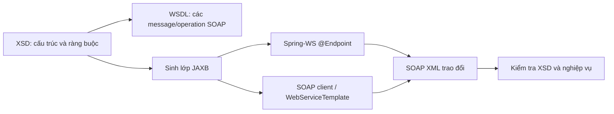

# Thứ tự phần tử, nội dung trộn và những khác biệt có ý nghĩa trong hợp đồng XML

Trong dịch vụ SOAP phát triển theo hướng **contract-first** với Spring Web Services (Spring-WS), XML là dữ liệu có cấu trúc và có quy tắc, không đơn thuần là một chuỗi chứa các thẻ. Hai tài liệu trông gần giống nhau vẫn có thể khác về tính hợp lệ theo XSD, ý nghĩa nghiệp vụ hoặc kết quả ánh xạ JAXB. Đặc biệt, **thứ tự phần tử con**, **nội dung trộn văn bản với phần tử**, **khoảng trắng**, **namespace** và **sự hiện diện của phần tử** đều có thể quyết định một thông điệp SOAP có tuân thủ hợp đồng hay không.

Bài học thuộc chương **Nền tảng XML**, đặt trong bối cảnh phát triển dịch vụ SOAP bằng **Spring Web Services**: thiết kế XSD/WSDL, sinh mô hình JAXB, triển khai endpoint và SOAP client, xử lý SOAP Fault, interceptor, XML security/WS-Security, chứng chỉ số và kiểm thử tương thích khi tích hợp hệ thống doanh nghiệp.

## 1. Phân biệt XML hợp khuôn dạng và XML đúng hợp đồng

Cần tách ba câu hỏi:

1. **Well-formed XML?** Tài liệu có một phần tử gốc, thẻ đóng đúng, ký tự được escape hợp lệ và namespace được khai báo đúng hay không?
2. **Schema-valid XML?** Tài liệu có tuân thủ XSD đã công bố: tên phần tử, thứ tự, số lần xuất hiện, kiểu dữ liệu, ràng buộc và nội dung cho phép hay không?
3. **Business-valid XML?** Dữ liệu có thỏa điều kiện nghiệp vụ mà XSD chưa hoặc không thể diễn đạt đầy đủ, chẳng hạn khách hàng tồn tại và số lượng hàng không vượt tồn kho hay không?

Ví dụ, đoạn sau là XML well-formed nhưng có thể **không hợp lệ theo XSD** nếu hợp đồng yêu cầu `customerId` xuất hiện trước `itemId`:

```xml
<o:PlaceOrderRequest xmlns:o="https://example.org/orders/v1">
    <o:itemId>BOOK-01</o:itemId>
    <o:customerId>C-100</o:customerId>
</o:PlaceOrderRequest>
```

Một endpoint hoặc SOAP client không nên suy luận tính hợp lệ của hợp đồng chỉ bằng việc kiểm tra XML có parse được hay không.

## 2. Thứ tự phần tử con được quyết định bởi XSD

Trong XML, phần tử con có **thứ tự tài liệu**. Tuy nhiên, thứ tự ấy có bắt buộc về mặt hợp đồng hay không phụ thuộc vào **content model** trong XSD.

### 2.1. `xs:sequence`: bắt buộc đúng thứ tự khai báo

Xét hợp đồng yêu cầu đặt hàng:

```xml
<?xml version="1.0" encoding="UTF-8"?>
<xs:schema xmlns:xs="http://www.w3.org/2001/XMLSchema"
           xmlns:tns="https://example.org/orders/v1"
           targetNamespace="https://example.org/orders/v1"
           elementFormDefault="qualified">

    <xs:element name="PlaceOrderRequest">
        <xs:complexType>
            <xs:sequence>
                <xs:element name="customerId" type="xs:string"/>
                <xs:element name="itemId" type="xs:string"
                            minOccurs="1" maxOccurs="unbounded"/>
                <xs:element name="note" type="xs:string" minOccurs="0"/>
            </xs:sequence>
        </xs:complexType>
    </xs:element>

    <xs:element name="PlaceOrderResponse">
        <xs:complexType>
            <xs:sequence>
                <xs:element name="orderId" type="xs:string"/>
            </xs:sequence>
        </xs:complexType>
    </xs:element>
</xs:schema>
```

Với `xs:sequence`, cấu trúc hợp lệ là **một `customerId`, sau đó ít nhất một `itemId`, cuối cùng có thể có một `note`**:

```xml
<o:PlaceOrderRequest xmlns:o="https://example.org/orders/v1">
    <o:customerId>C-100</o:customerId>
    <o:itemId>BOOK-01</o:itemId>
    <o:itemId>PEN-02</o:itemId>
    <o:note>Giao tại quầy lễ tân</o:note>
</o:PlaceOrderRequest>
```

Hai biến thể dưới đây đều *well-formed* nhưng **không hợp lệ theo XSD trên**:

```xml
<!-- Sai: itemId đứng trước customerId -->
<o:PlaceOrderRequest xmlns:o="https://example.org/orders/v1">
    <o:itemId>BOOK-01</o:itemId>
    <o:customerId>C-100</o:customerId>
</o:PlaceOrderRequest>
```

```xml
<!-- Sai: note chen giữa các itemId -->
<o:PlaceOrderRequest xmlns:o="https://example.org/orders/v1">
    <o:customerId>C-100</o:customerId>
    <o:itemId>BOOK-01</o:itemId>
    <o:note>Giao buổi sáng</o:note>
    <o:itemId>PEN-02</o:itemId>
</o:PlaceOrderRequest>
```

`minOccurs` và `maxOccurs` cho biết số lần xuất hiện của **mỗi phần tử ở vị trí đã định**, không cấp phép tự ý di chuyển phần tử ấy sang vị trí khác. Nếu không ghi rõ, cả hai mặc định là `1`.

### 2.2. `xs:choice`: chọn nhánh hợp lệ

Khi yêu cầu chỉ định *một trong hai* kênh liên hệ, dùng `xs:choice`:

```xml
<xs:complexType xmlns:xs="http://www.w3.org/2001/XMLSchema">
    <xs:choice>
        <xs:element name="email" type="xs:string"/>
        <xs:element name="phone" type="xs:string"/>
    </xs:choice>
</xs:complexType>
```

Theo khai báo này, chỉ có `email` **hoặc** `phone`; không được gửi đồng thời cả hai. `xs:choice` mặc định có một lượt lựa chọn. Nếu đặt `maxOccurs` lớn hơn `1` trên nhóm, hợp đồng có thể cho phép nhiều lượt lựa chọn; phải đọc cả ràng buộc số lần xuất hiện trước khi kết luận.

### 2.3. `xs:all`: cho phép các phần tử theo nhiều thứ tự

Khi các trường độc lập và thứ tự không quan trọng, XSD có `xs:all`:

```xml
<xs:complexType xmlns:xs="http://www.w3.org/2001/XMLSchema">
    <xs:all>
        <xs:element name="firstName" type="xs:string"/>
        <xs:element name="lastName" type="xs:string"/>
        <xs:element name="middleName" type="xs:string" minOccurs="0"/>
    </xs:all>
</xs:complexType>
```

`firstName` có thể đứng trước hoặc sau `lastName`. Trong **XSD 1.0**, mỗi phần tử trong nhóm `xs:all` chỉ có tối đa một lần xuất hiện và bản thân nhóm chịu các giới hạn về số lần lặp. Không sử dụng `xs:all` như cách thay thế tự động cho mọi `xs:sequence` có danh sách lặp; các giới hạn có thể khác trong XSD 1.1.

| Cấu trúc | Ý nghĩa | Ví dụ phù hợp |
| --- | --- | --- |
| `xs:sequence` | Các phần tử/nhóm xuất hiện theo thứ tự định sẵn | Yêu cầu SOAP có trình tự trường ổn định |
| `xs:choice` | Chọn một nhánh trong các nhánh được khai báo cho mỗi lần chọn | Email **hoặc** số điện thoại |
| `xs:all` | Các phần tử xuất hiện không phụ thuộc thứ tự, với giới hạn của `xs:all` | Nhóm trường hồ sơ đơn lẻ |

Một `xs:sequence` cũng có thể chứa `xs:choice` lồng bên trong. Khi đọc hợp đồng phức tạp, hãy xem **toàn bộ cây nhóm và ràng buộc occurrence**, không đọc riêng từng dòng `xs:element`.

## 3. Nội dung chỉ gồm phần tử, nội dung văn bản và nội dung trộn

Hãy phân biệt ba kiểu biểu diễn:

| Kiểu nội dung | Ví dụ | Cách mô hình hóa XSD thường gặp |
| --- | --- | --- |
| **Element-only** | `<order><id>42</id></order>` | `xs:complexType` với `xs:sequence`/`choice`/`all`, mặc định `mixed="false"` |
| **Simple content** | `<amount currency="VND">250000</amount>` | `xs:simpleContent` để có giá trị đơn giản kèm thuộc tính |
| **Mixed content** | `<p>Đọc <strong>kỹ</strong> điều khoản.</p>` | `xs:complexType mixed="true"` có văn bản xen phần tử con |

### 3.1. Vì sao `mixed="true"` quan trọng?

Một mẫu hợp đồng cho đoạn mô tả có phần nhấn mạnh:

```xml
<xs:schema xmlns:xs="http://www.w3.org/2001/XMLSchema"
           xmlns:t="https://example.org/documents/v1"
           targetNamespace="https://example.org/documents/v1"
           elementFormDefault="qualified">
    <xs:element name="description">
        <xs:complexType mixed="true">
            <xs:sequence>
                <xs:element name="strong" type="xs:string"
                            minOccurs="0" maxOccurs="unbounded"/>
            </xs:sequence>
        </xs:complexType>
    </xs:element>
</xs:schema>
```

Payload hợp lệ có thể là:

```xml
<d:description xmlns:d="https://example.org/documents/v1">Thanh toán
    <d:strong>trước 17:00</d:strong> hôm nay.</d:description>
```

Cây nội dung giữ một chuỗi các nút theo thứ tự:

```text
description
├── text: "Thanh toán\n    "
├── strong
│   └── text: "trước 17:00"
└── text: " hôm nay."
```

Nếu bỏ `mixed="true"`, kiểu phức hợp chỉ chứa phần tử sẽ không cho phép các đoạn văn bản không phải khoảng trắng xen giữa chúng. Ngược lại, bật `mixed="true"` **không vô hiệu hóa quy tắc đối với các phần tử con**: các phần tử `strong` vẫn phải phù hợp với nhóm `xs:sequence` đã khai báo.

Trong ví dụ này, thứ tự các đoạn văn bản và phần tử nhấn mạnh ảnh hưởng trực tiếp đến câu người dùng đọc. Việc chỉ lấy `getTextContent()` sẽ ghép văn bản thành một chuỗi và làm mất ranh giới đánh dấu `strong`. Việc thu thập các `strong` vào một danh sách riêng cũng không đủ để dựng lại vị trí ban đầu của chúng trong câu.

### 3.2. JAXB ánh xạ nội dung trộn như thế nào?

Trong luồng contract-first, công cụ sinh mã từ XSD (thường được gọi là XJC/JAXB code generation) có thể sinh thuộc tính mang annotation `@XmlMixed` và danh sách nội dung gồm nhiều kiểu đối tượng. Danh sách đó giữ **thứ tự văn bản xen phần tử**; kiểu cụ thể và các annotation đi kèm (như `@XmlElementRef` hoặc `@XmlElementRefs`) phụ thuộc schema và công cụ sinh mã.

Nguyên tắc triển khai:

- Duyệt danh sách nội dung **theo đúng thứ tự** khi xử lý hoặc hiển thị đoạn mixed content.
- Không tự thay đổi thứ tự hay hợp nhất phần tử khi marshal/unmarshal.
- Không sửa thủ công lớp JAXB được sinh; điều chỉnh XSD/binding và sinh lại mã khi hợp đồng thay đổi.
- Phân biệt `@XmlMixed` với `@XmlValue`: `@XmlValue` phục vụ giá trị văn bản đơn giản (có thể kèm thuộc tính), không phải lời giải chung cho văn bản xen nhiều phần tử.

Nội dung trộn thường phù hợp với tài liệu, ghi chú giàu định dạng hoặc văn bản pháp lý. Với thông điệp nghiệp vụ SOAP có trường dữ liệu rõ ràng, cấu trúc element-only thường dễ sinh mã, kiểm tra và bảo trì hơn. Không nên bật `mixed` chỉ để bỏ qua lỗi XSD do văn bản nằm sai vị trí.

## 4. Những khác biệt XML nhỏ nhưng có thể đổi ý nghĩa hợp đồng

### 4.1. Namespace và tên đầy đủ của phần tử

Tên của một phần tử trong XML có namespace được xác định bởi **URI namespace + local name**. Hai prefix khác nhau nhưng trỏ cùng URI có thể biểu thị cùng tên mở rộng:

```xml
<a:customerId xmlns:a="https://example.org/orders/v1">C-100</a:customerId>
<b:customerId xmlns:b="https://example.org/orders/v1">C-100</b:customerId>
```

Tuy nhiên, đổi URI namespace từ `/v1` sang `/v2` là đổi tên phần tử theo nghĩa XML Namespaces, dù local name vẫn là `customerId`. Trong XSD ở mục 2, `elementFormDefault="qualified"` yêu cầu các phần tử con được khai báo cục bộ xuất hiện trong namespace đích. Một phần tử `<customerId>` không có namespace sẽ không tự động tương đương `<o:customerId>`.

Namespace mặc định áp dụng cho tên phần tử không có prefix, **không tự động áp dụng cho thuộc tính không có prefix**. Đây là một nguyên nhân thường gặp khiến XML nhìn đúng nhưng JAXB hoặc bộ xác thực hợp đồng không khớp.

### 4.2. Thứ tự thuộc tính khác với thứ tự phần tử

Hai cách viết dưới đây có cùng tên và giá trị thuộc tính xét theo mô hình XML, vì thứ tự thuộc tính không có ý nghĩa:

```xml
<item code="P01" unit="piece"/>
<item unit="piece" code="P01"/>
```

Ngược lại, thứ tự **phần tử con** thuộc cấu trúc tài liệu; không được tùy ý đổi thứ tự nếu XSD quy định `xs:sequence`. Không nên so sánh thông điệp SOAP bằng chuỗi byte thô khi mục tiêu là kiểm tra sự tương đương về cấu trúc XML.

### 4.3. Vắng mặt, rỗng và `xsi:nil` không đồng nghĩa

Xét khai báo:

```xml
<xs:element name="note" type="xs:string"
            minOccurs="0" nillable="true"
            xmlns:xs="http://www.w3.org/2001/XMLSchema"/>
```

Các dạng sau có ý nghĩa khác nhau:

```xml
<!-- 1. Không có note: phần tử tùy chọn bị lược bỏ -->

<!-- 2. Có note với chuỗi rỗng -->
<o:note xmlns:o="https://example.org/orders/v1"/>

<!-- 3. Có note nhưng giá trị được đánh dấu nil -->
<o:note xmlns:o="https://example.org/orders/v1"
        xmlns:xsi="http://www.w3.org/2001/XMLSchema-instance"
        xsi:nil="true"/>

<!-- 4. Có note chứa một ký tự khoảng trắng -->
<o:note xmlns:o="https://example.org/orders/v1"> </o:note>
```

`minOccurs="0"` cho phép **không gửi phần tử**; `nillable="true"` cho phép **gửi phần tử với `xsi:nil="true"`**. Phần tử `note` rỗng vẫn là một phần tử hiện diện và đối với `xs:string` thường biểu diễn chuỗi rỗng. `xsi:nil="true"` chỉ hợp lệ nếu khai báo cho phép nil và phần tử không chứa nội dung không phù hợp với trạng thái nil.

Trong JAXB, `null` trong Java **không luôn đủ** để suy ra chính xác trường hợp thiếu phần tử hay phần tử có `xsi:nil`; ánh xạ có thể sử dụng `JAXBElement` hoặc annotation và cấu hình sinh mã phù hợp. Nếu nghiệp vụ cần phân biệt “không cập nhật trường này”, “xóa giá trị” và “đặt chuỗi rỗng”, hợp đồng phải nói rõ ba trạng thái đó.

### 4.4. Khoảng trắng trong nội dung văn bản

Các đoạn sau không nhất thiết biểu diễn cùng dữ liệu:

```xml
<message>Giao hàng gấp</message>
<message>Giao  hàng gấp</message>
```

XSD có quy tắc `whiteSpace` theo kiểu dữ liệu:

| Kiểu/kiểu dẫn xuất | Quy tắc khoảng trắng | Hệ quả |
| --- | --- | --- |
| `xs:string` | `preserve` | Giữ khác biệt giữa một và nhiều dấu cách |
| `xs:normalizedString` | `replace` | Thay tab, CR, LF bằng dấu cách |
| `xs:token` | `collapse` | Chuẩn hóa và gộp các chuỗi khoảng trắng liên tiếp, bỏ đầu/cuối |

Việc thêm xuống dòng, thụt lề hoặc chạy bộ định dạng XML có thể làm thay đổi text node, đặc biệt với **mixed content**. Trong element-only content, khoảng trắng phục vụ thụt lề có thể được ứng dụng xử lý khác với khoảng trắng mang ý nghĩa dữ liệu; không suy luận rằng mọi bộ parser luôn tự động bỏ khoảng trắng.

### 4.5. Comment, CDATA, entity và escape

Các cách biểu diễn như `&amp;` và ký tự `&` sau khi parser giải mã thể hiện cùng ký tự dữ liệu trong vị trí hợp lệ. CDATA là một cách viết văn bản mà không phải escape một số ký tự; nó **không biến phần tử nằm trong CDATA thành phần tử XML thực**:

```xml
<message><![CDATA[<strong>Ưu tiên</strong>]]></message>
```

Ở đây `<strong>` là **văn bản**, không phải nút phần tử. Comment nhìn chung không được dùng làm dữ liệu nghiệp vụ. Tuy vậy, việc bỏ hoặc giữ comment, CDATA, khoảng trắng hay prefix khi chuyển đổi/chuẩn hóa XML có thể ảnh hưởng việc so sánh byte và **chữ ký XML**, tùy cách canonicalization và các transform được áp dụng.

## 5. Tác động tới Spring Web Services và JAXB

### 5.1. Contract-first nối XSD với WSDL, endpoint và client

Quy trình phổ biến:



Từ XSD ở mục 2, công cụ sinh mã JAXB có thể sinh lớp Java đại diện `PlaceOrderRequest` với khai báo thứ tự phần tử tương đương:

```java
// Lược minh họa: tên package, annotation, field và accessor
// thực tế phụ thuộc phiên bản JAXB và công cụ sinh mã.
@XmlAccessorType(XmlAccessType.FIELD)
@XmlType(name = "", propOrder = {
    "customerId",
    "itemId",
    "note"
})
@XmlRootElement(name = "PlaceOrderRequest")
public class PlaceOrderRequest {
    @XmlElement(required = true)
    protected String customerId;

    @XmlElement(required = true)
    protected List<String> itemId;

    protected String note;
    // getters/setters ...
}
```

`propOrder` phản ánh thứ tự phần tử theo hợp đồng. Việc marshal đối tượng bằng JAXB tạo XML theo ánh xạ đó; trường `itemId` lặp được giữ dưới dạng danh sách. Không nên “sửa lỗi thứ tự XML” bằng cách sắp xếp lại các phần tử thủ công sau khi marshal: cần kiểm tra XSD, cấu hình JAXB và phiên bản lớp sinh mã đang dùng.

Một endpoint Spring-WS có thể định tuyến theo namespace và local name của phần tử gốc payload:

```java
@Endpoint
public class OrderEndpoint {
    private static final String NS = "https://example.org/orders/v1";

    @PayloadRoot(namespace = NS, localPart = "PlaceOrderRequest")
    @ResponsePayload
    public PlaceOrderResponse placeOrder(
            @RequestPayload PlaceOrderRequest request) {
        PlaceOrderResponse response = new PlaceOrderResponse();
        response.setOrderId("ORD-1001");
        return response;
    }
}
```

Đây là ví dụ phần thân endpoint; cần cấu hình Spring-WS, JAXB và WSDL/XSD tương ứng để chạy thực tế. Với hệ Spring-WS mới dùng Jakarta EE, các annotation JAXB thuộc `jakarta.xml.bind.annotation`; dự án cũ có thể dùng `javax.xml.bind.annotation`. Không trộn hai hệ API trong cùng một cấu hình không tương thích.

### 5.2. Cách lỗi được phát hiện trong một yêu cầu SOAP

Một SOAP Body hợp lệ có thể chứa payload ở mục 2:

```xml
<soapenv:Envelope
    xmlns:soapenv="http://schemas.xmlsoap.org/soap/envelope/"
    xmlns:o="https://example.org/orders/v1">
    <soapenv:Header/>
    <soapenv:Body>
        <o:PlaceOrderRequest>
            <o:customerId>C-100</o:customerId>
            <o:itemId>BOOK-01</o:itemId>
        </o:PlaceOrderRequest>
    </soapenv:Body>
</soapenv:Envelope>
```

Ví dụ dùng SOAP 1.1; SOAP 1.2 có namespace envelope riêng. XSD nghiệp vụ ở mục 2 mô tả **payload**, không trực tiếp định nghĩa `Envelope`/`Header`/`Body` của giao thức SOAP.

Trong Spring-WS:

1. SOAP parser đọc envelope và trích xuất payload.
2. Interceptor xác thực payload với XSD, chẳng hạn `PayloadValidatingInterceptor` nếu được bật, có thể chặn lỗi cấu trúc trước khi chạy logic endpoint.
3. JAXB unmarshal XML thành đối tượng Java; ánh xạ không đúng có thể gây lỗi chuyển đổi ngay cả khi XML parse thành công.
4. Endpoint kiểm tra nghiệp vụ và tạo kết quả; JAXB marshal lại thành response XML.
5. Phía client có thể xác thực payload nhận được theo hợp đồng tương ứng.

**Không mặc định rằng JAXB unmarshal luôn kiểm tra đầy đủ mọi ràng buộc XSD.** Cần cấu hình schema validation tường minh tại nơi cần bảo đảm tuân thủ hợp đồng. Khi yêu cầu sai thứ tự phần tử, cách chuyển đổi thành lỗi SOAP Fault phụ thuộc vào interceptor, cấu hình exception resolver và cách xây dựng endpoint. `SoapFaultMappingExceptionResolver` có thể được cấu hình để ánh xạ các exception thích hợp sang Fault rõ ràng; không nên gán mọi lỗi xác thực thành lỗi máy chủ không có giải thích.

### 5.3. XML Signature và WS-Security làm thay đổi yêu cầu xử lý XML

Trong tích hợp doanh nghiệp, thông điệp có thể được ký qua WS-Security, dùng chứng chỉ để xác minh bên gửi và bảo vệ tính toàn vẹn. Phép canonicalization XML (C14N) chuẩn hóa một số khác biệt biểu diễn, nhưng **không cho phép tùy tiện đổi thứ tự phần tử con hoặc nội dung văn bản đã được ký**. Một phép biến đổi payload hoặc pretty-print có thể làm chữ ký không còn xác minh được, tùy node được ký và bộ transform sử dụng.

Do đó, phải phân biệt hai phép kiểm:

- **XSD validation:** thông điệp có đúng cấu trúc/hợp đồng hay không?
- **Signature verification:** nội dung được ký có nguyên vẹn và có thể xác minh bằng khóa/chứng chỉ tin cậy hay không?

XML hợp lệ theo XSD vẫn có thể sai chữ ký; XML có chữ ký hợp lệ vẫn có thể không đúng XSD hoặc vi phạm quy tắc nghiệp vụ. Không tự thay đổi payload đã ký trước khi chạy kiểm tra bảo mật thích hợp.

## 6. Thay đổi hợp đồng và kiểm thử tương thích

Giả sử bên cung cấp thêm trường `promotionCode` sau `note` trong `xs:sequence`:

```xml
<xs:element name="promotionCode" type="xs:string" minOccurs="0"
            xmlns:xs="http://www.w3.org/2001/XMLSchema"/>
```

Việc đặt `minOccurs="0"` giúp **request cũ** vẫn có thể hợp lệ với schema mới nếu không có thay đổi nào khác. Nhưng **request mới có `promotionCode`** không tự động hợp lệ với schema cũ; một client hoặc service vẫn xác thực theo XSD cũ có thể từ chối. Mức độ tương thích thực tế còn phụ thuộc cách JAXB xử lý trường không biết, quy tắc nghiệp vụ và các ràng buộc khác. Đặt trường mới ở giữa `customerId` và `itemId` còn tạo thêm nguy cơ phá vỡ thứ tự của các payload hiện có hoặc mã XML viết tay.

Các thay đổi cần xem xét kỹ:

| Thay đổi | Rủi ro đối với tích hợp |
| --- | --- |
| Đổi vị trí phần tử trong `xs:sequence` | Request/response đang có có thể không hợp lệ |
| Đổi `minOccurs="0"` thành `1` | Client cũ thiếu trường bị từ chối |
| Bổ sung trường tùy chọn cuối chuỗi | Request cũ có thể tiếp tục hợp lệ với XSD mới; schema/client cũ có thể không chấp nhận payload mới |
| Đổi namespace URI | QName và định tuyến `@PayloadRoot` thay đổi |
| Đổi từ element-only sang mixed content | Mô hình JAXB và xử lý văn bản có thể thay đổi |
| Đổi `xs:string` sang `xs:token` | Giá trị khoảng trắng có thể bị chuẩn hóa khác |
| Đổi `nillable`/quy tắc vắng mặt | Ý nghĩa null, rỗng và cập nhật trường có thể thay đổi |

Đối với thay đổi không tương thích, cân nhắc phiên bản hợp đồng mới, chẳng hạn namespace `/v2` và WSDL/XSD đi kèm, đồng thời định rõ thời gian duy trì client cũ. Không suy luận “backward-compatible” chỉ từ việc XML vẫn well-formed.

### Ma trận kiểm thử nên có

| Tình huống | Điều cần xác minh |
| --- | --- |
| Payload đúng thứ tự `xs:sequence` | XSD chấp nhận, endpoint nhận dữ liệu đầy đủ |
| Đảo `customerId` và `itemId` | XSD từ chối, cơ chế báo lỗi phù hợp |
| Có nhiều `itemId` đúng vị trí | Danh sách được JAXB marshal/unmarshal đủ phần tử, giữ thứ tự |
| `note` vắng, rỗng, có một dấu cách hoặc `xsi:nil` | Phân biệt trạng thái theo ràng buộc và nghiệp vụ |
| Gửi cả hai nhánh của `xs:choice` | Bị từ chối khi schema chỉ cho một lần chọn |
| Mixed content có text trước/sau phần tử | Giữ đúng thứ tự và nội dung sau vòng marshal/unmarshal |
| Đổi prefix nhưng giữ nguyên namespace URI | Vẫn xác định đúng QName, nếu không có ràng buộc khác |
| Dùng namespace URI khác | Kiểm tra phát hiện sai hợp đồng/định tuyến |
| SOAP payload có trường mới, client dùng schema cũ | Phát hiện nguy cơ không tương thích |
| SOAP message có chữ ký WS-Security | Xác minh chữ ký trên nội dung gốc và phát hiện thay đổi nội dung đã ký |

Có thể kiểm tra ở nhiều cấp: xác thực XML trực tiếp bằng XSD; round-trip JAXB; kiểm thử endpoint bằng `MockWebServiceClient`; kiểm thử SOAP client bằng `MockWebServiceServer` hoặc môi trường tích hợp; và contract test giữa các phiên bản WSDL/XSD. Đối với lỗi schema, kiểm tra cả phản hồi Fault thực tế thay vì chỉ kiểm tra một exception nội bộ.

## 7. Quy trình chẩn đoán khi hai hệ thống không hiểu cùng một XML

1. **Xác định đúng phiên bản XSD/WSDL** đang dùng ở mỗi hệ, bao gồm target namespace và các imported schemas.
2. **Đọc QName của phần tử gốc payload** trước; xác nhận local name và namespace URI, không chỉ so sánh prefix.
3. **Đọc content model theo thứ tự**: `xs:sequence`, `xs:choice`, `xs:all`, `minOccurs` và `maxOccurs`.
4. **So sánh text node và trạng thái phần tử**: vắng mặt, chuỗi rỗng, nil, khoảng trắng và mixed content.
5. **Xác thực payload với XSD đúng phiên bản** để có lỗi cụ thể về phần tử mong đợi/vị trí lỗi.
6. **Kiểm tra lớp JAXB và cấu hình marshaller** được sinh từ bản hợp đồng nào; đối chiếu `propOrder`, namespace và annotation.
7. **Xem log SOAP Fault và interceptor**, sau đó mới phân tích lỗi nghiệp vụ hoặc xác minh chữ ký WS-Security nếu áp dụng.

Không nên “chữa cháy” bằng cách tắt schema validation hoặc thay thế XML bằng thao tác chuỗi. Cách bền vững là đưa hai phía về cùng một hợp đồng được phiên bản hóa và có bộ kiểm thử mẫu chung.

## 8. Tự kiểm tra

**Câu 1.** Một XSD dùng `xs:sequence` với thứ tự `accountId`, `amount`, `currency`. XML đặt `currency` trước `amount` có well-formed không? Có schema-valid không?

**Đáp án:** Có thể vẫn well-formed; không schema-valid nếu XSD không có nhánh hợp lệ khác cho thứ tự đó.

**Câu 2.** Một mô tả là `Thanh toán <strong>ngay</strong> hôm nay`. Vì sao chỉ lưu mảng các phần tử `strong` không đủ để phục hồi nguyên văn?

**Đáp án:** Văn bản trước và sau `strong` cũng là các nút trong thứ tự nội dung; phải giữ thứ tự xen kẽ giữa text node và element node.

**Câu 3.** `<note/>` và không gửi `note` có phải cùng trạng thái theo contract không?

**Đáp án:** Không. Một trường hợp phần tử hiện diện với nội dung rỗng; trường hợp kia không có phần tử. Sự cho phép và ý nghĩa phụ thuộc XSD/logic nghiệp vụ.

**Câu 4.** Thêm một phần tử tùy chọn ở cuối `xs:sequence` có đảm bảo tất cả client cũ xử lý được response mới không?

**Đáp án:** Không. XSD mới có thể chấp nhận payload cũ, nhưng client cũ xác thực theo XSD cũ hoặc có ánh xạ JAXB cứng có thể từ chối phần tử chưa biết.

**Câu 5.** XML đã qua schema validation thành công thì có thể bỏ qua kiểm tra chữ ký WS-Security không?

**Đáp án:** Không. Schema validation và signature verification kiểm tra các thuộc tính khác nhau của thông điệp.

## Ghi nhớ

- **Thứ tự phần tử con có thể là một phần của hợp đồng.** `xs:sequence` bắt buộc thứ tự; `xs:choice` xác định các lựa chọn; `xs:all` cho phép đổi thứ tự trong phạm vi giới hạn.
- **Mixed content là luồng văn bản và phần tử đan xen.** Thứ tự toàn bộ các nút nội dung phải được bảo toàn.
- **Namespace URI, vắng mặt/rỗng/nil và khoảng trắng có thể thay đổi ý nghĩa.** Đừng đánh đồng các XML chỉ vì chúng trông tương tự.
- **Contract-first cần kiểm thử cả XSD, JAXB, endpoint, client và tương thích phiên bản.** Nếu có WS-Security, bổ sung xác minh chữ ký và bảo đảm không biến đổi nội dung đã ký ngoài quy trình cho phép.
