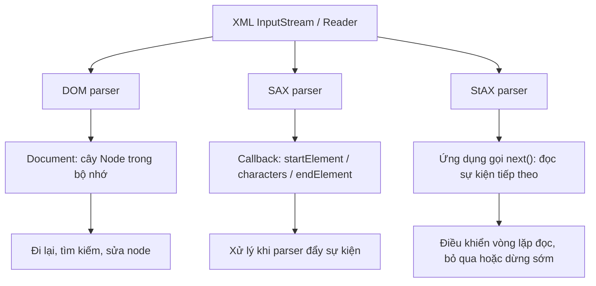
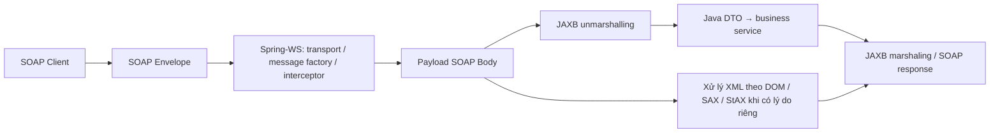

# DOM, SAX, StAX và lựa chọn cách xử lý XML

## 1. Bài toán: cùng một tài liệu XML, nhiều cách đọc

Một hệ thống bán hàng cần trao đổi đơn hàng với ERP thông qua SOAP. Phần `Body` của SOAP message là XML; có request chỉ vài trường, nhưng cũng có response chứa hàng chục nghìn dòng giao dịch. Nhóm phát triển phải đọc dữ liệu, kiểm tra hợp lệ, chuyển đổi sang đối tượng Java và trả SOAP Fault khi payload sai. Nếu luôn tải toàn bộ XML vào RAM, một response lớn có thể làm tăng độ trễ, gây áp lực bộ nhớ và ảnh hưởng toàn bộ dịch vụ. Nếu chỉ đọc tuần tự, việc sửa đổi các phần tử bất kỳ hoặc tra cứu quan hệ phức tạp lại khó hơn.

Java cung cấp ba mô hình xử lý XML phổ biến:

- **DOM (Document Object Model):** đọc XML thành cây đối tượng để truy cập và chỉnh sửa.
- **SAX (Simple API for XML):** parser đẩy các sự kiện trong lúc đọc XML theo thứ tự.
- **StAX (Streaming API for XML):** ứng dụng chủ động lấy các sự kiện XML theo thứ tự.

Đây là ba lựa chọn **cách phân tích XML**, không phải ba phiên bản XML hay ba chuẩn SOAP. Trong module **SPRING_WEB_SERVICES**, việc chọn DOM, SAX hay StAX ảnh hưởng trực tiếp đến cách xử lý payload theo hợp đồng XSD/WSDL, cách ánh xạ JAXB, khả năng mở rộng của SOAP endpoint/client, kiểm thử XML và kiểm soát rủi ro bảo mật.

**Mục tiêu sau bài học:** hiểu mô hình bộ nhớ và luồng xử lý của từng API; viết được ví dụ Java cơ bản cho DOM, SAX, StAX; chọn công cụ theo kiểu truy cập dữ liệu; bảo vệ parser trước XML không tin cậy; và biết khi nào nên để Spring-WS/JAXB xử lý XML thay cho việc tự viết parser.

## 2. Các khái niệm XML phải nắm trước khi chọn parser

Xét tài liệu `orders.xml`:

```xml
<?xml version="1.0" encoding="UTF-8"?>
<o:orders xmlns:o="urn:example:orders:v1">
  <o:order id="A-1001">
    <o:status>PAID</o:status>
    <o:total>149.50</o:total>
  </o:order>
  <o:order id="A-1002">
    <o:status>PENDING</o:status>
    <o:total>75.00</o:total>
  </o:order>
</o:orders>
```

Mỗi `order` có thuộc tính `id`, phần tử con `status` và `total`. Giả sử yêu cầu là in mã và trạng thái của từng đơn hàng; sau đó cần mở rộng để validate XSD, lọc bản ghi hoặc xử lý một file XML rất lớn.

### 2.1. Well-formed, namespace và schema

- **Well-formed XML** có cú pháp hợp lệ: chỉ một phần tử gốc, các thẻ đóng đúng thứ tự, thuộc tính có giá trị hợp lệ và các ký tự đặc biệt được escape phù hợp.
- **Namespace** phân biệt các phần tử có cùng local name nhưng thuộc hợp đồng khác nhau. Trong ví dụ, QName của phần tử đơn hàng là `{urn:example:orders:v1}order`. Tiền tố `o` chỉ là bí danh; đổi thành `x` mà giữ URI namespace thì ý nghĩa QName không đổi.
- **XSD validation** kiểm tra dữ liệu có tuân schema như thứ tự phần tử, kiểu `xs:decimal`, trường bắt buộc và namespace hay không. *Một XML well-formed chưa chắc hợp lệ theo XSD*.
- **JAXB** cung cấp ánh xạ XML ↔ Java theo cấu trúc schema. JAXB có thể dựa trên một số cơ chế XML bên dưới; khi dùng JAXB thông thường, ứng dụng không cần tự chọn parser cho từng phần tử.

Chọn API đọc XML không tự động mang lại schema validation, bảo mật, retry hay các quy tắc nghiệp vụ. Những trách nhiệm này cần được thiết kế riêng.

### 2.2. Ba kiểu truy cập dữ liệu



Hãy hình dung:

- **DOM** giống nhận nguyên một sơ đồ cây rồi chọn nút bất kỳ để xem/sửa.
- **SAX** giống người đọc tài liệu liên tục báo “mở thẻ, có văn bản, đóng thẻ”; ứng dụng phản ứng ngay mỗi khi được gọi.
- **StAX** giống người đọc được ứng dụng yêu cầu “cho sự kiện tiếp theo”; ứng dụng quyết định khi nào tiếp tục, khi nào dừng.

Vì SAX và StAX thường không giữ toàn bộ cây, bộ nhớ của chúng thường phụ thuộc độ sâu cấu trúc, bộ đệm và dữ liệu đang tích lũy; một handler tự lưu tất cả bản ghi vẫn có thể dùng nhiều RAM như DOM.

## 3. DOM: khi cần cả cây tài liệu

DOM biểu diễn XML bằng cấu trúc `Document`, `Element`, `Attr`, `Text` và các kiểu `Node` khác. Sau khi parse xong, chương trình có thể đi đến phần tử bất kỳ, đọc anh em/cha/con, cập nhật node hoặc tạo XML mới.

### 3.1. Mô hình trong bộ nhớ

```text
Document
└── Element: {urn:example:orders:v1}orders
    ├── Element: order [id="A-1001"]
    │   ├── Element: status
    │   │   └── Text: PAID
    │   └── Element: total
    │       └── Text: 149.50
    └── Element: order [id="A-1002"]
        ├── Element: status
        │   └── Text: PENDING
        └── Element: total
            └── Text: 75.00
```

Cây DOM không chỉ lưu ký tự gốc mà còn tạo đối tượng cho nhiều nút và quan hệ giữa chúng. Với tài liệu lớn, chi phí bộ nhớ có thể cao đáng kể so với kích thước file XML. Bù lại, truy cập ngẫu nhiên và biến đổi nhiều vị trí trở nên thuận tiện.

### 3.2. Ví dụ DOM bằng JAXP

Ví dụ sau đọc các `order` và in `id` cùng `status`. Cấu hình parser cấm DTD và truy cập external entity để phù hợp với dữ liệu XML không tin cậy:

```java
import java.io.InputStream;
import java.nio.file.Files;
import java.nio.file.Path;
import javax.xml.XMLConstants;
import javax.xml.parsers.DocumentBuilder;
import javax.xml.parsers.DocumentBuilderFactory;
import org.w3c.dom.Document;
import org.w3c.dom.Element;
import org.w3c.dom.NodeList;

public class DomOrdersExample {
    private static final String NS = "urn:example:orders:v1";

    public static void main(String[] args) throws Exception {
        DocumentBuilderFactory factory = DocumentBuilderFactory.newInstance();
        factory.setNamespaceAware(true);
        factory.setXIncludeAware(false);
        factory.setExpandEntityReferences(false);
        factory.setFeature(XMLConstants.FEATURE_SECURE_PROCESSING, true);
        factory.setFeature(
                "http://apache.org/xml/features/disallow-doctype-decl", true);
        factory.setFeature(
                "http://xml.org/sax/features/external-general-entities", false);
        factory.setFeature(
                "http://xml.org/sax/features/external-parameter-entities", false);
        factory.setAttribute(XMLConstants.ACCESS_EXTERNAL_DTD, "");
        factory.setAttribute(XMLConstants.ACCESS_EXTERNAL_SCHEMA, "");

        DocumentBuilder builder = factory.newDocumentBuilder();
        Document document;
        try (InputStream input = Files.newInputStream(Path.of("orders.xml"))) {
            document = builder.parse(input);
        }

        NodeList orders = document.getElementsByTagNameNS(NS, "order");
        for (int i = 0; i < orders.getLength(); i++) {
            Element order = (Element) orders.item(i);
            String id = order.getAttribute("id");
            Element statusElement = (Element)
                    order.getElementsByTagNameNS(NS, "status").item(0);
            String status = statusElement.getTextContent().trim();
            System.out.println(id + " -> " + status);
        }
    }
}
```

Kết quả:

```text
A-1001 -> PAID
A-1002 -> PENDING
```

**Vì sao dùng `getElementsByTagNameNS`?** Phương thức này dựa vào URI namespace và local name, tránh phụ thuộc tiền tố `o`. `getElementsByTagName("o:order")` sẽ dễ hỏng nếu đối tác đổi tiền tố thành `p` hoặc dùng default namespace.

Ví dụ giả định schema đảm bảo mỗi `order` có đúng một `status`. Nếu XML đầu vào chưa được validate, `item(0)` có thể trả `null`; code production cần kiểm tra sự tồn tại, số lượng phần tử và kiểu dữ liệu, hoặc validate XSD trước khi truy cập.

### 3.3. Khi DOM là lựa chọn hợp lý

DOM phù hợp khi cần:

1. Chỉnh sửa một số nút ở nhiều vị trí rồi serialize trở lại XML.
2. Tra cứu XPath phức tạp hoặc so sánh quan hệ cha/con giữa các phần tử.
3. Đọc tài liệu nhỏ/vừa nhiều lần trong cùng thao tác nghiệp vụ.
4. Viết công cụ quản lý hoặc chuyển đổi hợp đồng XML có cấu trúc phức tạp.

DOM kém phù hợp nếu chỉ lọc vài trường từ một tài liệu hàng trăm MB, hoặc hệ thống cần xử lý đồng thời nhiều payload lớn. Việc parse cây DOM cũng thường phải hoàn tất trước khi ứng dụng truy cập toàn bộ cấu trúc.

### 3.4. Các lưu ý của DOM

- `NodeList` do các phương thức DOM trả về có thể mang tính *live*; khi sửa cây trong lúc duyệt, thứ tự/chỉ số có thể thay đổi.
- `getTextContent()` trả nội dung văn bản của phần tử và các node con. Với cấu trúc lồng nhau, cần xác định chính xác vị trí muốn đọc.
- DOM giữ các nút văn bản biểu diễn khoảng trắng giữa các thẻ. Khi duyệt `getChildNodes()`, không được giả định tất cả node đều là `Element`.
- Nếu cần xuất XML, dùng API transformer/serializer được cấu hình an toàn, và hiểu rằng cách xuống dòng, thứ tự thuộc tính hay tiền tố namespace có thể thay đổi mà ý nghĩa XML vẫn giữ nguyên.

## 4. SAX: parser đẩy các sự kiện

SAX đọc XML từ đầu tới cuối, phát sự kiện qua các callback như `startDocument`, `startElement`, `characters`, `endElement` và `endDocument`. Ứng dụng thường kế thừa `DefaultHandler` để xử lý sự kiện và tự lưu **trạng thái tối thiểu**.

### 4.1. Luồng sự kiện của SAX

Với bản ghi đầu tiên:

```text
startElement(orders)
  startElement(order, id="A-1001")
    startElement(status)
      characters("PAID")
    endElement(status)
    startElement(total)
      characters("149.50")
    endElement(total)
  endElement(order)
...
endElement(orders)
```

Đây là mô hình **push**: parser gọi handler theo tiến độ đọc, không chờ ứng dụng chủ động gọi `next()`. Muốn xử lý một bản ghi, handler phải nhớ mình đang ở phần tử nào và dữ liệu đã thu thập.

### 4.2. Ví dụ SAX

```java
import java.io.InputStream;
import java.nio.file.Files;
import java.nio.file.Path;
import javax.xml.XMLConstants;
import javax.xml.parsers.SAXParser;
import javax.xml.parsers.SAXParserFactory;
import org.xml.sax.Attributes;
import org.xml.sax.helpers.DefaultHandler;

public class SaxOrdersExample {
    private static final String NS = "urn:example:orders:v1";

    static class OrdersHandler extends DefaultHandler {
        private String currentId;
        private String currentStatus;
        private boolean insideStatus;
        private final StringBuilder text = new StringBuilder();

        @Override
        public void startElement(String uri, String localName,
                                 String qName, Attributes attrs) {
            if (NS.equals(uri) && "order".equals(localName)) {
                currentId = attrs.getValue("id");
                currentStatus = null;
            } else if (currentId != null && NS.equals(uri)
                    && "status".equals(localName)) {
                insideStatus = true;
                text.setLength(0);
            }
        }

        @Override
        public void characters(char[] chars, int start, int length) {
            if (insideStatus) {
                text.append(chars, start, length);
            }
        }

        @Override
        public void endElement(String uri, String localName, String qName) {
            if (NS.equals(uri) && "status".equals(localName)
                    && insideStatus) {
                currentStatus = text.toString().trim();
                insideStatus = false;
            } else if (NS.equals(uri) && "order".equals(localName)) {
                System.out.println(currentId + " -> " + currentStatus);
                currentId = null;
            }
        }
    }

    public static void main(String[] args) throws Exception {
        SAXParserFactory factory = SAXParserFactory.newInstance();
        factory.setNamespaceAware(true);
        factory.setXIncludeAware(false);
        factory.setFeature(XMLConstants.FEATURE_SECURE_PROCESSING, true);
        factory.setFeature(
                "http://apache.org/xml/features/disallow-doctype-decl", true);
        factory.setFeature(
                "http://xml.org/sax/features/external-general-entities", false);
        factory.setFeature(
                "http://xml.org/sax/features/external-parameter-entities", false);

        SAXParser parser = factory.newSAXParser();
        parser.setProperty(XMLConstants.ACCESS_EXTERNAL_DTD, "");
        parser.getXMLReader().setEntityResolver(
                (publicId, systemId) -> {
                    throw new org.xml.sax.SAXException(
                            "External entity resolution is forbidden");
                });

        try (InputStream input = Files.newInputStream(Path.of("orders.xml"))) {
            parser.parse(input, new OrdersHandler());
        }
    }
}
```

Đoạn code trên in kết quả tương tự DOM nhưng không tạo cây `Document`. Nó giả định XML có cấu trúc đúng XSD: `order` không lồng nhau, `status` thuộc `order` đang xét và các trường cần thiết tồn tại. Khi cần sử dụng dữ liệu trong production, có thể phát một DTO/record đến consumer thay cho `System.out.println`; tránh tích lũy toàn bộ DTO vào một `List` nếu mục tiêu là streaming.

**Bẫy quan trọng:** callback `characters()` không đảm bảo được gọi đúng một lần cho toàn bộ nội dung một phần tử. Nó có thể được gọi nhiều lần vì cách parser chia bộ đệm, entity hoặc CDATA. Vì thế phải `append` vào `StringBuilder` trong lúc đọc và chỉ kết luận giá trị khi gặp `endElement()`. Việc viết `status = new String(chars, start, length)` mỗi lần có thể làm mất dữ liệu.

### 4.3. Điểm mạnh và giới hạn SAX

**Điểm mạnh:** đọc tuần tự với overhead bộ nhớ thường thấp; phù hợp cho ETL/import XML lớn, đếm bản ghi, lấy một tập trường nhỏ, kiểm tra metadata hoặc phát luồng kết quả đến hệ thống phía sau.

**Giới hạn:** trạng thái callback có thể phức tạp khi XML lồng sâu; khó dừng có kiểm soát, “đọc nhìn trước” hoặc quay lại phần tử trước; viết transform nhiều nhánh thường khó bảo trì. SAX là parser đọc; việc tạo XML đầu ra cần API khác.

## 5. StAX: ứng dụng chủ động kéo sự kiện

StAX cũng là API streaming, nhưng theo mô hình **pull**: chương trình gọi `next()` khi muốn đọc sự kiện tiếp theo. Có hai biến thể:

- **Cursor API:** `XMLStreamReader`, đọc sự kiện qua cursor; thường ít đối tượng trung gian và kiểm soát trực tiếp.
- **Event API:** `XMLEventReader`, tạo đối tượng `XMLEvent`; thuận tiện cho một số phép biến đổi/sắp xếp sự kiện và có thể nhìn trước qua `peek()`.

Điểm khác SAX nằm ở quyền điều khiển vòng lặp: SAX gọi handler, còn StAX cho phép mã ứng dụng tự điều phối việc đọc. Cả hai chủ yếu duyệt một chiều và không cung cấp truy cập ngẫu nhiên như DOM.

### 5.1. Ví dụ StAX với `XMLStreamReader`

```java
import java.io.InputStream;
import java.nio.file.Files;
import java.nio.file.Path;
import javax.xml.stream.XMLInputFactory;
import javax.xml.stream.XMLStreamConstants;
import javax.xml.stream.XMLStreamException;
import javax.xml.stream.XMLStreamReader;

public class StaxOrdersExample {
    private static final String NS = "urn:example:orders:v1";

    public static void main(String[] args) throws Exception {
        XMLInputFactory factory = XMLInputFactory.newFactory();
        factory.setProperty(XMLInputFactory.IS_NAMESPACE_AWARE, true);
        factory.setProperty(XMLInputFactory.SUPPORT_DTD, false);
        factory.setProperty(
                XMLInputFactory.IS_SUPPORTING_EXTERNAL_ENTITIES, false);
        factory.setXMLResolver((publicId, systemId, baseUri, namespace) -> {
            throw new XMLStreamException("External entities are forbidden");
        });

        try (InputStream input = Files.newInputStream(Path.of("orders.xml"))) {
            XMLStreamReader reader = factory.createXMLStreamReader(input);
            try {
                String currentId = null;
                String currentStatus = null;

                while (reader.hasNext()) {
                    int event = reader.next();

                    if (event == XMLStreamConstants.DTD) {
                        throw new XMLStreamException("DOCTYPE is not allowed");
                    }

                    if (event == XMLStreamConstants.START_ELEMENT) {
                        if (NS.equals(reader.getNamespaceURI())
                                && "order".equals(reader.getLocalName())) {
                            currentId = reader.getAttributeValue(null, "id");
                            currentStatus = null;
                        } else if (currentId != null
                                && NS.equals(reader.getNamespaceURI())
                                && "status".equals(reader.getLocalName())) {
                            currentStatus = reader.getElementText().trim();
                        }
                    } else if (event == XMLStreamConstants.END_ELEMENT
                            && NS.equals(reader.getNamespaceURI())
                            && "order".equals(reader.getLocalName())) {
                        System.out.println(currentId + " -> " + currentStatus);
                        currentId = null;
                    }
                }
            } finally {
                reader.close();
            }
        }
    }
}
```

Ở đây `getElementText()` chỉ hợp lệ khi cursor đang đứng tại `START_ELEMENT`, và sẽ đọc các sự kiện tiếp theo cho tới thẻ đóng tương ứng. Nếu phần tử chứa nested element không phù hợp, nó có thể ném `XMLStreamException`. Vì vậy API này thuận tiện cho `status` chỉ có text; không nên áp dụng tùy tiện cho một phần tử phức hợp.

Code sử dụng `getNamespaceURI()` và `getLocalName()` để không phụ thuộc vào tiền tố namespace. Việc gọi `reader.close()` đóng reader StAX, còn `try-with-resources` đóng chính `InputStream`; không nên giả định mọi StAX implementation luôn đóng giúp stream bên dưới.

Như ví dụ SAX, đoạn StAX tập trung minh họa mô hình; việc kiểm tra mỗi `order` có đủ trường, không lồng bất thường và đúng kiểu dữ liệu nên được xử lý theo XSD hoặc code kiểm tra riêng.

### 5.2. Tại sao StAX dễ điều khiển hơn trong nhiều bài toán?

Giả sử response SOAP chứa 100.000 đơn hàng nhưng ứng dụng chỉ cần 20 đơn đầu tiên thỏa điều kiện.

Với **StAX**, vòng lặp ứng dụng có thể đếm và `break` khi đã lấy đủ 20 đơn (sau đó đóng reader). Với **SAX**, parser thường tiếp tục gọi callback cho đến hết input; muốn dừng sớm phải dùng một cơ chế/hợp đồng riêng, chẳng hạn signal hoặc exception được phân biệt với lỗi parse. Với **DOM**, parser trước hết tạo cây toàn bộ tài liệu rồi mới truy vấn.

StAX vì vậy thích hợp cho tác vụ lọc dòng, trích xuất theo điều kiện, đọc phần header rồi quyết định có cần đọc phần còn lại, hoặc thực hiện nhiều trạng thái đọc tuần tự trong cùng hàm.

**Lưu ý:** StAX không bảo đảm “không tốn RAM” một cách tuyệt đối. Việc gọi `getElementText()` trên phần tử văn bản dài, gom toàn bộ bản ghi vào danh sách hoặc xử lý một SOAP message đã bị framework buffer trước đó vẫn có thể tốn bộ nhớ lớn.

## 6. So sánh DOM, SAX, StAX theo tiêu chí kỹ thuật

| Tiêu chí | DOM | SAX | StAX |
|---|---|---|---|
| Mô hình | Cây đối tượng | Push event qua callback | Pull event bằng cursor/iterator |
| Đọc tuần tự | Có, nhưng phải parse thành cây | Tự nhiên | Tự nhiên |
| Truy cập ngẫu nhiên/duyệt lại | Tốt khi cây còn trong bộ nhớ | Không có sẵn | Không có sẵn |
| Bộ nhớ khi chỉ lấy vài trường | Thường tăng theo kích thước và số node XML | Thường nhỏ, tùy state/dữ liệu giữ lại | Thường nhỏ, tùy state/dữ liệu giữ lại |
| Điều khiển dừng sớm | Chỉ sau khi parse cây | Khó hơn vì callback do parser đẩy | Dễ bằng `break` và đóng reader |
| Đọc/ghi XML | DOM hỗ trợ sửa cây; cần serializer để ghi | Chủ yếu đọc | Có `XMLStreamWriter`/`XMLEventWriter` để ghi tuần tự |
| XPath/truy vấn cây | Thuận lợi | Cần tự thiết kế state | Cần tự thiết kế state |
| Code cho tài liệu lồng sâu | Dễ đọc khi đã có cây, nhưng tốn bộ nhớ | Callback/state có thể phức tạp | Logic state trong vòng lặp, thường rõ hơn |
| Trường hợp điển hình | XML cấu hình/hợp đồng nhỏ, chỉnh sửa tài liệu | Import XML lớn, parse sự kiện, kiểm tra quy tắc khi đọc | Lọc/dừng sớm, biến đổi tuần tự, đọc payload lớn |

Về độ phức tạp, cả ba phương pháp đều cần đọc input theo kích thước tài liệu khi parse toàn bộ. DOM thường dùng **O(N)** bộ nhớ theo số node/kích thước tài liệu, với hằng số phụ trội cho đối tượng; SAX/StAX có thể gần **O(depth + retained data + buffer)** nếu code thật sự xử lý và giải phóng bản ghi từng phần. Đây là mô hình định hướng, không phải cam kết đo đạc cho mọi parser/provider.

Độ nhanh chậm thực tế còn phụ thuộc kích thước XML, số namespace, validation, việc tạo đối tượng Java, logging, tốc độ I/O, GC và thư viện parser cụ thể. Không kết luận StAX luôn nhanh hơn SAX hoặc ngược lại nếu chưa benchmark trên workload của hệ thống.

## 7. Chọn thế nào trong ứng dụng Spring Web Services?

Spring-WS phát triển SOAP endpoint và SOAP client theo hướng **contract-first**: thống nhất XSD/WSDL, xử lý request/response và dùng JAXB hoặc XML source phù hợp. Trong nhiều trường hợp, **mặc định nên dùng JAXB + Spring-WS** cho payload nghiệp vụ có schema rõ, thay vì tự parse SOAP Envelope bằng DOM/SAX/StAX.

### 7.1. Sơ đồ vị trí xử lý



**Chú ý:** một SOAP message có thể được parser, message factory, interceptor hoặc thư viện WS-Security xử lý trước khi tới code endpoint. Việc ứng dụng dùng StAX cho payload không tự động có nghĩa toàn bộ đường đi SOAP là streaming. Cần xem message factory, attachment, schema validation, chữ ký XML, logging và giới hạn payload.

### 7.2. Bảng quyết định theo tình huống

| Tình huống | Lựa chọn thường phù hợp | Lý do |
|---|---|---|
| SOAP request/response nhỏ, XSD ổn định, đã có JAXB class | **JAXB qua Spring-WS** | Giảm code parse thủ công, giữ ánh xạ bám hợp đồng. |
| Cần đọc vài trường của XML cấu hình nhỏ, rồi sửa một node | **DOM** | Có sẵn cây để duyệt và thay đổi. |
| Nhận batch XML hàng trăm nghìn record và ghi từng record vào pipeline | **SAX hoặc StAX** | Có thể xử lý từng record, hạn chế giữ cả tài liệu. |
| Cần lọc đúng N bản ghi đầu tiên rồi dừng | **StAX** | Chủ động gọi `next()` và dừng vòng lặp. |
| Đã có thư viện xử lý SAX callback/handler cho một định dạng cũ | **SAX** | Tận dụng luồng sự kiện và handler đã được kiểm thử. |
| Cần XPath ở nhiều vị trí, có thể sửa cấu trúc và serialize | **DOM** | Truy cập cây thuận tiện hơn. |
| XML có payload lớn nhưng phải ký/verify WS-Security | **Đánh giá toàn pipeline Spring-WS trước** | Chữ ký và xác minh có thể yêu cầu xử lý/canonicalize và giữ thông điệp. |
| Muốn sinh XML tuần tự từ dữ liệu lớn | **StAX writer** | Ghi `START_ELEMENT`, text, `END_ELEMENT` theo dòng mà không cần tạo cây DOM. |

Lựa chọn không phải chỉ DOM/SAX/StAX. Ngoài JAXB còn có XPath, XSLT, schema validator, Apache XML libraries và các cơ chế Spring-WS. Chỉ tự viết parser khi yêu cầu đọc/ghi XML thực sự cần logic ở mức luồng hoặc nút.

### 7.3. Ví dụ hai kiến trúc cho dịch vụ SOAP tra cứu lịch sử giao dịch

**Trường hợp A — trả chi tiết một giao dịch:**

1. XSD khai báo `GetTransactionRequest`/`GetTransactionResponse`.
2. Sinh lớp JAXB từ XSD tương thích phiên bản Jakarta/Java sử dụng.
3. Endpoint Spring-WS nhận object được unmarshal, gọi service nghiệp vụ và trả JAXB response.
4. Dùng interceptor/schema validation và SOAP Fault mapping để kiểm tra lỗi.

Mô hình này dễ đọc, giảm parse thủ công và phù hợp với lượng dữ liệu vừa phải.

**Trường hợp B — nhận báo cáo giao dịch rất lớn từ đối tác:**

1. Xác minh WSDL/XSD, SOAP version và chính sách bảo mật của đối tác.
2. Kiểm tra Spring-WS message factory có hỗ trợ lộ trình streaming thực tế không; cân nhắc payload hoặc file attachment ngoài SOAP Body nếu hợp đồng cho phép.
3. Khi payload thực sự đến dưới dạng luồng, dùng StAX/SAX để xử lý từng record và ghi từng phần.
4. Đảm bảo giới hạn kích thước, timeout, validation, backpressure, retry/idempotency và logging không tự buffer toàn bộ dữ liệu.

Một yêu cầu “XML lớn” tự nó chưa đủ để chọn StAX; nếu thư viện xử lý SOAP đã dựng toàn bộ tree trước đó, cần tối ưu ở lớp message factory hoặc cách trao đổi dữ liệu.

## 8. Bảo mật khi parse XML không tin cậy

SOAP thường đi qua HTTP(S), nhưng vẫn là XML do đối tác/client cung cấp. Rủi ro **XML External Entity (XXE)** xảy ra khi parser cho phép xử lý DTD/external entity, có thể dẫn đến đọc file nội bộ, truy cập tài nguyên mạng hoặc làm lộ dữ liệu. **Entity expansion** cũng có thể gây tiêu thụ tài nguyên bất thường. Ngoài ra còn có XML quá sâu, số phần tử quá nhiều và text node cực lớn.

Những nguyên tắc nền tảng:

1. **Chặn DOCTYPE/DTD nếu hợp đồng không cần.** Không cho parser tự tải external DTD/schema hoặc tài nguyên qua network.
2. **Tắt external general/parameter entities và XInclude** ở những parser hỗ trợ; không mặc định “secure processing” là đủ cho mọi provider.
3. **Dùng namespace-aware parsing**, validate XSD bằng schema tin cậy và áp dụng giới hạn kích thước/độ sâu từ lớp vận chuyển đến lớp ứng dụng.
4. **Kiểm soát việc tải schema.** XSD có `include`/`import` chỉ nên lấy từ các nguồn được phép; không tải schema tùy ý theo URL do payload cung cấp.
5. **Không lộ nguyên văn payload và lỗi parser vào SOAP Fault/log** vì message có thể chứa thông tin nhạy cảm.
6. **Nếu parser không hỗ trợ cấu hình bảo mật bắt buộc, phải fail closed** hoặc chọn provider khác; không bắt exception rồi tiếp tục với cấu hình thiếu.

### 8.1. Cấu hình theo từng API

| API | Điểm cấu hình chính | Điều cần xác minh |
|---|---|---|
| DOM | `DocumentBuilderFactory`: secure processing, cấm DOCTYPE, external entity, XInclude; `ACCESS_EXTERNAL_DTD`/`ACCESS_EXTERNAL_SCHEMA` rỗng | Provider có thực sự áp dụng tất cả feature/property? |
| SAX | `SAXParserFactory` + `XMLReader`: cấm DOCTYPE, external entity, entity resolver an toàn | Có mở external DTD khi parser dùng chế độ validation không? |
| StAX | `XMLInputFactory.SUPPORT_DTD=false`, `IS_SUPPORTING_EXTERNAL_ENTITIES=false` và `XMLResolver` từ chối truy cập ngoài | Provider xử lý các property thế nào, có vẫn phát DTD event hay không? |
| XSD validation | `SchemaFactory`/`Validator`: `ACCESS_EXTERNAL_DTD`, `ACCESS_EXTERNAL_SCHEMA`, giới hạn nguồn schema | Có `include/import` tới nguồn ngoài mong muốn? |

Cấu hình trong các đoạn Java ở trên mô tả mục tiêu an toàn phổ biến với JAXP/StAX trên JDK hiện đại. Các provider khác nhau có thể ném exception khi không hỗ trợ tính năng; production code cần xác nhận hành vi bằng test, tuyệt đối không lặng lẽ bỏ qua.

### 8.2. Validate XSD là bước riêng

Ví dụ có thể validate cây DOM đã parse bằng XSD được quản lý nội bộ:

```java
import javax.xml.XMLConstants;
import javax.xml.transform.dom.DOMSource;
import javax.xml.validation.Schema;
import javax.xml.validation.SchemaFactory;
import javax.xml.validation.Validator;
import org.w3c.dom.Document;

// document: cây DOM đã parse bằng DocumentBuilderFactory an toàn.
SchemaFactory schemaFactory =
        SchemaFactory.newInstance(XMLConstants.W3C_XML_SCHEMA_NS_URI);
schemaFactory.setFeature(XMLConstants.FEATURE_SECURE_PROCESSING, true);
schemaFactory.setProperty(XMLConstants.ACCESS_EXTERNAL_DTD, "");
schemaFactory.setProperty(XMLConstants.ACCESS_EXTERNAL_SCHEMA, "");
Schema schema = schemaFactory.newSchema(
        new java.io.File("orders.xsd"));

Validator validator = schema.newValidator();
validator.setProperty(XMLConstants.ACCESS_EXTERNAL_DTD, "");
validator.setProperty(XMLConstants.ACCESS_EXTERNAL_SCHEMA, "");
validator.validate(new DOMSource(document));
```

Ví dụ này giả định `orders.xsd` là schema nội bộ độc lập, không cần import bên ngoài. Nếu XSD được cấu trúc thành nhiều file, ứng dụng cần resolver/nguồn schema được cho phép thay vì bật truy cập mạng tùy ý.

**Validation không đồng nghĩa bảo mật nghiệp vụ:** XSD không xác định người gọi có quyền xem `orderId` nào, cũng không chứng minh chữ ký WS-Security hợp lệ. Tương tự, parser an toàn không thay thế TLS/mTLS, X.509 certificate management, SOAP interceptor và WS-Security policy. Những lớp này cần phối hợp trong Spring-WS.

## 9. Namespace, whitespace và lỗi dữ liệu: ba điểm dễ gây sai

### 9.1. Không so sánh theo prefix nếu cần tính tương thích

Hai đoạn sau có cùng QName cho phần tử `order`:

```xml
<o:order xmlns:o="urn:example:orders:v1" id="A-1001"/>
<p:order xmlns:p="urn:example:orders:v1" id="A-1001"/>
```

Với DOM dùng `getElementsByTagNameNS`, SAX dùng `uri + localName` và StAX dùng `getNamespaceURI() + getLocalName()`. Khi sử dụng `@PayloadRoot` trong Spring-WS, giá trị namespace/localPart cũng quan trọng hơn tiền tố XML.

### 9.2. Text không phải lúc nào cũng đơn giản

XML cho phép whitespace, entity reference và CDATA; SAX có thể chia văn bản thành nhiều callback. StAX có thể phát các loại event khác nhau tùy cấu hình `IS_COALESCING`. DOM có thể tồn tại nhiều text node. Chỉ dùng `trim()` khi hợp đồng cho phép bỏ khoảng trắng đầu/cuối; với nội dung văn bản có ý nghĩa, việc trim có thể làm sai dữ liệu.

### 9.3. Lỗi cú pháp, schema và nghiệp vụ là ba nhóm khác nhau

| Nhóm lỗi | Ví dụ | Cách xử lý |
|---|---|---|
| XML không well-formed | Thiếu thẻ đóng, ký tự không được escape | Parser ném exception; từ chối message và ánh xạ thành Fault phù hợp. |
| XML sai XSD | Thiếu trường bắt buộc, `total` không phải decimal | Validator từ chối; trả mã lỗi hợp đồng mà không lộ thông tin nội bộ. |
| XML hợp lệ nhưng nghiệp vụ sai | `orderId` không tồn tại hoặc người gọi không có quyền | Business service xử lý; Fault hoặc response nghiệp vụ theo thiết kế WSDL/XSD. |

Đừng để endpoint diễn giải lỗi syntax thành “không tìm thấy đơn hàng”: lớp lỗi khác nhau cần mã và cơ chế quan sát khác nhau.

## 10. Đo lường hiệu năng và bộ nhớ đúng cách

Một ví dụ “DOM tốn RAM, SAX/StAX nhẹ” chỉ là điểm khởi đầu. Khi chọn parser cho dịch vụ SOAP, nên chạy thử trên **dữ liệu có đại diện thực tế**, bao gồm tài liệu nhỏ, tài liệu lớn, số lượng phần tử sâu, namespace, validation và payload lỗi.

Các chỉ số nên theo dõi:

| Chỉ số | Câu hỏi cần trả lời |
|---|---|
| Thời gian parse end-to-end | Từ lúc đọc input đến khi hoàn tất nghiệp vụ mất bao lâu? |
| Heap peak và GC | Có tạo quá nhiều node/DTO/string hoặc tăng thời gian dừng GC không? |
| Throughput khi đồng thời | Một process chịu được bao nhiêu request/payload mỗi giây? |
| Thời gian tới record đầu tiên | Có thể bắt đầu xử lý khi chưa đọc hết XML không? |
| XSD/WS-Security overhead | Validation/chữ ký có thay đổi chi phí bộ nhớ và CPU không? |
| Hành vi khi input lỗi | Parser có giải phóng stream, ngắt sớm và ghi Fault hợp lý không? |

**Gợi ý quy trình benchmark:** dùng cùng JVM, parser provider, input data và môi trường; làm nóng JVM trước, chạy nhiều lượt, quan sát median/p95 cùng heap/GC. Tách thời gian đọc đĩa/network khỏi thời gian parse nếu muốn so parser thuần; sau đó đo lại trong Spring-WS end-to-end vì nhiều tầng khác có thể quyết định hiệu năng tổng thể.

### 10.1. Streaming cần kiểm soát downstream

Ví dụ SAX phát một bản ghi mỗi lần nhưng consumer đặt mọi bản ghi vào `ArrayList` để cuối cùng gửi đi, peak memory vẫn tăng theo số lượng bản ghi. Tương tự, nếu ứng dụng chuyển từng event StAX thành một chuỗi XML khổng lồ trước khi gọi endpoint khác, lợi ích streaming giảm đáng kể.

Để duy trì hiệu quả, cần có cơ chế xử lý từng record, batch kích thước giới hạn, kiểm soát tốc độ downstream và đóng stream/reader khi lỗi hoặc khi đã đạt điều kiện dừng.

## 11. Lỗi thường gặp và cách khắc phục

| Dấu hiệu | Nguyên nhân có khả năng | Hướng xử lý |
|---|---|---|
| Không tìm được `order` dù XML có dữ liệu | Dùng tên có prefix thay vì QName; namespace-aware chưa bật | Kiểm tra namespace URI + local name. |
| SAX thiếu một phần giá trị text | Chỉ lấy một lần gọi `characters()` | Dùng `StringBuilder` và kết luận ở `endElement()`. |
| StAX bỏ sót thẻ sau `getElementText()` | Không hiểu `getElementText()` đã tiêu thụ đến end tag | Đọc đúng contract API; chỉnh state machine. |
| DOM bị `OutOfMemoryError` khi nhập file lớn | Materialize toàn bộ cây và có nhiều request đồng thời | Chuyển sang SAX/StAX nếu chỉ cần xử lý tuần tự; cân nhắc kích thước và concurrency. |
| XPath/DOM dùng nhầm phần tử cùng tên | Không so namespace hoặc lấy mọi descendant | Chọn QName đúng, kiểm tra cấu trúc/schema và phạm vi truy vấn. |
| XML parse thành công nhưng JAXB lỗi | XML/schema/JAXB binding không khớp, `javax`/`jakarta` lẫn lộn | So XSD với generated classes, namespace và runtime JAXB. |
| Lỗi kết nối mạng lạ khi parse XML | Parser cố tải external DTD/schema | Chặn external access và dùng resolver an toàn. |
| Unit test pass nhưng SOAP integration lỗi | Chỉ test logic Java, chưa test Envelope, Fault, WSDL hoặc WS-Security | Dùng Spring-WS test và interoperability test với client độc lập. |
| Dữ liệu rất lớn nhưng dùng StAX vẫn nặng RAM | SOAP layer, interceptor, signature hoặc downstream buffer toàn bộ | Đo end-to-end và xem lại message factory/kiến trúc truyền tải. |

## 12. Bài tập thực hành

### Bài tập 1 — So sánh ba parser với cùng một XML

Tạo file `orders.xml` như ví dụ ở đầu bài, lần lượt chạy DOM, SAX và StAX. Xác nhận cả ba in:

```text
A-1001 -> PAID
A-1002 -> PENDING
```

Sau đó đổi tiền tố namespace `o` thành `x` nhưng giữ URI. Kết quả phải không đổi. Nếu một phiên bản bị mất kết quả, hãy kiểm tra chỗ phụ thuộc prefix.

### Bài tập 2 — Thử khả năng streaming

Sinh một file XML nhiều bản ghi hợp lệ theo cùng cấu trúc; đo memory/latency cho DOM, SAX và StAX. Trong bản StAX, chỉ in 10 bản ghi đầu tiên rồi `break`. Trong bản SAX, xử lý dữ liệu tại callback mà không lưu tất cả bản ghi. So sánh cả thời gian tạo parser lẫn bộ nhớ lớn nhất trong quá trình chạy.

### Bài tập 3 — Kiểm thử trường hợp lỗi

Chuẩn bị các input:

1. XML thiếu `</o:status>`, không well-formed.
2. `total` chứa `abc`, không hợp lệ nếu schema yêu cầu `xs:decimal`.
3. DTD có external entity: parser phải từ chối hoặc không bao giờ truy cập tài nguyên bên ngoài theo chính sách.
4. XML có đúng tên `order` nhưng namespace khác: code không được nhận nhầm là hợp đồng hiện tại.
5. `status` có CDATA và đoạn text dài: SAX phải ghép đủ các callback.

Thử cả ba mô hình với input phù hợp, ghi rõ **lỗi parser**, **lỗi schema** và **lỗi nghiệp vụ** cần phân biệt như thế nào.

### Bài tập 4 — Liên hệ Spring-WS

Thiết kế một operation `GetOrdersRequest`/`GetOrdersResponse` theo XSD, sinh JAXB và triển khai endpoint Spring-WS. Giải thích khi nào nên nhận dữ liệu thành JAXB class, khi nào xử lý payload tuần tự qua SAX/StAX, và rủi ro nếu hệ thống có WS-Security hoặc response rất lớn. Kèm một bộ test kiểm tra namespace, schema, SOAP Fault và SOAP client bên ngoài.

## 13. Tổng kết lựa chọn

DOM, SAX và StAX đều phân tích XML, nhưng có điểm mạnh khác nhau:

- **DOM:** chọn khi cần **cây XML để truy cập nhiều nơi hoặc chỉnh sửa**; đổi lại phải chấp nhận chi phí bộ nhớ.
- **SAX:** chọn khi muốn **xử lý các sự kiện liên tục** và thuận tiện dùng callback, với trạng thái xử lý được kiểm soát.
- **StAX:** chọn khi muốn **streaming nhưng điều khiển luồng đọc ngay trong mã ứng dụng**, đặc biệt khi cần dừng sớm hoặc lọc bản ghi.

Trong **Spring Web Services**, lựa chọn thường xuyên nhất cho SOAP contract-first có XSD/WSDL rõ ràng vẫn là **Spring-WS kết hợp JAXB**. DOM/SAX/StAX phát huy tác dụng khi ứng dụng có yêu cầu thao tác XML riêng, nhất là payload lớn hoặc xử lý cấu trúc phức tạp. Bất kể chọn API nào, hãy sử dụng namespace đúng cách, kiểm tra XSD khi cần, cấu hình parser chống XXE/DTD ngoài ý muốn và thử khả năng tương thích với hệ thống đối tác trên toàn chuỗi SOAP.
