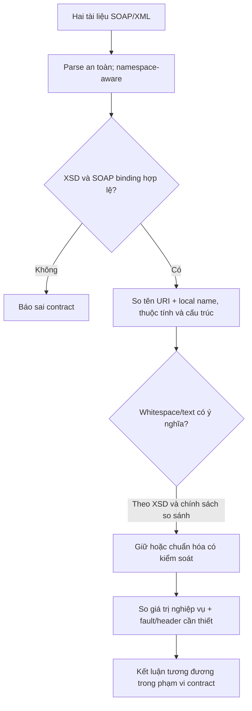

# So sánh XML theo ngữ nghĩa thay vì so sánh chuỗi prefix và khoảng trắng

> **Chương:** Nền tảng XML  
> **Ngữ cảnh:** Phát triển SOAP contract-first với **Spring Web Services (Spring-WS)**, thiết kế XSD/WSDL, ánh xạ JAXB, endpoint và SOAP client. Việc so sánh đúng thông điệp XML giúp kiểm thử tương thích giữa Spring-WS, JAX-WS, Apache CXF và các hệ thống doanh nghiệp.

## 1. Vì sao hai XML trông khác nhau vẫn có thể mang cùng một thông điệp?

Khi kiểm thử SOAP, ta thường có một XML *expected* và một XML *actual*. Nếu dùng `String.equals()`, so sánh snapshot dạng văn bản hoặc tìm và thay thế prefix bằng chuỗi, bài kiểm thử dễ thất bại vì khác cách trình bày, mặc dù hai endpoint trao đổi cùng dữ liệu theo contract.

Ví dụ, hai payload dưới đây thể hiện cùng một `GetOrderResponse` khi hợp đồng quy định nội dung chỉ gồm một phần tử `status` và hai thuộc tính `id`, `source`:

```xml
<!-- XML A -->
<ord:GetOrderResponse xmlns:ord="urn:demo:orders:v1"
                      id="ORD-1001" source="ERP">
  <ord:status>PAID</ord:status>
</ord:GetOrderResponse>
```

```xml
<!-- XML B -->
<r:GetOrderResponse source="ERP" id="ORD-1001"
                    xmlns:r="urn:demo:orders:v1"><r:status>PAID</r:status></r:GetOrderResponse>
```

Nhìn theo chuỗi, A khác B ở prefix `ord`/`r`, thứ tự thuộc tính, cách xuống dòng và thụt lề. Nhìn theo **tên XML có namespace**, nội dung thuộc tính và giá trị nghiệp vụ, chúng có thể tương đương. Cách so sánh phù hợp phải được quyết định bởi **XSD/WSDL và yêu cầu nghiệp vụ**, chứ không phải bởi định dạng khi in ra.

**Mệnh đề cốt lõi:** *XML có nhiều biểu diễn văn bản cho cùng một cấu trúc; nhưng không phải mọi khác biệt về văn bản đều vô nghĩa.* Đặc biệt, khoảng trắng trong text, thứ tự phần tử, namespace URI và dữ liệu dùng để ký XML có thể mang ý nghĩa quan trọng.

## 2. Xác định “bằng nhau” ở tầng nào

Trước khi chọn thư viện hay viết assertion, cần nêu rõ mục đích của phép so sánh.

| Tầng so sánh | Cái gì được so? | Phù hợp cho | Giới hạn |
|---|---|---|---|
| Byte/chuỗi | Chính xác ký tự hoặc byte, encoding, prefix, dòng trắng | So khớp artifact bất biến, kiểm tra serialized output thật sự | Báo khác dù XML có thể tương đương về cấu trúc |
| Cấu trúc XML có namespace | Tên mở rộng của element/attribute, cây node, text, thuộc tính, thứ tự | Hầu hết assertion SOAP payload và XML integration test | Cần chính sách rõ cho whitespace, comment, PI, QName trong value |
| Giá trị theo XSD | Dữ liệu đã kiểm tra kiểu, ví dụ số nguyên, boolean, ngày giờ | Kiểm tra contract và giá trị nghiệp vụ | Cần schema/type-aware binding; không thể suy từ text thuần |
| Đối tượng nghiệp vụ | Trường Java/JAXB/domain sau khi giải mã | Xác nhận hành vi endpoint, mapping và business logic | Có thể bỏ sót XML lỗi/field không được ánh xạ nếu không validate |
| XML Signature/canonical form | Bộ node và dạng canonical theo thuật toán chữ ký | Kiểm chứng toàn vẹn thông điệp đã ký | Quy tắc mật mã khác phép so sánh nghiệp vụ; không được sửa XML trước khi verify |

Một test tích hợp SOAP thường cần **cả hai nhóm assertion**: (1) XML hợp lệ và đúng contract, (2) giá trị nghiệp vụ đúng. Thêm so sánh raw bytes chỉ khi *chính byte serialization* là yêu cầu được xác định.

## 3. Namespace: so sánh URI và local name, không so prefix

### 3.1 Expanded name mới là định danh của element

Tên XML có namespace được nhận diện theo cặp:

```text
expanded name = {namespace URI}local name
```

Với:

```xml
<a:GetOrderRequest xmlns:a="urn:demo:orders:v1"/>
<b:GetOrderRequest xmlns:b="urn:demo:orders:v1"/>
```

hai element có cùng expanded name `{urn:demo:orders:v1}GetOrderRequest`. Prefix `a` và `b` chỉ là **bí danh cục bộ** được khai báo qua `xmlns`. Tên đầy đủ của cả hai không đổi nên một SOAP endpoint định tuyến bằng `QName` sẽ xem chúng là cùng loại payload.

Ngược lại:

```xml
<a:GetOrderRequest xmlns:a="urn:demo:orders:v1"/>
<a:GetOrderRequest xmlns:a="urn:demo:orders:v2"/>
```

không tương đương về tên: cùng chữ `GetOrderRequest`, cùng prefix `a`, nhưng **namespace URI khác**. Đây có thể là thay đổi phiên bản contract làm Spring-WS `@PayloadRoot` không match request hoặc client không parse được response.

Trong Java DOM, nên đọc:

```java
Element root = document.getDocumentElement();
String namespaceUri = root.getNamespaceURI();
String localName = root.getLocalName();
// Ví dụ: "urn:demo:orders:v1" và "GetOrderRequest"
```

`getNodeName()` hoặc `getTagName()` có thể chứa prefix dạng `a:GetOrderRequest`; không dùng các chuỗi này để kiểm tra danh tính element xuyên hệ thống khi alias namespace có thể thay đổi.

### 3.2 Default namespace không áp dụng cho attribute không prefix

Một bẫy khác:

```xml
<!-- Thuộc tính code không nằm trong namespace orders -->
<item xmlns="urn:demo:orders:v1" code="A"/>

<!-- Thuộc tính code thuộc namespace orders -->
<item xmlns="urn:demo:orders:v1"
      xmlns:o="urn:demo:orders:v1" o:code="A"/>
```

Hai XML trên **khác nhau**: element `item` có cùng namespace nhưng attribute `code` của chúng có expanded name lần lượt là `{}code` và `{urn:demo:orders:v1}code`. Trong DOM, `getAttribute("code")` và `getAttributeNS("urn:demo:orders:v1", "code")` truy cập hai thuộc tính khác nhau. Namespace mặc định áp dụng cho element không prefix, **không tự động áp dụng cho attribute không prefix**.

Khi so sánh tập thuộc tính, hãy chuẩn hóa **khóa theo `(namespaceURI, localName)`**, không theo chuỗi tên có prefix; bỏ qua sự khác biệt đơn thuần của khai báo `xmlns` khi chúng không làm đổi danh tính hoặc ý nghĩa của dữ liệu. Các thuộc tính thật như `xml:lang`, `xml:space`, `xsi:nil`, `wsu:Id` thì vẫn phải được đánh giá theo contract.

### 3.3 Prefix có thể nằm trong *giá trị* chứ không chỉ tên tag

Đừng thay mọi `a:` thành `b:` bằng string replacement. Ví dụ:

```xml
<value xmlns:xsi="http://www.w3.org/2001/XMLSchema-instance"
       xmlns:p="urn:demo:types"
       xsi:type="p:PremiumOrder">...</value>
```

Nếu đối tác đổi `p` thành `q` và đổi khai báo namespace tương ứng, **giá trị của `xsi:type`** có thể vẫn trỏ tới cùng kiểu XML Schema, dù chuỗi `p:PremiumOrder` và `q:PremiumOrder` khác nhau. Nhưng một text node thường chứa `"p:PremiumOrder"` mà schema xác định là `xs:string` thì lại là **hai chuỗi khác nhau**. Chỉ nên giải giá trị thành `QName` khi contract/kiểu dữ liệu quy định giá trị đó là QName; phép so sánh DOM thông thường không biết ngữ nghĩa bên trong tất cả text và attribute value.

## 4. Khoảng trắng: khi nào bỏ qua, khi nào phải giữ?

XML không có quy tắc chung rằng “mọi khoảng trắng đều bỏ được”.

| Dạng khác biệt | Có thể xem tương đương? | Điều kiện |
|---|---|---|
Xuống dòng/thụt lề giữa các *child element* | Thường có thể | Nội dung element-only theo XSD hoặc chính sách test đã xác nhận whitespace đó là định dạng |
Khoảng trắng đầu/cuối trong text, ví dụ `<name> Lan </name>` | Không tự động | Có thể là một phần của `xs:string` hoặc dữ liệu ký |
Khoảng trắng giữa từ: `A B` và `A  B` | Không mặc định | Chỉ có thể chuẩn hóa nếu kiểu XSD/quy tắc nghiệp vụ cho phép |
Thứ tự các attribute | Có | Thứ tự thuộc tính không mang ý nghĩa trong mô hình XML |
Thứ tự các child element | Thường không | `xs:sequence` và nhiều contract quy định thứ tự |
CDATA so với text thường | Thường có | Nếu nội dung ký tự sau parsing giống nhau và không có yêu cầu lexical đặc biệt |
Comment / processing instruction (PI) | Phụ thuộc mục đích | Test nghiệp vụ có thể bỏ comment; processing/canonical signature có thể cần quan tâm |

### 4.1 Element-only content khác mixed content

Ví dụ một phần tử chỉ chứa các child element:

```xml
<o:Order xmlns:o="urn:demo:orders:v1">
  <o:id>ORD-1</o:id>
  <o:status>PAID</o:status>
</o:Order>
```

Nếu XSD định nghĩa `Order` có **element-only content**, khoảng trắng để thụt lề giữa `id` và `status` thường không thuộc giá trị nghiệp vụ; test có thể chọn bỏ qua các whitespace-only text node ở đúng vị trí đó.

Nhưng với **mixed content**:

```xml
<p>Thanh toán <strong>đúng hạn</strong> nhé.</p>
```

chuỗi text trước và sau `strong` là thành phần nội dung. Việc `trim()`, xóa whitespace-only text node hoặc ghép từ không đúng cách có thể biến văn bản thành `Thanh toánđúng hạnnhé.`. Ngay cả `<value> </value>` cũng không luôn tương đương với `<value/>`: một bên chứa một ký tự khoảng trắng, bên kia rỗng.

Thuộc tính `xml:space="preserve"` là tín hiệu rằng ứng dụng cần bảo tồn khoảng trắng ở phạm vi đó; `xml:space="default"` không có nghĩa là được xóa toàn bộ whitespace. XSD còn có facet `whiteSpace` (`preserve`, `replace`, `collapse`) áp dụng tùy kiểu dữ liệu. Chỉ dùng `trim`/collapse khi **đã biết kiểu hoặc yêu cầu** cho phép.

### 4.2 Thứ tự node có thể là contract

```xml
<o:Payment xmlns:o="urn:demo:payments:v1">
  <o:account>001</o:account>
  <o:amount>100</o:amount>
</o:Payment>
```

không được mặc định tương đương với payload đảo vị trí `amount` và `account`. Với `xs:sequence`, tài liệu đảo thứ tự có thể không hợp lệ theo XSD. Ngay cả khi cả hai hợp lệ theo một schema linh hoạt, parser hoặc phía nhận vẫn có thể áp dụng chính sách xử lý thứ tự riêng. Nếu contract thật sự cho phép coi thứ tự là không quan trọng (ví dụ tập item không có thứ tự theo nghiệp vụ), hãy mô tả điều đó **cho đúng element**, thay vì sắp xếp mọi node trong tài liệu.

## 5. XML giống cấu trúc vẫn có thể khác ở cấp giá trị

Giả sử XSD quy định `count` là `xs:int`, `enabled` là `xs:boolean`:

```xml
<o:count xmlns:o="urn:demo:orders:v1">01</o:count>
<o:count xmlns:o="urn:demo:orders:v1">1</o:count>
```

`01` và `1` có **giá trị số nguyên giống nhau** sau khi kiểm tra/chuyển đổi đúng kiểu. Nhưng hai text node **không giống nhau về ký tự**. Tương tự, XSD `xs:boolean` chấp nhận biểu diễn `true` và `1` của cùng giá trị logic. Ngược lại, nếu `count` là `xs:string`, hai giá trị đó **khác nhau**.

Một số khác biệt không nên tự động gộp:

- **Vắng mặt vs rỗng vs nil:** `<a/>`, không có `a`, và `<a xsi:nil="true"/>` có thể mang ý nghĩa khác nhau; XSD `minOccurs`, `nillable` và nghiệp vụ quyết định.
- **Mã định danh:** `00123` và `123` không tương đương khi đó là mã khách hàng kiểu chuỗi, dù nhìn giống số.
- **Ngày giờ và múi giờ:** chỉ so sánh *instant* khi kiểu thời gian và yêu cầu nghiệp vụ cho phép; không tự động xóa timezone.
- **Giá trị QName:** prefix khác có thể cùng kiểu định danh, nhưng phải phân giải theo namespace đang có hiệu lực.
- **Unicode và chữ hoa/thường:** XML không mặc nhiên so sánh không phân biệt hoa thường hay thực hiện Unicode normalization cho dữ liệu nghiệp vụ.

**Quy tắc thực hành:** muốn kiểm thử contract, trước tiên validate XML theo XSD; muốn so sánh giá trị đã chuẩn kiểu, dùng JAXB hoặc trình đọc dữ liệu có ý thức về kiểu XSD, rồi so sánh đúng trường nghiệp vụ. Nếu chỉ cần test payload phản hồi có `status=PAID`, không cần ép toàn bộ XML thành một chuỗi duy nhất rồi so bằng ký tự.

## 6. Thuật toán so sánh cấu trúc XML đáng tin cậy

Với hai XML cùng contract, thuật toán so sánh cấu trúc tối thiểu nên:

1. **Parse XML an toàn và namespace-aware.** Không sử dụng regex để tự tách XML và không cho tải external entity/DTD tùy ý.
2. **So expanded name** của mỗi element (`namespaceURI`, `localName`), không so prefix.
3. **So các attribute như một tập khóa–giá trị** theo expanded name; không dựa vào thứ tự serialize hoặc thứ tự iteration của DOM `NamedNodeMap`. Phân biệt attribute vắng mặt, rỗng và thuộc namespace khác.
4. **Duyệt child node theo thứ tự**, ghép adjacent text/CDATA thành luồng ký tự khi thích hợp; áp dụng chính sách whitespace theo từng loại nội dung XSD.
5. **Áp dụng chính sách riêng cho comments, PI, QName-valued attributes, kiểu XSD, `xsi:nil`** nếu contract có sử dụng.
6. **Báo khác biệt tại vị trí cụ thể**, ví dụ `/Envelope/Body/GetOrderResponse/status`, expected và actual expanded QName/value, để truy nguyên lỗi.

Sơ đồ tư duy:



Không có một chế độ “ignore all whitespace/prefix/order” an toàn cho mọi XML. Một comparator tốt là comparator có **chính sách rõ ràng**, được kiểm tra cả với trường hợp đúng lẫn trường hợp phải thất bại.

## 7. Ví dụ Java: assertion theo QName và giá trị nghiệp vụ

Ví dụ sau sử dụng **Java 17**, JUnit 5 và DOM tiêu chuẩn để so hai response trong một contract nhỏ. Mục tiêu là chỉ ra cách assertion **không phụ thuộc prefix, thứ tự attribute và thụt lề**. Nó đọc chính xác phần tử `status` là **con trực tiếp** của `GetOrderResponse`, tránh bắt nhầm một thẻ `status` ở sâu trong cây XML.

```java
import static org.junit.jupiter.api.Assertions.*;

import java.io.StringReader;
import java.util.Map;
import javax.xml.XMLConstants;
import javax.xml.parsers.DocumentBuilderFactory;
import org.junit.jupiter.api.Test;
import org.w3c.dom.Document;
import org.w3c.dom.Element;
import org.w3c.dom.Node;
import org.xml.sax.InputSource;

class OrderXmlSemanticTest {
    private static final String NS = "urn:demo:orders:v1";

    private static Document parseXml(String xml) throws Exception {
        DocumentBuilderFactory factory = DocumentBuilderFactory.newInstance();
        factory.setNamespaceAware(true);
        factory.setFeature(XMLConstants.FEATURE_SECURE_PROCESSING, true);
        factory.setFeature(
            "http://apache.org/xml/features/disallow-doctype-decl", true);
        factory.setXIncludeAware(false);
        factory.setExpandEntityReferences(false);
        factory.setAttribute(XMLConstants.ACCESS_EXTERNAL_DTD, "");
        factory.setAttribute(XMLConstants.ACCESS_EXTERNAL_SCHEMA, "");
        return factory.newDocumentBuilder().parse(
            new InputSource(new StringReader(xml)));
    }

    private static Element requiredDirectChild(
            Element parent, String namespace, String localName) {
        Element found = null;
        for (Node n = parent.getFirstChild(); n != null; n = n.getNextSibling()) {
            if (n.getNodeType() == Node.ELEMENT_NODE
                    && namespace.equals(n.getNamespaceURI())
                    && localName.equals(n.getLocalName())) {
                assertNull(found, "Duplicate child: " + localName);
                found = (Element) n;
            }
        }
        assertNotNull(found, "Missing child: " + localName);
        return found;
    }

    private static Map<String, String> orderView(String xml) throws Exception {
        Element root = parseXml(xml).getDocumentElement();
        assertEquals(NS, root.getNamespaceURI());
        assertEquals("GetOrderResponse", root.getLocalName());
        assertTrue(root.hasAttribute("id"), "Missing id");
        assertTrue(root.hasAttribute("source"), "Missing source");
        Element status = requiredDirectChild(root, NS, "status");

        // Không gọi trim(): khoảng trắng trong status chỉ được bỏ
        // khi hợp đồng dữ liệu định nghĩa được phép bỏ.
        return Map.of(
            "id", root.getAttribute("id"),
            "source", root.getAttribute("source"),
            "status", status.getTextContent());
    }

    @Test
    void sameBusinessPayloadEvenWhenPrefixAndIndentationDiffer()
            throws Exception {
        String a = """
            <ord:GetOrderResponse xmlns:ord="urn:demo:orders:v1"
                                  id="ORD-1001" source="ERP">
              <ord:status>PAID</ord:status>
            </ord:GetOrderResponse>
            """;
        String b = """
            <r:GetOrderResponse source="ERP" id="ORD-1001"
                                xmlns:r="urn:demo:orders:v1"><r:status>PAID</r:status></r:GetOrderResponse>
            """;
        assertEquals(orderView(a), orderView(b));
    }

    @Test
    void namespaceVersionChangeMustFail() {
        String changed = """
            <r:GetOrderResponse xmlns:r="urn:demo:orders:v2"
                                id="ORD-1001" source="ERP">
              <r:status>PAID</r:status>
            </r:GetOrderResponse>
            """;
        assertThrows(AssertionError.class, () -> orderView(changed));
    }
}
```

Trong thực tế, code `orderView` là một **assertion theo mục tiêu nghiệp vụ**, **không phải comparator đầy đủ cho mọi XML**: nó chưa kiểm tra child/attribute lạ, thứ tự tất cả phần tử, namespace của mọi attribute hoặc các extension. Với SOAP contract-first, hãy **validate request/response theo XSD** và bổ sung assertion cho header, fault, security, cardinality cũng như các trường quan trọng khác. Khi định nghĩa object bằng JAXB, có thể so dữ liệu đã unmarshal, nhưng không vì thế mà bỏ qua XML validation: các trường lạ có thể không xuất hiện trong domain object.

**Nếu parser không hỗ trợ cờ an toàn bắt buộc**, ứng dụng cần xử lý lỗi cấu hình thay vì âm thầm bỏ bảo vệ. Với schema validation, phải cấu hình riêng `SchemaFactory`/validator và chính sách external schema access; đoạn mã trên chỉ minh họa **parse an toàn**, chưa tự validate XSD.

## 8. Dùng thư viện so sánh XML và XML Canonicalization đúng cách

Trong dự án Java, **XMLUnit 2** hỗ trợ so sánh XML có cấu trúc, cấu hình `DiffBuilder`, `NodeMatcher`, `ElementSelector` và `DifferenceEvaluator`. Một cấu hình thường bắt đầu từ phân biệt **identical** (giống ở mức chi tiết chặt chẽ) với **similar** (chấp nhận một số khác biệt không ảnh hưởng đến tiêu chí được định nghĩa). Tuy nhiên, hãy xem comparator đang so sánh **namespace URI hay prefix**, nó bỏ qua loại whitespace nào, có phân biệt comment/PI hay không và xử lý những child trùng tên ra sao.

Khi dùng XMLUnit:

- Ghép cặp element theo **expanded QName** và cấu trúc/ngữ cảnh; không tự động ghép theo thứ tự khi collection có nhiều element cùng tên mà contract cho phép hoán đổi.
- Dùng `ignoreWhitespace` hoặc `normalizeWhitespace` **chỉ trong những test đã xác định whitespace không quan trọng**; đừng bật toàn cục cho mixed content hoặc dữ liệu có chữ ký.
- Giữ kiểm tra thứ tự và số lần xuất hiện khi XSD yêu cầu `xs:sequence`, `minOccurs`, `maxOccurs`.
- Viết negative tests để chắc chắn thay namespace URI, thay giá trị nghiệp vụ hoặc làm thiếu một element quan trọng **phải gây lỗi**.

### 8.1 C14N không phải phép kiểm tra nghiệp vụ tổng quát

**XML Canonicalization (C14N)** quy định cách serialize XML về dạng canonical phục vụ các mục tiêu như **XML Digital Signature**: chuẩn hóa một số chi tiết biểu diễn như thứ tự thuộc tính, cách viết một số cú pháp và quy tắc namespace tùy thuật toán. Nhưng cần phân biệt:

1. **C14N không tự động khiến mọi XML khác prefix trở thành cùng chuỗi byte.** Các thuật toán canonicalization thông dụng vẫn có thể giữ prefix trong tên element/attribute; XML A/B ở đầu bài chưa chắc cho kết quả byte-identical sau C14N.
2. **C14N không phải XSD-aware value comparison.** `01` và `1` vẫn là những ký tự khác nhau ngay cả khi XSD coi cả hai là cùng giá trị số nguyên.
3. **C14N không được hiểu là xóa toàn bộ whitespace.** Text node chứa khoảng trắng có thể được giữ; việc chuẩn hóa không cho phép tự tiện bỏ nội dung.
4. **Chữ ký XML là ngữ cảnh mật mã.** Trước khi thay prefix, tái định dạng, gom node hoặc marshal lại một SOAP message đã ký, phải xét phạm vi signed references và thuật toán c14n của chữ ký. Thao tác trên XML có thể làm signature verification thất bại.

Do đó, **kiểm thử payload nghiệp vụ** và **kiểm tra XML Signature/WS-Security** nên là hai hạng mục riêng với công cụ và tiêu chí chấp nhận tương ứng.

## 9. Áp dụng trong SOAP và Spring-WS contract-first

Spring-WS thường dispatch request bằng `@PayloadRoot(namespace = ..., localPart = ...)`. Hai SOAP client sử dụng prefix khác nhau vẫn đến **cùng endpoint** nếu QName của phần tử gốc trong SOAP Body là như nhau:

```xml
<soap:Envelope xmlns:soap="http://schemas.xmlsoap.org/soap/envelope/"
               xmlns:o="urn:demo:orders:v1">
  <soap:Body>
    <o:GetOrderRequest><o:orderId>ORD-1001</o:orderId></o:GetOrderRequest>
  </soap:Body>
</soap:Envelope>
```

Đổi `soap` thành `s` và `o` thành `ord` trong toàn bộ tên XML cùng với khai báo namespace tương ứng không làm thay đổi QName của `Envelope`, `Body` hoặc `GetOrderRequest`. Nhưng đổi `urn:demo:orders:v1` thành `urn:demo:orders:v2` có thể làm request không match annotation.

Với module Spring Web Services, nên áp dụng tiêu chí sau:

| Vùng cần kiểm thử | Điều cần bảo toàn | Không nên dựa vào |
|---|---|---|
**SOAP Envelope/Body** | SOAP version, QName của payload, cấu trúc và nội dung | Prefix `soap`/`soapenv`, thứ tự attribute |
**XSD/WSDL contract** | Namespace, element declaration, type, cardinality, sequence, binding và fault | Việc cùng render đẹp/đúng định dạng |
**JAXB mapping** | Giá trị trường, nillable/optional, precision, kiểu được quy định | `toString()` của JAXB object hoặc text không có type |
**SOAP Fault** | Fault code/reason, detail theo contract, quy tắc xử lý lỗi | Chuỗi serialized fault với prefix ngẫu nhiên |
**SOAP Header** | Header bắt buộc, SOAP role/mustUnderstand, WS-Addressing nếu dùng | Thứ tự hay khoảng trắng khi contract không quy định |
**WS-Security** | Chữ ký, timestamp, token, chứng chỉ, chính sách bảo mật | Kết luận “hợp lệ” chỉ từ so XML sau khi xóa header |

Một test `MockWebServiceClient` của Spring-WS nên kiểm tra được request có tới đúng endpoint, response phù hợp XSD và giá trị nghiệp vụ khớp. Có thể dùng **XMLUnit** cho assertion cấu trúc nhưng phải thiết kế chính sách so sánh phù hợp. Tương tự, một SOAP client JAX-WS/CXF gọi service Spring-WS cần kiểm tra **khả năng tương tác trên wire**, không kiểm tra xem hai bên dùng cùng tên lớp Java hoặc sinh đúng một dạng thụt lề.

### Khi có WS-Security, chữ ký và chứng chỉ

Với SOAP đã ký theo **WS-Security**, sự đúng đắn gồm ít nhất hai câu hỏi độc lập:

1. SOAP payload có đúng **ngữ nghĩa theo XSD/WSDL** không?
2. Chữ ký XML, phần tham chiếu được ký, chính sách token/timestamp/chứng chỉ có **được xác thực bằng quy trình bảo mật chính thức** không?

Một chuỗi XML được “normalize” để test nghiệp vụ **không thể thay thế** kiểm chứng signature. Ngược lại, chữ ký hợp lệ không tự chứng minh nội dung đúng nghiệp vụ hay người gửi có đủ quyền gọi operation. Cần kiểm thử cả valid/invalid XML, SOAP Fault, replay/timestamp, cấu hình chứng chỉ và tương thích client trên các stack khác nhau.

## 10. Bộ test dương tính/âm tính nên có

Đặt contract cho `GetOrderResponse`: namespace `urn:demo:orders:v1`, một `status` kiểu chuỗi, `id` bắt buộc, `source` bắt buộc. Mỗi trường hợp dưới đây cần được gắn với một **assertion có chủ đích**:

| Trường hợp | Kỳ vọng | Lý do |
|---|---|---|
Thay `ord` bằng `r`, giữ namespace URI | Tương đương | Expanded QName không đổi |
Đảo thứ tự attribute `id`/`source` | Tương đương | Attribute không có thứ tự ngữ nghĩa |
Thêm indentation giữa các element-only child | Có thể tương đương | Chỉ khi chính sách schema cho phép bỏ whitespace formatting |
Thay URI `v1` thành `v2` | Khác | QName thay đổi |
Thay `<status>PAID</status>` thành `<status> PAID </status>` | Khác nếu là `xs:string` preserve | Text có thêm dấu cách |
Đảo `account`/`amount` trong `xs:sequence` | Lỗi contract | Sai thứ tự XSD |
Thêm `<status>` thứ hai khi `maxOccurs=1` | Lỗi contract | Sai cardinality |
Xóa phần tử bắt buộc | Lỗi contract | Sai `minOccurs` hoặc nghiệp vụ |
Thay attribute không prefix bằng attribute có namespace | Khác | Expanded QName của attribute đổi |
Thay `01` bằng `1` cho trường `xs:int` | Có thể tương đương ở cấp giá trị | Chỉ sau type-aware parsing/validation |
Thay plain string `"001"` thành `"1"` cho mã định danh | Khác | Chuỗi nghiệp vụ khác nhau |
Thay đổi prefix trong nội dung `xsi:type` có cùng binding | Có thể tương đương theo kiểu QName | Phải phân giải QName trong scope |
Thay whitespace trong vùng SOAP Body đã ký | Có thể làm signature fail | Chữ ký được kiểm theo canonicalized signed content |

Để đánh giá khác biệt thực tế, ngoài unit test còn nên chạy **cross-stack integration test**: một client được sinh từ WSDL bằng CXF/JAX-WS gửi tới Spring-WS, rồi kiểm tra cả positive response và SOAP Fault. Với contract version mới, đối chiếu QName, header, binding, fault detail, policy, TLS và chứng chỉ.

## 11. Checklist ra quyết định khi một XML assertion thất bại

1. **Khác mỗi prefix?** Kiểm tra hai prefix có trỏ tới cùng namespace URI không; nếu không thì đó là lỗi contract.
2. **Khác khoảng trắng?** Xác định đó là indent giữa element-only child hay text/mixed content có giá trị.
3. **Khác thứ tự?** Phân biệt attribute (không thứ tự) với child element (thường có thứ tự).
4. **Khác lexical value?** Kiểm tra kiểu XSD: string, int, decimal, boolean, dateTime hay QName.
5. **Thiếu/thừa node?** Validate cardinality, nil/optional, cấu trúc SOAP Body, Header và Fault.
6. **Có XML Signature?** Xác minh bằng công cụ WS-Security phù hợp; không sửa dữ liệu đã ký để làm test xanh.
7. **Khác giữa Spring-WS và client CXF/JAX-WS?** So WSDL/XSD và SOAP thực tế trên wire, rồi mới xét JAXB/proxy/endpoint mapping.

### Câu hỏi tự kiểm tra

**1.** Hai response dùng prefix `a` và `b`, cùng `{urn:demo:orders:v1}GetOrderResponse`. Có cần sửa code server Spring-WS không?  
**Gợi ý:** Không vì prefix; `@PayloadRoot` định tuyến theo namespace và local part. Cần kiểm tra thêm nội dung và binding.

**2.** Vì sao `ignoreWhitespace()` không nên bật bừa cho mọi XML?  
**Gợi ý:** Mixed content, `xs:string`, `xml:space`, và vùng đã ký có thể phụ thuộc vào khoảng trắng.

**3.** C14N có thể thay thế so sánh giá trị `xs:int` hoặc chứng minh hai payload cùng nghĩa nghiệp vụ không?  
**Gợi ý:** Không. C14N xử lý biểu diễn canonical phục vụ các mục đích như chữ ký; so sánh kiểu XSD và nghiệp vụ là vấn đề khác.

**4.** Hai message có `<o:item code="A"/>` và `<o:item o:code="A"/>` với `o` trỏ cùng URI có giống nhau không?  
**Gợi ý:** Không. Attribute `code` không prefix không nhận default namespace.

**5.** Nếu JAXB unmarshal được một SOAP response thì đã đủ để khẳng định tương thích contract chưa?  
**Gợi ý:** Chưa. Cần validation XSD, kiểm tra element bắt buộc, headers/fault và security policy liên quan.

**Kết luận:** Trong **Spring Web Services**, hãy so sánh SOAP/XML ở cấp **expanded QName, cấu trúc hợp lệ theo XSD và giá trị mà contract định nghĩa**. Bỏ qua khác biệt về prefix, thứ tự attribute và định dạng khi chúng thực sự không ảnh hưởng nội dung; giữ nguyên những khác biệt có ý nghĩa như namespace URI, text, thứ tự element, nil và chữ ký. Cách làm này giúp endpoint, SOAP client, JAXB, interceptor, SOAP Fault và WS-Security hoạt động ổn định khi tích hợp các hệ thống khác stack.
