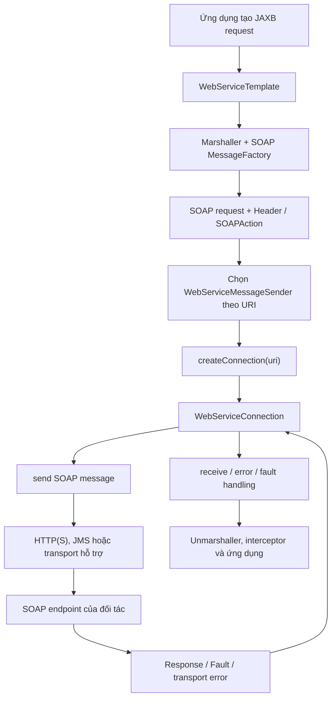
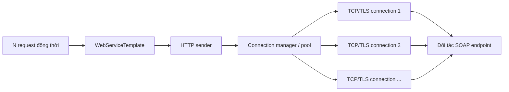
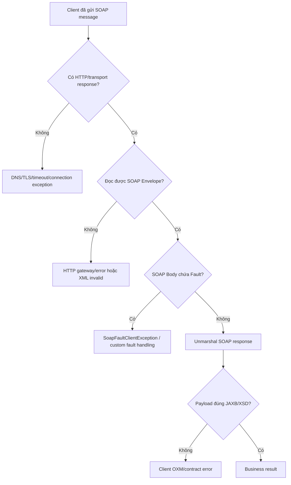

# WebServiceMessageSender, WebServiceConnection và lựa chọn transport

Trong **Spring Web Services (Spring-WS)**, khi gọi một dịch vụ SOAP từ ứng dụng Java, ta thường thấy một dòng ngắn như `webServiceTemplate.marshalSendAndReceive(request)`. Tuy nhiên, đằng sau lời gọi đó còn có việc chọn giao thức truyền, mở kết nối, đưa SOAP Envelope lên đường truyền, nhận phản hồi và phân biệt lỗi mạng với **SOAP Fault**. Hai abstraction cốt lõi của tầng này là **`WebServiceMessageSender`** và **`WebServiceConnection`**.

Bài thuộc chương **HTTP và kết nối** của module `SPRING_WEB_SERVICES`. Nội dung tập trung vào cách Spring-WS lựa chọn transport cho một URI, vai trò của sender và connection, cấu hình HTTP/HTTPS hoặc transport khác, giới hạn về timeout và connection pooling, TLS/chứng chỉ, hành vi lỗi, và cách kiểm thử đường gửi/nhận SOAP contract-first với XSD/WSDL, JAXB, interceptor và WS-Security.

> **Nguyên tắc thiết kế:** `WebServiceMessageSender` chịu trách nhiệm **đưa message qua transport**; `WebServiceConnection` đại diện cho **một lượt kết nối/trao đổi với đích**. Chúng không quyết định QName, không tự kiểm tra XSD và không mặc định xác thực WS-Security. Chọn sai transport hoặc sai cấu hình kết nối có thể làm một hợp đồng SOAP hoàn toàn đúng vẫn không thể tích hợp.

## 1. Hai abstraction nằm ở đâu trong Spring-WS client?

Một lời gọi client thường đi qua các tầng:



Sơ đồ là **mô hình khái niệm**, không khẳng định đúng thứ tự từng lời gọi nội bộ trên mọi phiên bản Spring-WS. Ví dụ interceptor phía client có thể sửa message trước khi nó được gửi; việc xử lý lỗi HTTP và Fault phụ thuộc implementation của connection và template.

Các thành phần có vai trò khác nhau:

| Thành phần | Trách nhiệm chính | Không làm thay |
| --- | --- | --- |
| `WebServiceTemplate` | Điều phối gửi SOAP, callback, interceptor, marshalling, fault handling | Không tự định nghĩa XSD/WSDL |
| `WebServiceMessageFactory` | Tạo/đọc SOAP message theo implementation và SOAP version | Không chọn URL đích |
| `Marshaller` / `Unmarshaller` | Chuyển Java ↔ XML payload, ví dụ `Jaxb2Marshaller` | Không mở kết nối HTTP |
| **`WebServiceMessageSender`** | Hỗ trợ một loại URI/transport và tạo connection thích hợp | Không chọn business operation |
| **`WebServiceConnection`** | Gửi/nhận message, cung cấp trạng thái lỗi/Fault của exchange, đóng kết nối | Không phải repository hoặc application service |
| `ClientInterceptor` | Tham gia request/response/fault phía **client** | Không phải server `EndpointInterceptor` |
| SOAP client contract | XSD/WSDL, QName, SOAPAction, SOAP version, WS-Security policy | Không thay thế cấu hình TLS/network |

**Phân biệt ba đường dẫn:** URL GET WSDL để tìm hiểu contract; endpoint URI POST SOAP để gọi nghiệp vụ; SOAPAction hoặc QName để xác định operation. Sender chỉ dựa trên transport/URI có thể xử lý, **không đọc tên operation rồi tự chọn máy chủ**.

## 2. `WebServiceMessageSender`: chọn transport và tạo connection

Interface `org.springframework.ws.transport.WebServiceMessageSender` biểu diễn một component có thể tạo kết nối cho một URI đích. Hai thao tác cần biết:

```java
// Chữ ký API khái niệm của WebServiceMessageSender:
boolean supports(java.net.URI uri);
WebServiceConnection createConnection(java.net.URI uri)
        throws java.io.IOException;
```

Chữ ký trên nhằm giải thích trách nhiệm; nó **không phải class hoàn chỉnh** và cần dùng đúng interface của phiên bản Spring-WS đang triển khai.

- **`supports(uri)`**: sender có hỗ trợ scheme/cách gửi tới URI này hay không? Ví dụ một sender dành cho HTTP/HTTPS thường không xử lý URI của JMS.
- **`createConnection(uri)`**: khởi tạo một connection để trao đổi SOAP message với đích tương ứng. Thời điểm mở socket thật, lấy connection từ pool hay thực hiện TLS handshake có thể khác theo implementation.
- Một template có thể được cấu hình với **một sender** hoặc, khi API hỗ trợ, **danh sách sender** cho nhiều loại URI.
- Khi không có sender phù hợp với URI, lỗi nằm ở cấu hình transport/đích; không nên thay XSD hoặc JAXB để chữa lỗi đó.

### Sender không phải một kết nối duy nhất dùng chung

Một `WebServiceMessageSender` thường được cấu hình như bean dùng chung. Nó có thể tạo **nhiều** `WebServiceConnection` cho các request khác nhau. Với HTTP client có connection pooling, các connection cấp API có thể sử dụng lại những **kết nối TCP** bên dưới, nhưng đây là chiến lược của HTTP client/pool, không có nghĩa dùng chung một đối tượng `WebServiceConnection` giữa hai luồng gọi.

```text
Một WebServiceMessageSender
  ├── WebServiceConnection cho call A
  ├── WebServiceConnection cho call B
  └── WebServiceConnection cho call C

Mỗi call có message/response/lifecycle của riêng nó.
Sender có thể dùng chung HTTP client + pool an toàn theo cấu hình.
```

**Không giữ `WebServiceConnection` trong singleton rồi gọi `send` nhiều lần từ nhiều thread.** Tách trách nhiệm: cấu hình sender/pool lâu dài, còn connection/exchange thuộc từng lời gọi.

## 3. `WebServiceConnection`: vòng đời một lượt gửi/nhận

Interface `org.springframework.ws.transport.WebServiceConnection` trừu tượng hóa cuộc trao đổi message giữa client và đích. Những thao tác thường gặp:

| API/nhóm thao tác | Ý nghĩa |
| --- | --- |
| `getUri()` | Địa chỉ mà connection đang kết nối |
| `send(WebServiceMessage)` | Ghi SOAP message lên transport |
| `receive(WebServiceMessageFactory)` | Đọc message phản hồi và dùng factory để tạo SOAP message |
| `hasError()` / `getErrorMessage()` | Tín hiệu lỗi ở tầng connection/transport |
| `hasFault()` | Tín hiệu liên quan SOAP Fault theo quy tắc của transport/implementation |
| `close()` | Giải phóng tài nguyên của exchange; với pool có thể trả tài nguyên lại pool |

Đây là **ý nghĩa của abstraction**, không phải cam kết rằng mọi transport đều hỗ trợ cùng kiểu request-response đồng bộ, HTTP status hay socket. Ví dụ JMS có correlation/reply destination và semantics khác HTTP; một transport truyền bất đồng bộ có thể cần adapter/profile riêng.

### Chu trình khái niệm

```text
(1) Template chọn sender tương thích URI
(2) Sender tạo WebServiceConnection cho URI
(3) Template/marshaller chuẩn bị SOAP message
(4) Client callbacks/interceptors được xử lý theo cấu hình
(5) Connection gửi message
(6) Connection nhận response hoặc báo transport error
(7) Template phân biệt SOAP response, SOAP Fault và lỗi transport
(8) Client unmarshal response hoặc chuyển lỗi cho caller
(9) Connection đóng/release tài nguyên
```

Ở đường đi bình thường, template quản lý việc đóng connection **ngay cả khi có exception** theo cách implementation hỗ trợ. Nếu tự viết sender/connection, phải bảo đảm release tài nguyên trên các đường thành công, Fault, timeout và IOException.

**Đừng nhầm `close()` của connection với đóng luôn TCP socket vật lý.** Khi có HTTP keep-alive/pooling, `close` của một exchange có thể giải phóng hoặc trả kết nối vào pool để tái sử dụng. Hành vi cụ thể thuộc HTTP client, tình trạng response body và chính sách connection manager.

## 4. Cùng hợp đồng XSD/WSDL nhưng transport có thể khác

SOAP là một giao thức message. Tích hợp doanh nghiệp thường dùng **SOAP qua HTTP(S)**, nhưng có profile và hạ tầng truyền qua JMS hoặc transport khác nếu Spring-WS và đối tác đều hỗ trợ.

| Vấn đề | HTTP/HTTPS | JMS (khi có sender/receiver tương thích) |
| --- | --- | --- |
| Địa chỉ | `https://host/context/ws` | URI/đích broker theo cú pháp sender được hỗ trợ |
| Mô hình | Request-response HTTP thông dụng | Message queue/topic, correlation/reply destination tùy thiết kế |
| Security transport | TLS, proxy, mTLS, HTTP authentication | Kết nối broker, authentication, authorization, TLS của JMS provider |
| Timeout | Connect/read/connection-pool timeouts | Send/reply/receive timeout và broker delivery semantics |
| Error reporting | HTTP status + SOAP Fault nếu có | Broker/client exception và SOAP Fault trong message phản hồi nếu profile có |
| Retry | Xem idempotency khi response mất | Cần tính đến duplicate delivery, ack, redelivery và transactional boundaries |
| Định tuyến | HTTP URI + SOAPAction/QName ở server | JMS destination + correlation/profile + SOAP contract |

**Không được suy ra chỉ vì cả hai truyền SOAP XML thì cùng một WSDL HTTP binding dùng nguyên vẹn cho JMS.** Một hệ dùng JMS cần thỏa thuận cụ thể cách mô tả endpoint, request-reply correlation, error/fault message và message properties.

Với phần lớn SOAP API công khai, **HTTPS** là lựa chọn mặc định thực dụng nhờ hệ sinh thái WSDL/SOAP client và hạ tầng gateway, TLS, proxy. Dùng JMS khi yêu cầu tích hợp thực sự đòi hỏi messaging/broker và hệ thống hai bên có profile phù hợp; không chọn JMS chỉ để "khắc phục" timeout HTTP.

## 5. Cấu hình HTTP sender tối thiểu trong Spring Boot

Một cách tiếp cận rõ ràng là tạo `HttpUrlConnectionMessageSender` và truyền vào `WebServiceTemplate`. Đây là sender dựa trên cơ chế `HttpURLConnection` của Java, thường phù hợp cho ví dụ cơ bản và những dịch vụ có nhu cầu HTTP không quá phức tạp.

```java
import org.springframework.context.annotation.Bean;
import org.springframework.context.annotation.Configuration;
import org.springframework.oxm.jaxb.Jaxb2Marshaller;
import org.springframework.ws.client.core.WebServiceTemplate;
import org.springframework.ws.transport.http.HttpUrlConnectionMessageSender;

@Configuration
public class OrdersHttpClientConfig {

    @Bean
    public Jaxb2Marshaller ordersMarshaller() {
        Jaxb2Marshaller marshaller = new Jaxb2Marshaller();
        marshaller.setContextPath("com.acme.orders.soap.v1");
        return marshaller;
    }

    @Bean
    public HttpUrlConnectionMessageSender ordersMessageSender() {
        HttpUrlConnectionMessageSender sender =
                new HttpUrlConnectionMessageSender();
        // Timeout sẽ được thiết kế và cấu hình phù hợp ở phần sau.
        return sender;
    }

    @Bean
    public WebServiceTemplate ordersTemplate(
            Jaxb2Marshaller ordersMarshaller,
            HttpUrlConnectionMessageSender ordersMessageSender) {

        WebServiceTemplate template = new WebServiceTemplate();
        template.setMarshaller(ordersMarshaller);
        template.setUnmarshaller(ordersMarshaller);
        template.setMessageSender(ordersMessageSender);
        template.setDefaultUri(
                "https://orders.partner.example/ws");
        return template;
    }
}
```

Đoạn code giả định đã có JAXB classes sinh từ XSD trong package `com.acme.orders.soap.v1`, dependencies Spring-WS/Spring OXM phù hợp và đích HTTPS là ví dụ. Trong dự án thật, URI phải đến từ **cấu hình triển khai đã kiểm tra**, không hard-code vào lớp Java.

### Điểm cấu hình này thực sự làm

1. `ordersMarshaller()` xác định cách chuyển XML payload ↔ JAXB objects.
2. `ordersMessageSender()` tạo sender cho HTTP/HTTPS.
3. `template.setMessageSender(...)` gắn sender đã cấu hình vào client.
4. `template.setDefaultUri(...)` chỉ định đích SOAP khi lời gọi không truyền URI.
5. `marshalSendAndReceive(request)` sẽ dùng các thành phần này để gửi request, nhận response hoặc Fault.

**Chỉ set URI không cấu hình TLS truststore/mTLS, chỉ set sender không định nghĩa SOAPAction, và chỉ set marshaller không bảo đảm XSD validation đã bật**. Các phần này có trách nhiệm riêng.

### Tránh vừa dùng auto-configuration vừa cấu hình chồng chéo

Spring Boot/Spring-WS starter có thể cung cấp message factory, template builder hoặc thành phần client hỗ trợ tùy phiên bản. Khi tự định nghĩa một `WebServiceTemplate`, hãy kiểm tra **bean thực sự được inject**, sender có hiệu lực và các customizations cần thiết, không giả định mọi bean tự động được áp vào template do mình `new`.

## 6. Gửi một SOAP request với JAXB và SOAPAction

Giả sử WSDL 1.1 công bố operation `GetOrder` với input element:

```text
{https://example.com/orders/v1}GetOrderRequest
```

và SOAPAction:

```text
urn:example:orders:v1:GetOrder
```

Một client dùng `WebServiceTemplate`:

```java
import java.math.BigInteger;
import org.springframework.ws.client.core.WebServiceTemplate;
import org.springframework.ws.soap.client.core.SoapActionCallback;

public class OrdersSoapClient {

    private final WebServiceTemplate template;

    public OrdersSoapClient(WebServiceTemplate template) {
        this.template = template;
    }

    public Object getOrder(long id) {
        if (id <= 0) {
            throw new IllegalArgumentException("id must be positive");
        }

        GetOrderRequest request = new GetOrderRequest();
        request.setOrderId(BigInteger.valueOf(id));

        return template.marshalSendAndReceive(
                request,
                new SoapActionCallback(
                    "urn:example:orders:v1:GetOrder"));
    }
}
```

Trong ví dụ, `GetOrderRequest` được giả định sinh bởi XJC, `orderId` được ánh xạ thành `BigInteger`, và JAXB class có root mapping phù hợp. Nếu generated model là named complex type thiếu `@XmlRootElement`, hãy dùng `JAXBElement` từ `ObjectFactory`. Vì bài tập trung vào transport, phương thức trả `Object`; trong code sản phẩm hãy phân loại kết quả thành DTO/JAXB response hoặc unwrap `JAXBElement` đúng model.

**`SoapActionCallback` không mở kết nối và không chọn transport**. Nó thay đổi thông tin của SOAP message trước khi sender truyền đi; URI vẫn do template/defaultUri hoặc overload URI cung cấp.

Ví dụ một request SOAP 1.1 hợp lệ mà client có thể gửi đến HTTP endpoint:

```http
POST /ws HTTP/1.1
Host: orders.partner.example
Content-Type: text/xml; charset=utf-8
SOAPAction: "urn:example:orders:v1:GetOrder"
```

```xml
<soap:Envelope
    xmlns:soap="http://schemas.xmlsoap.org/soap/envelope/"
    xmlns:ord="https://example.com/orders/v1">
    <soap:Header/>
    <soap:Body>
        <ord:GetOrderRequest>
            <ord:orderId>42</ord:orderId>
        </ord:GetOrderRequest>
    </soap:Body>
</soap:Envelope>
```

Trong ví dụ, HTTP sender chịu trách nhiệm gửi HTTP request, còn message factory/serializer tạo SOAP Envelope và JAXB tạo payload `GetOrderRequest`. XML là **minh họa trên wire**; các prefix có thể khác miễn namespace URI và local name đúng. Nếu contract dùng SOAP 1.2, media type/Envelope và cách biểu diễn action phải được thay đổi nhất quán với WSDL binding, không chỉ thay HTTP sender.

## 7. Chọn sender theo URI: một hoặc nhiều transport

Đối với dự án chỉ dùng HTTPS, thường một HTTP sender là đủ. Khi ứng dụng cần nhiều loại transport, `WebServiceTemplate` có API cấu hình danh sách sender. Về nguyên tắc, template chọn sender phù hợp theo `supports(uri)`.

Ví dụ mang tính cấu trúc:

```java
// Fragment trong một @Configuration class.
@Bean
public WebServiceTemplate multiTransportTemplate(
        Jaxb2Marshaller marshaller,
        WebServiceMessageSender httpSender,
        WebServiceMessageSender otherSender) {

    WebServiceTemplate template = new WebServiceTemplate();
    template.setMarshaller(marshaller);
    template.setUnmarshaller(marshaller);
    template.setMessageSenders(
            new WebServiceMessageSender[] {
                    httpSender, otherSender
            });
    return template;
}
```

`WebServiceMessageSender` ở trên là interface cần import từ `org.springframework.ws.transport`; `otherSender` là bean đã cấu hình thực sự, **không phải class dựng sẵn trong fragment**. Ví dụ này chỉ minh họa một template có thể sử dụng nhiều sender; không bắt người học tự tạo sender rỗng.

Các trường hợp:

| URI | Sender được chọn | Rủi ro cần kiểm tra |
| --- | --- | --- |
| `https://partner.example/ws` | HTTP/HTTPS sender hỗ trợ `https` | TLS, proxy, certificate và credentials |
| `http://localhost:8080/ws` | HTTP sender hỗ trợ `http` | Chỉ phù hợp local/test đã kiểm soát |
| URI JMS theo cú pháp của JMS sender | Sender JMS tương thích nếu đã đăng ký | Broker, queue, reply, timeout, correlation |
| URI với scheme không được sender nào hỗ trợ | Không chọn được sender hợp lệ | Không mặc định fallback sang HTTP |
| Hai sender cùng báo hỗ trợ một URI | Quyết định theo cấu hình/chọn sender của framework | Tránh routing mơ hồ, test sender thực sự được dùng |

Nếu cần HTTP client với pooling và TLS đặc thù, có thể dùng implementation HTTP sender dựa trên thư viện HTTP client được Spring-WS hỗ trợ. **Tên lớp và API rất phụ thuộc phiên bản**: một số nhánh có `HttpComponentsMessageSender` và một số nhánh có sender tương ứng Apache HttpClient 5. Không copy class của Spring-WS/HttpClient phiên bản khác khi chưa đối chiếu dependency và tài liệu của release.

### Khi nào nên tách thành nhiều template?

Nếu hai endpoint có **khác truststore, client certificate, HTTP authentication hoặc WS-Security policy**, một template chung với override URI có thể vô tình gửi cùng credential đến đích mới. Khi đó nên:

- Tạo **client/template riêng theo nhóm đích cùng security policy**, hoặc
- Dùng transport/credential resolver được thiết kế tường minh theo destination và được kiểm thử không rò rỉ secret.

Việc có hai sender cùng hỗ trợ HTTPS không có nghĩa template sẽ tự chọn sender có certificate đúng theo hostname. Cần xác định chiến lược chọn sender/client phù hợp, không trông chờ `supports(uri)` giải quyết bài toán phân quyền.

## 8. HTTP(S) sender và connection pooling

HTTP(S) là transport phổ biến nhất cho Spring-WS SOAP client. Với khối lượng lớn, đặc biệt nhiều request ngắn, **connection pooling** có thể tiết kiệm chi phí thiết lập TCP/TLS và hỗ trợ kiểm soát concurrency.

Một số đặc điểm:

- `HttpUrlConnectionMessageSender` sử dụng nền tảng HTTP URL connection của Java. Cách reuse keep-alive/socket do implementation/JVM và môi trường quản lý; **không được mặc định nó cung cấp một HTTP pool có cấu hình như Apache HttpClient**.
- Sender dựa trên một HTTP client chuyên dụng có thể dùng connection manager/pool, kiểm soát số kết nối tối đa, keep-alive, proxy, TLS và các loại timeout chi tiết.
- Pool thường được cấu hình như **tài nguyên lâu dài** và chia sẻ an toàn; `WebServiceConnection` vẫn là **exchange per-call**.
- Tài nguyên trong pool không được giữ mãi sau khi response không được tiêu thụ/connection không được release; cần quan sát pool lease, timeout và leak.



Một HTTP connection pool **không làm một operation chuyển trạng thái trở nên idempotent**. Nó tối ưu tài nguyên transport, không giải quyết duplicate message, retry, transaction hoặc quyền tenant.

### Ba nhóm timeout dễ nhầm

| Timeout | Bắt đầu đo ở đâu | Thường xảy ra khi |
| --- | --- | --- |
| **Connection request / pool lease timeout** | Chờ lấy connection khả dụng từ pool | Pool cạn vì tải cao hoặc connection bị giữ lâu |
| **Connect timeout** | Thiết lập kết nối tới đích | DNS/network/port/route không đáp ứng trong thời gian cho phép |
| **Response/read timeout** | Chờ dữ liệu phản hồi trên kết nối sau khi gửi | Server xử lý lâu, network stall hoặc response không hoàn tất |

Không phải message sender nào cũng phơi bày đủ **ba** nhóm timeout bằng cùng API. Thời gian TLS handshake, DNS resolution, proxy connection và socket operations có thể được tính khác nhau tùy HTTP client/implementation. Cần kiểm tra sender đang dùng và test với network fault mô phỏng.

Ví dụ với nhánh Spring-WS có `HttpUrlConnectionMessageSender` dùng setter timeout tính bằng **mili giây**:

```java
HttpUrlConnectionMessageSender sender =
        new HttpUrlConnectionMessageSender();

// Ví dụ API thường gặp trên nhánh có setConnectionTimeout(int)
// và setReadTimeout(int); xác minh signature phiên bản thực tế.
sender.setConnectionTimeout(3_000);
sender.setReadTimeout(10_000);
```

Thời gian chỉ là **số liệu minh họa**. Chọn timeout theo SLO, tải thực, độ trễ đối tác và tính chất operation. Đừng áp dụng con số trên cho mọi hệ thống. Với Apache HTTP sender, setter có thể ở HTTP client/connection manager, dùng kiểu `Duration` hoặc API khác theo phiên bản.

## 9. TLS, mTLS và certificate khi thay đổi đích

Khi URI là `https://...`, sender/HTTP client cần thiết lập TLS. Có các nhóm cấu hình:

| Nhu cầu | Thành phần |
| --- | --- |
| Xác minh server certificate | Truststore/CA chain đáng tin và hostname verification |
| Client certificate mTLS | Keystore chứa khóa/chứng chỉ client và cấu hình SSL của HTTP client |
| Giới hạn TLS protocol/cipher | TLS context/policy của JVM hoặc HTTP client |
| Kết nối qua proxy | Proxy config, route, authentication, CONNECT cho HTTPS nếu cần |
| Certificate rotation | Quy trình cập nhật trust/identity, reloading hoặc restart theo thiết kế |
| Phân biệt đối tác | Không tái sử dụng mTLS credentials trái policy khi đổi endpoint |

Cần nhớ:

1. **HTTPS không tự là WS-Security.** TLS bảo vệ kênh truyền; WS-Security có thể yêu cầu token, XML Signature hoặc encryption trong SOAP Header/Body.
2. **Chứng chỉ server hợp lệ không tự chứng minh caller được phép truy cập dữ liệu tenant**; authorization vẫn là bước riêng.
3. **Không bật chế độ trust-all** hay tắt hostname verification để xử lý lỗi certificate. Điều đó có thể tạo cơ hội gửi dữ liệu và token tới endpoint giả.
4. Nếu có một template dùng chung nhiều đích và sender dùng chung client certificate, phải xem chính sách đối tác có cho phép không.

### Sai lệch giữa URL thực và URL trong WSDL

WSDL có thể được tải từ một URL công khai, nhưng `soap:address` lại chứa hostname nội bộ vì server đứng sau reverse proxy chưa cấu hình rewrite/forwarded headers đúng. Khi đó cần xác minh **endpoint public hợp lệ**, không tự gửi tới một hostname nội bộ không thuộc phạm vi kiểm soát.

Khi đổi URI sang vùng dự phòng hoặc đối tác thứ hai, client vẫn phải kiểm tra hợp đồng XSD/WSDL, SOAPAction, WS-Security policy và chứng chỉ tương ứng. **Transport hỗ trợ đích không đồng nghĩa hợp đồng tương thích.**

## 10. SOAP 1.1, SOAP 1.2 và message factory

Sender vận chuyển SOAP message, còn `WebServiceMessageFactory` và message implementation quyết định cấu trúc SOAP. Với HTTP binding thông dụng:

| Thuộc tính | SOAP 1.1 | SOAP 1.2 |
| --- | --- | --- |
| Envelope namespace | `http://schemas.xmlsoap.org/soap/envelope/` | `http://www.w3.org/2003/05/soap-envelope` |
| HTTP media type phổ biến | `text/xml` | `application/soap+xml` |
| SOAPAction | HTTP header `SOAPAction` theo SOAP 1.1 | Action có thể ở tham số `action` của media type |
| Fault code phía request | `Client` | `Sender` |
| Fault code phía xử lý | `Server` | `Receiver` |

Ví dụ khởi tạo message factory SOAP 1.2 trong phiên bản Spring-WS có SAAJ tương ứng:

```java
import org.springframework.ws.soap.SoapVersion;
import org.springframework.ws.soap.saaj.SaajSoapMessageFactory;

SaajSoapMessageFactory factory =
        new SaajSoapMessageFactory();
factory.setSoapVersion(SoapVersion.SOAP_12);

// Trong Spring configuration, có thể truyền factory
// vào WebServiceTemplate constructor hoặc setter phù hợp.
```

Đây là fragment, chưa chứa toàn bộ bean initialization; Spring thường quản lý lifecycle của bean thông qua container. SAAJ/Jakarta SOAP libraries cần phù hợp với Spring-WS version.

**Không nên mong đổi `HttpUrlConnectionMessageSender` thành Apache HTTP sender sẽ tự chuyển SOAP 1.1 thành SOAP 1.2.** Đó là sự thay đổi ở message factory/binding chứ không phải ở transport sender. Khi SOAP version sai, máy chủ có thể trả `VersionMismatch` Fault hoặc lỗi HTTP/protocol từ bước parse.

## 11. SOAP Fault và lỗi connection không phải một nhóm

`WebServiceConnection` có phương thức liên quan error/fault để tầng client có thể phân biệt tình huống, nhưng không phải mọi lỗi HTTP đều là SOAP Fault.



Đây là cây quyết định **chẩn đoán khái niệm**. Chi tiết implementation có thể kiểm tra HTTP status và fault trước hoặc sau bước parse theo giao thức và lớp sender đang dùng.

| Tình huống | Ví dụ | Có SOAP Fault để đọc? |
| --- | --- | --- |
| Kết nối TCP bị từ chối | `Connection refused` | Không |
| TLS handshake thất bại | `SSLHandshakeException` | Không |
| Gateway trả HTML 502 | HTTP response không phải SOAP | Thường không |
| Server trả HTTP 500 kèm SOAP 1.1 Fault | `soap:Fault` trong Body | Có |
| Client nhận SOAP 1.2 Fault hợp lệ | `env:Fault` | Có |
| Server trả response SOAP nhưng client JAXB không đọc được | QName/enum sai | Không nhất thiết |
| Client marshal request sai trước khi gửi | `XmlMappingException` | Không |
| JMS broker không gửi được message | JMS exception | Không có SOAP Fault từ endpoint |

Với Spring-WS, `WebServiceTemplate` có cơ chế xử lý transport error và SOAP Fault; ở client thông dụng, Fault có thể được biểu diễn thành `SoapFaultClientException`. Nếu ứng dụng thay custom fault resolver/handler, hành vi có thể khác. **Đừng catch mọi exception và đổi thành "SOAP Fault"**; mã trạng thái HTTP và SSL error không phải XML fault code.

### HTTP status có ý nghĩa gì?

SOAP 1.1 qua HTTP thường sử dụng HTTP 500 cho lỗi SOAP; SOAP 1.2 binding có quy tắc HTTP status riêng. API gateway/filter có thể trả HTTP 401, 403, 429, 502, 503 trước khi Spring-WS endpoint được gọi. Do vậy client phải kiểm tra **Content-Type, Envelope namespace và fault code** nếu thực sự nhận SOAP response.

Đừng đánh giá thành công chỉ bằng HTTP 200; một ứng dụng sai chuẩn có thể trả Fault trong response 200, hoặc trả HTML error page với status 200. Test cần phân biệt **transport status** và **SOAP Body**.

## 12. Cấu hình một hay nhiều sender và bảo mật dữ liệu

Trong hệ thống có nhiều đối tác, nên chọn tổ chức:

| Phương án | Phù hợp khi | Rủi ro |
| --- | --- | --- |
| Một template, một HTTP sender | Một nhóm endpoint dùng chung credential/policy | Không phù hợp nếu mỗi đối tác có mTLS/WS-Security khác |
| Một template với nhiều sender theo scheme | Thực sự gọi nhiều loại transport | Dễ nhầm semantics HTTP/JMS và policy đặc thù |
| Nhiều template/gateway theo đối tác | Truststore, client cert, SOAP version hoặc policy khác | Cần quản lý cấu hình rõ, tránh nhân bản sai |
| Sender/HTTP client tùy chỉnh | Cần pooling/proxy/TLS/telemetry đặc thù | Chi phí bảo trì, rủi ro khi upgrade và resource leak |

Một **URI** trong request do người dùng cung cấp không phải lý do tạo connection trực tiếp. Nếu code gọi:

```java
// Anti-pattern: endpointUri do người dùng/soap header chọn tùy ý.
template.marshalSendAndReceive(endpointUri, request);
```

thì có nguy cơ **SSRF**, truy cập nội bộ, gửi token/credential sang host không được phép hoặc chuyển dữ liệu chéo tenant. Nên thiết kế **destination registry** server-side:

```java
import java.net.URI;
import java.util.Map;

public final class SoapDestinationRegistry {
    public enum Target { ORDERS_PRIMARY, ORDERS_DR }

    private static final Map<Target, URI> DESTINATIONS = Map.of(
        Target.ORDERS_PRIMARY,
        URI.create("https://orders-primary.example/ws"),
        Target.ORDERS_DR,
        URI.create("https://orders-dr.example/ws")
    );

    public static URI resolve(Target target) {
        URI uri = DESTINATIONS.get(target);
        if (uri == null) {
            throw new IllegalArgumentException("Target not permitted");
        }
        return uri;
    }
}
```

Ví dụ này chỉ cho phép chọn từ các đích **đã cấu hình sẵn**. Với cấu hình động, cần kiểm tra scheme/host/port/path, DNS/redirect và egress policy. Nếu người dùng chọn region/tenant, server phải kiểm tra principal được phép dùng route đó trước khi gửi. **`supports(uri)` chỉ nói sender có hiểu scheme, không phải URI an toàn về quyền hay bảo mật.**

## 13. HTTP redirect, proxy và authentication

Một HTTP sender có thể phải tương tác với proxy hoặc gặp các phản hồi redirect:

- **301/302/307/308**: không giả định mọi HTTP client giữ nguyên POST body, SOAPAction và authentication khi chuyển địa chỉ. Với SOAP operation thay đổi trạng thái, redirect có thể dẫn đến gửi lại request theo cách không mong muốn.
- **HTTP proxy/CONNECT**: ảnh hưởng host/port kết nối, SSL tunnel, authentication, timeout và logging.
- **HTTP 401/407**: một lỗi xác thực HTTP hoặc proxy có thể xảy ra **trước khi endpoint SOAP nhận message**.
- **Persistent connection**: idle timeout của gateway có thể khiến pooled connection đã lâu không dùng bị đóng; sender/pool cần xử lý kiểm tra stale connection khi có hỗ trợ.
- **Credential forwarding**: khi đổi host, không mang bearer token/Basic auth/mTLS identity sang đích ngoài policy.

**Khuyến nghị:** mặc định chỉ cho phép redirect tới các đích đã duyệt, hoặc tắt redirect tự động đối với SOAP POST nếu policy yêu cầu. Với failover, nên **chọn đích chủ động qua registry**, thay vì dựa vào redirect không kiểm soát từ endpoint bất kỳ.

## 14. JMS transport: điều kiện và những điểm khác HTTP

Một số dòng Spring-WS hỗ trợ JMS qua `JmsMessageSender` và thành phần receiver/listener tương ứng. Tên lớp, namespace cấu hình, dependency Jakarta/Javax JMS và cú pháp JMS URI **phụ thuộc phiên bản Spring-WS/Spring Framework**. Không copy một URI JMS trên Internet vào production khi chưa xác nhận sender của dự án.

Một cách thiết kế khái niệm:

```text
Ứng dụng Java
  -> WebServiceTemplate
     -> JMS sender đã cấu hình ConnectionFactory
     -> broker destination/queue
        -> SOAP server-side JMS listener/receiver
        -> message reply destination và correlation ID
     -> client nhận SOAP response hoặc timeout
```

Những câu hỏi bắt buộc trước khi chọn JMS:

1. **Đối tác có hỗ trợ SOAP/JMS binding/profile tương ứng hay không?** Không phải mọi SOAP server dùng `MessageDispatcherServlet` HTTP đều tự lắng nghe JMS.
2. **Cách xác định đích:** queue/topic, naming convention và URI parser của sender.
3. **Đáp ứng request–reply:** `JMSReplyTo`, `JMSCorrelationID` hoặc cơ chế correlation trong profile, thời hạn chờ response.
4. **Delivery semantics:** durable/non-durable, acknowledgement, redelivery, duplicate message và out-of-order.
5. **Transaction/idempotency:** một message có thể được gửi lại sau lỗi broker hoặc consumer; nghiệp vụ không được nhân đôi.
6. **Security và mạng:** broker ACL, TLS, credentials, network segmentation, logging không lộ SOAP payload.
7. **Fault semantics:** phân biệt broker exception với SOAP Fault message do consumer phản hồi.
8. **Giới hạn message:** kích thước, encoding, attachment, MTOM và giới hạn broker.

SOAP over JMS có lợi khi cần tích hợp messaging, nhưng **một JMS sender không tự biến một SOAP service HTTP thành JMS service**. Cần cấu hình cả client và phía tiếp nhận cũng như hợp đồng transport tương thích.

## 15. Khi nào cần viết custom `WebServiceMessageSender`?

Có thể cần custom sender khi hạ tầng dùng transport đặc thù chưa được Spring-WS hỗ trợ sẵn hoặc cần tích hợp một cơ chế transport riêng. Nhưng nên ưu tiên sender hiện có và custom message sender/client interceptor trước, vì việc tự implement connection làm tăng trách nhiệm:

```java
// Mã minh họa cấu trúc, KHÔNG là class hoàn chỉnh.
public final class SpecialTransportSender
        implements WebServiceMessageSender {

    @Override
    public boolean supports(URI uri) {
        return "special".equalsIgnoreCase(uri.getScheme());
    }

    @Override
    public WebServiceConnection createConnection(URI uri)
            throws IOException {
        // Kiểm tra policy đích, cấu hình transport và tạo
        // một connection có send/receive/error/fault/close đúng.
        throw new UnsupportedOperationException("Implementation required");
    }
}
```

Fragment trên cần imports `java.net.URI`, `java.io.IOException`, `WebServiceMessageSender` và `WebServiceConnection` từ Spring-WS; nó cố ý **không hoạt động**, vì không có giao thức `special` cụ thể.

Một custom connection thực sự phải xác định:

- Cách serialize `WebServiceMessage` lên transport và deserialize response bằng `WebServiceMessageFactory`.
- Timeout, cancellation, thread safety và lifecycle của stream/sockets/buffers.
- Error status, Fault detection, request–reply correlation và trường hợp response không có.
- Bảo mật URI, authentication, certificate, proxy và credential scope.
- Việc `close()` dọn tài nguyên đầy đủ trên cả các nhánh exception.
- Observability, metrics, retries, idempotency và kiểm thử tải.

**Không viết custom sender chỉ để thay SOAPAction hoặc thêm SOAP Header.** Với việc đó, `WebServiceMessageCallback` hoặc `ClientInterceptor` ở tầng message phù hợp hơn.

## 16. Kiểm thử `WebServiceMessageSender` và `WebServiceConnection`

Bài kiểm thử cần tách hai mục tiêu:

**Tầng SOAP message:** `MockWebServiceServer` hỗ trợ kiểm tra outgoing payload, SOAPAction và response của `WebServiceTemplate` mà không phụ thuộc HTTP mạng thật. Nó hữu ích để xác minh JAXB/contract và logic client. Nhưng một mock sender **không chứng minh** TCP/TLS, proxy, pooling hoặc timeout thực tế đã đúng.

**Tầng transport integration:** chạy một HTTP test server/staging endpoint được kiểm soát, gọi bằng **sender thật** đã cấu hình, đo request gửi đi và response nhận lại. Nếu dùng JMS, cần một broker test phù hợp (embedded/testcontainer hoặc môi trường staging) và producer/consumer thực.

Một ví dụ unit về API client (mã minh họa theo Spring-WS Test, kiểm tra chữ ký API của version sử dụng):

```java
import static org.springframework.ws.test.client.RequestMatchers.connectionTo;
import static org.springframework.ws.test.client.RequestMatchers.payload;
import static org.springframework.ws.test.client.ResponseCreators.withPayload;

import org.springframework.xml.transform.StringSource;
import org.springframework.ws.test.client.MockWebServiceServer;

// template đã được cấu hình marshaller/unmarshaller.
MockWebServiceServer server =
        MockWebServiceServer.createServer(template);

server.expect(connectionTo("https://orders.partner.example/ws"))
      .andExpect(payload(new StringSource("""
          <ord:GetOrderRequest xmlns:ord="https://example.com/orders/v1">
              <ord:orderId>42</ord:orderId>
          </ord:GetOrderRequest>
          """)))
      .andRespond(withPayload(new StringSource("""
          <ord:GetOrderResponse xmlns:ord="https://example.com/orders/v1">
              <ord:status>PAID</ord:status>
          </ord:GetOrderResponse>
          """)));

template.marshalSendAndReceive(validJaxbRequest);
server.verify();
```

`validJaxbRequest` là JAXB object được tạo theo XSD, `template` là bean đã cấu hình và code dùng Java text blocks. Đây là **fragment test**, không phải test class độc lập. Mục tiêu của nó là xác minh URI/payload **ở tầng template**, chưa kiểm tra connection timeout hoặc TLS.

### Integration test phải quan sát gì?

- URI và HTTP method thực tế, bao gồm context path sau proxy.
- Content-Type/SOAPAction/Envelope theo SOAP 1.1 hoặc SOAP 1.2.
- TLS certificate validation, mTLS identity và HTTP credentials.
- Thời gian kết nối, chờ pool, chờ response và các lỗi timeout.
- `WebServiceConnection` được release, không leak dưới tải hoặc khi gặp SOAP Fault.
- HTTP status không có SOAP, SOAP Fault hợp lệ và response thành công.
- Payload/XSD, JAXB object và WS-Security nội dung đúng contract.
- Không gửi token/payload sang host ngoài allowlist khi có redirect.
- Thao tác failover/retry có tính idempotent và hợp đồng rõ ràng.

## 17. Ma trận kiểm thử HTTP, connection và transport

| Ca | Tình huống | Kỳ vọng |
| --- | --- | --- |
| T01 | Một HTTP sender hỗ trợ URI `https://...` | `supports(uri)` phù hợp và tạo exchange |
| T02 | HTTP sender gặp URI không hỗ trợ | Không chọn nhầm sender khác |
| T03 | Template có defaultUri HTTPS | Gửi đúng URI qua sender cấu hình |
| T04 | Gọi overload URI tường minh | Không thay default URI toàn cục |
| T05 | Hai đích dùng cùng HTTP sender | Không lẫn request/response giữa các exchange |
| T06 | Template có danh sách HTTP/JMS sender | Sender tương thích với scheme được chọn |
| T07 | URI dùng scheme không sender nào hỗ trợ | Báo lỗi cấu hình rõ, không fallback sang endpoint bất kỳ |
| T08 | HTTP POST với SOAP 1.1 | `text/xml`/Envelope và SOAPAction đúng binding |
| T09 | HTTP POST với SOAP 1.2 | Media type/Envelope phù hợp phiên bản |
| T10 | WSDL GET URL bị dùng nhầm làm SOAP URI | Contract integration test phát hiện |
| T11 | Connect timeout | Phân loại lỗi transport, không tạo Fault giả |
| T12 | Read timeout sau khi gửi request | Client không suy ra server chắc chắn chưa xử lý |
| T13 | Pool không còn connection khả dụng | Pool lease timeout/metrics phản ánh rõ nguyên nhân |
| T14 | HTTP 500 chứa SOAP 1.1 Fault | Client đọc fault code/detail theo policy |
| T15 | Gateway trả HTTP 502 HTML | Không cố unmarshal như SOAP response hợp lệ |
| T16 | TLS certificate chain không tin cậy | Kết nối bị từ chối, không disable trust verification |
| T17 | TLS hostname mismatch | Không gửi request tới host giả |
| T18 | mTLS thiếu certificate | Không đi qua bảo mật của server |
| T19 | Sender A và B dùng credential khác nhau | Không rò rỉ credential sang đích sai |
| T20 | Proxy trả HTTP 407 | Phân loại proxy authentication, không xem là business Fault |
| T21 | Redirect đến host ngoài registry | Từ chối hoặc kiểm soát theo egress policy |
| T22 | Persistent connection stale | Pool/HTTP sender xử lý connection hỏng theo chính sách |
| T23 | Payload sai XSD | Request/response validation phát hiện lỗi ở lớp tương ứng |
| T24 | Response JAXB không tương thích namespace | Báo lỗi OXM/contract thay vì đổ cho transport |
| T25 | Client gửi SOAPAction khác operation | Endpoint từ chối theo mapping/policy |
| T26 | WS-Security signature/token sai | Security layer từ chối, không truy cập nghiệp vụ |
| T27 | Callback SOAPAction và sender HTTP | Hai thành phần phối hợp đúng, không tự chọn operation sai |
| T28 | Tải đồng thời lớn | Pool, heap và latency trong giới hạn cho phép |
| T29 | Có SOAP Fault trong lúc pool tải cao | Connection được release, không leak |
| T30 | HTTP request bị reset trước receive | IOException/transport error được báo nhất quán |
| T31 | JMS request–reply được cấu hình | Correlation/reply destination đúng profile |
| T32 | Broker redelivery message | Application idempotency ngăn xử lý trùng |
| T33 | JMS timeout | Không coi mất reply là SOAP Fault chắc chắn |
| T34 | SOAP over JMS không có listener server | Integration test phát hiện sai kiến trúc |
| T35 | Đổi endpoint sang DR | Cùng WSDL/XSD/SOAPAction và policy TLS |
| T36 | Thử client sinh từ WSDL với đối tác | Tương thích HTTP binding, Fault và QName |

Với các ca T01–T07, có thể viết unit tests đối chiếu `supports(uri)` và kiểm thử cấu hình sender. **Không nên gọi `createConnection()` đến production chỉ để kiểm tra kết nối**, vì hành vi và thời điểm bắt đầu network work phụ thuộc implementation.

Các ca TLS, pooling, proxy và JMS bắt buộc có **môi trường transport thật có kiểm soát**; nếu chỉ dùng `MockWebServiceServer` thì kết quả PASS không đủ xác nhận chất lượng đường truyền.

## 18. Chẩn đoán lỗi theo tầng

| Triệu chứng | Lớp ưu tiên kiểm tra | Hướng xử lý |
| --- | --- | --- |
| "No suitable message sender" hoặc không có destination | Template/sender/URI | Kiểm tra `setMessageSender(s)`, scheme, defaultUri và overload |
| `Connection refused` | TCP/host/port | Kiểm tra DNS, firewall, service đang lắng nghe |
| `SSLHandshakeException` | TLS/certificate | Kiểm tra trust chain, mTLS identity, TLS protocol |
| HTTP 404/405 | URL/servlet mapping | POST SOAP tới đúng endpoint, không nhầm WSDL |
| HTTP 401/403 | HTTP/security gateway | Kiểm tra credential/quyền; không chỉ sửa JAXB |
| HTTP 407 | Proxy | Kiểm tra proxy authentication và CONNECT policy |
| HTTP 502/503 HTML | Gateway/upstream | Không phân tích body như SOAP Fault |
| `No endpoint mapping` trong Fault | SOAPAction/QName/server config | So WSDL operation và SOAP Body thực gửi |
| `UnmarshallingFailureException` | JAXB/OXM | Đối chiếu payload/response XSD và generated model |
| SOAP Fault `Sender/Client` | Hợp đồng request hoặc policy | Sửa request, security, action theo lỗi chi tiết |
| SOAP Fault `Receiver/Server` | Bên xử lý | Điều tra backend và retry có điều kiện |
| Read timeout | Transport hoặc upstream processing | Kiểm tra trạng thái giao dịch/idempotency |
| Chỉ lỗi dưới tải cao | Pool/GC/timeout | Đo active, idle, pending, heap và latency |
| Chỉ lỗi sau deploy gateway mới | Proxy/hostname/route | Kiểm tra URI public, certificate và HTTP headers |
| JMS reply không về | Broker/correlation/reply destination | Kiểm tra selector/correlation/TTL và consumer |
| Retry tạo giao dịch trùng | Idempotency/transaction | Thiết kế key và cơ chế kiểm tra kết quả |

### Trình tự điều tra

1. **Hiệu lực của URI:** client thực sự gọi URI nào, có override per-call không, scheme có được sender hỗ trợ?
2. **Hiệu lực của sender:** instance `WebServiceTemplate` có gắn đúng bean message sender/HTTP client không?
3. **Đường mạng:** DNS, proxy, firewall, port, TLS/mTLS, credential và connection pool.
4. **Dấu vết request trên wire:** HTTP method, Content-Type, SOAPAction và Envelope version.
5. **Response:** có kết nối/HTTP response hay chỉ là IOException? Có SOAP Envelope hay chỉ là HTML gateway?
6. **SOAP-level:** Fault code, response QName, JAXB unmarshalling, XSD version, WS-Security.
7. **Chính sách retry:** operation có idempotent không, đã commit server hay chưa?
8. **Hồi quy:** thêm test với đúng sender và transport thực tế, không chỉ mock client.

## 19. Bài tập: chuyển từ HTTP URLConnection sang pooled HTTP client

**Bối cảnh:** Một hệ Spring-WS gọi đối tác qua HTTPS với `HttpUrlConnectionMessageSender`. Tải tăng, độ trễ p95 cao, connection reset xuất hiện khi gateway đóng idle connection, và team muốn thay bằng sender dựa trên HTTP client có pooling.

**Yêu cầu:** phân tích nên thay lớp nào, phần nào phải giữ nguyên, và cách xác minh kết quả.

**Hướng thực hiện:**

1. Giữ nguyên **XSD/WSDL và JAXB model** nếu hợp đồng không đổi. Không sửa SOAP Body chỉ vì thay thư viện HTTP.
2. Giữ nguyên **SOAP version và action**, không mặc định sender mới sẽ tự nâng SOAP 1.1 thành SOAP 1.2.
3. Chọn HTTP sender tương thích với **phiên bản Spring-WS/Apache HTTP client** của dự án, cấu hình pool với connection limit phù hợp tải/host.
4. Cấu hình connect/read/pool lease timeout theo SLO và quan sát thực tế. Kiểm soát idle/stale connection khi gateway đóng kết nối.
5. Gắn sender mới vào `WebServiceTemplate` hoặc gateway đang dùng và bảo đảm code không vô tình tạo hai template khác nhau với credential khác nhau.
6. Giữ nguyên/cấu hình lại TLS truststore, mTLS client certificate, proxy authentication và hostname verification; không tắt xác minh TLS.
7. Chạy test SOAP 1.1/1.2, schema validation, Fault response, HTTP 401/503, reset connection, timeout và tải đồng thời.
8. Đo pool metrics (`leased/available/pending` tùy HTTP client), throughput, p95/p99, memory và error rate trước/sau thay đổi.
9. Kiểm tra release connection sau các nhánh lỗi, đặc biệt khi response là SOAP Fault hoặc HTTP error body dài.
10. Không retry tự động toàn bộ lệnh tạo đơn/thu tiền khi mất response, trừ khi đã có idempotency policy.

**Đáp án cốt lõi:** thay **sender/HTTP transport client**, không thay XSD/WSDL/endpoint mapping; xây test đảm bảo protocol trên wire không đổi và vận hành pool/TLS đúng.

## 20. Checklist chọn và cấu hình transport Spring-WS

1. **Hiểu trách nhiệm:** `WebServiceMessageSender` chọn/khởi tạo transport, `WebServiceConnection` xử lý một exchange, `WebServiceMessageFactory` tạo SOAP message.
2. **Dùng đúng URI:** SOAP endpoint cho gửi message; WSDL/XSD URL dành cho hợp đồng.
3. **Chọn sender tương thích scheme** và kiểm tra `supports(uri)`; không nghĩ mọi sender đều hỗ trợ mọi protocol.
4. **Giữ một connection/exchange riêng cho mỗi lời gọi**; không chia sẻ `WebServiceConnection` qua nhiều thread.
5. **Dùng defaultUri/override per-call đúng cách**; không mutate bean shared theo mỗi request.
6. **Bảo vệ đích:** destination allowlist/registry, DNS/redirect/egress policy và authorization tenant/region.
7. **Quản lý sender/HTTP client/pool theo lifecycle**: release connection, shutdown pool khi ứng dụng ngừng.
8. **Cấu hình timeout đúng tầng**: pool lease, connect, read/response và giới hạn retry.
9. **Bảo vệ TLS/mTLS** với truststore, certificate và hostname verification chính xác; không trust-all.
10. **Đồng bộ SOAP version, Content-Type và SOAPAction** theo WSDL binding; sender không tự chọn operation.
11. **Tách SOAP Fault khỏi HTTP/transport exception** trong code và monitoring.
12. **Kiểm soát WS-Security/credential theo đích**, không vô tình gửi cùng token/chứng chỉ cho đối tác khác.
13. **Thẩm định JMS riêng**: broker, connection factory, queue, reply/correlation và redelivery semantics.
14. **Kiểm thử JAXB/XSD/WSDL contract** ở cả request và response, không coi kết nối thành công là tương thích nghiệp vụ.
15. **Kiểm thử timeout, TLS, proxy, pooling, load và transport thật**, không chỉ mock template.
16. **Thiết kế retry/idempotency rõ** trước khi failover operation thay đổi trạng thái.
17. **Giữ log an toàn**: ghi URI đã chuẩn hóa/mã đích, HTTP status/fault category và correlation ID; không ghi token hoặc SOAP Body nhạy cảm.
18. **Kiểm tra phiên bản Spring-WS và HTTP client** khi dùng class sender nâng cao, tránh trộn API không tương thích.

**Kết luận:** Trong Spring-WS, `WebServiceMessageSender` quyết định **cách liên lạc với đích** và tạo `WebServiceConnection` cho mỗi trao đổi; connection đảm nhiệm gửi, nhận và giải phóng tài nguyên ở mức transport. HTTP(S) là lựa chọn quen thuộc cho SOAP contract-first; JMS chỉ phù hợp khi cả hai phía đã thống nhất messaging profile và hạ tầng. Một client bền vững phải cấu hình URI, sender, pooling, timeout, TLS và credentials đúng đích, đồng thời **giữ riêng logic SOAP/XSD/WSDL/JAXB, Fault handling và WS-Security** để lỗi kết nối không bị nhầm thành lỗi hợp đồng và ngược lại.
