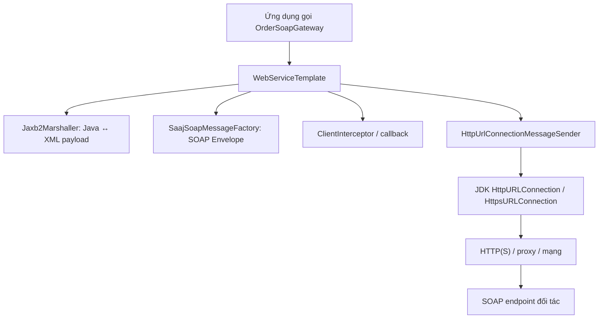
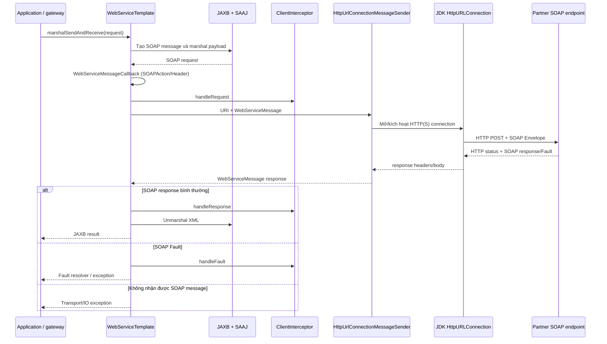
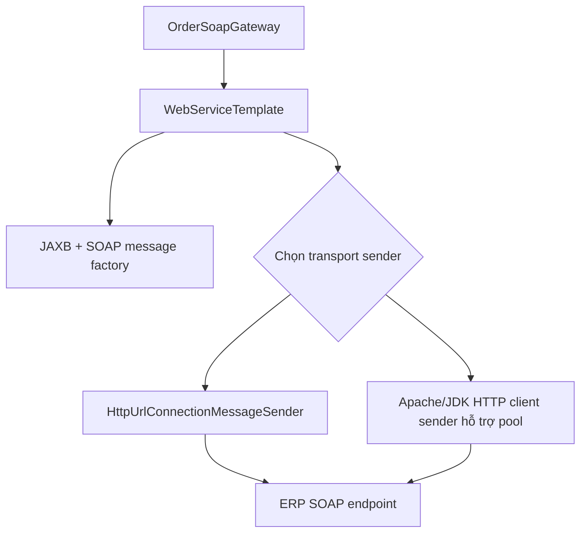
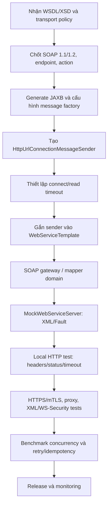

# HttpUrlConnectionMessageSender cho trao đổi HTTP cơ bản

## 1. Bài toán: SOAP client cần gửi và nhận HTTP đáng tin cậy

Một ứng dụng Java dùng **Spring Web Services (Spring-WS)** để gọi SOAP API của hệ thống ERP. Nhóm đã có XSD/WSDL, các lớp JAXB được sinh từ schema, một `WebServiceTemplate` và một phương thức `getOrder(...)`. Nhưng khi chạy trên môi trường thật, request phải đi qua HTTP hoặc HTTPS: tạo kết nối, đặt headers, truyền SOAP Envelope, chờ phản hồi và xử lý lỗi.

Những vấn đề thường xuất hiện ngay ở lớp này:

- Client kết nối được trên máy phát triển nhưng timeout ở môi trường staging.
- Đối tác trả `415 Unsupported Media Type` khi SOAP version và HTTP `Content-Type` không khớp.
- HTTPS handshake thất bại vì truststore hoặc client certificate.
- HTTP 500 chứa SOAP Fault bị hiểu nhầm thành lỗi mạng thuần túy.
- Nhiều lời gọi đồng bộ chờ lâu, chiếm hết thread của ứng dụng.
- Nhóm muốn thêm connection pooling nhưng sender cơ bản không có các điều khiển pool như Apache HttpClient.

**`HttpUrlConnectionMessageSender`** của Spring-WS là lựa chọn đơn giản để thực hiện SOAP over HTTP(S) dựa trên **`java.net.HttpURLConnection`** của JDK. Nó là một **transport adapter**, không phải message factory, marshaller hay SOAP endpoint.

Trong module **SPRING_WEB_SERVICES**, bài học thuộc chương **HTTP và kết nối** và tập trung trực tiếp vào **`HttpUrlConnectionMessageSender cho trao đổi HTTP cơ bản`**. Kiến thức này nối phần triển khai SOAP contract-first (XSD/WSDL, JAXB, endpoint, client) với các yêu cầu sản xuất như SOAP Fault, interceptor, XML security, WS-Security, chứng chỉ, timeout và kiểm thử tương thích.

**Mục tiêu sau bài học:** bạn có thể giải thích lifecycle của sender, cấu hình nó cho `WebServiceTemplate`, đặt connect/read timeout, hiểu ranh giới HTTPS/mTLS, phân biệt lỗi transport với SOAP Fault, xác định khi nào cần client có pool và kiểm thử đường truyền ngoài mock.

## 2. `HttpUrlConnectionMessageSender` nằm ở đâu?

Một SOAP client Spring-WS thường gồm các lớp:



**Nhiệm vụ của từng thành phần:**

| Thành phần | Trách nhiệm chính | Không đảm nhiệm |
|---|---|---|
| `WebServiceTemplate` | Điều phối một lần gửi/nhận SOAP đồng bộ | Không tự định nghĩa XML schema |
| `Jaxb2Marshaller` | Marshal/unmarshal payload JAXB | Không mở TCP connection |
| `SaajSoapMessageFactory` | Tạo/đọc SOAP Envelope/Header/Body | Không quyết định TLS trust |
| `SoapActionCallback` | Cấu hình SOAP action cho request | Không thay đổi WSDL binding |
| `ClientInterceptor` | Xử lý message trước/sau lời gọi, security, audit | Không thay thế sender |
| **`HttpUrlConnectionMessageSender`** | Tạo kết nối HTTP(S) bằng API JDK và cấu hình transport cơ bản | Không quản lý pool như một HTTP client chuyên dụng |
| `HttpURLConnection` | Thực hiện giao tiếp HTTP qua JDK handler | Không hiểu kiểu Java JAXB/domain |
| `HttpsURLConnection` | Biến thể HTTPS có TLS/SSL | Không tự áp dụng WS-Security XML Signature |

Package cần import:

```java
import org.springframework.ws.transport.http.HttpUrlConnectionMessageSender;
```

Lớp này là một implementation của **`WebServiceMessageSender`**, được gắn vào `WebServiceTemplate` bằng `setMessageSender(...)`. Điều đó giúp ứng dụng thay transport mà không phải sửa mọi nơi gọi SOAP.

### 2.1. Phân biệt ba khái niệm hay bị nhầm

**SOAP message factory** như `SaajSoapMessageFactory` tạo SOAP message và hiểu version 1.1/1.2. **Message sender** như `HttpUrlConnectionMessageSender` chuyển thông điệp qua HTTP(S). **Marshaller** như `Jaxb2Marshaller` chuyển dữ liệu ứng dụng thành XML payload.

Nếu đối tác báo `No SAAJ provider`, kiểm tra message factory và dependency SAAJ trước. Nếu nhận `SSLHandshakeException`, kiểm tra tầng TLS của sender/JDK. Nếu JAXB báo sai namespace, kiểm tra XSD/generated binding. Không sửa nhầm lớp.

## 3. Kiến trúc bên dưới: `HttpURLConnection` của JDK

`HttpUrlConnectionMessageSender` sử dụng HTTP handler của JDK thông qua `HttpURLConnection`. URL với scheme `https` dẫn tới cách triển khai HTTPS (`HttpsURLConnection`), còn `http` không có TLS.

Ở mức khái niệm, mỗi lần trao đổi cần:

1. Nhận URI đích từ `WebServiceTemplate`.
2. Mở một đối tượng kết nối HTTP qua JDK.
3. Thiết lập đặc tính gửi/nhận, HTTP method và timeout.
4. Để Spring-WS ghi SOAP request message vào output stream.
5. Nhận HTTP status/headers và response stream.
6. Để Spring-WS phân tích SOAP response hoặc phát sinh transport error.
7. Đóng các resource sau khi exchange kết thúc.

Điều đó **không có nghĩa mỗi lời gọi chắc chắn mở một TCP socket hoàn toàn mới**. JDK có thể tái sử dụng kết nối HTTP keep-alive ở mức implementation, phụ thuộc server, proxy, trạng thái stream và môi trường. Nhưng sender này **không cung cấp cấu hình pool chuyên dụng** như giới hạn connections per route, leased connection metrics hay pool acquisition timeout.

### 3.1. API cơ bản và giới hạn

```java
HttpUrlConnectionMessageSender sender =
        new HttpUrlConnectionMessageSender();

sender.setConnectionTimeout(3_000);
sender.setReadTimeout(10_000);
```

Ví dụ trên sử dụng API setter nhận **số nguyên millisecond** của các phiên bản Spring-WS phổ biến. Hãy kiểm tra Javadoc của phiên bản đã khóa: tên kiểu tham số và cấu hình timeout có thể được mở rộng qua các đời thư viện.

Không nhầm:

- `setConnectionTimeout(3000)` **không** có nghĩa 3000 giây.
- `setReadTimeout(10000)` **không** đặt tổng thời gian của toàn bộ business operation.
- Hai timeout này **không** tự cấu hình HTTP connection pool.
- Sender không tự cài retry, circuit breaker hoặc idempotency.

### 3.2. Khi nào lựa chọn này đủ?

Nó thường phù hợp khi client:

- Gọi một hoặc vài SOAP endpoints qua HTTP(S) với tải vừa phải.
- Muốn dùng API JDK, không cần dependency HTTP client bổ sung.
- Cần timeout kết nối và đọc phản hồi cơ bản.
- Có cơ chế TLS phù hợp trong JVM hoặc cấu hình HTTPS đã kiểm chứng.
- Không cần các tính năng connection pooling/HTTP authentication/proxy nâng cao.

Nếu có hàng trăm/hàng nghìn request đồng thời, yêu cầu pooling có chỉ số vận hành, cơ chế authentication phức tạp hoặc proxy doanh nghiệp có nhiều quy tắc, nên **đánh giá HTTP message sender dựa trên thư viện HTTP client chuyên dụng** với phiên bản tương thích Spring-WS. Quyết định dựa trên benchmark và requirements, không dựa vào việc tên sender nào “mạnh hơn” theo cảm tính.

## 4. Một lời gọi SOAP đồng bộ đi qua sender như thế nào?

Giả sử application gọi:

```java
Object raw = template.marshalSendAndReceive(
        request,
        new SoapActionCallback("urn:example:orders:GetOrder"));
```

Trình tự khái niệm:



Đây là sơ đồ **trách nhiệm**, không là mô tả từng câu lệnh nội bộ của một phiên bản framework. Một connection object có thể được tạo trước khi request được marshal tùy nhánh triển khai; HTTP sender sở hữu việc trao đổi dữ liệu còn template quyết định nhánh unmarshalling/Fault.

### 4.1. Lỗi có thể xuất hiện trước hoặc sau khi server xử lý

| Thời điểm | Ví dụ lỗi | Hệ quả |
|---|---|---|
| Trước khi kết nối | URI sai, DNS không phân giải | Server chưa chắc đã nhận request |
| Thiết lập TCP/TLS | Connection refused, TLS handshake failed | Có thể chưa gửi SOAP Body |
| Gửi request | Broken pipe, gateway reset, socket error | Khó biết bao nhiêu byte đã đến server |
| Chờ response | Read timeout | Server **có thể đã xử lý** command |
| Đọc response | EOF/response bị cắt | Có thể đã có side effect |
| Phân tích SOAP | Envelope sai version, XML không hợp lệ | Transport có thể thành công nhưng SOAP layer lỗi |
| Unmarshal JAXB | Sai QName hoặc data type | SOAP protocol có thể đúng nhưng contract payload lỗi |

Vì vậy **không thể kết luận “timeout = chưa thực hiện nghiệp vụ”**. Đây là điểm cốt lõi khi quyết định retry một operation tạo đơn hàng/thanh toán.

## 5. Contract-first: XSD/WSDL vẫn quyết định request trên dây

Sender không biết `GetOrderRequest` là gì. XSD quyết định payload, WSDL quyết định SOAP operation/binding. Giả sử:

```xml
<?xml version="1.0" encoding="UTF-8"?>
<xs:schema xmlns:xs="http://www.w3.org/2001/XMLSchema"
           targetNamespace="urn:example:orders:v1"
           xmlns:tns="urn:example:orders:v1"
           elementFormDefault="qualified">
  <xs:element name="GetOrderRequest">
    <xs:complexType>
      <xs:sequence>
        <xs:element name="orderId" type="xs:string"/>
      </xs:sequence>
    </xs:complexType>
  </xs:element>
  <xs:element name="GetOrderResponse">
    <xs:complexType>
      <xs:sequence>
        <xs:element name="orderId" type="xs:string"/>
        <xs:element name="state" type="xs:string"/>
      </xs:sequence>
    </xs:complexType>
  </xs:element>
</xs:schema>
```

Một WSDL 1.1 SOAP binding có thể chỉ ra:

```xml
<!-- Phần binding minh họa, không phải WSDL đầy đủ. -->
<wsdl:binding name="OrdersSoap11Binding" type="tns:OrdersPortType">
  <soap:binding style="document"
                transport="http://schemas.xmlsoap.org/soap/http"/>
  <wsdl:operation name="GetOrder">
    <soap:operation soapAction="urn:example:orders:GetOrder"/>
    <wsdl:input><soap:body use="literal"/></wsdl:input>
    <wsdl:output><soap:body use="literal"/></wsdl:output>
  </wsdl:operation>
</wsdl:binding>
```

Giả sử `xmlns:wsdl="http://schemas.xmlsoap.org/wsdl/"`, `xmlns:soap="http://schemas.xmlsoap.org/wsdl/soap/"` và `tns` là namespace của WSDL. Sender chỉ đảm nhiệm gửi qua HTTP(S); **JAXB marshaller và message factory** đảm bảo SOAP XML phù hợp binding, còn callback thiết lập action.

### 5.1. Một HTTP POST SOAP 1.1

```http
POST /soap/orders HTTP/1.1
Host: erp.example.org
Content-Type: text/xml; charset=utf-8
SOAPAction: "urn:example:orders:GetOrder"

<soap:Envelope xmlns:soap="http://schemas.xmlsoap.org/soap/envelope/"
               xmlns:ord="urn:example:orders:v1">
  <soap:Body>
    <ord:GetOrderRequest>
      <ord:orderId>ORD-1001</ord:orderId>
    </ord:GetOrderRequest>
  </soap:Body>
</soap:Envelope>
```

Với SOAP 1.1 qua HTTP, `Content-Type` thường là `text/xml`, và `SOAPAction` được dùng theo WSDL binding. HTTP `Content-Type` khác SOAP Header. XML prefix `soap` hay `ord` có thể thay đổi mà QName vẫn tương đương.

Nếu server trả `415` vì gửi `application/json` hoặc SOAP version không đúng, **đừng sửa class sender để hardcode `Content-Type` trước**. Hãy kiểm tra `SaajSoapMessageFactory` và WSDL binding; sender sẽ gửi message có media type do SOAP stack chuẩn bị.

### 5.2. SOAP 1.2

| Chi tiết | SOAP 1.1 | SOAP 1.2 |
|---|---|---|
| Envelope namespace | `http://schemas.xmlsoap.org/soap/envelope/` | `http://www.w3.org/2003/05/soap-envelope` |
| Media type thông dụng | `text/xml` | `application/soap+xml` |
| Action qua HTTP | `SOAPAction` header | Tham số `action` của media type theo binding |
| Fault | `faultcode`/`faultstring` | `Code`/`Reason` |

Sender JDK có thể chuyển SOAP 1.2 qua HTTP(S) khi **message factory** tạo thông điệp SOAP 1.2 phù hợp. Ví dụ:

```java
SaajSoapMessageFactory factory = new SaajSoapMessageFactory();
factory.setSoapVersion(SoapVersion.SOAP_12);
```

Đây là phần cấu hình factory, không phải của `HttpUrlConnectionMessageSender`. Chuyển SOAP version phải đồng bộ với WSDL, SOAPAction/action, client, response/Fault và schema test.

**Ngoại lệ MTOM/XOP:** nếu body có binary attachments, outer HTTP `Content-Type` có thể là `multipart/related`; phải kiểm tra root MIME part và policy thay vì so cứng với `text/xml`/`application/soap+xml`. Một sender chuyển được MIME không bảo đảm mọi attachment đều streaming hoặc không tiêu thụ RAM.

## 6. Cấu hình `HttpUrlConnectionMessageSender` trong Spring Boot

### 6.1. Dependency và layout

Với stack Spring Boot tương thích, starter `spring-boot-starter-web-services` thường cung cấp Spring-WS client/server infrastructure. JAXB cần runtime/bindings tương ứng; trong stack Jakarta hiện đại sử dụng `jakarta.xml.bind.*`, không trộn tùy tiện với `javax.xml.bind.*` của các phiên bản cũ.

Ví dụ cấu trúc:

```text
src/main/
  java/com/example/orders/
    integration/erp/
      ErpSoapClientConfiguration.java
      ErpOrderGateway.java
      ErpOrderMapper.java
    application/
      OrderQueryService.java
    domain/
      OrderSnapshot.java
  resources/
    contracts/orders/v1/orders.xsd
    application.yml
target/generated-sources/jaxb/
  com/example/orders/soap/generated/v1/
```

Generated JAXB classes do build sinh từ XSD, **không chỉnh sửa trực tiếp**. Nếu XSD thay đổi, regenerate và chạy tests.

### 6.2. Bean HTTP sender với timeout

```java
package com.example.orders.integration.erp;

import org.springframework.context.annotation.Bean;
import org.springframework.context.annotation.Configuration;
import org.springframework.ws.transport.http.HttpUrlConnectionMessageSender;

@Configuration
public class ErpHttpSenderConfiguration {

    @Bean(name = "erpHttpSender")
    public HttpUrlConnectionMessageSender erpHttpSender() {
        HttpUrlConnectionMessageSender sender =
                new HttpUrlConnectionMessageSender();
        sender.setConnectionTimeout(3_000); // 3 giây
        sender.setReadTimeout(10_000);       // 10 giây
        return sender;
    }
}
```

Mục đích là đặt các giới hạn hữu hạn, tránh để một request chờ vô thời hạn vì thiếu timeout. **3 giây và 10 giây chỉ là giá trị minh họa**: cần điều chỉnh dựa trên độ trễ đối tác, SLO, số thread/connection và chính sách retry. API dạng `int` tính theo milliseconds phải được xác minh theo phiên bản Spring-WS trong build.

### 6.3. Bean JAXB marshaller và SOAP message factory

```java
package com.example.orders.integration.erp;

import org.springframework.context.annotation.Bean;
import org.springframework.context.annotation.Configuration;
import org.springframework.oxm.jaxb.Jaxb2Marshaller;
import org.springframework.ws.soap.SoapVersion;
import org.springframework.ws.soap.saaj.SaajSoapMessageFactory;

@Configuration
public class ErpSoapBindingConfiguration {

    @Bean(name = "erpMarshaller")
    public Jaxb2Marshaller erpMarshaller() {
        Jaxb2Marshaller marshaller = new Jaxb2Marshaller();
        marshaller.setContextPath(
                "com.example.orders.soap.generated.v1");
        return marshaller;
    }

    @Bean(name = "erpSoap11Factory")
    public SaajSoapMessageFactory erpSoap11Factory() {
        SaajSoapMessageFactory factory = new SaajSoapMessageFactory();
        factory.setSoapVersion(SoapVersion.SOAP_11);
        return factory;
    }
}
```

`setContextPath(...)` phải tương ứng với package và JAXB metadata thực tế được sinh từ schema. Class có thể dùng `@XmlRootElement` hoặc cần `ObjectFactory`/`JAXBElement`, tùy công cụ và cấu trúc XSD. Không suy ra từ tên class rồi sửa generated source cho “khớp ví dụ”.

Vì beans do Spring quản lý, factory được khởi tạo theo bean lifecycle. Nếu tự tạo `SaajSoapMessageFactory` bằng `new` trong test không chạy Spring container, cần thực hiện initialization theo yêu cầu API (ví dụ `afterPropertiesSet()`).

### 6.4. Gắn sender vào `WebServiceTemplate`

```java
package com.example.orders.integration.erp;

import org.springframework.beans.factory.annotation.Qualifier;
import org.springframework.context.annotation.Bean;
import org.springframework.context.annotation.Configuration;
import org.springframework.oxm.jaxb.Jaxb2Marshaller;
import org.springframework.ws.client.core.WebServiceTemplate;
import org.springframework.ws.soap.saaj.SaajSoapMessageFactory;
import org.springframework.ws.transport.http.HttpUrlConnectionMessageSender;

@Configuration
public class ErpSoapClientConfiguration {

    @Bean(name = "erpWebServiceTemplate")
    public WebServiceTemplate erpWebServiceTemplate(
            @Qualifier("erpSoap11Factory")
            SaajSoapMessageFactory messageFactory,
            @Qualifier("erpMarshaller")
            Jaxb2Marshaller marshaller,
            @Qualifier("erpHttpSender")
            HttpUrlConnectionMessageSender sender) {

        WebServiceTemplate template =
                new WebServiceTemplate(messageFactory);
        template.setMarshaller(marshaller);
        template.setUnmarshaller(marshaller);
        template.setMessageSender(sender);
        template.setDefaultUri("https://erp.example.org/soap/orders");
        return template;
    }
}
```

Địa chỉ `erp.example.org` là ví dụ, không phải endpoint có thể gọi thật. Trong production, đưa URL và timeout sang configuration theo môi trường, có kiểm soát thay đổi.

**Điều quan trọng:** việc khai báo riêng bean sender chưa tự bảo đảm `WebServiceTemplate` sẽ sử dụng nó. Phải gắn qua `setMessageSender(...)` hoặc cấu hình tương ứng, đồng thời kiểm tra không có template khác đang được inject nhầm vào gateway.

### 6.5. Cấu hình theo môi trường, không hardcode

Một ứng dụng thường có cấu hình như:

```yaml
erp:
  orders:
    endpoint: https://erp.example.org/soap/orders
    connect-timeout: 3s
    read-timeout: 10s
```

Đây là **tên property do ứng dụng tự định nghĩa**, không phải các property mặc định của Spring-WS. Với `@ConfigurationProperties`, có thể bind sang `Duration` rồi chuyển sang millisecond cho API sender thích hợp. Cần kiểm tra range: chuyển một `Duration` rất lớn sang `int` có thể tràn số, và một giá trị nhỏ hơn 1 millisecond có thể làm tròn thành 0.

Trong một số API timeout JDK, giá trị `0` biểu diễn chờ vô hạn. Vì vậy, **đừng lặng lẽ chuyển một cấu hình không hợp lệ thành 0**. Validate timeout phải dương và nằm trong ngưỡng được tổ chức chấp nhận.

## 7. Viết SOAP gateway sử dụng sender đã cấu hình

Giữ các lớp Java sinh từ XSD ở **integration boundary**, không đưa `GetOrderRequest`/`GetOrderResponse` vào domain.

```java
package com.example.orders.domain;

public record OrderSnapshot(String orderId, String state) {
}
```

Client:

```java
package com.example.orders.integration.erp;

import com.example.orders.domain.OrderSnapshot;
import com.example.orders.soap.generated.v1.GetOrderRequest;
import com.example.orders.soap.generated.v1.GetOrderResponse;
import org.springframework.beans.factory.annotation.Qualifier;
import org.springframework.stereotype.Component;
import org.springframework.ws.client.core.WebServiceTemplate;
import org.springframework.ws.soap.client.core.SoapActionCallback;

@Component
public final class ErpOrderGateway {
    private static final String ACTION =
            "urn:example:orders:GetOrder";

    private final WebServiceTemplate template;

    public ErpOrderGateway(
            @Qualifier("erpWebServiceTemplate")
            WebServiceTemplate template) {
        this.template = template;
    }

    public OrderSnapshot getOrder(String orderId) {
        if (orderId == null || orderId.isBlank()) {
            throw new IllegalArgumentException("orderId is required");
        }

        GetOrderRequest request = new GetOrderRequest();
        request.setOrderId(orderId);

        Object raw = template.marshalSendAndReceive(
                request,
                new SoapActionCallback(ACTION));

        if (!(raw instanceof GetOrderResponse response)) {
            throw new IllegalStateException(
                    "Unexpected SOAP response type from ERP");
        }
        return new OrderSnapshot(response.getOrderId(),
                                 response.getState());
    }
}
```

Ví dụ giả định `GetOrderRequest`/`GetOrderResponse` được sinh thành root JAXB classes tương ứng; với schema sinh `JAXBElement<T>` cần bọc/unwrap qua `ObjectFactory` và kiểm tra QName. `OrderSnapshot` là domain record do ứng dụng sở hữu.

Ở đây:

1. Gateway tạo request mới **theo mỗi invocation**.
2. `WebServiceTemplate` marshal JAXB và tạo SOAP Envelope.
3. `SoapActionCallback` đặt action từ WSDL.
4. `HttpUrlConnectionMessageSender` thực hiện HTTP(S) exchange với timeout.
5. Template nhận response hoặc SOAP Fault.
6. Gateway chuyển JAXB response sang domain model.

**Không cần gọi sender trực tiếp từ business service.** Những trường hợp cần gửi raw HTTP hoặc truy cập native `HttpURLConnection` nên được bao lại trong transport-specific adapter, tránh rò phụ thuộc vào domain.

### 7.1. Giữ client singleton không chứa request state

Không làm như sau:

```java
// KHÔNG NÊN: thay đổi config trên một template dùng chung.
template.setDefaultUri(partnerUriForCurrentCall);
Object result = template.marshalSendAndReceive(request);
```

Nếu nhiều thread cùng thay `defaultUri`, request có thể được gửi nhầm đối tác. Tương tự, không lưu `currentPartnerId`, `currentOrderId` hoặc `Authorization` của lời gọi hiện tại trong mutable field của singleton sender/gateway.

Nếu phải lựa chọn endpoint trên từng lời gọi, dùng overload của `WebServiceTemplate` nhận URI rõ ràng **sau khi kiểm tra allowlist/trust policy**, hoặc có template riêng cho từng đối tác. Không nhận URL tùy ý từ SOAP payload hoặc đầu vào người dùng vì rủi ro **server-side request forgery (SSRF)**.

## 8. Connect timeout và read timeout: phân biệt chính xác

Hai timeout phổ biến nhất với `HttpURLConnection`:

| Thiết lập | Phạm vi khái niệm | Ví dụ lỗi |
|---|---|---|
| **Connect timeout** | Thời gian tối đa chờ thiết lập kết nối theo hành vi của JDK/provider | `java.net.SocketTimeoutException: connect timed out` |
| **Read timeout** | Thời gian chờ dữ liệu từ stream khi đọc response | `java.net.SocketTimeoutException: Read timed out` |
| **End-to-end deadline** | Ngân sách thời gian tổng cho DNS, connect, TLS, gửi, chờ, parse, retry | Không được tạo tự động chỉ bằng hai timeout trên |

Đối với các API Java phổ biến, connect/read timeout có giá trị số tính bằng millisecond. **Read timeout không phải tổng thời gian toàn bộ response**: nếu các byte đến nhỏ giọt trước mỗi lần chờ vượt ngưỡng, tổng thời gian đọc có thể vẫn kéo dài. TLS negotiation, DNS, các lần retry hoặc proxy cũng tạo thêm độ trễ.

### 8.1. Ví dụ định ngân sách thời gian

Giả sử một operation cần hoàn thành trong 8 giây để đáp ứng SLO của ứng dụng, nhưng client cấu hình:

```text
connect timeout = 3 giây
read timeout    = 10 giây
retry           = 2 lần thêm
```

Cấu hình này **không bảo đảm hoàn thành trong 8 giây**. Một lời gọi có thể mất quá 8 giây ngay ở lần thử đầu; khi retry, thời gian tăng nữa.

Một thiết kế chịu lỗi cần xác định:

- SLO/deadline tổng của operation.
- Timeout kết nối và chờ response hợp lý với deadline.
- Số lần retry tối đa, backoff và jitter.
- Loại lỗi nào được phép retry dựa trên semantics của operation.
- Cancellation/interrupt strategy khi không còn thời gian.
- Giới hạn concurrency để tránh chiếm hết application threads.

`HttpUrlConnectionMessageSender` không tự cung cấp đầy đủ một **deadline controller** hay retry framework; phải kết hợp ở lớp ứng dụng/resilience hoặc chọn transport phù hợp.

### 8.2. Timeout quá ngắn cũng nguy hiểm

Đặt `readTimeout=100` milliseconds vì muốn “fail fast” có thể tạo nhiều timeout giả nếu đối tác thường phản hồi 500 ms. Khi client retry đồng loạt, có thể gây **retry storm**, làm hệ thống ERP quá tải.

Hãy đo p50/p95/p99 latency, chi phí TLS, proxy, request size và SLO; dùng dữ liệu thực tế cùng capacity planning thay vì chỉ giảm timeout đến mức thấp nhất.

### 8.3. Timeout giá trị 0

Trong `URLConnection`/`HttpURLConnection`, `0` thường biểu thị **không có timeout** cho các setter tương ứng. Một service doanh nghiệp thường không muốn một request phụ thuộc bên ngoài bị treo vô hạn. Validate cấu hình để tránh 0 do lỗi chuyển đổi đơn vị và tránh giá trị âm không hợp lệ theo API.

## 9. Kết nối HTTP, Keep-Alive và câu chuyện pooling

`HttpURLConnection` có thể sử dụng các cơ chế HTTP keep-alive do JDK quản lý. Nhưng cần phân biệt **khả năng tái sử dụng socket** với **connection pool được cấu hình/quản trị rõ ràng**.

| Khả năng | JDK `HttpURLConnection` qua sender này | HTTP client chuyên dụng |
|---|---|---|
| Gửi SOAP bằng HTTP POST | Có | Có |
| Dùng HTTPS/TLS | Có, qua `HttpsURLConnection` | Có |
| Connect/read timeout | Có | Có |
| Socket keep-alive do implementation | Có thể có | Thường có chính sách rõ |
| Max connections per host/route | Không có API sender cơ bản riêng | Thường cấu hình được |
| Pool leasing và acquisition timeout | Không có khái niệm pool-managed ở sender cơ bản | Thường hỗ trợ |
| Pool metrics: leased/available/pending | Không có API sender cơ bản | Thường hỗ trợ |
| Proxy/authentication nâng cao | Phụ thuộc JDK/hạ tầng hoặc custom code | Nhiều lựa chọn cụ thể |
| Tuning kết nối tải cao | Giới hạn khả năng tùy chỉnh | Phù hợp hơn khi đã benchmark |

Không phát biểu cực đoan rằng **`HttpUrlConnectionMessageSender` “không tái sử dụng kết nối”**. Điều đúng là **nó không cho ứng dụng điều khiển một connection manager/pool ở mức chi tiết giống HTTP client chuyên dụng**.

### 9.1. Khi nào nên đổi sender?

Những tín hiệu:

- Nhiều request đồng thời tới cùng host, connection overhead/queue tăng.
- Cần giới hạn `maxTotal`, `maxPerRoute`, idle eviction, stale connection policy.
- Cần kết nối qua proxy doanh nghiệp có xác thực và routing phức tạp.
- Cần HTTP client metrics và điều khiển pool acquisition timeout.
- Cần cơ chế TLS/HTTP customization sâu được thư viện client hỗ trợ ổn định.

Ở các stack Spring-WS khác nhau có thể có sender tích hợp **Apache HttpClient 4 hoặc 5**, với package và cấu hình khác nhau. **Không copy class/constructor của HttpClient phiên bản này sang phiên bản kia**. Chọn sender tương thích dependency đã khóa, rồi test cùng WSDL, SOAP version, Content-Type, Fault và TLS.

### 9.2. Sender được thay nhưng hợp đồng SOAP giữ nguyên



Đây là ưu điểm của phân lớp Spring-WS: application gateway và JAXB schema không nhất thiết phải thay đổi khi nhóm chỉ thay lớp gửi HTTP. Tuy nhiên behavior mới vẫn cần **regression tests cho headers, proxy, certificate, timeout và SOAP Fault**.

## 10. HTTPS, chứng chỉ và mTLS

Khi `defaultUri` bắt đầu bằng `https://`, `HttpUrlConnectionMessageSender` sử dụng cơ chế kết nối HTTPS do JDK cung cấp. **HTTPS không đồng nghĩa WS-Security**:

- **TLS** bảo vệ kênh và kiểm tra certificate của server.
- **mTLS** có thể xác thực cả client bằng certificate trên kênh.
- **WS-Security** bảo vệ nội dung thông điệp SOAP ở mức XML (signature, encryption, token, timestamp) theo policy.

### 10.1. Các bước kiểm tra TLS cơ bản

1. Server certificate có chain dẫn tới CA được tin cậy?
2. Hostname của URL có khớp SAN/chứng chỉ?
3. Chứng chỉ có hết hạn hoặc bị policy từ chối?
4. Client dùng phiên bản TLS/cipher suite được hai phía hỗ trợ?
5. Nếu yêu cầu mTLS: client có private key và certificate chain đúng?
6. JDK và truststore đang được runtime **thật** sử dụng là gì?

Không giải quyết lỗi bằng cách cài **trust-all `TrustManager`** hoặc tắt **hostname verification**. Những cách đó làm client không còn xác minh đúng server và có thể tạo lỗ hổng man-in-the-middle.

### 10.2. Truststore và keystore khác nhau

| Kho | Chứa | Dùng cho |
|---|---|---|
| **Truststore** | Certificates/CA mà client tin cậy | Kiểm tra server certificate hoặc peer trong kịch bản phù hợp |
| **Keystore** | Private key và certificate chain của client (nếu có) | Xác thực client trong mTLS hoặc ký theo cơ chế riêng khi được cấu hình |

Không lưu password/private key thật trong source code, file ví dụ công khai hoặc SOAP logs. Thực tế có thể sử dụng secret manager, platform credential store và rotation tự động.

### 10.3. Cấu hình TLS per-client hay toàn JVM?

JDK có các cơ chế default SSL context và system properties, nhưng chúng có thể ảnh hưởng **nhiều HTTPS clients trong cùng JVM**. Khi một ứng dụng gọi nhiều đối tác có trust policy khác nhau, việc đổi default context hoặc global hostname verifier lúc runtime là nguy hiểm.

Hướng thiết kế:

- Tạo `SSLContext` riêng theo đối tác nếu cần cách ly trust/key material.
- Sử dụng sender/HTTP client có API **per-client/per-connection TLS configuration** phù hợp.
- Không mutate global `HttpsURLConnection` default settings giữa nhiều lời gọi.
- Kiểm tra sender thực sự dùng context đã cấu hình; không cho rằng một bean `SSLContext` tồn tại nghĩa là nó tự được gắn vào mọi connection.
- Có test kết nối mTLS thật với certificate test và truststore, không chỉ unit test SOAP payload.

### 10.4. SSL handshake timeout và lỗi TLS

Một lỗi `SSLHandshakeException` có thể do trust chain, hostname, certificate client, protocol/cipher hoặc policy của server. Nó **không phải SOAP Fault**, vì lỗi có thể xảy ra trước khi SOAP request được gửi. `SoapFaultClientException` chỉ phù hợp khi client đã nhận một SOAP Fault hợp lệ.

Không tự retry vô hạn lỗi chứng chỉ; loại lỗi này thường cần sửa cấu hình hoặc rotate certificate.

## 11. Proxy, redirects, authentication và HTTP headers

Trong doanh nghiệp, client có thể đi qua outbound proxy hoặc gateway. `HttpURLConnection` chịu ảnh hưởng của **cấu hình proxy và HTTP handler của JDK**. Cách cấu hình cụ thể phụ thuộc triển khai, JVM properties, policy mạng và lớp sender.

### 11.1. Proxy

Các điểm cần xác minh:

- Endpoint nào được đi trực tiếp, endpoint nào bắt buộc qua proxy?
- HTTP CONNECT tunnel được cho phép cho HTTPS không?
- Proxy có yêu cầu authentication? Cơ chế credentials có bị đưa vào log?
- Proxy có giới hạn body size, idle time hoặc response time không?
- Proxy có thay `Content-Type`, `SOAPAction` hoặc trả lỗi HTML thay cho SOAP không?

Một ứng dụng có thể kết nối trực tiếp thành công nhưng thất bại qua proxy do TLS interception, certificate trust, HTTP 407 Proxy Authentication Required hoặc rule URL.

**Đừng gắn URL proxy trực tiếp làm `defaultUri` của SOAP service.** Destination URI vẫn là endpoint SOAP theo WSDL; transport/proxy layer chịu trách nhiệm route đường mạng.

### 11.2. HTTP Authorization khác WS-Security

| Cơ chế | Vị trí | Tác dụng |
|---|---|---|
| HTTP `Authorization` | HTTP headers | HTTP-level authentication (ví dụ Basic/Bearer theo chính sách) |
| mTLS client certificate | TLS handshake | Xác thực client ở transport layer |
| `wsse:UsernameToken` | SOAP Header | WS-Security token ở mức message |
| XML Signature | SOAP Header + phần SOAP được ký | Bảo vệ integrity và authenticity của các node được ký |

Không dùng một HTTP header `X-PartnerId` do caller tùy ý cung cấp làm danh tính đáng tin nếu không có xác thực và chống spoofing ở gateway. Tương tự, việc thêm `wsse:Security` vào SOAP Header chưa đồng nghĩa với xác minh chữ ký.

Sender cơ bản không tự bật HTTP Basic/Bearer hoặc WS-Security chỉ vì endpoint dùng HTTPS. Nếu đối tác yêu cầu xác thực cụ thể, thiết kế cấu hình sender/connection/interceptor hỗ trợ cơ chế đó và kiểm thử end-to-end.

### 11.3. Redirects phải được kiểm soát

Một HTTP endpoint trả 301/302/307/308 có thể dẫn tới một địa chỉ khác. Hành vi tự theo redirect của `HttpURLConnection` và cách xử lý POST/headers thay đổi theo JDK, HTTP status và cấu hình. Với SOAP, **đừng giả định mọi redirect giữ nguyên POST body, `SOAPAction` và Authorization**.

Rủi ro:

- Gửi credential hoặc SOAP payload nhạy cảm sang host không được phép.
- Chuyển từ HTTPS sang HTTP.
- Biến POST thành phương thức khác hoặc làm mất body.
- Gây vòng lặp redirect hoặc gọi URL nội bộ.

Hướng an toàn là cấu hình **endpoint URL cuối cùng đã được phê duyệt**, giới hạn redirects theo transport policy và kiểm tra danh sách host/scheme cho phép. Khi chuyển địa chỉ server, cập nhật cấu hình và WSDL thay vì dựa vào redirect không kiểm soát.

### 11.4. Content-Type và SOAPAction có thể bị proxy thay đổi

Với SOAP 1.1, kiểm tra:

```text
Content-Type: text/xml; charset=utf-8
SOAPAction: "urn:example:orders:GetOrder"
```

Với SOAP 1.2:

```text
Content-Type: application/soap+xml; charset=utf-8; action="..."
```

Đó là **HTTP metadata**; các SOAP Headers như `wsse:Security` và `wsa:Action` nằm trong Envelope. Nếu endpoint gặp lỗi action, phải so giá trị thực trên dây, không chỉ giá trị bạn truyền vào `SoapActionCallback`.

## 12. SOAP Fault khác lỗi HTTP/transport

Một response SOAP 1.1 Fault có thể là:

```http
HTTP/1.1 500 Internal Server Error
Content-Type: text/xml; charset=utf-8

<soap:Envelope xmlns:soap="http://schemas.xmlsoap.org/soap/envelope/">
  <soap:Body>
    <soap:Fault>
      <faultcode>soap:Client</faultcode>
      <faultstring>Unknown order</faultstring>
      <detail>
        <err:code xmlns:err="urn:example:errors:v1">
          ORDER_NOT_FOUND
        </err:code>
      </detail>
    </soap:Fault>
  </soap:Body>
</soap:Envelope>
```

Đây là **SOAP Fault** được biểu diễn trong HTTP response, dù status là 500. Ngược lại, HTTP 500 với HTML từ reverse proxy **không phải SOAP Fault**.

### 12.1. Bảng phân loại

| Kết quả quan sát | Cách diễn giải |
|---|---|
| HTTP 200 + SOAP response hợp lệ | Tiếp tục unmarshal và kiểm tra nghiệp vụ |
| HTTP 500 + SOAP Fault | `WebServiceTemplate` có thể xử lý qua fault resolver |
| HTTP 400/415 + text/HTML | Có thể bị HTTP gateway từ chối trước SOAP |
| HTTP 401/403/407 | HTTP authentication/authorization hoặc proxy policy |
| TLS handshake error | Không có SOAP response hợp lệ |
| Connect timeout | Có thể chưa kết nối được server |
| Read timeout sau khi gửi | Trạng thái xử lý phía server có thể không biết |
| HTTP 200 + XML không khớp XSD | Lỗi hợp đồng/unmarshal dù transport thành công |

### 12.2. Code phân loại lỗi phía client

```java
import org.springframework.ws.client.WebServiceIOException;
import org.springframework.ws.client.WebServiceTransportException;
import org.springframework.ws.soap.client.SoapFaultClientException;

public OrderSnapshot queryPartnerSafely(String orderId) {
    try {
        return gateway.getOrder(orderId);
    } catch (SoapFaultClientException fault) {
        throw new PartnerBusinessOrProtocolException(
                "ERP returned SOAP Fault", fault);
    } catch (WebServiceIOException io) {
        throw new PartnerUnavailableException(
                "ERP HTTP connection/stream failed", io);
    } catch (WebServiceTransportException transport) {
        throw new PartnerTransportStatusException(
                "ERP returned unexpected HTTP transport status", transport);
    }
}
```

`PartnerBusinessOrProtocolException`, `PartnerUnavailableException` và `PartnerTransportStatusException` là exception do **ứng dụng tự định nghĩa**; `gateway` và kiểu `OrderSnapshot` thuộc project. Ví dụ định hướng cách xử lý theo nhóm lỗi. Tên exception và nội dung detail/HTTP status thực tế phải đối chiếu với phiên bản Spring-WS và transport sender.

**Không chuyển tất cả lỗi thành một `OrderSnapshot` giả với `state="FAILED"`.** Lỗi protocol, transport và nghiệp vụ có chính sách retry/alert khác nhau.

### 12.3. Vì sao 500 chưa đủ để kết luận

`WebServiceTemplate` có logic phát hiện Fault bên cạnh phát hiện HTTP transport error. Khi HTTP sender nhận response, Spring-WS phải biết nó có thể là SOAP Fault hay một lỗi HTTP thuần túy. Cơ chế cụ thể phụ thuộc binding, sender và phiên bản framework.

Để chẩn đoán chính xác:

1. Lưu metadata status code và `Content-Type`.
2. Kiểm tra response body có Envelope namespace phù hợp không.
3. Nếu là SOAP Fault, đọc code/reason/detail theo đúng SOAP version.
4. Nếu là HTML/text, phân loại transport/gateway.
5. Không ghi toàn bộ SOAP Body chứa dữ liệu nhạy cảm hoặc credentials vào log.

### 12.4. HTTP 202, empty response và one-way operation

Một số SOAP patterns có thể trả HTTP 202 hoặc không có response payload. `marshalSendAndReceive` dùng cho **request–response** không nên được áp dụng máy móc cho operation one-way. Với WSDL one-way, cần thiết kế API client và xác nhận HTTP/transport behavior theo hợp đồng.

Không tự tạo `GetOrderResponse` từ response rỗng hoặc coi `null` luôn tương đương business success. Phân biệt loại operation trong WSDL trước khi quyết định cách gọi `WebServiceTemplate`.

## 13. Retry, idempotency và trạng thái không chắc chắn

Ví dụ ERP nhận `CreateOrderRequest` và ghi đơn hàng thành công, nhưng HTTP connection bị cắt trước khi client nhận `CreateOrderResponse`. Nếu client retry một command mới, có thể tạo **hai đơn hàng**.

Đây là bài toán **at-least-once delivery và idempotency**, không phải lỗi riêng `HttpUrlConnectionMessageSender`.

### 13.1. Các quy tắc an toàn

- **Read-only query** như `GetOrder` thường dễ retry hơn, nhưng vẫn cần giới hạn tần suất, đảm bảo query thật sự không có side effect.
- **Write command** như `CreateOrder` cần idempotency key bền vững theo một yêu cầu nghiệp vụ, được server hỗ trợ.
- Retry nên có **giới hạn số lần, backoff, jitter** và theo ngân sách deadline.
- Không retry lỗi XSD invalid, HTTP 401 do credentials sai hoặc SOAP Fault “đơn không hợp lệ” nếu contract coi chúng là lỗi vĩnh viễn.
- Với trạng thái không chắc chắn, có thể cần **query status/reconciliation** thay vì gửi lại command mù quáng.

### 13.2. Correlation ID khác idempotency key

| Thuộc tính | Mục đích |
|---|---|
| `correlationId` | Liên kết log/traces của một luồng xử lý |
| `clientRequestId` / idempotency key | Nhận diện một command logic khi retry |
| `orderId` | Định danh entity đơn hàng |
| `wsu:Timestamp` | Kiểm tra freshness theo WS-Security policy |

Một lần retry có thể dùng **correlation ID mới** nhưng **idempotency key cũ**. Nếu tự sinh idempotency key mới cho mỗi lần retry, server không có cách nhận ra duplicate command.

### 13.3. Không cài retry vô điều kiện bên dưới SOAP gateway

Nếu có một HTTP client/resilience library tự retry ở transport layer mà gateway không biết, bạn có thể tạo duplicate command trước khi application kịp xử lý lỗi. Policy retry phải được thiết kế **theo operation semantics** và được quan sát bằng metrics/tracing. Không coi timeout là tín hiệu chắc chắn server không nhận request.

## 14. Quan sát và hiệu năng với lời gọi đồng bộ

`HttpUrlConnectionMessageSender` phục vụ request đồng bộ: mỗi lời gọi đang chờ response có thể giữ một application thread. Với 50 request đồng thời và một đối tác phản hồi chậm, tài nguyên server có thể bị chiếm lâu.

### 14.1. Những chỉ số nên đo

| Chỉ số | Ý nghĩa |
|---|---|
| Total latency p50/p95/p99 | Thời gian thực tế để hoàn thành lời gọi từ góc nhìn application |
| Connect timeout count | Không thiết lập kết nối kịp |
| Read timeout count | Không nhận được dữ liệu trong giới hạn chờ |
| HTTP 4xx/5xx rate | Các vấn đề media type, auth, proxy hoặc upstream |
| SOAP Fault rate theo code | Lỗi nghiệp vụ/giao thức mà đối tác trả về |
| TLS failures | Certificate/trust/protocol issues |
| In-flight synchronous calls | Mức sử dụng thread và giới hạn concurrency |
| Request/response bytes | Dung lượng XML, attachments và giới hạn transport |
| JVM heap/GC | Chi phí SAAJ tree, JAXB, validation, WS-Security |

Không hứa có metric kết nối đang leased/available như một pool chuyên dụng nếu sender thực tế không cung cấp API đó.

### 14.2. Một cách giới hạn concurrency

Khi đối tác giới hạn concurrent requests, application có thể dùng bulkhead/semaphore hoặc một executor có giới hạn để bảo vệ chính mình. Nếu call là synchronous:

```java
import java.util.concurrent.Semaphore;

public final class BoundedSoapGateway {
    private final Semaphore permits = new Semaphore(20);
    private final ErpOrderGateway delegate;

    public BoundedSoapGateway(ErpOrderGateway delegate) {
        this.delegate = delegate;
    }

    public OrderSnapshot getOrder(String id) throws InterruptedException {
        if (!permits.tryAcquire()) {
            throw new PartnerOverloadedException(
                    "SOAP capacity limit reached");
        }
        try {
            return delegate.getOrder(id);
        } finally {
            permits.release();
        }
    }
}
```

Đây là **ví dụ bulkhead giới hạn 20 lời gọi cùng thời điểm**, không phải cấu hình built-in của sender. `PartnerOverloadedException` là exception do dự án định nghĩa. `tryAcquire()` ở đây từ chối ngay khi hết slot; phương án production có thể dùng bounded waiting, metrics và fairness theo SLO, nhưng không nên block vô hạn.

**Không đồng nhất giới hạn concurrency với connection pooling.** Dù có tối đa 20 lời gọi, JDK vẫn kiểm soát socket reuse theo implementation, không có pool manager do ứng dụng quản lý.

### 14.3. Dữ liệu XML lớn và SAAJ

SOAP Body có thể được parse thành cây SAAJ. JAXB unmarshal tạo thêm object graph; XML validation và WS-Security có thể duyệt/biến đổi dữ liệu nhiều lần. Điều đó gây CPU/heap overhead ngoài HTTP transfer time.

Nếu payload có 10 MB XML, không được suy ra peak heap chỉ 10 MB. Hãy đo thực tế với concurrency, attachment size và response time. Với dữ liệu hàng loạt, có thể cần paging/batch hoặc hợp đồng chuyên biệt cho binary attachments.

## 15. Kiểm thử sender: phân biệt mock SOAP và kiểm thử HTTP thật

### 15.1. `MockWebServiceServer` làm được gì?

`spring-ws-test` cung cấp `MockWebServiceServer` để kiểm tra client `WebServiceTemplate`:

- JAXB request payload đúng QName.
- SOAPAction/headers nếu có matcher phù hợp.
- Response unmarshalling và domain mapping.
- SOAP Fault handling.

Nhưng **mock này không tạo socket mạng thực và không thực thi `HttpURLConnection` tới server bên ngoài**. Vì vậy:

- Không chứng minh connect/read timeout đang có hiệu lực.
- Không chứng minh HTTPS certificate trust hoặc mTLS.
- Không kiểm tra proxy/redirect/HTTP Content-Type trên dây theo cách thực tế.
- Không chứng minh TCP keep-alive hay throughput với connection reuse.

Đây là lý do bài học cần cả **HTTP integration test**.

### 15.2. Mock test kiểm tra SOAP payload

```java
import static org.springframework.ws.test.client.RequestMatchers.payload;
import static org.springframework.ws.test.client.ResponseCreators.withPayload;

import org.junit.jupiter.api.Test;
import org.springframework.ws.test.client.MockWebServiceServer;
import org.springframework.xml.transform.StringSource;

@Test
void sendsCorrectSoapPayload() {
    MockWebServiceServer server =
            MockWebServiceServer.createServer(erpWebServiceTemplate);

    String request = """
        <o:GetOrderRequest xmlns:o="urn:example:orders:v1">
          <o:orderId>ORD-1001</o:orderId>
        </o:GetOrderRequest>
        """;
    String response = """
        <o:GetOrderResponse xmlns:o="urn:example:orders:v1">
          <o:orderId>ORD-1001</o:orderId>
          <o:state>CONFIRMED</o:state>
        </o:GetOrderResponse>
        """;

    server.expect(payload(new StringSource(request)))
          .andRespond(withPayload(new StringSource(response)));

    OrderSnapshot result = gateway.getOrder("ORD-1001");
    org.junit.jupiter.api.Assertions.assertEquals(
            "CONFIRMED", result.state());
    server.verify();
}
```

Đây là snippet **đặt trong một JUnit test class** đã inject `erpWebServiceTemplate` và `gateway`; để biên dịch, cần đầy đủ các field/test dependencies. Nó chủ đích kiểm tra payload mà không tạo HTTP server thật. Test có thể xác minh SOAPAction bằng matcher khi phiên bản `spring-ws-test` hỗ trợ.

## 16. HTTP integration test sử dụng server cục bộ

Để kiểm tra **sender thật**, cần một HTTP server trong môi trường test. Có thể dùng WireMock, MockWebServer, embedded servlet hoặc `com.sun.net.httpserver.HttpServer` của JDK. Ví dụ sau dùng `HttpServer` trong test đơn giản, không chạy Gradle/build ở bước viết tài liệu.

### 16.1. Test gửi POST qua `HttpURLConnection`

```java
import static org.junit.jupiter.api.Assertions.assertEquals;
import static org.junit.jupiter.api.Assertions.assertTrue;

import com.sun.net.httpserver.HttpServer;
import java.net.InetSocketAddress;
import java.nio.charset.StandardCharsets;
import java.util.concurrent.atomic.AtomicReference;
import org.junit.jupiter.api.Test;
import org.springframework.ws.client.core.WebServiceTemplate;
import org.springframework.ws.soap.SoapVersion;
import org.springframework.ws.soap.saaj.SaajSoapMessageFactory;
import org.springframework.ws.soap.client.core.SoapActionCallback;
import org.springframework.ws.transport.http.HttpUrlConnectionMessageSender;
import org.springframework.xml.transform.StringResult;
import org.springframework.xml.transform.StringSource;

class HttpUrlConnectionMessageSenderTest {

    @Test
    void sendsRealHttpSoapPost() throws Exception {
        HttpServer server = HttpServer.create(
                new InetSocketAddress("127.0.0.1", 0), 0);
        AtomicReference<String> receivedMethod = new AtomicReference<>();
        AtomicReference<String> receivedContentType = new AtomicReference<>();
        AtomicReference<String> receivedSoapAction = new AtomicReference<>();
        AtomicReference<String> receivedBody = new AtomicReference<>();

        server.createContext("/soap", exchange -> {
            try {
                receivedMethod.set(exchange.getRequestMethod());
                receivedContentType.set(
                        exchange.getRequestHeaders().getFirst("Content-Type"));
                receivedSoapAction.set(
                        exchange.getRequestHeaders().getFirst("SOAPAction"));
                receivedBody.set(new String(
                        exchange.getRequestBody().readAllBytes(),
                        StandardCharsets.UTF_8));

                String response = """
                    <soap:Envelope
                        xmlns:soap="http://schemas.xmlsoap.org/soap/envelope/"
                        xmlns:o="urn:example:orders:v1">
                      <soap:Body>
                        <o:GetOrderResponse>
                          <o:orderId>ORD-1001</o:orderId>
                          <o:state>CONFIRMED</o:state>
                        </o:GetOrderResponse>
                      </soap:Body>
                    </soap:Envelope>
                    """;

                byte[] bytes = response.getBytes(StandardCharsets.UTF_8);
                exchange.getResponseHeaders().set(
                        "Content-Type", "text/xml; charset=utf-8");
                exchange.sendResponseHeaders(200, bytes.length);
                try (var output = exchange.getResponseBody()) {
                    output.write(bytes);
                }
            } finally {
                exchange.close();
            }
        });
        server.start();

        try {
            SaajSoapMessageFactory factory = new SaajSoapMessageFactory();
            factory.setSoapVersion(SoapVersion.SOAP_11);
            factory.afterPropertiesSet();

            HttpUrlConnectionMessageSender sender =
                    new HttpUrlConnectionMessageSender();
            sender.setConnectionTimeout(3_000);
            sender.setReadTimeout(5_000);

            WebServiceTemplate template = new WebServiceTemplate(factory);
            template.setMessageSender(sender);

            String request = """
                <o:GetOrderRequest xmlns:o="urn:example:orders:v1">
                  <o:orderId>ORD-1001</o:orderId>
                </o:GetOrderRequest>
                """;
            StringResult result = new StringResult();
            String url = "http://127.0.0.1:"
                    + server.getAddress().getPort() + "/soap";

            boolean hasResponse = template.sendSourceAndReceiveToResult(
                    url,
                    new StringSource(request),
                    new SoapActionCallback("urn:example:orders:GetOrder"),
                    result);

            assertTrue(hasResponse);
            assertEquals("POST", receivedMethod.get());
            assertTrue(receivedContentType.get()
                    .toLowerCase().startsWith("text/xml"));
            assertTrue(receivedBody.get().contains("GetOrderRequest"));
            assertTrue(receivedSoapAction.get()
                    .contains("urn:example:orders:GetOrder"));
            assertTrue(result.toString().contains("GetOrderResponse"));
        } finally {
            server.stop(0);
        }
    }
}
```

Test minh họa Java 17+ và API `sendSourceAndReceiveToResult` có overload URI, `Source`, callback, `Result` trong stack Spring-WS phổ biến. Khi chuyển phiên bản framework, hãy kiểm tra overload của API hiện dùng. `HttpServer` thuộc module JDK `jdk.httpserver`; nếu dự án chạy bằng module-path có thể cần khai báo `requires jdk.httpserver` cho code test.

**Giá trị test này:** nó thực sự tạo HTTP POST tới `127.0.0.1` và quan sát method, Content-Type, SOAPAction, SOAP Body và response. Nó chưa kiểm tra HTTPS, mTLS hoặc timeout.

### 16.2. Test timeout

Để xác minh `readTimeout`, dựng endpoint test có chủ đích trì hoãn phản hồi **lâu hơn ngưỡng** và assert exception phù hợp. Ví dụ:

```text
Test-only server:
  nhận request
  chờ trước khi gửi response headers/body
  thời gian chờ > sender.readTimeout

Expected:
  WebServiceTemplate không nhận SOAP response kịp
  lỗi transport/IO được report
  cleanup và dừng server test
```

Không dùng test timeout trên một ERP production thật. Với CI, sleep-based test có thể flaky do scheduling; tốt hơn dùng server/clock/latch có kiểm soát và thiết lập ngưỡng phù hợp. Cần kiểm tra exception chain để phân biệt timeout kết nối với timeout đọc, nhưng không gắn chặt test vào message string của một JDK cụ thể.

### 16.3. Test 500 SOAP Fault và 500 HTML

Hai case phải khác nhau:

**Case A — SOAP Fault:**

```http
HTTP/1.1 500 Internal Server Error
Content-Type: text/xml; charset=utf-8

<soap:Envelope xmlns:soap="http://schemas.xmlsoap.org/soap/envelope/">
  <soap:Body>
    <soap:Fault>
      <faultcode>soap:Server</faultcode>
      <faultstring>ERP unavailable</faultstring>
    </soap:Fault>
  </soap:Body>
</soap:Envelope>
```

**Case B — reverse proxy trả lỗi không phải SOAP:**

```http
HTTP/1.1 500 Internal Server Error
Content-Type: text/html

<html><body>Upstream error</body></html>
```

Kỳ vọng: case A đi qua cơ chế SOAP Fault của Spring-WS nếu parser nhận thông điệp hợp lệ; case B phải được phân loại transport/protocol error, **không unmarshal thành JAXB response thành công**.

### 16.4. Test mTLS và proxy

Những hành vi này không thể xác nhận chỉ bằng một `HttpServer` HTTP plain:

- Dựng HTTPS test server có certificate test và truststore tin cậy.
- Nếu cần mTLS, server bắt buộc client certificate và assert danh tính client được chấp nhận.
- Dùng certificate bị từ chối/khác hostname/hết hạn để kiểm tra failure.
- Đặt test proxy giữa client và server, kiểm tra CONNECT/authentication và giới hạn HTTP.
- So sánh SOAP Envelope/Content-Type/SOAPAction trước và sau proxy.

Không tắt TLS verification để “pass integration test”; hãy cấu hình certificate test đúng chính sách.

## 17. Chẩn đoán sự cố thường gặp

| Hiện tượng | Nguyên nhân có thể | Hướng kiểm tra |
|---|---|---|
| `Connection refused` | Host/port không có listener, firewall, service down | URI, DNS, firewall, health endpoint |
| `Connect timed out` | Không thiết lập TCP được trong giới hạn | Network path, proxy, firewall, connect timeout |
| `Read timed out` | Đã kết nối nhưng không nhận byte kịp | ERP latency, read timeout, load, response streaming |
| `UnknownHostException` | DNS hoặc hostname sai | Cấu hình URI, DNS resolution |
| `SSLHandshakeException` | Truststore, certificate, cipher/protocol hoặc mTLS sai | Trust chain, hostname, keystore, certificate policy |
| HTTP `407 Proxy Authentication Required` | Proxy đòi credentials | Proxy/auth config, không gửi secret vào log |
| HTTP `415 Unsupported Media Type` | SOAP version hoặc Content-Type không phù hợp | WSDL binding, SaajSoapMessageFactory, HTTP media type |
| HTTP `401/403` | Authentication/authorization tầng HTTP | Auth policy, token/client cert và identity |
| SOAP VersionMismatch | Envelope không đúng phiên bản | SOAP 1.1/1.2 namespace, message factory |
| `SoapFaultClientException` | Đối tác trả SOAP Fault | Fault code/reason/detail theo WSDL |
| `JAXBException`/unexpected root | XSD/JAXB bindings không khớp | QName, generated classes, `ObjectFactory` |
| Mất header `SOAPAction` | Binding/callback/proxy khác kỳ vọng | WSDL, raw HTTP request, proxy |
| Response HTML nhưng parser báo XML error | Gateway trả non-SOAP error | HTTP status và response Content-Type |
| Read timeout sau gửi `CreateOrder` | Response mất, server có thể đã commit | Idempotency/reconciliation trước retry |
| Lỗi chỉ xảy ra dưới tải | Thread exhaustion, JDK connection reuse, server overload | Concurrency, latency, heap, sender suitability |
| Dùng sender này nhưng không thấy pool metrics | Không có pool manager rõ ở sender | Đánh giá sender có quản lý connection pool |
| URI trỏ nhầm partner | Mutable singleton template URI | Endpoint allowlist, URI per-call an toàn |
| Lỗi XML Signature | SOAP Body/Header thay sau khi ký | ClientInterceptor ordering, WS-Security policy |
| MTOM request bị gateway chặn | Multipart Content-Type chưa allowlist | MIME root part, content limits và WSDL policy |

### 17.1. Debug theo lớp, không sửa mọi thứ cùng lúc

Trình tự đề xuất:

1. **WSDL/XSD:** SOAP version, endpoint address, SOAPAction, request/response và Fault.
2. **JAXB:** generated DTO, root QName, namespace, schema validation.
3. **Message factory:** tạo Envelope đúng SOAP 1.1/1.2, headers đúng.
4. **Sender:** URI, connect/read timeout, HTTP method, network behavior.
5. **TLS/proxy:** truststore, client certificate, gateway/auth/redirect.
6. **Response:** phân biệt HTTP error, SOAP Fault, XML/contract lỗi.
7. **Resilience:** retry, idempotency, concurrency và observability.

Log nên có correlation ID đã sanitize, endpoint alias, SOAP operation QName, status, fault category, duration và retry count; **không log** private key, bearer token, UsernameToken/password hoặc toàn bộ XML nhạy cảm.

## 18. Khi nào không nên sử dụng sender cơ bản?

Không có sender nào phù hợp mọi quy mô. Một lựa chọn cần dựa trên vận hành và hợp đồng:

| Nhu cầu | `HttpUrlConnectionMessageSender` | Lựa chọn cần cân nhắc |
|---|---|---|
| Một số SOAP calls đồng bộ, HTTPS đơn giản | Thường đủ | Giữ API JDK và ít dependency |
| Timeout connect/read cơ bản | Hỗ trợ | Thiết kế deadline và retry bên ngoài |
| Pool theo host/route và metrics chi tiết | Không có API pool chuyên biệt | Apache HTTP client sender tương thích |
| HTTP/HTTPS proxy phức tạp, proxy auth | Phụ thuộc cơ chế JDK/cấu hình tùy biến | Sender từ HTTP client có cấu hình explicit |
| Certificate/trust theo từng đối tác | Có thể cần tùy biến connection/TLS | Sender hỗ trợ SSLContext per client rõ ràng |
| WS-Security XML Signature | Không phải trách nhiệm sender | Dùng interceptor WSS4J và policy |
| SOAP messages rất lớn/MTOM | Phụ thuộc toàn pipeline, cần benchmark | Thiết kế streaming/attachments/batch phù hợp |
| API hoàn toàn async/reactive | Sender cơ bản không biến `WebServiceTemplate` thành async | Đánh giá kiến trúc/client khác, quản lý giới hạn SOAP contract |

**Không tự suy ra “đổi sender sẽ giải quyết mọi timeout”.** Nếu ERP xử lý 30 giây, một pool không tự làm operation nhanh hơn. Cần phối hợp SLO, API contract, caching/phân trang, server capacity và một kiến trúc integration phù hợp.

## 19. Quy trình triển khai thực tế



Các bước áp dụng:

1. **Chốt hợp đồng**: WSDL binding, SOAPAction/action, SOAP 1.1/1.2, XSD và fault detail.
2. **Sinh JAXB có kiểm soát**: giữ generated code ngoài business logic, xem `ObjectFactory` và namespace.
3. **Khởi tạo `SaajSoapMessageFactory`**: đảm bảo SOAP version đúng.
4. **Tạo sender với timeout hữu hạn**: xem setter và đơn vị cấu hình của phiên bản Spring-WS.
5. **Gắn vào template rõ ràng**: `setMessageSender`, marshaller, unmarshaller và endpoint URI.
6. **Bổ sung security**: TLS/mTLS, truststore, WS-Security và XML parser hardening đúng policy.
7. **Viết gateway**: tạo request mới mỗi lần, gắn action/header, map response thành domain object.
8. **Test nhiều lớp**: mock SOAP, HTTP thật, TLS/mTLS, timeout, Fault, XML sai và proxy.
9. **Định retry/idempotency** theo operation; không retry write command mù quáng.
10. **Đo và vận hành**: latency, capacity, lỗi transport/Fault, certificate expiry; đánh giá sender có pooling khi thực sự cần.

### Checklist trước khi kết nối production

- [ ] WSDL/XSD chính thức được kiểm tra, SOAP action/endpoint/namespace đúng.
- [ ] `SaajSoapMessageFactory` đúng SOAP version và tương thích runtime SAAJ.
- [ ] `Jaxb2Marshaller` đúng generated package, root element và XML schema.
- [ ] Bean `HttpUrlConnectionMessageSender` thật sự được gắn vào `WebServiceTemplate` sử dụng.
- [ ] Connect/read timeout có giá trị dương hợp lý, đơn vị xác minh đúng.
- [ ] Deadline tổng và concurrency được kiểm soát ở tầng phù hợp.
- [ ] HTTP Content-Type/SOAPAction đúng binding và đi qua gateway không bị biến đổi sai.
- [ ] HTTPS hostname verification, trust chain và mTLS (nếu có) được kiểm thử.
- [ ] Không sử dụng trust-all cert, không đưa credentials vào log.
- [ ] SOAP Fault, HTTP error, TLS error, timeout và JAXB error được phân loại.
- [ ] Command có idempotency policy nếu cần retry sau trạng thái không chắc chắn.
- [ ] Mock tests và HTTP integration tests đều pass; có test bảo mật, proxy và load phù hợp.
- [ ] Đánh giá sender có pool nếu tải cao hoặc cần pool metrics/controls.

## 20. Bài tập thực hành

### Bài tập 1 — Cấu hình sender cơ bản

Tạo Spring Boot application có SOAP client `GetOrder` theo XSD ở phần 5. Cấu hình:

```text
SaajSoapMessageFactory -> SOAP 1.1
Jaxb2Marshaller        -> generated package của XSD
HttpUrlConnectionMessageSender:
  connectionTimeout    -> 3000 ms
  readTimeout          -> 10000 ms
WebServiceTemplate:
  defaultUri           -> endpoint test được phép
  messageSender        -> sender phía trên
  marshaller           -> Jaxb2Marshaller
```

Gọi `GetOrder("ORD-1001")` và kiểm tra response thành `OrderSnapshot`. Giải thích nhiệm vụ của từng bean và vì sao không cấu hình timeout trong `Jaxb2Marshaller`.

### Bài tập 2 — Kiểm thử HTTP POST thật

Dùng một HTTP server cục bộ như phần 16:

1. Nhận SOAP POST tại `/soap`.
2. Ghi nhận request method, `Content-Type` và `SOAPAction`.
3. Trả SOAP 1.1 `GetOrderResponse` hợp lệ.
4. Assert client nhận được payload đúng.
5. Thay response thành SOAP Fault (HTTP 500) rồi thành HTML (HTTP 500), phân loại hai lỗi khác nhau.

Giải thích vì sao một test `MockWebServiceServer` không thể chứng minh các HTTP headers đã đến server thực.

### Bài tập 3 — Connect timeout và read timeout

Tạo hai môi trường thử nghiệm:

- Endpoint không thể thiết lập TCP connection trong giới hạn, kiểm tra connect timeout.
- Endpoint cục bộ nhận request nhưng trì hoãn response, kiểm tra read timeout.

So thời điểm xảy ra lỗi và cách caller biết/không biết trạng thái xử lý phía đối tác. Không chạy phép thử mạng không kiểm soát và không dùng host production.

### Bài tập 4 — SOAP 1.1, SOAP 1.2 và MTOM

Một đối tác chuyển WSDL binding từ SOAP 1.1 sang SOAP 1.2. Hãy liệt kê những thay đổi:

- `SaajSoapMessageFactory` và Envelope namespace.
- HTTP `Content-Type`/action.
- Fault code/detail và client parser.
- Header/WS-Security policy.
- Regression tests qua `HttpUrlConnectionMessageSender`.

Sau đó giải thích tại sao outer `Content-Type: multipart/related` trong MTOM không nhất thiết là một lỗi media type.

### Bài tập 5 — HTTPS/mTLS và proxy

Thiết kế một test environment có HTTPS server và client truststore; sau đó thử server đòi client certificate. Cần:

1. Kết nối hợp lệ bằng đúng certificate test.
2. Kết nối thất bại khi thiếu hoặc sai client certificate.
3. Hostname verification vẫn được bật.
4. Proxy/gateway không làm mất `SOAPAction` hoặc biến đổi media type trái binding.
5. Không log secrets và không gắn trust-all manager.

Chỉ dùng certificates dành riêng cho test; không nhúng private key production vào bài tập.

### Bài tập 6 — Quyết định dùng connection pool

Đối tác có p95 latency 800 ms, ứng dụng cần phục vụ 100–300 request đồng thời. Thiết kế benchmark so sánh:

- `HttpUrlConnectionMessageSender` với timeout phù hợp.
- Một sender HTTP client có explicit pooling theo host/route.

Đo latency, throughput, error rate, TLS overhead, in-flight calls và áp lực thread/heap. Quyết định dựa trên SLO và hành vi đo được, không suy ra kết quả từ tên sender.

### Bài tập 7 — Retry và idempotency

Một `CreateOrder` SOAP request được server xử lý nhưng connection bị cắt trước response. Đề xuất:

1. Idempotency key ổn định qua mọi lần gửi lại cùng command.
2. Bảng lỗi được phép retry và lỗi phải dừng.
3. Deadline tổng, số lần retry, backoff và jitter.
4. Query trạng thái/reconciliation sau timeout.
5. Golden SOAP tests và HTTP failure injection test chứng minh không tạo đơn trùng.

## 21. Tổng kết

**`HttpUrlConnectionMessageSender` là adapter HTTP(S) cơ bản của Spring-WS dựa trên `HttpURLConnection` của JDK.** Nó thích hợp khi client cần gửi/nhận SOAP đồng bộ, có connect/read timeout rõ ràng và chưa cần quản lý pool kết nối chuyên dụng.

Trong kiến trúc **contract-first**, sender chỉ lo **transport**: **XSD/WSDL** định nghĩa payload và binding, **JAXB** ánh xạ dữ liệu, **SaajSoapMessageFactory** tạo SOAP Envelope, **WebServiceTemplate** điều phối vòng đời request–response, còn **ClientInterceptor/WS-Security** xử lý chính sách cấp thông điệp. **HTTPS/mTLS** bảo vệ kênh, **SOAP Fault** biểu diễn lỗi giao thức/nghiệp vụ, và application quyết định **retry/idempotency**.

Hãy kiểm thử đầy đủ request/response trên dây, timeout, lỗi HTTP khác SOAP Fault, certificate, proxy và concurrency. Khi cần connection pooling/observability nâng cao, thay sender có chủ đích và giữ nguyên contract tests, thay vì mở rộng ngẫu nhiên một transport adapter đơn giản.
