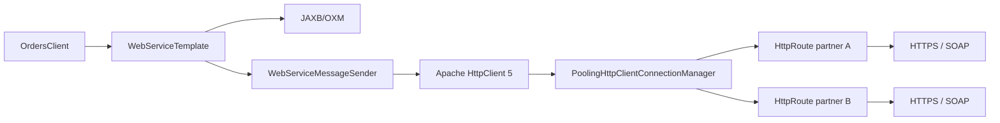
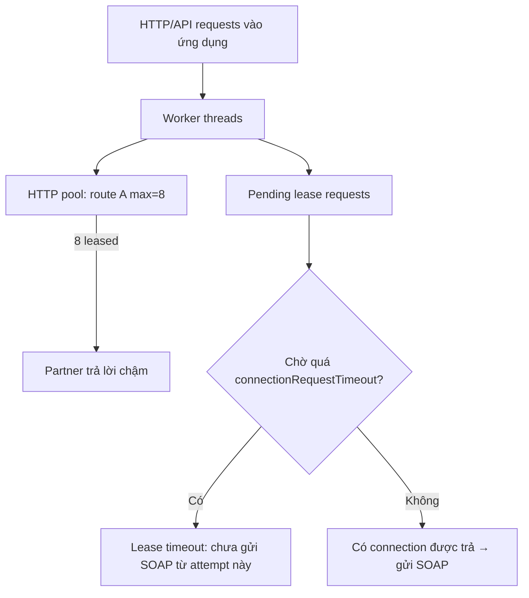

# Nhóm kết nối, giới hạn theo đích và thời gian chờ lấy kết nối

## 1. Vì sao SOAP client cần nhóm kết nối?

Trong hệ thống **Spring Web Services (Spring-WS)** phát triển theo hướng **contract-first**, XSD/WSDL quy định thông điệp SOAP, còn `WebServiceTemplate` và message sender chịu trách nhiệm chuyển thông điệp qua HTTP. Khi chỉ gửi một request kiểm thử, mọi thứ có thể hoạt động; khi hàng chục hoặc hàng trăm request được gửi đồng thời, chính **HTTP connection pool** thường trở thành một giới hạn cần quản lý.

Giả sử ứng dụng gọi:

```text
https://partner.example.org/soap/orders
```

Ba tình huống dễ nhầm lẫn:

1. **Pool đã đạt giới hạn theo đích:** các request mới phải đợi connection, dù partner vẫn khỏe.
2. **Pool đạt giới hạn tổng:** các đích khác nhau tranh nhau cùng một ngân sách connection.
3. **Đối tác chậm trả lời:** connection đã được thuê nhưng bị giữ lâu; số request phải chờ pool vì thế tăng.

Nếu không cấu hình **thời gian chờ lấy kết nối**, một request có thể xếp hàng đáng kể trước cả khi gửi SOAP Envelope. Nếu chỉ tăng số connection mà bỏ qua khả năng xử lý của partner, ứng dụng có thể đẩy quá nhiều tải ra ngoài, tạo timeout và retry hàng loạt.

Bài tập trung vào **SOAP client outbound** sử dụng Spring-WS, Apache HttpClient 5 kiểu synchronous/classic, HTTP connection pooling và các giới hạn timeout. `MessageDispatcherServlet` ở phía SOAP server nhận HTTP từ client, không tự sử dụng pool outbound này.

### Mục tiêu

Sau bài, bạn có thể:

- Phân biệt một SOAP operation, HTTP endpoint, HTTP connection và HTTP route.
- Giải thích các trạng thái `leased`, `available`, `pending` và `max`.
- Tính ý nghĩa của `maxConnTotal`, `maxConnPerRoute` và override theo route.
- Phân biệt `connectionRequestTimeout` (chờ pool cấp connection), `connectTimeout`, `responseTimeout` và deadline toàn request.
- Cấu hình `WebServiceTemplate` bằng Apache HttpClient 5 với `SimpleHttpComponents5MessageSender`.
- Thiết kế giới hạn concurrency, eviction, retry, metrics, TLS/mTLS và test bão hòa pool.
- Bảo toàn JAXB/OXM, SOAP Fault, XSD/WSDL và WS-Security khi tối ưu HTTP transport.

Các URL, thông số pool và timeout trong bài chỉ là **ví dụ kỹ thuật**; cần đo và điều chỉnh theo SLA cùng khả năng thực tế của đối tác.

## 2. SOAP operation, HTTP connection và route là ba cấp khác nhau

| Khái niệm | Ví dụ | Vai trò |
|---|---|---|
| SOAP operation | `GetOrder`, `CancelOrder` | Nghiệp vụ và thông điệp theo WSDL |
| HTTP SOAP endpoint | `https://partner.example.org/soap/orders` | Nơi POST Envelope |
| HTTP connection | TCP socket + TLS state khi dùng HTTPS | Tài nguyên vật lý/transport có thể reuse |
| HTTP route | Target scheme/host/port và tuyến proxy/TLS | Khóa mà connection pool quản lý |
| HTTP client | Apache `CloseableHttpClient` | Thuê/trả connection, gửi/nhận request |
| SOAP message sender | `SimpleHttpComponents5MessageSender` | Cầu nối Spring-WS và HttpClient |
| SOAP client API | `WebServiceTemplate` | Marshaling, gửi SOAP và xử lý response/fault |

Một `WebServiceTemplate` có thể gọi nhiều SOAP operations đến **cùng endpoint URL**. Nếu requests dùng cùng HTTP route, chúng thường chia sẻ **một hạn mức per-route**, không có riêng một pool theo tên Java method hay SOAPAction.

Ba URLs:

```text
https://partner.example.org/soap/orders/v1
https://partner.example.org/soap/orders/v2
https://partner.example.org/soap/customers
```

thường dùng cùng route transport nếu scheme/host/port và đường đi proxy/TLS như nhau. Đổi path hoặc SOAPAction **không tự tạo route riêng**.

### 2.1. Kiến trúc client outbound



- `WebServiceTemplate` đóng gói SOAP payload, gọi message sender và diễn giải response.
- Apache HttpClient thực hiện HTTP POST.
- `PoolingHttpClientConnectionManager` cấp một connection đã idle hoặc mở mới nếu còn quota.
- Connection được trả về pool để tái sử dụng sau khi response được xử lý và transport resource đã được giải phóng.
- Connection hết hạn, bị đóng, lỗi hoặc không reusable sẽ bị loại.

**Pool không giải quyết XML contract.** XSD/WSDL, JAXB, SOAPAction và SOAP Fault là các lớp xử lý riêng. Một SOAP Fault hợp lệ vẫn là một HTTP response nhận qua connection; còn connection lease timeout là lỗi local transport và **có thể chưa có request gửi tới partner**.

## 3. Vòng đời lease → connect → send → receive → release

```mermaid
sequenceDiagram
    participant C as Caller thread
    participant H as Apache HttpClient
    participant P as Connection pool
    participant S as SOAP partner
    C->>H: SOAP HTTP POST
    H->>P: Lease connection for HttpRoute
    alt Có reusable idle connection
        P-->>H: Cấp connection đang idle
    else Pool còn quota
        P-->>H: Cấp slot; mở connection mới
    else Pool chạm giới hạn
        Note over H,P: Pending / chờ free connection
        P-->>H: Connection được trả hoặc hết lease timeout
    end
    opt Đã lấy được connection
        H->>S: SOAP HTTP request
        S-->>H: HTTP response + SOAP Envelope / Fault
        H->>P: Return reusable or discard connection
        H-->>C: SOAP response / fault / transport error
    end
```

Mỗi chặng có nguy cơ lỗi khác nhau:

- **Lease/acquire:** chờ một connection từ pool.
- **Connect:** tạo TCP/TLS connection nếu không reuse.
- **Request/response:** gửi bytes và đợi kết quả HTTP.
- **XML processing:** unmarshalling JAXB, validation, xử lý SOAP Fault.
- **Release:** đưa connection reusable trở lại pool hoặc đóng connection.

Một request có thể mất rất nhiều thời gian ở bước **lease** dù chưa bắt đầu TCP connect; đây là lý do không thể dùng riêng `connectTimeout` để bảo vệ queue pool.

### 3.1. Trạng thái pool

| Trạng thái `PoolStats` | Diễn giải | Ví dụ |
|---|---|---|
| `leased` | Kết nối đang được thuê | 8 SOAP calls đang chiếm 8 connections |
| `available` | Kết nối idle còn có thể reuse | 3 sockets đang chờ request tiếp theo |
| `pending` | Yêu cầu thuê kết nối đang phải chờ | 5 worker threads đợi pool |
| `max` | Giới hạn của pool hoặc route được quan sát | Trần 8 connections cho route |

Trong Apache HttpClient 5:

- `pool.getTotalStats()` trả thống kê toàn manager.
- `pool.getStats(route)` trả thống kê route cụ thể.
- `pool.getRoutes()` cho biết những routes đã được manager theo dõi.

**`available=0` chưa đủ kết luận pool cạn:** nếu `leased<max` và manager còn khả năng tạo connection mới, request có thể được cấp ngay. **`pending>0`**, nhất là khi `leased≈max` kéo dài, là dấu hiệu contention rõ hơn.

## 4. Giới hạn toàn pool và giới hạn theo đích

Hai thuộc tính cốt lõi của Apache HttpClient 5:

- `maxConnTotal`: số connections tối đa trên **tất cả routes** của connection manager.
- `maxConnPerRoute`: trần mặc định cho **mỗi HTTP route**.

Các giới hạn là **capacity caps**, không phải số connection được tạo sẵn khi ứng dụng khởi động.

### 4.1. Ví dụ route A còn bị giới hạn dù total có chỗ

```text
maxConnTotal    = 20
maxConnPerRoute = 8

Route A: 16 requests đồng thời
Route B:  5 requests đồng thời
```

| Route | Incoming | Connection có thể dùng tối đa | Request chờ ít nhất lúc snapshot |
|---|---:|---:|---:|
| A | 16 | 8 | 8 |
| B | 5 | 5 | 0 |
| Toàn hệ | 21 | 13 | 8 |

Trong mô hình snapshot này, pool dùng tối đa 13 connections dù `maxConnTotal=20`, vì Route A bị chặn bởi per-route limit. Không có chuyện A tự dùng các slots global còn trống để vượt `maxConnPerRoute`.

Con số là **mô hình giả định** khi không có các routes khác và request chưa kịp hoàn thành, không phải mô phỏng scheduler thật.

### 4.2. Ví dụ global cap mới là nút cổ chai

```text
maxConnTotal    = 16
maxConnPerRoute = 12

A: 12 leased
B:  4 leased
C: cần thêm 3
```

Tổng đã có 16 leased connections. Dù C chưa đạt trần riêng, nó vẫn phải chờ connection có thể được manager cấp lại, vì **global cap đã đầy**.

### 4.3. Per-route không đồng nghĩa per-hostname string

Một route có thể bao gồm scheme, host, port, proxy, tunnel và secure/layered attributes. Hai requests tới cùng hostname nhưng một HTTP, một HTTPS, hoặc một đi proxy, một direct có thể tạo route khác nhau.

Không nên tạo `HttpRoute` từ một hostname rồi khẳng định nó khớp client HTTPS/mTLS. Route override và metrics phải dùng **đúng route mà HttpClient thực dùng**, nếu không giới hạn riêng có thể bị bỏ qua.

### 4.4. Per-route không có nghĩa per-tenant hoặc per-operation

Nếu hai khách hàng gọi `CancelOrder` và `GetOrder` trên cùng HTTPS endpoint, chúng thường cạnh tranh cùng per-route cap. Khi cần quota riêng theo tenant hoặc operation, dùng application-level bulkhead/semaphore, rate limiting hoặc tách transport profile theo policy; không dựa vào SOAPAction để tạo pool route.

## 5. `connectionRequestTimeout`: chờ được cấp connection

**`connectionRequestTimeout`** là thời gian request được phép chờ thuê connection từ manager. Apache HttpClient 5 dùng API:

```java
RequestConfig requestConfig = RequestConfig.custom()
    .setConnectionRequestTimeout(Timeout.ofMilliseconds(250))
    .build();
```

Ý nghĩa:

1. SOAP call yêu cầu connection theo route.
2. Pool thử cấp idle connection hoặc slot để tạo connection mới.
3. Nếu không có tài nguyên phù hợp vì caps, request phải đợi.
4. Nếu không được cấp connection trước deadline lease, attempt thất bại ở **tầng pool**.
5. Partner có thể **chưa nhận được SOAP request nào** từ attempt thất bại này.

Dưới một số phiên bản Apache HttpComponents Core, cause có thể là `org.apache.hc.core5.http.ConnectionRequestTimeoutException`. Spring-WS có thể bọc IOException vào transport exception; chẩn đoán bằng cause chain và metrics, không phụ thuộc duy nhất một message string.

### 5.1. Kịch bản ba request với pool chỉ có hai slots

```text
maxConnTotal    = 2
maxConnPerRoute = 2
lease timeout   = 150 ms

Request A: giữ connection #1 trong 800 ms
Request B: giữ connection #2 trong 800 ms
Request C: đến khi A/B đang giữ connection
```

Nếu A và B vẫn bận sau 150 ms, C không lấy được connection trước hạn và bị từ chối **trước bước gửi HTTP**. Nếu một connection được trả sau 80 ms, C có thể tiếp tục.

### 5.2. Vì sao `setConnectTimeout` không có tác dụng thay thế?

`connectTimeout` áp dụng khi thiết lập kết nối mới; `connectionRequestTimeout` áp dụng khi chờ quyền dùng một kết nối của pool. Request đang đợi pool có thể chưa bắt đầu connect. Do đó giảm connect timeout không trực tiếp giới hạn queue lease.

### 5.3. Timeout 0 hoặc vô hạn không nên là mặc định

Trong nhiều Apache HttpClient timeout configurations, giá trị 0 có thể được diễn giải là vô hạn. Cần kiểm tra semantics của phiên bản cụ thể; **không chọn 0 chỉ vì muốn request đợi mãi**. Trong server đồng bộ, chờ vô hạn dễ làm cạn worker threads và kích hoạt cascading failure.

Một giá trị khởi điểm minh họa cho SOAP call tương tác có thể là 100–500 ms, nhưng phải được chọn từ **deadline, request rate, partner latency và load test**. Không có con số chung cho mọi doanh nghiệp.

## 6. Phân biệt lease, connect, socket, response và deadline tổng

| Cơ chế | Cấu hình HttpClient 5 thường gặp | Chờ điều gì? | Có thể remote đã nhận SOAP chưa? |
|---|---|---|---|
| Lease timeout | `RequestConfig.setConnectionRequestTimeout` | Pool cấp connection | Thường chưa |
| Connect timeout | `ConnectionConfig.setConnectTimeout` | Thiết lập connection mới | Thường chưa gửi SOAP Body |
| Socket timeout | `ConnectionConfig.setSocketTimeout` | Hoạt động I/O socket | Có thể rồi |
| Response timeout | `RequestConfig.setResponseTimeout` | Chờ HTTP response từ endpoint | **Có thể rồi** |
| Tổng deadline | Application boundary/cancellation policy | Toàn bộ call và các lần retry | Phụ thuộc giai đoạn |

Một SOAP call thường có nhiều thành phần thời gian:

```text
T_total ≈ T_lease_wait + T_connect_and_TLS
        + T_request_transfer + T_remote_processing
        + T_response_transfer + T_XML_processing
        + T_retries_and_backoff
```

Đây là mô hình để đo, không phải phương trình deadline được HttpClient bảo đảm. Một số stages như DNS/TLS, redirects, re-execution và marshal/unmarshal không nhất thiết nằm gọn trong từng timeout.

### 6.1. Response timeout không phải end-to-end deadline

Apache HttpClient nêu rõ `responseTimeout` không phải absolute deadline; việc tự thực hiện lại request hoặc khác biệt transport có thể khiến thời gian tổng vượt ngưỡng. Đừng cộng lease + connect + response timeout rồi kết luận HTTP call chắc chắn kết thúc trong tổng đó.

Với một service có SLO 4 giây, có thể bắt đầu từ lease=200ms, connect≈800ms, response≈2.5s, phần còn lại cho TLS/serialization/overhead; sau đó kiểm thử deadline toàn call và khả năng cancellation riêng.

### 6.2. Chẩn đoán đúng loại lỗi

| Quan sát | Nên nghi vấn |
|---|---|
| `pending` tăng, nhiều lease timeouts | Pool contention/caps |
| Connect timeout nhưng `pending` thấp | DNS/TCP/proxy/TLS tới partner |
| Response timeout khi SOAP request đã gửi | Partner chậm hoặc mạng đứt sau gửi |
| SOAP Fault `Receiver/Server` nhận từ partner | Server gửi SOAP message báo lỗi |
| HTTP 500 trả HTML | Gateway/transport, không phải SOAP Fault XML hợp lệ |
| `No endpoint mapping found` từ partner | QName/operation/WSDL khác, không phải pool |

Đặc biệt, response timeout **không chứng minh partner chưa thực hiện giao dịch**. Một request thay đổi trạng thái có thể thành công ở phía đối tác nhưng response đến quá muộn.

## 7. Các thế hệ Spring-WS sender và HttpClient

| Stack | Sender/API | Cần lưu ý |
|---|---|---|
| Spring-WS cũ + Apache HttpClient 4 | `HttpComponentsMessageSender` | Sử dụng `org.apache.http.*` và API pool/timeout của HttpClient 4 |
| Spring-WS 4.0.x + Apache HttpClient 5 | `HttpComponents5MessageSender` | API convenience và custom client theo version |
| Spring-WS 4.1.x + Apache HttpClient 5 tự cấu hình | `SimpleHttpComponents5MessageSender` | Nhận một HttpClient đã được xây dựng đầy đủ |
| Sender dùng `HttpURLConnection` | `HttpUrlConnectionMessageSender` | Không tương đương pool per-route/total của Apache |

Các package Apache 5 thường là `org.apache.hc.client5.*` và `org.apache.hc.core5.*`, **không** phải `org.apache.http.*` của thế hệ 4.

Tài liệu Spring-WS 4.1.x đánh dấu một số cách truyền custom HttpClient vào `HttpComponents5MessageSender` là deprecated, và giới thiệu `SimpleHttpComponents5MessageSender` cho trường hợp tự kiểm soát client. **Cần đối chiếu BOM/version đang chạy** trước khi copy code.

Ví dụ Java bên dưới dành cho **Spring-WS 4.1.x, Apache HttpClient 5.x classic/blocking I/O**. Nó không phải ví dụ cho reactive Netty, HttpClient 4 hay các thư viện REST client khác.

## 8. Ví dụ cấu hình hoàn chỉnh: Apache pool, HttpClient và `WebServiceTemplate`

### 8.1. Bean connection manager

```java
package org.example.orders.soap.client;

import org.apache.hc.client5.http.config.ConnectionConfig;
import org.apache.hc.client5.http.impl.io.PoolingHttpClientConnectionManager;
import org.apache.hc.client5.http.impl.io.PoolingHttpClientConnectionManagerBuilder;
import org.apache.hc.core5.util.TimeValue;
import org.apache.hc.core5.util.Timeout;
import org.springframework.context.annotation.Bean;
import org.springframework.context.annotation.Configuration;

@Configuration(proxyBeanMethods = false)
public class PartnerSoapTransportConfig {

    @Bean(destroyMethod = "")
    public PoolingHttpClientConnectionManager partnerPool() {
        ConnectionConfig config = ConnectionConfig.custom()
            .setConnectTimeout(Timeout.ofSeconds(2))
            .setSocketTimeout(Timeout.ofSeconds(6))
            .setTimeToLive(TimeValue.ofMinutes(5))
            .setValidateAfterInactivity(TimeValue.ofSeconds(2))
            .build();

        return PoolingHttpClientConnectionManagerBuilder.create()
            .setMaxConnTotal(32)
            .setMaxConnPerRoute(8)
            .setDefaultConnectionConfig(config)
            .build();
    }
}
```

Ý nghĩa:

- `setMaxConnTotal(32)` là trần toàn pool.
- `setMaxConnPerRoute(8)` là giới hạn mặc định cho từng route.
- `setConnectTimeout(2s)` bảo vệ connect; `setSocketTimeout(6s)` cho socket I/O.
- `setTimeToLive(5m)` giới hạn vòng đời để connection không được reuse quá lâu.
- `setValidateAfterInactivity(2s)` giúp kiểm tra kết nối idle lâu trước khi tái sử dụng.

**Tại sao `destroyMethod=""`?** Trong mẫu này, manager được sở hữu bởi HttpClient tạo ở bean sender tiếp theo. Ta tránh Spring đóng manager độc lập trước/ngoài vòng đời HttpClient. Khi thay kiến trúc bean, cần đảm bảo **một owner duy nhất** chịu trách nhiệm đóng kết nối lúc shutdown.

### 8.2. Bean sender với `connectionRequestTimeout`

Thêm vào **cùng** class `PartnerSoapTransportConfig` (không tạo class trùng tên):

```java
import org.apache.hc.client5.http.config.RequestConfig;
import org.apache.hc.client5.http.impl.classic.CloseableHttpClient;
import org.apache.hc.client5.http.impl.classic.HttpClients;
import org.apache.hc.core5.util.TimeValue;
import org.apache.hc.core5.util.Timeout;
import org.springframework.ws.transport.http.HttpComponents5ClientFactory;
import org.springframework.ws.transport.http.SimpleHttpComponents5MessageSender;

@Bean
public SimpleHttpComponents5MessageSender partnerSender(
        PoolingHttpClientConnectionManager partnerPool) {

    RequestConfig requestConfig = RequestConfig.custom()
        .setConnectionRequestTimeout(Timeout.ofMilliseconds(250))
        .setResponseTimeout(Timeout.ofSeconds(6))
        .build();

    CloseableHttpClient client = HttpClients.custom()
        .setConnectionManager(partnerPool)
        .setDefaultRequestConfig(requestConfig)

        // Loại HTTP framing headers có thể do SOAP stack set sớm.
        .addRequestInterceptorFirst(
            new HttpComponents5ClientFactory.RemoveSoapHeadersInterceptor())

        .evictExpiredConnections()
        .evictIdleConnections(TimeValue.ofSeconds(30))

        // Không tự replay SOAP POST thiếu idempotency policy.
        .disableAutomaticRetries()
        .build();

    return new SimpleHttpComponents5MessageSender(client);
}
```

Phân biệt các API:

- `RequestConfig.setConnectionRequestTimeout(...)`: **giới hạn thời gian đợi được pool cấp connection**.
- `RequestConfig.setResponseTimeout(...)`: thời gian đợi HTTP response theo semantics của HttpClient.
- `ConnectionConfig.setConnectTimeout(...)`: thiết lập kết nối mới.
- `ConnectionConfig.setSocketTimeout(...)`: timeout I/O cơ bản.
- `SimpleHttpComponents5MessageSender(client)`: dùng HttpClient đã được cấu hình, không tự đặt lại các timeout/pool.
- `HttpComponents5ClientFactory.RemoveSoapHeadersInterceptor`: loại `Content-Length`/`Transfer-Encoding` mà SOAP stack có thể đã gắn, tránh xung đột với header framing của HttpClient. **Không** xóa `SOAPAction` hay WS-Security Header.
- `evictIdleConnections(...)` và `evictExpiredConnections()`: hỗ trợ dọn idle/expired connections; có thể sử dụng tài nguyên nền cần được giải phóng.

Ở Spring-WS 4.1.x, sender kế thừa `DisposableBean`. Khi Spring context đóng, cần kiểm chứng `destroy()` của phiên bản đang chạy đóng underlying client và manager do nó sở hữu. **Không đăng ký thêm cùng HttpClient như một bean có destroy callback độc lập** nếu không thiết kế chia sẻ/ownership rõ; không đóng client ngay sau từng request.

### 8.3. Bean `WebServiceTemplate` với JAXB/OXM

Thêm các bean sau vào cấu hình tương ứng:

```java
import org.springframework.oxm.jaxb.Jaxb2Marshaller;
import org.springframework.ws.client.core.WebServiceTemplate;

@Bean
public Jaxb2Marshaller partnerMarshaller() {
    Jaxb2Marshaller marshaller = new Jaxb2Marshaller();
    marshaller.setContextPath("org.example.partner.contract.v1");
    return marshaller;
}

@Bean
public WebServiceTemplate partnerTemplate(
        Jaxb2Marshaller partnerMarshaller,
        SimpleHttpComponents5MessageSender partnerSender) {

    WebServiceTemplate template = new WebServiceTemplate();
    template.setMarshaller(partnerMarshaller);
    template.setUnmarshaller(partnerMarshaller);
    template.setMessageSender(partnerSender);
    template.setDefaultUri("https://partner.example.org/soap/orders");
    return template;
}
```

Cần có generated JAXB classes/`ObjectFactory` đúng XSD của partner. Nếu XJC sinh root qua `JAXBElement` thay vì `@XmlRootElement`, client phải marshal đúng root; pool không giải quyết JAXB binding.

Chỉ cấu hình `WebServiceTemplate` **một lần**, rồi chia sẻ sau khi khởi tạo. Không tạo HttpClient/pool mới trong mỗi `marshalSendAndReceive(...)` vì sẽ phá connection reuse và khiến các pool caps riêng không bảo vệ tổng connection của cả JVM.

### 8.4. Gọi SOAP qua cùng pool

```java
import org.springframework.ws.client.core.WebServiceTemplate;
import org.springframework.ws.soap.client.core.SoapActionCallback;

public final class PartnerOrdersClient {
    private final WebServiceTemplate template;

    public PartnerOrdersClient(WebServiceTemplate template) {
        this.template = template;
    }

    public Object getOrder(Object jaxbRequest) {
        return template.marshalSendAndReceive(
            jaxbRequest,
            new SoapActionCallback("urn:partner:orders:GetOrder"));
    }
}
```

Dùng `Object` ở đây chỉ để minh họa nơi gửi request; production nên có types cụ thể và xử lý SOAP Fault/transport exceptions rõ ràng. SOAPAction phải đến từ WSDL binding, không tự suy từ Java method. Nhiều callers đồng thời dùng chung template → sender → HttpClient → pool.

## 9. Cấu hình giới hạn cho route riêng

Apache manager có phương thức `setMaxPerRoute(HttpRoute, int)`. Quan trọng là **route override phải đúng key của route đang dùng**.

Ví dụ chỉ cho **direct HTTP không TLS, không proxy** ở một stub local:

```java
import org.apache.hc.client5.http.HttpRoute;
import org.apache.hc.core5.http.HttpHost;

HttpHost target =
    new HttpHost("http", "legacy.test.example.org", 8080);

HttpRoute directHttp = new HttpRoute(target);
partnerPool.setMaxPerRoute(directHttp, 3);
```

Đây là **fragment** cần chạy khi `partnerPool` đã được tạo và trước load test. Constructor `new HttpRoute(target)` trong Apache HttpClient 5 biểu diễn direct/insecure route; không dùng nó cho HTTPS/tunnel proxy rồi khẳng định khớp route thực.

Với HTTPS/mTLS hoặc proxy, hãy xác định route thực do HttpClient route planner tạo (gồm secure/tunnel/proxy attributes), sau đó mới override và kiểm tra `pool.getStats(actualRoute)`. Một override trên route **khác** không thay đổi giới hạn mà request đang dùng.

Per-route cap cũng không tương đương quota theo user, tenant, SOAP operation hoặc SOAPAction. Muốn fairness theo nghiệp vụ cần bulkhead/limiter phía trên transport.

## 10. Keep-alive, TTL, stale và idle eviction

Pooling có ích khi kết nối được tái sử dụng, nhưng cần loại connections không còn phù hợp:

| Khái niệm | Ý nghĩa | Không phải |
|---|---|---|
| HTTP keep-alive | Cho phép tái sử dụng connection sau khi xử lý response | Bảo đảm kết nối sống mãi |
| TTL (*time to live*) | Trần tuổi của connection cho tái sử dụng theo policy | Timeout của một SOAP call |
| Idle eviction | Đóng connections rảnh lâu | Thay đổi `maxPerRoute` |
| Validate after inactivity | Kiểm tra connection idle có bị stale trước khi cấp lại | Bảo đảm không bao giờ bị reset |
| TCP/TLS keepalive | Cơ chế hệ thống/giao thức hỗ trợ sống còn của kết nối | SOAP WS-Security message signing |

Ví dụ partner/load balancer đóng socket sau 45 giây idle, còn client giữ một connection 10 phút. Request đầu tiên sau giờ nghỉ có thể gặp `Connection reset`. Cần lựa chọn `validateAfterInactivity`, idle eviction và TTL phù hợp với hạ tầng.

Không coi mọi reset là do stale connection: có thể do network, proxy, mTLS, upstream restart hoặc partner overload. Test cả các giai đoạn TLS/connect/response riêng.

### 10.1. Tài nguyên nền phải được dọn khi shutdown

Các phương thức evict của HttpClient có thể tạo công việc nền. Apache khuyến cáo đóng `CloseableHttpClient` để dừng các tài nguyên nền. Khi dùng shared manager, evictor hoặc ownership có thể hoạt động khác; cần quản lý một owner duy nhất, tránh một sender đóng manager được sender khác vẫn sử dụng.

**Không đóng pool trong `finally` của từng request.** Vòng đời pool phù hợp với Spring ApplicationContext hoặc transport profile, không phải vòng đời SOAP call.

## 11. Sizing bằng throughput và thời gian giữ connection

Một quy tắc tính **mức trung bình** từ định luật Little:

\[
L \approx \lambda \times W
\]

trong đó:

- `L`: số calls đang hoạt động trung bình.
- `λ`: request rate (calls/giây).
- `W`: thời gian mỗi call chiếm tài nguyên trung bình (giây).

Giả sử partner nhận 40 requests/giây, thời gian trung bình connection bị thuê khoảng 0,30 giây:

\[
L \approx 40 \times 0.30 = 12
\]

Khi tải ổn định, trung bình khoảng 12 concurrent calls. Điều đó **không bảo đảm** per-route cap 12 là đủ: peak bursts và p95/p99 latency khiến concurrency tức thời cao hơn nhiều. Cần đo trong thực tế và dành headroom có kiểm soát.

| Partner | Rate quan sát | Time leased trung bình | In-flight trung bình xấp xỉ |
|---|---:|---:|---:|
| Orders | 40 calls/s | 0,30 s | 12 |
| Pricing | 10 calls/s | 0,20 s | 2 |
| Legacy reporting | 5 calls/s | 1,00 s | 5 |

Tổng trung bình ≈19 không có nghĩa `maxTotal=19` là đáp án production. Phải đo burst, service capacity, tail latency và ngân sách threads/memory; Reporting chậm có thể gây tranh chấp với Orders quan trọng.

### 11.1. Global cap và per-route cap cần cân bằng

- `maxTotal=200`, `maxPerRoute=1`: mỗi route vẫn chỉ 1 connection.
- `maxTotal=20`, `maxPerRoute=16`: một route chậm có thể chiếm hầu hết tổng pool.
- `maxTotal=32`, `maxPerRoute=8`: mỗi route có trần 8; nếu cần 20 concurrent calls tới một route, request phải chờ hoặc dùng thiết kế transport khác.

### 11.2. Đừng quên số replicas

Nếu mỗi instance có `maxPerRoute=20` và ứng dụng chạy 10 replicas, cụm **có thể tạo tới khoảng 200 connections** đến cùng partner trong kịch bản mọi replica dùng hết trần riêng. Đây không phải trần chắc chắn vì còn global caps/route behavior, nhưng đủ cho thấy **pool cap của một JVM không phải limit toàn cluster**.

SLO, partner quotas, HPA/autoscaling và rate limiter phải được thiết kế cùng nhau.

## 12. Pool saturation, pending queue và backpressure

Khi partner chậm, các connections đang được thuê lâu hơn, dẫn đến các requests sau phải đợi:



Dấu hiệu bão hòa pool:

- `leased` sát trần per-route hoặc maxTotal trong thời gian dài.
- `available` gần 0 trong lúc `pending>0`.
- Lease timeout rate và p95/p99 request latency tăng cùng nhau.
- Worker threads bị giữ trong call đồng bộ, khiến queue phía trên tăng.
- Cùng một partner có nhiều lần timeout và retry tạo thêm áp lực.

### 12.1. Tăng lease timeout không tạo thêm capacity

Giả sử request có deadline nghiệp vụ 2 giây, còn partner đã mất 1,8 giây xử lý. Nếu `connectionRequestTimeout` được tăng từ 200 ms lên 10 giây, request có thể ngồi trong queue quá deadline trước khi được gửi.

**Thời gian chờ lấy connection là giới hạn queue**, không phải nút tăng throughput. Để giảm saturation cần xem concurrency, số connections thực sự cần, tốc độ remote, sự công bằng giữa routes và tốc độ requests đến.

### 12.2. Bulkhead trước HTTP pool

Một lựa chọn là giới hạn số calls đến partner ngay tại ứng dụng bằng semaphore hoặc thư viện bulkhead. Ví dụ minh họa:

```java
import java.util.concurrent.Semaphore;
import java.util.concurrent.TimeUnit;

public final class PartnerBulkhead {
    private final Semaphore permits = new Semaphore(8);

    public <T> T call(Callable<T> task) throws Exception {
        boolean entered;
        try {
            entered = permits.tryAcquire(100, TimeUnit.MILLISECONDS);
        } catch (InterruptedException e) {
            Thread.currentThread().interrupt();
            throw e;
        }

        if (!entered) {
            throw new PartnerBusyException("Partner capacity exhausted");
        }

        try {
            return task.call();
        } finally {
            permits.release();
        }
    }
}
```

Đây là mẫu kiến trúc; cần import `java.util.concurrent.Callable`, tự định nghĩa `PartnerBusyException`, bổ sung metrics và exception mapping phù hợp. Số permits 8 chỉ là ví dụ. Trong production có thể dùng Resilience4j Bulkhead hoặc tương đương, nhưng vẫn cần chính sách error budget và integration tests.

Bulkhead giúp hạn chế số concurrent calls **trước khi** worker bước vào queue của Apache pool. Pool vẫn nên có `connectionRequestTimeout` như lớp bảo vệ bổ sung. Một semaphore trong một JVM không phải là giới hạn toàn cụm.

### 12.3. Queueing fairness không được mặc định

Nếu route A đang có 100 pending requests và route B có 1 pending request, Apache pool có thể có policy điều phối riêng. Không tuyên bố luôn có FIFO hoặc fairness tuyệt đối nếu chưa kiểm chứng cấu hình và version. Cần thực hiện test burst/priority hoặc tách pools khi một partner quá chậm có thể ảnh hưởng luồng quan trọng khác.

## 13. Retry và tính an toàn của SOAP operation

Một connection acquisition failure thường có nghĩa attempt đó chưa gửi HTTP request. Nhưng **response timeout sau khi gửi POST** có thể xảy ra dù partner đã xử lý request thành công.

| Lỗi | Remote có thể đã thực thi nghiệp vụ? | Hướng xử lý |
|---|---|---|
| Chờ pool quá hạn trước khi có connection | Thường chưa có request từ attempt đó | Có thể retry có giới hạn nếu còn deadline |
| Connect failure | Thường chưa truyền SOAP Body | Kiểm tra DNS/network/TLS/proxy và backoff |
| Response timeout sau khi gửi SOAP | **Có thể đã thực thi** | Chỉ retry theo idempotency contract |
| SOAP Fault nghiệp vụ | Remote trả lỗi có cấu trúc | Đọc mã lỗi, không retry mù |
| HTTP 503/gateway reset | Trạng thái xử lý có thể không rõ | Retry policy tùy operation và attempt history |

Một SOAP operation như `GetOrder` (đọc) thường dễ retry hơn `CreatePayment` hoặc `CancelOrder` (thay đổi trạng thái). Với operation biến đổi dữ liệu cần request identifier, idempotency key hoặc khả năng tra cứu trạng thái thực tế trước khi gửi lại.

### 13.1. Không để HTTP layer tự replay request ngoài ý muốn

Trong cấu hình ở mục 8 có:

```java
.disableAutomaticRetries()
```

Ý nghĩa là ứng dụng không muốn HttpClient tự động replay SOAP POST mà business layer không biết. Đây không phải tuyên bố rằng **mọi** retry phải tắt trong mọi sản phẩm; đó là lựa chọn an toàn ban đầu cho các operation không được bảo đảm idempotent.

Khi bật retry:

1. Chỉ retry với exception/status thực sự có thể phục hồi.
2. Có giới hạn attempts và deadline tổng.
3. Dùng exponential backoff và jitter.
4. Không tăng concurrency trong lúc pool/partner đang bão hòa.
5. Có idempotency và timeout semantics trong hợp đồng đối tác.
6. Theo dõi request IDs và retry rate để phát hiện duplicate effects.

Không để `connectionRequestTimeout` thấp cùng retry vô hạn tạo một vòng **liên tục tranh pool**.

## 14. Quan sát metrics: leased, available, pending, max

Vì `partnerPool` ở mục 8 là một Spring bean, có thể inject để đọc metrics:

```java
import org.apache.hc.core5.pool.PoolStats;

PoolStats s = partnerPool.getTotalStats();

int leased = s.getLeased();
int idle = s.getAvailable();
int pending = s.getPending();
int capacity = s.getMax();
```

Đây là code fragment; `partnerPool` đã được khai báo/inject ở ứng dụng. Có thể ghi metrics bằng Micrometer Gauges hoặc monitor theo lịch với label partner/client đã được chuẩn hóa.

Đối với **direct HTTP route** ở mục 9:

```java
HttpRoute directHttpRoute = new HttpRoute(
    new HttpHost("http", "legacy.test.example.org", 8080));

PoolStats routeStats = partnerPool.getStats(directHttpRoute);
```

Với route HTTPS/proxy, không dùng key minh họa trên; phải chọn chính xác route mà HttpClient thực sử dụng, có thể đối chiếu `getRoutes()` và policy route planner. Không log hostname nhạy cảm hoặc URL chứa token nếu compliance policy không cho phép.

### 14.1. Những chỉ số nên theo dõi

| Chỉ số | Đơn vị/nhãn | Ý nghĩa |
|---|---|---|
| `http.pool.leased` | Connection manager + route | Connections đang sử dụng |
| `http.pool.available` | Connection manager + route | Idle connections reusable |
| `http.pool.pending` | Connection manager + route | Yêu cầu lease đang đợi |
| `http.pool.max` | Connection manager + route | Capacity ceiling |
| `soap.outbound.duration` | Partner + operation | Thời gian từ trước call đến kết quả |
| `soap.outbound.lease_timeout` | Partner/route | Số lần không thuê được connection |
| `soap.outbound.connect_error` | Partner/route | Network/connection setup failures |
| `soap.outbound.response_timeout` | Partner/operation | Không có response trong hạn |
| `soap.outbound.soap_fault` | Fault code | Partner trả SOAP Fault |
| `soap.outbound.retry_count` | Partner/operation | Tải tăng do retry |
| `soap.outbound.inflight` | Partner | In-flight application calls |

**Không gộp SOAP Fault count với transport timeout count.** Một bên là remote SOAP response có Fault, bên kia có thể là local pool saturation chưa gửi request.

### 14.2. Alert theo xu hướng

Những dấu hiệu nên xem xét:

- `pending>0` kéo dài nhiều khoảng đo.
- `leased/max` cao bền vững **đồng thời** latency và error rate tăng.
- Route A chiếm phần lớn `maxTotal` khiến Route B khó lấy connection.
- Lease timeouts tăng sau deploy thay đổi số replicas hoặc burst load.
- Một lỗi `Connection reset` xảy ra ngay sau idle period dài.

Một snapshot `available=0` hoặc `leased>0` **không tự là sự cố**. Phải đánh giá cùng request rate, latency, partner health và thời gian tồn tại của tình trạng.

### 14.3. Tránh cardinality cao và lộ dữ liệu

Dùng label partner/route name cố định hoặc whitelist; không đưa `orderId`, `customerId`, raw SOAP Body, token, WS-Security signature hay full URI có query secrets vào metric labels. Với log correlation ID do client gửi, giới hạn ký tự/độ dài và kiểm soát log injection.

## 15. Một pool chung hay tách theo đối tác?

Một shared `PoolingHttpClientConnectionManager` cho nhiều routes giúp dùng chung tài nguyên, nhưng tạo coupling do `maxConnTotal` là giới hạn toàn bộ manager.

| Phương án | Ưu điểm | Rủi ro/chi phí |
|---|---|---|
| Một pool, nhiều routes | Tiết kiệm socket management, dễ có global budget | Một route chậm có thể tranh global slots |
| Pool riêng cho mỗi partner/priority | Cô lập timeout, TLS/mTLS, connection budget | Nhiều tài nguyên và lifecycle quản lý hơn |
| Một pool + bulkhead theo operation | Vừa reuse vừa giới hạn business concurrency | Cần đồng bộ policy ở hai tầng |
| Nhiều pools theo trust boundary | Tách cert/truststore/credential | Phải đo tổng connection của cả process/cluster |

Ví dụ các profile minh họa:

```text
Orders partner:
  maxTotal=32; maxPerRoute=8; leaseWait=250ms

Legacy reporting:
  maxTotal=8; maxPerRoute=4; leaseWait=500ms

Payment gateway:
  maxTotal=16; maxPerRoute=8; leaseWait=100ms
  mTLS profile riêng; idempotency + retries theo hợp đồng
```

Không copy số liệu trên sang production mà không test. Nếu đối tác B chỉ nhận tối đa 5 concurrent requests, đặt per-route 50 có thể làm quá tải thay vì cải thiện hiệu năng.

### 15.1. Tách pool không thay thế rate limiting

Pool giới hạn connections đang dùng, **không bảo đảm** số requests/giây hoặc số tiền giao dịch. Nếu remote dùng request rate quota, cần thêm rate limiter. Nếu remote chia hạn mức trên toàn tenant/cluster, cần cơ chế phối hợp ngoài một JVM.

### 15.2. Không tạo pool theo từng request

Anti-pattern:

```java
public Object invoke(Object request) {
    // Anti-pattern minh họa: mỗi call lại tạo HTTP client/sender.
    var sender = new HttpComponents5MessageSender();
    var template = new WebServiceTemplate();
    template.setMessageSender(sender);
    return template.marshalSendAndReceive(request);
}
```

Đoạn này chưa cấu hình URI/JAXB và không phải client runnable; nó chỉ minh họa sai lầm ở lifecycle. Nếu mọi request có một pool riêng, sẽ không có một global connection budget có ý nghĩa cho các requests đó, cũng không có keep-alive reuse bền vững.

Dùng Spring singleton sender/client theo transport profile, với các cấu hình bất biến sau khởi tạo.

## 16. Cấu hình theo môi trường thay vì hard-code

Có thể externalize pool và timeout settings:

```yaml
soap:
  partner:
    uri: ${SOAP_PARTNER_URI:https://partner.example.org/soap/orders}
    pool:
      max-total: 32
      max-per-route: 8
    timeouts:
      lease: 250ms
      connect: 2s
      response: 6s
      socket: 6s
    connection:
      ttl: 5m
      validate-after-inactivity: 2s
      evict-idle-after: 30s
```

**Đây là namespace property tùy biến**, không phải các property mà Spring Boot tự động áp dụng vào Apache HttpClient. Cần binding bằng `@ConfigurationProperties` và truyền giá trị thực vào builders trong mục 8.

### 16.1. Record cấu hình kiểu mạnh

```java
import java.net.URI;
import java.time.Duration;
import org.springframework.boot.context.properties.ConfigurationProperties;

@ConfigurationProperties(prefix = "soap.partner")
public record PartnerSoapProperties(
    URI uri,
    Pool pool,
    Timeouts timeouts,
    Connection connection
) {
    public record Pool(int maxTotal, int maxPerRoute) {}
    public record Timeouts(
        Duration lease,
        Duration connect,
        Duration response,
        Duration socket
    ) {}
    public record Connection(
        Duration ttl,
        Duration validateAfterInactivity,
        Duration evictIdleAfter
    ) {}
}
```

Bật binding bằng `@EnableConfigurationProperties(PartnerSoapProperties.class)` hoặc configuration properties scanning. Sau đó áp dụng các Duration đã bind vào Apache `Timeout`/`TimeValue` theo API phù hợp; đoạn record **không tự cấu hình pool** khi chỉ được khai báo.

Cần fail-fast với:

- `uri` không rỗng và được allowlist; production dùng HTTPS.
- `maxTotal>0`, `maxPerRoute>0` và các giá trị có ý nghĩa theo thiết kế.
- Timeouts hữu hạn và dương theo SLA.
- Không cho phép một request bên ngoài tự đổi destination URL tùy ý (rủi ro SSRF).
- Không log secrets/truststore password hoặc đường dẫn chứa dữ liệu nhạy cảm.

### 16.2. Local/staging/production có SLO khác nhau

- Local: có thể dùng stub HTTP để tái hiện saturation.
- Staging: giống production về TLS/mTLS, proxy, WSDL/XSD và phần quan trọng của traffic pattern.
- Production: capacity theo quotas đã cam kết, autoscaling, monitoring và fallback/bulkhead policy.

Đổi pool settings ở runtime cần được thực hiện có kế hoạch: tránh thay manager khi vẫn còn in-flight calls và không đóng socket mà một request khác đang dùng.

## 17. TLS, DNS, proxy và WS-Security

### 17.1. HTTPS và mTLS

Trong doanh nghiệp, outbound SOAP thường cần HTTPS hoặc mutual TLS. Một custom HttpClient phải kiểm soát:

- CA/truststore hợp lệ, hostname verification bật.
- Client certificate/private key khi partner yêu cầu mTLS.
- TLS versions/ciphers tương thích chính sách.
- Rotation chứng chỉ có phương án thay transport profile/connection pool.
- HTTP proxy, CONNECT tunnel và proxy authentication nếu mạng bắt buộc.

**Không dùng trust-all SSL hoặc tắt hostname verification** chỉ để vượt handshake failure. Việc đó là vấn đề bảo mật, không phải cách chữa pool timeout.

### 17.2. DNS changes và TTL

Một persistent connection tiếp tục dùng TCP socket tới địa chỉ IP nó đang kết nối, trong khi DNS có thể đã thay đổi. TTL và idle eviction giúp giảm thời gian giữ các connections quá cũ, nhưng phải kiểm chứng failover với hạ tầng thật. Connect timeout có thể không bao phủ mọi trường hợp DNS/TLS theo provider/proxy đang dùng; total deadline cần được quản lý riêng.

### 17.3. Không nhầm TLS với WS-Security

- Pool quản lý transport connections.
- TLS/mTLS bảo vệ kênh mạng và có thể xác thực endpoint.
- WS-Security bảo vệ SOAP message/header, chữ ký, mã hóa, timestamp và token.
- JAXB/XSD validation kiểm tra XML contract.
- SOAP Fault xử lý lỗi ứng dụng/giao thức.

Tối ưu pooling không được làm vô hiệu header SOAPAction, WS-Security hoặc validation. Một request có connection nhưng bị SOAP security interceptor từ chối **không phải lease timeout**.

## 18. Kiểm thử concurrency thật: mock SOAP không đủ

`MockWebServiceServer` giúp kiểm tra `WebServiceTemplate` gửi XML, SOAPAction và nhận response/fault theo hợp đồng mà không cần HTTP remote. Nhưng nó **không chứng minh** pool lease, TCP reuse, TLS hoặc `connectionRequestTimeout`. Để test pool, cần server HTTP thực (stub/embedded server) có thể kiểm soát độ trễ và số requests.

### 18.1. Kịch bản lease timeout deterministic

Thiết lập:

```text
maxTotal=1
maxPerRoute=1
connectionRequestTimeout=150ms
responseTimeout=3s
```

Các bước:

1. SOAP stub server có handler nhận request A rồi giữ response bằng synchronization latch.
2. Gửi A từ một thread; đợi **stub xác nhận đã nhận A**, nghĩa là connection đã được thuê.
3. Gửi B từ thread khác đến **cùng route**, khi A chưa trả response.
4. B phải không lấy được connection trước lease timeout.
5. Chứng minh stub **không nhận B** trước thời điểm B báo lỗi.
6. Nhả response A rồi xác minh B hoặc request C có thể chạy tiếp nếu vẫn trong deadline.
7. Xác minh pool stats sau test: `leased` trở về baseline, không leak.
8. Đóng HttpClient khi test context kết thúc.

**Không dùng `Thread.sleep(100)` rồi cho rằng A đã chiếm connection.** Scheduling khác nhau làm test chập chờn; cần latch/await cho trạng thái có thể quan sát.

### 18.2. Kiểm tra maxTotal khác perRoute

Tạo hai stub HTTP destinations thuộc hai routes khác nhau:

```text
maxTotal=3
maxPerRoute=2
A: 2 slow requests
B: 2 slow requests
```

Giữ response, quan sát tại một thời điểm tổng leased ≤3 và một route ≤2. Request thứ tư phải đợi hoặc fail theo lease timeout khi không có connection được trả kịp. Không giả định request A/B sẽ được cấp theo một thứ tự FIFO cụ thể trừ khi pool policy xác nhận điều đó.

### 18.3. Kiểm tra keep-alive/stale

- Gửi nhiều SOAP calls tuần tự trên một `WebServiceTemplate` dùng chung.
- Đo số TCP connections mới ở stub, so với số HTTP requests.
- Cho stub đóng idle socket rồi gửi request sau thời gian nghỉ; quan sát stale handling.
- Mô phỏng reset, connect failure và response delay như các ca riêng.
- Kiểm tra `getTotalStats().getLeased()` không kẹt ở max khi không còn calls.

### 18.4. Kiểm thử contract và bảo mật song song

Cùng với pooling tests, vẫn cần:

- SOAP 1.1/1.2 Envelope và content type theo WSDL.
- JAXB/XSD request/response, fault detail đúng namespace.
- Client khác stack để kiểm tra interoperability.
- TLS/mTLS trust chain, hostname verification, chứng chỉ hết hạn/rotation.
- WS-Security token/signature/timestamp âm tính.
- Operation thay đổi dữ liệu được bảo vệ bởi idempotency trước retry.

HTTP 500 có SOAP Fault hợp lệ khác hoàn toàn HTTP 500 HTML do gateway hoặc lỗi không thuê được connection.

## 19. Ma trận kiểm thử đề xuất

| # | Tình huống | Kỳ vọng |
|---|---|---|
| 1 | Một SOAP request, pool còn slot | Thành công, `pending=0` |
| 2 | Hai requests cùng route, `maxPerRoute=2` | Cả hai có thể thuê connection |
| 3 | Request thứ ba khi hai connections đang leased | Đợi hoặc lease timeout |
| 4 | `maxTotal=100` nhưng `maxPerRoute=2` | Route vẫn không vượt 2 |
| 5 | Hai routes cùng đòi tổng > `maxTotal` | Global cap hạn chế |
| 6 | `available=0` nhưng còn quota | Có thể mở connection mới |
| 7 | `pending>0` dưới tải kéo dài | Metrics và alert nhận diện congestion |
| 8 | Lease timeout trước khi gửi HTTP | Stub không nhận request từ attempt đó |
| 9 | Connect timeout | Phân loại đúng connect error |
| 10 | Response timeout | Remote có thể đã nhận request |
| 11 | SOAP Fault do remote gửi | Parse Fault, không gộp vào pool failure |
| 12 | HTTP 503/HTML từ gateway | Không coi là SOAP Fault XML |
| 13 | Reuse tuần tự | Không tạo TCP socket mới cho mỗi call nếu reusable |
| 14 | Stale socket sau idle dài | Không kẹt pool, kết nối được thay |
| 15 | Client shutdown | Connections/evictor resources được giải phóng |
| 16 | Tăng replicas | Tổng transport capacity tính trên cụm |
| 17 | Partner chậm | Bulkhead không để queue tăng vô hạn |
| 18 | Retry operation thay đổi dữ liệu | Có idempotency, retry budget |
| 19 | HTTPS wrong certificate | Bị từ chối, không bypass TLS |
| 20 | WS-Security signature sai | Bị từ chối ở security layer |
| 21 | SOAP request sai XSD | Domain không được gọi |
| 22 | WSDL endpoint/proxy URL sai | Lỗi routing được phân biệt với pool |
| 23 | Hai SOAP operations cùng route | Không có quota tự tách theo SOAPAction |
| 24 | Route override sai TLS/proxy | Test phát hiện cấu hình không có hiệu lực |

## 20. Triệu chứng thường gặp và cách điều tra

| Triệu chứng | Nguyên nhân khả dĩ | Điều cần kiểm tra |
|---|---|---|
| `pending` cao, `leased≈maxPerRoute` | Bão hòa một đích | Rate, response latency, per-route cap |
| `leased≈maxTotal` ở nhiều routes | Cạn tổng pool | Isolation/capacity global |
| Connection request timeout tăng | Chờ lease quá lâu | Stats theo route, concurrency |
| Connect timeout, `pending` thấp | Network/proxy/DNS/TLS | TCP route và certificates |
| Response timeout | Upstream chậm hoặc network response | Server latency, đã gửi request chưa |
| Connection reset sau idle | Stale keep-alive | TTL, validation after inactivity, LB idle |
| Pool còn nhiều available nhưng call chậm | JAXB, WS-Security, remote processing | Timing theo phase |
| Leased kẹt ở max dù không có active calls | Response/connection lifecycle leak | Stream/HTTP response consumption |
| Tăng pool nhưng throughput không tăng | Partner bị quá tải | Quotas, p95 latency, backoff |
| Request trùng khi timeout | Retry thiếu idempotency | Key/operation semantics |
| WSDL trả 404 | Metadata URL/servlet/proxy | Không phải pool lease |
| SOAP Fault business | Đối tác từ chối theo contract | Fault code/detail XSD/WSDL |

### Quy trình chẩn đoán

1. Xác định lỗi ở **SOAP client outbound** hay Spring-WS server inbound.
2. Đo timing acquire/connect/response/unmarshal và đọc cause chain.
3. Quan sát `leased`, `available`, `pending`, `max` tổng và theo route.
4. Kiểm tra traffic, p95/p99, retry rate và số replicas.
5. Phân biệt per-route cap, global cap, bulkhead và capacity phía partner.
6. Thay đổi **một tham số có kiểm soát**, tải thử lại và kiểm chứng WSDL/SSL/security.
7. Thêm regression tests cho saturation và lỗi transport vừa tái hiện.

## 21. Bài tập thực hành

Hãy xây một Spring-WS client giả lập gọi đối tác `GetOrder`, dùng SOAP HTTP stub có thể giữ response:

1. Tạo XSD/WSDL đơn giản, sinh JAXB request/response và cấu hình `WebServiceTemplate`.
2. Tạo pool với `maxTotal=3`, `maxPerRoute=2`, `leaseTimeout=200ms`.
3. Giữ hai requests đồng thời trên cùng route; xác nhận chúng đã tới stub bằng latch.
4. Gửi request thứ ba và xác minh bị lease timeout **trước khi** stub nhận request này.
5. Nhả một response rồi gọi lại; kiểm tra khả năng reuse connection.
6. Đổi `maxTotal` lên 50, giữ `maxPerRoute=2`; giải thích vì sao Route A không tăng concurrency.
7. Thêm Route B, chứng minh `maxTotal=3` vẫn chặn tổng trên hai routes.
8. Thử 100ms, 250ms, 2s lease timeout; đo pending và tail latency.
9. Mô phỏng remote response delay; phân biệt response timeout với lease timeout.
10. Mô phỏng idle socket bị đóng; kiểm tra stale connection recovery.
11. Thêm application bulkhead; xác minh nó từ chối sớm khi partner bão hòa.
12. Thêm một SOAP Fault hợp lệ và một HTML 503; bảo đảm client phân loại đúng.
13. Kiểm tra TLS/mTLS và SOAP WS-Security trong staging nếu hợp đồng yêu cầu.
14. Tính capacity tổng khi có nhiều replicas, dựa trên SLA và quota partner.
15. Đưa metrics/leasing tests vào CI hoặc bộ performance regression phù hợp.

### Câu hỏi tự kiểm tra

1. Tại sao `maxConnTotal=100` không giúp một route vượt `maxConnPerRoute=2`?
2. `available=0` có đồng nghĩa pool đang cạn không?
3. `connectionRequestTimeout` có bảo vệ thời gian chờ DNS/TLS không?
4. `connectTimeout` và `responseTimeout` khác lease timeout ở bước nào?
5. Tại sao response timeout không chứng minh remote chưa xử lý SOAP request?
6. Hai SOAPAction trên cùng URL có dùng pool route riêng không?
7. Dùng HttpRoute direct/insecure để override HTTPS/proxy route có vấn đề gì?
8. Vì sao `WebServiceTemplate` nên được dùng chung thay vì tạo mới per call?
9. TTL, idle eviction, stale validation khác nhau ở mục đích nào?
10. Tại sao tăng lease timeout có thể làm latency và queue tệ hơn?
11. Khi nào nên tách pool cho hai partner thay vì tăng maxTotal?
12. Số replicas ảnh hưởng giới hạn connection toàn cụm thế nào?
13. Vì sao `MockWebServiceServer` chưa đủ để test pooling?
14. WS-Security, TLS và HTTP pooling giải quyết những vấn đề khác nhau nào?
15. Nếu SOAP trả Server Fault nhưng pool không bão hòa, có nên tăng pool ngay không?

## 22. Definition of Done

Một SOAP client có HTTP connection pooling chỉ nên được coi là sẵn sàng tích hợp khi:

- [ ] Đã xác định Spring-WS và Apache HttpClient version, không trộn HTTP Client 4/5 APIs.
- [ ] Có HttpClient/message sender/pool được quản lý theo application lifecycle, không tạo per-request.
- [ ] `maxTotal` và `maxPerRoute` có cơ sở từ tải, p95/p99 latency, quota partner.
- [ ] Đã xác định đúng HTTP routes gồm scheme/host/port/proxy/TLS, không nhầm route với SOAP operation.
- [ ] `connectionRequestTimeout` hữu hạn và được cấu hình trên đúng HttpClient đang được sender dùng.
- [ ] Connect/socket/response timeouts và deadline tổng được định nghĩa riêng.
- [ ] Có backpressure/bulkhead và retry budget, không để queue tích tụ vô hạn.
- [ ] Có connection TTL, stale validation, idle eviction và shutdown đúng owner.
- [ ] HTTP client custom xử lý SOAP framing headers mà không làm hỏng SOAPAction/WS-Security.
- [ ] TLS/mTLS/truststore/hostname verification được bảo vệ; không dùng trust-all.
- [ ] JAXB/XSD và SOAP Fault contract được test độc lập với transport timeouts.
- [ ] Có pool metrics `leased/available/pending/max` và cảnh báo theo xu hướng.
- [ ] Có integration test với HTTP stub gây lease contention deterministic.
- [ ] Có test response timeout và stale connection, phân biệt với SOAP Fault.
- [ ] Đã tính số connections tổng trên mọi replicas.
- [ ] Retry operation biến đổi dữ liệu chỉ chạy theo idempotency contract.
- [ ] Có client interoperability tests với WSDL/XSD và SOAP version thật.

**Ghi nhớ:** connection pool giúp tái sử dụng socket và giới hạn HTTP concurrency. **Giới hạn theo route** bảo vệ từng đường kết nối, còn **`connectionRequestTimeout` bảo vệ thời gian request phải đợi để được cấp một connection**. Chỉ khi phối hợp cả ba với deadline, backpressure, telemetry và các điều kiện SOAP/TLS/WS-Security, ứng dụng mới ổn định khi lưu lượng tăng.

## 23. Tài liệu tham khảo

- [Spring Web Services — Reference Documentation](https://docs.spring.io/spring-ws/docs/current/reference/html/): `WebServiceTemplate`, HTTP transports và SOAP contract-first.
- [Spring-WS 4.1 — SimpleHttpComponents5MessageSender](https://docs.spring.io/spring-ws/docs/4.1.x/api/org/springframework/ws/transport/http/SimpleHttpComponents5MessageSender.html): dùng Apache HttpClient preconfigured.
- [Spring-WS 4.1 — HttpComponents5MessageSender](https://docs.spring.io/spring-ws/docs/4.1.x/api/org/springframework/ws/transport/http/HttpComponents5MessageSender.html): tiện ích cấu hình và lưu ý khi đưa custom HttpClient.
- [Spring-WS 4.1 — HttpComponents5ClientFactory](https://docs.spring.io/spring-ws/docs/4.1.x/api/org/springframework/ws/transport/http/HttpComponents5ClientFactory.html): helper HTTP SOAP framing interceptor.
- [Apache HttpClient 5 — Connection management](https://hc.apache.org/httpcomponents-client-5.6.x/connection-management.html): per-route/total limits, keep-alive, TTL và eviction.
- [Apache HttpClient 5 — PoolingHttpClientConnectionManagerBuilder](https://hc.apache.org/components/httpcomponents-client-5.4.x/5.4.4/httpclient5/apidocs/org/apache/hc/client5/http/impl/io/PoolingHttpClientConnectionManagerBuilder.html): pool caps.
- [Apache HttpClient 5 — RequestConfig.Builder](https://hc.apache.org/httpcomponents-client-5.6.x/5.6/httpclient5/apidocs/org/apache/hc/client5/http/config/RequestConfig.Builder.html): connection request timeout và response timeout.
- [Apache HttpClient 5 — ConnectionConfig.Builder](https://hc.apache.org/components/httpcomponents-client-5.3.x/5.3.1/httpclient5/apidocs/org/apache/hc/client5/http/config/ConnectionConfig.Builder.html): connect/socket timeouts và connection TTL.
- [Apache HttpCore 5 — PoolStats](https://hc.apache.org/components/httpcomponents-core-5.0.x/5.0.4/httpcore5/apidocs/org/apache/hc/core5/pool/PoolStats.html): leased/available/pending/max.
- [Apache HttpClient 5 — HttpRoute](https://hc.apache.org/components/httpcomponents-client-5.4.x/5.4.4/httpclient5/apidocs/org/apache/hc/client5/http/HttpRoute.html): scheme, target, proxy và direct/secure route.
- [W3C — WSDL 1.1](https://www.w3.org/TR/wsdl.html): operation, SOAP binding và service address.
- [OWASP — Web Service Security Cheat Sheet](https://cheatsheetseries.owasp.org/cheatsheets/Web_Service_Security_Cheat_Sheet.html): TLS và bảo mật tích hợp SOAP.
