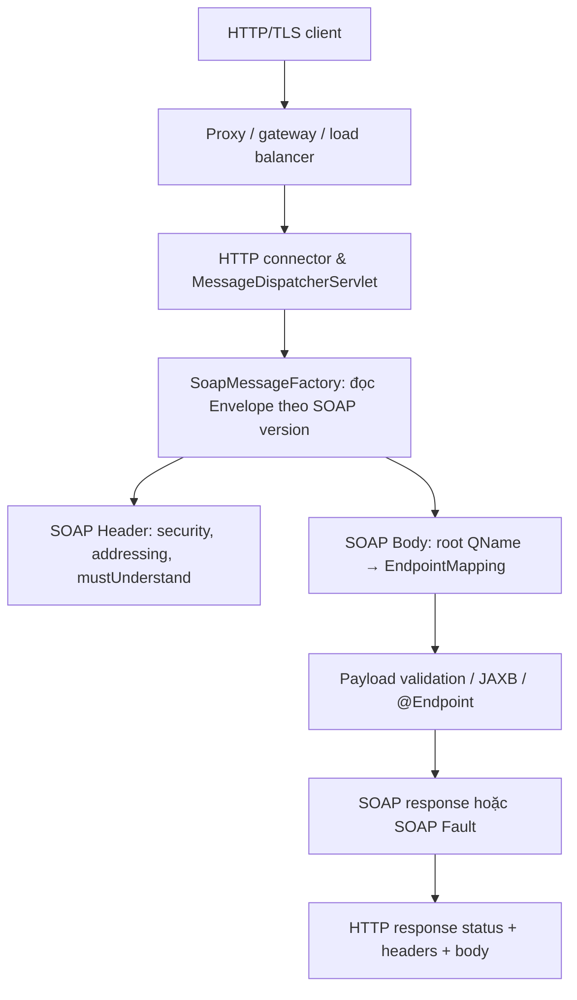
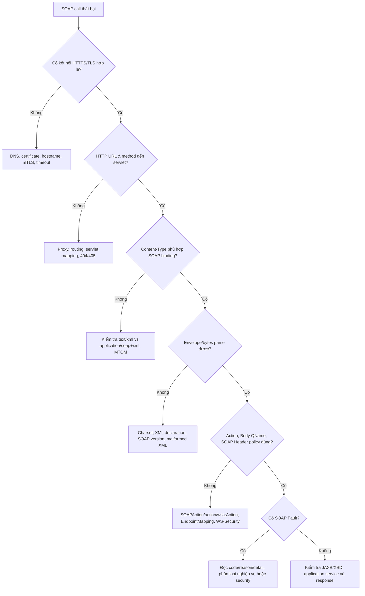

# Content-Type, charset, SOAPAction và các header do transport quản lý

## 1. Vì sao một SOAP message đúng XSD vẫn có thể bị từ chối?

Trong dịch vụ **Spring Web Services (Spring-WS)** theo hướng **contract-first**, XSD quy định các phần tử XML và kiểu dữ liệu, WSDL công bố operation/binding/địa chỉ, JAXB ánh xạ XML ↔ Java, còn `@Endpoint` và `@PayloadRoot` xử lý nghiệp vụ. Tuy nhiên, trước khi endpoint được gọi, một SOAP message thường phải đi qua **HTTP transport**, web container, reverse proxy và bộ đọc SOAP Envelope.

Ví dụ client gửi Body `GetOrderRequest` đúng namespace nhưng nhận `415 Unsupported Media Type`. Hoặc request có XML UTF-8 nhưng header khai `charset=ISO-8859-1`, khiến dấu tiếng Việt bị diễn giải sai. Một trường hợp khác: client gửi HTTP `SOAPAction` không đúng WSDL, nhưng developer sửa `@PayloadRoot` thay vì kiểm tra binding và mapping. Đây là các lỗi **ranh giới transport ↔ SOAP protocol**, không phải lúc nào cũng là lỗi XSD/JAXB.

**Chủ đề bài học:** cách cấu hình, phân biệt và kiểm thử `Content-Type`, `charset`, `SOAPAction` cùng các HTTP headers do transport quản lý, trong bối cảnh module `SPRING_WEB_SERVICES` — phát triển dịch vụ SOAP contract-first với Spring-WS, XSD/WSDL, JAXB, endpoint/client, SOAP Fault, interceptor, XML security, WS-Security, chứng chỉ và kiểm thử tương thích tích hợp doanh nghiệp.

### Mục tiêu học tập

Sau bài thuộc chương **HTTP và kết nối**, bạn có thể:

1. Giải thích sự khác nhau của HTTP headers, SOAP Envelope/Body/Header và dữ liệu nghiệp vụ theo XSD.
2. Chọn đúng `Content-Type` cho **SOAP 1.1** và **SOAP 1.2**, kể cả yêu cầu có MTOM.
3. Giải thích ý nghĩa `charset` so với XML declaration, byte encoding, BOM và Unicode.
4. Phân biệt **HTTP `SOAPAction`**, `action` parameter của SOAP 1.2, `wsa:Action` (WS-Addressing) và QName trong `@PayloadRoot`.
5. Nhận diện các HTTP headers **do HTTP client/server/container/proxy** quản lý, không tự ghi đè hoặc nhầm với SOAP Header.
6. Cấu hình `WebServiceTemplate`, SOAP message factory và callback để gửi request đúng binding; quan sát transport qua servlet filter.
7. Viết test tích hợp cho request/response headers, SOAP Fault, security, encoding và contract compatibility.

> **Nguyên tắc:** XML hợp XSD là điều kiện của **payload**, không tự bảo đảm HTTP request/response có đúng MIME type, SOAP version, action hoặc encoding. Ngược lại, HTTP headers đúng không chứng minh SOAP Body hợp lệ hoặc caller đã được cấp quyền.

## 2. Ba vùng dữ liệu: HTTP header, SOAP header, SOAP body

Một request SOAP qua HTTP có thể hình dung:

```text
HTTP request line:
  POST /ws HTTP/1.1

HTTP headers (transport):
  Host, Content-Type, SOAPAction, Authorization,
  Content-Length / Transfer-Encoding, Accept-Encoding, ...

HTTP entity body:
  <soap:Envelope>
      <soap:Header> ... WS-Security, WS-Addressing ... </soap:Header>
      <soap:Body> ... GetOrderRequest từ XSD ... </soap:Body>
  </soap:Envelope>
```



| Vùng | Ví dụ | Do ai thường quản lý? |
| --- | --- | --- |
| **HTTP request/response headers** | `Content-Type`, `SOAPAction`, `Content-Length`, `Authorization`, `Accept-Encoding`. | HTTP message sender, servlet container, reverse proxy/gateway; một số có cấu hình của ứng dụng. |
| **SOAP Envelope namespace** | SOAP 1.1 `http://schemas.xmlsoap.org/soap/envelope/`; SOAP 1.2 `http://www.w3.org/2003/05/soap-envelope`. | SOAP message factory và giao thức. |
| **SOAP Header** | `wsse:Security`, `wsa:Action`, `wsa:MessageID`, metadata theo contract. | SOAP processing/interceptor và policy WS-Security/WS-Addressing. |
| **SOAP Body** | `ord:GetOrderRequest`, `ord:GetOrderResponse`, `soap:Fault`. | XSD/WSDL contract, endpoint mapping, JAXB/OXM/serializer. |

**Đừng nhầm:** HTTP header `SOAPAction` **không** nằm trong `<soap:Header>`. HTTP `Authorization` cũng **không phải** WS-Security `UsernameToken`. Chúng có thể cùng xuất hiện nhưng bảo vệ các lớp khác nhau.

### 2.1. HTTP và SOAP có trách nhiệm độc lập

- HTTP cho biết **đường truyền, method, MIME type, encoding parameters, nội dung được truyền và một số metadata bảo mật**.
- SOAP quyết định **cấu trúc Envelope, Header, Body, Fault, vai trò của SOAP node và nghĩa của các namespace giao thức**.
- XSD/WSDL mô tả **wire contract** nghiệp vụ — QName, element, loại dữ liệu, SOAP binding/operation/service address.
- JAXB/OXM chuyển **payload** qua các lớp Java theo binding; không tự lựa chọn HTTP Content-Type chỉ vì lớp có `@XmlRootElement`.

Nếu một SOAP 1.2 Envelope được gửi với `Content-Type: text/xml` dành cho SOAP 1.1, lỗi có thể xuất hiện **trước khi** ứng dụng giải mã JAXB. Nếu gửi `Content-Type: application/soap+xml` nhưng Body root QName sai, hạ tầng có thể đọc đúng SOAP version rồi vẫn không tìm thấy endpoint.

## 3. Content-Type: phân biệt SOAP 1.1 và SOAP 1.2

`Content-Type` là **HTTP entity header** mô tả media type của entity body. Khi gửi SOAP qua HTTP, nó giúp stack nhận biết representation và cách diễn giải envelope. Không coi `Content-Type` như metadata ứng dụng tùy ý.

### 3.1. SOAP 1.1 thường dùng text/xml

Ví dụ request **SOAP 1.1** thông dụng:

```http
POST /ws HTTP/1.1
Host: api.example.com
Content-Type: text/xml; charset=utf-8
SOAPAction: "https://example.com/orders/GetOrder"

<?xml version="1.0" encoding="UTF-8"?>
<soap:Envelope
    xmlns:soap="http://schemas.xmlsoap.org/soap/envelope/"
    xmlns:ord="https://example.com/orders/v1">
  <soap:Header/>
  <soap:Body>
    <ord:GetOrderRequest>
      <ord:orderId>ORD-000123</ord:orderId>
    </ord:GetOrderRequest>
  </soap:Body>
</soap:Envelope>
```

Trong HTTP/1.1 thực, một entity body còn cần cách **xác định độ dài** (ví dụ `Content-Length` hoặc chunked transfer). Ví dụ cố ý bỏ header độ dài để tập trung vào MIME/action; **đây là minh họa cấu trúc, không phải capture byte-for-byte đã sẵn sàng gửi trực tiếp qua TCP**.

Kết hợp cần đúng:

| Thành phần | Giá trị |
| --- | --- |
| HTTP method phổ biến | `POST` |
| `Content-Type` | `text/xml; charset=utf-8` |
| HTTP `SOAPAction` | Giá trị action theo WSDL SOAP 1.1 binding, thường có dấu nháy kép. |
| SOAP Envelope namespace | `http://schemas.xmlsoap.org/soap/envelope/` |
| Payload QName | `{https://example.com/orders/v1}GetOrderRequest` |

`text/xml` không tự chứng minh XML đã đúng SOAP: client có thể gửi XML thường không có Envelope. `@PayloadRoot` định tuyến dựa trên **QName phần tử gốc trong SOAP Body**, không dựa vào `Content-Type`.

### 3.2. SOAP 1.2 thường dùng application/soap+xml

Ví dụ request **SOAP 1.2**:

```http
POST /ws HTTP/1.1
Host: api.example.com
Content-Type: application/soap+xml; charset=utf-8; action="https://example.com/orders/GetOrder"

<?xml version="1.0" encoding="UTF-8"?>
<env:Envelope
    xmlns:env="http://www.w3.org/2003/05/soap-envelope"
    xmlns:ord="https://example.com/orders/v1">
  <env:Header/>
  <env:Body>
    <ord:GetOrderRequest>
      <ord:orderId>ORD-000123</ord:orderId>
    </ord:GetOrderRequest>
  </env:Body>
</env:Envelope>
```

Khác biệt quan trọng:

- Media type là **`application/soap+xml`**, không phải `text/xml`.
- `action` là **parameter của chính `Content-Type`** trong HTTP binding phổ biến của SOAP 1.2; giá trị của nó không nằm trong một HTTP header `SOAPAction` độc lập như SOAP 1.1.
- Namespace Envelope là `http://www.w3.org/2003/05/soap-envelope`.
- SOAP Fault của SOAP 1.2 dùng `env:Code`, `env:Reason`, `env:Detail`, khác cấu trúc SOAP 1.1.

`action` parameter trong SOAP 1.2 **không phải lúc nào cũng bắt buộc**; điều kiện cụ thể do binding/WSDL/policy tích hợp quyết định. Nếu có, nó phải thống nhất với nghĩa của message, nhưng **không được dùng làm bằng chứng xác thực hoặc cấp quyền**.

### 3.3. Bảng phân biệt nhanh

| Khía cạnh | SOAP 1.1 qua HTTP | SOAP 1.2 qua HTTP |
| --- | --- | --- |
| Content-Type thông dụng | `text/xml; charset=utf-8` | `application/soap+xml; charset=utf-8` |
| Nơi mang action HTTP | Header `SOAPAction` | Parameter `action` trong `Content-Type` khi sử dụng. |
| Namespace của Envelope | `http://schemas.xmlsoap.org/soap/envelope/` | `http://www.w3.org/2003/05/soap-envelope` |
| Fault phía gửi | `faultcode=soap:Client` | `env:Code/env:Value=env:Sender` |
| Fault phía nhận | `soap:Server` | `env:Receiver` |
| WSDL 1.1 binding | `soap:binding` / `soap:operation soapAction` | Có thể dùng SOAP 1.2 binding extension tương ứng. |
| Mã Java JAXB payload | Có thể **dùng chung** XSD/QName payload. | Có thể **dùng chung** XSD/QName payload. |
| Runtime SOAP message factory | Phải phù hợp SOAP 1.1. | Phải phù hợp SOAP 1.2. |

**Lưu ý:** Cùng một lớp JAXB `GetOrderRequest` không làm client tự chuyển từ SOAP 1.1 sang SOAP 1.2. Đó là thay đổi **SOAP protocol + HTTP binding**, không phải chỉ một annotation JAXB.

### 3.4. Content-Type của response cũng phải đúng

Khi trả kết quả thành công, server cần serialize SOAP Envelope tương ứng và HTTP response entity có media type phù hợp. Ví dụ:

```http
HTTP/1.1 200 OK
Content-Type: text/xml; charset=utf-8

<soap:Envelope xmlns:soap="http://schemas.xmlsoap.org/soap/envelope/">
  <soap:Body>
    <ord:GetOrderResponse xmlns:ord="https://example.com/orders/v1">
      <ord:orderId>ORD-000123</ord:orderId>
      <ord:status>CONFIRMED</ord:status>
    </ord:GetOrderResponse>
  </soap:Body>
</soap:Envelope>
```

Với SOAP 1.2, response thường mang `Content-Type: application/soap+xml; charset=utf-8` và Envelope namespace SOAP 1.2. **SOAP Fault cũng là một SOAP message**, nên response headers, Envelope version và HTTP status phải được kiểm thử cùng nhau.

Không xem `HTTP 200` là bằng chứng Body hợp XSD/WSDL; và không xem mọi `HTTP 500` đều chứa SOAP Fault — proxy/gateway có thể trả HTML/JSON hoặc không có body.

### 3.5. application/xml và text/plain có dùng được không?

`application/xml` là một XML media type chung, nhưng **không phải** media type chuẩn thông dụng của SOAP 1.1/1.2 HTTP bindings nói trên. `text/plain` càng không phải representation SOAP thích hợp. Một server tùy chỉnh có thể chấp nhận nhiều loại với adapter riêng, nhưng client chuẩn phải gửi **đúng binding đã thỏa thuận** thay vì dựa vào server lenient.

Khi nhận HTTP `415 Unsupported Media Type`, trước tiên xem **request Content-Type** và SOAP version; đừng vội sửa XML Body hoặc `@PayloadRoot`.

## 4. Charset, XML declaration và byte encoding

`charset` trong `Content-Type` là một **MIME parameter** mô tả cách diễn giải byte của XML entity. Nó khác với:

- **Namespace URI:** danh tính của XML element.
- **`encoding` trong XML declaration:** khai báo cách tài liệu XML được mã hóa.
- **`Accept-Language`:** ưu tiên ngôn ngữ mô tả của client, không liên quan đến UTF-8.
- **`Content-Encoding`:** biến đổi payload ở HTTP như `gzip`, không phải mã ký tự.

### 4.1. Trường hợp nhất quán nên dùng

```http
Content-Type: text/xml; charset=utf-8
```

Và document:

```xml
<?xml version="1.0" encoding="UTF-8"?>
<soap:Envelope xmlns:soap="http://schemas.xmlsoap.org/soap/envelope/">
    <soap:Body/>
</soap:Envelope>
```

**Byte được gửi thật phải là UTF-8.** Giá trị `UTF-8` trong XML declaration và `utf-8` trong header tương ứng cùng một encoding dù cách viết chữ hoa/thường khác nhau.

Ví dụ một message có `<ord:note>Đơn hàng đã xác nhận</ord:note>`: nếu client tạo bytes bằng UTF-8 nhưng khai `charset=ISO-8859-1`, bên nhận có thể đọc sai ký tự, khiến xác minh chữ ký/validation/binding bị lỗi hoặc dữ liệu bị hỏng.

### 4.2. Đừng nối chuỗi để tạo XML rồi đoán charset

Ví dụ phản diện:

```java
// Sai về mô hình: ép UTF-8 bytes nhưng nói ISO-8859-1 ở HTTP.
byte[] bytes = xmlString.getBytes(StandardCharsets.UTF_8);
request.header("Content-Type", "text/xml; charset=ISO-8859-1");
```

Thay vào đó, dùng JAXB/DOM/StAX serializer hoặc thư viện SOAP message factory được cấu hình phù hợp. Nếu phải gửi bytes thô trong test, hãy **chọn một charset, encode bytes đúng và khai báo nhất quán**.

### 4.3. Nhiều nguồn khai báo encoding phải đồng thuận

| Nguồn | Ví dụ | Ý nghĩa |
| --- | --- | --- |
| HTTP `Content-Type` | `charset=utf-8` | Cách interpret HTTP entity bytes theo binding/XML rules. |
| XML declaration | `encoding="UTF-8"` | Khai báo encoding của XML document. |
| Byte Order Mark (BOM) | UTF-8 BOM hoặc dấu BOM cho UTF-16 | Có thể ảnh hưởng xác định encoding theo quy tắc XML. |
| Java `String` | Dữ liệu ký tự trong JVM | Không phải bytes trên network. |
| JAXB/StAX serializer | `UTF-8` output | Bộ tạo bytes thực tế. |

**Nếu các nguồn mâu thuẫn**, hành vi có thể khác nhau theo XML/MIME rules, parser và stack; tránh phụ thuộc fallback. Test **bytes thực sự** qua HTTP, không chỉ so sánh `String` trong unit test. Với hệ thống tích hợp hiện đại, UTF-8 thường là lựa chọn đơn giản và có khả năng tương thích tốt, nhưng hợp đồng legacy dùng UTF-16 hoặc encoding khác phải được hỗ trợ có chủ đích.

### 4.4. Khi không có charset hoặc XML declaration?

XML parser có quy tắc xác định encoding theo BOM, dấu mở đầu và XML declaration, đồng thời MIME/HTTP binding có quy tắc về `charset`. Đừng đoán “không có charset thì chắc chắn ISO-8859-1” hoặc “luôn UTF-8” cho **mọi** media type và phiên bản XML; lựa chọn mặc định có thể khác theo media type/chuẩn áp dụng và thư viện.

Trong hợp đồng do bạn kiểm soát, hãy **gửi rõ UTF-8 nhất quán**. Nếu phải nhận XML từ đối tác không có charset, cần test cụ thể parser/binding, BOM và encoding được thỏa thuận, chứ không bật tự đoán dựa trên locale của máy chủ.

### 4.5. Charset không phải ngôn ngữ

`charset=utf-8` cho phép biểu diễn tiếng Việt, tiếng Nhật và nhiều ký tự Unicode; nó không buộc SOAP Fault reason có ngôn ngữ nào. SOAP 1.2 `env:Reason/env:Text` dùng `xml:lang` để gắn ngôn ngữ, ví dụ `xml:lang="vi"`. SOAP 1.1 `faultstring` không có cùng cấu trúc như SOAP 1.2 Reason.

Nếu client yêu cầu giao diện tiếng Việt, đó là **chính sách localization và fault contract**, không phải lý do đổi charset sang một mã khác.

## 5. SOAPAction: action của HTTP binding không phải tên phương thức Java

`SOAPAction` thường gây nhầm vì một số dịch vụ SOAP định tuyến theo action, trong khi phần lớn ví dụ Spring-WS dùng `@PayloadRoot` để định tuyến theo QName của Body.

### 5.1. Trong SOAP 1.1, SOAPAction là HTTP request header

SOAP 1.1 HTTP binding định nghĩa header `SOAPAction` để cho biết ý định của SOAP HTTP request. Dạng thông dụng:

```http
SOAPAction: "https://example.com/orders/GetOrder"
```

Hai dạng khác cũng có ý nghĩa riêng trong SOAP 1.1:

```http
SOAPAction: ""
```

và:

```http
SOAPAction:
```

Ý nghĩa theo SOAP 1.1:

- **Có URI:** action được diễn đạt bằng URI reference mà hai phía đã thống nhất; WSDL thường quy định URI này.
- **Chuỗi rỗng có dấu nháy kép `""`:** ý định SOAP HTTP request được cung cấp bởi HTTP request URI; một số dịch vụ/WSDL quy định action rỗng.
- **Header có mặt nhưng không có giá trị:** không cung cấp thông tin về ý định của thông điệp.
- **Header vắng mặt:** khác với header xuất hiện nhưng rỗng xét về quy tắc/giao ước giữa client và gateway.

Không nên tự suy ra rằng mọi server/gateway đều diễn giải ba trường hợp cuối giống nhau. Những profile tương tác SOAP 1.1 (chẳng hạn WS-I Basic Profile) và hệ thống legacy có thể đòi hỏi action được **đặt trong dấu nháy kép**, kể cả action rỗng. Hãy theo **WSDL/binding và các yêu cầu tích hợp được kiểm thử**, không dựa vào một client test chạy được một lần.

### 5.2. soapAction trong WSDL 1.1

Một WSDL 1.1 SOAP 1.1 binding có thể khai báo:

```xml
<!-- Trích đoạn bên trong wsdl:binding / wsdl:operation. -->
<soap:operation soapAction="https://example.com/orders/GetOrder"/>
<wsdl:input>
    <soap:body use="literal"/>
</wsdl:input>
<wsdl:output>
    <soap:body use="literal"/>
</wsdl:output>
```

Ở đây:

- `soap:operation/@soapAction` thuộc **WSDL SOAP binding**.
- Giá trị của nó có thể được client dùng để đặt **HTTP `SOAPAction`** của SOAP 1.1.
- Nó **không** là QName của request element và **không** nhất thiết trùng tên `GetOrderRequest`, Java method `getOrder` hoặc URL servlet.
- Đừng tự thay action khi đổi tên method Java nếu hợp đồng bên ngoài không thay.

Ví dụ một operation có thể có:

```text
WSDL operation: GetOrder
WSDL soapAction: https://example.com/orders/GetOrder
SOAP Body QName: {https://example.com/orders/v1}GetOrderRequest
Java method: OrderEndpoint#findById(...)
HTTP URL: https://api.example.com/ws
```

Đây là **năm định danh/đường dẫn có vai trò khác nhau**; chỉ so tên chuỗi có thể dẫn tới chẩn đoán sai.

### 5.3. SOAP 1.2 action parameter khác HTTP SOAPAction

SOAP 1.2 `application/soap+xml` có thể dùng:

```http
Content-Type: application/soap+xml; charset=utf-8; action="https://example.com/orders/GetOrder"
```

Đây là **MIME parameter**, không phải HTTP header `SOAPAction` riêng biệt. SOAP 1.2 không dùng header `SOAPAction` của SOAP 1.1 như thành phần định nghĩa chuẩn của action; những đối tác đòi cả hai cần được xem là **quy ước tương thích riêng**, kiểm chứng với stack/binding tương ứng.

Một số SOAP stack có API chung tên `setSoapAction` hoặc callback `SoapActionCallback` để thiết lập action. **Đừng suy ra từ tên API rằng wire request của cả hai SOAP versions có cùng hình thức header.** Phải quan sát `Content-Type` và actual HTTP headers của request do message factory tạo.

### 5.4. wsa:Action trong SOAP Header là một trục độc lập

Với **WS-Addressing**, client có thể gửi:

```xml
<soap:Header
    xmlns:soap="http://schemas.xmlsoap.org/soap/envelope/"
    xmlns:wsa="http://www.w3.org/2005/08/addressing">
    <wsa:Action>https://example.com/orders/GetOrder</wsa:Action>
    <wsa:MessageID>urn:uuid:6bdb0e1e-0f81-4b89-98bf-73354fa26320</wsa:MessageID>
</soap:Header>
```

`wsa:Action` nằm trong **SOAP Header**, được xử lý bởi WS-Addressing/endpoint mapping hoặc policy có hỗ trợ. Nó không trở thành HTTP `SOAPAction` chỉ vì text giống nhau.

Một request có thể có cả ba thông tin:

```text
HTTP SOAPAction (SOAP 1.1) hoặc Content-Type action (SOAP 1.2)
SOAP Header wsa:Action
SOAP Body root QName
```

Nếu hợp đồng yêu cầu chúng **nhất quán**, cần có cơ chế xác nhận tương ứng và test các tổ hợp sai lệch. Đừng cho rằng Spring-WS tự thực hiện điều kiện logic **AND** trên cả ba khi có nhiều endpoint mappings.

### 5.5. @PayloadRoot và @SoapAction ánh xạ theo các khóa khác nhau

Spring-WS hỗ trợ nhiều chiến lược endpoint mapping. Hai chiến lược thường gặp:

| Mapping | Annotation | Khóa sử dụng |
| --- | --- | --- |
| `PayloadRootAnnotationMethodEndpointMapping` | `@PayloadRoot(namespace, localPart)` | QName của **phần tử payload gốc trong SOAP Body**. |
| `SoapActionAnnotationMethodEndpointMapping` | `@SoapAction(value)` | Action SOAP theo cơ chế được hỗ trợ. |

Ví dụ A — endpoint theo Body QName:

```java
@PayloadRoot(
    namespace = "https://example.com/orders/v1",
    localPart = "GetOrderRequest")
@ResponsePayload
public GetOrderResponse getOrder(
        @RequestPayload GetOrderRequest request) {
    return service.findOrder(request);
}
```

Ví dụ B — một chiến lược endpoint **khác** theo SOAPAction:

```java
@SoapAction("https://example.com/orders/GetOrder")
@ResponsePayload
public GetOrderResponse getByAction(
        @RequestPayload GetOrderRequest request) {
    return service.findOrder(request);
}
```

Hai đoạn là **minh họa chữ ký**, giả định trong bean `@Endpoint` có application service và JAXB classes tương ứng. **Không nên đăng ký hai phương thức cạnh tranh nhau rồi kỳ vọng runtime tự kết hợp điều kiện**. Nếu có nhiều `EndpointMapping` và một request khớp nhiều chiến lược, thứ tự/ưu tiên mapping sẽ ảnh hưởng method được chọn.

**Không dùng SOAPAction làm authorization:** action là metadata giao thức do bên gửi cung cấp. Kẻ gọi có thể tự gửi action tùy ý; xác thực danh tính, chữ ký WS-Security, chứng chỉ và phân quyền tài nguyên phải được kiểm tra độc lập.

### 5.6. Tổ hợp sai lệch nên kiểm thử

| Body root QName | HTTP/WSDL action | Điều cần xác minh |
| --- | --- | --- |
| Đúng | Đúng | Request vào endpoint dự kiến và trả response đúng. |
| Đúng | Sai | Payload-root mapping có thể vẫn khớp; gateway/policy hoặc action mapping có thể từ chối. |
| Sai | Đúng | Payload-root mapping không khớp; action mapping khác có thể có hành vi riêng. |
| Sai | Sai | Không đi vào nghiệp vụ ngoài ý muốn. |
| Đúng | Header action rỗng theo WSDL | Truyền và xử lý đúng quy ước action rỗng, bao gồm dấu nháy. |
| Đúng | HTTP `SOAPAction` khớp nhưng `wsa:Action` khác | Nếu dùng WS-Addressing, xác minh chính sách nhất quán thay vì bỏ qua. |

SOAPAction có thể được firewall, gateway hoặc một middleware sử dụng để lọc/routing, nhưng **không đủ để xác định danh tính hoặc quyền**. Nếu endpoint không được chọn, cần log an toàn **Body QName, SOAPAction và mapping thực tế** trước khi sửa hợp đồng.

## 6. Những HTTP headers thuộc trách nhiệm của transport

Khi dùng `WebServiceTemplate`, HTTP sender, HTTP server và gateway thường cùng tham gia tạo/đọc các HTTP headers. Không phải header nào cũng nên do code nghiệp vụ tự gắn.

### 6.1. Ma trận ownership

| Header | Thường do thành phần nào quản lý? | Điều ứng dụng cần biết |
| --- | --- | --- |
| `Host` / `:authority` (HTTP/2) | HTTP client, connection, proxy. | Phù hợp public host/virtual host, TLS SNI và certificate validation. |
| `Content-Type` | SOAP message factory + HTTP sender/container. | Phải khớp SOAP 1.1/1.2, charset, MTOM và binding. |
| `SOAPAction` (SOAP 1.1) | SOAP client message callback/factory + HTTP sender. | Theo WSDL, phân biệt header action với Body QName. |
| `Content-Length` | HTTP sender/server. | Không hard-code độ dài theo số ký tự Java; tính theo bytes thực và framing. |
| `Transfer-Encoding: chunked` (HTTP/1.1) | HTTP transport. | Chỉ liên quan framing truyền tải, **không quyết định SOAP operation**. |
| `Connection`, `Keep-Alive` | HTTP connection management. | Hop-by-hop; không phải SOAP Header hoặc metadata nghiệp vụ. |
| `Accept` | Client/gateway. | Loại representation client sẵn sàng nhận; khác request `Content-Type`. |
| `Accept-Encoding` | HTTP client. | Hỗ trợ compression như gzip nếu stack tương thích. |
| `Content-Encoding` | Transport/compression layer. | Mô tả body đã được nén/mã hóa theo content coding, khác `charset`. |
| `Authorization` | HTTP authentication/Security stack. | Basic/Bearer v.v. là bảo vệ HTTP, **khác** WS-Security token trong SOAP Header. |
| `Cookie`/`Set-Cookie` | Session/security HTTP hoặc ứng dụng có chủ đích. | SOAP service stateless thường không cần cookie, nhưng một số legacy systems có. |
| `User-Agent` | HTTP client. | Hữu ích chẩn đoán phiên bản tích hợp, không dùng như nguồn tin cậy. |
| `Retry-After` | Server/proxy khi có lỗi phù hợp. | Chỉ là tín hiệu retry ở HTTP; client vẫn phải xét idempotency. |
| `Date`, `Server` | Web container/proxy. | Không bắt buộc lộ chi tiết server version. |
| `traceparent`, `tracestate` | Tracing infrastructure. | Cần kiểm tra và giới hạn đầu vào; không dùng làm thông tin xác thực. |
| `X-Forwarded-*` / `Forwarded` | Reverse proxy đáng tin cậy. | Chỉ tin theo cấu hình trusted proxies; client bên ngoài có thể giả mạo. |

**Hop-by-hop headers** như `Connection`, `Transfer-Encoding` và một số header được đánh dấu bởi `Connection` phải do từng hop HTTP quản lý; proxy không nên chuyển tiếp mù quáng như metadata end-to-end. Trên HTTP/2, framing và pseudo-headers khác HTTP/1.1; ví dụ `Transfer-Encoding: chunked` không được dùng như cách HTTP/1.1.

### 6.2. Vì sao không đặt Content-Length thủ công?

`Content-Length` đo **số byte** của entity body truyền trên HTTP, **không phải** số lượng ký tự của Java `String`, số phần tử XML hay kích thước file trước nén.

Ví dụ:

```java
String xml = "<note>Đã thanh toán</note>";
int numberOfCharacters = xml.length();
int numberOfUtf8Bytes =
    xml.getBytes(StandardCharsets.UTF_8).length;
```

Hai giá trị có thể khác nhau vì ký tự Unicode dùng nhiều byte UTF-8. Nếu còn compression hoặc MIME multipart, kích thước truyền tải có thể đổi thêm.

**Không đặt đồng thời `Content-Length` và `Transfer-Encoding` theo cách mâu thuẫn** hoặc cố ý để chúng khác body. Những mâu thuẫn HTTP framing không chỉ gây lỗi kết nối mà còn có thể tạo rủi ro bảo mật như request smuggling khi proxy/backend parse khác nhau. Hãy để HTTP client/container đáng tin cậy xác định framing.

### 6.3. Accept không thay Content-Type

Ví dụ:

```http
Accept: application/soap+xml
Content-Type: text/xml; charset=utf-8
```

`Accept` thể hiện client mong muốn nhận representation nào; `Content-Type` mô tả **body mà nó đang gửi**. Gửi SOAP 1.1 Envelope với `text/xml` nhưng đặt `Accept: application/soap+xml` không biến request thành SOAP 1.2.

Một số SOAP endpoints chỉ hỗ trợ một SOAP version cố định hoặc không dùng `Accept` để thương lượng; vì vậy đừng mong server tự chuyển version chỉ nhờ `Accept`. SOAP binding được thỏa thuận qua WSDL và cấu hình server/client tương ứng.

### 6.4. Content-Encoding không phải charset

Nếu HTTP dùng compression:

```http
Content-Type: text/xml; charset=utf-8
Content-Encoding: gzip
```

thì entity bytes đã được **gzip**, và sau khi giải nén sẽ là XML có encoding UTF-8. Nếu client chỉ đặt `Accept-Encoding: gzip`, đó là thông báo client có thể nhận gzip response; không có nghĩa request hiện tại được nén.

Trong SOAP stack, compression có thể được hỗ trợ tại HTTP sender/server/proxy. Cần test cả **compress** và **decompress**, giới hạn kích thước sau giải nén để chống zip/gzip bombs, cũng như logging để không log raw bytes nhầm thành XML.

### 6.5. Authorization header và WS-Security Header

Hai ví dụ:

```http
Authorization: Bearer <access-token-redacted>
```

và trong SOAP Envelope:

```xml
<soap:Header
    xmlns:soap="http://schemas.xmlsoap.org/soap/envelope/"
    xmlns:wsse="http://docs.oasis-open.org/wss/2004/01/oasis-200401-wss-wssecurity-secext-1.0.xsd">
    <!-- wsse:Security được tạo/xác minh theo policy của hệ thống. -->
</soap:Header>
```

Đoạn SOAP Header trên chỉ minh họa **vị trí và namespace** của WS-Security, chưa có một `wsse:Security` block hoàn chỉnh. Trong code thực, dùng API WSS4J/framework để sinh/canonicalize chữ ký, token. Không tạo WS-Security bằng nối chuỗi.

**Không gửi access token thật trong tài liệu/test fixtures**. Với HTTP Basic/Bearer, bảo vệ qua TLS và quản trị token theo chính sách. Với WS-Security, áp dụng rule về chữ ký, timestamp, encryption và chứng chỉ theo agreement. Một layer hợp lệ chưa chứng minh mọi layer còn lại hợp lệ.

### 6.6. Headers không phân biệt chữ hoa/thường

Tên HTTP header không phân biệt hoa/thường: `Content-Type` và `content-type` là một tên header theo quy tắc HTTP. MIME media type và tên parameter có quy tắc case-insensitive tương ứng; tuy nhiên, **giá trị URI action và namespace của XML không tự trở thành case-insensitive**.

Đừng sửa giá trị `SOAPAction`/QName bằng cách `toLowerCase()`. Một URI như `https://example.com/orders/GetOrder` có thể mang khác biệt về path theo cách endpoint/gateway xử lý. Hãy so khớp theo **binding contract**, không chuẩn hóa bừa.

## 7. Reverse proxy, MTOM và các biến thể transport

### 7.1. Reverse proxy có thể thay đổi request đến server

Trong production:

```text
SOAP client
  → HTTPS public gateway
  → ingress / load balancer / WAF
  → HTTP(S) nội bộ
  → MessageDispatcherServlet
  → EndpointMapping / Endpoint
```

Proxy có thể:

- Terminate TLS và thiết lập kết nối nội bộ mới.
- Rewrite host/path, quản lý `Forwarded` hoặc `X-Forwarded-*`.
- Thêm/bỏ headers tracing và bảo mật theo policy.
- Từ chối `Content-Type` không được allowlist hoặc body vượt quota.
- Trả `401`, `403`, `413`, `415`, `429`, `502`, `503`, `504` **không có SOAP Envelope**.
- Nén/giải nén body hoặc buffer trước khi chuyển tiếp.

Với `MessageDispatcherServlet.setTransformWsdlLocations(true)`, Spring-WS có thể điều chỉnh địa chỉ được công bố trong WSDL theo request. Nhưng nếu proxy làm mất thông tin public scheme/host, `soap:address` vẫn có thể sai. Cần cấu hình **forwarded headers chỉ từ proxy đáng tin cậy** và kiểm tra `GET /ws/orders.wsdl` từ URL công khai.

Không tin trực tiếp một header `X-Forwarded-Host` do client ngoài gửi; dùng trusted-proxy configuration và không nhúng host chưa được thẩm định vào SOAP Fault hoặc redirect.

### 7.2. MTOM/XOP làm Content-Type phức tạp hơn

Nếu SOAP message dùng **MTOM** để truyền dữ liệu nhị phân, HTTP entity không nhất thiết là một XML document đơn giản với `Content-Type: text/xml` hay `application/soap+xml` ở **top-level**. Nó có thể là một MIME package:

```http
Content-Type: multipart/related; type="application/xop+xml"; boundary="..."; start="..."; start-info="application/soap+xml"
```

Các part bên trong có `Content-Type`, `Content-ID` và metadata riêng. Root part thường có media type `application/xop+xml`, còn `start-info` cung cấp thông tin về SOAP binding underlying. Với SOAP 1.1, `start-info` và những tham số related phải tương ứng `text/xml`/SOAP 1.1; với SOAP 1.2 tương ứng `application/soap+xml` và action nếu có.

Ví dụ trên **chỉ minh họa hình dạng MIME headers**, không phải một MTOM request hoàn chỉnh; cấu trúc thật còn phụ thuộc message factory và MTOM specification, bao gồm `boundary`, `start`, `Content-ID` và cách tham chiếu dữ liệu nhị phân. Tránh tự ghép `multipart/related` hoặc sửa `Content-Length` bằng tay.

Nếu ứng dụng dùng JAXB `@XmlMimeType`/MTOM hoặc `Jaxb2Marshaller.setMtomEnabled(true)`, cần bảo đảm SOAP message factory/transport/client hỗ trợ cùng attachment contract, security policy, kích thước file, dọn temporary resources và khả năng tương thích với đối tác.

### 7.3. Attachments, streaming và buffering

Một HTTP client dùng `Transfer-Encoding: chunked` **không đồng nghĩa** toàn bộ SOAP stack xử lý streaming với heap gần như cố định:

- SOAP message factory có thể materialize SOAP Envelope.
- WS-Security/XML Signature có thể yêu cầu DOM/canonicalization.
- JAXB unmarshal `maxOccurs="unbounded"` có thể tạo danh sách lớn.
- MTOM attachment có thể được spool vào bộ nhớ hoặc disk tùy provider.
- Logging/interceptor có thể đọc toàn bộ payload để debug.

Khi tối ưu payload lớn, benchmark **end-to-end** với cùng proxy, compression, security, validator, sender/factory và concurrency; không suy luận kết quả từ một header `chunked`.

## 8. Cấu hình Spring-WS client: message factory, JAXB và SOAPAction

Phía SOAP client, `WebServiceTemplate` dùng:

- **`WebServiceMessageFactory`** để tạo SOAP message theo SOAP version.
- **Marshaller/Unmarshaller** (ví dụ `Jaxb2Marshaller`) cho XML payload theo XSD.
- **`WebServiceMessageSender`** (mặc định hoặc cấu hình riêng) để gửi SOAP qua HTTP/HTTPS.
- **`WebServiceMessageCallback`** như `SoapActionCallback` để đặt metadata SOAP phù hợp với binding.
- **`ClientInterceptor`** để xử lý outbound/inbound SOAP security, tracing hoặc kiểm tra nội dung.

Mỗi thành phần giải quyết một loại trách nhiệm. **Marshaller không trực tiếp đặt `Content-Type`; message factory/transport mới tạo HTTP representation thích hợp.**

### 8.1. Ví dụ client SOAP 1.1 dùng Jaxb2Marshaller

Giả sử mã JAXB đã được sinh từ `orders-v1.xsd` vào package `com.example.orders.contract.v1`:

```java
import org.springframework.context.annotation.Bean;
import org.springframework.context.annotation.Configuration;
import org.springframework.oxm.jaxb.Jaxb2Marshaller;
import org.springframework.ws.client.core.WebServiceTemplate;
import org.springframework.ws.soap.SoapVersion;
import org.springframework.ws.soap.saaj.SaajSoapMessageFactory;

@Configuration
public class OrderSoap11ClientConfig {

    @Bean
    public SaajSoapMessageFactory soap11MessageFactory() {
        SaajSoapMessageFactory factory = new SaajSoapMessageFactory();
        factory.setSoapVersion(SoapVersion.SOAP_11);
        return factory;
    }

    @Bean
    public Jaxb2Marshaller orderClientMarshaller() {
        Jaxb2Marshaller binding = new Jaxb2Marshaller();
        binding.setContextPath("com.example.orders.contract.v1");
        return binding;
    }

    @Bean
    public WebServiceTemplate orderSoap11Template(
            SaajSoapMessageFactory soap11MessageFactory,
            Jaxb2Marshaller orderClientMarshaller) {

        WebServiceTemplate template =
            new WebServiceTemplate(soap11MessageFactory);
        template.setMarshaller(orderClientMarshaller);
        template.setUnmarshaller(orderClientMarshaller);
        return template;
    }
}
```

**Lưu ý cho dự án thực tế:**

- Các đoạn Java là **ví dụ cấu hình**, cần dependency Spring-WS, JAXB API/runtime và provider SAAJ tương thích. Trong Spring Boot, auto-configuration có thể đã tạo các bean tương ứng; tránh đăng ký hai factory cạnh tranh mà không chủ đích.
- Bean `Jaxb2Marshaller` phải có package JAXB/XJC hợp lệ (`ObjectFactory` hoặc `jaxb.index`), và kiểu JAXB root có thể dùng `@XmlRootElement` hoặc cần `JAXBElement`/`ObjectFactory`.
- Nếu ứng dụng chứa cả **SOAP server và SOAP client**, không coi `soap11MessageFactory` của client là cấu hình độc lập tuyệt đối nếu cũng được Spring dùng theo tên/kiểu cho servlet; cần đặt bean/qualifier và hạ tầng server rõ ràng.
- Dự án chạy Spring Framework 6/Spring-WS phù hợp Jakarta cần JAXB `jakarta.xml.bind`, còn code XJC/JAXB 2.x cũ thường ở `javax.xml.bind`. Đừng trộn hai thế hệ.

### 8.2. Gửi request với SoapActionCallback

```java
import org.springframework.ws.soap.client.core.SoapActionCallback;

GetOrderRequest request = new GetOrderRequest();
request.setOrderId("ORD-000123");

Object received = orderSoap11Template.marshalSendAndReceive(
    "https://api.example.com/ws",
    request,
    new SoapActionCallback("https://example.com/orders/GetOrder")
);

GetOrderResponse response = (GetOrderResponse) received;
```

`SoapActionCallback` là cách đặt **SOAP action ở cấp SOAP message** mà Spring-WS hỗ trợ, thay vì trực tiếp tự thêm HTTP `SOAPAction` qua một low-level HTTP client khác với cấu hình của template. **Giá trị phải lấy từ WSDL/binding** và được giữ ổn định theo hợp đồng.

Nếu XJC sinh `JAXBElement<GetOrderRequest>` làm root thay vì `@XmlRootElement`, thay biến `request` bằng wrapper do `ObjectFactory` tạo; kiểu trả về cũng phải được kiểm tra tương ứng.

Trong production:

- Cấu hình **connect/read/response timeouts** phù hợp qua sender/HTTP client được hỗ trợ.
- Bật TLS certificate/hostname verification và cấu hình mTLS khi cần; **không tắt xác minh chứng chỉ** để chữa lỗi môi trường.
- Có WS-Security client interceptor nếu WSDL/policy yêu cầu.
- Phân loại SOAP Fault, HTTP 401/403/415/503, timeout và lỗi TLS **khác nhau**.
- Quyết định retry theo tính idempotent của operation, không gửi lại mù quáng một thao tác có side effect.

### 8.3. Client SOAP 1.2: chọn đúng message factory

Một client SOAP 1.2 riêng có thể khai báo:

```java
import org.springframework.context.annotation.Bean;
import org.springframework.ws.soap.SoapVersion;
import org.springframework.ws.soap.saaj.SaajSoapMessageFactory;

@Bean
public SaajSoapMessageFactory soap12MessageFactory() {
    SaajSoapMessageFactory factory = new SaajSoapMessageFactory();
    factory.setSoapVersion(SoapVersion.SOAP_12);
    return factory;
}
```

Sau đó tạo một `WebServiceTemplate` riêng dùng factory này và marshaller/HTTP sender thích hợp. **Không dùng đồng thời cả SOAP 1.1 và 1.2 message factories cho một template mà không có chiến lược rõ ràng.**

Khi cần action cho SOAP 1.2, hãy đối chiếu **WSDL SOAP 1.2 binding** và cách `SoapActionCallback`/`SoapMessage`/message factory của **phiên bản Spring-WS đang chạy** biểu diễn action thành `application/soap+xml; action="..."`. Cần **wire-level test** để chứng minh action xuất hiện đúng ở Content-Type parameter thay vì mặc định “API tên SoapAction thì chắc chắn giống SOAP 1.1”.

### 8.4. Vì sao không tự set Content-Type trên Jaxb2Marshaller?

Marshaller chỉ nhận một Java object và ghi XML vào `Result` hoặc đọc XML từ `Source`. Nó không biết đầy đủ HTTP transport có:

- SOAP 1.1 hay SOAP 1.2 Envelope;
- MIME multipart/MTOM attachments;
- Compression;
- HTTP/1.1 chunking hay HTTP/2 framing;
- TLS/gateway/cookie/authentication;
- Action binding và response status.

Do đó, **không đặt một string `Content-Type` ở marshaller rồi kỳ vọng WebServiceTemplate tuân theo**. Đặt đúng message factory/binding, sau đó kiểm tra actual HTTP request do sender tạo.

### 8.5. SOAP Header XML được cấu hình riêng HTTP headers

Ví dụ nếu nghiệp vụ cần `wsa:MessageID` hoặc một SOAP Header riêng, ứng dụng có thể dùng `WebServiceMessageCallback` để ghi vào `SoapMessage.getSoapHeader()` qua `Result` phù hợp; WS-Security nên giao cho **WSS4J interceptor** với cấu hình token/chữ ký, không tự tạo XML bảo mật bằng chuỗi.

Nếu cần HTTP `Authorization`, `User-Agent` hoặc proxy authentication, hãy dùng **HTTP sender/HTTP client configuration** thích hợp. **Không viết `<soap:Header><Authorization>...</Authorization></soap:Header>` để thay thế HTTP Authorization**; hai lớp được xử lý bởi thành phần khác nhau.

## 9. Cấu hình server: servlet, SOAP version và HTTP boundary

### 9.1. @EnableWs và MessageDispatcherServlet

Ví dụ cấu hình server nhận các SOAP requests ở `/ws/*`:

```java
import org.springframework.boot.web.servlet.ServletRegistrationBean;
import org.springframework.context.ApplicationContext;
import org.springframework.context.annotation.Bean;
import org.springframework.context.annotation.Configuration;
import org.springframework.ws.config.annotation.EnableWs;
import org.springframework.ws.transport.http.MessageDispatcherServlet;

@EnableWs
@Configuration
public class OrderSoapServerConfig {
    @Bean
    public ServletRegistrationBean<MessageDispatcherServlet>
            messageDispatcherServlet(ApplicationContext context) {

        MessageDispatcherServlet servlet =
            new MessageDispatcherServlet();
        servlet.setApplicationContext(context);
        servlet.setTransformWsdlLocations(true);

        return new ServletRegistrationBean<>(servlet, "/ws/*");
    }
}
```

**Trách nhiệm của servlet:** nhận các HTTP requests đúng URL pattern, đưa SOAP message vào dispatcher/endpoint mappings, và có thể công bố WSDL/XSD theo bean definition. `@EnableWs` thiết lập Spring-WS endpoint infrastructure; **không trực tiếp chứng minh mọi HTTP header đúng**.

Khi server cần SOAP 1.2, phải cấu hình `WebServiceMessageFactory` server tương ứng trong application context mà `MessageDispatcherServlet` sử dụng, cùng WSDL binding và protocol policy đúng. Đừng đổi duy nhất HTTP `Content-Type` để “bật SOAP 1.2”. Một thiết kế hỗ trợ đồng thời 1.1/1.2 cần được kiểm tra ở message factory, dispatcher, endpoint mappings, transport và fault handling của stack đang dùng.

### 9.2. Servlet Filter: vị trí hợp lý để quan sát HTTP headers

Một `EndpointInterceptor` của Spring-WS xử lý **SOAP messages** sau khi dispatcher đã nhận/định tuyến theo mapping. Nếu cần quan sát **HTTP method, URL, MIME header, response status**, một **Servlet Filter** có mapping đúng `/ws/*` thường phù hợp hơn.

Ví dụ chỉ ghi metadata tối thiểu và **không đọc SOAP Body**:

```java
import jakarta.servlet.Filter;
import jakarta.servlet.http.HttpServletRequest;
import jakarta.servlet.http.HttpServletResponse;
import org.slf4j.Logger;
import org.slf4j.LoggerFactory;
import org.springframework.boot.web.servlet.FilterRegistrationBean;
import org.springframework.context.annotation.Bean;
import org.springframework.context.annotation.Configuration;

@Configuration
public class SoapHttpDiagnosticsConfig {
    private static final Logger log =
        LoggerFactory.getLogger(SoapHttpDiagnosticsConfig.class);

    @Bean
    public FilterRegistrationBean<Filter> soapHttpTelemetryFilter() {
        Filter filter = (request, response, chain) -> {
            HttpServletRequest http =
                (HttpServletRequest) request;
            HttpServletResponse httpResponse =
                (HttpServletResponse) response;

            long started = System.nanoTime();
            boolean contentTypeProvided =
                http.getContentType() != null;
            boolean actionHeaderProvided =
                http.getHeader("SOAPAction") != null;

            try {
                chain.doFilter(request, response);
            } finally {
                long elapsedMs =
                    (System.nanoTime() - started) / 1_000_000L;

                log.debug(
                    "SOAP HTTP method={} status={} contentTypePresent={} " +
                    "soapActionHeaderPresent={} durationMs={}",
                    http.getMethod(), httpResponse.getStatus(),
                    contentTypeProvided, actionHeaderProvided, elapsedMs
                );
            }
        };

        FilterRegistrationBean<Filter> registration =
            new FilterRegistrationBean<>();
        registration.setFilter(filter);
        registration.addUrlPatterns("/ws/*");
        return registration;
    }
}
```

**Điểm đúng của ví dụ:**

- `Filter` quan sát metadata ở HTTP boundary; không phải `EndpointInterceptor`.
- Đo thời gian với `System.nanoTime()`, không lưu start time trong field singleton mutable.
- Không log Authorization, Cookie, raw SOAPAction hoặc nguyên SOAP Envelope.
- `/ws/*` có thể bao gồm `GET /ws/orders.wsdl` lẫn SOAP POST, nên mọi metric phải phân biệt method khi phân tích.
- Filter không tự xác thực hoặc validate request; đây là **diagnostics**, không phải một lớp bảo mật hoàn chỉnh.

Nếu muốn log chính xác media type/action để chẩn đoán, hãy sanitize/giới hạn kích thước trước khi log và đặt privacy policy. Headers là **untrusted input**; không đưa raw control characters, token, URI tùy ý hoặc dữ liệu nhạy cảm vào log hay metric labels.

### 9.3. Vì sao đọc SOAP Body trong Filter có thể gây lỗi?

Một `ServletInputStream` của request thường không thể được tiêu thụ hai lần nếu chưa có wrapper hỗ trợ buffering/replay. Nếu Filter tự `readAllBytes()` để ghi log, `MessageDispatcherServlet` có thể không còn body để parse.

Giải pháp phải cân nhắc:

- **Không đọc payload** nếu chỉ cần header/metric.
- Nếu thật sự phải audit payload, dùng cơ chế wrapper có giới hạn và tuân thủ privacy/security policy, không copy vô hạn.
- Với SOAP MTOM/attachments hoặc dữ liệu lớn, tránh buffering toàn bộ chỉ để debug.
- SOAP XML Signature có thể chịu ảnh hưởng khi sửa nội dung hoặc serialization; cần bảo đảm dữ liệu được ứng dụng dùng chính là dữ liệu được xác minh.

### 9.4. Spring MVC HandlerInterceptor không thay EndpointInterceptor

| Cơ chế | Phạm vi |
| --- | --- |
| **Servlet Filter** | Request/response HTTP ở container, trước hoặc sau servlet theo chain. |
| **Spring MVC HandlerInterceptor** | MVC controllers/handlers; không mặc nhiên can thiệp `MessageDispatcherServlet` của SOAP server. |
| **Spring-WS EndpointInterceptor** | SOAP message được chuyển qua endpoint mapping/dispatcher. |
| **Spring-WS ClientInterceptor** | SOAP message outbound/inbound của `WebServiceTemplate`. |
| **HTTP client interceptors/handlers** | Wire HTTP headers, connection management, authentication/proxy settings. |

Đặt xử lý đúng tầng: **HTTP headers ở HTTP transport**, **SOAP Header ở SOAP processing**, **XSD validation ở schema layer**, **phân quyền nghiệp vụ ở application/domain service**.

## 10. Thử nghiệm HTTP thực: nhìn đúng headers trên dây

Các unit tests XML/JAXB hoặc `MockWebServiceClient` là cần thiết nhưng không thay được một bài test gửi request qua **HTTP sender, servlet container và gateway thực**. Một cách đơn giản khi dùng Java 17+ là `java.net.http.HttpClient`.

### 10.1. Gửi một request SOAP 1.1 qua HTTP

```java
import java.net.URI;
import java.net.http.HttpClient;
import java.net.http.HttpRequest;
import java.net.http.HttpResponse;
import java.nio.charset.StandardCharsets;

String soap11 = """
    <?xml version="1.0" encoding="UTF-8"?>
    <soap:Envelope
      xmlns:soap="http://schemas.xmlsoap.org/soap/envelope/"
      xmlns:ord="https://example.com/orders/v1">
      <soap:Body>
        <ord:GetOrderRequest>
          <ord:orderId>ORD-000123</ord:orderId>
        </ord:GetOrderRequest>
      </soap:Body>
    </soap:Envelope>
    """;

HttpRequest request = HttpRequest.newBuilder(
        URI.create("https://api.example.com/ws"))
    .header("Content-Type", "text/xml; charset=utf-8")
    .header("SOAPAction",
        "\"https://example.com/orders/GetOrder\"")
    .POST(HttpRequest.BodyPublishers.ofString(
        soap11, StandardCharsets.UTF_8))
    .build();

HttpClient client = HttpClient.newHttpClient();
HttpResponse<byte[]> response = client.send(
    request, HttpResponse.BodyHandlers.ofByteArray());

System.out.println("HTTP status: " + response.statusCode());
System.out.println("Response Content-Type: " +
    response.headers().firstValue("Content-Type").orElse("<absent>"));

// Test thực tế: giải mã/kiểm tra XML theo response charset,
// Envelope SOAP version, QName Body và SOAP Fault khi có.
```

Đây là một **đoạn thân test/integration client minh họa**, không phải một file Java hoàn chỉnh có `main`/JUnit class. Endpoint URL là ví dụ, không thực hiện network trong bài học. Với dữ liệu có token, TLS/mTLS hoặc WSS4J, phải cấu hình ứng dụng/test environment riêng, **không bypass hostname/certificate validation**.

**Vì sao dùng `BodyHandlers.ofByteArray()`?** Test có thể kiểm tra **actual bytes** khi đánh giá charset/BOM/encoding thay vì để thư viện tự chuyển thẳng thành `String` với một charset giả định. Để xử lý body, cần đọc `Content-Type`, `Content-Encoding` và SOAP message protocol đúng chuẩn; đừng chỉ gọi `new String(bytes)` mà bỏ qua encoding.

### 10.2. Gửi SOAP 1.2 qua HTTP

```java
String soap12 = """
    <?xml version="1.0" encoding="UTF-8"?>
    <env:Envelope
      xmlns:env="http://www.w3.org/2003/05/soap-envelope"
      xmlns:ord="https://example.com/orders/v1">
      <env:Body>
        <ord:GetOrderRequest>
          <ord:orderId>ORD-000123</ord:orderId>
        </ord:GetOrderRequest>
      </env:Body>
    </env:Envelope>
    """;

HttpRequest request12 = HttpRequest.newBuilder(
        URI.create("https://api.example.com/ws"))
    .header(
        "Content-Type",
        "application/soap+xml; charset=utf-8; " +
        "action=\"https://example.com/orders/GetOrder\"")
    .POST(HttpRequest.BodyPublishers.ofString(
        soap12, StandardCharsets.UTF_8))
    .build();
```

Thử request này **chỉ khi server công bố hỗ trợ SOAP 1.2**. Trong test có thể bắt `415`, `VersionMismatch` hoặc kết quả khác tùy stack nếu endpoint chỉ hỗ trợ SOAP 1.1. **Không coi một status cố định là bắt buộc cho mọi implementation khi request protocol sai**.

### 10.3. Test bằng curl theo đúng bytes

Một lệnh minh họa cho một file `soap11.xml` có XML UTF-8 (file là tài sản test do dự án chuẩn bị):

```bash
curl -i -X POST "https://api.example.com/ws" \
  -H 'Content-Type: text/xml; charset=utf-8' \
  -H 'SOAPAction: "https://example.com/orders/GetOrder"' \
  --data-binary @soap11.xml
```

`--data-binary` giúp gửi bytes file thay vì để cURL xử lý entity body theo các mặc định của `--data`. **Lưu ý:** lệnh dùng cú pháp shell Unix với backslash nối dòng; trên PowerShell/cmd có cú pháp quote/continuation khác và `curl` có thể là alias ở một số phiên bản Windows PowerShell. Điều quan trọng là **actual headers và actual bytes**, không phải lệnh minh họa được copy nguyên ở mọi shell.

Không dùng tùy chọn tắt kiểm tra TLS để “cho pass” một test: nếu certificate/hostname sai, đó là một sự cố transport/security cần được xử lý riêng.

## 11. Kiểm thử các header bằng nhiều cấp độ

Kiểm thử ở **một cấp** có thể cho cảm giác an toàn giả: một endpoint unit test với JAXB không biết gì về HTTP `Content-Type`, còn một HTTP 200 test không chắc đã xác minh XML đáp ứng XSD/WSDL. Cần tách ba nhóm:

1. **SOAP logic test:** mapping, SOAP Envelope, Body, Fault, interceptor và JAXB.
2. **HTTP wire test:** request/response headers, bytes, MIME parameters, charset, TLS, proxy và transport outcome.
3. **Contract/security compatibility test:** WSDL/XSD, SOAP version, SOAPAction/WS-Addressing policy, WS-Security và client cũ.

### 11.1. MockWebServiceClient kiểm tra SOAP processing, không phải raw HTTP

`MockWebServiceClient` trong `spring-ws-test` giúp gửi XML payload vào Spring-WS dispatcher trong Spring test context:

```java
import org.springframework.xml.transform.StringSource;
import org.springframework.ws.test.server.MockWebServiceClient;
import static org.springframework.ws.test.server.RequestCreators.withPayload;
import static org.springframework.ws.test.server.ResponseMatchers.noFault;
import static org.springframework.ws.test.server.ResponseMatchers.payload;

MockWebServiceClient client =
    MockWebServiceClient.createClient(applicationContext);

StringSource request = new StringSource("""
    <ord:GetOrderRequest xmlns:ord="https://example.com/orders/v1">
        <ord:orderId>ORD-000123</ord:orderId>
    </ord:GetOrderRequest>
    """);

StringSource expected = new StringSource("""
    <ord:GetOrderResponse xmlns:ord="https://example.com/orders/v1">
        <ord:orderId>ORD-000123</ord:orderId>
        <ord:status>CONFIRMED</ord:status>
    </ord:GetOrderResponse>
    """);

client.sendRequest(withPayload(request))
    .andExpect(noFault())
    .andExpect(payload(expected));
```

Đây là **thân test minh họa**: `applicationContext` và service mock phải được tạo trong test; WSDL/XSD/JAXB của dự án phải phù hợp. Test giúp xác minh Body QName, adapter và endpoint chạy đúng, **không chứng minh** actual HTTP `Content-Type`, `Content-Length`, `Transfer-Encoding`, TLS hoặc reverse proxy.

### 11.2. MockWebServiceServer kiểm tra SOAPAction logic phía client

`MockWebServiceServer` dùng để mô phỏng server đối với `WebServiceTemplate`. Có thể kiểm tra **SOAP action mà template đặt trên message**:

```java
import org.springframework.xml.transform.StringSource;
import org.springframework.ws.test.client.MockWebServiceServer;
import org.springframework.ws.soap.client.core.SoapActionCallback;

import static org.springframework.ws.test.client.RequestMatchers.soapAction;
import static org.springframework.ws.test.client.ResponseCreators.withPayload;

MockWebServiceServer server =
    MockWebServiceServer.createServer(orderSoap11Template);

server.expect(soapAction("https://example.com/orders/GetOrder"))
    .andRespond(withPayload(new StringSource("""
        <ord:GetOrderResponse
            xmlns:ord="https://example.com/orders/v1">
          <ord:orderId>ORD-000123</ord:orderId>
          <ord:status>CONFIRMED</ord:status>
        </ord:GetOrderResponse>
        """)));

GetOrderRequest request = new GetOrderRequest();
request.setOrderId("ORD-000123");

orderSoap11Template.marshalSendAndReceive(
    "https://api.example.com/ws", request,
    new SoapActionCallback("https://example.com/orders/GetOrder")
);

server.verify();
```

**Giới hạn:** test kiểm tra **logical SOAPAction của Spring-WS message**, không nhất thiết kiểm tra chính xác HTTP wire header `SOAPAction: "..."` hoặc cách biểu diễn action trong `Content-Type` của SOAP 1.2. Để xác nhận quote, MIME parameters và framing thực tế, vẫn cần HTTP sender/wire-level test.

### 11.3. Ma trận tích hợp HTTP/SOAP

| Test | HTTP Content-Type | SOAP Envelope | Action | Kỳ vọng cần xác nhận |
| --- | --- | --- | --- | --- |
| SOAP 1.1 chuẩn | `text/xml; charset=utf-8` | SOAP 1.1 | WSDL action đúng | Phản hồi thành công/Fault theo nghiệp vụ, MIME response đúng. |
| SOAP 1.2 chuẩn | `application/soap+xml; charset=utf-8` | SOAP 1.2 | `action` parameter đúng nếu sử dụng | Server hỗ trợ 1.2 xử lý theo binding và trả Envelope 1.2. |
| MIME sai với Envelope 1.1 | `application/soap+xml` | SOAP 1.1 | Bất kỳ | Không âm thầm giả định khớp; kiểm tra lỗi thực tế của stack. |
| MIME sai với Envelope 1.2 | `text/xml` | SOAP 1.2 | Bất kỳ | Bị từ chối hoặc xử lý theo policy rõ, không gọi nhầm endpoint. |
| Loại XML chung | `application/xml` | SOAP 1.1 | WSDL action | Không mặc định server chấp nhận media type ngoài binding. |
| Không có Content-Type | Không có | SOAP 1.1 | Đúng | Quan sát rejection/behavior, không dựa vào fallback ngầm. |
| SOAPAction có URI chuẩn | `text/xml` | SOAP 1.1 | `"https://.../GetOrder"` | Được hiểu theo hợp đồng; xác minh mapping/policy. |
| SOAPAction rỗng | `text/xml` | SOAP 1.1 | `""` | Chỉ chấp nhận khi WSDL/policy cho phép, không tự suy action. |
| SOAPAction thiếu | `text/xml` | SOAP 1.1 | Không có header | Kiểm tra profile/gateway/legacy expectations. |
| SOAPAction khác WSDL | `text/xml` | SOAP 1.1 | Sai URI | Không thực hiện thao tác ngoài ý muốn; policy/mapping phải rõ. |
| Body QName khác action | Binding đúng | SOAP phù hợp | URI một operation khác | Xác minh thứ tự mapping và rule nhất quán nếu được yêu cầu. |
| `wsa:Action` khác HTTP action | Binding đúng | SOAP phù hợp | Hai nguồn khác nhau | Kiểm tra WS-Addressing policy/mustUnderstand nếu dùng. |
| UTF-8 nhất quán | `charset=utf-8` | XML UTF-8, tiếng Việt | Đúng | Không lỗi ký tự, schema/marshalling đúng. |
| Charset sai | `charset=ISO-8859-1` | Bytes UTF-8 | Đúng | Phát hiện lỗi, không âm thầm thay dữ liệu ký tự. |
| Invalid XML bytes | MIME hợp lệ | XML không well-formed | Đúng | Parser/protocol từ chối; không gọi nghiệp vụ. |
| Request body vượt quota | Binding đúng | Envelope lớn | Đúng | Từ chối an toàn ở transport/parser, không hết tài nguyên. |
| HTTP auth thiếu | Binding đúng | SOAP hợp lệ | Đúng | Gateway/security từ chối, có thể không có SOAP Fault. |
| SOAP Header security sai | Binding đúng | SOAP hợp lệ | Đúng | WS-Security từ chối, không thực thi nghiệp vụ. |
| MTOM | `multipart/related` phù hợp | SOAP + attachment | Theo binding | MIME parts, Content-ID, XOP và security/size policy đúng. |

**Kỳ vọng không phải luôn một HTTP status duy nhất:** proxy/gateway, SOAP message factory, exception resolver và Spring-WS version có thể chọn mã/status khác nhau. Hãy viết test theo **hợp đồng triển khai**, chứ không hard-code “mọi lỗi phải là 400/415/500” cho tất cả stack.

### 11.4. Những phép thử encoding thực sự cần bytes

Để tránh test “qua mặt” charset mismatch:

1. Chuẩn bị XML UTF-8 có ký tự tiếng Việt như `Đơn hàng đã xác nhận` và một ký tự Unicode ngoài ASCII.
2. Gửi bytes UTF-8 với `Content-Type` khai UTF-8 — kiểm tra dữ liệu nhận đúng.
3. Gửi **cùng bytes** nhưng khai charset khác — quan sát parser/transport xử lý và không ghi sai dữ liệu.
4. Gửi XML declaration mâu thuẫn với HTTP charset — xác nhận hành vi theo binding đã cam kết.
5. Gửi thông điệp có/không có BOM khi hợp đồng cho phép.
6. Chạy lại qua proxy/gateway production-like để phát hiện chỗ nào tự transcode.

Đừng chỉ tạo Java `String` rồi assert nó bằng chính Java `String` trước khi gửi. Kiểm thử ở đây nhắm vào **biểu diễn byte trên HTTP**.

### 11.5. Test response headers và SOAP Fault

Kiểm tra ít nhất:

- Response thành công có `Content-Type` và SOAP Envelope namespace phù hợp SOAP binding.
- SOAP Fault có **cùng SOAP protocol version** được hợp đồng hỗ trợ, mã lỗi/Reason/Detail đúng; không chỉ kiểm tra HTTP status.
- HTTP lỗi ở gateway không có SOAP Envelope được client phân loại là **transport/proxy error**, không cố JAXB-unmarshal như business response.
- Server không trả HTML error page với `Content-Type: text/xml` khiến client nhầm thành SOAP.
- Compression: `Content-Encoding` đúng với body được gửi; client giải nén an toàn.
- CORS/cache headers nếu có policy áp dụng ở gateway; không giả định SOAP POST thường cần cache.
- `Retry-After`/HTTP `429` hoặc `503` khi phù hợp, client vẫn xét idempotency và backoff.

Test cũng cần xác minh **không vô tình log hoặc trả Authorization token, Cookie, WS-Security Header** vào SOAP Fault detail hoặc tracing.

## 12. Security và độ tin cậy của transport headers

HTTP metadata có thể được client hoặc proxy cung cấp, vì vậy không nên coi tất cả header là đáng tin cậy. Những rủi ro này thường xuất hiện ở **ranh giới HTTP trước khi SOAP endpoint chạy**.

### 12.1. Không dùng SOAPAction hay Host để phân quyền

- `SOAPAction` là **khai báo ý định**, không phải bằng chứng người gọi có quyền dùng operation.
- `Host` có thể được dùng để chọn virtual host ở gateway, nhưng không thay authorization.
- `X-Forwarded-For`/`X-Forwarded-Proto` có thể bị giả mạo nếu server tin dữ liệu từ phía Internet không qua trusted proxy.
- `User-Agent` và tracing headers có thể thay đổi tùy client, không phải danh tính được xác thực.
- `Content-Type` chỉ mô tả MIME representation, không xác nhận Body XML hợp XSD hay đã được ký.

Ngay cả khi endpoint `@PayloadRoot` khớp và HTTP Authorization token hợp lệ, **application service vẫn phải kiểm tra quyền trên tài nguyên cụ thể** (ví dụ đơn hàng có thuộc account của caller không).

### 12.2. Header injection và request smuggling

Nếu ứng dụng cho phép giá trị header từ bên ngoài được nối trực tiếp vào HTTP response headers, log hoặc URL, có thể phát sinh header injection hoặc response splitting. Cần sử dụng API HTTP client/container có validation, giới hạn độ dài và lọc các ký tự điều khiển theo policy.

Sự khác biệt cách parse giữa proxy và backend đối với `Content-Length` và `Transfer-Encoding` có thể tạo **HTTP request smuggling**. Phòng ngừa bằng:

- HTTP proxy/backend được cập nhật, cấu hình framing nhất quán.
- Không để business code tự chèn hai header framing mâu thuẫn.
- Không dựa vào client-provided Content-Length để cấp phát bộ nhớ không giới hạn.
- Kiểm tra giới hạn request bytes/headers và timeout ở edge.

Không xây dựng request thủ công có framing mơ hồ trong bài test chức năng SOAP thông thường. Đây là mối quan tâm hardening HTTP infrastructure cần đánh giá trong môi trường kiểm thử bảo mật có kiểm soát.

### 12.3. XML security và WS-Security là lớp khác

HTTP headers không thay thế:

- **XXE hardening** của XML parser/schema resolver/transformer.
- **WS-Security** xác minh chữ ký, token, timestamp, certificate trust và canonicalization.
- **SOAP `mustUnderstand`** cho Header blocks cần được hiểu theo role/actor.
- **XSD validation** của request/response payload.
- **Business authorization**, rate limits, idempotency và kiểm tra chống replay.

Một request có đúng `Content-Type` nhưng sai chữ ký WS-Security phải bị từ chối. Một request có WS-Security signature đúng nhưng Body sai XSD cũng phải được xử lý theo schema/business policy. Đừng “cứu” một lỗi ở lớp này bằng cách tắt kiểm tra lớp khác.

### 12.4. TLS/mTLS và chứng chỉ

Trong HTTPS:

1. HTTP client xác minh **certificate chain, hostname và các quy tắc TLS** theo cấu hình đáng tin cậy.
2. Nếu dùng **mTLS**, server/gateway cũng xác minh client certificate và ánh xạ danh tính theo policy.
3. Khi proxy terminate TLS, backend cần cấu hình trusted-proxy và bảo vệ kênh nội bộ theo threat model.
4. `Host`, SNI, WSDL `soap:address` và public URL phải nhất quán để tránh hostname mismatch hoặc gọi nhầm host.
5. Khi chứng chỉ hết hạn/không tin cậy, request có thể thất bại **trước khi có SOAP Envelope**, không nên cố ánh xạ thành business SOAP Fault.

**Không dùng TrustManager chấp nhận mọi chứng chỉ hoặc disable hostname verification trong production/test integration quan trọng**. Làm vậy khiến bài test “PASS” nhưng đã bỏ qua mục tiêu kiểm tra an toàn transport.

### 12.5. Cookie/session và dữ liệu nhạy cảm

Một số SOAP integrations cũ dùng HTTP cookie/session. Nếu business operation có thể stateless, nên cân nhắc tránh phụ thuộc session không cần thiết; nếu bắt buộc, bảo vệ cookie qua TLS, HttpOnly/Secure/SameSite theo bối cảnh và chính sách expiry.

Không ghi `Authorization`, `Cookie`, `Set-Cookie` hoặc SOAP `wsse:Security` vào log đầy đủ. Một `soapActionPresent=true`/`contentTypePresent=true` chỉ là metadata chẩn đoán; giá trị action cũng có thể được log khi đã sanitize và theo privacy policy, nhưng không nên lấy URI tùy ý làm metric label có cardinality cao.

## 13. Kết nối HTTP: timeout, pooling và retry

Để tích hợp SOAP ổn định, headers chính xác vẫn chưa đủ. HTTP sender/container và gateway phải quản lý **kết nối, timeout, pooling, concurrency và chính sách retry**.

### 13.1. Các loại timeout khác nhau

| Timeout/giới hạn | Bước liên quan | Tác động |
| --- | --- | --- |
| **Connect timeout** | Thiết lập kết nối TCP/HTTPS. | Không kết nối được server/gateway trong thời hạn. |
| **TLS handshake timeout** | Thương lượng TLS/chứng chỉ. | Lỗi trước SOAP request; một số client quản lý bằng connection/handshake timeout chung. |
| **Read/response timeout** | Chờ bytes phản hồi sau khi gửi request. | Có thể không biết server đã xử lý nghiệp vụ chưa. |
| **Pool acquisition timeout** | Chờ một connection từ HTTP pool. | Có thể bị nghẽn nội bộ ngay cả khi server đang hoạt động. |
| **Idle connection eviction / keep-alive** | Duy trì connection tái sử dụng. | Cần tránh dùng lại connection đã đóng hoặc leak resources. |
| **Server request/body timeout** | Nhận headers/body từ client. | Bảo vệ thread và memory trước slow clients. |
| **Gateway timeout** | Proxy chờ upstream. | Có thể trả HTTP 504 mà không có SOAP Envelope. |

Tên property cụ thể phụ thuộc **HTTP sender/client implementation và Spring-WS version**. Có dự án dùng sender dựa trên JDK HttpURLConnection; dự án khác dùng Apache HttpComponents thế hệ 4/5. Đừng sao chép một tên setter từ phiên bản này sang phiên bản khác mà không xác minh dependency; ý tưởng cần giữ là cấu hình đầy đủ timeout ở đúng HTTP transport.

### 13.2. Pooling và số kết nối

Một `WebServiceTemplate` được dùng đồng thời bởi nhiều thread thường cần HTTP client/sender cấu hình pool phù hợp và cách tái sử dụng tài nguyên an toàn. Những điều cần đo:

- Số kết nối tối đa tổng cộng và theo host.
- Số request SOAP đồng thời.
- Kích thước payload/response và attachment.
- Thời gian handshake, queueing, downstream latency.
- Tỷ lệ connection reset, timeout, 429/503/504.
- Tài nguyên được đóng/dọn khi có SOAP Fault hoặc XML parse error.

**Không tạo HTTP client và TLS context mới cho mỗi request** nếu thư viện có thể tái sử dụng theo vòng đời ứng dụng, trừ trường hợp có lý do isolation rõ.

### 13.3. Retry: SOAP POST không tự được xem là idempotent

Với `GetOrder` chỉ đọc, retry khi timeout có thể hợp lý hơn so với `CancelOrder` hoặc `ChargePayment` có side effects. HTTP method thường là `POST` cho cả ba, nên **không suy ra tính idempotent từ HTTP method hoặc SOAPAction name**.

Ví dụ một `CancelOrder` request:

1. Client gửi qua HTTPS.
2. Server thay đổi trạng thái và commit DB.
3. Response bị mất vì connection reset/gateway timeout.
4. Client không biết operation đã hoàn thành và retry.

Nếu không có idempotency policy, retry có thể gây xử lý trùng hoặc lỗi không mong muốn. Cần **idempotency key/operation status lookup/transactional contract** tùy nghiệp vụ. `Retry-After` hoặc `retryable=true` trong Fault detail chỉ là tín hiệu; không vượt qua ràng buộc này.

### 13.4. Không trộn connection errors với SOAP Fault

Một phân loại client cần có:

```text
WebServiceTemplate call
     │
     ├── Không thể kết nối / TLS / DNS / timeout
     │     └── Transport error, chưa chắc có SOAP Envelope
     │
     ├── HTTP response bị gateway từ chối
     │     └── HTTP-level error, có thể không phải SOAP
     │
     ├── SOAP Fault có Envelope phù hợp
     │     └── SoapFaultClientException / fault handler
     │           └── Fault code + typed Detail theo contract
     │
     └── SOAP success response
           └── JAXB/OXM hoặc XML processing theo XSD
```

Không coi mọi `WebServiceIOException`, `SoapFaultClientException` và `XmlMappingException` là một loại “SOAP server failed”. Khả năng retry, cảnh báo, bảo mật và trách nhiệm xử lý khác nhau. Tên exception cụ thể có thể thay theo sender/version, nên integration tests cần xác minh trên stack đang dùng.

## 14. Case study: cùng một XSD nhưng client Java gọi không được

### 14.1. Bối cảnh

Một doanh nghiệp công bố SOAP 1.1 service `GetOrder` qua:

```text
Public URL: https://partner.example.com/ws
SOAP binding: SOAP 1.1
SOAPAction: https://example.com/orders/GetOrder
Payload QName: {https://example.com/orders/v1}GetOrderRequest
Expected Content-Type: text/xml; charset=utf-8
```

Đối tác A (client .NET) hoạt động, đối tác B (client Java) báo lỗi. Hai bên sử dụng **cùng XSD**, cùng phần tử `GetOrderRequest` và cùng order ID.

Client B đang gửi:

```http
POST /ws HTTP/1.1
Host: partner.example.com
Content-Type: application/soap+xml; charset=utf-8; action="https://example.com/orders/GetOrder"
```

Nhưng Body lại chứa SOAP 1.1 Envelope:

```xml
<soap:Envelope
    xmlns:soap="http://schemas.xmlsoap.org/soap/envelope/"
    xmlns:ord="https://example.com/orders/v1">
    <soap:Body>
        <ord:GetOrderRequest>
            <ord:orderId>ORD-000123</ord:orderId>
        </ord:GetOrderRequest>
    </soap:Body>
</soap:Envelope>
```

### 14.2. Phân tích nguyên nhân theo lớp

| Kiểm tra | Kết quả | Nhận định |
| --- | --- | --- |
| XML well-formed | Đúng | Không phải lỗi cú pháp XML. |
| Body root QName | Đúng | `@PayloadRoot` có thể khớp nếu dispatcher nhận tới bước mapping. |
| XSD field `orderId` | Đúng | JAXB DTO không phải nguyên nhân đầu tiên. |
| SOAP Envelope | SOAP 1.1 | Không thống nhất với HTTP media type SOAP 1.2. |
| HTTP Content-Type | `application/soap+xml` | Sai binding đã công bố; server/gateway có thể từ chối sớm. |
| SOAPAction theo SOAP 1.1 | Không có HTTP `SOAPAction`; chỉ có `action` parameter | Chưa tuân theo WSDL SOAP 1.1 binding. |

Thay đổi `@PayloadRoot`, JAXB package hoặc XSD để “chữa” tình trạng này **sẽ làm sai tầng vấn đề**.

### 14.3. Cách khắc phục

1. Client B sử dụng **SOAP 1.1 message factory** tương thích WSDL.
2. Đặt HTTP `SOAPAction` thông qua callback/API Spring-WS, giá trị đúng theo binding.
3. Đảm bảo HTTP entity dùng `text/xml; charset=utf-8` và Body có namespace Envelope SOAP 1.1.
4. Giữ nguyên `GetOrderRequest` XSD/JAXB và `@PayloadRoot` nếu payload đã đúng.
5. Test actual HTTP request/response qua gateway công khai, không chỉ test unit `WebServiceTemplate`.
6. Kiểm tra HTTP Authorization/WS-Security và TLS certificate riêng nếu request vẫn bị từ chối.

**Kết quả mong đợi** là HTTP transport chuyển request đến Spring-WS dispatcher; endpoint mapping chọn đúng `GetOrderRequest` và ứng dụng tiếp tục validation, authorization và nghiệp vụ như bình thường. HTTP header đúng chưa có nghĩa response luôn thành công — order có thể không tồn tại hoặc caller không có quyền.

### 14.4. Một lỗi khác: WSDL công bố http:// sau reverse proxy

Giả sử client tải WSDL tại `https://partner.example.com/ws/orders.wsdl`, nhưng phần `soap:address` trong WSDL lại công bố:

```xml
<soap:address location="http://internal-server:8080/ws"/>
```

Client generator có thể sinh endpoint URL sai vì Spring-WS phía sau proxy nhìn thấy host/scheme nội bộ. Đây là lỗi **public URL, proxy forwarding và WSDL location transformation**, không phải lỗi `SOAPAction` hay JAXB.

Giải pháp là xác minh `setTransformWsdlLocations(true)`, cấu hình forwarded headers/trusted proxy và cách WSDL được công bố; khi hợp đồng đã cố định, có thể dùng WSDL tĩnh để quản trị `soap:address`. Không chỉ sửa file XSD hoặc redirect mọi request một cách tùy tiện.

## 15. Chẩn đoán lỗi HTTP/SOAP theo dấu hiệu

### 15.1. Bảng sự cố thường gặp

| Dấu hiệu | Khả năng nguyên nhân | Kiểm tra đầu tiên |
| --- | --- | --- |
| `415 Unsupported Media Type` | Content-Type không đúng binding, gateway allowlist hoặc MIME multipart sai. | Raw `Content-Type` và SOAP version; không bắt đầu từ JAXB. |
| `400 Bad Request` trước endpoint | HTTP framing, XML malformed, request size hoặc parser. | Transport logs có kiểm soát, actual bytes và Envelope. |
| `404 Not Found` ở `/ws` | Servlet mapping/URL/proxy rewrite không đúng. | `MessageDispatcherServlet` mapping và public URL. |
| `401/403` trước SOAP Fault | HTTP auth, gateway policy hoặc thiếu quyền transport. | Authorization, TLS client cert, gateway/security logs. |
| `502/503/504` trả HTML | Gateway/backend unavailable/timeout. | HTTP status, Content-Type, proxy và connection timeouts. |
| `Content-Type: text/xml` nhưng Envelope SOAP 1.2 | SOAP version mismatch. | MIME vs Envelope namespace. |
| `Content-Type: application/soap+xml` nhưng Envelope SOAP 1.1 | SOAP version mismatch. | SOAP message factory và HTTP sender config. |
| Body đúng mà không vào endpoint | SOAPAction/endpoint mapping policy, sai QName, security chặn. | So Body QName, SOAPAction, `wsa:Action` và mappings. |
| SOAPAction đúng nhưng vẫn lỗi `No endpoint mapping found` | Mapping đang dùng `@PayloadRoot`, Body QName sai. | So `{namespace}localName` trong SOAP Body. |
| SOAPAction header bị mất/đổi quote | Proxy, HTTP client behavior hoặc callback chưa chạy. | Wire capture trong môi trường kiểm thử an toàn. |
| Tiếng Việt thành ký tự lỗi | Charset, XML declaration, bytes, double transcoding. | Kiểm tra raw bytes, BOM và Content-Type. |
| XML Signature verification lỗi không rõ lý do | SOAP header/security, canonicalization hoặc dữ liệu bị thay đổi. | Kiểm tra WS-Security processing, proxy/content transformation. |
| Client nhận `XmlMappingException` | SOAP đến nơi nhưng JAXB root/namespace/schema sai. | XSD/JAXB context và actual Body QName. |
| Client có `SoapFaultClientException` | Server trả SOAP Fault hợp lệ theo cách handler nhận ra. | Fault code/Reason/Detail, operation semantics. |
| Client có transport IOException | DNS, connect/read timeout, reset, TLS. | Kết nối và sender; chưa chắc có SOAP response. |
| Server trả response nhưng client báo sai Content-Type | Response factory/gateway đã rewrite MIME hoặc trả HTML error page. | Actual response status + Content-Type + Body/Envelope. |
| MTOM request bị parser xem là XML text | Multipart Content-Type/attachments không được hỗ trợ. | Message factory, MIME boundary, root part và XOP. |
| Request lớn bị chặn dù XML hợp XSD | Byte quota, gateway, body buffering hoặc decompress limit. | HTTP 413/size limits, pool, memory và MTOM. |
| WSDL dùng địa chỉ nội bộ | Forwarded headers/scheme/host transformation sai. | GET WSDL từ public URL, `soap:address`. |
| Retry gây cập nhật trùng | Client coi mọi POST timeout là an toàn thử lại. | Idempotency/transaction status và retry policy. |

### 15.2. Sơ đồ xác định lớp lỗi



**Hạn chế log chẩn đoán:** in trạng thái, media type đã chuẩn hóa, có hay không action và QName XML thường đủ; log nguyên Envelope/Authorization/WS-Security trong production có thể gây rò rỉ bí mật. Khi cần capture bytes, dùng môi trường kiểm thử đã ẩn dữ liệu nhạy cảm và có chính sách lưu trữ rõ.

### 15.3. Vì sao không nên kiểm tra từng lỗi bằng một status cứng?

Một yêu cầu sai Content-Type có thể bị **gateway** từ chối trước container, bị **HTTP message receiver** từ chối hoặc được chấp nhận rồi lỗi tại **SOAP parser**. Cùng một sai sót nhưng client có thể thấy các HTTP statuses/response bodies khác nhau theo deployment.

Bộ test nên khóa **hành vi đã thỏa thuận** cho environment của bạn, đồng thời tách kỳ vọng:

- Không xử lý một request không hợp lệ như thành công.
- Không thực hiện side effects ngoài ý muốn.
- Có kết quả lỗi công khai đủ để vận hành và client xử lý.
- Không lộ dữ liệu nhạy cảm qua Fault, HTML error page hoặc headers.
- Các thay đổi proxy/framework không âm thầm làm thay đổi SOAP binding đã phát hành.

## 16. Những ngộ nhận phổ biến

| Ngộ nhận | Cách hiểu chính xác |
| --- | --- |
| “JAXB đúng thì HTTP Content-Type tự đúng.” | JAXB xử lý XML payload; SOAP message factory/HTTP sender quản lý representation. |
| “SOAP 1.1 và SOAP 1.2 chỉ đổi Envelope prefix.” | Khác Envelope namespace, MIME type, action binding và SOAP Fault format. |
| “SOAPAction là một node trong `soap:Header`.” | SOAP 1.1 SOAPAction là **HTTP request header**; `wsa:Action` mới là SOAP Header theo WS-Addressing. |
| “SOAP 1.2 cũng phải gửi HTTP SOAPAction như SOAP 1.1.” | Binding chuẩn SOAP 1.2 dùng `action` parameter của `application/soap+xml` khi có. |
| “SOAPAction phải bằng tên method Java.” | Nó được thỏa thuận trong WSDL/binding, có thể là URI khác tên method. |
| “Có SOAPAction đúng sẽ định tuyến được mọi request.” | Payload-root mapping so **QName Body**, còn mappings và security policy có trách nhiệm riêng. |
| “Có QName Body đúng thì không cần quan tâm SOAPAction.” | Gateway hoặc contract có thể đòi action nhất quán; cần test theo binding. |
| “Header `Content-Type` là SOAP Body field.” | Đây là HTTP entity metadata do transport quản lý. |
| “`Accept` quyết định loại request Body.” | `Content-Type` mô tả Body được gửi; `Accept` nói về representation mong muốn nhận. |
| “`charset=utf-8` nghĩa là payload được gzip.” | Charset là mã ký tự; gzip được diễn đạt qua `Content-Encoding`. |
| “Ký tự XML trên Java String cho biết bytes gửi là UTF-8.” | Phải chọn đúng encoding khi serialize và kiểm tra actual HTTP bytes. |
| “HTTP headers phân biệt tên `Content-Type` và `content-type`.” | Tên HTTP header case-insensitive; URI và QName vẫn có quy tắc riêng. |
| “`Content-Length` bằng `String.length()`.” | Content-Length đo bytes entity body, không phải ký tự UTF-16 của Java. |
| “Nên tự đặt Content-Length cho chắc.” | HTTP sender/container phải quản lý framing, nhất là khi gzip/MTOM/chunking. |
| “`Transfer-Encoding: chunked` đảm bảo toàn SOAP xử lý streaming.” | SOAP factory, JAXB, signature và validation có thể vẫn materialize dữ liệu. |
| “Authorization HTTP thay thế WS-Security.” | Hai lớp bảo vệ khác nhau; không tự thay nhau. |
| “X-Forwarded-Proto luôn đáng tin.” | Chỉ tin từ reverse proxy được cấu hình đáng tin cậy. |
| “Nếu server trả HTTP 500 thì chắc chắn có SOAP Fault.” | Gateway hoặc container có thể trả non-SOAP error. |
| “MockWebServiceClient đã test được raw HTTP headers.” | Chủ yếu kiểm tra Spring-WS dispatcher; cần wire-level test riêng. |
| “Mọi SOAP POST đều retry được.” | Thao tác có side effects cần idempotency/transaction status và chính sách retry. |

## 17. Checklist triển khai và phát hành

- [ ] XSD/WSDL **contract-first** đã xác định SOAP binding version, operation, action và public service address.
- [ ] SOAP 1.1 dùng `text/xml` với charset đúng và HTTP `SOAPAction` theo WSDL/policy.
- [ ] SOAP 1.2 dùng `application/soap+xml`, Envelope SOAP 1.2 và `action` parameter khi binding yêu cầu.
- [ ] Không tự suy SOAP version chỉ từ JAXB DTO, method name hoặc URL.
- [ ] HTTP request/response `Content-Type` khớp **SOAP version** và MIME multipart khi có MTOM.
- [ ] HTTP `charset`, XML declaration và **actual bytes** nhất quán, đặc biệt với Unicode/tiếng Việt.
- [ ] Đã thử action đúng, sai, rỗng, thiếu và action khác Body QName theo policy.
- [ ] Nếu dùng WS-Addressing, `wsa:Action`/`mustUnderstand` được xử lý đúng, không nhầm với HTTP SOAPAction.
- [ ] `@PayloadRoot` dựa trên QName Body; không dùng SOAPAction để cấp quyền.
- [ ] HTTP sender/container quản lý `Host`, `Content-Length`, chunking và connection headers; app không ghi đè framing.
- [ ] HTTP Authorization, TLS/mTLS/chứng chỉ được kiểm tra tách biệt WS-Security token/chữ ký trong SOAP Header.
- [ ] Reverse proxy/trusted forwarded headers công bố đúng public WSDL `soap:address` và không tin header giả mạo.
- [ ] Compression/MTOM được kiểm thử về MIME, Content-ID, limits, security và buffering.
- [ ] Có connect/response/pool timeout, connection pooling phù hợp, idle eviction và telemetry vận hành.
- [ ] Retry không vượt qua idempotency/business transaction semantics của operation.
- [ ] Servlet Filter/HTTP metrics chỉ ghi metadata an toàn; không làm cạn SOAP InputStream trước dispatcher.
- [ ] Có integration tests dùng **HTTP sender thực** để kiểm tra actual headers/bytes/status và SOAP Envelope.
- [ ] Có Spring-WS dispatcher/client mocks cho QName, SOAPAction logic, JAXB và SOAP Fault.
- [ ] Có test HTTP error pages, gateway 401/403/413/415/502/503/504 mà **không giả định luôn có SOAP Fault**.
- [ ] Có negative tests charset mismatch, sai MIME, SOAP version mismatch, header lạ, oversized body và certificate failures.
- [ ] Có regression tests với client cũ đã sinh từ WSDL/XSD trước khi thay SOAP binding/message factory.

## 18. Câu hỏi tự kiểm tra

1. HTTP `Content-Type` khác với SOAP `Header` và SOAP `Body` ở vai trò gì?
2. SOAP 1.1 và SOAP 1.2 khác nhau về MIME type, Envelope namespace và cách mang action ra sao?
3. `SOAPAction: ""` có ý nghĩa thế nào trong SOAP 1.1 và vì sao không nên tự ý thay bằng một URI mới?
4. `soap:operation/@soapAction` trong WSDL 1.1 có phải QName của `GetOrderRequest` hoặc tên method Java không?
5. `wsa:Action` khác HTTP `SOAPAction` và SOAP 1.2 `Content-Type action` như thế nào?
6. Nếu `@PayloadRoot` khớp Body QName nhưng HTTP SOAPAction sai, Spring-WS có tự kết hợp chúng như điều kiện AND không?
7. Vì sao một SOAP 1.2 Envelope gửi với `Content-Type: text/xml` có thể bị từ chối dù XML well-formed?
8. Khi Java `String` có tiếng Việt, vì sao `String.length()` không phải `Content-Length`?
9. Sự khác nhau giữa `charset=UTF-8` và `Content-Encoding: gzip` là gì?
10. Nếu XML declaration nói UTF-8 nhưng bytes là ISO-8859-1, cần kiểm tra ở tầng nào và vì sao JAXB test đơn giản có thể bỏ sót?
11. `Accept` và `Content-Type` trong cùng HTTP request có cùng ý nghĩa không?
12. Vì sao không nên đặt `Transfer-Encoding: chunked` hoặc `Content-Length` bằng business code?
13. Khi dùng `WebServiceTemplate`, vai trò của `SoapActionCallback`, `SaajSoapMessageFactory` và `Jaxb2Marshaller` khác nhau ra sao?
14. Vì sao một `Servlet Filter` thích hợp để quan sát HTTP headers nhưng một `EndpointInterceptor` phù hợp hơn với SOAP processing?
15. Nếu Filter gọi `request.getInputStream().readAllBytes()` để log rồi không wrapper lại, hậu quả có thể là gì?
16. Vì sao SOAP service sau reverse proxy có thể công bố `soap:address` sai dù `GET /ws/orders.wsdl` vẫn trả HTTP 200?
17. Trong MTOM, vì sao HTTP top-level `Content-Type` có thể là `multipart/related` thay vì `text/xml`?
18. Nếu client nhận HTTP 504 nhưng không có SOAP Envelope, có nên xử lý như `SoapFaultClientException` không?
19. `Authorization` HTTP đã hợp lệ có bảo đảm người dùng được xem một order bất kỳ không?
20. SOAP operation `CancelOrder` bị timeout sau khi server commit; tại sao client không nên retry mù quáng?

## 19. Bài tập thực hành

Thiết kế một hệ thống tích hợp `GetOrder` và `CancelOrder` với hai SOAP clients: một đối tác dùng SOAP 1.1, một đối tác thử SOAP 1.2 trong môi trường kiểm thử.

### Phần A — Hợp đồng và cấu hình

1. Tạo XSD/WSDL có `GetOrderRequest`/`GetOrderResponse` và operation `GetOrder` với QName rõ; xác định SOAP 1.1 `soapAction` và URL public.
2. Cấu hình client Spring-WS `WebServiceTemplate` với `SaajSoapMessageFactory` SOAP 1.1 và `Jaxb2Marshaller`.
3. Gọi operation bằng `SoapActionCallback`; ghi lại actual HTTP `Content-Type`, `SOAPAction`, charset và Envelope namespace trong môi trường không chứa dữ liệu nhạy cảm.
4. Tạo một client SOAP 1.2 test riêng với factory/binding tương ứng; đối chiếu `application/soap+xml` và `action` parameter khi được yêu cầu.

### Phần B — Negative tests

5. Gửi SOAP 1.1 Body nhưng `Content-Type: application/soap+xml`; ghi nhận điểm từ chối và outcome của stack.
6. Gửi SOAP 1.2 Envelope với `text/xml`; đối chiếu MIME vs Envelope.
7. Gửi đúng Body QName nhưng sai `SOAPAction`; xác định endpoint mapping và gateway policy nào xử lý.
8. Gửi UTF-8 bytes có tiếng Việt cùng charset đúng/sai; xác minh hệ thống không ghi sai dữ liệu.
9. Thử `SOAPAction` rỗng/thiếu theo WSDL policy, phân biệt missing vs empty.
10. Gửi WS-Addressing `wsa:Action` khác HTTP action (nếu hệ thống dùng WS-Addressing), kiểm tra mustUnderstand/policy.
11. Thử một HTTP 401/415/503 từ gateway không có SOAP Envelope; client phải phân loại khác business SOAP Fault.
12. Thử TLS hostname/certificate trust failure và mTLS khi có, không tắt kiểm tra chứng chỉ.

### Phần C — Vận hành và compatibility

13. Đặt `Servlet Filter` đo HTTP status/duration/headers presence mà không đọc hết Body hoặc log token.
14. Kiểm tra public WSDL `soap:address` khi qua reverse proxy và forwarded headers được tin cậy.
15. Tạo test MTOM/binary attachment nếu operation hỗ trợ; xác minh MIME parts, Content-ID, quota và security.
16. Dùng mock phía client và dispatcher để xác nhận JAXB, QName và Fault. Dùng HTTP real test để xác minh raw bytes/headers; so sánh giá trị mà mỗi cấp test chứng minh được.
17. Với `CancelOrder`, mô tả cách xử lý timeout, retry, idempotency và trạng thái giao dịch.
18. Ghi bảng kết quả gồm: SOAP version, MIME, HTTP action, Body QName, charset/bytes, HTTP status, SOAP outcome và backend side effect.

**Tiêu chí đạt:** Hệ thống gửi đúng wire contract qua HTTP; không nhầm action/headers; không tự tạo HTTP framing; client phân biệt lỗi transport, SOAP Fault và payload lỗi; TLS/WS-Security cùng tính tương thích đối tác được kiểm tra đúng tầng.

## 20. Tổng kết

Trong **Spring Web Services**, `Content-Type` và `charset` là phần **HTTP entity representation**, còn `SOAPAction` biểu diễn ý định thao tác ở **SOAP 1.1 HTTP binding**; SOAP 1.2 thường dùng media type `application/soap+xml` với `action` parameter khi cần. Những thông tin đó khác với `wsa:Action` trong **SOAP Header** và QName của phần tử gốc trong **SOAP Body** mà `@PayloadRoot` sử dụng.

HTTP sender, servlet container và reverse proxy quản lý `Host`, `Content-Length`, `Transfer-Encoding`, `Content-Encoding`, authentication, kết nối và timeout. Application code phải cấu hình đúng **SOAP message factory + WSDL binding + JAXB/OXM + client/server security** chứ không sửa những HTTP headers tùy tiện để chữa lỗi ở lớp khác.

**Ghi nhớ:** một dịch vụ SOAP contract-first vận hành ổn định cần **wire-level tests** kiểm tra đúng MIME, action, byte encoding, Envelope, HTTP response và các lỗi transport, đồng thời duy trì **XSD/WSDL validation, SOAP Fault, WS-Security, chứng chỉ, quyền truy cập, timeout/retry và backward compatibility**. Mỗi lớp có trách nhiệm riêng; chẩn đoán chính xác lớp lỗi giúp sửa đúng nguyên nhân mà không làm hỏng hợp đồng với đối tác.
