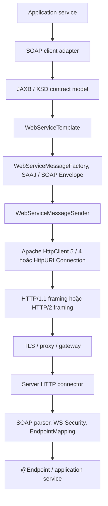
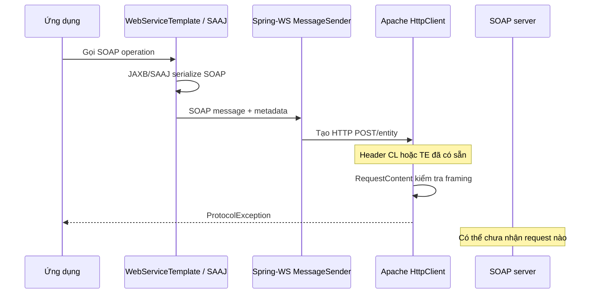

# Lỗi Content-Length hoặc Transfer-Encoding khi phối hợp các thư viện HTTP

## Mục tiêu học tập

Trong chương **HTTP và kết nối** thuộc module **SPRING_WEB_SERVICES**, chúng ta giải quyết một nhóm lỗi tích hợp thường gặp nhưng khó chẩn đoán: **Spring Web Services tạo thông điệp SOAP bằng JAXB/SAAJ rồi một thư viện HTTP khác tiếp tục đóng gói request, dẫn đến tranh chấp trách nhiệm thiết lập `Content-Length` hoặc `Transfer-Encoding`**.

Đây không chỉ là lỗi cấu hình lặt vặt. Hai header nói trên quyết định cách bên nhận biết **ranh giới kết thúc thông điệp HTTP/1.1**. Khai báo sai có thể làm đứt SOAP Envelope, gây chờ vô hạn, phá kết nối tái sử dụng, phát sinh HTTP 400/411/502 hoặc tạo bất đồng phân tích giữa proxy và backend. Hợp đồng SOAP **contract-first** (XSD/WSDL) vẫn có thể hoàn toàn đúng trong khi request thất bại ở tầng HTTP trước khi đến endpoint.

Sau bài này, bạn có thể:

1. Phân biệt **HTTP message framing**, XML payload, SOAP Envelope, SOAP Header, HTTP `Content-Type`, `Content-Encoding` và SOAPAction.
2. Giải thích chính xác `Content-Length` là **số octet/byte** của HTTP message content sau khi áp dụng các biến đổi thích hợp, không phải số ký tự Java hay kích thước object JAXB.
3. Đọc cú pháp `Transfer-Encoding: chunked` và hiểu khi nào HTTP client dùng length cố định, chunked hoặc cơ chế HTTP/2 tương ứng.
4. Nêu quy tắc RFC 9112: **không gửi đồng thời `Content-Length` và `Transfer-Encoding` trong một message HTTP/1.1**; phân biệt quy tắc phía gửi với cách phía nhận xử lý thông điệp lỗi.
5. Xác định xung đột giữa **SOAP message factory/SAAJ**, Spring-WS `WebServiceTemplate`, Apache HttpClient 4/5, Java `HttpURLConnection` và gateway.
6. Dùng đúng `HttpComponents5MessageSender`, `SimpleHttpComponents5MessageSender` và `HttpComponents5ClientFactory.withDefaults()` với Spring-WS 4.1.4.
7. Biết khi nào cần `RemoveSoapHeadersInterceptor` và vì sao phải đặt nó **trước interceptor tạo HTTP entity-framing headers**.
8. Không nhầm `HttpComponentsMessageSender.RemoveSoapHeadersInterceptor` của Apache HttpClient 4 với `HttpComponents5ClientFactory.RemoveSoapHeadersInterceptor` của Apache HttpClient 5.
9. Viết test để kiểm tra **bytes và framing header trên HTTP request thực**, không kết luận từ việc `MockWebServiceServer` khớp payload.
10. Áp dụng quy trình chẩn đoán an toàn, không vô hiệu hóa HTTP protocol checks, không sửa tay length, không tạo request smuggling, và giữ TLS/WS-Security/transaction behavior đúng chính sách.

## 1. Tình huống: SOAP Body đúng nhưng lời gọi thất bại trước endpoint

Giả sử bạn có client Spring-WS gọi dịch vụ đơn hàng đối tác:

```java
Object response = webServiceTemplate.marshalSendAndReceive(
        "https://partner.example.com/ws/orders",
        request,
        new SoapActionCallback("urn:example:orders:v1/GetOrder"));
```

Bên đối tác công bố WSDL với `GetOrderRequest` và `GetOrderResponse`. XJC sinh JAXB classes đúng schema. Request marshal thành SOAP Envelope hợp lệ, nhưng sau khi đổi từ message sender mặc định sang Apache HttpClient tùy biến, ứng dụng báo lỗi kiểu:

```text
org.apache.hc.core5.http.ProtocolException:
  Content-Length header already present
```

hoặc:

```text
org.apache.hc.core5.http.ProtocolException:
  Transfer-encoding header already present
```

Với Apache HttpClient 4, stack trace có thể dùng package `org.apache.http.*` thay vì `org.apache.hc.core5.*`. Lỗi tương tự cũng có thể biểu hiện ở phía server bằng HTTP 400/411, proxy 502, request bị đọc thiếu byte hoặc kết nối bị đóng.

**Không nên kết luận ngay “WSDL sai”, “JAXB sinh code lỗi” hoặc “SOAP Fault không được map”.** Những exception ở trên thường xảy ra tại **HTTP request processing/framing**, trước khi đối tác có SOAP message để dispatch.

### 1.1. Dấu hiệu phân biệt

| Triệu chứng | Nghi vấn đầu tiên | Đừng sửa vội |
| --- | --- | --- |
| `Content-Length header already present` | Cùng header được SOAP layer và Apache HttpClient cùng đặt. | XSD, JAXB field, `@PayloadRoot`. |
| `Transfer-encoding header already present` | Hai tầng cùng quản lý transfer coding hoặc một HTTP interceptor đặt thủ công. | SOAPAction string. |
| `Content-Length` sai sau khi đổi encoding/gzip | Đếm byte tại sai giai đoạn hoặc dùng số ký tự thay cho byte. | Loại field trong WSDL. |
| HTTP 411 Length Required | Server/proxy legacy yêu cầu body length biết trước, không thích chunked. | Lỗi nghiệp vụ GetOrder. |
| HTTP 400 khi có cả CL và TE | Framing mâu thuẫn; server từ chối theo policy bảo mật. | Exception resolver SOAP. |
| HTTP 502 hoặc EOF khi đọc response | Proxy/server xử lý framing bất nhất, response bị cắt hoặc đóng. | Tự động retry lệnh ghi. |
| MockWebServiceServer pass nhưng production fail | Test chỉ kiểm tra SOAP message, không thực sự gửi qua HTTP sender/proxy. | Bỏ test hợp đồng. |
| Chỉ lỗi khi upload MTOM lớn | Streaming/buffering, multipart boundary, length, gateway body limit. | Thay MTOM thành Base64 trong Body ngay. |

Đặt câu hỏi trước: **Header do lớp nào tạo, có HTTP request thật được gửi ra chưa, và byte stream trên wire thực sự trông thế nào?**

## 2. Xác định ranh giới: HTTP không phải SOAP

Một lời gọi Spring Web Services có nhiều lớp:



Ở hệ thống chạy SOAP/HTTP:

- **JAXB** xác định nội dung XML dựa trên kiểu XSD; nó **không phải** chủ sở hữu HTTP `Content-Length`.
- **SOAP message factory** quản lý SOAP Envelope, Header, Body và serialization; một số implementation có thể cung cấp metadata HTTP/transport.
- **`WebServiceTemplate`** điều phối message factory, callback, client interceptors, sender, response và Fault.
- **`WebServiceMessageSender`** nối SOAP message với transport (Apache HttpClient, `HttpURLConnection`, ...).
- **HTTP client** đóng gói HTTP request, định khung entity, quản lý connection, timeout, pooling và gửi bytes.
- **Gateway/proxy** có thể kết thúc TLS, chuyển HTTP/2 ↔ HTTP/1.1, giải nén hoặc chuyển tiếp request.
- **Spring-WS server** chỉ nhận SOAP Envelope sau khi HTTP connector đã đọc và bóc lớp framing.

Khi hai thành phần cùng tự quyết định một header thuộc **framing** của HTTP connection, chúng có thể xung đột. Nguyên tắc an toàn là **một HTTP stack chịu trách nhiệm cuối cùng cho kích thước/cách truyền thực**.

### 2.1. Bốn header không thể dùng thay nhau

| Header hoặc trường | Tầng | Vai trò |
| --- | --- | --- |
| `Content-Length` | HTTP/1.1 | Số **octet** content nếu không có Transfer-Encoding. |
| `Transfer-Encoding` | HTTP/1.1 | Cách mã hóa truyền tải theo hop, phổ biến `chunked`. |
| `Content-Encoding` | HTTP representation | Biến đổi representation như `gzip`, **không phải** chunking. |
| `Content-Type` | HTTP representation | Kiểu dữ liệu, ví dụ `text/xml` hoặc `application/soap+xml`. |
| `SOAPAction` | SOAP 1.1 HTTP binding | Chỉ dấu hành động SOAP, không quyết định kích thước body. |
| `wsa:Action` | SOAP Header | Hành động WS-Addressing nằm **trong XML Envelope**. |

**SOAPAction và `Content-Length` đều có thể là HTTP header nhưng chức năng hoàn toàn khác nhau.** Đổi action hoặc thêm SOAP Header không sửa được lỗi request framing.

## 3. `Content-Length` tính theo byte, không phải ký tự

Theo HTTP, `Content-Length` là số octet ở dạng số thập phân không âm. Trong HTTP/1.1, khi không có `Transfer-Encoding`, nó giúp bên nhận xác định độ dài message body.

### 3.1. Ví dụ ASCII dễ hiểu

```http
POST /ws HTTP/1.1
Host: partner.example.com
Content-Type: text/plain; charset=utf-8
Content-Length: 5

hello
```

Năm ký tự ASCII cũng là **năm byte UTF-8**. Nhưng không thể tổng quát quy tắc này cho tiếng Việt hoặc SOAP XML có ký tự đa byte.

### 3.2. Ký tự Unicode làm lệch độ dài

```java
import java.nio.charset.StandardCharsets;

String body = "<x>Đơn hàng</x>";

int wrong = body.length();
int correct = body.getBytes(StandardCharsets.UTF_8).length;
```

`String.length()` đếm **UTF-16 code units**, còn `getBytes(UTF_8).length` đếm byte UTF-8. Với ký tự `Đ`, `ơ`, `à` hoặc ký tự ngoài BMP, hai số có thể khác.

**Tuy nhiên, ứng dụng Spring-WS thường không nên tự tính rồi set header kể cả bằng `getBytes(...)`.** XML có thể được serialize với encoding khác, có XML declaration, canonicalization, MTOM attachment, gzip hoặc streaming. HTTP sender mới biết **thông điệp thực sự được gửi**.

### 3.3. Vì sao byte length còn có thể thay đổi sau marshalling?

- JAXB có thể tạo XML declaration/namespace prefixes khác với một chuỗi XML hiển thị trong log.
- SAAJ hoặc message factory serialize Envelope và Header trước khi gửi.
- WS-Security có thể thêm Timestamp, UsernameToken, Signature hoặc phần mã hóa.
- MTOM/XOP có thể biến request thành `multipart/related` với MIME boundaries và các phần nhị phân.
- `Content-Encoding: gzip` có thể nén representation, làm số byte thực khác.
- Một HTTP client có thể chuyển từ buffered entity có length biết trước sang streaming entity chưa biết length.
- Gateway có thể chuyển HTTP/2 sang HTTP/1.1 và phải tạo framing mới.

Vì thế, lấy kích thước riêng `<ord:GetOrderRequest>...` rồi dùng làm `Content-Length` của **SOAP Envelope hoặc multipart** là sai.

## 4. `Transfer-Encoding: chunked` hoạt động như thế nào?

Trong HTTP/1.1, một sender có thể dùng `Transfer-Encoding: chunked` khi muốn gửi dữ liệu mà **không biết trước toàn bộ độ dài**.

### 4.1. Ví dụ chunked minh họa cơ chế

```http
POST /upload HTTP/1.1
Host: example.test
Transfer-Encoding: chunked
Content-Type: text/plain

4
Test
0

```

Trong stream thực tế, mỗi kích thước chunk được viết theo **hexadecimal**, theo sau bằng CRLF, đúng số byte dữ liệu, rồi CRLF; chunk kích thước `0` đánh dấu kết thúc (có thể theo sau trailer fields và dòng rỗng).

Mẫu ở trên diễn giải bằng văn bản nên không thể hiện chính xác các byte CRLF. Nó chỉ mô phỏng framing; **không phải SOAP request hợp lệ** vì body chỉ có `Test`.

### 4.2. Chunk size không phải kích thước cả request

Trong chunked mode:

- `Transfer-Encoding: chunked` nói rằng HTTP body được chia thành các chunk.
- Mỗi chunk có size riêng.
- HTTP layer đọc đến chunk cuối (kích thước 0) để biết body kết thúc.
- SOAP parser **nhận nội dung đã được HTTP layer giải mã**, không tự phân tích size chunk.
- Client hoặc server có thể gửi nhiều chunk với kích thước tùy ý; kích thước các chunk không liên quan XSD field count.

**Không** đồng thời set `Content-Length` bằng tổng kích thước chunk payload. Khi sử dụng Transfer-Encoding, HTTP framing theo transfer coding chứ không theo length do ứng dụng đặt.

### 4.3. Khi nào dùng fixed length?

Nếu message body length đã biết trước, sender HTTP/1.1 thường có thể gửi:

```http
Content-Length: 1457
```

thay vì chunked. RFC 9112 khuyến khích dùng `Content-Length` hợp lệ khi sender biết trước độ dài và không cần transfer coding khác, vì một số hệ thống legacy từ chối chunked với HTTP 411.

Điều này **không có nghĩa** người viết SOAP endpoint phải đặt length bằng tay: để HTTP client biết kích thước thông qua entity hoặc buffering phù hợp.

## 5. Quy tắc RFC 9112: không gửi đồng thời CL và TE

Đây là nguyên tắc cốt lõi của bài.

**RFC 9112 `6.2 quy định sender không được gửi `Content-Length` trong message có `Transfer-Encoding`.**

### 5.1. Một request có framing hợp lệ

**Trường hợp A — fixed length:**

```http
POST /ws HTTP/1.1
Host: partner.example.com
Content-Type: text/xml; charset=utf-8
Content-Length: 1234
SOAPAction: "urn:example:orders:v1/GetOrder"

...1234 byte HTTP body...
```

`1234` chỉ là con số minh họa; độ dài thật phải được tính từ bytes thực sau serialization.

**Trường hợp B — chunked:**

```http
POST /ws HTTP/1.1
Host: partner.example.com
Content-Type: text/xml; charset=utf-8
Transfer-Encoding: chunked
SOAPAction: "urn:example:orders:v1/GetOrder"

...chuỗi chunk có kích thước hexadecimal và chunk cuối...
```

Trong hai trường hợp, SOAP Body sau khi tầng HTTP bóc framing có thể giống hệt nhau.

### 5.2. Trường hợp không hợp lệ

```http
POST /ws HTTP/1.1
Host: partner.example.com
Content-Type: text/xml; charset=utf-8
Content-Length: 1234
Transfer-Encoding: chunked

...framing mâu thuẫn...
```

**Không dùng request mẫu này để thử lên hệ thống bên ngoài không được phép**. Đây là minh họa một thông điệp HTTP/1.1 không tuân thủ yêu cầu đối với sender, có thể bị server/gateway từ chối và mang rủi ro request smuggling.

### 5.3. Thứ tự ưu tiên phía nhận không cho phép sender phát sai

RFC 9112 quy định khi receiver thấy cả `Transfer-Encoding` và `Content-Length`, Transfer-Encoding có ưu tiên phân định body; thông điệp nên được xem là lỗi và có liên hệ với rủi ro request smuggling/response splitting. Server có thể từ chối hoặc xử lý theo Transfer-Encoding, nhưng phải đóng kết nối sau phản hồi theo điều kiện RFC.

**Không được diễn dịch “TE override CL” thành “cứ gửi cả hai, server sẽ tự chọn”.** Phía gửi vẫn có nghĩa vụ tạo message hợp lệ. Trong hệ thống nhiều proxy hoặc thư viện HTTP không đồng nhất, dựa vào khả năng sửa lỗi của receiver là rủi ro.

### 5.4. Content-Length trùng, âm, sai định dạng

Các trường hợp như:

```text
Content-Length: -1
Content-Length: abc
Content-Length: 10
Content-Length: 11
```

đều phải được xem là lỗi hoặc xử lý theo quy tắc rất chặt của RFC. Đừng cố normalize bằng cách chọn đại một giá trị. Nếu một proxy và backend diễn giải khác nhau, có thể dẫn đến mất đồng bộ HTTP request boundaries.

### 5.5. Hậu quả ở mô hình proxy

```text
SOAP client → API gateway → reverse proxy → Spring-WS backend
```

Nếu các hop tính độ dài thông điệp không giống nhau, một hop có thể chờ thêm bytes trong khi hop khác tin request đã kết thúc. Hệ quả gồm timeout, HTTP 400/502, connection reuse hỏng và lỗ hổng request smuggling.

Khuyến nghị phòng thủ: **từ chối framing mâu thuẫn tại boundary tin cậy, dùng HTTP parser cập nhật và nhất quán**, không tự viết parser header thứ hai cho SOAP endpoint.

## 6. HTTP/2 không dùng Transfer-Encoding chunked như HTTP/1.1

Đừng copy header HTTP/1.1 vào HTTP/2 một cách máy móc.

Trong HTTP/2:

- Framing được thực hiện bằng **DATA frames** của giao thức, không cần `Transfer-Encoding: chunked`.
- `Transfer-Encoding` kiểu HTTP/1.1 không được dùng; `TE` trong HTTP/2 bị giới hạn theo quy tắc riêng (thường chỉ `trailers`).
- `Content-Length` có thể xuất hiện nếu tuân thủ ngữ nghĩa và phải nhất quán với tổng data bytes khi áp dụng.
- Khi gateway chuyển HTTP/2 → HTTP/1.1, gateway phải **tạo framing hợp lệ cho HTTP/1.1**, không sao chép `Transfer-Encoding` cũ từ HTTP/2.

Bài này tập trung vào Spring-WS/Apache HTTP client **classic** và HTTP/1.1 framing. Khi sử dụng client khác hỗ trợ HTTP/2, cần xem protocol negotiation, ALPN/TLS và HTTP/2 processing riêng.

## 7. Xung đột thực tế: SOAP message factory và Apache HttpClient cùng đặt header

Một số implementation SOAP dựa trên SAAJ hoặc message factory khác có thể tạo/copy `Content-Length` hoặc `Transfer-Encoding` trước khi HTTP sender chuẩn bị entity.

Sau đó Apache HttpClient có bước request processing dùng `RequestContent` để tạo HTTP entity framing. Interceptor này có thể phát hiện header đã có và từ chối thay vì ghi đè.

Luồng lỗi:



### 7.1. Apache HttpClient từ chối để bảo vệ tính nhất quán

Với một HTTP client chuẩn, việc phát hiện `Content-Length`/`Transfer-Encoding` đặt từ trước có thể kích hoạt lỗi:

```text
Content-Length header already present
Transfer-encoding header already present
```

Điều đó có thể do **hai thư viện cùng quản lý HTTP framing**, không có nghĩa JAXB object hay SOAP security token không hợp lệ.

### 7.2. Tại sao lỗi chỉ xuất hiện sau khi đổi sender?

`HttpUrlConnectionMessageSender` và Apache HttpClient không nhất thiết đi qua cùng request processor. Một chương trình có thể chạy khi dùng JDK connection nhưng vỡ khi tiêm một `HttpClient` tùy chỉnh thiếu các interceptor tương thích Spring-WS.

Ngược lại, cùng Apache HttpClient vẫn có thể hoạt động khi dùng **sender do Spring-WS tự dựng**, nhưng lỗi khi đưa vào một Apache client đã tự build vì đã mất interceptor loại bỏ SOAP-origin framing headers.

### 7.3. Vì sao gọi là “RemoveSoapHeadersInterceptor”?

Tên class dễ gây hiểu nhầm. Trong Spring-WS, interceptor này **không xóa SOAP Header XML**, không xóa `wsse:Security` và không sửa SOAPAction nghiệp vụ. Nó xóa **HTTP `Content-Length` và `Transfer-Encoding` headers đã được đặt trước** để HTTP client tái tạo framing dựa trên entity thực.

Đây là **Apache HTTP request interceptor**, không phải Spring-WS server `EndpointInterceptor` hoặc SOAP client `ClientInterceptor`.

## 8. Ba lựa chọn HTTP message sender của Spring-WS

| Lựa chọn | Bên dưới | Khi dùng | Điểm cần kiểm tra |
| --- | --- | --- | --- |
| `HttpUrlConnectionMessageSender` | JDK `HttpURLConnection` | Tích hợp đơn giản, ít tùy chỉnh. | Framing và buffering do JDK connection quản lý, giới hạn tùy chỉnh. |
| `HttpComponentsMessageSender` | **Apache HttpClient 4** (`org.apache.http.*`) | Dự án legacy hoặc bản tương thích còn dùng HC4. | Class interceptor HC4 và cách build custom client. |
| `HttpComponents5MessageSender` | **Apache HttpClient 5** (`org.apache.hc.*`) | Spring-WS 4.1.4, cần pool/timeouts/HTTP client linh hoạt. | API `Duration`, cấu hình mặc định và interceptor loại headers. |
| `SimpleHttpComponents5MessageSender` | Apache HttpClient 5 do ứng dụng/factory cung cấp | Muốn quản lý HttpClient build, TLS, proxy, pool riêng. | Với custom client phải bảo đảm interceptor framing tương thích. |

**Tên gần giống không có nghĩa hai major HttpClient tương thích nhị phân.** Không truyền `org.apache.http.client.HttpClient` (HC4) vào constructor yêu cầu `org.apache.hc.client5.http.classic.HttpClient` (HC5). Không copy mã interceptor giữa hai major chỉ vì tên gần giống.

### 8.1. Lưu ý phiên bản

Các API ví dụ được đối chiếu với **Spring-WS 4.1.4**. Ở Spring-WS 4.1.x, `HttpComponents5MessageSender(HttpClient)`/`setHttpClient(...)` đã được đánh dấu deprecated từ 4.1.0 nhằm ưu tiên `SimpleHttpComponents5MessageSender` khi muốn cung cấp custom client.

Trước khi dùng Spring-WS 5.x hoặc dự án legacy Spring-WS 3.x, phải xem lại API và stack Java/Jakarta/SAAJ, không áp dụng máy móc import hoặc constructor của bài này.

## 9. Cách cấu hình an toàn nhất với HttpComponents5MessageSender mặc định

Nếu chưa có yêu cầu đặc thù buộc phải tự xây toàn bộ Apache client, bắt đầu bằng **message sender do Spring-WS quản lý**.

**`SoapClientConfig.java`**:

```java
package com.example.orders.soapclient;

import java.time.Duration;

import org.springframework.context.annotation.Bean;
import org.springframework.context.annotation.Configuration;
import org.springframework.ws.client.core.WebServiceTemplate;
import org.springframework.ws.transport.http.HttpComponents5MessageSender;

@Configuration
public class SoapClientConfig {

    @Bean
    public HttpComponents5MessageSender ordersMessageSender() {
        HttpComponents5MessageSender sender =
                new HttpComponents5MessageSender();

        sender.setConnectionTimeout(Duration.ofSeconds(3));
        sender.setReadTimeout(Duration.ofSeconds(15));
        sender.setMaxTotalConnections(40);

        return sender;
    }

    @Bean
    public WebServiceTemplate ordersWebServiceTemplate(
            HttpComponents5MessageSender ordersMessageSender) {

        WebServiceTemplate template = new WebServiceTemplate();
        template.setMessageSender(ordersMessageSender);
        template.setDefaultUri("https://partner.example.com/ws/orders");

        // Khi dùng marshalSendAndReceive:
        // còn phải cấu hình JAXB marshaller/unmarshaller.
        return template;
    }
}
```

**Giới hạn của code:** Bean trên chưa có TLS/mTLS/WS-Security/JAXB configuration và chưa cấu hình proxy. Đoạn mẫu cho thấy **sender/timeout/pooling**, không phải SOAP client production hoàn chỉnh.

Ở Spring-WS 4.1.4, constructor mặc định của `HttpComponents5MessageSender` tự cấu hình client theo cách thư viện quản lý. Khi gặp lỗi duplicate headers, hãy kiểm tra có ai **thay client mặc định** bằng custom Apache client hoặc custom interceptor khiến bước loại bỏ header bị mất hay không.

### 9.1. Vì sao không viết `request.setHeader("Content-Length", "0")`?

Bởi SOAP POST có body và length cần được quyết định theo entity thực. `0` sẽ báo cho receiver rằng request không có body theo cơ chế CL, có thể khiến SOAP parser nhận dữ liệu rỗng hoặc làm hỏng connection reuse.

### 9.2. Vì sao không viết `Transfer-Encoding: chunked` trong SOAP callback?

SOAP `WebServiceMessageCallback` được thiết kế để sửa SOAP message, không phải nơi chọn HTTP request entity framing. Thêm HTTP transfer header sớm không làm entity trở thành chunked và có thể xung đột với HTTP client.

### 9.3. Khi nào cần custom client?

Ví dụ thực tế:

- Kết nối pool dùng chung với chính sách limit cụ thể.
- HTTPS/mTLS truststore/keystore, rotation.
- Enterprise proxy, DNS strategy, connection eviction.
- Custom HTTP authentication, telemetry hoặc response handling.
- Yêu cầu đặc thù về timeout, connection reuse hoặc transport tracing.

Trong các trường hợp đó, hãy dùng factory/adapter đúng của Spring-WS để tránh mất **framing hygiene** mặc định.

## 10. Cách khuyến nghị với custom HttpClient 5: `HttpComponents5ClientFactory.withDefaults()`

Spring-WS 4.1.4 cung cấp `HttpComponents5ClientFactory` để tạo client HTTP 5 với một số cấu hình thuận tiện. Đặc biệt, API chính thức nêu:

**`HttpComponents5ClientFactory.withDefaults()` đăng ký `RemoveSoapHeadersInterceptor` làm interceptor đầu tiên.**

### 10.1. Cấu hình bean đầy đủ về phía sender

**`OrdersSoapHttpConfig.java`**:

```java
package com.example.orders.soapclient;

import java.time.Duration;

import org.springframework.context.annotation.Bean;
import org.springframework.context.annotation.Configuration;
import org.springframework.ws.client.core.WebServiceTemplate;
import org.springframework.ws.transport.http.HttpComponents5ClientFactory;
import org.springframework.ws.transport.http.SimpleHttpComponents5MessageSender;

@Configuration
public class OrdersSoapHttpConfig {

    @Bean
    public SimpleHttpComponents5MessageSender ordersSender() {
        HttpComponents5ClientFactory factory =
                HttpComponents5ClientFactory.withDefaults();

        factory.setConnectionTimeout(Duration.ofSeconds(3));
        factory.setReadTimeout(Duration.ofSeconds(15));
        factory.setMaxTotalConnections(40);

        return new SimpleHttpComponents5MessageSender(factory);
    }

    @Bean
    public WebServiceTemplate ordersTemplate(
            SimpleHttpComponents5MessageSender ordersSender) {

        WebServiceTemplate template = new WebServiceTemplate();
        template.setMessageSender(ordersSender);
        template.setDefaultUri("https://partner.example.com/ws/orders");
        return template;
    }
}
```

**Điểm cần đọc kỹ:** `withDefaults()` không phải một method vô nghĩa. Nó chọn những default cần thiết của Spring-WS, trong đó có interceptor **loại `Content-Length` và `Transfer-Encoding` do tầng SOAP đặt trước**, để HTTP client tự xử lý entity framing sau đó.

Các API `setConnectionTimeout(Duration)`, `setReadTimeout(Duration)` và `setMaxTotalConnections(int)` được cấu hình trên factory. Ví dụ không hard-code HTTP Content-Length, không đổi SOAP Envelope và không bỏ protocol validation.

### 10.2. Khi cần tùy chỉnh HTTP client builder

Factory có `addClientBuilderCustomizer(...)` và `addConnectionManagerBuilderCustomizer(...)`. Hãy bổ sung các customizer khi có nhu cầu thật, ví dụ thiết lập proxy hoặc TLS theo API Apache đang dùng.

**Không** dùng customizer để cố tình thêm lại `Content-Length` hoặc `Transfer-Encoding` trong mọi request. Nếu customizer thêm một request interceptor đặt framing headers thủ công *sau* bước loại bỏ, lỗi vẫn có thể quay lại.

### 10.3. Cảnh báo khi chuyển sang client tự build

Dùng:

```java
CloseableHttpClient customClient = HttpClients.custom()
        // ... cấu hình riêng ...
        .build();

SimpleHttpComponents5MessageSender sender =
        new SimpleHttpComponents5MessageSender(customClient);
```

là hợp lệ về ý tưởng/API, nhưng **factory defaults không còn được tự động áp dụng lên client này**. Hãy bảo đảm client tùy chỉnh có bước loại bỏ header sớm và đáp ứng timeout/TLS/pooling/cleanup. Không giả định constructor của sender sẽ sửa một client được đưa vào **as-is**.

## 11. Khi tự dựng Apache HttpClient 5: interceptor phải chạy trước request framing

Nếu thật sự không thể dùng `HttpComponents5ClientFactory.withDefaults()`, có thể gắn interceptor phù hợp của Spring-WS ở đầu request interceptor chain Apache HttpClient 5.

### 11.1. Ví dụ client builder

```java
package com.example.orders.soapclient;

import org.apache.hc.client5.http.impl.classic.CloseableHttpClient;
import org.apache.hc.client5.http.impl.classic.HttpClients;

import org.springframework.context.annotation.Bean;
import org.springframework.context.annotation.Configuration;
import org.springframework.ws.transport.http.HttpComponents5ClientFactory;

@Configuration
public class CustomApacheClientConfig {

    @Bean(destroyMethod = "close")
    public CloseableHttpClient ordersHttpClient() {

        return HttpClients.custom()
                .addRequestInterceptorFirst(
                    new HttpComponents5ClientFactory.RemoveSoapHeadersInterceptor())
                // TLS, proxy, timeouts, pool: cấu hình theo policy.
                .build();
    }
}
```

Trong thực tế, cách tốt hơn là **dùng factory `withDefaults()`** để tránh code tự quản lý thứ tự request interceptors.

Bean này quản lý vòng đời `CloseableHttpClient` nếu Spring context tạo bean theo lifecycle bình thường. Khi đưa nó vào `SimpleHttpComponents5MessageSender`, cần quy ước ownership/đóng tài nguyên rõ, tránh đóng hai lần hoặc quên đóng connection manager; với tùy chỉnh phức tạp, ưu tiên factory quản lý thống nhất.

### 11.2. Vì sao phải là interceptor “first”?

`HttpRequestInterceptor` trong Apache client chạy ở giai đoạn xử lý request. Interceptor của Spring-WS cần **xóa headers có sẵn trước khi bước RequestContent của HttpCore kiểm tra và thêm headers mới**.

Nếu chạy quá muộn:

```text
SAAJ/SOAP copy Content-Length
    ↓
Apache RequestContent kiểm tra → ProtocolException
    ↓
RemoveSoapHeadersInterceptor chạy sau? KHÔNG BAO GIỜ TỚI.
```

Không chỉ quan tâm tên interceptor; **thứ tự thực sự trong builder/HTTP execution chain** quyết định nó có hiệu quả không.

### 11.3. Không dùng client-side SOAP `ClientInterceptor` thay thế

Một `ClientInterceptor` của `WebServiceTemplate` chạy với `MessageContext`/SOAP message, khác với Apache `HttpRequestInterceptor`. Nó không phải lớp thích hợp để can thiệp vào cách HttpCore đánh dấu bytes của entity.

Đừng đặt một SOAP client interceptor tên “RemoveContentLength” rồi giả định Apache HttpClient sẽ thấy header đã bị xóa. Dùng đúng interceptor ở **HTTP request chain**, hoặc factory Spring-WS đã cấu hình sẵn.

### 11.4. Đừng coi việc xóa hai header là mất tính toàn vẹn

`RemoveSoapHeadersInterceptor` xóa **metadata HTTP framing được copy sớm**, không xóa SOAP Body hoặc WS-Security signature. Sau đó HTTP client sẽ đặt framing đúng theo entity mà nó gửi.

Điều này không thay thế **message security**: nếu HTTP client hoặc proxy sửa XML đã được ký, chữ ký vẫn có thể sai; cần test riêng WS-Security và signed parts.

## 12. Với Apache HttpClient 4 (legacy): dùng đúng class HC4

Trong dự án Spring-WS đang dùng Apache HttpClient 4, API legacy là:

```java
org.springframework.ws.transport.http.HttpComponentsMessageSender
```

và nested interceptor:

```java
HttpComponentsMessageSender.RemoveSoapHeadersInterceptor
```

### 12.1. Cấu hình custom HttpClient 4 minh họa

```java
import org.apache.http.impl.client.CloseableHttpClient;
import org.apache.http.impl.client.HttpClients;

import org.springframework.ws.transport.http.HttpComponentsMessageSender;

CloseableHttpClient httpClient = HttpClients.custom()
        .addInterceptorFirst(
            new HttpComponentsMessageSender.RemoveSoapHeadersInterceptor())
        .build();

HttpComponentsMessageSender sender =
        new HttpComponentsMessageSender(httpClient);
```

Đây là đoạn Java minh họa trong code phù hợp HC4; **đừng dán nó vào dự án chỉ có HC5**. API `addInterceptorFirst` trong HC4 khác `addRequestInterceptorFirst` của HC5.

### 12.2. Bảng phân biệt

| Khía cạnh | Apache HC4 | Apache HC5 |
| --- | --- | --- |
| Package HTTP client | `org.apache.http.*` | `org.apache.hc.client5.*` / `org.apache.hc.core5.*` |
| Sender Spring-WS | `HttpComponentsMessageSender` | `HttpComponents5MessageSender` hoặc `SimpleHttpComponents5MessageSender` |
| Nested interceptor | `HttpComponentsMessageSender.RemoveSoapHeadersInterceptor` | `HttpComponents5ClientFactory.RemoveSoapHeadersInterceptor` |
| Interface interceptor | `org.apache.http.HttpRequestInterceptor` | `org.apache.hc.core5.http.HttpRequestInterceptor` |
| Builder đăng ký đầu chuỗi | `addInterceptorFirst(...)` | `addRequestInterceptorFirst(...)` |
| Timeout setter trong sender theo API đã nêu | `int` milliseconds ở HC4 | `Duration` ở HC5 |
| Factory `withDefaults()` ở Spring-WS 4.1.4 | Không dùng class HC5 factory | Có, tự gắn interceptor first |

**Không thay package bằng tìm/replace mù.** Kiểm tra BOM, version, dependency graph và kiểu thật của client/sender trong Spring context.

## 13. Vì sao không nên “sửa” bằng `RequestContent(true)` hoặc tắt protocol checks?

Apache HttpCore có `RequestContent`, chịu trách nhiệm xác lập hoặc kiểm tra một số headers gắn với HTTP entity. Một số version có chế độ overwrite các header framing đã tồn tại.

Cách giải quyết có vẻ nhanh:

```text
"ProtocolException vì Content-Length đã tồn tại"
    → tắt kiểm tra / cho overwrite mọi header / bỏ qua HTTP compliance?
```

**Không nên coi đây là fix mặc định.** Lý do:

1. Xung đột **ownership** giữa SOAP layer và HTTP transport vẫn tồn tại.
2. Một interceptor khác có thể tiếp tục ghi `Transfer-Encoding` sau bước overwrite.
3. Việc tắt validation không giúp backend/proxy xử lý framing bất nhất.
4. Thay đổi request processing có thể làm lỗi khó tái hiện khi retry, chunked streaming hoặc pooling.
5. Đây là vùng ảnh hưởng trực tiếp tới **HTTP request smuggling** nếu các hop diễn giải ranh giới khác nhau.

Cách sửa bền vững: **để HTTP client định framing, loại sớm headers được SOAP layer chép vào**, dùng cấu hình do Spring-WS cung cấp, rồi kiểm tra on-wire.

## 14. Khi dùng HttpURLConnection: đừng mang giả định Apache sang

`HttpUrlConnectionMessageSender` sử dụng JDK `HttpURLConnection`. Nó không dùng request interceptor chain của Apache HttpClient.

Trong Java `HttpURLConnection` có các streaming modes `setFixedLengthStreamingMode(...)` và `setChunkedStreamingMode(...)`, nhưng đó là API của **JDK HTTP connection**; không nên tự gọi chúng từ SOAP endpoint/`WebServiceTemplate` khi sender đang quản lý connection.

Nếu dự án gặp HTTP 411 do bên nhận không chấp nhận chunked:

- Xác định sender thực sự đang dùng JDK hay Apache.
- Xác nhận request thật gửi `Transfer-Encoding: chunked`.
- Tìm tùy chọn **buffering/repeatable entity** phù hợp sender, không tự set một length đoán.
- Nếu cần biết trước total length, đánh giá memory/disk buffering và giới hạn kích thước.
- Làm rõ ràng buộc từ đối tác/gateway; chuẩn HTTP/1.1 có hỗ trợ chunked nhưng một số hệ thống cũ vẫn yêu cầu CL.
- Test lại với MTOM và request lớn, không chỉ một payload vài trăm byte.

**Không có một cờ `WebServiceTemplate.setContentLength(...)` tiêu chuẩn để khắc phục mọi sender.** Đây là nhiệm vụ ở HTTP transport/entity layer.

## 15. SOAP 1.1, SOAP 1.2, Content-Type và framing

Framing độc lập với ngữ nghĩa SOAP, nhưng nhiều lỗi có thể xảy ra cùng lúc.

### 15.1. SOAP 1.1

Thường dùng:

```http
Content-Type: text/xml; charset=utf-8
SOAPAction: "urn:example:orders:v1/GetOrder"
Content-Length: 1234
```

hoặc thay CL bằng `Transfer-Encoding: chunked`. SOAP Envelope namespace là `http://schemas.xmlsoap.org/soap/envelope/`.

### 15.2. SOAP 1.2

HTTP binding thường dùng:

```http
Content-Type: application/soap+xml; charset=utf-8; action="urn:example:orders:v1/GetOrder"
Transfer-Encoding: chunked
```

với SOAP Envelope namespace `http://www.w3.org/2003/05/soap-envelope`. Action có thể được thể hiện qua media-type parameter theo binding. **Không** dùng `SOAPAction` của SOAP 1.1 như quy tắc chung cho mọi SOAP 1.2 client.

### 15.3. Những lỗi khác lớp nhưng trông giống nhau

| Lỗi | Tầng thực sự | Ví dụ |
| --- | --- | --- |
| `Content-Length header already present` | Apache HTTP request processing | Xung đột framing headers. |
| HTTP 415 | HTTP representation/binding | SOAP 1.2 client gửi `text/xml`. |
| HTTP 411 | HTTP framing/proxy | Endpoint yêu cầu fixed CL nhưng client dùng chunked. |
| SOAP Fault `VersionMismatch` | SOAP protocol | Envelope namespace không đúng. |
| SOAP Fault `MustUnderstand` | SOAP Header processing | Header bắt buộc không được hiểu. |
| SOAP Fault `OrderNotFound` | Domain/resolver | Request hợp lệ, dữ liệu không tồn tại. |
| JAXB marshal error | XML binding | Root element/namespace/class không đúng. |

Đừng bắt lỗi HTTP framing trong `EndpointExceptionResolver` phía server rồi hi vọng nó chạy — có thể lỗi phát sinh **trước khi SOAP Envelope được parse**.

## 16. MTOM, multipart và attachments khiến việc tự tính length càng nguy hiểm

Một dịch vụ SOAP tải tài liệu có thể dùng MTOM/XOP:

```http
Content-Type: multipart/related;
    type="application/xop+xml";
    boundary="MIME_BOUNDARY_EXAMPLE";
    start="<root.message@example>"
Transfer-Encoding: chunked
```

Đây là mẫu **header minh họa** được xuống dòng cho dễ đọc, không phải block HTTP có folding hợp lệ để copy nguyên vào client.

Message HTTP thực có thể gồm:

- MIME preamble/boundary.
- SOAP root part chứa XOP reference.
- Binary attachments và MIME headers riêng.
- Boundary kết thúc.
- Chữ ký/mã hóa hoặc các biến đổi bổ sung theo profile.

Nếu chỉ tính byte của SOAP root part rồi đặt `Content-Length`, request sẽ bị thiếu length. Nếu streaming, tổng bytes có thể không biết trước lúc mở connection; `chunked` là một lựa chọn framing hợp lệ ở HTTP/1.1 nếu server hỗ trợ.

### 16.1. Quyết định buffering có giá

- Buffered entity: có thể biết CL, nhưng tiêu tốn bộ nhớ hoặc I/O disk.
- Streaming entity: giảm memory peak, nhưng có thể yêu cầu chunked hoặc không repeatable.
- Retry/redirect: một entity đã stream và không repeatable không thể gửi lại tùy ý.
- WS-Security/MTOM: ký/mã hóa và canonicalization có thể thay đổi size và tính repeatable.

Thiết kế theo **giới hạn payload, chính sách bảo mật, khả năng streaming của đối tác**. Không chuyển mọi MTOM file 500 MB sang buffer RAM chỉ vì một proxy legacy trả 411.

## 17. Tầng server: Servlet, filter, reverse proxy và response

Không chỉ client gây lỗi. Server Spring-WS chạy sau `MessageDispatcherServlet` hoặc một HTTP gateway có thể gặp framing không nhất quán ở **request vào** hoặc **response ra**.

### 17.1. Đường response

```text
@Endpoint
  → JAXB/SAAJ tạo SOAP response hoặc SOAP Fault
  → Servlet container / HTTP response handling
  → compression filter hoặc gateway
  → HTTP/1.1 Content-Length hoặc Transfer-Encoding
  → SOAP client
```

Nếu một filter nén gzip **sau khi** header CL được tính theo bytes chưa nén mà không điều chỉnh, client có thể đọc sai độ dài. Đó là lỗi ở tầng HTTP response, không phải JAXB/XSD.

### 17.2. Những anti-pattern phía server

**Không nên:**

```java
// Anti-pattern minh họa, không phải Servlet filter đầy đủ:
response.setHeader("Content-Length", "9999");
chain.doFilter(request, response);
```

Từ filter, ứng dụng chưa biết chính xác bytes cuối cùng do Spring-WS và gzip filter gửi. Việc đặt CL trước có thể sai.

Tương tự, đừng tự:

```java
response.setHeader("Transfer-Encoding", "chunked");
```

để “yêu cầu container chunk request”. Servlet container chịu trách nhiệm response framing; các response status không có body cũng có quy tắc riêng.

### 17.3. Header response không đồng nghĩa SOAP Fault

Một HTTP 500 có thể mang SOAP 1.1 Fault hợp lệ; một HTTP 502 từ proxy có thể mang HTML hoặc không có SOAP Envelope. Khi `WebServiceTemplate` nhận phản hồi, nó phân biệt lỗi transport và SOAP Fault dựa trên HTTP/message behavior.

Không ép mọi lỗi HTTP 4xx/5xx thành `SoapFaultClientException` nếu không có SOAP message. Cần phân loại đúng.

## 18. An toàn bảo mật: tránh bất đồng framing giữa các hop

RFC 9112 mô tả rủi ro khi các thành phần HTTP không nhất quán về CL và TE, bao gồm **request smuggling** và **response splitting**. Với hệ thống doanh nghiệp có gateway, load balancer, WAF và backend SOAP:

- Phải **từ chối hoặc chuẩn hóa an toàn** message có framing không hợp lệ theo RFC.
- Không cho phép sender sản sinh CL+TE đồng thời.
- Không chuyển nguyên headers hop-by-hop qua gateway như header nghiệp vụ.
- Tránh parser HTTP tự viết và nâng cấp HTTP libraries khi có bản vá.
- Nếu chuyển HTTP/2 ↔ HTTP/1.1, validate lại semantics và xây framing mới đúng protocol.
- Test các lỗi framing trong **môi trường được cho phép**, không dùng payload nguy hiểm trên production hoặc hệ thống đối tác không được phép thử.
- Không bỏ qua protocol exception chỉ để lấy SOAP Fault đẹp.

### 18.1. SOAP XML security là lớp bảo vệ riêng

HTTP framing hợp lệ không chứng minh:

- WS-Security token hợp lệ.
- Chữ ký XML bao phủ đúng SOAP Body/Header thực được endpoint dùng.
- Chứng chỉ mTLS đáng tin.
- Caller có quyền `order:cancel` hoặc được đọc dữ liệu tenant.
- Nội dung XML không bị XXE/entity expansion hoặc vượt giới hạn tài nguyên.

Hãy giữ hai lớp kiểm soát **bổ sung**: HTTP layer bảo đảm framing/transport đúng, còn SOAP/security/application layer bảo đảm XML/identity/authorization đúng hợp đồng.

### 18.2. Không ghi wire log đầy đủ ở production

Trong quá trình debug, HTTP wire logs có thể chứa:

- `Authorization`, cookie/session token.
- SOAP `wsse:Security`, certificate data hoặc signature.
- XML business payload, dữ liệu khách hàng và tệp đính kèm.
- Host nội bộ và thông tin hạ tầng.

Ưu tiên log **content-length/transfer-encoding presence, method, URI alias, status, duration, request ID** mà không log payload hoặc secret. Chỉ bật capture tạm thời trong môi trường test kiểm soát được.

## 19. Quy trình chẩn đoán có hệ thống

Khi client gặp lỗi CL/TE, làm theo quy trình này trước khi chỉnh code:

### Bước 1 — Phân loại thời điểm lỗi

- **Trước gửi request:** Java exception từ Apache HttpClient như `Content-Length header already present`.
- **Sau khi gửi HTTP:** server/proxy trả HTTP 400/411/502.
- **Sau khi SOAP parser chạy:** nhận SOAP Fault có Code/Reason.
- **Sau khi server đã ghi trạng thái:** client timeout/EOF, không chắc side effect đã xảy ra hay chưa.

Điểm lỗi quyết định lớp cần sửa.

### Bước 2 — Xác định version thật

Ghi lại:

```text
Spring-WS version:
Spring Boot/Spring Framework version:
SOAP message factory: SAAJ / other
HTTP sender class:
Apache HttpClient major: 4 / 5 / none
HTTP protocol: 1.1 / 2
Proxy/gateway path:
SOAP version/binding: 1.1 / 1.2
MTOM / WS-Security / compression:
```

Đừng tự suy ra Apache major chỉ từ tên dependency “httpclient”. Kiểm tra class name/runtime và dependency management thực tế.

### Bước 3 — Xem ai thiết lập CL/TE

Đối chiếu cấu hình sender:

- `new HttpComponents5MessageSender()` mặc định hay một custom `CloseableHttpClient`?
- Có dùng `HttpComponents5ClientFactory.withDefaults()` hay factory tạo thủ công?
- Có `RemoveSoapHeadersInterceptor` ở **đầu** chain không?
- SOAP message factory/SAAJ có copy HTTP headers vào request không?
- Custom HTTP request interceptor/filter nào tự set CL/TE?
- Có compression/MTOM/streaming hoặc retry interceptor thay đổi entity không?

### Bước 4 — Tái hiện qua stub HTTP trên loopback

Dùng server test cục bộ mà chính bạn quản lý. Ghi lại:

- Method/URI/HTTP version.
- `Content-Type` và `SOAPAction` nếu dùng SOAP 1.1.
- **Có một trong CL hoặc TE**, không đồng thời cả hai ở HTTP/1.1.
- Byte count thực của SOAP Envelope sau khi HTTP parser nhận.
- Response body có phải SOAP Envelope hợp lệ.
- Không log token/chữ ký/dữ liệu nhạy cảm ra công khai.

### Bước 5 — Sửa cấu hình thay vì giả lập độ dài

Ưu tiên:

1. Sử dụng sender/factory Spring-WS có default framing hygiene.
2. Nếu phải custom HttpClient, gắn đúng `RemoveSoapHeadersInterceptor` **đúng major và trước** RequestContent.
3. Không tự set CL/TE trong SOAP callback, Apache interceptor khác hoặc Servlet filter.
4. Nếu đối tác từ chối chunked, thiết kế buffering/repeatable entity có kiểm soát và đo chi phí.
5. Test lại cùng MTOM/WS-Security/compression và qua gateway.

### Bước 6 — Hồi quy và đánh giá rủi ro

Kiểm tra GetOrder, SubmitOrder và upload attachment; cả response thành công, SOAP Fault, timeout, reconnect, retry và concurrent calls. Với thao tác ghi, không tự động retry chỉ vì HTTP framing/EOF không có response: server **có thể đã xử lý**.

## 20. Unit test: tự tính độ dài từ bytes chứ không từ Java String

Một bài test ngắn giúp hiểu sai lầm cơ bản.

**`Utf8ByteLengthTest.java`**:

```java
package com.example.orders.soapclient;

import static org.junit.jupiter.api.Assertions.*;

import java.nio.charset.StandardCharsets;
import org.junit.jupiter.api.Test;

class Utf8ByteLengthTest {

    @Test
    void utf8BytesDifferFromJavaStringLength() {
        String xml = "<message>Đơn hàng</message>";

        int characters = xml.length();
        int bytes = xml.getBytes(StandardCharsets.UTF_8).length;

        assertTrue(bytes > characters);
    }

    @Test
    void asciiHasSameLengthUnderUtf8() {
        String text = "hello";

        assertEquals(
                text.length(),
                text.getBytes(StandardCharsets.UTF_8).length);
    }
}
```

Test này chứng minh **lý do không dùng `String.length()` làm CL**. Nó không kiểm chứng SOAP serialization hay Apache sender; với production, **vẫn để HTTP client tự thiết lập framing**.

### 20.1. Byte length và Content-Encoding

Nếu gzip được áp dụng sau khi XML chuyển thành UTF-8 bytes, length thực của HTTP content có thể là kích thước **bytes đã nén**, không phải length XML gốc. Vì vậy “lấy XML UTF-8 bytes length rồi set CL” vẫn có thể sai.

### 20.2. Byte length và MTOM

Với MTOM, cần tính cả multipart boundaries, MIME headers và attachments nếu dùng fixed CL. Tính size SOAP root part riêng sẽ không đủ. HTTP sender có thể chọn chunked để không buffer toàn bộ message.

## 21. Integration test HTTP thực: xác minh framing không xung đột

`MockWebServiceServer` kiểm thử SOAP client ở mức message; nó **không thay thế** một server HTTP thực có thể quan sát request headers.

Ví dụ sau dùng **JDK HttpServer trên loopback**, phù hợp test local cho message sender Apache HttpClient 5. Nó không yêu cầu JAXB classes vì dùng `StringSource` làm payload.

**`SoapHttpFramingIntegrationTest.java`**:

```java
package com.example.orders.soapclient;

import static org.junit.jupiter.api.Assertions.*;

import java.io.IOException;
import java.net.InetSocketAddress;
import java.nio.charset.StandardCharsets;
import java.util.concurrent.atomic.AtomicReference;

import javax.xml.transform.stream.StreamResult;

import com.sun.net.httpserver.HttpServer;

import org.junit.jupiter.api.Test;
import org.springframework.ws.client.core.WebServiceTemplate;
import org.springframework.ws.soap.client.core.SoapActionCallback;
import org.springframework.ws.transport.http.HttpComponents5ClientFactory;
import org.springframework.ws.transport.http.SimpleHttpComponents5MessageSender;
import org.springframework.xml.transform.StringSource;

class SoapHttpFramingIntegrationTest {

    record CapturedRequest(
            String contentLength,
            String transferEncoding,
            String contentType,
            int bodyBytes) {
    }

    @Test
    void sendsExactlyOneHttp11FramingMechanism() throws Exception {
        AtomicReference<CapturedRequest> observed =
                new AtomicReference<>();

        HttpServer server = HttpServer.create(
                new InetSocketAddress("127.0.0.1", 0), 0);

        String soapResponse = """
            <soap:Envelope
                xmlns:soap="http://schemas.xmlsoap.org/soap/envelope/"
                xmlns:ord="urn:example:orders:v1">
                <soap:Body>
                    <ord:GetOrderResponse>
                        <ord:status>CONFIRMED</ord:status>
                    </ord:GetOrderResponse>
                </soap:Body>
            </soap:Envelope>
            """;

        server.createContext("/ws", exchange -> {
            try {
                byte[] received =
                        exchange.getRequestBody().readAllBytes();

                observed.set(new CapturedRequest(
                    exchange.getRequestHeaders()
                            .getFirst("Content-Length"),
                    exchange.getRequestHeaders()
                            .getFirst("Transfer-Encoding"),
                    exchange.getRequestHeaders()
                            .getFirst("Content-Type"),
                    received.length));

                byte[] response =
                        soapResponse.getBytes(StandardCharsets.UTF_8);

                exchange.getResponseHeaders().set(
                        "Content-Type", "text/xml; charset=utf-8");
                exchange.sendResponseHeaders(200, response.length);
                exchange.getResponseBody().write(response);
            } finally {
                exchange.close();
            }
        });

        server.start();

        try {
            SimpleHttpComponents5MessageSender sender =
                new SimpleHttpComponents5MessageSender(
                    HttpComponents5ClientFactory.withDefaults());

            WebServiceTemplate template = new WebServiceTemplate();
            template.setMessageSender(sender);

            String payload = """
                <ord:GetOrderRequest xmlns:ord="urn:example:orders:v1">
                    <ord:orderId>ORD-000042</ord:orderId>
                </ord:GetOrderRequest>
                """;

            String target = "http://127.0.0.1:"
                    + server.getAddress().getPort() + "/ws";

            boolean hasResponse = template.sendSourceAndReceiveToResult(
                    target,
                    new StringSource(payload),
                    new SoapActionCallback(
                        "urn:example:orders:v1/GetOrder"),
                    new StreamResult(new java.io.StringWriter()));

            assertTrue(hasResponse);
            CapturedRequest received = observed.get();
            assertNotNull(received);
            assertTrue(received.bodyBytes() > 0);

            boolean hasContentLength =
                    received.contentLength() != null;
            boolean hasTransferEncoding =
                    received.transferEncoding() != null;

            // HTTP/1.1 request có body: CL hoặc TE, không phải cả hai.
            assertTrue(hasContentLength ^ hasTransferEncoding);

            if (hasContentLength) {
                assertEquals(
                    received.bodyBytes(),
                    Integer.parseInt(received.contentLength()));
            }
        } finally {
            server.stop(0);
        }
    }
}
```

### 21.1. Đọc kết quả test

- Test **không gọi hệ thống đối tác**, chỉ dùng loopback `127.0.0.1`.
- `HttpServer` đã parse HTTP framing, vì vậy `readAllBytes()` thu về **message content đã bóc chunking**, không phải chuỗi raw chunk sizes.
- Với request HTTP/1.1 có SOAP body, test kỳ vọng có đúng một trong CL hoặc TE; không ép Apache luôn chọn fixed CL.
- Nếu CL xuất hiện, kiểm tra integer length bằng byte count đã nhận.
- `Content-Type` được capture để có thể bổ sung assert SOAP 1.1 hoặc 1.2 theo profile.
- Test không kiểm tra TLS, mTLS, WS-Security hay reverse proxy; cần test riêng theo môi trường thật.
- Bài test là ví dụ học tập; trước khi đưa vào repository, cần bảo đảm dependencies và môi trường test cung cấp module JDK `jdk.httpserver`, Spring-WS, Apache HC5, JUnit 5. **Chưa chạy test trong workspace này**.

**Lưu ý tài nguyên:** ví dụ ngắn tập trung vào framing. Trong code production/test suite lớn, cần quản lý vòng đời `SimpleHttpComponents5MessageSender`/Apache client, executor và response resources theo quy tắc của project. Không lấy một test loopback làm bằng chứng sender hoạt động tốt dưới tải lớn hay qua proxy.

### 21.2. Nếu dự án dùng HC4

Thay sender/factory HC5 bằng cấu hình `HttpComponentsMessageSender` tương ứng HC4; **giữ nguyên mục tiêu test qua HTTP thật**: không có CL+TE đồng thời, body nhận đủ bytes, SOAP response parse đúng.

Không cố dùng cả HC4 và HC5 trong cùng một bean, trừ khi có lý do tương thích được review và kiểm tra dependency graph.

## 22. `MockWebServiceServer` vẫn có giá trị — nhưng đúng phạm vi

Spring-WS cung cấp `MockWebServiceServer` cho SOAP client:

```java
MockWebServiceServer server =
        MockWebServiceServer.createServer(webServiceTemplate);

server.expect(
        payload(new StringSource(expectedRequestXml)))
      .andRespond(
        withPayload(new StringSource(expectedResponseXml)));

webServiceTemplate.marshalSendAndReceive(request);
server.verify();
```

Đây là **khung ví dụ**: cần imports `RequestMatchers.payload`, `ResponseCreators.withPayload`, JAXB request, marshaller, response XML phù hợp.

Test này rất tốt để phát hiện:

- Payload QName sai namespace.
- JAXB marshal/unmarshal không đúng hợp đồng.
- SOAPAction không đúng khi thêm matcher `soapAction(...)`.
- Client mapping SOAP Fault theo response giả.
- Callback/ClientInterceptor thay đổi SOAP Header hoặc payload.

**Nhưng** `MockWebServiceServer` không mở HTTP socket thật qua Apache HttpClient, nên không chứng minh `Content-Length`, `Transfer-Encoding`, chunked framing, proxy, TLS hoặc HTTP/2 translation đang đúng.

Phải có **cả hai lớp test**: mock SOAP contract và integration HTTP transport.

## 23. Ma trận kiểm thử hồi quy nên có

| Case | Sender/payload | Điều cần xác minh |
| --- | --- | --- |
| A | HC5 default, SOAP nhỏ | Không CL+TE đồng thời; response parse được. |
| B | HC5 custom với `withDefaults()` | Không ProtocolException; removal interceptor còn được áp dụng. |
| C | HC5 custom thủ công | `RemoveSoapHeadersInterceptor` ở đầu chain; test framing on-wire. |
| D | HC4 legacy | Dùng đúng HC4 interceptor/API và wire test. |
| E | JDK `HttpURLConnection` sender | Không copy nhầm config Apache, kiểm tra framing trên wire. |
| F | UTF-8 có dấu tiếng Việt | CL khớp **bytes**, không theo `String.length()`. |
| G | SOAP 1.2 | `application/soap+xml` và framing đúng. |
| H | SOAPAction khác/payload QName sai | Kiểm tra routing/contract, không nhầm với CL/TE error. |
| I | MTOM attachment 1 MB / lớn hơn | Không truncate, gateway limit và streaming behavior phù hợp. |
| J | `Content-Encoding: gzip` nếu bật | Header length/content bytes được tính lại sau biến đổi. |
| K | Proxy HTTP/2 → HTTP/1.1 | Gateway sinh HTTP/1.1 framing hợp lệ. |
| L | SOAP Fault 1.1/1.2 | Fault được đọc đủ bytes và giải mã đúng. |
| M | Server trả chunked response | Client đọc hết message, connection reuse không lẫn response. |
| N | Server trả HTTP 411 | Client phân biệt yêu cầu CL của gateway với lỗi SOAP business. |
| O | Timeout/retry với thao tác ghi | Không tạo side effect lặp do retry mù. |
| P | Nhiều request đồng thời | Sender/client pool không có mutable CL/TE request state. |
| Q | WS-Security signed SOAP | Chữ ký xác minh đúng sau serialization/framing. |
| R | mTLS/gateway | Kết nối bảo mật hoạt động; không log certificates/secret. |
| S | Response qua compression proxy | CL/TE đúng sau compression, client không EOF. |
| T | Request framing không hợp lệ tại môi trường test kiểm soát | Gateway/server từ chối an toàn theo policy; không mở bypass. |

**Quy tắc:** Bài test positive chứng minh request bình thường được gửi/nhận hợp lệ; bài test negative chứng minh hệ thống không **chấp nhận bừa** message framing mâu thuẫn, không tạo quyền truy cập mới.

## 24. Những cách sửa sai cần tránh

### 24.1. Sửa `Content-Length` bằng cách cộng byte thủ công

Số byte của request sau JAXB/SAAJ/MTOM/compression khác một chuỗi payload. Trừ khi đang viết **HTTP entity implementation cấp thấp** và có test wire đầy đủ, hãy để HTTP client tự tính.

### 24.2. Thêm cả CL và TE “cho chắc chắn”

Vi phạm nghĩa vụ của sender theo RFC 9112, có thể dẫn đến từ chối request và rủi ro smuggling.

### 24.3. Tắt kiểm tra Apache RequestContent

Che dấu lỗi ownership thay vì sửa nguyên nhân, khiến proxy/backend dễ diễn giải khác nhau.

### 24.4. Dùng interceptor sai major HttpClient

HC4 `org.apache.http.HttpRequestInterceptor` không thay HC5 `org.apache.hc.core5.http.HttpRequestInterceptor`. Đổi import không đủ.

### 24.5. Xóa `SOAPAction` hoặc `wsse:Security` vì tên “RemoveSoapHeaders”

Interceptor chính thức chỉ nhắm `Content-Length` và `Transfer-Encoding` ở **HTTP request**. Xóa SOAPAction hoặc WS-Security sẽ tạo lỗi routing/authentication mới.

### 24.6. Coi HTTP 411 như SOAP Fault nghiệp vụ

411 là vấn đề framing/HTTP policy. Không map sang `ORDER_NOT_FOUND` hoặc `InvalidOrderStateException`.

### 24.7. Thay mọi chunked request bằng buffer vô hạn

Giải quyết được một proxy legacy nhưng có thể gây OOM với MTOM lớn. Cần giới hạn payload, streaming policy hoặc lựa chọn transport khác đã được đối tác chấp nhận.

### 24.8. Chỉ dựa vào MockWebServiceServer

Mock SOAP không nhất thiết chạy Apache request processors. Cần kiểm tra HTTP headers và bytes trên server test thực.

### 24.9. Retry thao tác ghi sau EOF không giới hạn

Có thể server đã xử lý request rồi response mới bị cắt. Cần idempotency/transaction policy và reconciliation.

### 24.10. Ghi toàn bộ wire dump có chứa secrets

Bảo mật logs và dữ liệu đối tác là yêu cầu riêng; chỉ thu metadata tối thiểu cần chẩn đoán trong môi trường được phép.

## 25. Bài tập thực hành có đáp án

### Bài 1 — Đếm byte hay ký tự?

SOAP request có ký tự tiếng Việt. Developer đặt `Content-Length = xml.length()`. Đúng hay sai?

**Đáp án:** Sai. HTTP Content-Length là **số octet** của message content thực. `String.length()` đếm UTF-16 code units; XML có thể có UTF-8 đa byte, SOAP Envelope, security header và MTOM. Giải pháp thông thường là để HTTP sender tự tính.

### Bài 2 — Hai header cùng tồn tại

Một request HTTP/1.1 vừa có `Content-Length` vừa có `Transfer-Encoding: chunked`. Có nên gửi cả hai vì “Transfer-Encoding được ưu tiên” không?

**Đáp án:** Không. RFC 9112 yêu cầu sender không gửi Content-Length nếu có Transfer-Encoding. Receiver có các quy tắc phòng vệ nhưng không làm message do sender tạo trở nên hợp lệ.

### Bài 3 — Tại sao lỗi sau khi thay Apache client?

Ứng dụng chạy với `new HttpComponents5MessageSender()`, sau đó chuyển sang `new SimpleHttpComponents5MessageSender(customHttpClient)` và xuất hiện `Content-Length header already present`. Nguyên nhân khả dĩ?

**Đáp án:** Custom Apache client có thể thiếu `RemoveSoapHeadersInterceptor` sớm mà cấu hình mặc định/factory Spring-WS có. Hãy dùng `HttpComponents5ClientFactory.withDefaults()` hoặc cấu hình interceptor HC5 ở đầu chain rồi test HTTP thực.

### Bài 4 — HC4 và HC5

Đoạn code có `org.apache.http.impl.client.HttpClients`. Có thể dùng `HttpComponents5ClientFactory.RemoveSoapHeadersInterceptor` trực tiếp không?

**Đáp án:** Không. Đây là HC4; dùng `HttpComponentsMessageSender.RemoveSoapHeadersInterceptor` của HC4 và `addInterceptorFirst`, hoặc chuyển toàn bộ sang HC5 đúng API/dependencies.

### Bài 5 — Interceptor thuộc tầng nào?

`RemoveSoapHeadersInterceptor` có phải `EndpointInterceptor` chạy quanh Spring-WS server `@Endpoint` không?

**Đáp án:** Không. Nó là **Apache HttpRequestInterceptor**, loại bỏ hai HTTP framing headers trước khi Apache tự tính. Server `EndpointInterceptor` dùng cho SOAP endpoint validation/tracing/security và chạy sau endpoint mapping.

### Bài 6 — Transfer-Encoding: chunked là lỗi?

Một client gửi chunked SOAP/HTTP 1.1 và server trả response bình thường. Bản thân chunked có bất hợp lệ không?

**Đáp án:** Không. Chunked là cơ chế hợp lệ của HTTP/1.1. Lỗi xuất hiện khi framing sai, đồng thời CL+TE, hoặc đối tác/gateway legacy không chấp nhận chunked theo policy (ví dụ 411).

### Bài 7 — SOAP 1.2

Developer chuyển Content-Type sang `application/soap+xml` nhưng vẫn dùng SOAP 1.1 Envelope. CL/TE có giúp sửa không?

**Đáp án:** Không. Framing và SOAP version là hai lớp khác nhau. Cần message factory/Envelope namespace/SOAP 1.2 binding đúng, rồi mới test HTTP framing.

### Bài 8 — MTOM

SOAP request có SOAP root part 800 byte và attachment 10 MB. Có thể đặt `Content-Length: 800` không?

**Đáp án:** Không. HTTP body gồm **toàn bộ multipart** với MIME headers/boundaries/attachment, có thể có compression/security transforms. Nếu không biết trước length, dùng streaming/framing hợp lệ và kiểm tra gateway hỗ trợ.

### Bài 9 — Mock test

`MockWebServiceServer` xác nhận XML payload và SOAPAction, nhưng production vẫn lỗi `Transfer-encoding header already present`. Vì sao test không phát hiện?

**Đáp án:** Mock server kiểm tra SOAP messages, không nhất thiết đi qua Apache HTTP request processors và socket thật. Bổ sung integration test HTTP loopback hoặc stub server kiểm tra CL/TE trên wire.

### Bài 10 — Gzip proxy

Server đã đặt CL theo bytes chưa gzip; sau đó proxy nén response nhưng vẫn giữ CL cũ. Client có thể gặp gì?

**Đáp án:** Sai framing, bị đọc thiếu/thừa bytes, EOF/timeout hoặc connection reuse lỗi. Tầng thực hiện compression phải bảo đảm headers framing cuối cùng phản ánh HTTP content đã biến đổi hoặc dùng framing hợp lệ khác.

### Bài 11 — HTTP/2

Trong HTTP/2, có nên thêm `Transfer-Encoding: chunked` như HTTP/1.1 không?

**Đáp án:** Không. HTTP/2 dùng DATA frame framing, không dùng HTTP/1.1 chunked Transfer-Encoding; proxy khi chuyển sang HTTP/1.1 chịu trách nhiệm xây framing HTTP/1.1 hợp lệ.

### Bài 12 — SOAP security

Sau khi sửa Apache sender, request không còn ProtocolException nhưng server trả lỗi WS-Security signature. Có nên bỏ signature để test pass?

**Đáp án:** Không. Framing được sửa nhưng security còn lỗi riêng. Kiểm tra message factory, signed parts, certificate/trust, timestamp và serialization; không vô hiệu hóa bảo mật hoặc phân quyền.

### Bài 13 — HTTP 411 từ đối tác

Server legacy trả 411 với chunked SOAP request. Giải pháp nào phù hợp hơn việc set CL đoán?

**Đáp án:** Phân tích hợp đồng vận hành; chọn sender/buffering mode có thể biết trước entity length, giới hạn kích thước và xác minh bytes trên wire. Nếu MTOM lớn, cân nhắc thương lượng endpoint hỗ trợ streaming hoặc cơ chế chuyển tệp khác.

### Bài 14 — Retry và side effect

`SubmitOrder` nhận EOF sau khi request được gửi. Client tự retry tạo hai đơn. Lỗi gốc chỉ là CL/TE?

**Đáp án:** Có thể CL/TE gây mất phản hồi, nhưng việc tạo hai đơn là lỗi **idempotency/retry strategy**. Phải thiết kế idempotency key, reconciliation và transaction boundary, không chỉ sửa framing.

### Bài 15 — Quy trình debug ngắn nhất

Khi gặp `Content-Length header already present`, bạn kiểm tra ba điều gì đầu tiên?

**Đáp án:** (1) Sender và Apache major thực sự dùng; (2) Có custom `HttpClient` đã thay defaults và có interceptor loại CL/TE trước RequestContent không; (3) HTTP request trên wire (nếu được gửi) có CL/TE ra sao. Sau đó mới kiểm tra MTOM, compression, proxy, retry.

## 26. Checklist triển khai và code review

- [ ] Đã phân biệt SOAP XML và HTTP/1.1 framing; không tính CL từ JAXB/Java String.
- [ ] Không có request HTTP/1.1 nào tự gửi đồng thời `Content-Length` và `Transfer-Encoding`.
- [ ] Header CL (nếu dùng) khớp bytes HTTP content thực, không chỉ SOAP Body.
- [ ] Dùng `chunked` khi phù hợp HTTP/1.1 và đối tác/gateway hỗ trợ; không coi chunked luôn là lỗi.
- [ ] SOAP message factory, sender và HTTP client đã được xác định theo **runtime version**.
- [ ] Với Spring-WS 4.1.4 HC5, ưu tiên `HttpComponents5MessageSender` hoặc `HttpComponents5ClientFactory.withDefaults()`.
- [ ] Khi tự build Apache HC5, có `HttpComponents5ClientFactory.RemoveSoapHeadersInterceptor` chạy sớm.
- [ ] Với HC4 legacy, dùng đúng `HttpComponentsMessageSender.RemoveSoapHeadersInterceptor` và HC4 API.
- [ ] Không dùng SOAP `ClientInterceptor` để thay Apache `HttpRequestInterceptor`.
- [ ] Không dùng `RequestContent(true)`/tắt protocol checks như workaround mặc định.
- [ ] Không tự set `Content-Length` hay `Transfer-Encoding` từ `WebServiceTemplate` callback.
- [ ] Có giới hạn MTOM attachments, timeout, connection pooling và buffering/streaming policy.
- [ ] Có test UTF-8, MTOM, gzip/compression, SOAP 1.1 và SOAP 1.2.
- [ ] Có `MockWebServiceServer` test contract và **HTTP loopback/stub** test framing.
- [ ] Có kiểm tra gateway HTTP/2 ↔ HTTP/1.1 và các HTTP proxy headers khi triển khai thật.
- [ ] Không thay đổi SOAPAction hoặc WS-Addressing chỉ để chữa lỗi CL/TE.
- [ ] TLS/mTLS, WS-Security signatures, certificate trust và authorization được test độc lập.
- [ ] SOAP Fault được phân biệt với HTTP 400/411/502, TLS error và EOF.
- [ ] Không retry thao tác ghi vô hạn; có idempotency hoặc reconcile trạng thái.
- [ ] Logging chỉ chứa metadata cần thiết, không chứa token, khóa, SOAP Body nhạy cảm.
- [ ] Khi nâng Spring-WS hoặc Apache client major, chạy lại framing wire tests và regression suite.
- [ ] Mọi negative test/an ninh được thực hiện trong môi trường đã được phép.
- [ ] Không coi test pass ở HTTP loopback là bảo đảm tương thích qua proxy/mTLS production.
- [ ] Có cơ chế quan sát HTTP status, bytes sent/received và connection closure cho chẩn đoán.

## 27. Tài liệu tham khảo chính thức

Các API chính được đối chiếu theo **Spring Web Services 4.1.4** và tiêu chuẩn HTTP. Khi sử dụng phiên bản mới hơn hoặc legacy, luôn soát lại tài liệu của đúng dependency/BOM.

1. [RFC 9112 — HTTP/1.1](https://www.rfc-editor.org/rfc/rfc9112.html) — `6` về message body, `6.1` Transfer-Encoding, `6.2` Content-Length, `6.3` xác định độ dài và `11` nguy cơ framing inconsistency.
2. [RFC 9110 — HTTP Semantics](https://www.rfc-editor.org/rfc/rfc9110.html) — `Content-Type`, `Content-Encoding`, representation và ý nghĩa HTTP status.
3. [RFC 9113 — HTTP/2](https://www.rfc-editor.org/rfc/rfc9113.html) — DATA frames, các header hợp lệ và giới hạn `TE`.
4. [Spring-WS 4.1.4 — HttpComponents5MessageSender](https://docs.spring.io/spring-ws/docs/4.1.4/api/org/springframework/ws/transport/http/HttpComponents5MessageSender.html) — sender HC5 với timeout `Duration`, pooling, default/custom client.
5. [Spring-WS 4.1.4 — HttpComponents5ClientFactory](https://docs.spring.io/spring-ws/docs/4.1.4/api/org/springframework/ws/transport/http/HttpComponents5ClientFactory.html) — `withDefaults()` và cấu hình loại HTTP framing headers.
6. [Spring-WS 4.1.4 — HC5 RemoveSoapHeadersInterceptor](https://docs.spring.io/spring-ws/docs/4.1.4/api/org/springframework/ws/transport/http/HttpComponents5ClientFactory.RemoveSoapHeadersInterceptor.html) — xóa `Content-Length`/`Transfer-Encoding` trước Apache request processing.
7. [Spring-WS 4.1.4 — SimpleHttpComponents5MessageSender](https://docs.spring.io/spring-ws/docs/4.1.4/api/org/springframework/ws/transport/http/SimpleHttpComponents5MessageSender.html) — đưa Apache client/factory tự cấu hình vào Spring-WS.
8. [Spring-WS 4.1.4 — HttpComponentsMessageSender](https://docs.spring.io/spring-ws/docs/4.1.4/api/org/springframework/ws/transport/http/HttpComponentsMessageSender.html) — sender Apache HC4 legacy.
9. [Spring-WS 4.1.4 — HC4 RemoveSoapHeadersInterceptor](https://docs.spring.io/spring-ws/docs/4.1.4/api/org/springframework/ws/transport/http/HttpComponentsMessageSender.RemoveSoapHeadersInterceptor.html) — interceptor đúng kiểu HC4.
10. [Spring-WS 4.1.4 — HttpUrlConnectionMessageSender](https://docs.spring.io/spring-ws/docs/4.1.4/api/org/springframework/ws/transport/http/HttpUrlConnectionMessageSender.html) — sender dựa trên JDK `HttpURLConnection`.
11. [Apache HttpCore 5 — RequestContent](https://hc.apache.org/httpcomponents-core-5.4.x/5.4.2/httpcore5/apidocs/org/apache/hc/core5/http/protocol/RequestContent.html) — request framing processing, kiểm tra header đã tồn tại.
12. [Spring-WS 4.1.4 — WebServiceTemplate](https://docs.spring.io/spring-ws/docs/4.1.4/api/org/springframework/ws/client/core/WebServiceTemplate.html) — client request lifecycle, send/receive, SOAP Fault so với transport error.
13. [Spring-WS 4.1.4 — MockWebServiceServer](https://docs.spring.io/spring-ws/docs/4.1.4/api/org/springframework/ws/test/client/MockWebServiceServer.html) — client SOAP mock tests, phạm vi không có HTTP socket thật.
14. [W3C SOAP 1.2 Part 2](https://www.w3.org/TR/soap12-part2/) — SOAP HTTP binding và `application/soap+xml`.
15. [W3C WSDL 1.1](https://www.w3.org/TR/wsdl11/) — thông điệp SOAP contract-first, operation/binding/service.
16. [Jakarta XML SOAP with Attachments (SAAJ)](https://jakarta.ee/specifications/soap-attachments/) — SOAP message/attachments serialization.

**Ghi chú phiên bản:** Trong Spring-WS 4.1.4, `HttpComponents5ClientFactory.withDefaults()` được tài liệu API xác nhận gắn `RemoveSoapHeadersInterceptor` đầu chuỗi. Không mặc định điều này áp dụng cho mọi Apache client tùy chỉnh được tạo bên ngoài. Mọi code mẫu ở đây là tài liệu học; bài này không chạy Maven/Gradle hoặc tạo project độc lập.

## Tổng kết

**`Content-Length` và `Transfer-Encoding` thuộc trách nhiệm HTTP framing, không thuộc XSD, JAXB hay SOAPAction.** Khi phối hợp Spring-WS/SAAJ với Apache HttpClient, lỗi “header already present” thường do hai tầng cùng cố sở hữu framing headers. Sửa bằng cách để **HTTP client quyết định framing cuối cùng**, sử dụng sender/factory Spring-WS phù hợp — đặc biệt `HttpComponents5ClientFactory.withDefaults()` ở Spring-WS 4.1.4 — hoặc gắn đúng `RemoveSoapHeadersInterceptor` của HC4/HC5 **trước** HTTP request content processing.

Không “chữa” bằng cách đặt CL đoán, gửi cả CL+TE, tắt protocol validation hoặc đổ lỗi cho JAXB. Hãy kiểm tra **HTTP bytes/headers trên wire**, phân biệt lỗi HTTP với SOAP Fault, xử lý streaming/MTOM/compression có giới hạn và giữ nguyên TLS/WS-Security cùng quyền nghiệp vụ. Đó là nền tảng để SOAP client contract-first vận hành đúng giao thức, có thể chẩn đoán và tương thích ổn định khi đi qua thư viện HTTP, proxy và đối tác doanh nghiệp.

