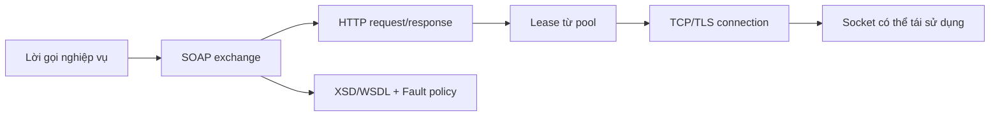
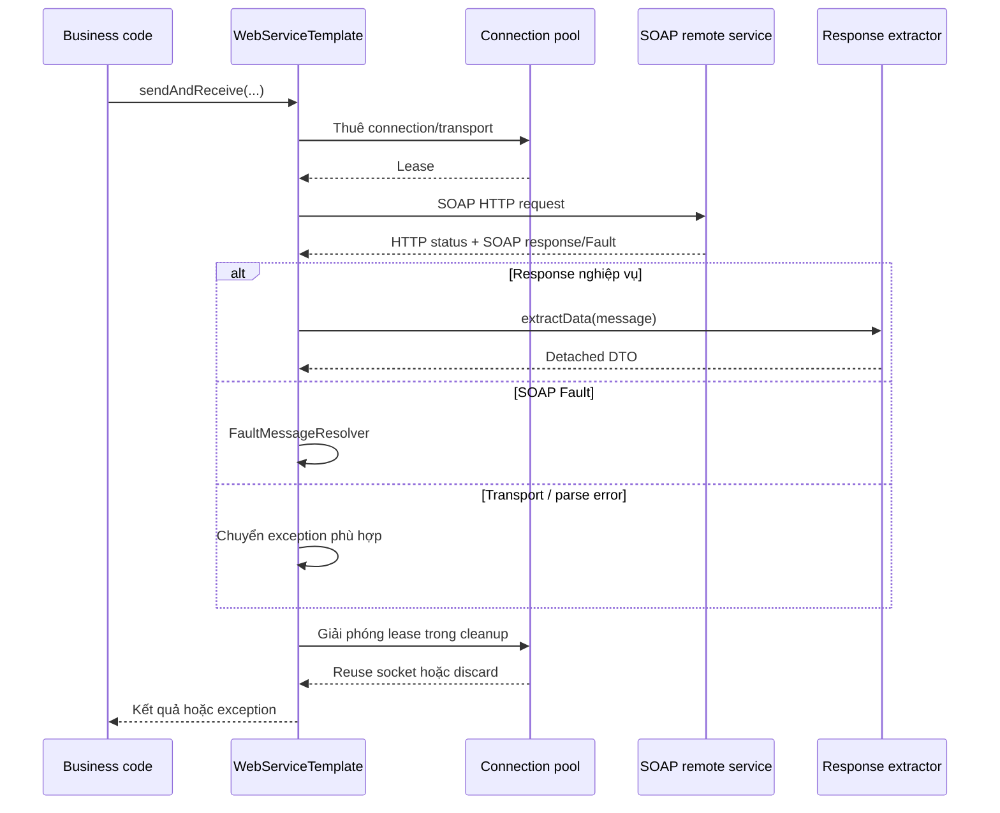
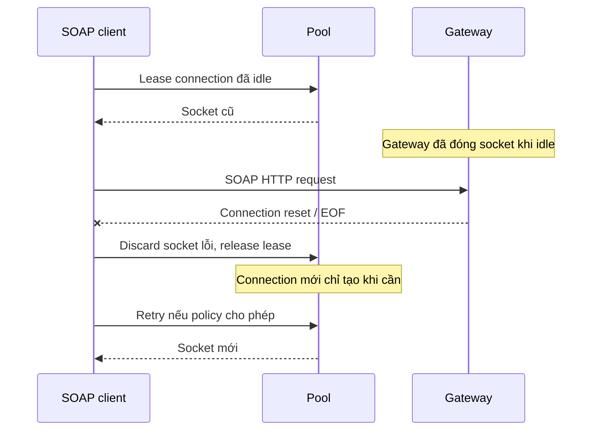
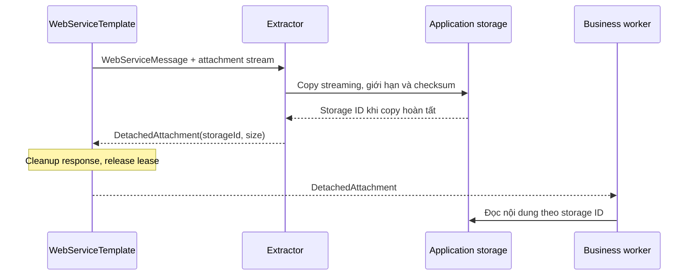

# Giải phóng kết nối, phản hồi lỗi và tái sử dụng kết nối

Trong một ứng dụng Spring Web Services (Spring-WS), việc nhận được SOAP response không có nghĩa mọi tài nguyên của lượt gọi đã được giải phóng. Ngược lại, **đóng một kết nối logic sau mỗi request không nhất thiết là đóng socket TCP vật lý**: khi dùng HTTP keep-alive và connection pool, thư viện có thể trả kết nối đủ điều kiện vào pool để request tiếp theo sử dụng. Hai việc tưởng như mâu thuẫn — **giải phóng đúng lúc** và **tái sử dụng hiệu quả** — thực chất bổ sung cho nhau.

Sai lầm phổ biến ở SOAP client là giữ `InputStream`/`Source` của response để đọc sau, bỏ qua SOAP Fault khi HTTP trả 500, tự retry mọi lỗi kết nối, hoặc cấu hình pool nhưng không có timeout lấy connection. Những sai lầm đó có thể gây **connection leak**, cạn pool, lỗi “stream closed”, thông điệp XML bị đọc dở, request bị thực hiện hai lần và dữ liệu nhạy cảm lọt vào log.

Bài thuộc chương **HTTP và kết nối** của module **SPRING_WEB_SERVICES**. Chúng ta đặt vòng đời transport cạnh kiến trúc **contract-first**: XSD/WSDL quy định payload request/response và SOAP Fault; JAXB/OXM chuyển đổi XML; `WebServiceTemplate` điều phối client; SOAP message sender quản lý HTTP; interceptor, TLS/mTLS, WS-Security, certificate và kiểm thử tương thích bảo vệ việc tích hợp doanh nghiệp.

> **Nguyên tắc:** để `WebServiceTemplate` sở hữu vòng đời connection/response; đọc và chuyển dữ liệu cần thiết thành một kết quả độc lập **trong callback/extractor**; cấu hình keep-alive, pool, timeout, Fault handling và retry theo chính sách có đo lường.

## 1. Mục tiêu học tập

Sau bài này, bạn có thể:

1. Phân biệt **SOAP message**, **HTTP request/response**, **kết nối logic**, **TCP/TLS connection**, **connection lease**, **pool** và **business transaction**.
2. Mô tả cách `WebServiceTemplate` tạo/gửi request, đọc response, phân loại lỗi, gọi extractor và dọn kết nối.
3. Giải thích vì sao `WebServiceConnection.close()` hoặc đóng HTTP response **không luôn đồng nghĩa** hủy socket đang có thể dùng lại.
4. Nhận diện dấu hiệu connection leak, stale pooled connection, response stream chưa được xử lý xong, cạn pool và timeout chờ lease.
5. Thiết kế client đọc SOAP Body/attachment đúng vòng đời bằng JAXB/OXM hoặc `WebServiceMessageExtractor<T>`.
6. Phân biệt SOAP Fault hợp lệ với HTTP error không phải SOAP, lỗi parsing, TLS, timeout và lỗi nghiệp vụ.
7. Cấu hình nguyên tắc **pool size**, connect timeout, connection-request timeout, response/read timeout, keep-alive, TTL và idle eviction.
8. Quyết định retry dựa trên **idempotency**, Fault code, giai đoạn thất bại và khả năng server đã commit nghiệp vụ.
9. Kiểm thử mock và integration thật để chứng minh kết nối được trả pool, response Fault được xử lý đúng và dữ liệu không lẫn giữa các request.

## 2. Năm vòng đời không được đánh đồng



Trong một lời gọi đồng bộ, ứng dụng có thể nhận một SOAP result và trả về Java DTO. Nhưng các phạm vi tài nguyên bên dưới có đời sống khác:

| Phạm vi | Bắt đầu/kết thúc | Điều quan trọng |
|---|---|---|
| **Business operation** | Khi service client bắt đầu đến khi biết kết quả hoặc timeout | Có thể tiếp tục tại server ngay cả sau client timeout. |
| **SOAP exchange** | Tạo request → nhận response/Fault hoặc gặp lỗi | Phải tuân WSDL/SOAP version và message semantics. |
| **HTTP exchange** | Gửi request HTTP → xử lý HTTP status, headers, entity | Một HTTP response có thể chứa SOAP Fault hoặc HTML lỗi từ proxy. |
| **Connection lease** | Pool cấp connection cho một request → được release | Phải trả lease đúng để request khác không bị kẹt. |
| **TCP/TLS connection** | Thiết lập socket/handshake → idle/reuse/close | Có thể phục vụ nhiều HTTP exchanges nếu điều kiện cho phép. |

**Kết nối logic được giải phóng** nghĩa là ứng dụng không còn chiếm tài nguyên của exchange đó. **Socket vật lý được giữ lại** nghĩa là pool đã xác nhận đủ điều kiện để tái sử dụng. Nếu response bị hỏng hoặc chưa được đọc/đóng theo API, pool có thể phải **loại bỏ socket** thay vì tái sử dụng. Đây là hành vi an toàn, không phải “connection leak”.

### Những lầm tưởng phổ biến

- “Gọi `close()` là HTTP keep-alive sẽ không còn hoạt động” — **không nhất thiết**; API close của response/exchange thường release quyền sử dụng, còn pool quyết định reuse.
- “Có pool rồi thì không bao giờ phải nghĩ tới response body” — **sai**; entity/stream và lease vẫn cần được xử lý đúng.
- “HTTP 200 nghĩa là business operation thành công” — **sai**; SOAP Body vẫn cần được parse/validate.
- “HTTP 500 chắc chắn là lỗi Java server” — **sai**; SOAP 1.1 Fault thường được gửi với HTTP 500 theo HTTP binding.
- “Timeout nghĩa là server chưa ghi DB” — **sai**; có thể server đã commit nhưng response thất lạc.
- “Một singleton `WebServiceTemplate` tương đương với một TCP connection” — **sai**; sender/pool có thể quản lý nhiều connection.

## 3. Spring-WS: ai sở hữu những tài nguyên nào?

Đối với SOAP client, các vai trò chính là:

| Thành phần | Trách nhiệm |
|---|---|
| `WebServiceTemplate` | Điều phối gửi/nhận, callback, extractor, client interceptors, fault/error handling và cleanup của lần gọi. |
| `WebServiceMessageSender` | Tạo kết nối tới URI/transport; lựa chọn HTTP stack và cấu hình. |
| `WebServiceConnection` | Biểu diễn một lượt trao đổi với địa chỉ đích; cung cấp send/receive và close. |
| HTTP client/connection manager | Quản lý socket, keep-alive, pooling, stale/idle eviction và TLS theo cấu hình cụ thể. |
| `WebServiceMessageFactory` | Tạo/đọc thông điệp SOAP hoặc loại message tương ứng. |
| `WebServiceMessageCallback` | Ghi Body/Header/SOAPAction vào request trong vòng đời lời gọi. |
| `WebServiceMessageExtractor<T>` | Đọc response, trả kết quả độc lập khỏi message/stream. |
| `FaultMessageResolver` | Xử lý SOAP Fault thay vì đưa cho luồng response nghiệp vụ bình thường. |
| JAXB/OXM | Marshal/unmarshal payload theo XSD binding, có thể kèm schema validation. |

Một stack điển hình:

```text
OrderServiceClient
    -> WebServiceTemplate
         -> SOAP callback / JAXB request
         -> ClientInterceptor chain
         -> WebServiceMessageSender
              -> HTTP client
                   -> connection pool
                   -> TCP socket + TLS
         <- HTTP response entity / SOAP message
         -> SOAP Fault/error classification
         -> JAXB unmarshaller hoặc extractor
         -> return detached domain result
    -> business code
```

**Không gọi trực tiếp `getOutputStream()` hay `connection.close()` ở code nghiệp vụ** khi đã dùng `WebServiceTemplate`. Template điều phối chúng; việc tự can thiệp thường làm mơ hồ ownership và dễ đóng response trước khi unmarshal.

### Chỉ một owner cho mỗi tài nguyên

Nếu ứng dụng **tự tạo** `CloseableHttpClient` làm singleton pool, ứng dụng chịu trách nhiệm **đóng HTTP client khi Spring context dừng**, không đóng sau mỗi SOAP request. Ngược lại, từng response/connection lease được giải phóng theo **lượt gọi**.

Nếu một helper mở stream/file tạm riêng để lưu attachment, helper chịu trách nhiệm đóng stream/file đó. Không hiểu nhầm việc template đóng HTTP connection là nó sẽ tự đóng mọi file do bạn đã tự tạo.

## 4. Hợp đồng XSD/WSDL làm nền cho HTTP response

Chúng ta dùng SOAP service tra cứu trạng thái đơn hàng. Namespace nghiệp vụ:

```text
urn:example:orders:v1
```

XSD ví dụ `orders-v1.xsd`:

```xml
<?xml version="1.0" encoding="UTF-8"?>
<xs:schema
    xmlns:xs="http://www.w3.org/2001/XMLSchema"
    xmlns:ord="urn:example:orders:v1"
    targetNamespace="urn:example:orders:v1"
    elementFormDefault="qualified">

    <xs:element name="GetOrderStatusRequest">
        <xs:complexType>
            <xs:sequence>
                <xs:element name="requestId" type="xs:string"/>
                <xs:element name="orderId" type="xs:string"/>
            </xs:sequence>
        </xs:complexType>
    </xs:element>

    <xs:element name="GetOrderStatusResponse">
        <xs:complexType>
            <xs:sequence>
                <xs:element name="requestId" type="xs:string"/>
                <xs:element name="orderId" type="xs:string"/>
                <xs:element name="status" type="xs:string"/>
            </xs:sequence>
        </xs:complexType>
    </xs:element>

    <xs:element name="OrderNotFoundFault">
        <xs:complexType>
            <xs:sequence>
                <xs:element name="code" type="xs:string"/>
                <xs:element name="orderId" type="xs:string"/>
            </xs:sequence>
        </xs:complexType>
    </xs:element>
</xs:schema>
```

Trong WSDL 1.1 document/literal, input message part tham chiếu `ord:GetOrderStatusRequest`, output part tham chiếu `ord:GetOrderStatusResponse`; một declared fault có thể tham chiếu `ord:OrderNotFoundFault` ở `wsdl:fault` và `soap:fault` thuộc binding.

```text
Body request QName:
  {urn:example:orders:v1}GetOrderStatusRequest

Body response QName:
  {urn:example:orders:v1}GetOrderStatusResponse

Fault detail QName (nếu được công bố):
  {urn:example:orders:v1}OrderNotFoundFault
```

Đây là điều client phải đối chiếu **sau khi** transport đã nhận HTTP entity. Pool được cấu hình tốt không giúp một response có root QName sai trở thành hợp lệ.

### SOAP 1.1 request qua HTTP

```http
POST /soap/orders HTTP/1.1
Host: partner.example.org
Content-Type: text/xml; charset=utf-8
SOAPAction: "urn:example:orders:GetOrderStatus"
Connection: keep-alive

[SOAP 1.1 Envelope chứa GetOrderStatusRequest]
```

`Connection: keep-alive` là ví dụ biểu diễn HTTP/1.1. Không nên tự gắn header này để **ép** tái sử dụng: client/server/proxy và version HTTP thực tế quyết định kết nối có được giữ. Phải làm đúng cleanup và cấu hình connection manager trước.

### SOAP 1.1 response thành công

```http
HTTP/1.1 200 OK
Content-Type: text/xml; charset=utf-8

[SOAP 1.1 Envelope chứa GetOrderStatusResponse]
```

`HTTP 200` thể hiện thành công ở HTTP transport, nhưng client vẫn phải kiểm SOAP version, XML/QName, JAXB mapping và các quy tắc XSD/business khi dùng dữ liệu.

## 5. Trường hợp HTTP 500 vẫn là SOAP response hợp lệ

Một SOAP service có thể gửi SOAP Fault khi không tìm thấy đơn hàng. Với SOAP 1.1 HTTP binding, HTTP status **500** thường là cách thể hiện một SOAP Fault hợp lệ về mặt giao thức:

```http
HTTP/1.1 500 Internal Server Error
Content-Type: text/xml; charset=utf-8

[SOAP 1.1 Envelope chứa soap:Fault]
```

SOAP Body ví dụ:

```xml
<soap:Envelope
    xmlns:soap="http://schemas.xmlsoap.org/soap/envelope/"
    xmlns:ord="urn:example:orders:v1">
    <soap:Body>
        <soap:Fault>
            <faultcode>soap:Client</faultcode>
            <faultstring>Order does not exist</faultstring>
            <detail>
                <ord:OrderNotFoundFault>
                    <ord:code>ORDER_NOT_FOUND</ord:code>
                    <ord:orderId>ORD-404</ord:orderId>
                </ord:OrderNotFoundFault>
            </detail>
        </soap:Fault>
    </soap:Body>
</soap:Envelope>
```

**HTTP 500 với SOAP Fault** khác **HTTP 500 chứa HTML lỗi reverse proxy**. Chúng có thể cần các nhánh xử lý khác nhau:

- SOAP Fault đã parse được → xử lý qua `FaultMessageResolver` và contract fault detail.
- Body HTML/plain text/empty → phân loại HTTP transport/proxy error, **không cố unmarshal thành `GetOrderStatusResponse`**.
- HTTP 401/403 từ gateway → authentication/authorization ở HTTP; có thể không có SOAP Envelope.
- TLS handshake thất bại → chưa có HTTP response; không thể kỳ vọng một SOAP Fault XML.

**Không dùng** `if (status >= 400) retry();` làm toàn bộ chính sách SOAP client. Một Fault phía gửi như `ORDER_NOT_FOUND` thường không nên retry mù; một 503 từ gateway có thể cân nhắc retry nếu operation an toàn và có budget; timeout là trường hợp kết quả nghiệp vụ có thể không rõ.

## 6. SOAP 1.1, SOAP 1.2 và trạng thái HTTP

SOAP version được xác định bởi **namespace Envelope và binding** chứ không phải tên prefix `soap` hay `env`.

| Khía cạnh | SOAP 1.1 qua HTTP | SOAP 1.2 qua HTTP |
|---|---|---|
| Envelope namespace | `http://schemas.xmlsoap.org/soap/envelope/` | `http://www.w3.org/2003/05/soap-envelope` |
| Content-Type thường dùng | `text/xml` | `application/soap+xml` |
| Action | Header HTTP `SOAPAction` theo binding | Action parameter của media type và/hoặc addressing policy |
| Lỗi bên gửi | `soap:Client` | `env:Sender` |
| Lỗi bên nhận | `soap:Server` | `env:Receiver` |
| Fault text | `faultstring` | `Reason/Text` |
| Fault detail | `detail` | `Detail` |
| HTTP status khi Fault | SOAP 1.1 HTTP binding thường dùng 500 | Theo SOAP 1.2 HTTP binding và lớp lỗi; không ép mọi Fault là 500 |

Trong SOAP 1.2, mapping HTTP status có các quy tắc khác, chẳng hạn lỗi Sender, Receiver, VersionMismatch; một số tình huống có thể cho 400 hoặc 500 theo binding. **Không thiết kế một bảng status tự nghĩ ra** rồi áp cho mọi gateway/SOAP version mà không kiểm WSDL, binding và response thực.

### HTTP 202 Accepted và operation một chiều

Một HTTP 202 có thể liên quan one-way/accepted processing, nhưng **không đồng nghĩa business transaction đã hoàn tất**. Với operation có WSDL output bắt buộc, response không có SOAP Body phải được xem xét như **contract mismatch**.

Nếu một SOAP service nhận yêu cầu tạo job rồi trả `jobId`, đó vẫn có thể là request–response business contract. Nếu thực sự one-way, client không nên đòi `GetOrderStatusResponse` để chứng minh server đã xử lý xong; cần cơ chế tra cứu/callback/reconciliation khác.

## 7. `WebServiceTemplate` thực hiện cleanup ở đâu?

`WebServiceTemplate` điều phối một lượt gọi đồng bộ: tạo request, gọi callback, gửi qua message sender, nhận message, kiểm lỗi/Fault, chạy response extractor, rồi dọn connection qua cơ chế nội bộ.



Đây là mô hình khái niệm; **thứ tự chi tiết** của các callback, interceptor và fault/error checks phụ thuộc Spring-WS version và sender. Điểm ứng dụng cần tin cậy là **API ownership**: template chịu trách nhiệm dọn connection do chính template tạo, kể cả khi extractor hoặc Fault handler báo lỗi.

### Không đóng connection bên trong extractor

```java
WebServiceMessageExtractor<OrderResult> extractor = message -> {
    // Đúng: đọc response khi WebServiceTemplate còn quản lý message.
    Object bound = marshaller.unmarshal(message.getPayloadSource());
    return toDetachedResult(bound);
};
```

`toDetachedResult` là helper miền ứng dụng phải được triển khai. Extractor **không** nên:

- Tự gọi close trên connection mà template đang dùng.
- Trả về một `InputStream` đang bám vào HTTP response.
- Đưa `WebServiceMessage` vào cache để phân tích sau.
- Gọi `CompletableFuture.supplyAsync` để đọc `Source` sau khi extractor trả về.
- Đóng một `CloseableHttpClient` singleton sau mỗi request.
- Tự retry cùng request ở bên trong callback/extractor.

Nếu có tài nguyên **do extractor tự tạo** (ví dụ output stream/file tạm để copy attachment), cần đóng tài nguyên của mình bằng `try-with-resources`/`finally`, đồng thời không nhầm chúng với transport do template sở hữu.

## 8. Đóng exchange khác với đóng socket vật lý

Một số giao diện sử dụng phương thức `close()` cho nhiều thứ khác nhau:

```text
close logic của HTTP response / WebServiceConnection
    -> hoàn tất việc sử dụng response body
    -> release tài nguyên cho connection manager
    -> pool có thể tái sử dụng physical connection
       hoặc chủ động đóng nếu không còn đủ điều kiện

close HTTP client / PoolingConnectionManager khi ứng dụng shutdown
    -> đóng pool và các connection do pool sở hữu
    -> không còn phục vụ các SOAP calls mới
```

Tái sử dụng có thể không xảy ra nếu:

- Response body không được tiêu thụ/dọn theo quy tắc transport.
- Server gửi `Connection: close` hoặc proxy đóng socket.
- HTTP connection đã quá **time-to-live** hoặc keep-alive timeout.
- Socket bị reset, gặp lỗi I/O hoặc TLS đã không còn hợp lệ.
- Pool đã vượt giới hạn idle connections.
- Server/load balancer đã đóng connection idle.
- Chính sách HTTP version/proxy làm connection reuse khác HTTP/1.1 keep-alive.

**Tái sử dụng** là tối ưu hiệu năng có điều kiện, không phải quyền bảo đảm rằng hai request sẽ luôn dùng đúng một socket. Khi xảy ra I/O error, **discard connection** có thể là kết quả đúng.

### Vì sao cạn pool dù không có “leak” trên heap?

Một thread đang chờ đọc SOAP response rất chậm **vẫn giữ lease hợp lệ**. Nếu số request đồng thời bằng max connections và tất cả đợi remote, các request tiếp theo có thể hết **connection-request timeout**. Đó là **pool exhaustion do tải/remote latency**, khác với leak do quên release. Cần metrics để phân biệt.

## 9. Đừng trả `Source`/stream vượt vòng đời phản hồi

Phản mẫu:

```java
import javax.xml.transform.Source;

Source unsafe = webServiceTemplate.sendAndReceive(
    endpointUri,
    requestCallback,
    response -> response.getPayloadSource()
);

// Đọc Source sau khi template đã hoàn tất là nguy hiểm:
transformer.transform(unsafe, someResult);
```

Nó có thể “tình cờ” chạy được khi response đã được buffer thành `DOMSource`, nhưng **không phải lời hứa về vòng đời** của Spring-WS. Với `StreamSource` hoặc message factory streaming, nguồn dữ liệu có thể phụ thuộc stream/socket đã đóng hoặc được chuyển sang request khác.

Cách đúng là chuyển sang object độc lập **trong extractor**:

```java
import java.io.IOException;
import javax.xml.transform.Source;
import org.springframework.ws.client.core.WebServiceMessageExtractor;

public record OrderResult(
    String requestId,
    String orderId,
    String status
) {}

WebServiceMessageExtractor<OrderResult> extractor = message -> {
    Source payload = message.getPayloadSource();

    if (payload == null) {
        throw new IOException("Expected SOAP response payload");
    }

    Object value = marshaller.unmarshal(payload);

    if (value instanceof jakarta.xml.bind.JAXBElement<?> root) {
        value = root.getValue();
    }

    if (!(value instanceof GetOrderStatusResponse response)) {
        throw new IllegalStateException("Unexpected response type");
    }

    return new OrderResult(
        response.getRequestId(),
        response.getOrderId(),
        response.getStatus()
    );
};
```

Giả định `GetOrderStatusResponse` được XJC sinh theo XSD, `marshaller` là `Jaxb2Marshaller` đã cấu hình, các import/bean context còn lại nằm trong ứng dụng. Đây là **đoạn minh họa đặt trong một method/config**, không phải Java file độc lập.

Lúc `extractData(...)` trả về, record chỉ giữ các `String` đã materialize, không còn giữ `Source` hoặc `WebServiceMessage`.

### Attachment/MTOM còn rủi ro hơn

Nếu SOAP Body có `xop:Include`, dữ liệu thực có thể nằm trong MIME attachment. Trả `DataHandler` hay stream thuộc message ra ngoài có thể bị lỗi tương tự. Với file nhỏ, **copy có giới hạn** trong lượt gọi; với file lớn, stream trực tiếp tới storage do ứng dụng sở hữu, trả **ID/path/metadata** sau khi copy hoàn tất. Cần đóng stream **do bạn tự mở**, tính checksum và dọn file tạm khi lỗi.

## 10. Tự quản lý connection ở API thấp: chỉ dùng khi cần

Đa số dự án nên sử dụng `WebServiceTemplate`. Nếu cần viết transport helper ở tầng thấp, hãy hiểu nguyên tắc `try/finally`:

```java
// Sơ đồ Java mức API thấp: các biến sender, uri,
// requestMessage, factory được khởi tạo trong ứng dụng.
WebServiceConnection connection =
    sender.createConnection(uri);

try {
    connection.send(requestMessage);

    if (connection.hasError()) {
        // Đọc/phân loại lỗi theo SOAP/HTTP policy.
    }

    WebServiceMessage response = connection.receive(factory);

    if (response != null) {
        // Parse response/Fault tại đây,
        // không trả Source phụ thuộc vào connection.
    }
} finally {
    connection.close();
}
```

Các API `WebServiceConnection` thuộc `org.springframework.ws.transport`; đoạn này là **sườn minh họa**, chưa đầy đủ về `hasFault`, HTTP status, Fault resolver, security interceptor, timeout và exception handling. Vì vậy **không sao chép nguyên rồi tự thay `WebServiceTemplate` trong production**.

Trong chương trình xử lý tài nguyên, `finally` quan trọng vì exception có thể xảy ra ở:

- Tạo/gửi SOAP request.
- TLS handshake/HTTP write.
- Nhận header/status hoặc body response.
- XML parsing, XSD/JAXB unmarshalling.
- SOAP Fault parsing.
- Logic trong extractor hoặc client interceptor.
- Timeout, remote reset, interrupted I/O.

Nếu không release khi lỗi, mỗi lần fail có thể giữ một lease; sau một đợt lỗi hàng loạt, pool cạn hẳn dù server remote đã phục hồi.

### Dừng ứng dụng: lifecycle khác per-call cleanup

Nếu ứng dụng sở hữu HTTP client/connection manager singleton, hãy đóng chúng **khi Spring application context dừng**, sau khi ngừng nhận công việc mới và cho inflight calls hoàn tất trong giới hạn shutdown policy. Đóng pool ngay sau mỗi lời gọi sẽ triệt tiêu keep-alive; không đóng pool lúc shutdown có thể giữ thread/socket và làm quá trình tắt ứng dụng không sạch.

## 11. Ví dụ Spring-WS client JAXB tối thiểu, không tự giữ connection

```java
package org.example.orders.client;

import org.springframework.context.annotation.Bean;
import org.springframework.context.annotation.Configuration;
import org.springframework.oxm.jaxb.Jaxb2Marshaller;
import org.springframework.ws.client.core.WebServiceTemplate;

@Configuration
public class OrdersSoapClientConfiguration {

    @Bean
    public Jaxb2Marshaller ordersMarshaller() {
        Jaxb2Marshaller m = new Jaxb2Marshaller();
        m.setContextPath("org.example.orders.contract");
        return m;
    }

    @Bean
    public WebServiceTemplate ordersTemplate(
            Jaxb2Marshaller ordersMarshaller) {

        WebServiceTemplate template = new WebServiceTemplate();
        template.setMarshaller(ordersMarshaller);
        template.setUnmarshaller(ordersMarshaller);
        template.setDefaultUri(
            "https://partner.example.org/soap/orders"
        );
        return template;
    }
}
```

`contextPath` giả định có JAXB `ObjectFactory`/`jaxb.index` hoặc metadata thích hợp, sử dụng `jakarta.xml.bind` trên stack Spring Boot 3/Spring-WS 4. Với Java 17, `javax.xml.namespace.QName` vẫn là Java XML API đúng. Ngoài bean mẫu cần dependency/transport sender được chọn phù hợp và cấu hình TLS/timeouts.

Gọi client:

```java
public GetOrderStatusResponse getStatus(
        GetOrderStatusRequest request) {

    Object result = ordersTemplate.marshalSendAndReceive(
        request,
        message -> {
            if (message instanceof SoapMessage soap) {
                soap.setSoapAction(
                    "urn:example:orders:GetOrderStatus"
                );
            }
        }
    );

    if (result instanceof jakarta.xml.bind.JAXBElement<?> e) {
        result = e.getValue();
    }

    if (!(result instanceof GetOrderStatusResponse response)) {
        throw new IllegalStateException(
            "Unexpected or missing SOAP output"
        );
    }

    return response;
}
```

Đây là method trong một client class giả định đã inject `ordersTemplate` và các loại JAXB/`SoapMessage`. Đừng khai báo `ordersTemplate` mutable rồi tự thay default URI giữa hai request; nếu cần gọi nhiều endpoint, dùng overload nhận URI hoặc các client bean đã cấu hình rõ.

`WebServiceTemplate` dọn connection per-call; code client không cần bao `marshalSendAndReceive` bằng `try (WebServiceConnection ...)` do connection không được caller trực tiếp sở hữu.

## 12. Connection pooling: cấu hình có giới hạn rõ ràng

Một HTTP client/connection pool dùng chung giúp giảm chi phí TCP handshake và TLS handshake khi hệ thống gọi SOAP nhiều lần. Nhưng pool phải được cấu hình theo **mức tải thực, độ trễ và giới hạn của đối tác**, không chỉ “càng nhiều connection càng tốt”.

Khái niệm:

```text
Application threads
    │
    ├── SOAP call 1 ── lease A ──> TCP/TLS connection A
    ├── SOAP call 2 ── lease B ──> TCP/TLS connection B
    ├── SOAP call 3 ── wait for available lease
    └── ...
             Pool (max total / max per route)
                 ├── leased
                 ├── available/idle
                 └── pending/waiting
```

Các tham số cần thiết:

| Tham số | Ý nghĩa | Rủi ro khi thiếu |
|---|---|---|
| `maxTotal` | Số connection tối đa trong pool | Quá nhiều socket/FD/CPU ở cả hai phía |
| `maxPerRoute` | Giới hạn tới một đích/route | Một đối tác có thể chiếm toàn pool hoặc bị nghẽn |
| Connection-request timeout | Thời gian chờ **mượn connection từ pool** | Thread đợi vô hạn khi pool bận |
| Connect timeout | Thời gian chờ thiết lập kết nối | Call bị giữ khi đích không reachable |
| Read/response timeout | Thời gian chờ nhận response/data | Remote chậm giữ lease lâu |
| Connection TTL | Thời gian sống tối đa của connection | Tái dùng socket quá lâu trong môi trường mạng thay đổi |
| Idle eviction | Loại connection rỗi quá lâu | Tái sử dụng socket đã bị proxy/server đóng |
| Keep-alive policy | Thời gian giữ connection đủ điều kiện | Reuse sai giả định về idle timeout |
| Shutdown close | Đóng pool đúng thời điểm | Rò socket/threads khi app tắt |

**Ba timeout khác nhau:** chờ lấy lease, tạo TCP/TLS connection và chờ phản hồi. Nếu chỉ đặt connect timeout, request vẫn có thể bị treo chờ connection trong pool hoặc chờ SOAP response.

### Minh họa cấu hình Apache HttpClient 5

Với một stack Spring-WS **có hỗ trợ `HttpComponents5MessageSender`**, ý tưởng dùng Apache HttpClient 5 pool:

```java
import org.apache.hc.client5.http.config.RequestConfig;
import org.apache.hc.client5.http.impl.classic.CloseableHttpClient;
import org.apache.hc.client5.http.impl.classic.HttpClients;
import org.apache.hc.client5.http.impl.io.PoolingHttpClientConnectionManager;
import org.apache.hc.client5.http.impl.io.PoolingHttpClientConnectionManagerBuilder;
import org.apache.hc.client5.http.config.ConnectionConfig;
import org.apache.hc.core5.util.TimeValue;
import org.apache.hc.core5.util.Timeout;

import org.springframework.context.annotation.Bean;
import org.springframework.context.annotation.Configuration;
import org.springframework.ws.client.core.WebServiceTemplate;
import org.springframework.ws.transport.http.HttpComponents5MessageSender;

@Configuration
public class PooledSoapTransportConfiguration {

    @Bean(destroyMethod = "close")
    public CloseableHttpClient soapHttpClient() {

        ConnectionConfig connectionConfig =
            ConnectionConfig.custom()
                .setConnectTimeout(Timeout.ofSeconds(3))
                .build();

        PoolingHttpClientConnectionManager pool =
            PoolingHttpClientConnectionManagerBuilder.create()
                .setMaxConnTotal(100)
                .setMaxConnPerRoute(20)
                .setDefaultConnectionConfig(connectionConfig)
                .build();

        RequestConfig requestConfig =
            RequestConfig.custom()
                .setConnectionRequestTimeout(
                    Timeout.ofSeconds(2)
                )
                .setResponseTimeout(
                    Timeout.ofSeconds(10)
                )
                .build();

        return HttpClients.custom()
            .setConnectionManager(pool)
            .setDefaultRequestConfig(requestConfig)
            .evictExpiredConnections()
            .evictIdleConnections(TimeValue.ofSeconds(30))
            .build();
    }

    @Bean
    public WebServiceTemplate pooledOrdersTemplate(
            Jaxb2Marshaller ordersMarshaller,
            CloseableHttpClient soapHttpClient) {

        HttpComponents5MessageSender sender =
            new HttpComponents5MessageSender(soapHttpClient);

        WebServiceTemplate template = new WebServiceTemplate();
        template.setMarshaller(ordersMarshaller);
        template.setUnmarshaller(ordersMarshaller);
        template.setMessageSender(sender);
        template.setDefaultUri(
            "https://partner.example.org/soap/orders"
        );
        return template;
    }
}
```

**Giới hạn của ví dụ:** đây là cấu hình minh họa cho **Apache HttpClient 5 + Spring-WS sender tương thích**; class, constructor và timeout API cần được đối chiếu với phiên bản Spring-WS/HttpClient 5 đã được Maven/Gradle resolve. Không trộn `HttpComponentsMessageSender` dùng stack HttpClient cũ với `HttpComponents5MessageSender` mà không kiểm adapter.

Các số 100/20/2s/3s/10s/30s là **giá trị minh họa**, không phải khuyến nghị mặc định cho production. Đặc biệt:

- Nếu ứng dụng chỉ được đối tác cấp 10 kết nối, `maxPerRoute=20` có thể quá cao.
- Response timeout 10 giây có thể không phù hợp operation xử lý lâu.
- `evictIdleConnections` cần hiểu idle timeout của load balancer; nó không bảo đảm socket không bao giờ stale.
- Khi app sở hữu `CloseableHttpClient` qua bean, `destroyMethod="close"` đóng pool khi context shutdown; **không** đóng client trong `getStatus(...)`.
- Việc cấu hình custom TLS/mTLS hoặc proxy/connection reuse policy phải được áp dụng trên HTTP client tương ứng, không vô hiệu hóa SSL verification.
- Cần giám sát pool và test dưới tải trước khi chọn cấu hình thật.

Nếu không sử dụng Apache HttpClient, ví dụ API sẽ khác. **Nguyên tắc pool/lease/timeout/cleanup vẫn giữ nguyên**, còn tên class/setter phải theo sender bạn chọn.

## 13. Phân loại lỗi: HTTP transport error khác SOAP Fault

Khi response về, client phải phân loại đúng **điểm thất bại**. Một thông điệp có SOAP Fault XML hợp lệ theo version cần được xử lý bởi **fault handling**, trong khi HTTP error không có Envelope cần đi theo **transport/error handling**.

| Tình huống | Có SOAP message hợp lệ? | Lỗi ứng dụng nên thấy | Retry tự động? |
|---|---|---|---|
| HTTP 200, SOAP Body hợp lệ | Có | Không, trả JAXB/DTO | Không cần |
| HTTP 500, SOAP 1.1 Fault | Có | `SoapFaultClientException`/typed fault theo cấu hình | Dựa vào Fault code và domain |
| HTTP 401/403 từ gateway | Không chắc | Authentication/authorization transport error | Thường **không** retry không đổi credential |
| HTTP 404 vì URL sai | Thường không | Sai URI/routing transport | Không retry mù |
| HTTP 429/503 từ proxy | Có thể không | Rate limit/service unavailable | Chỉ có budget/backoff/policy |
| HTTP 200 nhưng Body XML sai QName | Có thể parse SOAP, sai contract | Schema/unmarshal error | Không mặc định |
| HTTP 500, HTML error page | Không phải SOAP | Transport/invalid response | Cân nhắc sau phân loại |
| TLS handshake/certificate lỗi | Không có HTTP response | TLS/security transport exception | Không bỏ verification để retry |
| Connect timeout | Chưa biết có gửi request không | Network/timeout error | Theo operation và idempotency |
| Read timeout sau khi đã gửi | Chưa biết kết quả nghiệp vụ | Outcome **không xác định** | Chỉ an toàn theo dedup contract |
| SOAP Header WS-Security sai | Có thể có SOAP Fault | Security fault hoặc client exception | Không retry mù |

Một `WebServiceTemplate` thường phân biệt SOAP Fault qua message factory và `FaultMessageResolver`. Nếu service tuân SOAP binding, người sử dụng client có thể nhận `SoapFaultClientException` thay vì phản hồi nghiệp vụ từ unmarshaller.

### 13.1. Ví dụ bắt và phân loại exception ở biên ứng dụng

```java
import org.springframework.ws.client.WebServiceIOException;
import org.springframework.ws.client.WebServiceTransportException;
import org.springframework.ws.soap.client.SoapFaultClientException;

public OrderResult callPartner(GetOrderStatusRequest request) {

    try {
        return parseOrderResult(
            webServiceTemplate.marshalSendAndReceive(request)
        );
    } catch (SoapFaultClientException fault) {
        // SOAP Fault có ý nghĩa theo contract.
        // Map fault code + QName detail, không parse faultstring mù.
        throw mapSoapFault(fault);
    } catch (WebServiceTransportException transport) {
        // HTTP status/transport response không xử lý được như SOAP.
        throw mapTransportFailure(transport);
    } catch (WebServiceIOException io) {
        // Kết nối hoặc I/O lỗi; outcome có thể chưa xác định.
        throw mapNetworkFailure(io);
    }
}
```

Đây là **khung kiến trúc**, không phải Java class standalone: `parseOrderResult`, `mapSoapFault`, `mapTransportFailure` và `mapNetworkFailure` do ứng dụng triển khai; các API/loại exception phải kiểm với Spring-WS version thực tế. Một số lỗi JAXB/XML có thể được bọc vào loại runtime exception khác, vì vậy cần test toàn bộ error taxonomy chứ không dựa vào chỉ ba catch block.

Thứ tự catch nêu ý nghĩa riêng của các nhánh; thực tế phải kiểm class hierarchy/ngoại lệ mà transport sender tạo trong phiên bản ứng dụng.

### 13.2. Không nuốt exception rồi trả một response giả

Phản mẫu:

```java
try {
    return partnerClient.submitOrder(request);
} catch (Exception ignored) {
    return new SubmitOrderResult("SUCCESS");
}
```

Nếu timeout xảy ra sau khi server đã ghi đơn hàng, cách trả thành công giả khiến hệ thống mất khả năng đối soát. Ngược lại, trả thất bại khẳng định “chưa xử lý” cũng có thể sai. Hãy có **trạng thái kết quả không xác định** và reconciliation khi nghiệp vụ cho phép.

## 14. Hai cờ kiểm HTTP của `WebServiceTemplate` cần hiểu trước khi chỉnh

Các phiên bản Spring-WS có các cơ chế như:

- `setCheckConnectionForError(...)`: ảnh hưởng việc kiểm lỗi ở transport connection.
- `setCheckConnectionForFault(...)`: ảnh hưởng việc dùng dấu hiệu Fault từ transport connection.

**Không được hiểu chúng là công tắc “tự sửa HTTP 500”.** Khi đối tác gửi SOAP Fault hợp lệ với HTTP status khác quy ước của binding, đôi khi ứng dụng phải điều chỉnh fault/error classification cho tương thích. Nhưng việc tắt kiểm tra không có test có thể làm **HTML lỗi proxy bị đưa vào JAXB unmarshaller** hoặc bỏ sót một Fault.

Quy trình an toàn:

1. Lưu **response HTTP status, Content-Type và SOAP Envelope** thật trong test synthetic.
2. Xác minh WSDL SOAP version và quy tắc HTTP binding.
3. Quan sát Spring-WS version hiện tại phân loại response bằng sender nào.
4. Chỉ điều chỉnh các cờ trên nếu đã chứng minh chính xác hiện tượng không tương thích.
5. Đảm bảo `FaultMessageResolver` vẫn nhận các SOAP Fault mong đợi.
6. Kiểm HTTP 401/403, 404, 500 HTML và timeout không bị hiểu nhầm thành success.
7. Không tắt xác thực XML Signature/TLS để “làm fault handler hoạt động”.

Không viết:

```java
template.setCheckConnectionForError(false);
template.setCheckConnectionForFault(false);
```

rồi dùng như “cấu hình mặc định cho mọi đối tác”. Mã chỉ minh họa **những cờ không nên thay đổi tùy tiện**. Luôn có integration test riêng nếu một đối tác có HTTP/SOAP behavior khác chuẩn.

## 15. HTTP keep-alive, connection reuse và socket stale

HTTP/1.1 hỗ trợ persistent connections; một HTTP client có connection pool có thể dùng socket cũ cho SOAP request mới. Nhưng giữa hai lần gọi có thể có:

- Server SOAP đóng idle connection sau một khoảng thời gian.
- Load balancer/proxy NAT cắt connection không gửi traffic.
- Hết hạn idle keep-alive, connection TTL hoặc SSL session.
- Dịch vụ đổi IP/điểm cân bằng tải.
- Lỗi TCP reset hoặc đóng từ xa mà client chưa phát hiện.



Lỗi kiểu “connection reset”, “unexpected EOF”, “NoHttpResponseException” hoặc tương tự **có thể** liên quan stale pooled connection, nhưng không nên chẩn đoán chỉ từ một exception string: chúng cũng có thể do remote crash, proxy, mạng hoặc TLS.

### Biện pháp giảm stale reuse

- Cấu hình connection TTL/idle eviction hợp lý so với idle timeout của server/proxy.
- Cân nhắc validate connection sau thời gian idle nếu HTTP client/manager hỗ trợ.
- Tránh keep-alive vô hạn nếu load balancer đóng sau khoảng ngắn.
- Giám sát reset/EOF, connection created/closed và tỷ lệ retry.
- Retry **chỉ** khi có căn cứ operation idempotent hoặc server dedup.
- Không giữ một connection duy nhất “vĩnh viễn” để né handshake.

### Vì sao không dùng `Connection: close` cho mọi request?

Điều đó có thể tránh một số lỗi stale socket nhưng đổi lại phải liên tục TCP/TLS handshake, tăng latency, CPU và khả năng cạn cổng/connection trên hệ thống khi tải cao. Chỉ dùng như biện pháp **chẩn đoán tạm thời** hoặc khi chính sách đối tác yêu cầu; giải pháp bền vững là cấu hình pool/idle validation phù hợp.

## 16. Pool sizing cần dựa trên đo lường và giới hạn đối tác

Một ước lượng sơ bộ theo quan hệ throughput/concurrency:

```text
Concurrent in-flight SOAP calls
    ≈ request rate (calls/sec) × average response time (sec)
```

Ví dụ: nếu một service gửi 40 SOAP calls/giây và một lời gọi giữ connection trung bình 0,25 giây, mức in-flight trung bình xấp xỉ 10. Nhưng **không** được chọn `maxPerRoute=10` ngay lập tức; cần tính P95/P99 latency, burst, timeout, headroom và quota của partner.

| Chỉ số | Ý nghĩa |
|---|---|
| Leased connections | Số connection đang có request sử dụng |
| Available/idle | Có thể tái sử dụng nếu còn đủ điều kiện |
| Pending lease requests | Số thread/call đang chờ lấy connection |
| Pool max | Giới hạn được cấu hình |
| Connection creation rate | Mức tạo socket mới thay vì reuse |
| Stale/reset/EOF rate | Dấu hiệu mạng hoặc idle timeout không phù hợp |
| SOAP call duration P50/P95/P99 | Độ trễ end-to-end |
| Lease wait duration | Phân biệt remote chậm với pool quá nhỏ |
| Fault rate theo category | Phân biệt business Fault, validation, security, transport |

**Ví dụ đọc số liệu từ Apache HttpClient 5 pool manager** (nếu ứng dụng quản lý bean manager):

```java
import org.apache.hc.core5.pool.PoolStats;

PoolStats stats = poolManager.getTotalStats();

int leased = stats.getLeased();
int available = stats.getAvailable();
int pending = stats.getPending();
int max = stats.getMax();
```

`poolManager` là biến/bean được inject riêng của ứng dụng. Đoạn này dùng API pool stats để giải thích các chỉ số, không phải một exporter metrics hoàn chỉnh. Nếu cần metrics cho một route cụ thể, dùng API tương ứng trong HTTP client và giới hạn cardinality của endpoint tags.

### Hai hiện tượng khác nhau cần phân biệt

**Pool quá nhỏ nhưng không leak:** leased thường đụng max, pending tăng khi remote P99 latency cao, và giảm khi response hoàn tất. Giải pháp có thể là tăng quota pool có kiểm soát, giảm timeout, tối ưu remote/giảm concurrency.

**Connection leak hoặc stream bị giữ:** leased/pending tăng và không hồi phục sau khi traffic dừng, có dấu hiệu response/stream không được release trên một code path, nhất là custom HTTP client ngoài `WebServiceTemplate`. Cần rà lifecycle và test faults/timeouts, không đơn giản tăng max để che.

## 17. Retry, idempotency và kết quả không xác định

Khi SOAP client timeout, có ít nhất ba khả năng:

1. Request **chưa tới server**.
2. Request đã tới server nhưng **chưa commit** nghiệp vụ.
3. Server đã **commit**, nhưng response bị mất hoặc client hết thời gian chờ đọc.

Client **không thể chỉ dựa vào read timeout** để biết chính xác khả năng nào xảy ra. Vì vậy retry cần gắn với semantics operation.

### Ma trận quyết định retry

| Operation/lỗi | Có thể retry? | Điều kiện |
|---|---|---|
| `GetOrderStatus` đọc dữ liệu, network transient | Có thể | Không gây side effect, giới hạn số lần, backoff/jitter |
| `CreateOrder` khi read timeout | Chỉ khi có bảo đảm | Giữ idempotency key, dedup atomic ở server, reconciliation |
| `CancelOrder` khi timeout | Phụ thuộc contract | State transition idempotent hoặc key chống lặp |
| SOAP Fault `OrderNotFoundFault` | Thường không | Chỉ thử lại nếu domain state có thể thay đổi và policy cho phép |
| SOAP Fault `env:Sender` do request sai XSD | Không | Sửa request/contract trước |
| SOAP Fault `env:Receiver` do transient server error | Có thể cân nhắc | Mã lỗi, retryability và idempotency phù hợp |
| HTTP 401/403 | Không retry mù | Sửa credential/authorization, có cơ chế refresh token tin cậy |
| HTTP 429/503 có hướng dẫn retry | Có thể | Tôn trọng retry policy, rate limit và idempotency |
| TLS certificate invalid | Không | Sửa trust/certificate/hostname, không tắt verification |
| Connection reset khi gửi | Không mặc định | Không suy ra server chưa nhận; xét semantics request |

### Idempotency key phải đi qua contract

Với operation ghi dữ liệu, có thể có trường `requestId`/`idempotencyKey` trong SOAP Body hoặc SOAP Header đã được công bố trong XSD/WSDL/policy.

```xml
<ord:CreateOrderRequest xmlns:ord="urn:example:orders:v1">
    <ord:requestId>REQ-2026-0007</ord:requestId>
    <ord:customerId>CUS-100</ord:customerId>
</ord:CreateOrderRequest>
```

Server phải bảo đảm **atomic deduplication** theo khóa phù hợp, thường có namespace tenant và constraint/giao dịch tại database. Chỉ kiểm `if (!exists(key)) insert(...)` mà không đồng bộ ở DB có thể tạo bản ghi trùng khi hai retry đến đồng thời hoặc qua nhiều replica.

Retry nên:

1. Giữ cùng idempotency key cho **cùng một thao tác logic**.
2. Có upper bound cho attempts, tổng deadline và exponential backoff với jitter.
3. Không retry khi lỗi do schema/permission đã xác định.
4. Tôn trọng quota partner và circuit breaker/rate limiting.
5. Có đường **query status hoặc reconciliation** khi outcome không xác định.
6. Ghi event an toàn với correlation ID, attempt number và error category, không log raw SOAP request.

**Không xử lý retry bên trong `WebServiceMessageExtractor`.** Extractor chỉ đọc response đang được sở hữu trong lượt gọi đó; orchestration/retry thuộc tầng service client phía ngoài.

## 18. Phía server cũng phải giải phóng tài nguyên đúng cách

Ở server Spring-WS, `MessageDispatcherServlet` và servlet container chịu trách nhiệm xử lý HTTP lifecycle; endpoint chủ yếu xử lý SOAP payload. Một `@Endpoint` stateless không nên tự quản lý socket HTTP hoặc giữ servlet output stream trong instance field.

Ví dụ:

```java
@Endpoint
public final class OrderEndpoint {

    private static final String NS =
        "urn:example:orders:v1";

    private final OrderQueryService service;

    public OrderEndpoint(OrderQueryService service) {
        this.service = service;
    }

    @PayloadRoot(namespace = NS,
                 localPart = "GetOrderStatusRequest")
    @ResponsePayload
    public GetOrderStatusResponse getStatus(
            @RequestPayload GetOrderStatusRequest request) {

        return service.getStatus(request.getOrderId());
    }
}
```

Mã là khung endpoint; service, generated JAXB types và imports do project cung cấp. Không đặt:

```java
private InputStream currentRequestBody;
private OutputStream currentResponseStream;
private SoapMessage lastResponse;
```

trong singleton endpoint để “tái sử dụng bộ nhớ”. Đó là dữ liệu của từng request, gây race condition và giữ resource quá vòng đời.

### Response lỗi ở server

Khi business service ném `OrderNotFoundException`, một `EndpointExceptionResolver` có thể tạo SOAP Fault. Khi XSD validation lỗi, `PayloadValidatingInterceptor` có thể xử lý trước method endpoint. Lỗi TLS/HTTP authentication có thể bị chặn trước servlet và **không tạo SOAP Fault**.

Hãy bảo đảm:

- SOAP Fault đúng version và các part theo contract.
- Không để interceptor chỉ log lỗi rồi làm mất response body.
- Không ghi response thứ hai sau khi servlet container đã commit HTTP response.
- Không mở database cursor/stream rồi trả một object lazy mà SOAP marshaller sẽ đọc sau khi transaction/resource đã đóng.
- Không tự close servlet response stream trước khi message factory kết thúc serialization.
- Không để một exception handler tùy biến nuốt lỗi khiến HTTP status và SOAP Body mâu thuẫn.

## 19. Lỗi khi đang ghi hoặc đọc response: phải xử lý partial output

Một trường hợp khó là server hoặc proxy **đã gửi HTTP headers**, rồi mất kết nối ở giữa SOAP XML:

```text
HTTP/1.1 200 OK
Content-Type: text/xml; charset=utf-8

<soap:Envelope ...>
  <soap:Body>
    <ord:GetOrderStatusResponse>
      <ord:requestId>REQ-2026-0007</ord:requestId>
      <!-- connection bị cắt tại đây -->
```

Dù status là 200, Body **không well-formed** và không có SOAP result hợp lệ. Client phải:

- Báo **transport/read/XML parse failure**, không trả response đã parse một phần như thành công.
- Dọn connection/lease; socket có response bị cắt không được tái sử dụng một cách thiếu an toàn.
- Ghi đúng error category và request correlation, không log raw payload chứa PII.
- Với operation ghi dữ liệu, coi outcome **không xác định**, dùng reconciliation/idempotency khi retry.
- Kiểm response Content-Length/transfer-encoding, thời gian chờ và proxy behavior qua integration test.

Một lỗi ngược lại: HTTP response là 500 kèm HTML từ gateway nhưng client cố cast sang `SoapMessage`. Khi đó cần phân loại lỗi ở transport/error-handling, không bỏ qua parse exception rồi tưởng đó là Fault nghiệp vụ.

### Khi connection bị lỗi, không “trả lại như socket tốt”

Connection manager hiện đại thường đánh dấu lỗi I/O/TLS để loại bỏ kết nối không còn dùng được. Không tự giữ một socket raw rồi đẩy vào pool tùy ý. Release lease là cần thiết; **tái sử dụng physical connection chỉ khi HTTP stack xác định an toàn**.

## 20. MTOM, attachment lớn và thời gian giữ lease

SOAP với MTOM/XOP có thể trả attachment PDF/XML/binary lớn. Một client đọc toàn bộ attachment 500 MB trong `WebServiceMessageExtractor` sẽ giữ lease khá lâu; nhưng cố giữ attachment stream ra ngoài extractor có thể phá lifecycle.

Hai lựa chọn:

| Dữ liệu | Cách xử lý | Điều kiện |
|---|---|---|
| Payload nhỏ | JAXB unmarshal/DTO trong extractor | Kiểm XSD/QName và size |
| Attachment nhỏ | Copy có giới hạn thành `byte[]` | Không chứa dữ liệu nhạy cảm vượt policy |
| Attachment lớn | Stream trực tiếp vào storage/file an toàn trong extractor | Kiểm max size, checksum, disk quota, cleanup |
| Cần xử lý nền | Trong extractor tạo snapshot hoặc lưu file đã hoàn tất | Worker chỉ nhận ID/path, không nhận response stream |
| Không rõ content length | Đếm bytes thực khi copy, dừng khi vượt trần | Không tin Content-Length đơn độc |

Sơ đồ luồng file lớn:



**Không** lấy `Source`/`DataHandler`/stream đang phụ thuộc response rồi đưa thẳng vào hàng đợi để worker đọc sau. Với tài nguyên tạm do ứng dụng sở hữu, phải có TTL/xóa sau lỗi và bảo mật at-rest.

## 21. TLS/mTLS, proxy và WS-Security tác động đến pooling ra sao?

Connection pool tái sử dụng **socket/TLS connection** tới những route đủ điều kiện. Nó không được phép biến một kết nối đã xác thực với server A thành đường truyền tùy ý tới server B hoặc vô hiệu kiểm hostname khi kết nối tới partner.

Phải kiểm riêng:

- **Truststore**: CA/certificate nào được tin; quản lý rotation và expiry.
- **Hostname verification**: tên host từ URI khớp certificate theo quy tắc TLS; không tắt vì lỗi handshake.
- **mTLS client certificate**: keystore/key alias đúng chính sách, rotation không làm các connection trong pool giữ trạng thái cũ quá lâu.
- **Proxy**: tunnel TLS, routing, HTTP 407, idle timeout của proxy/load balancer.
- **Connection TTL**: giới hạn socket quá lâu để hỗ trợ rotation/network changes; không bảo đảm mọi chứng chỉ mới có hiệu lực tức thì khi socket cũ còn sống.
- **WS-Security**: ký/xác minh XML message ở **mỗi SOAP exchange**, không phải một lần cho toàn bộ pool.

### Cấu hình bảo mật không được giữ token per-request trong bean dùng chung

Một `WebServiceTemplate` singleton và HTTP pool dùng chung không có nghĩa có thể lưu:

```java
private String currentUsernameToken;
private String lastTenant;
private SoapMessage currentRequest;
```

vào một interceptor singleton. Nhiều SOAP calls đồng thời có thể khiến token/tenant của A bị dùng cho B. Callback và SOAP message được xây dựng **cho từng request**; security context cần rõ ràng, đã xác minh và không lẫn vòng đời.

SOAP Header, `SOAPAction` và WS-Addressing `wsa:Action` không tự điều khiển TCP keep-alive. Chúng thuộc các tầng hợp đồng/message khác HTTP connection manager. Không dùng `wsa:MessageID` của từng message để đánh giá một socket có được reuse.

## 22. Observability: chứng minh release/reuse mà không log raw SOAP

Để biết hệ thống có dùng pool hiệu quả hay không, cần metrics tại **transport/pool** và event an toàn tại SOAP client.

Một event log mẫu:

```text
event=soap_client_completed
partner=orders
operation=GetOrderStatus
soapVersion=1.1
outcome=SOAP_FAULT
faultCategory=BUSINESS
businessErrorCode=ORDER_NOT_FOUND
attempt=1
durationMs=186
correlationId=corr-903
```

Đây là format gợi ý, không phải output mặc định. Không log raw `faultstring`, toàn `soap:Envelope`, token, private key, certificate, khách hàng hoặc XML Body nếu không có chính sách phù hợp.

### Cặp metric nên quan sát cùng nhau

| SOAP layer | HTTP/pool layer | Cách diễn giải |
|---|---|---|
| P99 latency tăng | Pending leases tăng, max leased | Pool thiếu capacity hoặc remote chậm giữ lease |
| SOAP Fault tăng | Pool healthy | Lỗi nghiệp vụ/schema/security, không nhất thiết lỗi kết nối |
| Transport errors tăng | Connection resets tăng | Nghi vấn mạng/stale pool/proxy |
| Client timeout tăng | Leased giữ lâu | Remote chậm, read timeout/deadline |
| Throughput giảm | Connection creation tăng | Reuse kém/TLS handshake overhead |
| 401/403 tăng | TLS connection có thể ổn | Lỗi HTTP auth/authorization, không phải pool leak |
| 500 HTML tăng | SOAP Fault count không tăng | Gateway/proxy/app lỗi ngoài SOAP |
| Lỗi chỉ ở tải đồng thời | Pending/leased bất thường | Rà pool sizing, thread safety, stream ownership |

**Số liệu pool** không tự cho biết SOAP request nào đã commit. Business reconciliation cần transaction ID/idempotency key ở tầng domain.

## 23. Kiểm thử SOAP client bằng `MockWebServiceServer`

`MockWebServiceServer` giúp kiểm SOAP payload và Fault handling của `WebServiceTemplate` trong bộ test unit/integration nhẹ, không cần HTTP server thật. Nó **không chứng minh** keep-alive/pooling vì transport được mock.

Ví dụ test một response thành công:

```java
import static org.junit.jupiter.api.Assertions.assertEquals;
import static org.springframework.ws.test.client.RequestMatchers.payload;
import static org.springframework.ws.test.client.ResponseCreators.withPayload;

import org.junit.jupiter.api.Test;
import org.springframework.xml.transform.StringSource;
import org.springframework.ws.test.client.MockWebServiceServer;

class OrdersClientTest {

    @Test
    void readsResponseByContract() {
        MockWebServiceServer mock =
            MockWebServiceServer.createServer(webServiceTemplate);

        StringSource request = new StringSource("""
            <ord:GetOrderStatusRequest xmlns:ord="urn:example:orders:v1">
                <ord:requestId>REQ-101</ord:requestId>
                <ord:orderId>ORD-200</ord:orderId>
            </ord:GetOrderStatusRequest>
            """);

        StringSource response = new StringSource("""
            <x:GetOrderStatusResponse xmlns:x="urn:example:orders:v1">
                <x:requestId>REQ-101</x:requestId>
                <x:orderId>ORD-200</x:orderId>
                <x:status>SHIPPED</x:status>
            </x:GetOrderStatusResponse>
            """);

        mock.expect(payload(request))
            .andRespond(withPayload(response));

        OrderResult result = client.getStatus("REQ-101", "ORD-200");

        assertEquals("REQ-101", result.requestId());
        assertEquals("ORD-200", result.orderId());
        assertEquals("SHIPPED", result.status());
        mock.verify();
    }
}
```

Đây là **mẫu test lõi**, cần khai báo/inject `webServiceTemplate`, `client`, `OrderResult` và JAXB classes trong fixture; không phải class standalone. Việc client dùng prefix `x` trong response thay `ord` không đổi QName, nên kết quả phải như nhau.

### Test Fault và hành vi xử lý lỗi

Mock thêm SOAP Fault cho `ORD-404`, assert client phân loại là business error thay vì “response rỗng”. Tuy nhiên, khi muốn test **HTTP status 500 kèm SOAP Fault** hoặc HTML gateway, cần integration test qua HTTP thật; mock message-only có thể không mô phỏng chính xác transport headers/status/stream và cleanup.

Các unit tests nên xác nhận:

1. Callback marshal đúng XSD root QName, SOAPAction.
2. Response unmarshal đủ dữ liệu, không giữ `Source` ra ngoài.
3. SOAP Fault có typed `detail` được map theo contract.
4. Server trả response khác namespace/version → lỗi contract.
5. Không raw log dữ liệu nhạy cảm.
6. Idempotency key không đổi giữa các retry của một thao tác logic.
7. Không thay đổi mutable shared fields khi gọi đồng thời.

## 24. Integration test thật: mới đo được pool và cleanup

Một bộ test HTTP thật nên chạy với test SOAP server có thể điều khiển status, body, độ trễ và việc đóng connection. Không cần dùng certificate production; dùng truststore/keystore test được kiểm soát.

### Ma trận kiểm thử khuyến nghị

| ID | Bối cảnh | Kết quả cần khẳng định |
|---|---|---|
| C01 | 100 request SOAP 1.1 hợp lệ nối tiếp | Đúng response, pool reuse nếu server cho phép, không tăng sockets vô hạn |
| C02 | 30 request đồng thời, per-route max 10 | Leased ≤ max; pending phù hợp; không leak |
| C03 | SOAP 1.1 HTTP 500 chứa `soap:Fault` | Client nhận SOAP Fault, không coi là HTML transport |
| C04 | HTTP 500 chứa HTML trang lỗi | Transport/invalid response, không unmarshalling thành JAXB DTO |
| C05 | HTTP 401/403 | Lỗi auth đúng; không retry vô hạn |
| C06 | SOAP 1.2 Fault theo binding | Code/Reason/Detail được xử lý đúng nếu client hỗ trợ SOAP 1.2 |
| C07 | Server đóng socket sau response | Pool discard hoặc reconnect an toàn |
| C08 | Gateway đóng idle socket | Client xử lý reset/stale, áp retry theo policy |
| C09 | Connect timeout | Thất bại trong giới hạn, không treo lâu |
| C10 | Pool lease timeout | Pending call fail đúng giới hạn, không chặn thread vô hạn |
| C11 | Read timeout giữa body | Báo I/O/XML error; release/discard connection |
| C12 | Client extractor ném exception | Template cleanup; pool không bị kẹt |
| C13 | Server trả response cực lớn | Size/timeout/heap limit hoạt động; không raw log |
| C14 | MTOM attachment bị cắt giữa chừng | File tạm dọn, không báo hoàn thành |
| C15 | TLS certificate không tin cậy | Handshake fail; không tắt verify |
| C16 | mTLS cert không đúng | Authentication fail; không có SOAP success giả |
| C17 | WS-Security Signature invalid | Từ chối trước khi tin business data |
| C18 | Timeout sau server commit `CreateOrder` | Retry không tạo đơn trùng khi có dedup |
| C19 | Deployment nhiều replica client | Pool từng process độc lập; quota partner được chia hợp lý |
| C20 | Graceful shutdown | Không còn pooled sockets/threads treo, inflight calls xử lý đúng chính sách |

### Tiêu chí cụ thể cho C12

Để kiểm lỗi “extractor throws” có release lease:

1. Khởi tạo HTTP client/pool với max connections thấp (ví dụ 2) trong **môi trường test**.
2. Gửi nhiều SOAP responses hợp lệ về HTTP nhưng extractor chủ động ném exception.
3. Sau mỗi exception, ghi metrics leased/available/pending.
4. Gửi một request thành công mới và kiểm không hết connection-request timeout.
5. Sau khi traffic ngừng, leased phải giảm về mức phù hợp (thường 0).
6. Kiểm pool không giữ raw stream hoặc attachment cũ.
7. Không đánh giá “reuse success” chỉ bằng việc JVM không OutOfMemoryError.

### Tiêu chí cụ thể cho C03/C04

C03 và C04 có cùng HTTP 500, nhưng **Body khác nhau**. Test cần khẳng định:

- C03: message là SOAP Envelope đúng version và có Fault; Fault resolver nhận/code/detail đúng.
- C04: body là HTML hoặc plain text; client không cố ép sang Java response; phân loại là lỗi transport/invalid SOAP response.
- Cả hai đều **release connection lease** hoặc discard socket không thể reuse.
- Không thay đổi `checkConnectionForError`/`checkConnectionForFault` chỉ để một ca pass mà làm ca còn lại fail.

## 25. Chẩn đoán hiện tượng cạn pool và kết nối không ổn định

| Triệu chứng | Nguyên nhân thường gặp | Hướng xử lý |
|---|---|---|
| “Connection request timeout” | Pool hết available, nhiều leased hoặc leak | Đo leased/pending, latency, xem response cleanup |
| “Read timed out” | Server chậm, body lớn, mạng/proxy | Kiểm response timeout, deadline, remote P99 |
| “Connection reset” sau thời gian idle | Socket stale, LB idle timeout | TTL/idle eviction/validation, test retry |
| “Stream closed” sau `sendAndReceive` | Trả `Source`/attachment stream khỏi extractor | Đọc/copy trong extractor, trả detached DTO |
| SOAP Fault bị hiểu là transport error | HTTP/SOAP binding khác dự kiến, Fault resolver | Kiểm response status, Envelope và policy |
| HTTP 500 HTML bị coi là JAXB error | Client cố parse mọi 500 như SOAP | Phân loại transport/error response |
| Reuse giảm, nhiều TLS handshakes | Pool không dùng, keep-alive tắt, idle TTL thấp | Kiểm HTTP sender, proxy, metrics |
| 100 connection vẫn timeout | Pending lớn, remote xử lý lâu hoặc quota thấp | Giảm concurrency/circuit breaker, tối ưu remote |
| Lỗi khi bật nhiều thread | Mutable callback/extractor hoặc shared JAXB object | Đưa request state vào biến cục bộ |
| 401/403 sau certificate rotation | Credential, mTLS/truststore khác policy | Rà certificate deployment, pool TTL/rotation |
| Server xử lý xong nhưng client báo timeout | Response thất lạc, read deadline | Query status/idempotency, không retry mù |
| Response bị cắt nhưng status 200 | Proxy/server đóng stream giữa chừng | Không dùng dữ liệu bán phần; release socket lỗi |
| Không thấy request trong SOAP interceptor | TLS/HTTP/parser/mapping chặn trước | Quan sát ở tầng transport/gateway |
| Heap tăng khi response lớn | JAXB materialize nhiều, copy XML/MTOM | Streaming/size limit, không log raw payload |
| Shutdown treo | HTTP client/pool threads còn sống, inflight calls | Bean destroyMethod close, graceful shutdown |

### Checklist điều tra từng sự cố

1. Xác định **SOAP operation và partner URI**, không suy từ error string.
2. Phân biệt **HTTP status**, **SOAP Fault**, **I/O exception** và **business outcome**.
3. Xem metrics **leased/available/pending/max** của pool đúng route.
4. Kiểm timeout thuộc **lease**, **connect**, **read** hay **business deadline**.
5. Nếu response có XML, kiểm SOAP version và **QName/XSD** của Body hoặc Fault detail.
6. Nếu lỗi sau idle, đo khoảng idle/TTL/keep-alive của proxy và server.
7. Nếu lỗi đồng thời, tìm shared mutable fields/stream/cache trên client/interceptor.
8. Nếu extractor lỗi, kiểm `Source`/InputStream có bị trả ra ngoài không.
9. Nếu lỗi bảo mật, kiểm TLS/mTLS và WS-Security theo policy; không tắt verify.
10. Chạy test C03/C04/C12 và test retry/idempotency trước khi sửa production.
11. Chỉ thay pool size hoặc status flags sau khi có bằng chứng; giám sát lại sau thay đổi.
12. Chốt sự cố bằng **root cause** và regression test, không chỉ bằng “restart thì chạy”.

## 26. Bài thực hành: thiết kế SOAP client chịu tải và lỗi

**Bối cảnh:** hệ thống gọi SOAP `GetOrderStatus` 30 lần/giây, thường phản hồi dưới 300 ms, nhưng P99 có thể lên tới 3 giây; đôi lúc proxy đóng socket idle. Một operation khác `CreateOrder` có side effect và hỗ trợ `requestId` làm idempotency key. Hệ thống yêu cầu TLS/mTLS, xác minh WS-Security Signature của response và không lưu raw SOAP Body.

### Nhiệm vụ thực hành

1. Đọc WSDL/XSD và xác định input/output/Fault QNames cho mỗi operation.
2. Cấu hình `WebServiceTemplate` với `Jaxb2Marshaller` và một message sender phù hợp.
3. Tạo connection pool dùng chung, giới hạn `maxTotal` và `maxPerRoute` theo quota partner.
4. Đặt riêng connection-request, connect và response/read timeout; định nghĩa business deadline.
5. Thiết kế lifecycle: template per-call cleanup, pool đóng khi context dừng.
6. Viết `WebServiceMessageExtractor<OrderStatusResult>` chỉ trả DTO detached.
7. Khi XML có attachment, stream có giới hạn vào storage an toàn trong extractor.
8. Phân biệt SOAP Fault với HTTP 500 HTML và TLS/I/O exception.
9. Với `GetOrderStatus`, cấu hình retry có ngân sách, backoff và jitter.
10. Với `CreateOrder`, dùng một idempotency key ổn định cho retry; server dedup atomic và có query status.
11. Test pooled reuse qua HTTP thật khi server cho phép keep-alive.
12. Test server đóng socket idle, response bị cắt, extractor ném exception và lỗi 401/403.
13. Test SOAP 1.1/1.2 riêng nếu hợp đồng hỗ trợ cả hai.
14. Test mTLS/truststore và WS-Security signature với certificate/key dành cho test.
15. Theo dõi pool metrics, Fault category, latency và retry count mà không log raw payload.
16. Đảm bảo shutdown dọn HTTP client/pool sau khi các cuộc gọi đã kết thúc trong giới hạn policy.

### Câu hỏi tự đánh giá

1. Vì sao gọi close trên một HTTP exchange có thể **giúp** connection reuse?
2. Phân biệt giải phóng lease và đóng TCP/TLS socket vật lý?
3. Khi `WebServiceTemplate` được dùng đúng, ứng dụng có cần tự gọi `WebServiceConnection.close()` sau mỗi request không?
4. Vì sao response HTTP 500 có thể là SOAP Fault hợp lệ ở SOAP 1.1?
5. Nếu HTTP 500 trả HTML từ proxy, có nên unmarshal như `GetOrderStatusResponse` không?
6. Vì sao trả `StreamSource` ra khỏi extractor có thể qua test nhưng fail production?
7. Ba timeout nào cần được cấu hình riêng cho pooled HTTP client?
8. Vì sao pool cạn có thể là hệ quả của remote P99 latency, không phải leak?
9. Nếu gateway đóng idle socket, làm thế nào cải thiện reuse mà không tắt keep-alive trên mọi request?
10. Read timeout sau `CreateOrder` có chứng minh server chưa commit không?
11. Có thể retry mọi SOAP Fault `soap:Client`/`env:Sender` không?
12. Vì sao TLS connection reuse không thay WS-Security Signature trên từng message?
13. Có nên lưu `currentTenant` trong client interceptor singleton không?
14. Tại sao mock SOAP server chưa chứng minh pool reuse?
15. Khi extractor ném exception, metric nào cho thấy lease có bị giữ lại?
16. `@PayloadRoot` của server và `SOAPAction` của HTTP có làm pool tự đóng/mở connection không?

### Đáp án tham khảo

1. Release đúng response/lease để pool lấy lại connection còn sử dụng được.
2. Lease là quyền sử dụng trong một exchange; physical socket có thể được giữ idle sau release hoặc bị discard.
3. Không; template là owner per-call.
4. HTTP binding của SOAP 1.1 thường biểu diễn Fault với HTTP 500.
5. Không; đó là lỗi transport/invalid SOAP response.
6. Vì mock/buffer DOM có vòng đời khác nguồn streaming/connection thật.
7. Lease timeout, connect timeout, response/read timeout; còn cần business deadline.
8. Các call chậm giữ lease hợp lệ cho đến khi kết thúc hoặc timeout.
9. Điều chỉnh TTL/idle eviction/validation theo LB và giám sát reset.
10. Không; có thể server đã commit nhưng response bị mất.
11. Không; lỗi request/schema/permission thường cần sửa dữ liệu hoặc quyền.
12. TLS bảo vệ transport; chữ ký message và signed parts được kiểm cho từng SOAP message theo policy.
13. Không; state per-request có thể bị lẫn giữa threads.
14. Mock không sử dụng HTTP pool/socket thật.
15. Leased giảm sau lỗi, pending không tăng mãi, request tiếp theo lấy được connection.
16. Không; đó là routing/message semantics khác connection manager.

## 27. Checklist trước khi đưa SOAP client vào production

- [ ] **XSD/WSDL** được version rõ; response và Fault detail QNames đã có test tương thích.
- [ ] SOAP version, HTTP Content-Type và SOAPAction/action tuân binding đối tác.
- [ ] `WebServiceTemplate`/sender được cấu hình một lần; không mutate giữa các request đồng thời.
- [ ] Connection pool có maxTotal/maxPerRoute theo quota đối tác.
- [ ] Có connection-request timeout, connect timeout và response/read timeout.
- [ ] Có business deadline, rate limiting và backpressure khi remote chậm.
- [ ] HTTP client/pool được đóng theo application lifecycle, không đóng per-call.
- [ ] Callback/extractor không trả `Source`, `WebServiceMessage` hay stream phụ thuộc response ra ngoài.
- [ ] Response/attachment lớn có size limit, storage quota, checksum và cleanup sau lỗi.
- [ ] SOAP Fault, HTTP transport error, TLS failure và contract mismatch được phân loại riêng.
- [ ] Retry không áp đại trà; operation ghi dữ liệu có idempotency/reconciliation.
- [ ] TLS hostname verification/truststore/mTLS được kiểm tra; key rotation có kế hoạch.
- [ ] WS-Security token/timestamp/signature/signed parts được xác minh theo policy.
- [ ] XML parser/transformer hardening và XSD validation không phụ thuộc schema bên gửi tùy ý.
- [ ] Log chỉ ghi metadata an toàn; không thu raw XML chứa PII/token.
- [ ] Metrics pool (leased/pending/available), SOAP Fault và P95/P99 latency có dashboard/cảnh báo.
- [ ] Có integration tests cho HTTP 500 SOAP Fault vs HTML, timeout, truncated body và stale socket.
- [ ] Graceful shutdown và kiểm thử nhiều thread/multiple replicas đạt yêu cầu.

## 28. Tổng kết

**Giải phóng kết nối không đối lập với tái sử dụng kết nối.** Trong Spring-WS, `WebServiceTemplate` quản lý một lượt gửi–nhận SOAP và phải hoàn tất cleanup dù thành công hay lỗi. Khi dùng connection pool, việc trả lease đúng lúc giúp HTTP stack **có cơ hội** giữ và tái sử dụng socket TCP/TLS nếu response và connection còn an toàn; nếu lỗi hoặc socket stale, discard là hành vi phù hợp.

SOAP client cần xử lý lỗi theo nhiều tầng: **HTTP transport**, **SOAP version/Fault**, **XSD/WSDL contract**, **JAXB/OXM**, **TLS/WS-Security** và **business outcome**. Một HTTP 500 có thể mang SOAP Fault hợp lệ; một HTTP 200 có thể chứa XML hỏng; một read timeout không chứng minh server chưa commit. Vì vậy, đừng retry mù, đừng giữ stream qua vòng đời extractor, đừng vô hiệu bảo mật hay tắt error checks để né triệu chứng.

Bằng cách kết hợp **pooling có giới hạn**, **timeout/lease/cleanup rõ ràng**, **Fault handling đúng contract**, **idempotency**, **SOAP client stateless** và **kiểm thử tích hợp qua HTTP/TLS thực**, hệ thống Spring Web Services có thể phục vụ tải cao, thu hồi tài nguyên ổn định và xử lý lỗi an toàn khi tích hợp giữa các hệ thống doanh nghiệp.
