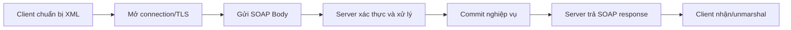
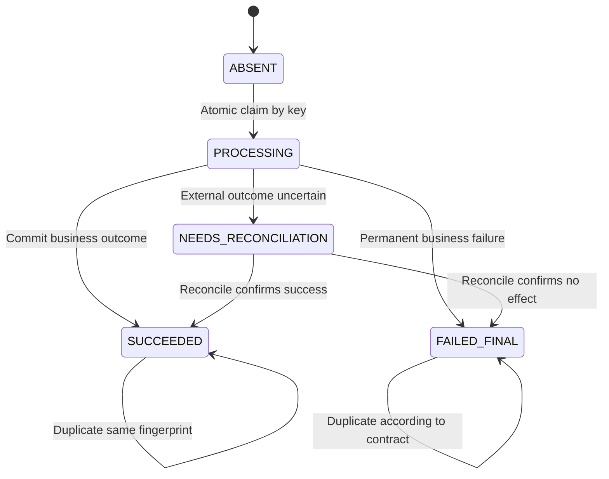
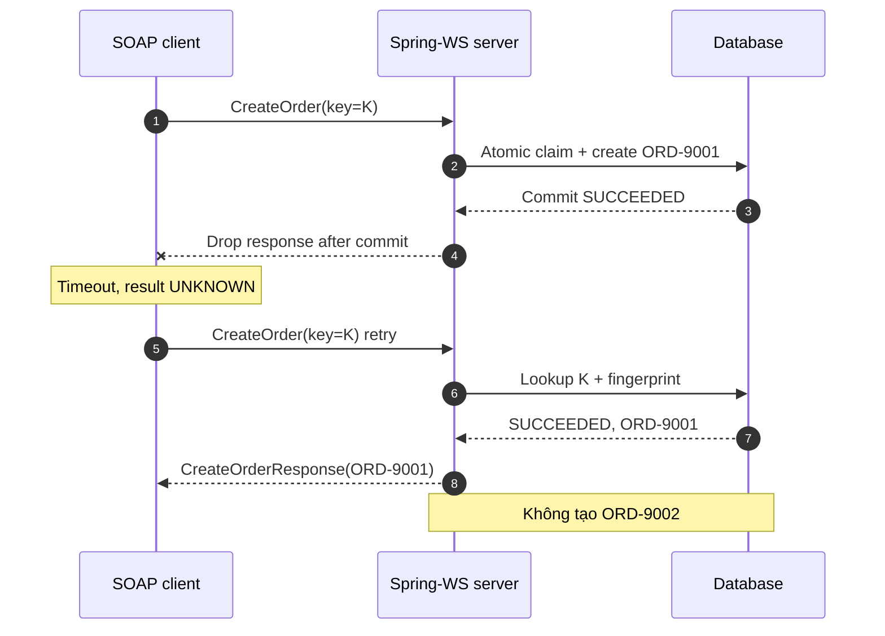

# Timeout, thử lại, tính lũy đẳng và nguy cơ lặp tác dụng nghiệp vụ

Trong tích hợp SOAP qua HTTP(S), một lời gọi `WebServiceTemplate.marshalSendAndReceive(...)` có thể thất bại vì kết nối chậm, server xử lý lâu, kết nối bị ngắt giữa chừng hoặc response không đến được client. Một câu hỏi đặc biệt nguy hiểm xuất hiện: **Nếu client không nhận được phản hồi, server có thật sự chưa thực hiện nghiệp vụ không?** Câu trả lời là **không thể suy ra chỉ từ timeout**.

Bài thuộc chương **HTTP và kết nối** của module `SPRING_WEB_SERVICES`. Ta sẽ phân biệt các loại timeout, xác định giai đoạn có thể phát sinh tác dụng nghiệp vụ, chọn điều kiện retry có giới hạn, thiết kế **idempotency key** và cơ chế chống thực thi trùng ở server, xử lý SOAP Fault/HTTP error, bảo vệ giao dịch với JDBC/transactional outbox và kiểm thử liên thông với XSD/WSDL, JAXB, SOAP client, interceptor, WS-Security và chứng chỉ.

> **Nguyên tắc trung tâm:** **Timeout không phải bằng chứng server chưa xử lý request. Retry không phải thao tác an toàn mặc định.** Với operation tạo đơn, chuyển tiền, hủy đơn hoặc gửi yêu cầu tới đối tác, muốn thử lại an toàn cần có **hợp đồng lũy đẳng, khóa định danh ổn định và cơ chế deduplication ở nơi phát sinh tác dụng nghiệp vụ**.

## 1. Câu chuyện mở đầu: client timeout, server vẫn tạo đơn

Giả sử một client SOAP gọi operation `CreateOrder`:

```mermaid
sequenceDiagram
    autonumber
    participant C as SOAP client
    participant G as API Gateway
    participant S as Spring-WS server
    participant D as Database
    C->>G: CreateOrder(requestId=R-101)
    G->>S: Chuyển request
    S->>D: INSERT order 9001
    D-->>S: COMMIT thành công
    S-->>G: CreateOrderResponse(orderId=9001)
    Note over G,C: Kết nối đứt / response thất lạc
    G--xC: Không trả được phản hồi
    Note over C: Read timeout, không biết kết quả
    C->>G: Retry cùng operation
    G->>S: CreateOrder(requestId mới?)
    S->>D: INSERT order 9002
    D-->>S: COMMIT
    S-->>C: CreateOrderResponse(orderId=9002)
```



Nếu server không kiểm tra yêu cầu trùng, **một ý định nghiệp vụ có thể tạo hai đơn hàng**. Client cuối cùng nhận response thứ hai và tưởng hệ thống chỉ tạo một đơn, trong khi đơn đầu đã tồn tại.

Tác dụng lặp không chỉ là thêm một bản ghi:

- Thu tiền hai lần hoặc phát hai lệnh thanh toán.
- Giảm tồn kho hai lần.
- Gửi email/SMS hai lần.
- Đẩy hai sự kiện vào hàng đợi và gây tác dụng dây chuyền.
- Hủy/ghi đè trạng thái trên một hệ thống thứ ba.
- Tạo hai yêu cầu cấp phát tài nguyên cho cùng khách hàng.

**Giải quyết gốc rễ không phải tăng read timeout lên vô hạn.** Timeout hợp lý vẫn cần để giới hạn thời gian đợi; **idempotency** mới xử lý trường hợp response bị mất sau khi tác dụng đã commit.

## 2. Timeout là gì? Phân loại theo từng giai đoạn

Một SOAP call qua HTTPS có thể trải qua DNS, chờ connection pool, tạo socket, TLS handshake, gửi body, server xử lý và nhận response. Mỗi giai đoạn có kiểu giới hạn thời gian riêng.

| Loại giới hạn | Giai đoạn | Triệu chứng thường gặp | Có thể kết luận server chưa xử lý? |
| --- | --- | --- | --- |
| **Pool lease / connection request timeout** | Chờ lấy connection từ pool của HTTP client | Pool cạn, quá nhiều request đồng thời | Thường chưa gửi request qua exchange này, nhưng phải kiểm tra implementation |
| **Connect timeout** | Thiết lập TCP connection | Không kết nối tới host/port được | Thường chưa gửi SOAP Body; lỗi có thể bị wrap hoặc phát sinh ở proxy |
| **TLS handshake timeout/failure** | Thiết lập kênh HTTPS an toàn | `SSLHandshakeException`, certificate fail | Thường không gửi SOAP Body đến endpoint, nhưng là lỗi transport chứ không phải SOAP Fault |
| **Write/send timeout** | Ghi request lên socket/network | Ghi dở request, socket reset | **Không chắc** server nhận được bao nhiêu byte hoặc đã xử lý chưa |
| **Read/response timeout** | Chờ dữ liệu response | Client đã gửi request rồi không nhận đủ phản hồi | **Không thể kết luận** nghiệp vụ chưa chạy |
| **Deadline toàn lời gọi** | Giới hạn thời gian end-to-end của một call | Hết ngân sách thời gian dù từng bước chưa timeout | Phải xét giai đoạn thực tế; cancellation không tự rollback server |
| **Retry budget/deadline tổng** | Bao gồm các lần thử và backoff | Hết ngân sách giao dịch | Không nói gì về trạng thái đã commit ở các lần thử trước |

Đừng nhầm **connect timeout** với **read timeout**. Một lệnh chậm do database đang xử lý có thể hết read timeout ngay cả khi connect chỉ tốn vài mili giây. Ngược lại, chờ HTTP pool hết chỗ không được chữa bằng tăng thời gian xử lý SQL.

### Timeout là giới hạn chờ, không phải distributed transaction rollback

Khi `WebServiceTemplate` báo timeout:

1. Client có thể ngừng chờ hoặc đóng kết nối.
2. Gateway có thể hủy/chấm dứt đường truyền của mình.
3. Server **có thể vẫn đang xử lý** hoặc đã commit transaction.
4. External side effect (email, payment, message broker) có thể đã xảy ra trước khi server ghi nhận kết quả.
5. Không có cơ chế SOAP/HTTP mặc định nào tự rollback tất cả các hệ thống chỉ vì client timeout.

Vì vậy, request thay đổi trạng thái cần cơ chế **kiểm tra trạng thái giao dịch hoặc replay an toàn**, không chỉ ngoại lệ ở client.

## 3. Bốn thời điểm thất bại và mức độ không chắc chắn



| Thời điểm lỗi | Ví dụ | Cách suy luận an toàn |
| --- | --- | --- |
| Trước khi request ra khỏi client | Không marshal được JAXB request, URI bị chặn | Chưa gọi được operation qua exchange đó; sửa client/contract |
| Trong quá trình gửi | Connection reset giữa Body | Kết quả **không chắc chắn** nếu không có bằng chứng toàn bộ message chưa được server xử lý |
| Sau khi server đã nhận nhưng trước response | Server xử lý lâu, gateway read timeout | **Có thể đã commit hoặc đang xử lý** |
| Sau khi commit, trước khi client nhận | Response đứt hoặc JAXB client không đọc được | Nghiệp vụ **có thể đã hoàn tất** dù phía client báo lỗi |

**Không suy luận từ exception class đơn lẻ.** `WebServiceIOException` có thể bọc những lỗi IOException khác nhau. Muốn phân biệt lỗi xảy ra trước/sau send cần quan sát transport, log có correlation ID và trạng thái phía server; trong nhiều trường hợp vẫn không thể chứng minh tuyệt đối.

## 4. SOAP over HTTP: POST không tự lũy đẳng

Hầu hết SOAP endpoint HTTP dùng **POST**, kể cả operation chỉ đọc dữ liệu như `GetOrder`. Ý nghĩa nghiệp vụ và tính an toàn khi retry phụ thuộc **operation**, không phụ thuộc duy nhất HTTP method.

| Operation | Hành vi thường gặp | Chính sách retry ban đầu |
| --- | --- | --- |
| `GetOrder` / `CheckStatus` | Chỉ đọc, không thay đổi trạng thái nghiệp vụ | Có thể retry giới hạn nếu security/policy cho phép |
| `CreateOrder` | Tạo tài nguyên mới | Chỉ retry khi có idempotency key/deduplication hoặc status reconciliation |
| `ChargePayment` | Ghi nhận hoặc chuyển tiền | Không retry mù; cần khóa lũy đẳng và quy tắc đối soát nghiêm |
| `CancelOrder` | Chuyển trạng thái, có thể hoàn tiền/gửi sự kiện | Phải xét tác dụng phụ và idempotency, dù thao tác “cancel” nghe có vẻ lặp được |
| `SendNotification` | Gửi email/SMS/push | Có thể tạo nhiều thông báo; cần dedupe theo business event |
| `UpdateCustomer` | Ghi đè về cùng giá trị | Có thể lũy đẳng ở database, nhưng audit/event downstream vẫn có thể lặp |

**Lũy đẳng (idempotency)** nghĩa là lặp lại **cùng một ý định nghiệp vụ** không tạo thêm tác dụng nghiệp vụ ngoài tác dụng của lần đầu. Không được đánh đồng với việc “response lần hai giống lần một” hay “không có exception”.

### Tính lũy đẳng của operation và của toàn hệ thống

Ngay cả khi `UPDATE orders SET status='CANCELLED'` chỉ đổi trạng thái một lần, code vẫn có thể:

- Gửi email “đơn đã hủy” ở **mỗi lần gọi**.
- Ghi một dòng phí xử lý cho **mỗi retry**.
- Phát một event `OrderCancelled` không có dedup key tới broker.
- Kích hoạt hai refund request ở service ngoài.

Khi nói một operation lũy đẳng, phải xét **toàn bộ tác dụng** được cam kết, bao gồm database, sự kiện, external API và trạng thái có thể quan sát.

## 5. Contract-first: mô tả khóa lũy đẳng ngay trong XSD

Ví dụ dịch vụ tạo đơn có hợp đồng XML:

```xml
<?xml version="1.0" encoding="UTF-8"?>
<xs:schema xmlns:xs="http://www.w3.org/2001/XMLSchema"
           xmlns:ord="https://example.com/orders/v1"
           targetNamespace="https://example.com/orders/v1"
           elementFormDefault="qualified">

    <xs:simpleType name="RequestKey">
        <xs:restriction base="xs:string">
            <xs:minLength value="16"/>
            <xs:maxLength value="128"/>
        </xs:restriction>
    </xs:simpleType>

    <xs:element name="CreateOrderRequest">
        <xs:complexType>
            <xs:sequence>
                <xs:element name="idempotencyKey"
                            type="ord:RequestKey"/>
                <xs:element name="customerReference" type="xs:string"/>
                <xs:element name="sku" type="xs:string"/>
                <xs:element name="quantity" type="xs:positiveInteger"/>
            </xs:sequence>
        </xs:complexType>
    </xs:element>

    <xs:element name="CreateOrderResponse">
        <xs:complexType>
            <xs:sequence>
                <xs:element name="orderId" type="xs:string"/>
                <xs:element name="status" type="xs:string"/>
            </xs:sequence>
        </xs:complexType>
    </xs:element>
</xs:schema>
```

Đây là XSD minh họa; trong production cần bổ sung ràng buộc về kích thước, ký tự, nghiệp vụ và quản lý version. `RequestKey` chỉ kiểm tra **cấu trúc**, không bảo đảm khóa duy nhất hay người gửi có quyền dùng khóa.

SOAP 1.1 Body:

```xml
<soap:Envelope
    xmlns:soap="http://schemas.xmlsoap.org/soap/envelope/"
    xmlns:ord="https://example.com/orders/v1">
    <soap:Body>
        <ord:CreateOrderRequest>
            <ord:idempotencyKey>req-2026-000000000091</ord:idempotencyKey>
            <ord:customerReference>C-1042</ord:customerReference>
            <ord:sku>BOOK-007</ord:sku>
            <ord:quantity>2</ord:quantity>
        </ord:CreateOrderRequest>
    </soap:Body>
</soap:Envelope>
```

Một response thành công:

```xml
<ord:CreateOrderResponse xmlns:ord="https://example.com/orders/v1">
    <ord:orderId>ORD-9001</ord:orderId>
    <ord:status>ACCEPTED</ord:status>
</ord:CreateOrderResponse>
```

Trong WSDL document/literal, input/output operation tham chiếu **global elements** `CreateOrderRequest` và `CreateOrderResponse`. Cấu hình SOAPAction (nếu binding sử dụng) cũng phải nhất quán, ví dụ `urn:example:orders:v1:CreateOrder`.

**Khóa phải được tạo một lần cho một ý định nghiệp vụ và giữ nguyên qua các lần thử lại.** Nếu mỗi retry sinh một khóa mới, server sẽ xem chúng là **những ý định độc lập** và có thể tạo nhiều đơn.

### Dùng SOAP Header thay vì trường trong Body có được không?

Có thể. Một hợp đồng khác có thể định nghĩa `ctx:IdempotencyKey` trong SOAP Header hoặc sử dụng giao thức bổ sung. Khi chọn Header phải:

- Công bố/ghi rõ quy tắc trong WSDL/WS-Policy/tài liệu tích hợp.
- Đọc header theo QName chính xác và từ chối giá trị thiếu/trùng/sai format.
- Chỉ tin khóa như **định danh yêu cầu**, không phải bằng chứng xác thực.
- Nếu policy cần chống sửa đổi khóa, bảo đảm Header nằm trong **phạm vi chữ ký WS-Security** được xác minh.
- Đồng bộ server/client khi nâng cấp hợp đồng.

Không tự xem `wsa:MessageID` là idempotency key đủ dùng: nó thuộc addressing/correlation, còn thời hạn, scope, tính duy nhất, dấu vết nghiệp vụ và deduplication phải được **ứng dụng định nghĩa và lưu**.

## 6. Tạo, giữ và phạm vi hóa idempotency key

Một chiến lược hợp lý:

```text
Unique key = (authenticated_actor, operation, idempotency_key)
Request fingerprint = hash(canonical business fields / normalized request)
```

Ở hệ multi-tenant có thể cần bổ sung **tenant đã được ủy quyền** hoặc resource scope vào composite key. Không lấy principal hay tenant trực tiếp từ header tự khai báo mà chưa xác thực.

| Thành phần | Vì sao quan trọng |
| --- | --- |
| Authenticated actor | Ngăn một người gửi chiếm/đọc kết quả từ khóa do người gửi khác dùng |
| Operation | Không nhầm `CreateOrder` với `CancelOrder` dù chuỗi key giống nhau |
| Authorized tenant / resource | Chặn reuse nhầm key giữa phạm vi quyền/dữ liệu |
| Idempotency key | Nhận diện **một ý định nghiệp vụ** xuyên các attempt |
| Request fingerprint | Phát hiện **cùng key nhưng payload nghiệp vụ khác** |
| TTL/retention | Biết cửa sổ thời gian server cam kết ghi nhớ key |
| State/result | Biết request đang chạy, đã hoàn tất hay cần đối soát |

**Fingerprint không nên đơn thuần là hash raw SOAP XML bytes**: thay prefix namespace, whitespace không quan trọng hoặc thay timestamp WS-Security ở lần retry có thể làm XML bytes khác dù payload nghiệp vụ không đổi. Thay vào đó, hash các **trường nghiệp vụ đã chuẩn hóa** theo schema và định dạng được công bố; chú ý thứ tự, giá trị mặc định, decimal và version normalization.

Đồng thời không tự gộp hai request khác ý nghĩa chỉ vì chúng có cùng customerReference hoặc cùng SKU. **Idempotency key** cần đủ entropy và phải mang nghĩa "cùng một thao tác ý định", không phải "cùng một khách hàng".

## 7. Ba trường hợp khi server nhận cùng một khóa

| Trạng thái khóa | Payload/fingerprint | Cách xử lý an toàn |
| --- | --- | --- |
| **Chưa tồn tại** | Request hợp lệ | Giành quyền xử lý atomically; ghi nhận trạng thái và thực thi đúng một lần |
| **Đã thành công** | **Giống** request đầu | Trả lại **cùng kết quả nghiệp vụ** (hoặc trạng thái/query tương đương theo contract), không tạo tác dụng mới |
| **Đã tồn tại** | **Khác** request đầu | Trả lỗi rõ như `IDEMPOTENCY_KEY_REUSED`; không thực thi payload mới |
| **Đang xử lý** | Giống request đầu | Chờ có giới hạn, trả `IN_PROGRESS` hoặc hướng dẫn query trạng thái; không chạy tác dụng phụ song song |
| **Lỗi có thể phục hồi** | Giống request đầu | Xử lý theo state machine/transaction policy, không mặc định chạy lại side effect |
| **Hết thời hạn lưu khóa** | Bất kỳ | Chính sách phải công bố: có thể bị xem là request mới; đối tác cần tránh retry quá cửa sổ |

Một HTTP response ở lần thứ hai không nhất thiết giống byte-for-byte lần đầu: hệ thống có thể ký lại WS-Security với timestamp mới hoặc tạo HTTP headers mới. Điều cần giữ ổn định là **business result và không nhân đôi tác dụng**.

## 8. Chống race condition: kiểm tra tồn tại rồi insert chưa đủ

Phản ví dụ:

```java
// SAI trong hệ nhiều luồng/multiple instances.
if (!repository.existsByIdempotencyKey(key)) {
    orderService.createOrder(request);
    repository.saveKey(key);
}
```

Hai request đồng thời trên hai pod có thể cùng thấy key chưa tồn tại rồi **cùng tạo đơn**. Đọc–kiểm tra–ghi không atomically tạo được quyền sở hữu xử lý.

### Cách làm bền vững: ràng buộc duy nhất tại database

Ví dụ DDL PostgreSQL minh họa:

```sql
CREATE TABLE soap_idempotency (
    actor_id           VARCHAR(128) NOT NULL,
    operation_name     VARCHAR(80)  NOT NULL,
    request_key        VARCHAR(128) NOT NULL,
    request_hash       CHAR(64)     NOT NULL,
    state              VARCHAR(24)  NOT NULL,
    order_id           VARCHAR(80),
    created_at         TIMESTAMPTZ NOT NULL DEFAULT NOW(),
    updated_at         TIMESTAMPTZ NOT NULL DEFAULT NOW(),
    PRIMARY KEY (actor_id, operation_name, request_key)
);

CREATE INDEX idx_soap_idempotency_state
    ON soap_idempotency (state, updated_at);
```

Lược đồ này chỉ minh họa **điểm ràng buộc UNIQUE**. Một triển khai thực tế phải có trạng thái hợp lệ, quy tắc TTL, row-level lock/transaction isolation, retention, index, dữ liệu trả về và policy GDPR/bảo vệ dữ liệu thích hợp.

### State machine tối thiểu



Nếu request trùng đi vào khi state `PROCESSING`, **không được gọi application service lần thứ hai** chỉ vì retry đến lúc đầu chưa trả response. Có thể trả business fault `IN_PROGRESS` hoặc response chứa operation status, tùy WSDL/contract. Với tình huống `NEEDS_RECONCILIATION`, không đoán “chưa chạy” để thực hiện lại tác dụng ngoài.

## 9. Transaction boundary: cùng database dễ hơn gọi hệ thống ngoài

Nếu toàn bộ tác dụng nghiệp vụ nằm trong **một database**, có thể thiết kế transaction kết hợp:

1. Giành claim idempotency key (constraint/locking).
2. Thực hiện thay đổi bảng `orders`.
3. Cập nhật kết quả `SUCCEEDED` và ID đơn hàng.
4. Commit **cùng transaction**.
5. Khi retry, trả kết quả đã lưu thay vì tạo đơn mới.

Mẫu service giả lập:

```java
public interface IdempotentOrderExecutor {
    CreateOrderResult execute(
            VerifiedActor actor,
            String key,
            String businessFingerprint,
            CreateOrderCommand command);
}
```

Đây là **giao diện thiết kế**, trong đó `VerifiedActor`, `CreateOrderResult` và `CreateOrderCommand` là các kiểu do ứng dụng định nghĩa. Implementations phải xử lý concurrency và tính atomic bằng database transaction/unique constraint thật; không thể bảo đảm chỉ với `synchronized` trên một JVM khi deploy nhiều instance.

### Vùng nguy hiểm: database transaction + external API

Giả sử service:

```text
(1) Gọi đối tác để charge payment -> thành công
(2) Ghi database local "payment succeeded" -> crash
(3) Retry -> gọi đối tác charge thêm lần nữa
```

Một transaction database local **không thể tự rollback API thanh toán bên ngoài**. Kể cả application dùng `@Transactional`, external side effect không thuộc cùng transaction ACID trừ khi có giao thức phân tán đặc biệt được cả hai hệ thống hỗ trợ.

Cách giảm rủi ro:

- Đối tác downstream cũng hỗ trợ **idempotency key** tương ứng.
- Trước khi retry thao tác tiền tệ, tra cứu **trạng thái giao dịch ở đối tác** nếu outcome không chắc chắn.
- Dùng **transactional outbox** để bảo đảm event gửi đi gắn với state local đã commit.
- Thiết kế saga/compensation rõ cho thao tác không thể atomically phối hợp.
- Có cơ chế đối soát định kỳ cho những key bị kẹt ở `PROCESSING` hoặc `NEEDS_RECONCILIATION`.

Không tuyên bố "exactly once delivery" chỉ vì có HTTP retry và unique index; mục tiêu thực tế thường là **at-least-once attempts với effectively-once business effect trong phạm vi đã thiết kế**.

## 10. Transactional outbox chống mất/nhân đôi event thế nào?

Khi `CreateOrder` cần tạo đơn và phát sự kiện `OrderCreated`, thực hiện trong **một transaction local**:

```text
BEGIN
  INSERT orders (..., order_id='ORD-9001')
  INSERT soap_idempotency (..., state='SUCCEEDED', order_id='ORD-9001')
  INSERT outbox (event_id='evt-...', aggregate_id='ORD-9001', payload=...)
COMMIT
```

Một worker riêng gửi event từ outbox tới broker. Tuy nhiên:

- Worker có thể gửi event rồi crash trước khi ghi “đã gửi”, dẫn đến **publish lại**.
- Consumer cần **inbox/deduplication** hoặc xử lý nghiệp vụ lũy đẳng theo `event_id`.
- Outbox giữ **at-least-once publication**, không tự bảo đảm consumer chỉ nhìn event một lần.
- Khi có hai transaction đồng thời theo cùng key, constraint/state machine phải bảo đảm chỉ một order và một event nghiệp vụ được tạo.

Nếu downstream không hỗ trợ dedupe, hãy xác định compensation/đối soát và chấp nhận rằng độ tin cậy chỉ có thể đạt trong phạm vi các thành phần tham gia.

## 11. Quy tắc retry: trường hợp nào nên, không nên?

| Lỗi/tình huống | Retry nguyên request? | Điều kiện |
| --- | --- | --- |
| Không marshal được JAXB request | **Không** | Sửa binding/model; chưa có request hợp lệ |
| XSD request sai | **Không** | Sửa XML theo WSDL/XSD |
| SOAP Fault `Client` / `Sender` do validation | **Không** | Request cần thay đổi |
| Token hết hạn | Không retry y hệt token; có thể refresh credential | Cần policy xác thực và không lặp side effect bất định |
| Connect/pool timeout trước khi send | Có thể | Giới hạn attempts/budget và chọn đúng đích |
| Read timeout sau khi gửi request | **Chỉ khi có idempotency/reconciliation** | Server có thể đã commit |
| HTTP 429/503 từ gateway | Có thể, **không mặc định** | Tuân policy, `Retry-After` hợp lệ, biết request đã đi tới server hay chưa |
| SOAP Fault `Server` / `Receiver` | Có thể, tùy business code | Xác định lỗi tạm thời và operation an toàn |
| SOAP business Fault `ORDER_NOT_FOUND` | Thường **không** | Trừ khi contract có eventual consistency/retry rule |
| SOAP Fault `IN_PROGRESS` với cùng key | Theo policy | Chờ có giới hạn hoặc query trạng thái, không đổi key |
| Timeout lệnh chuyển tiền hoặc tạo đơn | **Không retry mù** | Giữ key, tra trạng thái, bảo đảm dedupe server |
| TLS certificate invalid | **Không** | Sửa truststore/cert, không disable verification |
| SOAP response sai XSD/QName | **Không** theo retry thông thường | Đây có thể là lỗi contract server/client version |
| Lỗi do gateway trả HTML thay SOAP | Không theo chính sách SOAP Fault | Điều tra transport/gateway trước |

**Ngay cả `Receiver/Server` không bảo đảm retry sẽ giúp.** Một server có cấu hình JAXB sai có thể trả lỗi server liên tục; retry sẽ chỉ gây thêm tải. Cần phân biệt **transient vs permanent**, **trước vs sau side effect**, **idempotent vs non-idempotent**.

## 12. Backoff, jitter, deadline và retry budget

Retry có trách nhiệm phải giới hạn:

- **Số attempt tối đa** (tính cả lần đầu), ví dụ 3; không dùng vòng lặp vô hạn.
- **Exponential backoff** hoặc lịch trì hoãn có kiểm soát để tránh dồn tải lên hệ thống đang lỗi.
- **Jitter** để các client không đồng loạt thử lại sau cùng một khoảng thời gian.
- **Tổng deadline** và retry budget, không chỉ giới hạn từng HTTP call.
- **Phân loại lỗi**, không retry các lỗi vĩnh viễn hoặc lỗi hợp đồng.
- **Circuit breaker/rate limiting** ở tầng policy nếu hệ thống có lưu lượng lớn.
- **Idempotency** và tình trạng giao dịch đối với operation thay đổi trạng thái.

Một chiến lược phổ biến:

```text
capForAttempt(k) = min(maxBackoff, baseBackoff * 2^(k-1))
actualDelay(k)  = random(0, capForAttempt(k))  // full jitter

Ví dụ minh họa:
baseBackoff = 200 ms, maxBackoff = 2000 ms
k=1: delay trong [0, 200] ms
k=2: delay trong [0, 400] ms
k=3: delay trong [0, 800] ms
```

Đây chỉ là **ví dụ**. Mức thời gian thật cần phù hợp SLO, `Retry-After`, hạn mức đối tác, tổng deadline và đặc điểm giao dịch. Khi đặt timeout mỗi attempt + backoff, phải tính thời gian tổng, tránh tổng vượt thời hạn xử lý từ upstream caller.

### Vì sao jitter quan trọng?

Nếu 5.000 client cùng bị HTTP 503 rồi tất cả cùng chờ chính xác 1 giây, chúng sẽ gửi lại cùng lúc, gây **thundering herd**. Jitter phân tán lưu lượng, còn rate limiting/retry budget ngăn số request tổng tăng quá nhanh.

Một tầng gọi có tối đa 3 attempts và tầng bên dưới cũng âm thầm retry 3 lần có thể tạo **tới 9 attempts** ở tầng thấp cho một ý định ban đầu. Do đó cần xác định **retry owner** và tránh nhân retry qua gateway, HTTP client, message listener và service application.

## 13. Spring-WS: cấu hình timeout ở HTTP message sender

`WebServiceTemplate` điều phối SOAP call, trong khi timeout thường thuộc **`WebServiceMessageSender`/HTTP client** được cấu hình. Ví dụ với những phiên bản Spring-WS cung cấp `HttpUrlConnectionMessageSender`:

```java
import org.springframework.context.annotation.Bean;
import org.springframework.context.annotation.Configuration;
import org.springframework.oxm.jaxb.Jaxb2Marshaller;
import org.springframework.ws.client.core.WebServiceTemplate;
import org.springframework.ws.transport.http.HttpUrlConnectionMessageSender;

@Configuration
public class OrdersClientConfiguration {

    @Bean
    public HttpUrlConnectionMessageSender ordersHttpSender() {
        HttpUrlConnectionMessageSender sender =
                new HttpUrlConnectionMessageSender();
        sender.setConnectionTimeout(3_000);
        sender.setReadTimeout(8_000);
        return sender;
    }

    @Bean
    public WebServiceTemplate ordersTemplate(
            Jaxb2Marshaller ordersMarshaller,
            HttpUrlConnectionMessageSender ordersHttpSender) {

        WebServiceTemplate template = new WebServiceTemplate();
        template.setMarshaller(ordersMarshaller);
        template.setUnmarshaller(ordersMarshaller);
        template.setDefaultUri("https://orders.partner.example/ws");
        template.setMessageSender(ordersHttpSender);
        return template;
    }
}
```

Trong ví dụ:

- `ordersMarshaller` là bean JAXB/OXM đã có, phù hợp XSD/WSDL và phiên bản `jakarta.xml.bind` hoặc `javax.xml.bind` của dự án.
- Timeout ở đây dùng **mili giây** theo API sender tương ứng; giá trị 3 s/8 s chỉ để minh họa.
- `setDefaultUri` xác định **đích SOAP**, không phải WSDL URL và không phải timeout.
- Một HTTP sender dựa trên Apache HTTP client/connection pool có thể cấu hình timeout thông qua API/kiểu tham số **khác**. Không dùng lớp/setter từ Spring-WS/HttpClient phiên bản khác khi chưa xác nhận.
- Không có một phương thức `WebServiceTemplate.setRetryAllFailures(true)` chuẩn để biến mọi lỗi thành retry an toàn. Retry nên được thiết kế ở tầng gọi, library resilience được cấu hình hoặc một transport được kiểm soát.

**Thiếu timeout dễ khiến worker bị giữ rất lâu; timeout quá ngắn lại tạo nhiều kết quả bất định.** Cần đo p95/p99 latency, tải và SLO của đối tác để hiệu chỉnh.

## 14. Code SOAP client: giữ nguyên khóa qua mọi attempt

Trong XSD ví dụ phần 5, `idempotencyKey` là một trường **bắt buộc**. Client sinh khóa khi bắt đầu ý định tạo đơn, **trước retry loop**.

```java
import java.math.BigInteger;
import java.util.UUID;
import org.springframework.ws.client.core.WebServiceTemplate;
import org.springframework.ws.soap.client.core.SoapActionCallback;

public final class CreateOrderSoapGateway {
    private static final String CREATE_ACTION =
            "urn:example:orders:v1:CreateOrder";

    private final WebServiceTemplate template;

    public CreateOrderSoapGateway(WebServiceTemplate template) {
        this.template = template;
    }

    public String newBusinessRequestKey() {
        return UUID.randomUUID().toString();
    }

    public Object sendOnce(
            String key,
            String customerRef,
            String sku,
            int quantity) {

        if (quantity <= 0) {
            throw new IllegalArgumentException("quantity must be positive");
        }

        CreateOrderRequest request = new CreateOrderRequest();
        request.setIdempotencyKey(key);
        request.setCustomerReference(customerRef);
        request.setSku(sku);
        request.setQuantity(BigInteger.valueOf(quantity));

        return template.marshalSendAndReceive(
                request,
                new SoapActionCallback(CREATE_ACTION));
    }
}
```

`CreateOrderRequest` được giả định là JAXB class sinh từ XSD với root mapping và setter đúng kiểu. `Object` ở đây chỉ để đơn giản hóa ví dụ; client sản phẩm cần xử lý `CreateOrderResponse` hoặc `JAXBElement` theo generated model, kiểm tra response QName và business status.

**Sai lầm phổ biến:**

```java
// SAI: mỗi lần thử lại tạo một ý định mới.
for (int attempt = 0; attempt < 3; attempt++) {
    gateway.sendOnce(
            UUID.randomUUID().toString(), customerRef, sku, quantity);
}
```

Dù dữ liệu đơn hàng giống nhau, server có thể nhận **ba idempotency key khác nhau** và tạo ba đơn. Đúng là tạo `key` **một lần**, dùng lại key đó sau mọi lỗi không chắc chắn.

## 15. Retry loop có giới hạn và phân loại lỗi tường minh

Một cách triển khai đơn giản cho **client đồng bộ** là đưa retry policy ra một lớp riêng, chỉ retry khi lỗi được phân loại đúng. Ví dụ dùng các abstraction do ứng dụng định nghĩa:

```java
import java.util.concurrent.ThreadLocalRandom;
import org.springframework.ws.client.WebServiceIOException;
import org.springframework.ws.soap.client.SoapFaultClientException;

public final class CreateOrderRetryService {
    private final CreateOrderSoapGateway gateway;
    private final RetryTransportPolicy retryPolicy;

    public CreateOrderRetryService(
            CreateOrderSoapGateway gateway,
            RetryTransportPolicy retryPolicy) {
        this.gateway = gateway;
        this.retryPolicy = retryPolicy;
    }

    public Object createOrder(
            String customerRef, String sku, int quantity) {

        // Tạo MỘT key cho toàn bộ ý định nghiệp vụ.
        String key = gateway.newBusinessRequestKey();

        for (int attempt = 1; attempt <= 3; attempt++) {
            try {
                return gateway.sendOnce(key, customerRef, sku, quantity);

            } catch (SoapFaultClientException fault) {
                // Không retry mù vì fault có thể là lỗi vĩnh viễn
                // hoặc trạng thái đang xử lý phải được query riêng.
                throw fault;

            } catch (WebServiceIOException transport) {
                if (attempt == 3
                        || !retryPolicy.safeToRetry(transport, key)) {
                    throw transport;
                }

                long capMillis = 200L * (1L << (attempt - 1));
                long delayMillis = ThreadLocalRandom.current()
                        .nextLong(capMillis + 1L);

                try {
                    Thread.sleep(delayMillis);
                } catch (InterruptedException interrupted) {
                    Thread.currentThread().interrupt();
                    throw new IllegalStateException(
                            "SOAP retry interrupted", interrupted);
                }
            }
        }
        throw new IllegalStateException("Unreachable retry state");
    }
}
```

`RetryTransportPolicy` **không phải interface có sẵn trong Spring-WS**; ứng dụng phải tự định nghĩa implementation dựa trên **operation contract, idempotency được server cam kết, exception cause, ngân sách thời gian và mức độ an toàn của retry**. Nếu server không có deduplication bền vững, `safeToRetry(...)` đối với `CreateOrder` sau kết quả bất định phải trả `false`.

Giới hạn/điểm cần cải tiến trước production:

1. Đây là code **đồng bộ chặn thread**; tại server có lưu lượng lớn nên dùng thư viện resilience/scheduler phù hợp nếu cần orchestration phức tạp.
2. Mẫu chỉ retry một nhóm `WebServiceIOException` có điều kiện. Các lỗi HTTP status, transport hoặc wrapper khác có thể cần **policy/classifier** riêng tùy version Spring-WS.
3. Không suy từ `SoapFaultClientException` rằng tất cả Fault đều permanent; business code `IN_PROGRESS` có thể cần **query trạng thái** hoặc trì hoãn thay vì retry trực tiếp.
4. Chưa có **overall deadline**, circuit breaker và metrics; phải bổ sung khi đưa lên production.
5. Với hệ thống nhiều tầng, phải tránh HTTP client/gateway cũng retry âm thầm khiến attempts thực tế nhiều hơn giới hạn code.
6. `UUID` chỉ tạo khóa duy nhất ở mức xác suất; server vẫn cần ràng buộc unique, scope và chống reuse cùng key khác payload.

### Vì sao không catch tất cả `Exception`?

Vì `JAXBException`/client marshalling, lỗi schema, authentication, SOAP Fault nghiệp vụ, `SSLHandshakeException` và lỗi cấu hình URI có **cách sửa khác nhau**. Retry mọi exception chỉ che lỗi cố định và tăng tải. Hơn nữa, một cuộc gọi tạo đơn có thể đã thành công khi client ném timeout: **chính server-side idempotency mới giúp retry không nhân đôi tác dụng**.

## 16. Server Spring-WS: endpoint có khóa nhưng cần service idempotent thật

Ví dụ endpoint contract-first:

```java
import org.springframework.ws.server.endpoint.annotation.Endpoint;
import org.springframework.ws.server.endpoint.annotation.PayloadRoot;
import org.springframework.ws.server.endpoint.annotation.RequestPayload;
import org.springframework.ws.server.endpoint.annotation.ResponsePayload;

@Endpoint
public final class OrdersEndpoint {
    private static final String NS =
            "https://example.com/orders/v1";

    private final IdempotentOrderExecutor executor;
    private final VerifiedActorResolver actorResolver;

    public OrdersEndpoint(
            IdempotentOrderExecutor executor,
            VerifiedActorResolver actorResolver) {
        this.executor = executor;
        this.actorResolver = actorResolver;
    }

    @PayloadRoot(namespace = NS, localPart = "CreateOrderRequest")
    @ResponsePayload
    public CreateOrderResponse create(
            @RequestPayload CreateOrderRequest request) {

        VerifiedActor actor = actorResolver.requireVerifiedActor();

        CreateOrderCommand command =
                CreateOrderCommand.fromValidated(request);

        String fingerprint = command.businessFingerprint();
        CreateOrderResult result = executor.execute(
                actor,
                request.getIdempotencyKey(),
                fingerprint,
                command);

        CreateOrderResponse response = new CreateOrderResponse();
        response.setOrderId(result.orderId());
        response.setStatus(result.status());
        return response;
    }
}
```

`IdempotentOrderExecutor`, `VerifiedActorResolver`, `CreateOrderCommand`, `CreateOrderResult` và `VerifiedActor` là **thành phần ứng dụng phải định nghĩa**. Code mô tả **phân tách trách nhiệm**, không phải triển khai transaction/deduplication tự động. Việc gắn `@ResponsePayload` không tự làm endpoint lũy đẳng.

Điều kiện để triển khai an toàn:

- `VerifiedActor` được tạo từ authentication/WS-Security/TLS policy đã xác minh; **không copy trực tiếp từ SOAP Header `UserId`**.
- Request đã qua XSD validation và kiểm tra quyền tenant/resource; fingerprint được tính từ **dữ liệu nghiệp vụ chuẩn hóa**.
- `executor.execute` có **unique constraint/locking** và transaction, xử lý concurrent duplicate trong **nhiều pod/instance**.
- Kết quả nghiệp vụ đã commit được lưu đủ để trả lại hoặc truy vấn khi client retry.
- Không tái tạo outbound side effect cho replay cùng key.

### Kết quả đang xử lý và lỗi vĩnh viễn

Nếu cùng key được gửi khi request đầu vẫn chạy, service nên xử lý theo **quy tắc công bố**: có thể trả `IN_PROGRESS`, lỗi business có detail/Retry-After-like hint theo hợp đồng, hoặc giữ chờ ngắn có giới hạn. Không nên để hai request cùng tính phí/đặt hàng song song.

Với key đã dùng cho **payload khác**, phải trả lỗi kiểu `IDEMPOTENCY_KEY_REUSED` và **không sửa kết quả cũ**. Điều này giúp phát hiện bug client thay dữ liệu nhưng vẫn reuse khóa của ý định trước.

## 17. SOAP Fault, kết quả nghiệp vụ và trạng thái không xác định

Có ba nhóm đầu ra cần tách rõ:

| Kết quả | Ý nghĩa | Hành động client |
| --- | --- | --- |
| **SOAP response thành công** | Có response theo contract, ví dụ `orderId=ORD-9001` | Hoàn tất workflow |
| **SOAP business Fault** | Server từ chối do input/quyền/trạng thái, hoặc báo `IN_PROGRESS` theo hợp đồng | Dựa trên error code/detail, không đoán từ faultstring |
| **Transport timeout/no response** | Client **không biết chắc** server đã commit hay chưa | Giữ key, query trạng thái hoặc retry nếu deduplication được cam kết |

SOAP 1.1 thường dùng `Client`/`Server`, SOAP 1.2 dùng `Sender`/`Receiver`. Fault code phân loại lỗi giao thức nhưng **không đủ** để quyết định retry. Một business error code ổn định và operation status là cần thiết nếu đối tác cần tự động phục hồi.

Ví dụ business Fault detail có namespace:

```xml
<detail xmlns:err="https://example.com/orders/faults/v1">
    <err:OrderFault>
        <err:code>IDEMPOTENCY_KEY_REUSED</err:code>
        <err:message>Khóa đã gắn với một yêu cầu khác</err:message>
    </err:OrderFault>
</detail>
```

Đây là fragment của SOAP 1.1 Fault, **không phải cả Fault**. XSD/WSDL cần khai báo `err:OrderFault` và `wsdl:fault` nếu muốn các client sinh từ hợp đồng hiểu lỗi có cấu trúc. Với SOAP 1.2, detail nằm trong `env:Detail` và Fault có cấu trúc khác. Không bắt client parse chuỗi tiếng Việt của `faultstring`/`Reason` để quyết định có retry hay không.

### `IN_PROGRESS` không nên biến thành một retry storm

Khi server trả `IN_PROGRESS`, client có thể:

1. Chờ theo một khoảng có jitter và deadline tổng.
2. Gọi `GetOperationStatus`/`GetOrderByRequestKey` được contract công bố, nếu có.
3. Khi trạng thái trở thành `SUCCEEDED`, nhận business result đã lưu.
4. Khi trạng thái vẫn không rõ và deadline hết, báo **pending/unknown** để hệ thống đối soát, không gửi thêm vô hạn.

Việc trả `IN_PROGRESS` bằng success response hay business Fault là **lựa chọn contract**; không có một Fault code SOAP chuẩn mang tên này.

## 18. Bảo vệ replay và WS-Security: MessageID không phải khóa lũy đẳng

Trong WS-Addressing, `wsa:MessageID` thường là định danh message phục vụ addressing/correlation. WS-Security có thể dùng timestamp, token, nonce và XML Signature để xác thực/tăng khả năng chống replay.

Các giá trị này có **scope khác nhau**:

| Trường | Mục tiêu thường gặp | Không tự bảo đảm |
| --- | --- | --- |
| `wsa:MessageID` | Liên kết message/request–reply | Business deduplication trong database |
| WS-Security nonce/timestamp | Chống phát lại trong cửa sổ/policy bảo mật | Không tạo đơn hai lần khi client retry hợp lệ |
| Idempotency key nghiệp vụ | Nhận diện một **ý định tạo tác dụng** | Không tự xác thực người gửi |
| Internal correlation ID | Gắn trace/log của hệ thống | Không chứng minh giao dịch có/không commit |
| Database transaction/unique key | Atomic claim và lưu trạng thái | Không tự chống double charge ở external API không có dedupe |

**Một retry hợp lệ có thể cần tạo SOAP message mới với timestamp, nonce hoặc chữ ký mới** để đáp ứng security policy, trong khi **idempotency key nghiệp vụ phải giữ nguyên**. Nếu client giữ nguyên toàn bộ SOAP Envelope đã ký và gửi lại, interceptor chống replay có thể từ chối theo policy; đó không nhất thiết là lỗi của business idempotency.

Nếu đặt key trong SOAP Header và yêu cầu tính toàn vẹn, phải xác minh **header được ký cùng ngữ cảnh thích hợp**. Nếu chỉ ký Body nhưng key nằm trong Header không được bảo vệ, kẻ trung gian có thể thay key; ứng dụng không nên coi key đã được bảo đảm tính toàn vẹn.

## 19. Timeout và retry qua gateway, proxy, load balancer

Một request có thể qua nhiều tầng:

```text
Application -> WebServiceTemplate -> HTTP client
            -> outbound proxy -> API gateway/load balancer
            -> Spring-WS server -> application service -> database
```

Mỗi tầng có thể có timeout hoặc retry riêng:

- Client đặt read timeout 8 s.
- Gateway đặt upstream timeout 5 s.
- Reverse proxy retry request trên kết nối mới khi upstream reset.
- HTTP client library có cấu hình retry ở tầng network.
- Application retry SOAP call thêm tối đa 3 lần.
- Consumer downstream retry event từ outbox.

**Không tính attempts bằng một counter duy nhất nếu các tầng tự retry ngoài tầm nhìn ứng dụng.** Cần cấu hình rõ tầng nào có quyền retry và với operation nào. Với SOAP POST thay đổi trạng thái, nên hạn chế/kiểm soát retry **ở gateway và HTTP client** để tránh gửi lại không có key hoặc thiếu policy.

### Deadline toàn giao dịch

Một service gọi SOAP khi upstream HTTP request của chính nó có deadline 10 s. Nếu mỗi SOAP attempt có read timeout 8 s và retry ba lần cùng backoff, tổng thời gian có thể vượt đáng kể deadline của upstream. Dẫn đến client đầu tiên timeout, nhưng backend vẫn tiếp tục gửi nhiều request, tăng khả năng lặp nghiệp vụ.

Hãy truyền **ngân sách thời gian còn lại** tới outbound policy, đặt timeout per-attempt nằm trong deadline tổng và hủy/thả tài nguyên đúng cách khi hết ngân sách. **Cancel phía client không tự rollback transaction server**; trạng thái bất định phải được lưu để đối soát.

## 20. Observability: đo attempt, ý định nghiệp vụ và kết quả riêng

Nếu ghi mỗi "HTTP 200/500" hoặc chỉ log `SoapFaultClientException`, rất khó phân biệt một ý định tạo đơn với nhiều lần gửi.

Một log tối thiểu an toàn có thể như:

```text
traceId=svc-7a21
businessOperation=CreateOrder
requestKeyHash=2c6f...                  // Không nhất thiết log raw key
attempt=2
destination=orders-primary
soapVersion=1.1
requestQName={https://example.com/orders/v1}CreateOrderRequest
transportOutcome=read-timeout
businessOutcome=UNKNOWN
retryDecision=STATUS_QUERY_REQUIRED
```

Phân biệt **ba loại đếm**:

1. **Business intents**: số yêu cầu tạo đơn **duy nhất**.
2. **Transport attempts**: số lần gửi HTTP SOAP, có thể lớn hơn số business intents.
3. **Committed effects**: số đơn thực sự được tạo, thanh toán được ghi nhận hoặc event nghiệp vụ đã phát.

Đo riêng:

- Tỷ lệ connect/read/pool timeout và fault code.
- Attempts trung bình và p95, tổng retry budget tiêu thụ.
- Số duplicate cùng key, số conflicting payload, số request `IN_PROGRESS` lâu.
- Số trạng thái `NEEDS_RECONCILIATION` và độ tuổi chưa đối soát.
- Thời gian phản hồi p95/p99, connection pool active/idle/pending.
- Số tác dụng nghiệp vụ bị lặp thực tế (nếu phát hiện), mức ảnh hưởng và nguyên nhân.

**Không dùng raw idempotency key, PII, token, orderId, username hoặc faultstring tùy ý làm label metrics cardinality cao.** Nếu cần liên kết log, sử dụng hash/ID nội bộ, quyền truy cập và retention phù hợp.

## 21. Kiểm thử hệ thống: phải gây lỗi **sau commit**

Một unit test chỉ mock `WebServiceTemplate` ném `SocketTimeoutException` **không chứng minh server có idempotency**. Cần các integration tests chủ động tạo mất response sau khi tác dụng đã xảy ra.

### Tình huống kiểm thử quan trọng



Test phải assert **database chỉ có một order** với business key đó; response ở retry trả **đúng cùng kết quả** hoặc status reconciliation phù hợp, dù SOAP Header timestamp/chữ ký có thể khác.

### Bộ công cụ theo tầng

| Tầng | Công cụ/cách thử | Giới hạn |
| --- | --- | --- |
| Client Spring-WS | `MockWebServiceServer` | Kiểm tra payload/action, mock Fault; không mô phỏng TCP/TLS thật |
| Server Spring-WS | `MockWebServiceClient` | Kiểm tra endpoint/interceptor/contract; không chứng minh lỗi network sau commit |
| HTTP transport | Test HTTP server, fault injection/proxy test | Có thể gây reset/timeout có kiểm soát, chứng minh sender behavior |
| Database | Integration test có transaction/unique constraint | Kiểm tra atomic claim và concurrent duplicate |
| Broker/outbox | Test broker/consumer và redelivery | Xác minh event không tạo tác dụng nghiệp vụ trùng |
| Liên thông | Client sinh từ WSDL thực tế | Kiểm tra Fault, JAXB, SOAP 1.1/1.2, WS-Security và timeout |

### Không dùng production để thử lỗi

Fault injection cần chạy trên **môi trường cô lập**, sử dụng order/test account giả và idempotency keys kiểm soát. Không chủ động gửi lại lệnh chuyển tiền/thanh toán thật để "thử retry" khi chưa có quy trình an toàn riêng.

## 22. Ma trận 36 ca kiểm thử timeout, retry và idempotency

| Mã | Tình huống | Điều cần xác minh |
| --- | --- | --- |
| R01 | JAXB marshal lỗi trước khi gửi | Không retry; không có tác dụng server |
| R02 | URI/transport sender không hợp lệ | Fail fast; không gửi sang đích tùy ý |
| R03 | Pool lease timeout trước khi lấy connection | Phân loại đúng pool saturation |
| R04 | Connect timeout | Retry có giới hạn theo policy; không tự coi là SOAP Fault |
| R05 | TLS certificate không tin cậy | Không tắt hostname/certificate check để retry |
| R06 | Read timeout trước khi server commit | Client ghi UNKNOWN cho tới khi có bằng chứng |
| R07 | **Read timeout sau server commit** | Retry cùng key trả cùng kết quả; chỉ một order |
| R08 | Response HTTP bị reset sau commit | Server dedup, không tạo side effect mới |
| R09 | Client sinh khóa mới ở mỗi retry | Test phát hiện bug tạo nhiều business intents |
| R10 | Cùng key, cùng request, server đã SUCCEEDED | Trả lại business result, không insert/order/event mới |
| R11 | Cùng key nhưng quantity khác | Trả `IDEMPOTENCY_KEY_REUSED`, không sửa đơn cũ |
| R12 | Cùng key nhưng khác principal đã xác thực | Không trả thông tin của principal khác |
| R13 | Cùng key nhưng khác tenant/operation | Không va chạm scope hoặc vượt quyền |
| R14 | Hai request cùng key đến **đồng thời** hai pod | Unique constraint/locking chỉ cho một tác dụng |
| R15 | Request thứ hai gặp state PROCESSING | Không chạy service lần hai; response theo policy |
| R16 | PROCESSING lâu do crash giữa transaction | Recovery/reconciliation không gây tạo trùng |
| R17 | DB transaction rollback trước commit | Không để lại kết quả SUCCEEDED giả |
| R18 | External payment thành công rồi server crash | Không charge lần hai; tra trạng thái downstream theo key |
| R19 | Outbox publisher gửi xong rồi crash | Redelivery không tạo downstream effect trùng |
| R20 | SOAP Fault Client/Sender do XSD | Không retry nguyên request |
| R21 | SOAP business Fault ORDER_NOT_FOUND | Không retry nếu không có rule contract phù hợp |
| R22 | SOAP Fault Server/Receiver do DB timeout | Phân loại transient nhưng chỉ retry an toàn với key |
| R23 | HTTP 503/429 từ gateway | Đọc policy/Retry-After; không tự retry vô hạn |
| R24 | Gateway tự retry SOAP POST | Attempts thực tế có thể nhân; chặn/kiểm soát |
| R25 | HTTP client và service đều retry 3 lần | Test phát hiện amplification lên nhiều hơn 3 attempts |
| R26 | Backoff không jitter ở 1.000 clients | Tái hiện herd; áp jitter và retry budget |
| R27 | Deadline tổng nhỏ hơn tổng per-attempt | Không bắt đầu attempt mới khi hết budget |
| R28 | InterruptedException khi ngủ backoff | Khôi phục interrupt flag và kết thúc an toàn |
| R29 | SOAPAction đúng nhưng QName sai | Không thực thi business; contract validation từ chối |
| R30 | Retry dùng WS-Security timestamp/nonce cũ | Security có thể từ chối replay; tạo message mới nhưng giữ key |
| R31 | Idempotency key trong Header không được ký | Security policy phát hiện/không nâng thành trusted identity |
| R32 | Hết TTL key trong khi client vẫn retry | Hành vi rõ theo retention contract, không tạo trùng ngoài ý muốn |
| R33 | Response SOAP ký lại sau retry | Business result giữ nguyên dù bytes/chữ ký thay đổi |
| R34 | Hai client Java và .NET sinh từ WSDL | Cùng xử lý key/Fault/retry policy được công bố |
| R35 | Mất mạng hoàn toàn, không có SOAP Envelope | Client xử lý transport/UNKNOWN, không parse SOAP Fault giả |
| R36 | Một business intent qua 3 HTTP attempts | Metrics phân biệt intents=1, attempts=3, effects=1 |

**Các test R07/R08/R14/R18/R19 là quan trọng nhất** để chứng minh cơ chế chống nhân đôi tác dụng ngoài thế giới thực. Các bài test chỉ gọi thẳng Java method hoặc chỉ assert HTTP 200 sẽ bỏ sót chính failure mode mà hệ thống cần ngăn.

## 23. Chẩn đoán sự cố thường gặp

| Triệu chứng | Giả thuyết đúng tầng | Hành động |
| --- | --- | --- |
| Client báo read timeout, server log success | Response đến muộn/bị mất | Tra bằng idempotency key/correlation, không retry mù |
| Sau retry có hai order | Key không ổn định hoặc server không dedup atomically | Sửa client key reuse và DB unique constraint |
| Hai pod cùng xử lý một key | Check-then-insert race | Atomic claim/locking và trạng thái PROCESSING |
| Retry cùng key nhưng dữ liệu khác vẫn được chấp nhận | Không kiểm fingerprint | Ràng buộc fingerprint, báo lỗi key reused |
| Cùng key nhưng client khác xem được response | Key không scoped theo principal | Thêm authentication/authorization scope |
| Server báo PROCESSING mãi | Crash/lease stale, thiếu reconciliation | Thiết kế worker phục hồi và trạng thái không chắc chắn |
| Đã lưu SUCCEEDED nhưng chưa gửi event | Thiếu outbox/atomic publication | Ghi event vào outbox cùng transaction |
| Email hoặc payment bị lặp dù order không trùng | Downstream không dedupe | Áp eventId/idempotency key tại tác dụng downstream |
| Retry loop tạo tải bùng nổ | Không backoff/jitter, multi-layer retries | Retry budget/circuit breaker và chọn retry owner |
| Timeout quá ngắn khi tải cao | SLO thực khác cấu hình | Đo p95/p99 và pool, hiệu chỉnh theo deadline |
| SOAP Fault bị xem là timeout | Phân loại client exception sai | Tách SOAP Fault, transport và OXM |
| TLS error được retry liên tục | Policy bắt mọi IOException | Loại permanent handshake/cert error |
| SOAP Header có MessageID nhưng vẫn tạo hai đơn | Nhầm addressing với idempotency | Business key + server persistence |
| SOAP Body giống nhau nhưng hash khác sau retry | Hash raw XML/signature timestamp | Canonicalize business fields theo contract |
| Key hết hạn và request cũ được xử lý như mới | Retention ngắn hơn retry/reconciliation window | Điều chỉnh TTL và quy tắc công bố |
| Chuyển sang DR gây tạo đơn hai lần | DR không chia sẻ idempotency state | Phối hợp state/route pinning và reconciliation |

### Trình tự điều tra khi một đơn hàng bị tạo trùng

1. Lấy **mã ý định nghiệp vụ/idempotency key** của cả hai lần xử lý và verified principal/tenant.
2. Xem từng attempt: timestamp, destination, SOAPAction, QName, transport status, Fault/detail.
3. Xác định thứ tự commit của database và thời điểm client nhận/không nhận response.
4. So request fingerprint và quyết định deduplication; kiểm tra unique constraint/transaction.
5. Kiểm tra gateway/HTTP client có retry ẩn hay không, và các request chạy đồng thời trên pod khác.
6. Kiểm tra tác dụng downstream: outbox, broker redelivery, external payment/email.
7. Phục hồi/compensate giao dịch trùng theo quy trình an toàn, không chỉ sửa mã để tránh lần sau.
8. Thêm regression test gây mất response **sau commit**, không chỉ thử lỗi trước khi gửi.

## 24. Bài tập thực hành: hoàn thiện chính sách phục hồi

**Tình huống:** Một ứng dụng Spring Boot dùng `WebServiceTemplate` gọi `CreateOrder` tại đối tác. `HttpUrlConnectionMessageSender` có connect timeout 3 s và read timeout 8 s. Khi gặp `WebServiceIOException`, ứng dụng gửi lại tới endpoint DR tối đa 4 lần; mỗi lần sinh UUID mới. Đối tác chỉ lưu `requestId` trong log, không có unique constraint. Sau một ngày mạng chập chờn, xuất hiện đơn hàng trùng và một số email xác nhận lặp.

**Yêu cầu:** nêu ít nhất sáu điểm cần sửa và một bộ test xác minh không lặp tác dụng.

**Lời giải định hướng:**

1. **Dừng retry mù** đối với operation tạo đơn cho đến khi có cơ chế dedupe/reconciliation được đối tác cam kết.
2. Tạo **một idempotency key cho một business intent** trước lần gửi đầu, giữ nguyên ở mọi lần retry.
3. Đưa key vào **XSD/contract** hoặc header được quy định; không lấy SOAPAction/MessageID thay cho idempotency key.
4. Server thực thi **atomic claim và unique constraint**, scope theo authenticated actor/operation/tenant; lưu request fingerprint và trạng thái.
5. Duplicate cùng key/same payload trả kết quả cũ hoặc status; duplicate khác payload bị từ chối.
6. Khi server đã commit mà response mất, client tra **GetOrderByRequestKey/GetOperationStatus** hoặc retry cùng key theo cam kết.
7. Chỉ failover sang DR nếu **cùng contract và cùng miền idempotency state** hoặc có cơ chế route pinning/reconciliation; không chỉ đổi URI.
8. Dùng **transactional outbox + consumer dedupe** để tránh email/event lặp; external payment cũng cần khóa downstream hoặc đối soát.
9. Thêm backoff có jitter, maximum attempts, overall deadline, circuit breaker/retry budget và theo dõi retry ẩn ở gateway.
10. Tách SOAP Fault, lỗi XSD/JAXB, TLS, connect/read timeout và lỗi nghiệp vụ để retry đúng loại.
11. Bổ sung trace theo key đã hash, attempts, outcome UNKNOWN/PENDING/SUCCEEDED và committed effects.
12. Kiểm thử mất response sau commit, hai request đồng thời trên nhiều pod, key conflict, TTL, failover và broker redelivery.

**Tiêu chí đạt:** Với một key và payload hợp lệ, dù client gửi 3 attempt và bị mất response ở lần đầu **chỉ có một order và một hiệu ứng email nghiệp vụ**; kết quả có thể được tra cứu hoặc phát lại đúng theo contract. Nếu chưa có bằng chứng đó, không tuyên bố hệ thống đã an toàn trước retry.

## 25. Checklist triển khai timeout, retry và idempotency

1. **Phân biệt loại timeout**: pool lease, connect, TLS, send, read và overall deadline; xác định giai đoạn request có thể đã tới server.
2. **Không đồng nhất timeout với thất bại nghiệp vụ**: read timeout có thể xảy ra sau khi server commit.
3. **Định nghĩa độ lũy đẳng theo tác dụng nghiệp vụ**, không suy từ HTTP POST hay tên operation.
4. **Công bố key trong contract** (XSD/Body hoặc SOAP Header có quy tắc rõ), scope và TTL/retention.
5. **Tạo key một lần** cho một ý định và giữ nguyên qua mọi retry; không sinh key mới mỗi attempt.
6. **Áp unique constraint + atomic claim ở server**, xử lý concurrency qua nhiều instance.
7. **Lưu fingerprint và kết quả/trạng thái** để phân biệt replay, payload conflict và request đang chạy.
8. **Thiết kế recovery/reconciliation** cho trạng thái bất định và external side effect.
9. **Bảo vệ event/downstream** bằng outbox, deduplication/idempotency ở consumer hoặc compensation khi cần.
10. **Phân loại chính xác lỗi**: XSD/JAXB, SOAP Fault, security, HTTP status và transport exception.
11. **Retry có giới hạn, backoff, jitter và overall deadline**; chỉ một tầng có quyền retry theo chính sách rõ.
12. **Timeout ở message sender/HTTP client**, không coi `WebServiceTemplate` hay `setDefaultUri` tự cung cấp mọi loại timeout.
13. **Không retry token/chứng chỉ sai** hoặc tắt TLS/WS-Security để làm một request chạy lại.
14. **Phân biệt idempotency key, MessageID, nonce, timestamp và correlation ID**, không gộp các chức năng.
15. **Không lưu/đọc raw header thiếu tin cậy thành principal**, kiểm tra authorization theo tenant/operation.
16. **Không failover mù sang DR**, nhất là khi state dedup không đồng bộ hoặc vùng dữ liệu có quy định riêng.
17. **Bảo đảm SOAP Fault/response có contract**: mã nghiệp vụ ổn định, detail QName đúng WSDL/XSD.
18. **Theo dõi riêng intents, attempts và committed effects**, có quy trình đối soát các request UNKNOWN.
19. **Kiểm thử mất response sau commit và concurrent duplicate**, không chỉ mock IOException.
20. **Thử qua transport thật**: proxy, gateway, TLS/mTLS, timeout, SOAP 1.1/1.2, WS-Security và client liên thông.

**Kết luận:** Trong Spring-WS, timeout giúp client giới hạn thời gian chờ; retry giúp chịu lỗi tạm thời; còn **idempotency và trạng thái giao dịch bền vững ở server** mới ngăn một ý định tạo ra nhiều tác dụng nghiệp vụ khi response bị mất. Với SOAP contract-first, phải kết nối đúng bốn lớp: **transport có timeout và error handling**, **XSD/WSDL có khóa và lỗi được công bố**, **application service có atomic deduplication/reconciliation**, và **client có retry budget, backoff và cùng key qua các attempts**. Chỉ khi kiểm thử được trường hợp *server đã commit nhưng client chưa nhận response* mới có căn cứ đánh giá khả năng chống tạo tác dụng lặp trong tích hợp doanh nghiệp.
