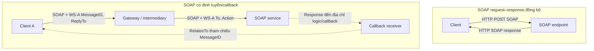

# WS-Addressing bổ sung địa chỉ và thông tin tương quan cho SOAP

Một SOAP client thông thường gửi HTTP POST đến một URL rồi chờ HTTP response trên cùng kết nối. Trong mô hình đơn giản ấy, địa chỉ máy chủ và mối liên hệ giữa request và response dường như đã được HTTP xử lý. Nhưng khi hệ thống tích hợp đi qua **SOAP gateway, message broker, intermediary**, sử dụng **callback bất đồng bộ** hoặc có nhiều lời gọi đang chờ kết quả, câu hỏi trở nên phức tạp: thông điệp này dành cho dịch vụ logic nào, biểu diễn thao tác nào, phản hồi phải gửi về đâu, và phản hồi này tương ứng với yêu cầu nào?

**WS-Addressing (Web Services Addressing)** bổ sung một tập **thuộc tính định tuyến và tương quan ở cấp SOAP message**, thường biểu diễn dưới dạng các phần tử trong SOAP Header. Thay vì chỉ phụ thuộc vào URL HTTP, thông điệp có thể mang các thông tin như `wsa:To`, `wsa:Action`, `wsa:MessageID`, `wsa:ReplyTo` và `wsa:RelatesTo`. Điều đó đặc biệt hữu ích khi thông điệp được định tuyến qua nhiều thành phần hoặc khi request và response không còn gắn chặt vào một cặp HTTP POST/response đồng bộ.

Bài thuộc chương **WS-Addressing** của module **SPRING_WEB_SERVICES**. Chúng ta đặt WS-Addressing vào quá trình phát triển SOAP **contract-first** với Spring Web Services (Spring-WS): từ XSD/WSDL và JAXB đến endpoint, SOAP client, interceptor, SOAP Fault, XML security, WS-Security, chứng chỉ và kiểm thử tương thích doanh nghiệp. Mục tiêu không phải chỉ “thêm một vài XML header”, mà là **hiểu ngữ nghĩa địa chỉ, quan hệ giữa thông điệp, vai trò của WSDL, và ranh giới tin cậy khi routing**.

Trong bài, các URI dưới tên miền `example.org` và mã đơn hàng là ví dụ. Phần chính dùng **WS-Addressing 1.0 (namespace 2005/08)** cùng SOAP 1.1. Một số đối tác cũ có thể dùng bản WS-Addressing 2004/08; không được trộn hai phiên bản. Các đoạn Spring-WS dùng Java 17+ và hệ Jakarta cho JAXB/SAAJ; các package JAXP như `javax.xml.transform.*` vẫn thuộc Java SE.

## 1. Vấn đề mà WS-Addressing giải quyết

Hãy xét hai kiểu trao đổi:



Trong sơ đồ thứ nhất, HTTP response đã gắn với request nhờ kết nối và luồng xử lý HTTP. Trong sơ đồ thứ hai, hệ thống phải biết **địa chỉ trả lời** và **quan hệ giữa những message độc lập**. WS-Addressing định nghĩa các thuộc tính phục vụ việc đó.

| Câu hỏi | Nếu chỉ dựa vào HTTP | Thông tin WS-Addressing liên quan |
| --- | --- | --- |
| Message dành cho endpoint logic nào? | URL đích HTTP | `To`, và có thể là EPR/reference parameters |
| Operation/ý nghĩa thông điệp là gì? | SOAPAction/binding/Body | `Action` |
| Phân biệt từng message cụ thể? | Request ID tùy hệ thống | `MessageID` |
| Response liên hệ với request nào? | Cùng HTTP exchange | `RelatesTo` tham chiếu `MessageID` |
| Kết quả nên gửi về đâu? | HTTP response đồng bộ | `ReplyTo` |
| Fault nên gửi về đâu? | HTTP response đồng bộ | `FaultTo` |
| Ai đã gửi message? | Transport/session/authentication | `From` chỉ định địa chỉ nguồn logic, **không phải bằng chứng xác thực** |

**WS-Addressing không thay thế HTTP, WSDL, XSD hoặc WS-Security.** Nó bổ sung một lớp metadata của **SOAP message**, có thể được truyền qua các transport khác nhau. Client/server vẫn cần một cơ chế transport thực tế để gửi byte, schema hợp lệ cho payload nghiệp vụ, và cơ chế xác thực/ủy quyền phù hợp.

### 1.1. Điểm phân biệt cốt lõi: địa chỉ logic và địa chỉ transport

Giả sử HTTP request được gửi đến:

```text
POST https://gateway.example.org/soap/orders
```

SOAP Header có:

```xml
<wsa:To xmlns:wsa="http://www.w3.org/2005/08/addressing">
    https://orders.example.org/services/ordering
</wsa:To>
```

Hai địa chỉ có thể khác nhau khi **gateway định tuyến tới endpoint logic** theo một thỏa thuận triển khai. Nhưng sự khác biệt ấy không có nghĩa mọi Spring-WS endpoint mặc định chấp nhận hai địa chỉ tùy ý. Các node, proxy, policy và routing rules phải **thống nhất ngữ nghĩa `To`**; một số cấu hình có thể yêu cầu `To` trùng địa chỉ endpoint công bố hoặc từ chối mismatch.

Đặc biệt, không dùng `wsa:To` do một client bên ngoài tùy ý cung cấp để thực hiện HTTP request đến bất kỳ URL nào. Đó có thể là lỗ hổng **SSRF/open proxy**.

## 2. Phiên bản và namespace phải khớp toàn bộ thông điệp

Hai họ phiên bản thường gặp:

| Phiên bản WS-Addressing | Namespace SOAP header | Lưu ý |
| --- | --- | --- |
| **WS-Addressing 1.0 (2005/08)** | `http://www.w3.org/2005/08/addressing` | Dùng cho các ví dụ chính trong bài |
| **WS-Addressing bản cũ (2004/08)** | `http://schemas.xmlsoap.org/ws/2004/08/addressing` | Gặp ở hệ thống legacy, cần cấu hình tương ứng |

Đây là **hai namespace khác nhau**, không chỉ là hai prefix XML. Một endpoint xử lý `{http://www.w3.org/2005/08/addressing}Action` sẽ không tự động coi `{http://schemas.xmlsoap.org/ws/2004/08/addressing}Action` là cùng QName.

Ngoài namespace của các **message addressing headers**, tài liệu metadata/WSDL có thể sử dụng các namespace khác, ví dụ WS-Addressing Metadata `http://www.w3.org/2007/05/addressing/metadata`. Namespace metadata **không thay** namespace 2005/08 của các phần tử `wsa:Action`/`wsa:To` trên message.

### 2.1. SOAP 1.1 và SOAP 1.2 là lựa chọn độc lập

| Trục | Giá trị minh họa |
| --- | --- |
| SOAP version | SOAP 1.1 hoặc SOAP 1.2 |
| WS-Addressing version | 2005/08 hoặc phiên bản legacy theo hợp đồng |
| Payload namespace | `https://example.org/ordering/v1` |
| WSDL operation/action | `urn:example:ordering:GetOrderRequest` |

Không thể chỉ đổi namespace SOAP Envelope để tự nâng cấp WS-Addressing. SOAP version, SOAP Fault, Content-Type, binding và WS-A version cần được cấu hình tương thích trong **cả hai phía**.

**Nguyên tắc contract-first:** lấy version, action và các header bắt buộc từ **WSDL/policy/thỏa thuận của đối tác**, không suy đoán chỉ vì tên sản phẩm có chữ “SOAP” hoặc “WS-Addressing”.

## 3. Những thuộc tính địa chỉ và tương quan quan trọng

Trong WS-Addressing 1.0, một số **message addressing properties (MAPs)** được biểu diễn bằng SOAP Header blocks:

| SOAP Header / MAP | Chức năng | Câu hỏi cần trả lời |
| --- | --- | --- |
| `wsa:Action` | Định danh ngữ nghĩa/action của message | “Thông điệp này biểu diễn thao tác gì?” |
| `wsa:To` | Địa chỉ đích logic | “Thông điệp này gửi cho endpoint nào?” |
| `wsa:MessageID` | Định danh duy nhất của message | “Đây là message nào?” |
| `wsa:RelatesTo` | Quan hệ tới message khác | “Message này liên quan message nào?” |
| `wsa:ReplyTo` | Endpoint reference nhận response | “Trả lời về đâu?” |
| `wsa:FaultTo` | Endpoint reference nhận Fault | “Gửi lỗi về đâu?” |
| `wsa:From` | Endpoint reference của nguồn logic | “Thông điệp khai báo xuất phát từ đâu?” |
| Reference parameters | Metadata trong endpoint reference cho việc định tuyến/định danh | “Node đích cần tham số tham chiếu nào?” |

Đây không phải danh sách các trường nghiệp vụ trong XSD `GetOrderRequest`. Các QName `wsa:*` thuộc **SOAP Header**, khác với element nằm trong SOAP Body.

### 3.1. `Action` không phải tên phương thức Java

`Action` là một **IRI**/giá trị định danh hành động theo hợp đồng, ví dụ:

```xml
<wsa:Action xmlns:wsa="http://www.w3.org/2005/08/addressing">
    urn:example:ordering:GetOrderRequest
</wsa:Action>
```

Nó không bắt buộc trùng local name `GetOrderRequest`, không tự biến thành URL truy cập mạng và không tự tạo response payload. Server có thể dùng action để **định tuyến tới handler** nếu có mapping phù hợp; hợp đồng vẫn phải quy định input/output schema cho operation.

### 3.2. `MessageID` định danh message, không phải transaction

Ví dụ:

```xml
<wsa:MessageID
    xmlns:wsa="http://www.w3.org/2005/08/addressing">
    urn:uuid:5a70f99a-40b8-4bf5-a203-bc93c918e6c9
</wsa:MessageID>
```

Một quy ước thường gặp là `urn:uuid:<UUID>`. Ý nghĩa là **ID duy nhất của một message**; hệ thống phải bảo đảm cách tạo/duy trì đủ phân biệt trong phạm vi trao đổi. Không dùng một `MessageID` lặp cho nhiều message khác nhau mà không có chủ đích theo chính sách.

Không đồng nhất `MessageID` với:

- **Business order ID:** `ORD-1001` là thực thể nghiệp vụ.
- **Idempotency key:** `clientRequestId` có thể áp dụng cho nhiều lần gửi lại một *lệnh logic*, nếu đối tác cam kết xử lý trùng.
- **Distributed trace ID:** có thể liên kết tracing nhưng không thay thế tự động mọi trace/span context.
- **Authentication token:** UUID không chứng minh danh tính hoặc quyền truy cập.

Khi client retry, mỗi **message mới** thường cần MessageID mới, trong khi **business idempotency key** được giữ nguyên nếu đó là một lần thử lại cùng lệnh theo hợp đồng.

### 3.3. `RelatesTo` biểu diễn mối liên hệ giữa các message

Response thường đặt:

```xml
<wsa:RelatesTo
    xmlns:wsa="http://www.w3.org/2005/08/addressing">
    urn:uuid:5a70f99a-40b8-4bf5-a203-bc93c918e6c9
</wsa:RelatesTo>
```

Giá trị này trỏ tới **`MessageID` của request gốc**. Nhờ đó một client/callback receiver có thể ghép response với request đang chờ, kể cả khi hai message đi qua kết nối khác nhau.

WS-Addressing cho phép thể hiện loại quan hệ, trong đó quan hệ reply là ngữ nghĩa thường gặp. Một vài workflow có quan hệ phức tạp hơn một cặp request–response; khi đó hệ thống phải xác định rõ **kiểu quan hệ, cardinality, timeout và cách xử lý message đến trễ**.

## 4. Ví dụ request SOAP 1.1 có WS-Addressing

Giả sử SOAP endpoint cung cấp operation `GetOrder`. Một request có thể mang:

```xml
<?xml version="1.0" encoding="UTF-8"?>
<s:Envelope
    xmlns:s="http://schemas.xmlsoap.org/soap/envelope/"
    xmlns:wsa="http://www.w3.org/2005/08/addressing"
    xmlns:o="https://example.org/ordering/v1">
    <s:Header>
        <wsa:Action s:mustUnderstand="1">urn:example:ordering:GetOrderRequest</wsa:Action>
        <wsa:MessageID>urn:uuid:5a70f99a-40b8-4bf5-a203-bc93c918e6c9</wsa:MessageID>
        <wsa:To s:mustUnderstand="1">https://orders.example.org/services/ordering</wsa:To>
        <wsa:ReplyTo>
            <wsa:Address>http://www.w3.org/2005/08/addressing/anonymous</wsa:Address>
        </wsa:ReplyTo>
    </s:Header>
    <s:Body>
        <o:GetOrderRequest>
            <o:orderId>ORD-1001</o:orderId>
        </o:GetOrderRequest>
    </s:Body>
</s:Envelope>
```

Đọc theo thứ tự:

1. **Envelope/Body** theo SOAP 1.1; Body chứa payload nghiệp vụ được XSD mô tả.
2. **`Action`** cho biết ngữ nghĩa message, đồng thời có thể tham gia endpoint mapping.
3. **`MessageID`** định danh request để response tham chiếu.
4. **`To`** là endpoint logic được nhắm đến.
5. **`ReplyTo`** là **endpoint reference (EPR)**, ở đây dùng anonymous URI biểu diễn cơ chế trả lời thông thường theo SOAP request-response binding.
6. **`mustUnderstand="1"`** yêu cầu SOAP node được nhắm tới phải hiểu và xử lý các Header blocks tương ứng; nó **không tự làm Action hay To đáng tin về bảo mật**.

**Giá trị URI/IRI cần chính xác.** Những khoảng trắng vô ý ở đầu/cuối hoặc trong URI có thể làm action/địa chỉ không khớp hợp đồng, tùy cách processor chuẩn hóa dữ liệu. Vì vậy ví dụ request dùng giá trị trên cùng dòng với các thẻ WS-A tương ứng; khi sinh SOAP thật, dùng WS-A API/serializer phù hợp thay vì tự nối chuỗi XML.

### 4.1. SOAP Body giữ nguyên XSD nghiệp vụ

Ví dụ `ordering.xsd`:

```xml
<xs:schema xmlns:xs="http://www.w3.org/2001/XMLSchema"
           targetNamespace="https://example.org/ordering/v1"
           elementFormDefault="qualified">
    <xs:element name="GetOrderRequest">
        <xs:complexType>
            <xs:sequence>
                <xs:element name="orderId" type="xs:string"/>
            </xs:sequence>
        </xs:complexType>
    </xs:element>

    <xs:element name="GetOrderResponse">
        <xs:complexType>
            <xs:sequence>
                <xs:element name="orderId" type="xs:string"/>
                <xs:element name="status" type="xs:string"/>
            </xs:sequence>
        </xs:complexType>
    </xs:element>
</xs:schema>
```

Không thêm `MessageID` hoặc `ReplyTo` vào `GetOrderRequest` chỉ để server nhận metadata. Chúng là **thuộc tính mức message** của WS-Addressing, có vòng đời và ngữ nghĩa khác với mã đơn hàng.

## 5. Response dùng `RelatesTo` để ghép với request

Một response SOAP có thể mang **MessageID riêng** và **RelatesTo trỏ về request**:

```xml
<s:Envelope
    xmlns:s="http://schemas.xmlsoap.org/soap/envelope/"
    xmlns:wsa="http://www.w3.org/2005/08/addressing"
    xmlns:o="https://example.org/ordering/v1">
    <s:Header>
        <wsa:Action s:mustUnderstand="1">urn:example:ordering:GetOrderResponse</wsa:Action>
        <wsa:MessageID>urn:uuid:1a187b29-9c3d-48bd-8a25-af1ec7de1f5c</wsa:MessageID>
        <wsa:RelatesTo>urn:uuid:5a70f99a-40b8-4bf5-a203-bc93c918e6c9</wsa:RelatesTo>
    </s:Header>
    <s:Body>
        <o:GetOrderResponse>
            <o:orderId>ORD-1001</o:orderId>
            <o:status>CONFIRMED</o:status>
        </o:GetOrderResponse>
    </s:Body>
</s:Envelope>
```

Ở đây:

- `wsa:MessageID` của **response** khác `MessageID` của **request**.
- `wsa:RelatesTo` trên **response** trỏ về `MessageID` của request.
- `wsa:Action` của response có giá trị **action dành cho output**, không phải action request.
- SOAP Body response vẫn tuân thủ `GetOrderResponse` XSD.

Một client xử lý nhiều lời gọi đồng thời có thể lưu:

```text
pending[request MessageID] = request context / completion handler

Khi response tới:
  relatedId = response.wsa:RelatesTo
  pendingRequest = pending.remove(relatedId)
  nếu chưa có → xử lý orphan/late/unexpected response theo policy
  nếu có → kiểm tra Action, payload QName, security rồi hoàn tất request
```

Đây là **mô hình khái niệm** cho một callback receiver; không phải API map có sẵn của `WebServiceTemplate`. Với request–response HTTP đồng bộ, template có thể tự ghép response với lời gọi đang chờ qua kết nối; không phải lúc nào ứng dụng cũng cần tự triển khai bảng `pending`. Nhưng nếu hợp đồng yêu cầu WS-A correlation, phải **xác minh `RelatesTo` đúng**, không chỉ dựa vào Body hợp lệ.

### 5.1. Phân biệt correlation kỹ thuật với nghiệp vụ

Ví dụ client gửi lại lệnh do timeout:

| Lần gửi | `wsa:MessageID` | `clientRequestId` trong Body | Ý nghĩa |
| --- | --- | --- | --- |
| Lần 1 | `urn:uuid:msg-A` | `REQ-1001` | Message thứ nhất của một lệnh nghiệp vụ |
| Lần 2 | `urn:uuid:msg-B` | `REQ-1001` | Message thứ hai, có thể là retry của **cùng lệnh** |
| Response cho lần 2 | `urn:uuid:msg-C` | `REQ-1001` (nếu contract có) | `RelatesTo=urn:uuid:msg-B` |

WS-A correlation giúp biết **response thuộc message nào**. Nó **không tự ngăn tạo hai đơn hàng**. Idempotency phải do đối tác và nghiệp vụ cam kết theo khóa/cửa sổ hiệu lực cụ thể.

## 6. `ReplyTo`, `FaultTo` và kiểu trả lời

`wsa:ReplyTo` và `wsa:FaultTo` chứa **endpoint references** chứ không chỉ một chuỗi URL đơn giản:

```xml
<wsa:ReplyTo xmlns:wsa="http://www.w3.org/2005/08/addressing">
    <wsa:Address>http://www.w3.org/2005/08/addressing/anonymous</wsa:Address>
</wsa:ReplyTo>
```

### 6.1. Anonymous: trả lời qua kênh request–response

Anonymous endpoint là lựa chọn thường dùng cho SOAP request–response đồng bộ trên HTTP. Service trả SOAP response/Fault theo transport binding thông thường; không phải thực hiện một HTTP POST riêng đến URL callback do client cung cấp.

Địa chỉ WS-A 1.0 anonymous:

```text
http://www.w3.org/2005/08/addressing/anonymous
```

**Lưu ý:** địa chỉ anonymous thuộc namespace WS-A 1.0. Hệ dùng WS-Addressing 2004/08 có quy ước địa chỉ khác; không sao chép URI 2005/08 vào message legacy.

### 6.2. Non-anonymous: callback endpoint riêng

Ví dụ:

```xml
<wsa:ReplyTo xmlns:wsa="http://www.w3.org/2005/08/addressing">
    <wsa:Address>https://client.example.org/callback/orders</wsa:Address>
</wsa:ReplyTo>
```

Trường hợp này có thể biểu diễn ý định **gửi response đến một receiver khác**. Nhưng **thêm `ReplyTo` non-anonymous không tự biến một Spring-WS HTTP endpoint đồng bộ thành hệ thống callback**. Để hỗ trợ thật, cần:

1. Thỏa thuận message exchange pattern và WS-Addressing policy.
2. Một receiver callback có URL, WSDL/XSD, bảo mật và khả năng hoạt động độc lập.
3. Hệ thống lưu correlation state, timeout, retry và xử lý response đến trễ.
4. Cơ chế gửi outbound SOAP từ service về receiver, với TLS/WS-Security phù hợp.
5. Kiểm soát `ReplyTo` để tránh SSRF, truy cập private network và chuyển dữ liệu nhạy cảm ra nơi không được phép.

Không coi một HTTP `202 Accepted` hoặc kết nối kết thúc là bằng chứng nghiệp vụ đã hoàn tất. Mức độ hoàn tất phải được đặc tả trong **hợp đồng async**.

### 6.3. `FaultTo` chỉ định nơi nhận lỗi

Một request có thể nêu địa chỉ nhận Fault:

```xml
<wsa:FaultTo xmlns:wsa="http://www.w3.org/2005/08/addressing">
    <wsa:Address>https://client.example.org/callback/orders/faults</wsa:Address>
</wsa:FaultTo>
```

Điều này tách **địa chỉ nhận response bình thường** và **địa chỉ nhận Fault** khi policy/transport hỗ trợ. Nếu không khai báo `FaultTo`, WS-A có quy tắc mặc định liên hệ với reply endpoint; tuy nhiên cách áp dụng cụ thể cần tuân thủ phiên bản WS-A, binding và policy. Không tự gửi mọi Fault đến một URL không được xác minh chỉ vì thấy `FaultTo` trong XML.

### 6.4. `none` và cơ chế một chiều

WS-Addressing 1.0 định nghĩa URI:

```text
http://www.w3.org/2005/08/addressing/none
```

Nó biểu diễn địa chỉ không dùng để nhận message theo ngữ nghĩa WS-A, thường liên quan các mẫu trao đổi một chiều hoặc quy định không trả message qua reply endpoint. **Không suy diễn rằng `ReplyTo=none` bắt buộc nghĩa là HTTP request không có bất kỳ response/status nào**; cách kết thúc HTTP, SOAP Fault và các ràng buộc khác do binding/mẫu trao đổi quyết định.

## 7. Endpoint Reference (EPR) không chỉ là URL

WS-Addressing định nghĩa **endpoint reference** để mô tả một đích liên lạc; ngoài `wsa:Address`, nó có thể chứa **reference parameters** và phần mở rộng được định nghĩa bởi hệ thống.

Ví dụ:

```xml
<wsa:ReplyTo
    xmlns:wsa="http://www.w3.org/2005/08/addressing"
    xmlns:r="https://example.org/routing/v1">
    <wsa:Address>https://client.example.org/callback/orders</wsa:Address>
    <wsa:ReferenceParameters>
        <r:ChannelKey>partner-42</r:ChannelKey>
    </wsa:ReferenceParameters>
</wsa:ReplyTo>
```

Trong binding SOAP của WS-Addressing 1.0, reference parameters có quy tắc biểu diễn khi EPR được dùng làm đích: các phần tử parameter liên quan có thể xuất hiện dưới dạng **SOAP Header blocks** ở thông điệp gửi đến node tương ứng, với dấu hiệu `wsa:IsReferenceParameter` theo quy tắc binding. Chúng không phải trường SOAP Body nghiệp vụ, không nhất thiết là HTTP query parameters.

**Cảnh báo quan trọng:**

- EPR không mặc nhiên là địa chỉ được phép kết nối: áp dụng allowlist, trust policy và DNS/TLS controls.
- Reference parameters **không phải token xác thực** trừ khi hợp đồng/security policy định nghĩa và bảo vệ chúng.
- Không log raw reference parameters nếu có dữ liệu nhạy cảm.
- Không tự tạo thêm các reference parameters ở response để “nhớ session” nếu client/đối tác chưa hiểu contract.
- Nếu định tuyến qua intermediary, phải xác định node nào tiêu thụ, chuyển tiếp hay ký những header này.

## 8. WSDL và metadata hành động trong contract-first

Trong contract-first, XSD mô tả **Body payload**, còn WSDL/binding và policy mô tả **operation, action, endpoint và yêu cầu WS-Addressing**. Một hợp đồng có thể mô tả action gắn với input/output/fault theo WS-Addressing Metadata.

Ví dụ fragment WSDL 1.1:

```xml
<!-- Fragment: wsam là WS-Addressing Metadata 2007/05.
     Các prefix wsdl, tns, o đã khai báo ở wsdl:definitions. -->

<wsdl:portType name="OrderingPortType">
    <wsdl:operation name="GetOrder">
        <wsdl:input
            message="tns:GetOrderInput"
            wsam:Action="urn:example:ordering:GetOrderRequest"/>
        <wsdl:output
            message="tns:GetOrderOutput"
            wsam:Action="urn:example:ordering:GetOrderResponse"/>
        <wsdl:fault
            name="ServiceError"
            message="tns:ServiceErrorMessage"
            wsam:Action="urn:example:ordering:ServiceError"/>
    </wsdl:operation>
</wsdl:portType>
```

Namespace metadata cần khai báo trong WSDL hoàn chỉnh:

```xml
xmlns:wsam="http://www.w3.org/2007/05/addressing/metadata"
```

Các phần tử `wsdl:message`/`wsdl:types`/`wsdl:binding`/`wsdl:service` chưa có ở fragment này; muốn chạy codegen hoặc kiểm tra hợp đồng phải tạo một WSDL **đầy đủ và hợp lệ**.

### 8.1. `Action` ở nhiều lớp phải được thống nhất

| Nguồn | Ví dụ | Phạm vi |
| --- | --- | --- |
| WS-A Header `wsa:Action` | `urn:example:ordering:GetOrderRequest` | Ngữ nghĩa message WS-Addressing |
| WSDL metadata `wsam:Action` | `urn:example:ordering:GetOrderRequest` | Hợp đồng khai báo action cho input |
| WSDL SOAP 1.1 `soap:operation soapAction` | URI do SOAP binding quy định | Metadata của SOAP-over-HTTP binding |
| HTTP `SOAPAction` | Giá trị do client gửi theo binding | HTTP header, **không phải phần tử XML `wsa:Action`** |

Đối tác có thể yêu cầu WS-A action và SOAPAction nhất quán theo profile/binding áp dụng. **Không mặc định hai giá trị luôn được tự đồng bộ khi chỉ cấu hình một cái**. Nếu server thực hiện mapping theo `wsa:Action`, HTTP SOAPAction đúng nhưng Header `wsa:Action` sai vẫn có thể bị từ chối.

### 8.2. WS-Addressing phải được công bố là yêu cầu ở đâu?

Ngoài `wsam:Action`, các profile có thể sử dụng **policy assertions** hoặc các extension liên quan WS-Addressing để biểu thị service yêu cầu WS-A và những phương thức trao đổi được hỗ trợ. Cách biểu diễn có thể khác giữa thế hệ WSDL/policy của đối tác.

Khi nhận một WSDL:

1. Kiểm tra SOAP version và binding.
2. Tìm WS-Addressing metadata/action/policy, kể cả policy references.
3. Xác định có cần `MessageID`, `To`, `ReplyTo`, `FaultTo` hay reference parameters không.
4. Xác định reply đồng bộ, callback hay one-way; không suy từ tên `ReplyTo`.
5. Kiểm tra typed SOAP Fault và action của Fault.
6. Xác định cách xác minh WS-Security, TLS, chữ ký và quyền callback.

Đừng giả định công cụ sinh WSDL từ XSD sẽ **tự tạo mọi WS-Addressing policy**. Với hợp đồng tích hợp phức tạp, lưu WSDL tĩnh đã được kiểm tra và quản lý version là một phương án phổ biến.

## 9. Spring-WS phía server: định tuyến theo `@Action`

Spring-WS cung cấp hỗ trợ WS-Addressing trong những phiên bản/cấu hình có module WS-A tương ứng. Bên cạnh endpoint mapping theo SOAP Body root `@PayloadRoot`, có thể sử dụng annotation **`@Action`** để ánh xạ **WS-A action** đến phương thức endpoint khi endpoint mapping liên quan được kích hoạt.

Ví dụ:

```java
import org.springframework.ws.server.endpoint.annotation.Endpoint;
import org.springframework.ws.server.endpoint.annotation.RequestPayload;
import org.springframework.ws.server.endpoint.annotation.ResponsePayload;
import org.springframework.ws.soap.addressing.server.annotation.Action;

@Endpoint
public class OrdersEndpoint {
    private final OrderService orders;

    public OrdersEndpoint(OrderService orders) {
        this.orders = orders;
    }

    @Action(
        value = "urn:example:ordering:GetOrderRequest",
        output = "urn:example:ordering:GetOrderResponse")
    @ResponsePayload
    public GetOrderResponse getOrder(
            @RequestPayload GetOrderRequest request) {
        return orders.getOrder(request.getOrderId());
    }
}
```

Ở đây `GetOrderRequest`, `GetOrderResponse` là JAXB classes tạo từ XSD; `OrderService` là service nghiệp vụ cần triển khai. `@Action` gắn với **SOAP Header WS-Addressing Action**, không phải HTTP `SOAPAction`. Muốn xử lý theo `@Action`, application phải có **đúng Spring-WS version, endpoint mapping, SOAP message factory và cấu hình WS-A**. Không suy luận annotation hoạt động chỉ vì source code compile.

### 9.1. So sánh các chiến lược mapping

| Annotation / cơ chế | Định tuyến bằng | Phù hợp |
| --- | --- | --- |
| `@PayloadRoot` | QName của payload root trong SOAP Body | SOAP document/literal contract-first phổ biến |
| `@SoapAction` | SOAPAction trong SOAP binding/transport | Hợp đồng dựa trên action kiểu SOAP 1.1 |
| `@Action` | WS-Addressing `wsa:Action` | Hợp đồng yêu cầu WS-A action |

Các mapping có thể cùng tồn tại trong một ứng dụng nhưng có **thứ tự ưu tiên/cấu hình riêng**. Không đặt các action trùng nhau giữa các handler rồi dựa vào thứ tự may rủi. Hãy test:

- Header `wsa:Action` đúng, Body QName đúng.
- Action đúng nhưng Body QName không hợp đồng.
- Action sai hoặc thiếu; service có từ chối đúng cách không?
- Cùng operation khi client không bật WS-A, nếu contract cho phép trường hợp này.

**Không dùng `Action` thay thế XSD validation**. Một action hợp lệ không bảo đảm Body là XML hợp lệ theo schema hoặc caller có quyền gọi operation.

### 9.2. Đọc thông tin WS-Addressing trong xử lý message

Endpoint có thể nhận `MessageContext` nếu cần tương tác hạ tầng:

```java
import org.springframework.ws.context.MessageContext;
import org.springframework.ws.soap.SoapMessage;
import org.springframework.ws.WebServiceMessage;

public void observeInbound(MessageContext context) {
    WebServiceMessage message = context.getRequest();
    if (!(message instanceof SoapMessage soap)) {
        throw new IllegalStateException("SOAP message expected");
    }

    // SOAP Header có thể chứa các WS-A Header blocks.
    // Phân tích bằng WS-A support API / interceptor phù hợp,
    // không đọc từ Body JAXB object.
    var iterator = soap.getSoapHeader().examineAllHeaderElements();
    while (iterator.hasNext()) {
        var element = iterator.next();
        // So QName {http://www.w3.org/2005/08/addressing}MessageID,
        // RelatesTo, To... và kiểm tra role/mustUnderstand khi cần.
    }
}
```

Đây là **helper minh họa**, không cần đặt trong `@Endpoint` nếu ứng dụng đã có WS-A processor/endpoint mapping xử lý metadata. Khi đọc thủ công:

- So sánh **QName gồm namespace URI và local name**, không dùng prefix.
- Không tiêu thụ một stream Header theo cách khiến security/interceptor tiếp theo không đọc được.
- Tôn trọng `mustUnderstand`, SOAP actor/role và xử lý header của node hiện tại.
- Không coi việc parse được `MessageID`/`To` là đã xác thực chúng.

Metadata WS-A dùng cho routing/correlation thường nên xử lý trong **adapter/interceptor** hơn là làm tăng độ phức tạp của business service.

## 10. Spring-WS phía client: `ActionCallback`

Spring-WS có `org.springframework.ws.soap.addressing.client.ActionCallback` để thêm các WS-Addressing headers cho outbound message theo API/hỗ trợ của phiên bản đang dùng.

Ví dụ sử dụng `WebServiceTemplate` và JAXB:

```java
import java.net.URI;
import org.springframework.ws.client.core.WebServiceTemplate;
import org.springframework.ws.soap.addressing.client.ActionCallback;

public final class OrdersSoapClient {
    private static final URI INPUT_ACTION = URI.create(
            "urn:example:ordering:GetOrderRequest");

    private final WebServiceTemplate template;
    private final String endpointUri;

    public OrdersSoapClient(
            WebServiceTemplate template, String endpointUri) {
        this.template = template;
        this.endpointUri = endpointUri;
    }

    public GetOrderResponse getOrder(String orderId) {
        GetOrderRequest request = new GetOrderRequest();
        request.setOrderId(orderId);

        ActionCallback callback = new ActionCallback(INPUT_ACTION);
        Object payload = template.marshalSendAndReceive(
                endpointUri, request, callback);

        if (!(payload instanceof GetOrderResponse response)) {
            throw new IllegalStateException(
                    "Unexpected SOAP response payload");
        }
        return response;
    }
}
```

**Điều kiện của ví dụ:**

1. `WebServiceTemplate` đã có `Marshaller` và `Unmarshaller` (chẳng hạn `Jaxb2Marshaller`) phù hợp XSD.
2. `GetOrderRequest`/`GetOrderResponse` có root JAXB phù hợp; nếu generated binding dùng `JAXBElement<?>`, cần wrap/unwrap đúng `ObjectFactory`.
3. HTTP sender, SOAP version, WS-A version và endpoint đã cấu hình đúng.
4. `ActionCallback` đang được sử dụng phải hỗ trợ version WS-A mà WSDL/policy yêu cầu. Kiểm tra API constructor/overloads của Spring-WS version thực tế.
5. Nếu hợp đồng yêu cầu `MessageID`, `To`, `ReplyTo` hoặc custom EPR, phải cấu hình/kiểm thử rằng **serialized SOAP message thực sự chứa các Header blocks cần thiết**. Không đoán từ tên callback rằng mọi field tự xuất hiện đúng.

`ActionCallback` là **WS-Addressing callback**. Nó không đồng nghĩa với `SoapActionCallback`:

```java
// SOAP 1.1 HTTP action/binding:
new org.springframework.ws.soap.client.core.SoapActionCallback(
        "urn:example:ordering:GetOrderRequest");

// WS-Addressing Action trong SOAP Header:
new org.springframework.ws.soap.addressing.client.ActionCallback(
        URI.create("urn:example:ordering:GetOrderRequest"));
```

Hai cách có thể liên quan cùng một giá trị nghiệp vụ nhưng xử lý **hai vị trí khác nhau** trong thông điệp. Nếu binding đòi hỏi cả hai, cấu hình tích hợp cần bảo đảm **cùng hợp đồng và không tạo header trùng/mâu thuẫn**. Không tự thêm một `wsa:Action` bằng DOM vào message đã được `ActionCallback` tạo Action nếu không có quy tắc rõ.

### 10.1. Tạo MessageID riêng và kiểm tra response

Trong hệ thống cần tương quan chặt chẽ:

```java
import java.net.URI;
import java.util.UUID;

URI requestMessageId = URI.create(
        "urn:uuid:" + UUID.randomUUID());
```

Đây mới là bước tạo **giá trị**. Cách gắn nó vào `ActionCallback` hoặc WS-A outbound message phụ thuộc API, version và policy đang triển khai. Hãy sử dụng **WS-A API của Spring-WS khi có**, hoặc một callback chuyên trách được kiểm thử để ghi `wsa:MessageID` đúng SOAP version. Không giả định `marshalSendAndReceive` tự cho ứng dụng truy cập MessageID được tạo nội bộ; nếu ứng dụng phải so `RelatesTo`, cần thiết kế chỗ lưu request ID một cách chủ động.

Khi response đến:

1. Xác định `RelatesTo` (nếu contract yêu cầu).
2. So với MessageID đã gửi, không chỉ so với business ID.
3. Kiểm tra action của response và QName Body có đúng WSDL không.
4. Nếu có WS-Security, xác minh chữ ký/signed parts trước khi tin header dùng cho routing hay matching nhạy cảm.
5. Xử lý response thiếu hoặc sai `RelatesTo` theo policy; không tự gán response cho request gần nhất khi client có nhiều lời gọi đồng thời.

Trong luồng đồng bộ đơn giản, template trả response cho đúng lời gọi HTTP đang chờ. WS-A correlation vẫn là **ràng buộc hợp đồng có thể cần assert**, không phải luôn là phần ứng dụng phải tự map.

## 11. `MessageID`, `RelatesTo` và callback không thay thế trace/idempotency

Hệ thống doanh nghiệp có thể sử dụng đồng thời nhiều loại ID:

```text
Trace ID:          trace-7ff1...       (observability)
WS-A MessageID:    urn:uuid:msg-001     (một SOAP message)
WS-A RelatesTo:    urn:uuid:msg-001     (message liên quan)
Business command:  REQ-1001             (một lệnh nghiệp vụ)
Order ID:          ORD-9001             (đơn hàng thực)
HTTP request ID:   http-req-887         (một HTTP hop)
```

Chúng có thể được liên kết trong logs nhưng **không nên đồng nhất**:

- Một business command có thể sinh nhiều message do retry.
- Một message có thể đi qua nhiều HTTP hop/gateway.
- Một distributed trace có thể bao trùm nhiều SOAP messages hoặc services.
- Một message nhận response không phải bằng chứng business transaction đã commit.
- Correlation ID do bên ngoài cung cấp cần kiểm tra/chuẩn hóa để tránh log injection.

Khi đặt một request vào bảng pending hoặc hàng đợi:

| Thuộc tính | Quy tắc quản lý |
| --- | --- |
| `MessageID` | Duy nhất theo chính sách, lưu đủ lâu để match response |
| `RelatesTo` | Match với request đang chờ, xử lý ID lạ/đã hoàn tất |
| TTL/deadline | Tránh giữ pending state vĩnh viễn |
| Duplicate response | Có chiến lược idempotent consume |
| Late response | Ghi nhận hoặc reconcile, không cập nhật nhầm request mới |
| Tenant/identity | Match theo caller được xác thực, không chỉ một UUID |
| Retry | Message ID mới, business idempotency key tùy hợp đồng |
| Cleanup | Xóa state và resource kể cả khi timeout/Fault |

Mã tương quan phục vụ **ghép message**, không phải thay thế transaction manager hoặc message delivery guarantees. Một callback có `RelatesTo` đúng nhưng **chữ ký sai hoặc đến sai tenant** vẫn phải bị từ chối theo security policy.

## 12. `mustUnderstand`, SOAP actor/role và các lỗi WS-Addressing

SOAP Header WS-A có thể đặt `mustUnderstand`. Điều đó yêu cầu node được nhắm tới **thật sự hiểu và xử lý** các header bắt buộc. Nó không chỉ có nghĩa “đã thấy chuỗi `wsa:Action`”.

Ví dụ:

```xml
<wsa:Action
    xmlns:wsa="http://www.w3.org/2005/08/addressing"
    xmlns:s="http://schemas.xmlsoap.org/soap/envelope/"
    s:mustUnderstand="1">urn:example:ordering:GetOrderRequest</wsa:Action>
```

Khi một SOAP node không hiểu một mandatory Header block được nhắm tới nó, SOAP có lỗi giao thức **`MustUnderstand`**. Nhưng khi node **hiểu WS-Addressing** và phát hiện `Action` sai, `To` không khớp hoặc thiếu header bắt buộc theo policy, nó có thể phát sinh **lỗi addressing khác** theo chuẩn/binding, không nên gộp tất cả thành `MustUnderstand`.

Một số nhóm lỗi WS-A có ý nghĩa như:

| Nhóm | Nguyên nhân ví dụ | Hướng xử lý |
| --- | --- | --- |
| Header WS-A không hợp lệ | Nội dung `MessageID`/`To` sai cú pháp hoặc mâu thuẫn | Fault addressing theo SOAP version/policy |
| Header addressing bắt buộc thiếu | Contract yêu cầu `Action`/metadata mà request không gửi | Fault về thiếu metadata theo profile |
| `Action` không được hỗ trợ | Action đúng định dạng nhưng không map được operation | Kiểm tra WSDL action và endpoint mapping |
| Destination không hợp lệ | `To` không thuộc endpoint logic được phép | Kiểm tra routing/addressing policy |
| `RelatesTo` không khớp | Response không liên quan pending request | Từ chối/đánh dấu orphan, điều tra correlation |
| Header chưa được hiểu với MU=true | SOAP node không xử lý Header block | SOAP `MustUnderstand` |

Tên Fault code/subcode và cấu trúc Fault phải kiểm tra **đúng WS-A/SOAP version và policy**. Không hard-code một `faultcode` SOAP 1.1 rồi tái dùng trực tiếp cho SOAP 1.2.

### 12.1. SOAP 1.1 `actor` và SOAP 1.2 `role`

Nếu message đi qua intermediary, SOAP 1.1 sử dụng `actor` và SOAP 1.2 sử dụng `role` để xác định node nhận trách nhiệm với Header blocks. Không phải mọi header ở `<Header>` đều dành cho ultimate receiver. Một gateway có thể phải xử lý header của nó và chuyển tiếp header khác theo quy tắc SOAP.

**Không viết interceptor `understands(...) { return true; }` cho mọi header** để bỏ Fault. Đặc biệt với `wsa:*` và `wsse:Security`, chỉ một bộ xử lý hiểu và thực thi ngữ nghĩa/policy mới được tuyên bố xử lý.

## 13. Ranh giới bảo mật của WS-Addressing

WS-Addressing metadata có thể ảnh hưởng định tuyến và correlation, vì vậy cần được xem là **dữ liệu chưa tin cậy cho tới khi được kiểm tra**:

| Trường | Rủi ro | Biện pháp |
| --- | --- | --- |
| `To` | Dùng để ép gateway gửi tới nội bộ/host lạ | Allowlist endpoint logic, routing policy, không cho arbitrary URL fetch |
| `ReplyTo` | Callback SSRF hoặc gửi dữ liệu cho attacker | Receiver allowlist, TLS identity, outbound egress policy |
| `FaultTo` | Rò thông tin Fault/tokens ra sai địa chỉ | Chỉ gửi theo policy, giới hạn detail công khai |
| `From` | Giả mạo danh tính bên gửi | Không dùng làm authentication; đối chiếu principal/chữ ký |
| `MessageID` | Replay, duplicate, log injection | Format/length limits, duplicate/TTL policy, kiểm tra security |
| `RelatesTo` | Ghép response sai request/tenant | Match pending request có identity và signed message policy |
| Reference parameters | Đưa metadata nhạy cảm vào routing/log | Schema, signing khi cần, redaction, allowlist |
| `Action` | Gọi operation ngoài quyền | Endpoint mapping và **authorization** độc lập |

### 13.1. WS-Security bảo vệ message, không được bỏ qua

Trong tích hợp doanh nghiệp có thể cần:

- **XML Signature:** ký SOAP Body và/hoặc WS-A headers theo **signed-part policy**. Nếu `To`, `ReplyTo` hoặc `Action` ảnh hưởng security/routing, phải xem chúng có cần được bảo vệ toàn vẹn hay không.
- **Timestamp và replay controls:** ngăn một message cũ được chấp nhận lại theo policy; `MessageID` đơn lẻ không bảo đảm chống replay.
- **Token/credential:** xác định principal thực, không tin `From` hoặc `clientId` tự khai.
- **XML Encryption:** bảo vệ phần nhạy cảm khi yêu cầu.
- **TLS/mTLS:** bảo vệ kênh, hostname verification và trust chain; khác với bảo vệ toàn vẹn SOAP message qua nhiều hop.

Nếu một interceptor biến đổi WS-A Header **sau khi đã ký**, chữ ký có thể không còn hợp lệ. Nếu parse ra DOM rồi xử lý một phần tử khác với phần được ký, có rủi ro XML Signature wrapping. Hãy dùng security framework phù hợp (thường WSS4J trong hệ Spring-WS) và kiểm thử chính xác **signed parts**, không chỉ nhìn có `wsse:Security`.

### 13.2. Bảo mật callback non-anonymous

Callback có thêm những yêu cầu riêng:

1. Chỉ gửi tới các URL/hostname được cấu hình hoặc cấp phép, không tin `ReplyTo` thô.
2. Kiểm tra DNS rebinding, private IP/network ranges và redirect policy ở egress.
3. TLS phải kiểm tra server certificate, hostname và nếu cần client certificate.
4. Không chuyển private security headers/PII sang callback ngoài hợp đồng.
5. Bảo vệ callback receiver bằng authentication/authorization và anti-replay.
6. Giới hạn queue/deadline/retry tránh response gửi vô hạn hoặc làm quá tải.
7. Ghi correlation log có redaction và retention hợp lý.

WS-Addressing là **giao thức địa chỉ và tương quan**, không phải một policy phân quyền callback có sẵn.

## 14. Kiểm thử WS-Addressing ở Spring-WS

Một bài test chỉ assert SOAP Body JAXB đúng **chưa chứng minh WS-A hoạt động**. Cần kiểm tra **SOAP Header trên wire**, endpoint mapping, response/Fault và tính an toàn khi định tuyến.

### 14.1. Unit test `ActionCallback` tạo header

Tùy Spring-WS version, có thể tạo SOAP message từ `SaajSoapMessageFactory`, áp callback rồi kiểm tra QName:

```java
import java.net.URI;
import java.util.Iterator;
import javax.xml.namespace.QName;
import org.junit.jupiter.api.Test;
import org.springframework.ws.soap.SoapHeaderElement;
import org.springframework.ws.soap.SoapMessage;
import org.springframework.ws.soap.addressing.client.ActionCallback;
import org.springframework.ws.soap.saaj.SaajSoapMessageFactory;

import static org.junit.jupiter.api.Assertions.*;

class AddressingCallbackTest {
    @Test
    void writesWsAddressingActionHeader() throws Exception {
        SaajSoapMessageFactory factory = new SaajSoapMessageFactory();
        factory.afterPropertiesSet();

        SoapMessage outbound = factory.createWebServiceMessage();
        ActionCallback callback = new ActionCallback(
                URI.create("urn:example:ordering:GetOrderRequest"));

        callback.doWithMessage(outbound);

        QName expected = new QName(
                "http://www.w3.org/2005/08/addressing", "Action");

        boolean found = false;
        Iterator<SoapHeaderElement> headers =
                outbound.getSoapHeader().examineAllHeaderElements();
        while (headers.hasNext()) {
            if (expected.equals(headers.next().getName())) {
                found = true;
                break;
            }
        }
        assertTrue(found, "Expected WS-Addressing Action header");
    }
}
```

Test này kiểm tra **có Header Action đúng QName**, chưa chứng minh action text, `To`/`MessageID`, SOAPAction binding, `ReplyTo` hoặc security. Cần mở rộng assertions theo serialization thực tế, SOAP version và policy, không giả định mọi `ActionCallback` mặc định xuất đủ mọi MAP. Nếu project chọn message factory khác SAAJ, test thêm implementation đó.

### 14.2. Kiểm tra client request và response

Với `MockWebServiceServer` có thể mock phần SOAP payload qua `WebServiceTemplate` rồi xác nhận client mapping đúng. Để kiểm thử WS-A đầy đủ, cần bổ sung request matcher **đọc SOAP Header** (hoặc capture serialized SOAP Envelope) và assert:

```text
Request:
  Envelope namespace = SOAP version đã thỏa thuận
  wsa:Action = input action từ WSDL
  wsa:To = endpoint logic được phép
  wsa:MessageID = đúng định dạng, duy nhất theo policy
  wsa:ReplyTo = anonymous hoặc EPR được thỏa thuận

Response:
  wsa:Action = output action từ WSDL
  wsa:RelatesTo = MessageID của request
  Body QName = GetOrderResponse

Fault:
  SOAP Fault code/detail hợp đồng
  WS-A action/relation đúng nếu profile yêu cầu
```

Một matcher chỉ so Body sẽ bỏ sót lỗi WS-A phổ biến nhất: **Action sai hoặc `RelatesTo` không trỏ đúng request**.

### 14.3. Ma trận kiểm thử hành vi

| Ca | Kỳ vọng |
| --- | --- |
| Request có `Action`, `To`, `MessageID` đúng | Endpoint xử lý theo contract |
| Prefix `wsa` đổi nhưng URI namespace giữ nguyên | Vẫn nhận đúng WS-A Header QName |
| Header dùng namespace WS-A 2004/08 khi server đòi 2005/08 | Từ chối hoặc xử lý theo compatibility policy rõ, không coi cùng QName |
| WS-A Action đúng nhưng Body QName sai | Không thực thi sai operation; validation/mapping chặn |
| Body đúng nhưng Action lạ | Fault/action mapping error theo profile |
| `To` không thuộc endpoint logic cho phép | Từ chối/không route tới host ngoài |
| `MessageID` trùng | Áp duplicate/replay policy nếu hệ thống yêu cầu |
| Response `RelatesTo` không khớp | Không ghép nhầm pending request |
| Response thiếu `RelatesTo` trong contract bắt buộc | Báo lỗi tương thích/correlation |
| Callback receiver nhận response đến trễ | Xử lý timeout/reconciliation, không cập nhật nhầm request |
| `ReplyTo` non-anonymous tới private IP | Chặn theo egress/callback policy |
| `FaultTo` trỏ host không được phép | Không tiết lộ Fault ra host đó |
| SOAP 1.2 gửi tới SOAP 1.1 binding | Phát hiện version/transport mismatch |
| Mandatory WS-A header không được xử lý | SOAP `MustUnderstand` theo node/role |
| WS-A header bị sửa sau khi ký | Chữ ký thất bại nếu header nằm trong signed parts |
| Signed WS-A Header giả mạo/không thuộc payload đã xác minh | Không tin dữ liệu nếu security policy không xác minh |
| Nhiều concurrent requests | Correlation map không rò giữa tenant/request |
| Retry cùng lệnh nghiệp vụ | MessageID mới, idempotency key giữ theo chính sách |
| SOAP Fault có `RelatesTo` | Client ghép đúng request và phân loại Fault |

### 14.4. Integration test qua transport thực

Mock test không đủ để chứng minh:

- HTTP SOAPAction, Content-Type và WSDL binding chính xác ở network.
- Reverse proxy xử lý `To` và routing logic đúng.
- TLS/mTLS, certificate chain, hostname và truststore.
- WS-Security signature/timestamp/signed parts trên outbound/inbound message.
- Callback không đồng bộ thật sự nhận message qua URL đã cho phép.
- Correlation có giữ đúng khi queue, retry, timeout hoặc service restart.

Nên có một **contract test** với request và response SOAP lưu làm fixture (không chứa secret thật), cộng một test end-to-end với đối tác/test harness để xác minh toàn bộ path.

## 15. Chẩn đoán các lỗi WS-Addressing thường gặp

| Triệu chứng | Nguyên nhân có thể | Hướng kiểm tra |
| --- | --- | --- |
| Server báo Action không hỗ trợ | `wsa:Action` sai, mapping thiếu hoặc WSDL action không khớp | So action của request, output, Fault và endpoint mapping |
| `@Action` không được gọi | WS-A mapping chưa kích hoạt, message header thiếu hoặc version khác | Kiểm tra cấu hình Spring-WS và QName `wsa:Action` |
| HTTP SOAPAction đúng nhưng WS-A mapping vẫn fail | HTTP action và `wsa:Action` là hai thứ khác nhau | Capture SOAP Envelope và HTTP headers |
| Server chỉ thấy `MessageID` nhưng không có `ReplyTo` | Client callback không xuất header mong muốn hoặc contract dùng default | Kiểm tra serialized message/policy, không suy từ API |
| Response không ghép được request | `RelatesTo` sai, request MessageID mất hoặc expire pending state | Kiểm tra ID cặp request–response |
| Correlation bị lẫn giữa hai tenant | Chỉ lookup theo ID không kiểm tra identity, hoặc state singleton | Thêm identity/signed message verification vào matching |
| Gateway gửi tới host không mong muốn | Tin `To`/`ReplyTo` thô hoặc redirect không kiểm soát | Cấu hình allowlist/outbound egress |
| SOAP Fault `MustUnderstand` | Node không hiểu header bắt buộc hoặc WS-A chưa bật | Kiểm tra SOAP version, role/actor, handlers |
| SOAP 1.2 response không parse được | Message factory đang dùng SOAP 1.1 | Kiểm tra Envelope namespace và Content-Type |
| WS-Security signature lỗi sau khi thêm WS-A | Header đổi sau ký, signed parts policy sai | Kiểm tra callback/interceptor order và chữ ký |
| Callback không đến | Receiver không công bố/không reachable/không được cấp phép | Kiểm tra TLS, URL, firewall, queue, retry |
| Test mock pass nhưng production lỗi | Mock chỉ assert Body, bỏ qua WS-A/transport/security | Bổ sung Header assertions và E2E |
| Retry tạo hai đơn hàng | Nhầm `MessageID` với idempotency key | Kiểm tra business idempotency semantics |
| WSDL cũ dùng WS-A 2004/08 | Namespace/action/policy mismatch | Xác định chính xác version trước khi cấu hình |

**Quy trình kiểm tra hữu ích:** (1) capture HTTP request và SOAP Envelope đã ẩn secret; (2) xác định SOAP version; (3) so WS-A namespace/QName và `Action`; (4) so `To`, `ReplyTo`/`FaultTo`; (5) đối chiếu `MessageID`–`RelatesTo`; (6) kiểm tra WSDL metadata, security và routing. Đừng sửa JAXB/XSD Body nếu nguyên nhân thực tế là thiếu `wsa:Action` hoặc response correlation sai.

## 16. Bài tập tự kiểm tra

**Câu 1.** SOAP request đã được gửi qua HTTP POST đến đúng URL. Có phải `wsa:To` luôn thừa không?

**Đáp án:** Không. WS-A định nghĩa địa chỉ logic của message, có thể quan trọng qua proxy/intermediary hoặc khi contract yêu cầu. Trong kịch bản đồng bộ trực tiếp, nó có thể trùng URL transport, nhưng vẫn cần tuân thủ policy.

**Câu 2.** `wsa:Action` có giống HTTP header `SOAPAction` không?

**Đáp án:** Không. `wsa:Action` là phần tử SOAP Header; `SOAPAction` thuộc SOAP 1.1 HTTP binding. Chúng có thể liên hệ hoặc phải nhất quán theo profile, nhưng không tự là cùng dữ liệu trên wire.

**Câu 3.** Client gửi `MessageID=urn:uuid:A`; response chứa `MessageID=urn:uuid:B` và `RelatesTo=urn:uuid:A`. Có hợp lý không?

**Đáp án:** Có. Response là một message riêng nên có MessageID khác, còn `RelatesTo` trỏ về request.

**Câu 4.** Có thể sử dụng `MessageID` làm idempotency key để chống tạo đơn hàng trùng mà không cần server logic khác không?

**Đáp án:** Không. MessageID định danh **message**, còn idempotency là quy tắc ứng dụng về nhiều lần gửi một lệnh logic. Server/đối tác phải cam kết cơ chế idempotent theo contract.

**Câu 5.** `ReplyTo=anonymous` có nghĩa gì trong SOAP request-response qua HTTP?

**Đáp án:** Nó biểu diễn reply endpoint anonymous theo WS-A binding, thường gắn với việc trả response qua kênh request-response đang có. Không phải một URL callback HTTP riêng của client.

**Câu 6.** Một client gửi `ReplyTo=https://attacker.example.org/callback`. Server có nên tự POST dữ liệu đơn hàng vào đó không?

**Đáp án:** Không. Chỉ chấp nhận callback đã được xác thực/cấp phép và có egress policy phù hợp. Nhận WS-A EPR không phải ủy quyền gửi dữ liệu tới URL tùy ý.

**Câu 7.** Vì sao `From` không phải bằng chứng danh tính?

**Đáp án:** Đây là địa chỉ logic do message khai báo. Authentication và quyền phải dựa trên TLS/WS-Security/principal được xác minh, không chỉ XML metadata.

**Câu 8.** Server dùng namespace WS-A 2005/08, client gửi `Action` trong namespace 2004/08 nhưng cùng local name. Có tự khớp không?

**Đáp án:** Không. QName khác namespace URI. Muốn tương thích cần cấu hình/version negotiation theo hợp đồng; không tự trộn hai họ namespace.

**Câu 9.** `@Action` trong Spring-WS định tuyến dựa trên `GetOrderRequest` JAXB class hay dựa trên WS-A Header?

**Đáp án:** Nó định tuyến theo **WS-Addressing Action** khi WS-A endpoint mapping phù hợp được kích hoạt. Body vẫn phải đúng contract và có thể được validate XSD riêng.

**Câu 10.** `RelatesTo` đúng có đủ để tin response thuộc khách hàng hiện tại chưa?

**Đáp án:** Chưa. Cần xác minh bảo mật, principal/tenant, signed parts và pending request state. Một UUID đúng trong XML không tự bảo đảm nguồn hay tính toàn vẹn.

**Câu 11.** Vì sao MockWebServiceServer chỉ kiểm tra Body chưa đủ cho WS-A?

**Đáp án:** Nó bỏ sót các Header blocks như `Action`, `MessageID`, `RelatesTo`, `ReplyTo`, `To` và WS-Security signatures. Cần matcher/capture SOAP Header và integration test thực.

**Câu 12.** Nếu một SOAP callback đến sau timeout đã xóa pending request, nên gán nó cho request mới nhất không?

**Đáp án:** Không. Phải xử lý orphan/late response theo retention/reconciliation policy, không gán nhầm bằng thứ tự thời gian hay operation name.

## Ghi nhớ

- **WS-Addressing bổ sung địa chỉ logic và tương quan cho SOAP message**, đặc biệt hữu ích khi có gateway, intermediary hoặc callback bất đồng bộ; nó không thay thế transport.
- **`Action` và `To` mô tả ý nghĩa/đích message; `MessageID` định danh từng message; `RelatesTo` nối response/Fault với request**. `ReplyTo`/`FaultTo` là endpoint references.
- **`wsa:Action` không phải HTTP `SOAPAction`**, WS-A namespace 2005/08 không phải 2004/08, và SOAP 1.1 không phải SOAP 1.2.
- **XSD mô tả Body, WSDL/action metadata/policy mô tả hành vi trao đổi**, còn Spring-WS hỗ trợ mapping/callback qua API phù hợp như `@Action` và `ActionCallback` khi được cấu hình.
- **Message correlation không phải authentication hay idempotency.** Cần WS-Security/TLS/authorization và business retry policy riêng.
- **Non-anonymous EPR là ranh giới tin cậy quan trọng**: kiểm soát URL callback, egress, certificate và dữ liệu được gửi đi để tránh SSRF/rò bí mật.
- **Test SOAP Header trên wire**, kiểm chứng namespace, Action, MessageID–RelatesTo, reply/fault routing, security và Fault handling, không chỉ test JAXB Body thành công.
