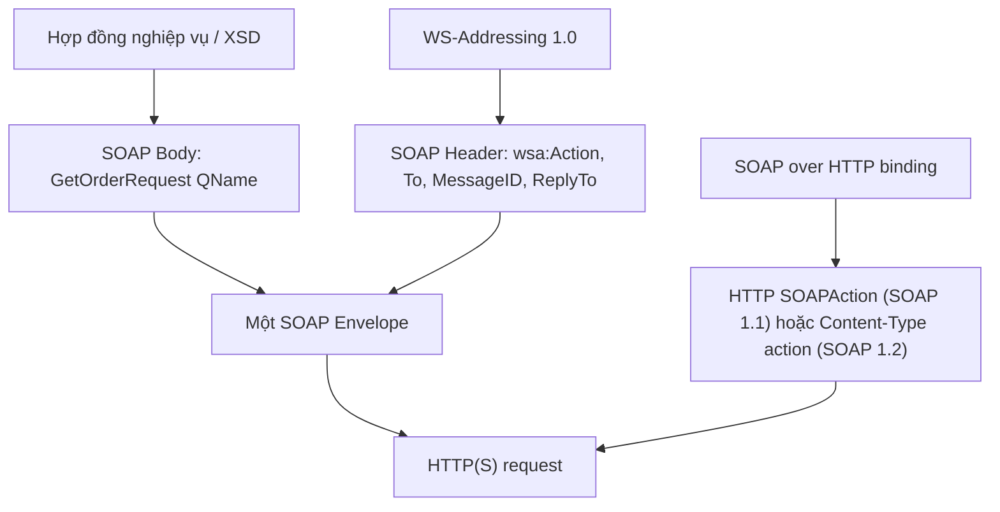
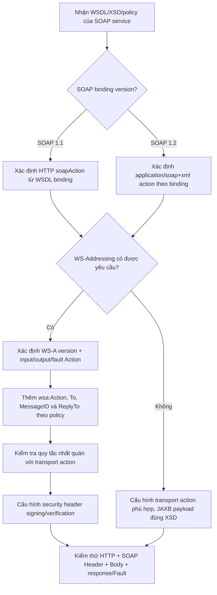

# Phân biệt WS-Addressing Action với SOAPAction của transport

## 1. Bài toán: hai giá trị “Action” nhưng không nằm cùng một lớp giao thức

Một ứng dụng Spring Boot dùng **Spring Web Services (Spring-WS)** gọi dịch vụ SOAP `GetOrder` của đối tác ERP. Tài liệu WSDL cho biết:

- Request có global element `{urn:example:orders:v1}GetOrderRequest`.
- Binding HTTP/SOAP 1.1 có `soapAction="urn:example:orders:v1:GetOrderRequest"`.
- Chính sách tích hợp còn yêu cầu **WS-Addressing 1.0**: SOAP Header phải có `wsa:Action`, `wsa:To` và `wsa:MessageID`.
- Response dùng một `wsa:Action` khác để phân biệt **thông điệp trả lời** với request, kèm `wsa:RelatesTo` liên kết response với request.

Lập trình viên thêm:

```java
new SoapActionCallback("urn:example:orders:v1:GetOrderRequest")
```

nhưng đối tác vẫn báo thiếu `wsa:Action`. Vì sao? **`SoapActionCallback` đặt action ở lớp SOAP-over-HTTP; nó không tương đương với việc xây dựng đầy đủ WS-Addressing message addressing properties trong SOAP Header.**

Trong một dự án khác, lập trình viên chỉ thêm `wsa:Action` vào SOAP Header, rồi gateway báo **HTTP `SOAPAction` không đúng WSDL**. Đây là chiều nhầm lẫn ngược lại.

**Bài học này xử lý đúng sự khác biệt đó.** Nó thuộc chương **WS-Addressing** của module **SPRING_WEB_SERVICES**, nằm trong lộ trình phát triển SOAP contract-first với XSD/WSDL, JAXB, Spring-WS endpoint và client, SOAP Fault, interceptor, XML security, WS-Security, chứng chỉ và kiểm thử tương thích cho tích hợp doanh nghiệp.

**Kết quả cần đạt:**

1. Định vị đúng `wsa:Action`, HTTP `SOAPAction` và `action` của media type SOAP 1.2.
2. Hiểu chúng liên quan tới WSDL, QName payload và operation như thế nào.
3. Biết cách cấu hình `ActionCallback` và `SoapActionCallback` trong Spring-WS mà không coi hai callback là một.
4. Nhận diện lỗi routing, ActionMismatch, mustUnderstand và thiếu/không hợp lệ WS-Addressing headers.
5. Tương quan request–response bằng `MessageID`/`RelatesTo`, không nhầm với correlation hay idempotency của nghiệp vụ.
6. Kiểm thử HTTP headers, SOAP headers và nội dung XSD/WSDL đồng thời; áp dụng đúng chính sách WS-Security.

## 2. Mô hình ba lớp: business payload, WS-Addressing và HTTP transport

Hãy tách ba lớp ngay từ đầu:



### 2.1. So sánh ngắn gọn

| Khái niệm | Nằm ở đâu? | Ý nghĩa chính | Xuất phát từ đâu? |
|---|---|---|---|
| **Payload QName** | Phần tử đầu tiên của SOAP Body | Dạng tài liệu nghiệp vụ, ví dụ `GetOrderRequest` | XSD và WSDL message/element |
| **`wsa:Action`** | **SOAP Header**, namespace WS-Addressing | Ý nghĩa hành động của **thông điệp WS-A**, có thể là request/response/fault | WS-Addressing metadata/policy và quy ước service |
| **HTTP `SOAPAction`** | **HTTP request header** của SOAP 1.1 | Action hint tại SOAP-over-HTTP binding; thường được gateway/dispatcher dùng để route | WSDL 1.1 `soap:operation/@soapAction` và chính sách endpoint |
| **`action` của `application/soap+xml`** | **Tham số HTTP Content-Type** trong SOAP 1.2 | Action hint ở binding SOAP 1.2 qua HTTP | Binding/policy SOAP 1.2 |
| **Java method name** | Mã nguồn client/server | Cách tổ chức code; không tự là giá trị trên dây | Cấu trúc ứng dụng |

Chỉ vì cả hai giá trị `wsa:Action` và `SOAPAction` đều thường chứa URI tương tự `urn:example:orders:v1:GetOrderRequest`, chúng **không phải một field** và **không thay thế nhau về vị trí xuất hiện**.

### 2.2. Quy tắc ghi nhớ

> **`wsa:Action` mô tả mục đích của SOAP message theo WS-Addressing. `SOAPAction`/media-type action là thông tin của SOAP-over-HTTP binding. QName payload xác định cấu trúc XML của Body.**

Hệ thống có thể yêu cầu các action này **trùng giá trị theo profile/binding**. Tuy nhiên, dù giá trị trùng nhau, bạn vẫn phải kiểm tra xem từng trường xuất hiện ở đúng chỗ chưa. **Không tự suy ra “trùng về nghĩa” đồng nghĩa “framework sẽ tự sinh tất cả”.**

## 3. SOAP 1.1: HTTP `SOAPAction` thật sự nằm ở đâu?

SOAP 1.1 qua HTTP định nghĩa một HTTP request header có tên `SOAPAction`. Ví dụ gửi operation `GetOrder`:

```http
POST /soap/orders HTTP/1.1
Host: erp.example.org
Content-Type: text/xml; charset=utf-8
SOAPAction: "urn:example:orders:v1:GetOrderRequest"

<soap:Envelope xmlns:soap="http://schemas.xmlsoap.org/soap/envelope/"
               xmlns:o="urn:example:orders:v1">
  <soap:Body>
    <o:GetOrderRequest>
      <o:orderId>ORD-1001</o:orderId>
    </o:GetOrderRequest>
  </soap:Body>
</soap:Envelope>
```

Phân tích:

1. `SOAPAction` là **HTTP header** bên ngoài XML Envelope.
2. `Content-Type: text/xml` thường xuất hiện trong SOAP 1.1 HTTP binding.
3. QName của `GetOrderRequest` do **XSD** xác định, không do chuỗi `SOAPAction` tạo ra.
4. Một gateway có thể route dựa trên `SOAPAction`, trong khi Spring-WS endpoint mapping có thể được cấu hình dựa trên payload QName; hai cơ chế cần đồng thuận theo WSDL.
5. Giá trị action là URI trong hợp đồng; **không tự dựng từ tên Java method** hoặc endpoint URL.

### 3.1. Giá trị rỗng, vắng mặt và dấu ngoặc kép

SOAP 1.1 phân biệt các dạng như:

```http
SOAPAction: "urn:example:orders:v1:GetOrderRequest"
SOAPAction: ""
SOAPAction:
```

Đây **không nhất thiết là ba trường hợp tương đương**, và một số gateway/đối tác xử lý khác nhau. Header có giá trị rỗng trong ngoặc kép không phải là hành động `GetOrder`. Trường hợp không có header và trường hợp header được gửi nhưng không có value cũng có thể được phân biệt ở tầng binding.

**Không xóa dấu quote, tự điền một URI tùy ý hoặc bỏ header chỉ để vượt một test.** Đọc `soapAction` từ WSDL, xem policy của đối tác và kiểm tra HTTP request trên dây bằng test.

### 3.2. HTTP `SOAPAction` khác SOAP Header

Đây **không phải** cách viết WS-Addressing:

```xml
<!-- Sai nếu tưởng đây là HTTP SOAPAction -->
<soap:Header xmlns:soap="http://schemas.xmlsoap.org/soap/envelope/">
  <SOAPAction>urn:example:orders:v1:GetOrderRequest</SOAPAction>
</soap:Header>
```

Một phần tử tùy ý có tên `SOAPAction` trong SOAP Header không thể thay cho HTTP header `SOAPAction`. Ngược lại, gửi HTTP `SOAPAction` cũng không tự tạo phần tử `wsa:Action` trong SOAP Envelope.

## 4. WS-Addressing 1.0: `wsa:Action` là SOAP Header

**WS-Addressing (WS-A)** định nghĩa một tập *message addressing properties* độc lập hơn với transport, giúp mô tả:

- Thông điệp được gửi **đến đâu** (`To`).
- Thông điệp biểu thị **hành động gì** (`Action`).
- Bên nhận nên **trả lời về đâu** (`ReplyTo`) và gửi Fault về đâu (`FaultTo`) nếu policy hỗ trợ.
- Thông điệp có **định danh nào** (`MessageID`).
- Response/Fault **liên hệ đến request nào** (`RelatesTo`).

Trong WS-Addressing 1.0, namespace phổ biến là:

```text
http://www.w3.org/2005/08/addressing
```

Một request WS-A có thể là:

```xml
<soap:Envelope
    xmlns:soap="http://schemas.xmlsoap.org/soap/envelope/"
    xmlns:o="urn:example:orders:v1"
    xmlns:wsa="http://www.w3.org/2005/08/addressing">
  <soap:Header>
    <wsa:Action soap:mustUnderstand="1">
      urn:example:orders:v1:GetOrderRequest
    </wsa:Action>
    <wsa:To soap:mustUnderstand="1">
      https://erp.example.org/soap/orders
    </wsa:To>
    <wsa:MessageID>
      urn:uuid:2f82d3a6-b7f9-4793-9521-8065e4b4be51
    </wsa:MessageID>
    <wsa:ReplyTo>
      <wsa:Address>
        http://www.w3.org/2005/08/addressing/anonymous
      </wsa:Address>
    </wsa:ReplyTo>
  </soap:Header>
  <soap:Body>
    <o:GetOrderRequest>
      <o:orderId>ORD-1001</o:orderId>
    </o:GetOrderRequest>
  </soap:Body>
</soap:Envelope>
```

Giá trị `wsa:Action` ở đây là một **IRI/URI định danh semantics của thông điệp**. Nó không phải địa chỉ mạng để HTTP client kết nối; `wsa:To` mới mô tả địa chỉ đích trong WS-A, còn URL thật của transport được cấu hình cho sender. Các giá trị này có liên hệ nhưng không thể thay thế nhau.

**Chú ý định dạng ví dụ:** XML được thụt lề để dễ đọc. Khi đối chiếu `wsa:Action`, `wsa:To` và `wsa:MessageID` với giá trị hợp đồng, phải tránh vô ý đưa whitespace không mong muốn vào giá trị IRI trên dây. Ứng dụng thật nên tạo header bằng API của thư viện, không copy nguyên đoạn XML có xuống dòng trong text node rồi so chuỗi.

### 4.1. Những header WS-A cần phân biệt

| Header | Ý nghĩa | Thường dùng trong |
|---|---|---|
| `wsa:Action` | Định danh ý nghĩa của message | Routing, metadata operation, validation |
| `wsa:To` | Destination endpoint reference address | Kiểm tra đích nhận, addressing policy |
| `wsa:ReplyTo` | Endpoint reference cho response | Anonymous reply hoặc callback/out-of-band reply |
| `wsa:FaultTo` | Endpoint reference cho Fault | Routing fault theo policy |
| `wsa:MessageID` | Định danh một message | Tương quan, xử lý response |
| `wsa:RelatesTo` | Liên kết tới message trước | Response/fault correlation |

Không phải một SOAP service đều bắt buộc bạn tự viết đủ mọi Header; **required/optional và cách xử lý phải dựa trên WS-A version, WSDL/policy và binding của đối tác**. `Action` là thuộc tính trọng tâm, còn `ReplyTo`, `FaultTo` hoặc `MessageID` có thể có yêu cầu riêng tùy interaction pattern.

### 4.2. `mustUnderstand` là ràng buộc xử lý, không phải dấu trang trí

Ví dụ SOAP 1.1:

```xml
<wsa:Action xmlns:wsa="http://www.w3.org/2005/08/addressing"
            soap:mustUnderstand="1"
            xmlns:soap="http://schemas.xmlsoap.org/soap/envelope/">
  urn:example:orders:v1:GetOrderRequest
</wsa:Action>
```

Nếu một SOAP node được nhắm đến bằng header có `mustUnderstand` nhưng không thể xử lý theo vai trò được yêu cầu, nó phải xử lý theo SOAP mustUnderstand semantics; không được mặc định bỏ qua rồi tiếp tục nghiệp vụ.

SOAP 1.2 có quy tắc namespace, role và biểu diễn boolean khác SOAP 1.1. Đừng copy `soap:mustUnderstand` của SOAP 1.1 sang SOAP 1.2 mà chưa kiểm tra binding.

### 4.3. `wsa:Action` khác `wsa:To`

So sánh:

```text
wsa:Action = urn:example:orders:v1:GetOrderRequest
wsa:To     = https://erp.example.org/soap/orders
HTTP URL   = https://erp.example.org/soap/orders
```

`Action` nói **thông điệp muốn thực hiện điều gì**. `To` nói **thông điệp được gửi tới đâu**. `HTTP URL` là địa chỉ thực để transport kết nối. Hai giá trị To và HTTP URL thường tương thích nhau theo policy, nhưng reverse proxy/gateway có thể làm địa chỉ public và internal khác nhau; cần kiểm tra endpoint reference, dispatch, policy và public WSDL.

## 5. SOAP 1.1 có thể mang đồng thời cả hai Action

Khi đối tác yêu cầu **SOAP 1.1 + WS-Addressing**, cùng một request có thể mang cả:

```http
POST /soap/orders HTTP/1.1
Host: erp.example.org
Content-Type: text/xml; charset=utf-8
SOAPAction: "urn:example:orders:v1:GetOrderRequest"
```

và trong SOAP Envelope:

```xml
<soap:Envelope
    xmlns:soap="http://schemas.xmlsoap.org/soap/envelope/"
    xmlns:wsa="http://www.w3.org/2005/08/addressing"
    xmlns:o="urn:example:orders:v1">
  <soap:Header>
    <wsa:Action>urn:example:orders:v1:GetOrderRequest</wsa:Action>
    <wsa:To>https://erp.example.org/soap/orders</wsa:To>
  </soap:Header>
  <soap:Body>
    <o:GetOrderRequest>
      <o:orderId>ORD-1001</o:orderId>
    </o:GetOrderRequest>
  </soap:Body>
</soap:Envelope>
```

Ở ví dụ này, hai action **cùng giá trị** vì đó là quy ước nhất quán mà hợp đồng mẫu yêu cầu. Tuy nhiên:

- HTTP header và SOAP Header là **hai vị trí khác nhau** trên dây.
- Một client có thể vô tình chỉ gửi một trong hai.
- Gateway có thể dùng HTTP action, còn backend kiểm tra WS-A action.
- Một profile/binding có thể yêu cầu hai giá trị nhất quán. Không tự quyết định được phép khác nhau nếu chưa đọc metadata/policy liên quan.
- Nếu thông điệp được chuyển sang một transport khác HTTP, `wsa:Action` có vai trò WS-A độc lập transport; HTTP `SOAPAction` không đi theo như một SOAP Header.

**Nguyên tắc triển khai:** hãy xem hai action là **hai thuộc tính cần cấu hình và kiểm thử riêng**, rồi áp dụng ràng buộc tương thích theo contract. Đừng giả định framework tự suy ra trường này từ trường kia.

## 6. SOAP 1.2: không dùng HTTP `SOAPAction` theo cùng cách SOAP 1.1

SOAP 1.2 có:

- SOAP Envelope namespace: `http://www.w3.org/2003/05/soap-envelope`.
- HTTP media type: `application/soap+xml`.
- Một **tham số `action`** trong media type có thể được dùng theo binding/policy.

Ví dụ:

```http
POST /soap/orders HTTP/1.1
Host: erp.example.org
Content-Type: application/soap+xml; charset=utf-8; action="urn:example:orders:v1:GetOrderRequest"
```

Trong body vẫn có thể có WS-A Header:

```xml
<soap12:Envelope
    xmlns:soap12="http://www.w3.org/2003/05/soap-envelope"
    xmlns:wsa="http://www.w3.org/2005/08/addressing"
    xmlns:o="urn:example:orders:v1">
  <soap12:Header>
    <wsa:Action soap12:mustUnderstand="true">urn:example:orders:v1:GetOrderRequest</wsa:Action>
    <wsa:To>https://erp.example.org/soap/orders</wsa:To>
  </soap12:Header>
  <soap12:Body>
    <o:GetOrderRequest>
      <o:orderId>ORD-1001</o:orderId>
    </o:GetOrderRequest>
  </soap12:Body>
</soap12:Envelope>
```

So sánh chính xác:

| Yếu tố | SOAP 1.1 over HTTP | SOAP 1.2 over HTTP |
|---|---|---|
| Envelope namespace | `http://schemas.xmlsoap.org/soap/envelope/` | `http://www.w3.org/2003/05/soap-envelope` |
| Media type thường gặp | `text/xml` | `application/soap+xml` |
| Transport action | HTTP `SOAPAction` header | Tham số `action` của `application/soap+xml` nếu binding sử dụng |
| `wsa:Action` | SOAP Header khi WS-A được dùng | SOAP Header khi WS-A được dùng |
| SOAP Fault | `faultcode`, `faultstring`, `detail` | `Code`, `Reason`, `Detail` |
| WS-A reply/relates-to | Theo WS-A policy | Theo WS-A policy |

**Không nên hardcode HTTP `SOAPAction` cho một SOAP 1.2 client chỉ vì đã thấy nó trên hệ thống SOAP 1.1.** Việc Spring-WS message factory/callback biểu diễn action ở transport phải được kiểm chứng theo WSDL binding và phiên bản framework.

### 6.1. MTOM và Content-Type

Khi dùng MTOM/XOP, outer HTTP media type có thể là `multipart/related`. Vì thế việc tìm trực tiếp chuỗi `application/soap+xml; action=...` trên outer HTTP Content-Type chưa đủ. Phải xem MIME root part, SOAP binding và action policy của đối tác.

`wsa:Action` vẫn là SOAP Header của message, không bị biến thành một HTTP MIME part chỉ vì payload chứa attachment.

## 7. WSDL công bố những thông tin nào?

Trong SOAP contract-first, XSD thường mô tả **phần tử và kiểu dữ liệu**. WSDL mô tả **operation, input/output messages, binding, transport action và endpoint**. WS-Addressing metadata có thể cung cấp **message action** cho từng input/output/fault.

### 7.1. HTTP SOAPAction ở WSDL 1.1 binding

Ví dụ trích từ WSDL:

```xml
<!-- Đoạn minh họa: namespaces được khai báo ở wsdl:definitions. -->
<wsdl:binding name="OrdersSoap11Binding" type="tns:OrdersPortType">
  <soap:binding style="document"
                transport="http://schemas.xmlsoap.org/soap/http"/>
  <wsdl:operation name="GetOrder">
    <soap:operation
        soapAction="urn:example:orders:v1:GetOrderRequest"/>
    <wsdl:input>
      <soap:body use="literal"/>
    </wsdl:input>
    <wsdl:output>
      <soap:body use="literal"/>
    </wsdl:output>
  </wsdl:operation>
</wsdl:binding>
```

Namespace tiền tố `soap` ở đây là **`http://schemas.xmlsoap.org/wsdl/soap/`** — không phải namespace SOAP Envelope. Giá trị `soapAction` quy định transport action ở binding operation.

### 7.2. WS-Addressing Action metadata cho từng message

Ví dụ khác trong cùng WSDL 1.1:

```xml
<!-- Trích đoạn minh họa, không phải WSDL hoàn chỉnh. -->
<wsdl:portType name="OrdersPortType">
  <wsdl:operation name="GetOrder">
    <wsdl:input
        message="tns:GetOrderInput"
        wsam:Action="urn:example:orders:v1:GetOrderRequest"/>
    <wsdl:output
        message="tns:GetOrderOutput"
        wsam:Action="urn:example:orders:v1:GetOrderResponse"/>
  </wsdl:operation>
</wsdl:portType>
```

`wsam` trong ví dụ thuộc **`http://www.w3.org/2007/05/addressing/metadata`**. Một số tài liệu/công cụ khác sử dụng cách biểu diễn metadata hoặc namespace WS-Addressing WSDL extension của thế hệ trước; **không trộn các phiên bản tùy ý**.

Điểm mấu chốt:

- **Input** có WS-A action `...GetOrderRequest`.
- **Output** có WS-A action **khác**: `...GetOrderResponse`.
- SOAP 1.1 binding operation thường có một `soapAction` tương ứng request operation.
- Không giả định output `wsa:Action` chính là HTTP `SOAPAction` của request.

### 7.3. Tách rõ bốn giá trị

| Thuộc tính | Giá trị mẫu | Nằm ở đâu trong contract/on-wire? |
|---|---|---|
| Operation name | `GetOrder` | `wsdl:operation/@name` |
| Request payload QName | `{urn:example:orders:v1}GetOrderRequest` | XSD global element và SOAP Body |
| HTTP SOAPAction request | `urn:example:orders:v1:GetOrderRequest` | `soap:operation/@soapAction`, HTTP request header |
| WS-A request action | `urn:example:orders:v1:GetOrderRequest` | `wsam:Action` trên input, `wsa:Action` SOAP Header |
| WS-A response action | `urn:example:orders:v1:GetOrderResponse` | `wsam:Action` trên output, `wsa:Action` response Header |

Ví dụ tình cờ dùng local names tương tự cho dễ học. **Không có quy tắc chung bắt buộc URI action phải được ghép bằng namespace + local name XSD**. Hãy đọc contract/policy đúng thay vì tự sinh action trong code.

### 7.4. WSDL và policy có thể yêu cầu WS-Addressing

Khi WSDL/WS-Policy công bố WS-Addressing support hoặc yêu cầu addressing, một SOAP client phải gửi các message addressing properties phù hợp. Chỉ đọc `soap:operation/@soapAction` có thể là **chưa đủ** để biết phía server đòi `wsa:Action` hay `wsa:MessageID`.

Cần kiểm tra:

1. WS-Addressing version và namespace được yêu cầu.
2. WS-A Action cho input, output và fault.
3. `ReplyTo`, `FaultTo`, `MessageID` có bắt buộc và được phép giá trị nào.
4. SOAP 1.1/1.2 binding; HTTP action tương ứng.
5. WS-Security policy: những Header nào phải được ký và timestamp/replay handling.
6. Điều kiện về `mustUnderstand` và SOAP processing roles.

## 8. WS-A 1.0 và WS-A phiên bản cũ: khác namespace là khác contract

Những hệ thống SOAP cũ có thể dùng namespace WS-Addressing đời trước, ví dụ bản submission 2004:

```text
WS-Addressing 1.0:
  http://www.w3.org/2005/08/addressing

WS-Addressing submission 2004/08:
  http://schemas.xmlsoap.org/ws/2004/08/addressing
```

Chúng **không có cùng QName**:

```xml
<wsa:Action
    xmlns:wsa="http://www.w3.org/2005/08/addressing">
  urn:example:orders:v1:GetOrderRequest
</wsa:Action>
```

khác với:

```xml
<old:Action
    xmlns:old="http://schemas.xmlsoap.org/ws/2004/08/addressing">
  urn:example:orders:v1:GetOrderRequest
</old:Action>
```

Một server yêu cầu WS-A 1.0 không nhất thiết hiểu Header của bản 2004; nếu Header được đánh dấu `mustUnderstand`, lỗi có thể xuất hiện trước khi endpoint nghiệp vụ chạy.

**Không sửa lỗi bằng cách đổi prefix `old` thành `wsa`** nếu namespace URI vẫn là bản cũ. Cần cấu hình addressing version thực sự theo stack Spring-WS/partner. Cũng đừng nhầm namespace WS-A SOAP headers với các namespace WS-A metadata trong WSDL.

## 9. Response WS-Addressing: `Action` riêng và `RelatesTo`

Trong trao đổi request–response đồng bộ, người gọi thường nhận response trên cùng HTTP exchange. Tuy vậy, WS-Addressing vẫn có khả năng mô tả **response message** độc lập:

```xml
<soap:Envelope
    xmlns:soap="http://schemas.xmlsoap.org/soap/envelope/"
    xmlns:wsa="http://www.w3.org/2005/08/addressing"
    xmlns:o="urn:example:orders:v1">
  <soap:Header>
    <wsa:Action>
      urn:example:orders:v1:GetOrderResponse
    </wsa:Action>
    <wsa:RelatesTo>
      urn:uuid:2f82d3a6-b7f9-4793-9521-8065e4b4be51
    </wsa:RelatesTo>
  </soap:Header>
  <soap:Body>
    <o:GetOrderResponse>
      <o:orderId>ORD-1001</o:orderId>
      <o:state>CONFIRMED</o:state>
    </o:GetOrderResponse>
  </soap:Body>
</soap:Envelope>
```

Ở đây:

- Request `wsa:MessageID` là `urn:uuid:2f82...`.
- Response `wsa:RelatesTo` tham chiếu **đúng ID của request**.
- Response `wsa:Action` là action **của thông điệp trả lời**, không dùng lại action request nếu metadata đã chỉ định giá trị riêng.
- XSD global element `GetOrderResponse` chỉ quyết định payload; không tự sinh WS-A headers.

### 9.1. `RelatesTo`, correlation ID và idempotency key

| Định danh | Semantics | Thường do ai tạo? |
|---|---|---|
| `wsa:MessageID` | Định danh message WS-A | Sender hoặc WS-A infrastructure theo policy |
| `wsa:RelatesTo` | Liên hệ response/fault với request message ID | Receiver tạo reply |
| `correlationId` | Nhóm logs/traces liên hệ qua nhiều service | Client, gateway hoặc tracing system |
| `clientRequestId` | Nhận diện **command nghiệp vụ** qua retry | Consumer/business contract |
| `orderId` | Định danh entity nghiệp vụ | Hệ thống sở hữu đơn hàng |

Nếu một request timeout và client retry, WS-A `MessageID` của lần gửi lại thường phải là **ID mới cho message mới**, nhưng **idempotency key nghiệp vụ** có thể phải giữ nguyên để server không tạo đơn trùng. Đừng mặc định dùng `MessageID` làm idempotency key; phải có thỏa thuận rõ và chính sách replay/deduplication phù hợp.

### 9.2. `ReplyTo` anonymous không biến client thành bất đồng bộ

Với WS-A 1.0:

```text
http://www.w3.org/2005/08/addressing/anonymous
```

được dùng cho một endpoint reference cho phép trả lời qua kênh phù hợp, thường là cùng HTTP connection trong request–response truyền thống.

Nếu `ReplyTo` trỏ tới một URL callback không anonymous, đó là một yêu cầu routing response **khác kiến trúc**. `WebServiceTemplate.marshalSendAndReceive(...)` là API đồng bộ; chỉ thêm `ReplyTo` callback URL **không tự tạo HTTP listener, correlation store hay background receiver** để nhận response sau.

Một triển khai callback cần thêm endpoint nhận response, xác thực các message trả về, kiểm tra `RelatesTo`, xử lý timeout/replay, persistence và trạng thái giao dịch nghiệp vụ.

## 10. Spring-WS client: `SoapActionCallback` dùng cho transport action

Spring-WS cung cấp:

```java
import org.springframework.ws.soap.client.core.SoapActionCallback;
```

Ví dụ:

```java
package com.example.orders.integration.soap;

import org.springframework.ws.client.core.WebServiceTemplate;
import org.springframework.ws.soap.client.core.SoapActionCallback;

public final class OrdersSoap11TransportClient {
    private static final String SOAP_ACTION =
            "urn:example:orders:v1:GetOrderRequest";

    private final WebServiceTemplate template;

    public OrdersSoap11TransportClient(WebServiceTemplate template) {
        this.template = template;
    }

    public Object getOrder(Object jaxbRequest) {
        return template.marshalSendAndReceive(
                jaxbRequest,
                new SoapActionCallback(SOAP_ACTION));
    }
}
```

Điều kiện để ví dụ chạy thật:

- `template` phải có JAXB marshaller/unmarshaller, message factory và URI/sender đúng WSDL.
- `jaxbRequest` phải là root JAXB element hoặc `JAXBElement<?>` phù hợp generated binding.
- Với SOAP 1.1, callback thiết lập SOAP action để transport dùng theo SOAP binding.
- Với SOAP 1.2, cách biểu diễn action trên HTTP khác; hãy kiểm thử Content-Type trên dây.

**Quan trọng:** `SoapActionCallback` **không phải chứng nhận client đã triển khai WS-Addressing**. Nếu WSDL/policy yêu cầu `wsa:Action`, cần thêm phần xử lý WS-A tương ứng.

### 10.1. Trường hợp chỉ cần SOAPAction

Một SOAP 1.1 endpoint **không bật WS-A** có thể chỉ cần:

```text
HTTP SOAPAction: urn:example:orders:v1:GetOrderRequest
SOAP Body:      {urn:example:orders:v1}GetOrderRequest
SOAP Header:    Không cần wsa:Action nếu policy không yêu cầu WS-A
```

Không nên thêm `wsa:Action` và `mustUnderstand` vào một đối tác không hỗ trợ WS-A; điều đó có thể gây MustUnderstand Fault.

### 10.2. Một callback là per-call configuration, không phải sửa WSDL

`new SoapActionCallback(...)` chỉ thay cách chuẩn bị **một request message**. Nó không sửa WSDL server, không thay XSD, không thay QName payload và không tự kiểm tra WS-Security signature.

Nếu action URI thay đổi giữa các operation, lấy giá trị đúng từ **contract operation**; không ghi một hằng action của `GetOrder` rồi dùng lại cho `CancelOrder`.

## 11. Spring-WS client: `ActionCallback` dùng cho WS-Addressing

Đối với WS-Addressing, Spring-WS có callback riêng:

```java
import org.springframework.ws.soap.addressing.client.ActionCallback;
```

Ví dụ sử dụng trong một client đã cấu hình `WebServiceTemplate`:

```java
package com.example.orders.integration.soap;

import java.net.URI;
import org.springframework.ws.client.core.WebServiceTemplate;
import org.springframework.ws.soap.addressing.client.ActionCallback;

public final class OrdersAddressingClient {
    private static final URI REQUEST_ACTION = URI.create(
            "urn:example:orders:v1:GetOrderRequest");

    private final WebServiceTemplate template;

    public OrdersAddressingClient(WebServiceTemplate template) {
        this.template = template;
    }

    public Object getOrder(Object jaxbRequest) {
        return template.marshalSendAndReceive(
                jaxbRequest,
                new ActionCallback(REQUEST_ACTION));
    }
}
```

**Phân biệt:**

- `org.springframework.ws.soap.client.core.SoapActionCallback` xử lý **SOAP transport action** thông qua abstraction của Spring-WS.
- `org.springframework.ws.soap.addressing.client.ActionCallback` xử lý **WS-Addressing message action** và các đặc tính addressing liên quan theo implementation/version.

Tên lớp đều chứa chữ *Action*, nhưng **package khác nhau và semantics khác nhau**. Đó là một trong những lỗi import phổ biến nhất khi dùng Spring-WS SOAP client.

### 11.1. Một bảng so sánh cách gọi

| Nhu cầu | API Spring-WS | Bạn phải kiểm tra trên dây |
|---|---|---|
| SOAP 1.1 có HTTP SOAPAction | `SoapActionCallback` | HTTP `SOAPAction` |
| WS-Addressing có `wsa:Action` | `ActionCallback` thuộc `soap.addressing.client` | SOAP Header `wsa:Action` đúng namespace và giá trị |
| SOAP 1.2 có action theo binding | Message factory SOAP 1.2 + action callback phù hợp | `Content-Type: application/soap+xml; action="..."` |
| Đối tác yêu cầu WS-A và transport action cùng lúc | Cấu hình kết hợp theo API/version/policy | **Cả HTTP metadata lẫn SOAP Header**, không chỉ một bên |

### 11.2. Khi cần cả WS-A Action và transport action

Có thể kết hợp các request callbacks nếu API/version hỗ trợ. Ví dụ khung:

```java
import java.net.URI;
import org.springframework.ws.WebServiceMessageCallback;
import org.springframework.ws.soap.addressing.client.ActionCallback;
import org.springframework.ws.soap.client.core.SoapActionCallback;

final String soapAction =
        "urn:example:orders:v1:GetOrderRequest";
final URI addressingAction =
        URI.create("urn:example:orders:v1:GetOrderRequest");

WebServiceMessageCallback combined = message -> {
    // Tạo WS-Addressing SOAP headers theo callback WS-A.
    new ActionCallback(addressingAction).doWithMessage(message);

    // Thiết lập action của SOAP transport theo WSDL binding.
    new SoapActionCallback(soapAction).doWithMessage(message);
};

Object result = template.marshalSendAndReceive(request, combined);
```

Đây là **đoạn minh họa trong method** có sẵn `template` và `request`, không phải một class Java độc lập. Giá trị action bằng nhau do **hợp đồng ví dụ** chọn như vậy, không vì hai loại header là cùng một thứ.

**Điểm cần xác minh trước khi dùng thực tế:** hành vi của `ActionCallback` đối với các thuộc tính WS-A bổ sung và SOAP transport action có thể chịu ảnh hưởng phiên bản Spring-WS, addressing version và message factory. Nếu callback WS-A cũng điều chỉnh transport action, **thứ tự callback sẽ có tác dụng**. Hãy kiểm tra API của bản dependency đã khóa và capture thông điệp HTTP thật, không chỉ tin đoạn code.

### 11.3. `ActionCallback` không tự tạo mọi kiến trúc WS-A

Một callback có thể giúp xây WS-Addressing headers, nhưng nó **không tự**:

- Công bố hoặc sửa WSDL `wsam:Action`.
- Bảo đảm phía server hỗ trợ cùng WS-A namespace/version.
- Mở một listener nhận callback bất đồng bộ khi `ReplyTo` là địa chỉ ngoài.
- Xác thực WS-Security XML Signature hoặc trust của server certificate.
- Cấp quyền nghiệp vụ hoặc chống tạo trùng đơn khi retry.
- Chứng minh `wsa:Action` và HTTP action trên wire tuân chính sách nếu chưa test.

**Contract-first:** action URI và addressing policy xuất phát từ WSDL/WS-Policy đã thống nhất, không tự phát sinh từ một `ObjectFactory` JAXB.

## 12. Spring-WS server: WS-A Action mapping khác PayloadRoot mapping

Ở phía server, Spring-WS có thể chọn method endpoint theo nhiều cách. Hai ví dụ quan trọng là:

1. **Payload root mapping:** dùng QName phần tử request trong SOAP Body, ví dụ annotation `@PayloadRoot`.
2. **WS-Addressing action mapping:** dùng `wsa:Action` của message khi cấu hình mapping hỗ trợ WS-Addressing, có thể khai báo bằng annotation `@Action` trong stack tương ứng.

### 12.1. Endpoint dựa trên payload QName

```java
package com.example.orders.soap.endpoint;

import com.example.orders.soap.generated.v1.GetOrderRequest;
import com.example.orders.soap.generated.v1.GetOrderResponse;
import org.springframework.ws.server.endpoint.annotation.Endpoint;
import org.springframework.ws.server.endpoint.annotation.PayloadRoot;
import org.springframework.ws.server.endpoint.annotation.RequestPayload;
import org.springframework.ws.server.endpoint.annotation.ResponsePayload;

@Endpoint
public final class OrdersPayloadEndpoint {
    private static final String NS = "urn:example:orders:v1";
    private final OrderQueryService queryService;
    private final OrderContractMapper mapper;

    public OrdersPayloadEndpoint(OrderQueryService queryService,
                                 OrderContractMapper mapper) {
        this.queryService = queryService;
        this.mapper = mapper;
    }

    @PayloadRoot(namespace = NS, localPart = "GetOrderRequest")
    @ResponsePayload
    public GetOrderResponse getOrder(
            @RequestPayload GetOrderRequest request) {
        return mapper.toResponse(
                queryService.findById(request.getOrderId()));
    }
}
```

`OrderQueryService` và `OrderContractMapper` là các interface/bean do dự án cung cấp. Bài chỉ minh họa **mapping bằng XML QName**, không phải implementation nghiệp vụ hoàn chỉnh.

### 12.2. Endpoint dựa trên WS-Addressing Action

Ở stack Spring-WS có `@Action`/annotation action endpoint mapping:

```java
import org.springframework.ws.soap.addressing.server.annotation.Action;
import org.springframework.ws.server.endpoint.annotation.Endpoint;
import org.springframework.ws.server.endpoint.annotation.RequestPayload;
import org.springframework.ws.server.endpoint.annotation.ResponsePayload;

@Endpoint
public final class OrdersAddressingEndpoint {
    private final OrderQueryService service;
    private final OrderContractMapper mapper;

    public OrdersAddressingEndpoint(
            OrderQueryService service, OrderContractMapper mapper) {
        this.service = service;
        this.mapper = mapper;
    }

    @Action("urn:example:orders:v1:GetOrderRequest")
    @ResponsePayload
    public GetOrderResponse getOrder(
            @RequestPayload GetOrderRequest request) {
        return mapper.toResponse(
                service.findById(request.getOrderId()));
    }
}
```

Các kiểu `GetOrderRequest`/`GetOrderResponse` và mapper/service là giống ví dụ payload ở trên; cần import generated classes đúng package trong file Java thực.

**Điểm cần kiểm tra khi triển khai:** annotation `@Action` cần một endpoint mapping hiểu WS-Addressing Action trong application context. `@EnableWs` và auto-configuration của từng Spring-WS/Boot version có thể quyết định mapping nào có mặt và thứ tự ưu tiên. **Không suy ra rằng gắn đồng thời `@PayloadRoot` và `@Action` sẽ tự buộc framework phải kiểm tra cả hai**. Hai kiểu endpoint mapping có thể là hai chiến lược chọn method riêng biệt.

### 12.3. Nguy cơ khi server chấp nhận Action không nhất quán

Giả sử SOAP Body có:

```xml
<o:CancelOrderRequest xmlns:o="urn:example:orders:v1">
  <o:orderId>ORD-1001</o:orderId>
</o:CancelOrderRequest>
```

nhưng WS-A Header nói:

```xml
<wsa:Action xmlns:wsa="http://www.w3.org/2005/08/addressing">
  urn:example:orders:v1:GetOrderRequest
</wsa:Action>
```

Nếu một mapping chọn endpoint theo `wsa:Action` trong khi JAXB payload lại là `CancelOrderRequest`, hệ thống có thể:

- Không unmarshal được request do QName sai.
- Gọi sai handler nếu tham số quá tổng quát.
- Tạo lỗi routing khó quan sát ở gateway.
- Nghiêm trọng hơn: vượt qua giả định authorization nếu layer bảo mật/route dựa trên action khác layer nghiệp vụ.

Hãy thiết kế **validation nhất quán giữa WS-A Action, Body QName và WSDL operation** theo policy, không để hai tầng độc lập tin hai mục tiêu khác nhau.

## 13. Khi hai Action không khớp: các tầng có thể phản ứng khác nhau

Giả sử đối tác đòi:

```text
HTTP SOAPAction: urn:example:orders:v1:GetOrderRequest
wsa:Action:      urn:example:orders:v1:GetOrderRequest
Payload QName:   {urn:example:orders:v1}GetOrderRequest
```

Nhưng client gửi:

```text
HTTP SOAPAction: urn:example:orders:v1:CancelOrderRequest
wsa:Action:      urn:example:orders:v1:GetOrderRequest
Payload QName:   {urn:example:orders:v1}GetOrderRequest
```

Có thể xảy ra nhiều tình huống:

| Thành phần | Có thể dựa vào | Rủi ro |
|---|---|---|
| HTTP gateway/reverse proxy | HTTP `SOAPAction` | Route request vào nhánh CancelOrder |
| WS-A-aware gateway | `wsa:Action` | Từ chối do action mismatch |
| Spring-WS `PayloadRoot` mapping | QName payload | Chọn GetOrder dù gateway đã route khác |
| Spring-WS WS-A action mapping | `wsa:Action` | Chọn handler GetOrder |
| JAXB/schema validator | XML payload QName/type | Không phát hiện HTTP action sai nếu không có policy check |
| WS-Security interceptor | Những node/headers được ký theo policy | Không tự biết HTTP SOAPAction có khớp metadata nghiệp vụ hay không |

**Không có một mô tả “lỗi chắc chắn” đúng cho mọi stack.** Kết quả phụ thuộc profile WS-A, WSDL, SOAP binding, endpoint mapping, version framework và gateway. Có hệ thống trả SOAP Fault, có hệ thống từ chối ở HTTP layer trước khi tạo SOAP message.

### 13.1. Các quy tắc xác minh quan trọng

- Nếu contract/profile quy định quan hệ giữa HTTP action và `wsa:Action`, validate rõ ràng.
- Nếu metadata WSDL chỉ ra input WS-A Action, đối chiếu giá trị với `wsa:Action` inbound.
- Nếu operation dựa trên QName, validate Body/XSD chứ không chỉ “action trông đúng”.
- Nếu hệ thống dùng cả nhiều mapping, xác định thứ tự và tránh routing có hai cách diễn giải.
- Khi proxy sửa rewrite path, kiểm tra lại `wsa:To` và chính sách endpoint reference.
- Khi security policy yêu cầu ký WS-A headers, bảo đảm những Header đó thực sự được bảo vệ.

### 13.2. Không sửa mismatch bằng cách hardcode toàn bộ action bằng một URI

Một shortcut nguy hiểm:

```java
// ANTI-PATTERN: mọi operation dùng chung một action.
private static final String ACTION = "urn:example:orders:v1:GetOrderRequest";
```

Trong cùng client còn có `CreateOrder`/`CancelOrder`, cách làm trên khiến những operation khác gửi request metadata sai. Hãy định nghĩa action theo **từng input message** như WSDL và kiểm thử mỗi operation riêng.

## 14. WS-Security: Action và To không tự đáng tin vì nằm trong SOAP Header

Những thông tin routing như `wsa:Action` và `wsa:To` có thể ảnh hưởng tới việc chọn endpoint hoặc xử lý security policy. Vì vậy, chúng cần được đánh giá trong **mô hình tin cậy**.

### 14.1. HTTP action và WS-A Action khác nhau về vùng chữ ký

WS-Security XML Signature bảo vệ **các node XML được tham chiếu bởi chữ ký**; HTTP `SOAPAction` ở ngoài SOAP Envelope nên **không trở thành một XML element được WS-Security ký chỉ vì SOAP Body có chữ ký**.

Nếu security policy yêu cầu integrity của `wsa:Action`/`wsa:To`, hãy cấu hình ký các SOAP headers thích hợp và kiểm tra chữ ký. Không tin `wsa:Action` chỉ vì:

- Header có đúng prefix `wsa`.
- Body được ký nhưng Header Action không nằm trong phạm vi chữ ký.
- Có HTTPS nhưng proxy/gateway hoặc system giữa các hop áp dụng policy khác.
- WS-A `MessageID` trông giống UUID hợp lệ.

TLS bảo vệ kênh theo trust chain của mỗi connection. WS-Security bảo vệ thông điệp/những phần được ký theo policy. Hai lớp không thay thế authorization nghiệp vụ.

### 14.2. Một request có Body được ký nhưng Action bị thay đổi

Tình huống:

```text
Signed body:   GetOrderRequest(orderId=ORD-1001)
Unsigned wsa:Action:  CancelOrderRequest  <- có thể bị sửa
HTTP SOAPAction:       GetOrderRequest
```

Nếu backend route bằng WS-A Action mà không đối chiếu Body/QName và phần được ký, có nguy cơ gọi nhầm operation hoặc ít nhất tạo lỗi xử lý. Cách phòng vệ:

1. Ký/verify các addressing headers cần bảo vệ theo WS-SecurityPolicy.
2. Kiểm tra `wsa:Action`/`wsa:To`/Body QName nhất quán với hợp đồng.
3. Không cho application business dựa trên một header chưa xác minh.
4. Áp dụng authorization theo verified identity và resource, không theo action string tự khai.
5. Test request bị thay `wsa:Action` sau khi ký phải bị từ chối nếu policy yêu cầu integrity.

### 14.3. Replay và timestamp

`wsa:MessageID` giúp định danh thông điệp nhưng **không tự bảo đảm chống replay**. Khi cần replay defense, kết hợp authentication, WS-Security timestamp, cache nonce/message IDs (theo thời gian policy), kiểm tra freshness và cơ chế idempotency cho command.

Ngay cả khi hai SOAP messages có cùng `MessageID`, quy tắc server xử lý duplicate phải được định nghĩa: đó có thể là lỗi addressing/security, nhưng **không tự đồng nghĩa** với việc thực hiện idempotency nghiệp vụ thành công.

### 14.4. Chứng chỉ và endpoint routing

Nếu kết nối HTTPS hoặc mTLS, client phải xác minh server certificate, hostname và chain tin cậy. Một `wsa:To` đúng không chứng minh HTTPS target đang được tin cậy; nó là một giá trị trong message, không thay SSL handshake.

Ngược lại, TLS thành công chưa chứng minh SOAP Header Action và To có semantics đúng. **Transport trust và message-level trust** là hai phần được kiểm chứng riêng.

## 15. SOAP Fault khi WS-Addressing có vấn đề

WS-Addressing/SOAP binding định nghĩa các dạng lỗi khi thông tin addressing thiếu hoặc sai. Một số tên thường gặp trong trao đổi WS-A:

- `MessageAddressingHeaderRequired`: thiếu addressing header bắt buộc trong điều kiện thích hợp.
- `InvalidAddressingHeader`: addressing header không hợp lệ.
- `ActionNotSupported`: receiver không hỗ trợ action được yêu cầu.
- `ActionMismatch`: action ở các vị trí phải nhất quán theo binding/profile nhưng không khớp.
- `DestinationUnreachable`: đích nhận không thể đến được theo semantics WS-A.

**Không có nghĩa mọi trường hợp đều trả đúng một fault code như nhau.** Tên, vị trí code/subcode, SOAP 1.1/1.2 envelope và fault detail phụ thuộc chuẩn WS-A được sử dụng, WSDL/WS-Policy và implementation thực tế.

### 15.1. SOAP 1.1 Fault và SOAP 1.2 Fault khác cấu trúc

SOAP 1.1 có:

```xml
<soap:Fault xmlns:soap="http://schemas.xmlsoap.org/soap/envelope/">
  <faultcode>soap:Client</faultcode>
  <faultstring>Unsupported WS-Addressing action</faultstring>
</soap:Fault>
```

Đây chỉ là **mẫu Fault minh họa**, không biểu diễn đủ mọi WS-A fault detail. SOAP 1.2 dùng `Code`, `Reason`, có thể có `Subcode` và `Detail`.

Nếu service công bố SOAP Fault detail theo schema, Spring-WS client phải parse fault đúng contract; không chỉ bắt `Exception` rồi đọc chuỗi `faultstring` làm mã lỗi nghiệp vụ.

### 15.2. Response/Fault WS-A cũng có Action

Với WS-Addressing:

- Normal response có `wsa:Action` được công bố cho **output message**.
- Fault có thể dùng fault action từ metadata hợp đồng hoặc action mặc định chuẩn/policy.
- `wsa:RelatesTo` có thể tham chiếu `MessageID` của request để tương quan.

Không dùng request action cho mọi normal response và Fault. Nếu client kiểm tra WS-A response action, một server trả payload JAXB đúng nhưng `wsa:Action` sai vẫn có thể bị coi không tương thích.

### 15.3. HTTP 500 không tự cho biết là WS-A Fault

Một HTTP 500 có thể chứa:

1. SOAP Fault do WS-Addressing thiếu/sai.
2. SOAP Fault do business operation.
3. HTTP error HTML/text từ proxy.
4. Lỗi SOAP version hoặc security từ server.

Quy trình debug phải đọc **HTTP status, Content-Type, SOAP Envelope, Fault code/subcode/detail và WS-A headers**. Không suy lỗi WS-A chỉ từ status code.

## 16. Proxy/gateway: `wsa:To` và endpoint URL có thể khác nhau

Một hệ thống doanh nghiệp thường có:

```text
Public WSDL endpoint:
  https://api.partner.example/erp/orders

Reverse proxy forward tới:
  http://erp-backend.internal/ws

WS-A To mà client gửi:
  https://api.partner.example/erp/orders

SOAPAction:
  urn:example:orders:v1:GetOrderRequest
```

Ở đây `wsa:To` phản ánh **địa chỉ công khai của endpoint reference**, còn backend nhận HTTP request tại đường nội bộ. Nếu một validator ở backend so `wsa:To` bằng chuỗi với `http://erp-backend.internal/ws`, request hợp lệ từ client có thể bị từ chối.

### 16.1. Cần quyết định rõ trust boundary

- Public WSDL/WS-A EPR phải chỉ rõ địa chỉ mà client được phép dùng.
- Reverse proxy phải giữ hoặc ánh xạ addressing metadata theo chính sách thống nhất; nếu rewrite `wsa:To`, phải xét tới XML Signature.
- Không được sửa một SOAP Header đã được ký rồi kỳ vọng chữ ký vẫn đúng.
- Không nhận endpoint URL tùy ý từ caller để mở kết nối server-side (rủi ro SSRF).
- Xác thực identity đối tác ở TLS/WS-Security, không dựa trên việc `wsa:To` trỏ đúng hostname.
- Audit request routing bằng operation, action, endpoint alias và correlation, không log secrets.

### 16.2. Gateway sử dụng HTTP SOAPAction nhưng backend dùng WS-A Action

Một gateway SOAP 1.1 có thể route HTTP:

```text
SOAPAction = urn:example:orders:v1:CancelOrderRequest -> backend /cancel
```

Sau đó backend đọc:

```text
wsa:Action = urn:example:orders:v1:GetOrderRequest
```

Nếu không có một chính sách kiểm tra tính nhất quán, hai lớp có thể xử lý request với những giả định khác nhau. Tốt nhất là **kiểm tra theo contract tại ingress** và xác định chính xác layer nào quyết định dispatch. Gateway không nên tự ý route theo action chưa được kiểm tra khi có tác vụ nhạy cảm.

### 16.3. Tại sao “đổi SOAPAction để sửa routing” có thể nguy hiểm?

Khi một request định dạng `GetOrderRequest` bị từ chối, thay HTTP SOAPAction thành `CancelOrderRequest` chỉ vì gateway nhận URI đó không giải quyết XSD/WSDL mismatch. Nó tạo request có **operation metadata và XML semantics bất nhất**, dẫn đến lỗi hoặc rủi ro bảo mật.

Điểm sửa đúng là **đọc WSDL, xác định action URI của operation thật, bảo đảm payload QName đúng và kiểm tra WS-A policy**.

## 17. Kiểm thử: phải xem cả HTTP và SOAP Header, không chỉ Body

Một unit test chỉ assert JAXB `GetOrderRequest` được marshal đúng chưa chứng minh WS-A Action hoặc SOAPAction transport đúng.

### 17.1. Ma trận test tối thiểu

| Kiểm thử | Điều cần quan sát |
|---|---|
| SOAP 1.1 client chỉ cần HTTP action | `SOAPAction` HTTP header đúng WSDL, không thêm WS-A ngoài policy |
| WS-A client | SOAP Header `wsa:Action` đúng namespace/version và URI |
| Kết hợp SOAP 1.1 + WS-A | **Cả hai** xuất hiện đúng vị trí và khớp quy tắc binding |
| SOAP 1.2 + WS-A | `application/soap+xml; action=...` nếu yêu cầu, và `wsa:Action` |
| Payload QName | `{urn:example:orders:v1}GetOrderRequest` theo XSD |
| Response | `wsa:Action` là output action, `RelatesTo` trỏ đúng request MessageID |
| Fault | Fault action/detail đúng policy, code/subcode tương thích SOAP version |
| Không gửi WS-A khi đối tác không hỗ trợ | Không tạo MustUnderstand Fault do Header tự thêm |
| WS-A 2004/08 vs 2005/08 | Không chấp nhận nhầm namespace |
| Mismatch HTTP action/WS-A action | Bị phát hiện theo chính sách, không route tùy ý |
| Mismatch WS-A action/Body QName | Từ chối hoặc xử lý có kiểm tra đúng hợp đồng |
| Header đã ký bị sửa | WS-Security signature verification thất bại |
| HTTPS/mTLS | Server certificate/hostname/client identity đúng |
| Proxy rewrite | `wsa:To` và routing được xử lý theo public endpoint policy |

### 17.2. `MockWebServiceServer`: tốt cho JAXB và client callback

Với Spring-WS outbound client, có thể dùng `MockWebServiceServer` để kiểm tra request payload và response JAXB mà không gửi network thật:

```java
import static org.junit.jupiter.api.Assertions.assertEquals;
import static org.springframework.ws.test.client.RequestMatchers.payload;
import static org.springframework.ws.test.client.ResponseCreators.withPayload;

import org.springframework.ws.client.core.WebServiceTemplate;
import org.springframework.ws.test.client.MockWebServiceServer;
import org.springframework.xml.transform.StringSource;

// Đoạn nằm trong một JUnit test method có template JAXB đã cấu hình.
MockWebServiceServer server =
        MockWebServiceServer.createServer(template);

String expectedRequest = """
    <o:GetOrderRequest xmlns:o="urn:example:orders:v1">
      <o:orderId>ORD-1001</o:orderId>
    </o:GetOrderRequest>
    """;
String response = """
    <o:GetOrderResponse xmlns:o="urn:example:orders:v1">
      <o:orderId>ORD-1001</o:orderId>
      <o:state>CONFIRMED</o:state>
    </o:GetOrderResponse>
    """;

server.expect(payload(new StringSource(expectedRequest)))
      .andRespond(withPayload(new StringSource(response)));

Object result = template.marshalSendAndReceive(
        request,
        new SoapActionCallback("urn:example:orders:v1:GetOrderRequest"));
server.verify();
```

Ở đây `request` phải là JAXB object được chuẩn bị ở fixture; import `SoapActionCallback` theo phần 10. Đoạn test này **chỉ xác minh payload**; nó không có assertion WS-A Header/HTTP action nếu chưa thêm matcher tương ứng.

Nếu phiên bản `spring-ws-test` hỗ trợ matcher như `soapAction(...)` hoặc matcher cho SOAP Header, có thể dùng chúng để kiểm tra request message. Nhưng không nhầm:

- **Payload matcher** không chứng minh SOAP Header tồn tại.
- **Message-level SOAPAction matcher** không nhất thiết chứng minh HTTP header trên dây được proxy truyền đúng.
- **Mock server** không thực hiện network round-trip tới endpoint HTTP thật.

Vì vậy, muốn kiểm tra đồng thời HTTP SOAPAction và WS-A Header **trên dây**, cần một test với local HTTP/HTTPS server.

### 17.3. HTTP integration test: ghi nhận header và body thật

Ví dụ dưới đây sử dụng `com.sun.net.httpserver.HttpServer` của JDK để nhận một SOAP 1.1 request và ghi nhận transport metadata. Đây là khung **trích trong một JUnit test method**, nhằm kiểm tra integration path thay vì chỉ gọi client callback thủ công:

```java
import com.sun.net.httpserver.HttpServer;
import java.net.InetSocketAddress;
import java.nio.charset.StandardCharsets;
import java.util.concurrent.atomic.AtomicReference;
import org.springframework.ws.soap.SoapVersion;
import org.springframework.ws.soap.saaj.SaajSoapMessageFactory;
import org.springframework.ws.transport.http.HttpUrlConnectionMessageSender;
import org.springframework.ws.client.core.WebServiceTemplate;
import org.springframework.xml.transform.StringSource;
import org.springframework.xml.transform.StringResult;

HttpServer httpServer = HttpServer.create(
        new InetSocketAddress("127.0.0.1", 0), 0);
AtomicReference<String> actionHeader = new AtomicReference<>();
AtomicReference<String> envelope = new AtomicReference<>();

httpServer.createContext("/soap", exchange -> {
    try {
        actionHeader.set(
                exchange.getRequestHeaders().getFirst("SOAPAction"));
        envelope.set(new String(
                exchange.getRequestBody().readAllBytes(),
                StandardCharsets.UTF_8));

        String response = """
            <s:Envelope xmlns:s="http://schemas.xmlsoap.org/soap/envelope/"
                        xmlns:o="urn:example:orders:v1">
              <s:Body>
                <o:GetOrderResponse>
                  <o:orderId>ORD-1001</o:orderId>
                  <o:state>CONFIRMED</o:state>
                </o:GetOrderResponse>
              </s:Body>
            </s:Envelope>
            """;
        byte[] bytes = response.getBytes(StandardCharsets.UTF_8);
        exchange.getResponseHeaders().set(
                "Content-Type", "text/xml; charset=utf-8");
        exchange.sendResponseHeaders(200, bytes.length);
        try (var output = exchange.getResponseBody()) {
            output.write(bytes);
        }
    } finally {
        exchange.close();
    }
});
httpServer.start();

try {
    SaajSoapMessageFactory factory = new SaajSoapMessageFactory();
    factory.setSoapVersion(SoapVersion.SOAP_11);
    factory.afterPropertiesSet();

    WebServiceTemplate template = new WebServiceTemplate(factory);
    template.setMessageSender(new HttpUrlConnectionMessageSender());

    String url = "http://127.0.0.1:"
            + httpServer.getAddress().getPort() + "/soap";
    String payload = """
        <o:GetOrderRequest xmlns:o="urn:example:orders:v1">
          <o:orderId>ORD-1001</o:orderId>
        </o:GetOrderRequest>
        """;

    StringResult reply = new StringResult();
    template.sendSourceAndReceiveToResult(
            url, new StringSource(payload),
            new SoapActionCallback(
                    "urn:example:orders:v1:GetOrderRequest"),
            reply);

    // Kiểm tra transport action của SOAP 1.1:
    org.junit.jupiter.api.Assertions.assertTrue(
            actionHeader.get().contains(
                    "urn:example:orders:v1:GetOrderRequest"));
    org.junit.jupiter.api.Assertions.assertTrue(
            envelope.get().contains("GetOrderRequest"));
} finally {
    httpServer.stop(0);
}
```

Test này dùng Java 17+ và API `sendSourceAndReceiveToResult` có overload URI/request Source/callback/Result trong các stack Spring-WS thông dụng. Các biến method là local; trong test thật cần dùng `@Test`, khai báo imports đầy đủ và kiểm tra overload trong phiên bản dependency của dự án. Nếu dùng Java module-path, module JDK `jdk.httpserver` có thể cần được thêm vào cấu hình test.

**Đây mới là bước đầu:** example trên chỉ gửi `SoapActionCallback` nên chưa kỳ vọng `wsa:Action`. Để kiểm tra **cả hai Action**:

1. Thay callback bằng cấu hình có `ActionCallback` WS-A và SOAP transport action theo policy như phần 11.
2. Phân tích `envelope.get()` bằng XML parser **namespace-aware** được cấu hình an toàn.
3. Assert SOAP Header có phần tử QName `{http://www.w3.org/2005/08/addressing}Action`.
4. Assert text value của `wsa:Action` bằng expected URI.
5. Assert HTTP header `SOAPAction`/SOAP 1.2 media-type action riêng theo binding.
6. Kiểm tra cả `wsa:To` và `wsa:MessageID` nếu policy yêu cầu.
7. Với response, trả WS-A metadata tương thích; kiểm tra `wsa:Action` output và `wsa:RelatesTo`.

**Không dùng so chuỗi XML thô làm kiểm thử chính cho QName.** Prefix `wsa` có thể được serialization đổi thành `ns3` mà QName vẫn giống nhau. Đồng thời, XML parser dùng trong test cũng phải chặn DTD/external entities để không tự tạo một điểm XXE mới.

### 17.4. Một mẫu test đối chiếu theo ba nguồn

Một bộ assertion tốt đối chiếu:

```text
Contract (WSDL/XSD):
  SOAP version  = 1.1
  soapAction    = urn:example:orders:v1:GetOrderRequest
  input Action  = urn:example:orders:v1:GetOrderRequest
  output Action = urn:example:orders:v1:GetOrderResponse
  input QName   = {urn:example:orders:v1}GetOrderRequest

Captured HTTP:
  SOAPAction    = "urn:example:orders:v1:GetOrderRequest"
  Content-Type  = text/xml; charset=utf-8

Captured SOAP request:
  Header Action = {http://www.w3.org/2005/08/addressing}Action
  Action value  = urn:example:orders:v1:GetOrderRequest
  Body QName    = {urn:example:orders:v1}GetOrderRequest
```

Nếu một trong ba lớp lệch, test phải báo chính xác **transport action, WS-A action hay payload QName** thay vì một thông báo chung “SOAP không đúng”.

## 18. Chẩn đoán sự cố: bảng lỗi và nguyên nhân

| Triệu chứng | Nguyên nhân có thể | Kiểm tra và sửa |
|---|---|---|
| HTTP gateway báo action không hợp lệ | HTTP `SOAPAction` sai/thiếu | WSDL `soap:operation/@soapAction` và captured HTTP |
| Server báo thiếu `wsa:Action` | Chỉ dùng `SoapActionCallback` | Thêm WS-A `ActionCallback`, xác minh SOAP Header |
| SOAPAction đã đúng nhưng `ActionNotSupported` | `wsa:Action` sai URI/version | Đọc WSDL input action, WS-A namespace, gateway policy |
| `wsa:Action` đúng nhưng route nhầm ở proxy | Gateway route theo HTTP SOAPAction khác | So cả hai action, áp dụng consistency check |
| QName payload đúng nhưng endpoint không gọi | Mapping dựa trên WS-A Action hoặc WSDL policy | Kiểm tra `@Action`/endpoint mapping thứ tự |
| `@Action` không được dùng | Thiếu/mapping không hoạt động trong Spring context | Xem endpoint mapping configuration bản thực tế |
| Header WS-A bị MustUnderstand Fault | Receiver không hiểu WS-A version/role | Đối chiếu WS-A version/policy, không tự thêm header |
| SOAP 1.2 trả 415 | Sai SOAP version hoặc media type | Kiểm tra `SaajSoapMessageFactory`/`application/soap+xml` |
| SOAP 1.2 có HTTP `SOAPAction` nhưng thiếu media type action | Dùng cách của SOAP 1.1 cho binding 1.2 | Kiểm tra Content-Type và API version |
| Client không khớp response `wsa:Action` | Server dùng request action hoặc URI output sai | Đối chiếu WSDL output/fault action |
| `RelatesTo` không đúng request | Dùng lại MessageID hoặc reply sai message | Kiểm tra ID và response correlation |
| `wsa:To` không khớp backend URL | Reverse proxy/public address khác | Thống nhất public endpoint reference/route policy |
| Chữ ký XML bị hỏng sau khi sửa Header | Thay node đã ký sau WS-Security signature | Ghi WS-A Header trước ký; verify đúng |
| WS-A Action không được bảo vệ | Policy chỉ ký Body, không ký Action | Cấu hình chữ ký cho addressing headers cần thiết |
| Client WS-A 2004 gửi tới server WS-A 1.0 | Sai namespace WS-A | Đổi addressing version thật, không chỉ prefix |
| Retry tạo trùng nghiệp vụ | Nhầm MessageID với idempotency key | Dùng key nghiệp vụ ổn định, reconciliation |
| Mock JAXB test pass nhưng production lỗi | Mock không kiểm tra HTTP/header/policy | Test HTTP/TLS thật và client interop |

### 18.1. Quy trình debug sáu bước

1. **Đọc WSDL**: operation, input/output WS-A action, SOAP binding action, request/response QName.
2. **Đọc transport capture**: HTTP status, SOAPAction hoặc SOAP 1.2 Content-Type/action.
3. **Đọc SOAP Envelope**: version và SOAP Header `wsa:Action`/`To`/`MessageID`.
4. **Kiểm tra routing**: gateway dùng HTTP action, WS-A action hay QName? Có kiểm tra tính nhất quán?
5. **Kiểm tra bảo mật**: WS-A Header có bị yêu cầu ký? Chữ ký có hợp lệ sau proxy transform?
6. **Kiểm tra response/Fault**: output/fault action, RelatesTo và schema của payload/fault detail.

Đừng bắt đầu bằng cách “thử các chuỗi SOAPAction ngẫu nhiên” vì mỗi lần sửa có thể route request vào một operation khác. Làm việc từ contract và dữ liệu capture đáng tin cậy.

## 19. Vận hành: log, metrics, concurrency và dữ liệu nhạy cảm

Một hệ thống tích hợp doanh nghiệp nên quan sát từng action mà không lưu toàn bộ message:

| Metadata nên quan sát | Cách ghi an toàn |
|---|---|
| Operation alias | `orders.get` / `orders.cancel` do hệ thống định nghĩa |
| SOAP version | `1.1` / `1.2` |
| Transport action | Giá trị đã được sanitize/allowlist hoặc alias |
| WS-A action | Giá trị URI hợp đồng đã biết hoặc alias |
| WS-A MessageID/RelatesTo | ID hợp lệ, giới hạn độ dài, không làm khóa bảo mật |
| Endpoint alias | `erp-primary` thay vì ghi hostname nhạy cảm nếu policy hạn chế |
| Status/Fault | Transport 4xx/5xx, SOAP Fault category |
| Latency | p50/p95/p99 cho SOAP client/endpoints |
| WS-Security result | Verified/rejected và lý do an toàn không lộ token |

Tránh ghi:

- Raw SOAP Header chứa `wsse:UsernameToken`, password, bearer token.
- Private key, nội dung keystore hoặc chứng chỉ khách hàng có dữ liệu nhạy cảm.
- Toàn bộ payload chứa PII, thông tin đơn hàng hoặc dữ liệu tài chính.
- Giá trị HTTP Authorization và các header có secrets.

### 19.1. Không lưu “current action” vào singleton bean

Ví dụ sai:

```java
@Component
class UnsafeActionContext {
    private String currentAction; // SAI: request-specific mutable state
}
```

Một Spring-WS client/endpoint có thể xử lý nhiều request đồng thời. Nếu singleton giữ `currentAction`, request `GetOrder` và `CancelOrder` có thể ghi đè nhau. Dùng:

- Action URI được chọn từ contract của **mỗi operation**.
- Callback mới theo mỗi invocation.
- Metadata như `MessageContext` property nếu cần qua nhiều interceptor.
- Immutable command/request context truyền tường minh.

Tương tự, không thay `setDefaultUri`/`setInterceptors` của một `WebServiceTemplate` dùng chung trong mỗi request để chuyển đối tác hay operation. Cấu hình ổn định rồi dùng overload per-call an toàn theo API hoặc client riêng.

### 19.2. Action không phải quyền truy cập

Một request có:

```text
wsa:Action = urn:example:orders:v1:CancelOrderRequest
```

không chứng minh người gửi có quyền hủy đơn. Server vẫn phải:

1. Xác thực caller qua TLS/mTLS hoặc WS-Security theo policy.
2. Kiểm tra integrity của message và addressing headers khi cần.
3. Ánh xạ caller thành partner/tenant identity đáng tin.
4. Kiểm tra quyền trên `orderId` và trạng thái domain.
5. Áp dụng idempotency, transaction, audit và business validation.

**Routing metadata không phải authentication/authorization metadata.** Đây là khác biệt quan trọng với những operation nhạy cảm như thanh toán hoặc thay đổi trạng thái đơn hàng.

## 20. Sơ đồ quyết định: khi nào cần gửi giá trị nào?



Một quy trình ngắn để triển khai:

1. **Đọc XSD/WSDL**: lấy request QName, SOAP binding, input/output action, Fault metadata.
2. **Chốt WS-A version**: 2005/08, legacy submission hay extension khác; tuyệt đối không đoán prefix.
3. **Cấu hình client**: `WebServiceTemplate` + JAXB + message factory + HTTP sender + URI.
4. **Thiết lập transport action**: SOAP 1.1 `SOAPAction` hoặc SOAP 1.2 media-type action khi binding yêu cầu.
5. **Thiết lập WS-A**: `ActionCallback` và addressing metadata phù hợp; khi cần cả hai, phối hợp theo version/policy.
6. **Xác minh request–response**: input/output actions khác nhau, `MessageID`/`RelatesTo` đúng.
7. **Cấu hình security**: TLS/mTLS và chữ ký WS-Security cho các SOAP headers được yêu cầu.
8. **Kiểm tra routing và lỗi**: MustUnderstand, ActionNotSupported, ActionMismatch, HTTP 415 và SOAP Fault.
9. **Chạy contract tests/interop**: mock SOAP, local HTTP capture và client/server độc lập khác công nghệ.
10. **Giám sát và thay đổi có kiểm soát**: URI/action theo từng contract version, không mutate shared runtime state.

### Checklist trước khi đưa vào production

- [ ] Đã biết SOAP 1.1 hay SOAP 1.2 theo WSDL binding.
- [ ] HTTP `SOAPAction` hoặc `Content-Type` action đúng transport binding.
- [ ] `wsa:Action` được đặt trong SOAP Header **chỉ khi policy yêu cầu/cho phép WS-A**.
- [ ] WS-A namespace/version đúng, không nhầm prefix và namespace.
- [ ] Input, output và Fault action được xác định **riêng**.
- [ ] Payload QName đúng XSD, được validate theo contract.
- [ ] `wsa:To` phù hợp public endpoint reference và proxy/gateway policy.
- [ ] `MessageID`/`RelatesTo` xử lý theo WS-A interaction pattern.
- [ ] `mustUnderstand`/role/actor phù hợp SOAP version và recipient.
- [ ] WS-Security ký/verify headers cần bảo vệ, TLS/mTLS xác thực peer.
- [ ] Hệ thống phát hiện/giải thích action mismatch theo policy, không route mơ hồ.
- [ ] Application thực thi authorization/idempotency độc lập action string.
- [ ] Test HTTP wire, WS-A Header, response/Fault, timeout và concurrency đều đạt.

## 21. Bài tập thực hành

### Bài tập 1 — Chỉ ra đúng vị trí của ba loại action

Cho request SOAP 1.1 có:

```text
HTTP SOAPAction: "urn:example:orders:v1:GetOrderRequest"
SOAP Header wsa:Action: urn:example:orders:v1:GetOrderRequest
SOAP Body root: {urn:example:orders:v1}GetOrderRequest
```

Trả lời:

1. Dòng nào thuộc HTTP transport?
2. Dòng nào thuộc SOAP Header WS-Addressing?
3. Dòng nào thuộc schema nghiệp vụ?
4. Tại sao `SoapActionCallback` không đủ để chứng minh có WS-A?
5. Nếu server chỉ dùng `@PayloadRoot`, liệu HTTP action có tự quyết định endpoint method không?

### Bài tập 2 — Viết client Spring-WS theo hai policy

Thiết kế một `WebServiceTemplate` dùng JAXB và SOAP 1.1:

- **Policy A:** đối tác chỉ cần HTTP `SOAPAction`; dùng `SoapActionCallback`.
- **Policy B:** đối tác cần WS-Addressing Action/To/MessageID và HTTP `SOAPAction` nhất quán; dùng `ActionCallback` và cấu hình kết hợp phù hợp.

Đối chiếu captured HTTP request/Soap Header, không chỉ xem code. Thử bỏ riêng HTTP action rồi bỏ riêng WS-A Action; mô tả kết quả kỳ vọng theo từng policy.

### Bài tập 3 — SOAP 1.2 và media-type action

Giả sử cùng operation được công bố bằng SOAP 1.2:

1. Đổi message factory sang SOAP 1.2 theo WSDL.
2. Kiểm tra Envelope namespace.
3. Kiểm tra `application/soap+xml` và tham số `action` nếu binding dùng.
4. Nếu WS-A có mặt, kiểm tra `wsa:Action` vẫn ở SOAP Header.
5. Kiểm tra Fault chuyển sang cấu trúc SOAP 1.2.

Giải thích vì sao **không được** coi HTTP `SOAPAction` của SOAP 1.1 và media-type `action` của SOAP 1.2 là cùng một header.

### Bài tập 4 — Response correlation và retry

Client gửi request:

```text
wsa:MessageID = urn:uuid:aaaaaaaa-aaaa-4aaa-8aaa-aaaaaaaaaaaa
wsa:Action    = urn:example:orders:v1:CreateOrderRequest
clientRequestId = CREATE-2026-001
```

Server đã xử lý thành công nhưng response bị timeout. Client gửi retry:

```text
wsa:MessageID = urn:uuid:bbbbbbbb-bbbb-4bbb-8bbb-bbbbbbbbbbbb
clientRequestId = CREATE-2026-001
```

Hãy giải thích vì sao `MessageID` mới có thể đúng cho message mới, trong khi `clientRequestId` phải giữ nguyên để đảm bảo idempotency nếu contract quy định. Thiết kế response có `RelatesTo` tương ứng với request thực mà server trả lời.

### Bài tập 5 — Mismatch giữa gateway và backend

Một HTTP gateway route theo `SOAPAction=CancelOrderRequest`, nhưng backend Spring-WS đọc `wsa:Action=GetOrderRequest` và SOAP Body có `GetOrderRequest`. Hãy:

1. Vẽ đường đi qua gateway, SOAP endpoint mapping và application service.
2. Chỉ ra mọi vị trí có thể phát hiện mismatch.
3. Đề xuất policy từ chối request trước business side effect.
4. Xác định WS-Security phải ký những headers nào theo threat model.
5. Viết negative test không chỉ assert HTTP status mà kiểm tra routing và SOAP Fault an toàn.

### Bài tập 6 — WSDL input/output action và Fault

Tạo WSDL 1.1 minh họa có:

```text
Operation: GetOrder
soapAction: urn:example:orders:v1:GetOrderRequest
wsam:Action input:  urn:example:orders:v1:GetOrderRequest
wsam:Action output: urn:example:orders:v1:GetOrderResponse
wsam:Action fault:  urn:example:orders:v1:GetOrderFault
```

Sau đó kiểm tra ba thông điệp request, response và fault có WS-A headers tương ứng. Không sử dụng input action của request cho response/Fault chỉ vì code dùng một constant duy nhất.

### Bài tập 7 — WS-Addressing version và `mustUnderstand`

Tạo hai request khác nhau về namespace:

```text
http://schemas.xmlsoap.org/ws/2004/08/addressing
http://www.w3.org/2005/08/addressing
```

Đối tác chỉ chấp nhận WS-A 1.0. Thử gửi request phiên bản legacy với `mustUnderstand`. Giải thích vì sao đổi prefix không giải quyết lỗi, và phân biệt MustUnderstand Fault với lỗi WSDL action URI không được hỗ trợ.

### Bài tập 8 — Kiểm thử liên thông với client độc lập

Dùng một client Java Spring-WS và một client khác công nghệ (ví dụ .NET) sinh từ cùng WSDL:

- So HTTP `SOAPAction` hoặc SOAP 1.2 media-type `action`.
- So QName `wsa:Action` và giá trị.
- So `MessageID`, `RelatesTo` và response action.
- Kiểm tra `To` qua reverse proxy.
- Kiểm tra signed addressing headers/WS-Security.
- Kiểm tra business response và typed SOAP Fault.

Ghi nhận các điểm khác nhau về XML prefix/serialization nhưng cùng QName/semantics; không yêu cầu hai message có byte giống hệt nhau.

## 22. Tổng kết

**`wsa:Action` và `SOAPAction` có thể mang cùng URI nhưng không phải cùng một thành phần giao thức.** `wsa:Action` là **SOAP Header** thuộc WS-Addressing, có thể xuất hiện trong request, response và Fault; `SOAPAction` là **HTTP request header** của SOAP 1.1 binding; SOAP 1.2 thường biểu diễn transport action bằng tham số **`action` của `application/soap+xml`**. Ngoài ra, **QName của phần tử trong SOAP Body** vẫn là dữ liệu hợp đồng XML độc lập.

Trong Spring-WS, cần phân biệt **`SoapActionCallback`** với **`ActionCallback` thuộc `soap.addressing.client`**, hiểu endpoint mapping theo `@PayloadRoot` hoặc WS-A `@Action` và kiểm tra behavior của phiên bản framework đang dùng. **XSD/WSDL/WS-Addressing metadata** định nghĩa URI hợp đồng; **JAXB** dựng payload; **WebServiceTemplate và HTTP sender** chuyển request; **SOAP Fault, interceptor, TLS/mTLS và WS-Security** thực thi chính sách xử lý và bảo mật.

Khi triển khai cho doanh nghiệp, **đọc hợp đồng, gửi đúng cả lớp HTTP và SOAP Header khi cần, đối chiếu routing/security và kiểm thử liên thông trên dây**. Làm được điều này giúp tránh những lỗi “SOAP Body đúng mà request vẫn bị từ chối” và bảo đảm hệ thống không diễn giải sai action trong các operation có tác động nghiệp vụ.
