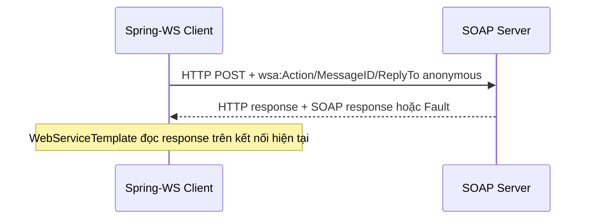
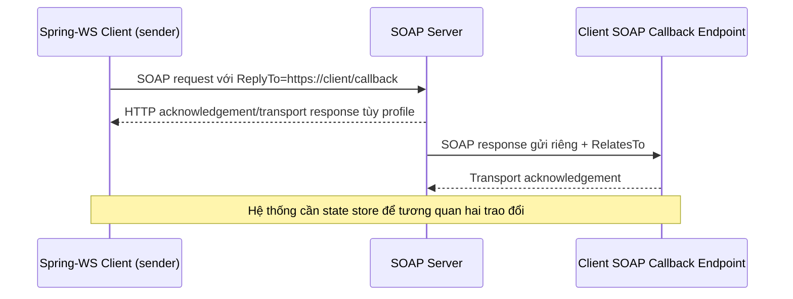

# ActionCallback và thiết lập header ở phía máy khách

## 1. Bài toán: SOAP client cần gửi thông tin định tuyến ở cấp thông điệp

Trong một hệ thống tích hợp đơn hàng, ứng dụng Java gửi `GetOrderRequest` tới dịch vụ SOAP của đối tác. Ngoài payload trong `soap:Body`, một số hợp đồng yêu cầu thông điệp mang **WS-Addressing Message Addressing Properties (MAPs)** trong `soap:Header`:

- `wsa:Action` — thông điệp mô tả hành động gì;
- `wsa:To` — đích logic của thông điệp;
- `wsa:MessageID` — định danh thông điệp để tương quan;
- `wsa:ReplyTo` — nơi phản hồi có thể được gửi;
- `wsa:FaultTo` — nơi Fault có thể được gửi;
- tùy profile, `wsa:From`, reference parameters và các trường khác.

Trong **Spring Web Services (Spring-WS)**, class **`org.springframework.ws.soap.addressing.client.ActionCallback`** giúp client tạo những WS-Addressing headers này theo một phiên bản addressing được lựa chọn. Nó thường được truyền vào `WebServiceTemplate.marshalSendAndReceive(...)` hoặc các API callback tương ứng.

Nếu client chỉ thêm HTTP `SOAPAction` nhưng đối tác yêu cầu `wsa:Action` trong SOAP Header, request có thể bị từ chối với lỗi thiếu WS-Addressing header hoặc không được định tuyến như mong muốn. Ngược lại, chỉ có `wsa:Action` cũng **không mặc nhiên** thiết lập đúng HTTP SOAPAction hoặc bảo đảm server hỗ trợ đúng SOAP binding.

Bài thuộc chương **WS-Addressing** của module `SPRING_WEB_SERVICES`. Chúng ta đặt việc thiết lập header trong toàn bộ hành trình **contract-first**: XSD/WSDL → JAXB → Spring-WS SOAP client → endpoint/routing → SOAP Fault → XML/WS-Security và kiểm thử tương thích doanh nghiệp. Trọng tâm là **`ActionCallback` và cách đưa addressing headers vào request ở phía máy khách**, không phải tự triển khai trọn vẹn một SOAP broker hay asynchronous message bus.

### Mục tiêu học tập

Sau bài này, bạn có thể:

1. Phân biệt **WS-Addressing Action** với **HTTP SOAPAction**, payload QName và URL HTTP.
2. Dùng `ActionCallback` với `WebServiceTemplate` để tạo `wsa:Action`, `To` và `MessageID`.
3. Lựa chọn WS-Addressing version 1.0 hoặc August 2004 theo hợp đồng, tránh trộn namespace.
4. Cấu hình `ReplyTo`, `FaultTo`, `From` thông qua `EndpointReference` khi có nhu cầu thực.
5. Kết hợp `ActionCallback` với `SoapActionCallback` và SOAP Header nghiệp vụ trong **một** `WebServiceMessageCallback`.
6. Hiểu giới hạn của `MessageID`, `ReplyTo` và `FaultTo` đối với tương quan, bất đồng bộ và bảo mật.
7. Kiểm thử header bằng QName/XPath với `MockWebServiceServer`, sau đó kiểm tra HTTP/TLS và WSDL thực tế.
8. Chẩn đoán lỗi thiếu/mâu thuẫn action, sai namespace, routing, WS-Security và SOAP Fault.

## 2. WS-Addressing nằm ở đâu trong SOAP request?

Một SOAP 1.1 request minh họa:

```http
POST /ws/orders HTTP/1.1
Host: partner.example.org
Content-Type: text/xml; charset=utf-8
SOAPAction: "urn:example:orders:v1:GetOrder"

<?xml version="1.0" encoding="UTF-8"?>
<soap:Envelope
    xmlns:soap="http://schemas.xmlsoap.org/soap/envelope/"
    xmlns:wsa="http://www.w3.org/2005/08/addressing"
    xmlns:ord="urn:example:orders:v1">
    <soap:Header>
        <wsa:Action soap:mustUnderstand="1">
            urn:example:orders:v1:GetOrder
        </wsa:Action>
        <wsa:To soap:mustUnderstand="1">
            https://partner.example.org/ws/orders
        </wsa:To>
        <wsa:MessageID>
            urn:uuid:550e8400-e29b-41d4-a716-446655440000
        </wsa:MessageID>
        <wsa:ReplyTo>
            <wsa:Address>
                http://www.w3.org/2005/08/addressing/anonymous
            </wsa:Address>
        </wsa:ReplyTo>
    </soap:Header>
    <soap:Body>
        <ord:GetOrderRequest>
            <ord:orderId>ORD-100</ord:orderId>
        </ord:GetOrderRequest>
    </soap:Body>
</soap:Envelope>
```

XML đã được trình bày xuống dòng để dễ đọc. Serializer có thể chọn prefix khác và có thể bổ sung/bỏ một số header tùy cấu hình, addressing version và profile. Ví dụ này **không tuyên bố `ActionCallback` luôn phát ra đúng mọi dòng trên**; cần xem request thực tế bằng test.

### 2.1. Mỗi định danh trả lời một câu hỏi

| Tín hiệu | Nằm ở đâu? | Câu hỏi nó trả lời |
| --- | --- | --- |
| URL HTTP `https://partner.example.org/ws/orders` | Transport connection | Client thực sự mở kết nối tới máy chủ/path nào? |
| HTTP `SOAPAction` (SOAP 1.1) | HTTP request header | SOAP/HTTP binding khai báo action gì? |
| `wsa:Action` | SOAP Header | Hành động message-level theo WS-Addressing là gì? |
| `wsa:To` | SOAP Header | Địa chỉ đích logic của message là gì? |
| `wsa:MessageID` | SOAP Header | Message này có định danh gì để tham chiếu? |
| `wsa:ReplyTo` | SOAP Header | Reply endpoint reference theo addressing policy là gì? |
| `wsa:FaultTo` | SOAP Header | Fault endpoint reference theo addressing policy là gì? |
| `ord:GetOrderRequest` | SOAP Body | Payload request có QName gì? |

HTTP `SOAPAction` **không** phải một child của `soap:Header`. `wsa:Action` **không** phải tên của Java method. `wsa:To` **không** tự mở socket tới URL được ghi trong header; message sender gửi request tới URI transport mà `WebServiceTemplate` được cấu hình.

### 2.2. SOAP Header block phải nhận diện bằng QName

Trong WS-Addressing 1.0:

```text
{http://www.w3.org/2005/08/addressing}Action
{http://www.w3.org/2005/08/addressing}To
{http://www.w3.org/2005/08/addressing}MessageID
{http://www.w3.org/2005/08/addressing}ReplyTo
{http://www.w3.org/2005/08/addressing}FaultTo
{http://www.w3.org/2005/08/addressing}From
```

`wsa` là prefix tùy chọn. XML sau biểu diễn **cùng QName** như `<wsa:Action>`:

```xml
<x:Action xmlns:x="http://www.w3.org/2005/08/addressing">
    urn:example:orders:v1:GetOrder
</x:Action>
```

Một phần tử `<Action>` không namespace hoặc `<a:Action xmlns:a="urn:vendor:custom">` **không phải** WS-Addressing 1.0 Action, dù local name giống nhau.

### 2.3. Action URI là **giá trị**, không phải QName của block

```xml
<wsa:Action
    xmlns:wsa="http://www.w3.org/2005/08/addressing">
    urn:example:orders:v1:GetOrder
</wsa:Action>
```

Có hai tầng cần kiểm tra:

- QName của element: `{http://www.w3.org/2005/08/addressing}Action`.
- Giá trị Action: `urn:example:orders:v1:GetOrder`.

Không dùng nội dung text của Action để suy rằng namespace của element đúng. Một header giả mạo có cùng text nhưng namespace khác vẫn là một block khác.

## 3. `ActionCallback` thực hiện công việc gì?

Class:

```java
org.springframework.ws.soap.addressing.client.ActionCallback
```

là một triển khai **`WebServiceMessageCallback`**. Spring-WS gọi callback khi message đã được tạo và trước khi gửi ra transport. `ActionCallback` dùng WS-Addressing version để bổ sung các addressing properties vào SOAP message.

Theo API Spring-WS 4.x, những constructor hữu ích:

```java
new ActionCallback(String action)
new ActionCallback(URI action)
new ActionCallback(URI action, AddressingVersion version)
new ActionCallback(URI action, AddressingVersion version, URI to)
```

Với constructor chỉ có action, version mặc định là **`Addressing10`**, và `To` lấy từ connection URI theo hành vi API. Dùng `URI` thay `String` giúp dễ kiểm tra giá trị URI và tránh checked exception `URISyntaxException` của một số constructor nhận `String`.

### 3.1. MessageID cũng được tạo

`ActionCallback` có **`MessageIdStrategy`** để tạo `wsa:MessageID`; mặc định là chiến lược UUID (`UuidMessageIdStrategy` trong Spring-WS). Điều này giúp tạo định danh message-level, nhưng:

- Không đồng nghĩa một business transaction ID.
- Không tự ngăn gửi trùng operation có side effect.
- Không tự bật replay protection trên server.
- Không chứng minh danh tính caller.
- Không bảo đảm client tự xác nhận `RelatesTo` khi nhận response, nếu ứng dụng không có kiểm tra phù hợp.

Với hệ thống có `PayOrder` hay `CancelOrder`, vẫn cần idempotency key do contract/ứng dụng thiết kế.

### 3.2. Những điểm cấu hình quan trọng

| API | Mục đích |
| --- | --- |
| `new ActionCallback(URI action)` | Chọn Action và dùng version mặc định |
| `new ActionCallback(action, version)` | Chọn phiên bản WS-Addressing |
| `new ActionCallback(action, version, to)` | Đặt To logic có chủ đích |
| `setReplyTo(EndpointReference)` | Đặt địa chỉ tham chiếu nhận reply |
| `setFaultTo(EndpointReference)` | Đặt địa chỉ tham chiếu nhận Fault |
| `setFrom(EndpointReference)` | Đặt From nếu profile yêu cầu |
| `setMessageIdStrategy(MessageIdStrategy)` | Thay chiến lược sinh MessageID |
| `setShouldInitializeTo(boolean)` | Kiểm soát khởi tạo To trên những phiên bản API có hỗ trợ |
| `doWithMessage(WebServiceMessage)` | Callback thực sự ghi addressing headers |

Không cần đặt mọi property chỉ vì API có setter. **Bên gửi và bên nhận phải thống nhất message exchange pattern, WS-Addressing version và security policy** trước khi đặt `ReplyTo`/`FaultTo` tới một URL bất kỳ.

### 3.3. Phân biệt hai callback tên tương tự

```java
// WS-Addressing Action: SOAP Header <wsa:Action>
import org.springframework.ws.soap.addressing.client.ActionCallback;

// SOAPAction của SOAP/HTTP binding
import org.springframework.ws.soap.client.core.SoapActionCallback;
```

| Callback | Kết quả chính |
| --- | --- |
| `ActionCallback` | Bổ sung WS-Addressing headers vào SOAP message |
| `SoapActionCallback` | Thiết lập giá trị SOAPAction theo SOAP binding |

**`ActionCallback` không nên được coi là alias của `SoapActionCallback`.** Hai action có thể mang cùng URI trong một profile, nhưng tồn tại ở **hai vị trí khác nhau** và có thể được server kiểm tra bằng cơ chế khác nhau.

## 4. Ví dụ tối thiểu với `WebServiceTemplate`

Giả sử dự án đã có `WebServiceTemplate` với JAXB marshaller/unmarshaller phù hợp và `ObjectFactory` do XJC sinh từ XSD đơn hàng:

```java
import java.net.URI;
import jakarta.xml.bind.JAXBElement;
import org.springframework.ws.client.core.WebServiceTemplate;
import org.springframework.ws.soap.addressing.client.ActionCallback;

public final class OrdersSoapGateway {

    private static final String ACTION =
        "urn:example:orders:v1:GetOrder";

    private final WebServiceTemplate template;
    private final ObjectFactory factory = new ObjectFactory();

    public OrdersSoapGateway(WebServiceTemplate template) {
        this.template = template;
    }

    public Object getOrder(String orderId) {
        GetOrderRequestType request = new GetOrderRequestType();
        request.setOrderId(orderId);

        JAXBElement<GetOrderRequestType> root =
            factory.createGetOrderRequest(request);

        return template.marshalSendAndReceive(
            root,
            new ActionCallback(URI.create(ACTION))
        );
    }
}
```

Đây là code minh họa **phần gửi**:

- `GetOrderRequestType` và `ObjectFactory` là JAXB-generated types giả định; import chúng từ package thực tế của dự án.
- `template` đã cấu hình default URI, SOAP message factory, JAXB context và HTTP sender phù hợp.
- `ACTION` là URI ví dụ, cần đối chiếu WS-Addressing metadata/profile của đối tác.
- Response trả `Object` trong ví dụ; production cần kiểm tra JAXB root QName và chuyển sang response model đúng contract.
- `ActionCallback` sẽ thêm addressing metadata **trước khi gửi**, nhưng không tự tạo HTTP authentication, WS-Security token hoặc client certificate.

Nếu cần chỉ định URL cụ thể tại lúc gọi:

```java
Object result = template.marshalSendAndReceive(
    "https://partner.example.org/ws/orders",
    root,
    new ActionCallback(
        URI.create("urn:example:orders:v1:GetOrder")
    )
);
```

Đây là mảnh code giả định `template`/`root` đã được tạo. Với constructor mặc định, `To` thường lấy từ **connection URI** của lời gọi này. Nếu một reverse proxy yêu cầu `To` logic khác URI HTTP thực, cần xem mục 6.

## 5. Quan sát SOAP Header do `ActionCallback` tạo

Ở WS-Addressing 1.0, một message có thể mang:

```xml
<soap:Header
    xmlns:soap="http://schemas.xmlsoap.org/soap/envelope/"
    xmlns:wsa="http://www.w3.org/2005/08/addressing">
    <wsa:Action soap:mustUnderstand="1">
        urn:example:orders:v1:GetOrder
    </wsa:Action>
    <wsa:To soap:mustUnderstand="1">
        https://partner.example.org/ws/orders
    </wsa:To>
    <wsa:MessageID>
        urn:uuid:550e8400-e29b-41d4-a716-446655440001
    </wsa:MessageID>
</soap:Header>
```

Đây là **mẫu header minh họa**, không phải snapshot cố định của serializer. Spring-WS có thể thêm `ReplyTo` mặc định, thay prefix/namespace placement, có thể dùng thuộc tính SOAP phù hợp version; MessageID được sinh nên khác nhau giữa các lần gửi.

### 5.1. Không assert raw XML byte-for-byte

Hai message có thể semantically tương đương dù:

- `wsa` được viết thành `a`;
- khai báo `xmlns` nằm ở `Envelope` thay vì `Header`;
- header blocks xuất hiện theo thứ tự khác;
- MessageID chứa UUID khác;
- XML whitespace/attribute ordering khác.

Vì vậy test nên dựa vào **QName, namespace-aware XPath, các giá trị contract và số lượng block**, không so chuỗi toàn Envelope byte-for-byte.

### 5.2. `mustUnderstand` thuộc SOAP namespace, không thuộc WSA QName

`wsa:Action soap:mustUnderstand="1"` là header block `Action` với thuộc tính `mustUnderstand` trong SOAP Envelope namespace. Khi node được nhắm tới không hiểu một header bắt buộc, SOAP processing có thể tạo `MustUnderstand` Fault theo version.

`mustUnderstand` **không** tự kiểm chứng rằng URI action đúng operation hay caller có quyền; server vẫn phải xác thực action/profile, payload và authorization theo contract.

## 6. Thiết lập `To`: địa chỉ logic và địa chỉ HTTP có thể khác

`wsa:To` là **địa chỉ đích ở cấp thông điệp**. Trong trường hợp đơn giản, nó trùng URI mà `WebServiceTemplate` đang kết nối. Tuy nhiên một hệ thống lớn có thể có:

```text
Client HTTP transport URI:
    https://gateway.partner.example.org/soap/orders

Logical WS-Addressing To:
    urn:partner:orders:service:v1
```

Nếu đối tác công bố một logical `To` riêng trong profile, gửi giá trị transport URL vào `To` có thể khiến WS-Addressing validator của server báo destination mismatch. Ngược lại, tự đặt `To` thành một URN khi server kỳ vọng HTTP endpoint URL cũng có thể bị từ chối.

### 6.1. Constructor có tham số `To`

```java
import java.net.URI;
import org.springframework.ws.soap.addressing.client.ActionCallback;
import org.springframework.ws.soap.addressing.version.Addressing10;

URI action = URI.create("urn:example:orders:v1:GetOrder");
URI logicalTo = URI.create("urn:partner:orders:service:v1");

ActionCallback addressing = new ActionCallback(
    action,
    new Addressing10(),
    logicalTo
);

Object result = webServiceTemplate.marshalSendAndReceive(
    "https://gateway.partner.example.org/soap/orders",
    requestRoot,
    addressing
);
```

Đoạn này là **mảnh code trong một client method**; `webServiceTemplate`/`requestRoot` cần được khai báo ở code gọi. Nó minh họa hai đường dẫn độc lập:

- `marshalSendAndReceive(transportUri, ...)` quyết định **nơi client kết nối thực tế**.
- Constructor `ActionCallback(..., to)` quyết định **nội dung header `wsa:To`**.

Thực tế `To` có thể là một HTTP(S) URI cũng như một URI logic, tùy phiên bản WS-Addressing và thỏa thuận. **Không tự chọn một URI chỉ vì “nhìn hợp lý”**; xác nhận chính xác policy của đối tác.

### 6.2. Khi không có tham số `To`

```java
ActionCallback addressing = new ActionCallback(
    URI.create("urn:example:orders:v1:GetOrder")
);
```

Theo API thông dụng của Spring-WS, callback mặc định sử dụng **connection URI** làm `To`. Khi request đi qua gateway, connection URI mà client nhìn thấy có thể khác địa chỉ nội bộ nơi endpoint xử lý. Điều này không mặc định sai — chỉ sai nếu partner contract yêu cầu một `To` khác.

### 6.3. `setShouldInitializeTo(false)` và phiên bản API

Một số Spring-WS 4.x có `ActionCallback.setShouldInitializeTo(boolean)` để điều khiển việc tự khởi tạo `To`. Đây là API dành cho những tích hợp có nhu cầu đặc thù, **không phải giải pháp mặc định** cho mọi lỗi destination.

Trước khi thay đổi:

1. Kiểm tra version Spring-WS ứng dụng đang dùng và API có hỗ trợ setter không.
2. Kiểm tra message có thực sự cần `wsa:To` theo profile không.
3. Tránh để header thiếu mà server yêu cầu, hoặc tạo hai `To` bằng hai callback.
4. Test XML wire-level và Fault khi header thiếu/mâu thuẫn.

### 6.4. `To` không thay thế DNS hay URL của HTTP sender

Đổi `wsa:To` **không** khắc phục:

- DNS không phân giải được transport host;
- TLS server certificate không khớp hostname;
- HTTP 404 do servlet mapping hoặc proxy rewrite;
- HTTP 502/504 từ gateway;
- mTLS hoặc HTTP authentication thất bại.

Những lỗi này nằm ở transport/security trước hoặc ngoài WS-Addressing message routing.

## 7. Thiết lập `ReplyTo`, `FaultTo` và `From` bằng `EndpointReference`

WS-Addressing mô tả địa chỉ nhận message bằng **Endpoint Reference (EPR)**, chứ không chỉ một string URL. Trong Spring-WS:

```java
org.springframework.ws.soap.addressing.core.EndpointReference
```

Một EPR đơn giản có thể tạo từ `URI`.

### 7.1. Ví dụ cấu hình

```java
import java.net.URI;
import org.springframework.ws.soap.addressing.client.ActionCallback;
import org.springframework.ws.soap.addressing.core.EndpointReference;

ActionCallback callback = new ActionCallback(
    URI.create("urn:example:orders:v1:SubmitOrder")
);

callback.setReplyTo(new EndpointReference(
    URI.create("https://client.example.org/soap/order-replies")
));

callback.setFaultTo(new EndpointReference(
    URI.create("https://client.example.org/soap/order-faults")
));

callback.setFrom(new EndpointReference(
    URI.create("https://client.example.org/soap")
));
```

**Đây là ví dụ metadata, không phải một hệ thống bất đồng bộ đã hoàn chỉnh.** Những địa chỉ `client.example.org` là giả định. Nếu gửi như vậy tới một đối tác mà không có thỏa thuận về out-of-band reply, server có thể:

- Từ chối vì message exchange pattern không phù hợp.
- Bỏ qua hoặc xử lý theo addressing policy.
- Cố gửi response tới `ReplyTo`, trong khi client chưa vận hành một SOAP callback endpoint có thể nhận/xác thực message.

### 7.2. `ReplyTo` không tự khởi chạy HTTP listener

Thiết lập:

```java
callback.setReplyTo(new EndpointReference(
    URI.create("https://client.example.org/soap/order-replies")
));
```

**không** tự:

- Tạo Spring-WS `@Endpoint` ở phía client.
- Mở HTTP port hoặc đăng ký servlet.
- Cấp TLS certificate hay cấu hình trust.
- Lưu correlation state.
- Thực thi transaction callback.
- Làm `marshalSendAndReceive` chờ bất kỳ response nào gửi tới URL khác.

Nếu cần asynchronous/callback response, phải thiết kế **hai đường trao đổi**: request gửi đi và SOAP message nhận tại callback endpoint. Hệ thống còn cần authn/authz, WS-Security, routing, queueing/retry, timeout/correlation và monitoring.

### 7.3. Anonymous ReplyTo trong WS-Addressing 1.0

Giá trị anonymous endpoint URI tiêu biểu:

```text
http://www.w3.org/2005/08/addressing/anonymous
```

Nó biểu diễn một special addressing endpoint cho reply trong message exchange pattern phù hợp, **không phải một URL mạng mà người dùng mở trình duyệt**.

Ví dụ header:

```xml
<wsa:ReplyTo
    xmlns:wsa="http://www.w3.org/2005/08/addressing">
    <wsa:Address>
        http://www.w3.org/2005/08/addressing/anonymous
    </wsa:Address>
</wsa:ReplyTo>
```

Nếu client gọi `marshalSendAndReceive` đồng bộ và profile đối tác kỳ vọng reply trên **HTTP response của request hiện tại**, anonymous reply thường là lựa chọn tương thích. Tuy vậy, không ép thêm `ReplyTo` một cách thủ công nếu callback/version đã có quy tắc mặc định phù hợp; kiểm tra request thực tế trước.

### 7.4. `FaultTo` định tuyến Fault, không biến Fault thành success

Một `FaultTo` non-anonymous có thể yêu cầu đối tác gửi Fault tới một endpoint khác nơi nhận normal reply. Điều này làm phức tạp client:

- Callback endpoint phải nhận diện đó là SOAP Fault và kiểm tra `RelatesTo`.
- Không thể chỉ dựa vào `SoapFaultClientException` từ request đồng bộ để xử lý mọi Fault out-of-band.
- Phải có nơi lưu trạng thái pending request và chính sách hết hạn.
- Không được tin Fault callback chỉ vì nó mang đúng MessageID/transaction ID.

Nếu không có yêu cầu thực sự từ hợp đồng, **không chủ động đặt một `FaultTo` công khai** chỉ để thử tính năng.

### 7.5. `EndpointReference` có thể chứa reference parameters

Ngoài URI, EPR ở các version/profile có thể bao gồm **reference parameters**. Một đối tác có thể sử dụng chúng để định danh endpoint/resource logic. Khi đó:

1. Đọc chính xác WSDL/addressing metadata của đối tác.
2. Dùng EPR schema/namespace đúng version.
3. Không chèn các reference parameters tùy ý bằng chuỗi XML không an toàn.
4. Đảm bảo những trường ảnh hưởng định tuyến/ủy quyền được bảo vệ theo security policy.

Với bài học này, constructor `new EndpointReference(URI)` là ví dụ đủ để hiểu các trường địa chỉ cơ bản. Các reference parameters phức tạp cần kiểm thử riêng với đối tác.

## 8. WS-Addressing 1.0 và phiên bản August 2004: đừng trộn namespace

Spring-WS hỗ trợ abstraction `AddressingVersion` với các implementation như `Addressing10` và `Addressing200408`.

| Phiên bản | XML namespace của MAPs | Ghi chú |
| --- | --- | --- |
| WS-Addressing 1.0 | `http://www.w3.org/2005/08/addressing` | W3C Recommendation, thường gặp ở tích hợp hiện đại |
| WS-Addressing August 2004 | `http://schemas.xmlsoap.org/ws/2004/08/addressing` | Phiên bản submission cũ, một số stack legacy còn sử dụng |

### 8.1. Chỉ định version trong callback

```java
import java.net.URI;
import org.springframework.ws.soap.addressing.client.ActionCallback;
import org.springframework.ws.soap.addressing.version.Addressing10;
import org.springframework.ws.soap.addressing.version.Addressing200408;

URI action = URI.create("urn:example:orders:v1:GetOrder");

ActionCallback modern =
    new ActionCallback(action, new Addressing10());

ActionCallback legacy =
    new ActionCallback(action, new Addressing200408());
```

**Không sử dụng đồng thời `modern` và `legacy` để ghi addressing headers vào cùng một request.** Việc này dễ tạo trùng `Action`/`To`/`MessageID` với hai namespace và vi phạm chính sách WS-Addressing của server.

### 8.2. Namespace khác thì QName khác

```text
{http://www.w3.org/2005/08/addressing}Action
{http://schemas.xmlsoap.org/ws/2004/08/addressing}Action
```

Hai QName **khác nhau** dù local name `Action` và text action URI có thể giống hệt. Server chỉ hiểu version 1.0 có thể xem header 2004 như extension không được hỗ trợ hoặc tạo Fault.

Không thay đơn thuần prefix `wsa` thành `wsa04` nếu namespace URI không đổi: prefix chỉ là cách trình bày. Muốn đổi version phải chọn **đúng AddressingVersion và các semantics tương ứng**.

### 8.3. Anonymous address cũng phụ thuộc version

WS-Addressing 1.0 và phiên bản 2004 có những URI đặc biệt khác nhau cho anonymous, faulting và endpoint concepts. Không copy `http://www.w3.org/2005/08/addressing/anonymous` vào một request 2004 mà không kiểm tra profile.

### 8.4. SOAP 1.1/1.2 không đồng nghĩa WS-Addressing 2004/1.0

Đây là **hai trục phiên bản khác nhau**:

| Trục | Quyết định |
| --- | --- |
| SOAP version | Envelope namespace, media type, Fault XML, processing rules |
| WS-Addressing version | QName namespace và semantics của MAPs/Endpoint References |

Ví dụ một service có thể dùng SOAP 1.1 + WS-Addressing 1.0. Không suy WS-Addressing version từ SOAP version; đọc WSDL/policy và kiểm thử phía đối tác.

## 9. `MessageID`, `RelatesTo` và correlation

Một request dùng WS-Addressing có thể có:

```xml
<wsa:MessageID
    xmlns:wsa="http://www.w3.org/2005/08/addressing">
    urn:uuid:550e8400-e29b-41d4-a716-446655440001
</wsa:MessageID>
```

Response tương ứng có thể chứa:

```xml
<wsa:RelatesTo
    xmlns:wsa="http://www.w3.org/2005/08/addressing">
    urn:uuid:550e8400-e29b-41d4-a716-446655440001
</wsa:RelatesTo>
```

Ý nghĩa cơ bản: response **tham chiếu lại MessageID** của request. Đây là cơ sở cho correlation ở tầng message-level, đặc biệt khi replies/faults đến qua kênh khác.

### 9.1. Sinh MessageID: mặc định và tùy chỉnh

Theo API Spring-WS, `ActionCallback` có:

```java
callback.getMessageIdStrategy();
callback.setMessageIdStrategy(customStrategy);
```

`customStrategy` phải là một `MessageIdStrategy` phù hợp và được khai báo trong ứng dụng. Mặc định Spring-WS sử dụng chiến lược UUID. Đừng cố tạo MessageID bằng cách dùng một hằng `urn:uuid:fixed` cho mọi request; như vậy gây trùng correlation và có thể làm hỏng các cơ chế chống replay/deduplication.

### 9.2. MessageID không phải business idempotency key

Một client retry `CancelOrderRequest` với **MessageID mới** vẫn có thể đang yêu cầu cùng một hành động nghiệp vụ. Ngược lại, gửi lại nguyên MessageID không tự bảo đảm server sẽ bỏ qua một giao dịch trùng nếu server không thiết kế deduplication.

Để tránh side effect:

- Dùng idempotency/transaction ID được công bố trong business contract (Body hoặc header nghiệp vụ).
- Server lưu và kiểm tra trạng thái xử lý theo key.
- Client tra cứu trạng thái nếu timeout sau khi gửi request.
- WS-A MessageID vẫn có thể được lưu để tương quan message/transport logs.

### 9.3. Cần thực sự kiểm tra `RelatesTo` nếu contract yêu cầu

Chỉ gọi `new ActionCallback(...)` trên request **không chứng minh** response sẽ có `RelatesTo` đúng hoặc client tự xác minh nó. Nếu tích hợp có correlation bắt buộc, hãy viết:

1. Test response có `wsa:RelatesTo` theo **đúng namespace WS-A version**.
2. Test giá trị `RelatesTo` bằng `MessageID` của request đã gửi.
3. Test khi thiếu/sai/trùng `RelatesTo`.
4. Test response/Fault đến qua callback endpoint nếu dùng out-of-band.
5. Không coi `RelatesTo` là bằng chứng authentication: người gửi còn phải được xác thực và thông điệp phải có integrity protection theo policy.

### 9.4. Correlation ID nghiệp vụ có thể cùng tồn tại với MessageID

Ví dụ:

```xml
<soap:Header
    xmlns:soap="http://schemas.xmlsoap.org/soap/envelope/"
    xmlns:wsa="http://www.w3.org/2005/08/addressing"
    xmlns:meta="urn:example:meta:v1">
    <wsa:MessageID>urn:uuid:550e8400-e29b-41d4-a716-446655440001</wsa:MessageID>
    <meta:CorrelationId>corr-42</meta:CorrelationId>
</soap:Header>
```

`wsa:MessageID` được dùng theo WS-Addressing; `meta:CorrelationId` là header nghiệp vụ/tracing do hai bên tự quy định. Chúng không tự đồng bộ nhau, và không nên hoán đổi mà không có quy tắc công khai.

## 10. WSDL/XSD và nguồn giá trị `Action` trong thiết kế contract-first

Trong tích hợp Spring-WS theo hướng **contract-first**, đừng tự đặt Action bằng tên method Java. Hãy xác định từ:

1. WSDL và SOAP binding được công bố;
2. WS-Addressing WSDL metadata, policy hoặc profile tích hợp;
3. Tài liệu đối tác quy định addressing version và các giá trị `Action`/`To`;
4. Request mẫu được hai bên xác nhận;
5. Bộ interoperability tests chạy trên đúng endpoint môi trường dự kiến.

### 10.1. XSD định nghĩa request và response element

Giả sử `orders.xsd`:

```xml
<?xml version="1.0" encoding="UTF-8"?>
<xs:schema
    xmlns:xs="http://www.w3.org/2001/XMLSchema"
    xmlns:ord="urn:example:orders:v1"
    targetNamespace="urn:example:orders:v1"
    elementFormDefault="qualified">

    <xs:complexType name="GetOrderRequestType">
        <xs:sequence>
            <xs:element name="orderId" type="xs:string"/>
        </xs:sequence>
    </xs:complexType>

    <xs:complexType name="GetOrderResponseType">
        <xs:sequence>
            <xs:element name="orderId" type="xs:string"/>
            <xs:element name="status" type="xs:string"/>
        </xs:sequence>
    </xs:complexType>

    <xs:element name="GetOrderRequest"
                type="ord:GetOrderRequestType"/>
    <xs:element name="GetOrderResponse"
                type="ord:GetOrderResponseType"/>
</xs:schema>
```

XSD này định nghĩa **QName của SOAP Body elements**, không tự định nghĩa mọi WS-Addressing Action URI. Ví dụ:

```text
Body request QName:
  {urn:example:orders:v1}GetOrderRequest

Body response QName:
  {urn:example:orders:v1}GetOrderResponse

WS-Addressing request Action (do contract/profile chọn):
  urn:example:orders:v1:GetOrder

WS-Addressing response Action (do contract/profile chọn):
  urn:example:orders:v1:GetOrderResponse
```

Các URI Action ở đây là **quy ước ví dụ**, không có hàm tự suy bắt buộc từ `localPart` của XSD.

### 10.2. WSDL 1.1: SOAPAction và WS-Addressing Action metadata

Một trích đoạn WSDL 1.1 với addressing metadata có thể viết:

```xml
<!-- Trích đoạn: giả định đã khai báo:
     xmlns:wsdl="http://schemas.xmlsoap.org/wsdl/"
     xmlns:soap="http://schemas.xmlsoap.org/wsdl/soap/"
     xmlns:wsam="http://www.w3.org/2007/05/addressing/metadata"
     xmlns:tns="urn:example:orders:v1"
     và đã import XSD cùng các wsdl:message tương ứng. -->

<wsdl:portType name="OrdersPortType">
    <wsdl:operation name="GetOrder">
        <wsdl:input
            message="tns:GetOrderInput"
            wsam:Action="urn:example:orders:v1:GetOrder"/>
        <wsdl:output
            message="tns:GetOrderOutput"
            wsam:Action="urn:example:orders:v1:GetOrderResponse"/>
    </wsdl:operation>
</wsdl:portType>

<wsdl:binding name="OrdersSoap11Binding"
              type="tns:OrdersPortType">
    <soap:binding
        style="document"
        transport="http://schemas.xmlsoap.org/soap/http"/>
    <wsdl:operation name="GetOrder">
        <soap:operation
            soapAction="urn:example:orders:v1:GetOrder"/>
        <wsdl:input>
            <soap:body use="literal"/>
        </wsdl:input>
        <wsdl:output>
            <soap:body use="literal"/>
        </wsdl:output>
    </wsdl:operation>
</wsdl:binding>
```

Đây **không phải WSDL chạy độc lập**: còn thiếu `wsdl:definitions`, `types`, `messages`, `service/port` và các chi tiết binding liên quan. Trích đoạn có mục đích phân biệt:

- `soap:operation/@soapAction`: SOAP 1.1 HTTP binding action.
- `wsam:Action`: WS-Addressing Action metadata trên input/output message.

Hai thuộc tính trong ví dụ cùng dùng URI `GetOrder` ở chiều input, nhưng **đó là lựa chọn hợp đồng**, không phải một thuộc tính tự động đồng bộ với thuộc tính còn lại. Một profile có thể dùng URI khác hoặc mô tả action theo cách metadata/binding khác.

### 10.3. Có WSDL không đồng nghĩa WS-Addressing đã bật

`DefaultWsdl11Definition` có thể tạo WSDL 1.1 từ XSD trong Spring-WS. Điều đó **không tự bảo đảm**:

- WSDL có WS-Addressing metadata cho mọi operation;
- Server đăng ký WS-Addressing `EndpointMapping`;
- Client tự thêm `wsa:Action`;
- `ReplyTo`, `FaultTo`, `RelatesTo` được kiểm tra như profile yêu cầu;
- Header được ký và authenticated theo WS-Security.

Cần cấu hình và test độc lập. Đặc biệt, nếu client được sinh mã bằng JAX-WS `wsimport` hay công cụ khác, **mã sinh và runtime addressing behavior có thể khác Spring-WS `WebServiceTemplate`**.

### 10.4. Hợp đồng reply/fault action cũng quan trọng

Một profile có thể yêu cầu:

```text
Request Action:
  urn:example:orders:v1:GetOrder

Normal response Action:
  urn:example:orders:v1:GetOrderResponse

Fault Action:
  URI theo WS-Addressing default fault hoặc fault contract
```

Client không nên chỉ kiểm tra `wsa:Action` của request rồi bỏ qua action/`RelatesTo` của response nếu profile bắt buộc. Tuy nhiên **`ActionCallback` trên request không tự biến `WebServiceTemplate` thành một response-addressing-policy validator đầy đủ**.

## 11. Tạo `WebServiceTemplate` và JAXB client cho ví dụ

Một cấu hình Spring sử dụng `Jaxb2Marshaller`:

```java
import org.springframework.context.annotation.Bean;
import org.springframework.context.annotation.Configuration;
import org.springframework.oxm.jaxb.Jaxb2Marshaller;
import org.springframework.ws.client.core.WebServiceTemplate;

@Configuration
public class OrdersSoapClientConfiguration {

    @Bean
    public Jaxb2Marshaller ordersJaxbMarshaller() {
        Jaxb2Marshaller marshaller = new Jaxb2Marshaller();
        marshaller.setContextPath("org.example.orders.jaxb");
        return marshaller;
    }

    @Bean
    public WebServiceTemplate ordersWebServiceTemplate(
            Jaxb2Marshaller ordersJaxbMarshaller) {

        WebServiceTemplate template = new WebServiceTemplate();
        template.setMarshaller(ordersJaxbMarshaller);
        template.setUnmarshaller(ordersJaxbMarshaller);
        template.setDefaultUri(
            "https://partner.example.org/ws/orders"
        );
        return template;
    }
}
```

`org.example.orders.jaxb` và URL chỉ là ví dụ. Ứng dụng cần:

- Spring-WS/OXM và JAXB runtime tương thích phiên bản Spring/Java.
- JAXB model sinh từ đúng XSD/WSDL contract; project hiện đại có thể dùng `jakarta.xml.bind`, stack cũ có thể dùng `javax.xml.bind`.
- SOAP message factory đúng SOAP version.
- HTTP sender với TLS/mTLS, timeout và authentication phù hợp.
- WS-Security/ClientInterceptor khi policy yêu cầu.

**`ActionCallback` không thay thế những cấu hình này.** Nó chỉ can thiệp SOAP message ở thời điểm callback được gọi.

### 11.1. Tại sao phải dùng `ObjectFactory`/`JAXBElement`?

Giả sử XJC sinh `GetOrderRequestType` từ named complex type và global element `GetOrderRequest`. Class named type có thể không có `@XmlRootElement`. Cần:

```java
GetOrderRequestType value = new GetOrderRequestType();
value.setOrderId("ORD-100");

JAXBElement<GetOrderRequestType> requestRoot =
    new ObjectFactory().createGetOrderRequest(value);
```

`requestRoot` mang **QName của global element**, giúp SOAP Body đúng contract. Dùng `ActionCallback` không thể “sửa” JAXB root sai: WS-A header và XML Body là hai phần khác nhau.

### 11.2. Kiểm tra response JAXB

Kết quả từ `marshalSendAndReceive` có thể là `JAXBElement<GetOrderResponseType>` hoặc class có `@XmlRootElement` trực tiếp, tùy generator. Đừng cast mù:

```java
Object response = template.marshalSendAndReceive(
    requestRoot, addressingCallback
);

if (response instanceof JAXBElement<?> wrapped) {
    if (!new QName(
            "urn:example:orders:v1",
            "GetOrderResponse"
        ).equals(wrapped.getName())) {
        throw new IllegalStateException(
            "Unexpected SOAP response root QName"
        );
    }
}
```

Đoạn trên là **mảnh code**, cần khai báo `template`, `requestRoot`, `addressingCallback` và import `QName`/`JAXBElement`. Khi client nhận SOAP Fault, thông thường Fault resolver xử lý trước bước JAXB response; khi nhận response không đúng QName, có thể phát sinh mapping error thay vì SOAP Fault.

## 12. Kết hợp `ActionCallback`, `SoapActionCallback` và SOAP Header nghiệp vụ

Một điểm tích hợp thực tế: đối tác yêu cầu **cả** WS-Addressing headers, SOAPAction transport và một header `meta:CorrelationId` do ứng dụng định nghĩa.

Nếu `marshalSendAndReceive(...)` chỉ cho truyền một `WebServiceMessageCallback`, ta có thể **gom các hành động vào một callback** thay vì cố truyền ba callback qua ba overload.

### 12.1. XSD cho header nghiệp vụ

Ví dụ schema `meta.xsd`:

```xml
<?xml version="1.0" encoding="UTF-8"?>
<xs:schema
    xmlns:xs="http://www.w3.org/2001/XMLSchema"
    xmlns:meta="urn:example:meta:v1"
    targetNamespace="urn:example:meta:v1"
    elementFormDefault="qualified">

    <xs:simpleType name="CorrelationIdType">
        <xs:restriction base="xs:string">
            <xs:minLength value="1"/>
            <xs:maxLength value="64"/>
            <xs:pattern value="[A-Za-z0-9._:-]+"/>
        </xs:restriction>
    </xs:simpleType>

    <xs:element name="CorrelationId"
                type="meta:CorrelationIdType"/>
</xs:schema>
```

XJC có thể sinh `org.example.meta.jaxb.ObjectFactory.createCorrelationId(String)` hoặc factory/root binding tương ứng. Không được chỉ marshal một `String` nếu root QName chưa được xác định.

### 12.2. Một callback tổng hợp

```java
import java.net.URI;
import org.springframework.oxm.jaxb.Jaxb2Marshaller;
import org.springframework.ws.WebServiceMessage;
import org.springframework.ws.client.core.WebServiceMessageCallback;
import org.springframework.ws.soap.SoapMessage;
import org.springframework.ws.soap.addressing.client.ActionCallback;
import org.springframework.ws.soap.client.core.SoapActionCallback;

public final class OrdersMessageCallbacks {

    private static final String ACTION =
        "urn:example:orders:v1:GetOrder";

    private final Jaxb2Marshaller metadataMarshaller;
    private final org.example.meta.jaxb.ObjectFactory metaFactory =
        new org.example.meta.jaxb.ObjectFactory();

    public OrdersMessageCallbacks(
            Jaxb2Marshaller metadataMarshaller) {
        this.metadataMarshaller = metadataMarshaller;
    }

    public WebServiceMessageCallback getOrder(
            String correlationId) {

        if (correlationId == null ||
                !correlationId.matches("[A-Za-z0-9._:-]{1,64}")) {
            throw new IllegalArgumentException(
                "Invalid correlation ID"
            );
        }

        ActionCallback addressing =
            new ActionCallback(URI.create(ACTION));

        SoapActionCallback bindingAction =
            new SoapActionCallback(ACTION);

        return (WebServiceMessage message) -> {
            if (!(message instanceof SoapMessage soap)) {
                throw new IllegalStateException(
                    "Expected a SOAP message"
                );
            }

            // 1. WS-Addressing Action/To/MessageID...
            addressing.doWithMessage(message);

            // 2. SOAPAction tại SOAP/HTTP binding.
            bindingAction.doWithMessage(message);

            // 3. Thêm header nghiệp vụ đúng global element QName.
            metadataMarshaller.marshal(
                metaFactory.createCorrelationId(correlationId),
                soap.getSoapHeader().getResult()
            );
        };
    }
}
```

Đây là một lớp minh họa **composition ở client**; muốn dùng thật phải đăng ký `metadataMarshaller` chứa JAXB classes từ `meta.xsd`. Trong một generator/version khác, factory method có thể nhận type khác `String` hoặc sinh class root khác; điều chỉnh theo generated API thực tế.

**Điểm cần bảo đảm:**

1. Cả `ActionCallback` và `SoapActionCallback` đều sử dụng Action URI từ **hợp đồng**. Trong ví dụ chúng giống nhau, nhưng một profile khác có thể đòi hai URI khác.
2. Mỗi request nên dùng **một lần** addressing setup. Không gọi thêm một callback khác cũng ghi `wsa:Action`/`To` gây trùng.
3. `CorrelationId` được kiểm tra trước khi marshal. JAXB/XSD validation trên wire vẫn cần nếu contract bắt buộc.
4. Callback được gọi trước transport send; nó **không** cấu hình HTTP auth, TLS/mTLS hoặc WS-Security thay cho các thành phần chuyên trách.
5. Nếu SOAP message được ký, cần sắp xếp **tạo tất cả headers cần bảo vệ trước khi ký**, tránh sửa vùng ký sau WS-Security processing.

### 12.3. Gửi bằng callback tổng hợp

```java
WebServiceMessageCallback callback =
    ordersMessageCallbacks.getOrder("corr-42");

Object response = webServiceTemplate.marshalSendAndReceive(
    "https://partner.example.org/ws/orders",
    requestRoot,
    callback
);
```

`ordersMessageCallbacks`, `webServiceTemplate` và `requestRoot` ở đây là đối tượng ứng dụng đã cấu hình. `marshalSendAndReceive` sử dụng SOAP callback để can thiệp vào **message hiện tại**, không phải một callback để nhận asynchronous `ReplyTo`.

### 12.4. Một số lỗi khi compose

| Cách làm | Vấn đề |
| --- | --- |
| Gọi hai `ActionCallback` khác nhau trên một message | Có thể tạo trùng WS-Addressing MAPs và MessageID |
| Thêm header sau khi XML signature đã tạo | Có thể phá integrity và vi phạm signed-parts policy |
| Chỉ dùng `SoapActionCallback` | Không bảo đảm có `wsa:Action` |
| Chỉ dùng `ActionCallback` | Không bảo đảm HTTP SOAPAction phù hợp binding |
| Viết `meta:CorrelationId` bằng nối XML không escape | Rủi ro XML injection/invalid XML |
| Marshal meta header nhưng quên JAXB context của namespace meta | Lỗi chuyển đổi dữ liệu trước khi gửi |
| Dùng chung một MessageID cố định cho mọi lần gọi | Mất unique correlation và có nguy cơ replay/dedup conflict |
| Tự thêm `wsa:ReplyTo` lẫn `ActionCallback.setReplyTo` | Có thể tạo duplicate header block |

## 13. Vì sao không nên tự viết toàn bộ WS-Addressing XML khi đã có `ActionCallback`?

Tự ghép:

```java
String xml = "<wsa:Action>" + userAction + "</wsa:Action>";
```

có nhiều rủi ro:

- Chưa định nghĩa namespace `wsa` hoặc dùng nhầm version.
- Không escape giá trị XML.
- Bỏ quên `MessageID`, `To` hoặc default EPR semantics.
- Dùng sai `mustUnderstand`/SOAP namespace.
- Sinh duplicate header nếu một interceptor khác cũng thêm WS-A.
- Không hỗ trợ reference parameters và profile phức tạp.

Sử dụng `ActionCallback` để sinh **MAPs chuẩn mà thư viện hỗ trợ**, sau đó kiểm chứng bằng test. Khi cần header nghiệp vụ không thuộc WS-A, dùng JAXB/`SoapHeader` API phù hợp thay vì sửa chuỗi WS-A của framework.

### 13.1. Trường hợp vẫn phải dùng XML thấp hơn

Một số đối tác có extension SOAP Header riêng hoặc policy không được `ActionCallback` hỗ trợ trực tiếp. Khi đó:

1. Định nghĩa XSD/WSDL hoặc profile cho extension.
2. Dùng API namespace-aware/JAXB/DOM/StAX an toàn.
3. Không thay đổi các MAPs mà callback đã tạo trừ khi có lý do và test cụ thể.
4. Test XML canonicalization/signature và WS-Security interoperability.
5. Không để giá trị header do client bên ngoài gửi điều khiển tùy ý đường mạng.

### 13.2. Bảo vệ trước duplicate headers

Một SOAP message có thể vô tình chứa hai block `{http://www.w3.org/2005/08/addressing}Action` nếu code tự thêm thủ công rồi `ActionCallback` thêm lần nữa. Đối tác có thể báo `InvalidAddressingHeader` hoặc lỗi processing. Khi debug, kiểm tra **cardinality theo QName**, không chỉ tìm “có ít nhất một Action”.

## 14. WS-Addressing và SOAP server routing không phải một bước tự động

Phía server Spring-WS có những `EndpointMapping` phù hợp WS-Addressing khi được cấu hình. Phía client `ActionCallback` giúp tạo addressing metadata, nhưng **không tự buộc mọi server** phải định tuyến theo `wsa:Action`.

Ví dụ:

```text
Request:
  Body root = {urn:example:orders:v1}GetOrderRequest
  wsa:Action = urn:example:orders:v1:CancelOrder
  SOAPAction = urn:example:orders:v1:GetOrder
```

Một hệ thống có thể:

- Chọn endpoint theo **Body root QName**;
- Chọn endpoint theo **WS-Addressing Action**;
- Chọn endpoint theo **SOAPAction**;
- Hoặc áp dụng một policy kiểm tra **tất cả tín hiệu phải nhất quán**.

Hành vi phụ thuộc mappings, precedence và validation của server. **Chỉ gắn `@PayloadRoot` và một annotation action không nhất thiết tạo phép AND tự động**. Không dùng Action URI do client tự khai để thay thế authorization nghiệp vụ.

### 14.1. Bảng invariant để đối tác thống nhất

| Body root QName | WS-A Action | SOAPAction | Chính sách ví dụ |
| --- | --- | --- | --- |
| `GetOrderRequest` v1 | `GetOrder` | `GetOrder` | Chấp nhận sau xác thực/validation |
| `CancelOrderRequest` v1 | `CancelOrder` | `CancelOrder` | Chấp nhận sau xác thực/validation |
| `GetOrderRequest` v1 | `CancelOrder` | `GetOrder` | Từ chối mismatch |
| `GetOrderRequest` v1 | Thiếu | `GetOrder` | Từ chối nếu WS-A bắt buộc |
| QName không biết | `GetOrder` | `GetOrder` | Từ chối payload không đúng contract |

`GetOrder`/`CancelOrder` trong bảng là cách rút gọn các action URI ví dụ; trong cấu hình thực tế so **giá trị URI đầy đủ**, không chỉ hậu tố.

### 14.2. Từ chối vì action mismatch không phải transport failure

Nếu server trả SOAP Fault như `InvalidAddressingHeader` hoặc Fault ứng dụng báo action mismatch, client cần kiểm tra `wsa:Action`, addressing namespace, `To`, WSDL/policy và body QName. Không đổi DNS, TLS truststore hoặc tăng timeout để khắc phục sai Action URI.

## 15. Đồng bộ và bất đồng bộ: giới hạn của `marshalSendAndReceive`

### 15.1. Trường hợp đồng bộ thông thường



Khi `ReplyTo` không được đặt hoặc dùng anonymous theo profile, response thường về trên đường HTTP response gắn với request. `WebServiceTemplate.marshalSendAndReceive` phù hợp với cách gọi này.

### 15.2. Trường hợp out-of-band reply



Để triển khai out-of-band reply, ngoài `ActionCallback` cần:

1. Định nghĩa message exchange pattern và response Action theo WSDL/policy.
2. Vận hành endpoint có thể nhận SOAP reply/Fault tại `ReplyTo`/`FaultTo`.
3. Xác thực nguồn gửi, kiểm tra WS-Security signature/trust và TLS.
4. Dùng `MessageID`/`RelatesTo` liên kết request với callback.
5. Lưu trạng thái pending/expired/duplicate và cơ chế retry/deduplication.
6. Quan sát timeout/tắc nghẽn và quản lý giao dịch nghiệp vụ.

**`ActionCallback.setReplyTo(...)` không tự tạo tất cả các bước trên.** Đặt `ReplyTo` non-anonymous cho một client chỉ biết chờ synchronous response có thể khiến tích hợp hoạt động sai.

## 16. WS-Security, TLS và những rủi ro khi thêm addressing headers

WS-Addressing giải quyết **định danh/địa chỉ hóa thông điệp**; bản thân nó **không phải cơ chế authentication hay authorization**. Một caller không được xác thực vẫn có thể gửi XML trông như:

```xml
<wsa:Action xmlns:wsa="http://www.w3.org/2005/08/addressing">
    urn:example:orders:v1:CancelOrder
</wsa:Action>
```

Header đúng QName và Action URI chỉ cho biết điều caller **khai báo**, không chứng minh caller được quyền hủy đơn.

### 16.1. Phân tầng bảo mật

| Lớp | Bảo vệ điều gì? | WS-A có tự làm không? |
| --- | --- | --- |
| TLS/HTTPS | Bí mật và integrity của kết nối tới server theo trust/hostname | Không |
| mTLS | Xác thực client certificate ở transport | Không |
| HTTP authentication | Identity tại HTTP/gateway | Không |
| WS-Security Signature | Integrity/authenticity của những XML parts được ký theo policy | Không |
| WS-Security Timestamp | Tính hợp lệ theo thời gian/replay policy | Không |
| Business authorization | Caller có quyền thực hiện operation trên resource không? | Không |
| WS-Addressing | Địa chỉ, action, correlation giữa messages | Có, trong phạm vi MAPs |

Nếu security policy yêu cầu WS-A `Action`/`To`/`MessageID` được bảo vệ, phải cấu hình XML Signature **bao phủ đúng header elements**. Không tự giả định một chữ ký trên SOAP Body cũng bảo vệ toàn bộ SOAP Header hoặc HTTP SOAPAction.

### 16.2. Thứ tự callback và WS-Security signing

Một luồng hợp lý ở phía gửi:

```text
JAXB marshal SOAP Body
    -> Tạo WS-Addressing MAPs
    -> Thêm header nghiệp vụ
    -> Hoàn tất những biến đổi XML cần thiết
    -> WS-Security signing/encryption theo policy
    -> Gửi SOAP/HTTP(S)
```

Đây là **mục tiêu xử lý logic**, không phải thứ tự mặc định bảo đảm của mọi `ClientInterceptor`. Khi cấu hình interceptors và callbacks, phải test SOAP message cuối cùng; nếu code sửa `wsa:To` hoặc `wsa:Action` **sau khi ký**, chữ ký có thể không còn hợp lệ.

Tại chiều nhận, phải verify signature/trust/timestamp theo policy **trước khi tin** vào addressing information dùng cho business authorization hoặc callback processing.

### 16.3. ReplyTo/FaultTo có thể gây server-side request forgery

Nếu một SOAP server tin tuyệt đối vào `wsa:ReplyTo`/`FaultTo` từ khách ngoài và tự gửi outbound HTTP tới địa chỉ đó, kẻ tấn công có thể tìm cách điều hướng kết nối tới mạng nội bộ hoặc endpoint không được phép.

Vì vậy cả client lẫn server cần:

- Chỉ sử dụng callback addresses **đã được phê duyệt/allowlist**.
- Xác thực/trust bên gửi request và bên nhận callback.
- Chặn địa chỉ loopback, link-local, metadata endpoints và mạng nội bộ không được phép ở tầng outbound policy.
- Giới hạn scheme, hostname, port, DNS rebinding và redirect policy phù hợp.
- Kiểm tra chữ ký/security policy trên các header ảnh hưởng định tuyến.
- Có quota/rate limiting, timeout và logging an toàn.

Không để một chuỗi `ReplyTo` lấy thẳng từ user input quyết định destination mạng của tổ chức.

### 16.4. MessageID không chứng minh request chưa phát lại

Một `MessageID` dạng UUID có thể giúp correlation, nhưng chống replay cần server-side state/timestamp/signature/nonce và policy xử lý duplicate. Nếu chỉ so UUID mà không có nguồn tin cậy và thời hạn, message có thể bị gửi lại.

Một business `idempotencyKey` cũng cần xác thực người sở hữu key và nội dung giao dịch, không chỉ thấy chuỗi giống nhau rồi coi là an toàn.

### 16.5. Header có `mustUnderstand` nhưng phía server không hỗ trợ

Nếu server không hiểu/không cấu hình WS-Addressing nhưng nhận `wsa:Action soap:mustUnderstand="1"` nhắm tới node đó, một SOAP `MustUnderstand` Fault là phản ứng có thể gặp theo giao thức.

Không khắc phục bằng cách bỏ `mustUnderstand` tùy tiện trước khi đọc profile: server có thể vẫn cần addressing để route operation. Hãy xác minh server mapping/WS-A policy và version tương thích.

## 17. Kiểm thử client bằng `MockWebServiceServer`

`MockWebServiceServer` ở package `org.springframework.ws.test.client` mô phỏng phía nhận cho `WebServiceTemplate`, giúp kiểm tra **SOAP request thực sự được tạo** mà không cần mở HTTP socket tới đối tác.

Mục tiêu quan trọng của bài này là test:

- Request payload root QName đúng XSD.
- Có `wsa:Action` theo đúng namespace WS-Addressing version.
- `wsa:Action` mang giá trị URI contract.
- `wsa:To` đúng địa chỉ logic/connection URI dự kiến.
- `wsa:MessageID` tồn tại đúng một lần và không cố định ngoài ý muốn.
- Có/không có `wsa:ReplyTo`/`FaultTo` theo profile.
- HTTP SOAPAction được thiết lập riêng khi binding yêu cầu.
- Callback nghiệp vụ `meta:CorrelationId` không ghi đè các MAPs.

### 17.1. Dùng `soapHeader(QName)` và custom matcher cho giá trị WS-A

Ví dụ JUnit 5, với `WebServiceTemplate` đã cấu hình và helper gửi `GetOrder` như mục 4:

```java
import java.util.Iterator;
import javax.xml.namespace.QName;
import javax.xml.transform.TransformerFactory;
import javax.xml.transform.dom.DOMResult;
import org.junit.jupiter.api.Test;
import org.w3c.dom.Document;
import org.w3c.dom.Node;
import org.springframework.ws.client.core.WebServiceTemplate;
import org.springframework.ws.soap.SoapHeaderElement;
import org.springframework.ws.soap.SoapMessage;
import org.springframework.ws.test.client.MockWebServiceServer;
import org.springframework.ws.test.client.RequestMatcher;
import org.springframework.xml.transform.StringSource;

import static org.springframework.ws.test.client.RequestMatchers.*;
import static org.springframework.ws.test.client.ResponseCreators.withPayload;
import static org.junit.jupiter.api.Assertions.*;

class WsAddressingClientTest {

    private static final String URL =
        "https://partner.example.org/ws/orders";

    private static final String ACTION =
        "urn:example:orders:v1:GetOrder";

    @Test
    void sendsWsAddressingActionToAndMessageId() {
        WebServiceTemplate template =
            TestSoapClientFactory.createTemplate(URL);

        MockWebServiceServer server =
            MockWebServiceServer.createServer(template);

        StringSource request = new StringSource("""
            <GetOrderRequest xmlns="urn:example:orders:v1">
                <orderId>ORD-100</orderId>
            </GetOrderRequest>
            """);

        StringSource response = new StringSource("""
            <GetOrderResponse xmlns="urn:example:orders:v1">
                <orderId>ORD-100</orderId>
                <status>CREATED</status>
            </GetOrderResponse>
            """);

        server.expect(connectionTo(URL))
              .andExpect(payload(request))
              .andExpect(soapHeader(new QName(
                  "http://www.w3.org/2005/08/addressing",
                  "Action"
              )))
              .andExpect(addressingHeaders(ACTION, URL))
              .andRespond(withPayload(response));

        OrdersSoapGateway gateway = new OrdersSoapGateway(template);
        Object result = gateway.getOrder("ORD-100");

        assertNotNull(result);
        server.verify();
    }

    private static RequestMatcher addressingHeaders(
            String expectedAction, String expectedTo) {

        return (uri, message) -> {
            SoapMessage soap = assertInstanceOf(
                SoapMessage.class, message
            );

            String ns = "http://www.w3.org/2005/08/addressing";
            QName actionName = new QName(ns, "Action");
            QName toName = new QName(ns, "To");
            QName idName = new QName(ns, "MessageID");

            int actions = 0;
            int destinations = 0;
            int messageIds = 0;

            Iterator<SoapHeaderElement> it =
                soap.getSoapHeader().examineAllHeaderElements();

            while (it.hasNext()) {
                SoapHeaderElement block = it.next();
                if (actionName.equals(block.getName())) {
                    actions++;
                    assertEquals(expectedAction, textOf(block));
                } else if (toName.equals(block.getName())) {
                    destinations++;
                    assertEquals(expectedTo, textOf(block));
                } else if (idName.equals(block.getName())) {
                    messageIds++;
                    assertFalse(textOf(block).isBlank());
                }
            }

            assertEquals(1, actions, "Expected one WS-A Action");
            assertEquals(1, destinations, "Expected one WS-A To");
            assertEquals(1, messageIds, "Expected one WS-A MessageID");
        };
    }

    private static String textOf(SoapHeaderElement element) {
        try {
            DOMResult result = new DOMResult();
            TransformerFactory.newInstance()
                .newTransformer()
                .transform(element.getSource(), result);

            Node node = result.getNode();
            if (node instanceof Document document) {
                node = document.getDocumentElement();
            }
            return node.getTextContent().trim();
        } catch (Exception ex) {
            throw new AssertionError(
                "Cannot inspect SOAP header element", ex
            );
        }
    }
}
```

**Điều kiện để chạy test:** cần `spring-ws-test`, JUnit, Jakarta/legacy JAXB stack đúng phiên bản, generated classes và `TestSoapClientFactory` do dự án định nghĩa. Ví dụ giả định `TestSoapClientFactory.createTemplate(URL)` trả template với SOAP 1.1 message factory, JAXB marshaller/unmarshaller và URL đúng; `OrdersSoapGateway` là class minh họa mục 4.

`MockWebServiceServer` **không dùng HTTP/TLS thực**, nên test trên xác nhận cấu trúc message và callback, không xác nhận certificate, proxy hoặc DNS.

**Quan trọng:** `RequestMatchers.xpath(...)` của Spring-WS kiểm tra **payload source**, không tự đánh giá trên toàn SOAP Envelope. Vì thế các XPath `/env:Envelope/env:Header/wsa:Action` dùng trực tiếp với matcher này sẽ **không** kiểm tra header như mong muốn. Ví dụ trên dùng `soapHeader(QName)` và custom `RequestMatcher` duyệt `SoapHeaderElement`; nếu muốn dùng XPath cho header, hãy chạy một parser namespace-aware trên **toàn Envelope** trong custom matcher, không phải payload.

`textOf(...)` ở đây chỉ giải mã những WS-A header blocks đơn giản **do chính client test tạo**; trong code production, nếu phải parse XML không tin cậy, cần bảo vệ transformer/parser trước XXE/external entity access và giới hạn tài nguyên.

### 17.2. Kiểm tra SOAPAction riêng

Vì HTTP SOAPAction và WS-A Action khác nhau, có thể bổ sung một custom `RequestMatcher`:

```java
import org.springframework.ws.soap.SoapMessage;
import static org.junit.jupiter.api.Assertions.assertEquals;
import static org.junit.jupiter.api.Assertions.assertInstanceOf;

server.expect((uri, message) -> {
    SoapMessage soap = assertInstanceOf(
        SoapMessage.class, message
    );
    assertEquals(
        "urn:example:orders:v1:GetOrder",
        soap.getSoapAction()
    );
}).andRespond(withPayload(response));
```

Đây là **đoạn matcher dùng ở một test riêng** có biến `server`/`response` được khai báo. Muốn test callback tổng hợp, phải gửi request bằng `OrdersMessageCallbacks.getOrder(...)` hoặc phương thức client sử dụng callback đó — **không dùng lại `OrdersSoapGateway` chỉ có `ActionCallback` của mục 4 rồi kỳ vọng SOAPAction tự được đặt**.

Tùy SOAP version/message implementation, representation của SOAPAction (ví dụ HTTP quoting) có thể được normalize. Phải kiểm tra giá trị API trả về và wire header trong integration test khi profile yêu cầu matching chặt.

### 17.3. Kiểm tra namespace của phiên bản 2004

Nếu client dùng `new Addressing200408()`, thay QName namespace của custom matcher:

```java
String wsA2004 = "http://schemas.xmlsoap.org/ws/2004/08/addressing";
QName action2004 = new QName(wsA2004, "Action");
QName messageId2004 = new QName(wsA2004, "MessageID");
```

Sau đó xác minh `Action` và `MessageID` thuộc đúng namespace 2004. Một test âm tính có thể assert **không** có `{http://www.w3.org/2005/08/addressing}Action` trong cùng request legacy. Nếu viết XPath để kiểm tra toàn Envelope, dùng một **custom matcher có toàn SOAP XML**, không dùng `RequestMatchers.xpath` payload-only.

### 17.4. Không assert MessageID bằng một giá trị UUID cố định

Nếu code không cấu hình custom `MessageIdStrategy`, MessageID được sinh. Nên test:

- Tồn tại đúng một `wsa:MessageID` theo QName version.
- Giá trị có định dạng URI hợp lệ theo profile.
- Hai lần gửi request riêng có định danh khác nhau trong điều kiện bình thường.

Không viết:

```java
// Anti-pattern: UUID do callback sinh sẽ thay đổi.
assertEquals("urn:uuid:550e8400-e29b-41d4-a716-446655440000",
             actualMessageId);
```

Nếu cần giá trị cố định để test `RelatesTo`, chỉ dùng **test-specific MessageIdStrategy** hoặc capture request MessageID rồi dựng response; không đưa chiến lược trả ID cố định vào production.

### 17.5. Assert không có duplicate Action

Một XPath:

```xpath
count(/env:Envelope/env:Header/wsa:Action)
```

phải trả **1** nếu profile yêu cầu một `wsa:Action`. Khi thêm nhiều callbacks/interceptors, test cardinality quan trọng ngang với test “có Action”.

### 17.6. Test `ReplyTo` và `FaultTo`

Nếu client được cấu hình EPR không anonymous, kiểm tra cấu trúc:

```xml
<wsa:ReplyTo xmlns:wsa="http://www.w3.org/2005/08/addressing">
    <wsa:Address>
        https://client.example.org/soap/order-replies
    </wsa:Address>
</wsa:ReplyTo>
```

Trong test, có thể dùng XPath `/env:Envelope/env:Header/wsa:ReplyTo/wsa:Address` trên **toàn SOAP Envelope** trong custom matcher, hoặc duyệt `SoapHeaderElement` và unmarshal EPR đúng schema. Làm tương tự cho `FaultTo`. Với EPR có reference parameters, cần kiểm tra namespace và nội dung theo profile.

### 17.7. Test response `RelatesTo`

Một test tương quan chuyên sâu:

1. Capture request MessageID mà callback tạo.
2. Cho mock response mang `wsa:RelatesTo` với giá trị tương ứng.
3. Xác minh client code xử lý correlation nếu hợp đồng yêu cầu.
4. Gửi response có `RelatesTo` sai, thiếu, trùng và assert behavior fail/flag.

**Chỉ có `ActionCallback` không tự bảo đảm bước 3–4.** Khi xây dựng client adapter, có thể cần custom `ClientInterceptor`, response extractor hoặc cơ chế xử lý async riêng.

## 18. Kiểm thử HTTP/SOAP integration với đối tác

Một test mock qua `MockWebServiceServer` có thể pass trong khi môi trường thật vẫn lỗi. Cần các ca:

| Ca | Đầu vào | Điều xác minh |
| --- | --- | --- |
| T01 | SOAP 1.1 + WS-A 1.0 + Action đúng | Server nhận và route đúng |
| T02 | HTTP SOAPAction đúng, thiếu `wsa:Action` | Server chấp nhận hay báo thiếu header theo profile |
| T03 | `wsa:Action` sai nhưng Body đúng | Không vô tình gọi nhầm operation |
| T04 | `wsa:To` khác endpoint policy | Fault/behavior destination mismatch rõ ràng |
| T05 | Header WS-A 2004 tới service yêu cầu 1.0 | Nhận diện version mismatch |
| T06 | Trùng hai `wsa:Action` | Không chấp nhận mapping mơ hồ |
| T07 | `ReplyTo` anonymous | Response qua HTTP theo message exchange pattern |
| T08 | `ReplyTo` non-anonymous | Callback endpoint thực sự nhận, xác thực, correlate |
| T09 | `FaultTo` non-anonymous | Fault đến đúng endpoint theo contract, không mất sự kiện |
| T10 | Response `RelatesTo` sai | Client/callback consumer nhận diện mismatch |
| T11 | HTTP 401/403 trước SOAP | Không gán lỗi nhầm cho WS-A |
| T12 | TLS/mTLS certificate sai | Xác nhận thất bại ở transport, không có SOAP Fault bắt buộc |
| T13 | WS-Security signature thiếu/sai trên WS-A headers | Security policy phát hiện và từ chối |
| T14 | Proxy đổi host/path | `To` được chọn đúng logic/transport URI theo contract |
| T15 | SOAP 1.2 với WS-A 1.0 | Message factory, Content-Type và Fault handling đúng |
| T16 | Timeout sau request `CancelOrder` | Không retry side effect nếu thiếu idempotency |

### 18.1. Gửi SOAP 1.1 bằng curl để quan sát headers

Lưu `get-order-with-addressing.xml`:

```xml
<?xml version="1.0" encoding="UTF-8"?>
<soap:Envelope
    xmlns:soap="http://schemas.xmlsoap.org/soap/envelope/"
    xmlns:wsa="http://www.w3.org/2005/08/addressing"
    xmlns:ord="urn:example:orders:v1">
    <soap:Header>
        <wsa:Action soap:mustUnderstand="1">
            urn:example:orders:v1:GetOrder
        </wsa:Action>
        <wsa:To soap:mustUnderstand="1">
            http://localhost:8080/ws
        </wsa:To>
        <wsa:MessageID>
            urn:uuid:550e8400-e29b-41d4-a716-446655440001
        </wsa:MessageID>
    </soap:Header>
    <soap:Body>
        <ord:GetOrderRequest>
            <ord:orderId>ORD-100</ord:orderId>
        </ord:GetOrderRequest>
    </soap:Body>
</soap:Envelope>
```

Gửi đến server **sandbox/local đã có WS-Addressing support**:

```bash
curl -i -X POST "http://localhost:8080/ws" \
  -H "Content-Type: text/xml; charset=utf-8" \
  -H 'SOAPAction: "urn:example:orders:v1:GetOrder"' \
  --data-binary @get-order-with-addressing.xml
```

`localhost:8080` là ví dụ, không phải service có sẵn. Lệnh dùng cú pháp Bash; ở Windows PowerShell có thể dùng `curl.exe` và chỉnh cách quote/tiếp dòng.

**Không dùng request XML có MessageID cố định để test replay/deduplication production**. XML này chỉ minh họa cấu trúc; mỗi message thực tế nên có định danh thích hợp và được bảo vệ theo policy.

### 18.2. Đối chiếu client Spring-WS với curl

`curl` giúp thấy HTTP status/body và xác minh server có phản hồi cho **một message thủ công**. Nhưng `ActionCallback` trong Java có thể sinh header với thứ tự/prefix/default EPR khác. Để kiểm tra client thật:

1. Dùng test logger/wire tap có **redaction** ở sandbox.
2. So QName, value, version, cardinality và Content-Type.
3. Không yêu cầu prefix hoặc thứ tự attribute giống file XML mẫu.
4. Xác minh Action URI và To được chọn từ cùng contract.
5. Kiểm tra callback và server-side routing thực sự.

### 18.3. SOAP 1.2 cần request riêng

Khi kiểm thử SOAP 1.2, thay:

```text
Envelope namespace:
    http://www.w3.org/2003/05/soap-envelope

HTTP Content-Type:
    application/soap+xml; charset=utf-8
```

và xử lý action theo SOAP 1.2 binding/profile. Không chỉ đổi Content-Type trên SOAP 1.1 XML rồi coi là test SOAP 1.2 hợp lệ.

### 18.4. WSDL public và TLS public URL

Nếu WSDL công bố `soap:address` là HTTP internal host thay vì public HTTPS endpoint, `ActionCallback` mặc định có thể đặt `To` khác với mong đợi, hoặc `WebServiceTemplate` kết nối sai URL. Kiểm tra:

- Public WSDL mà đối tác thực sự tải;
- `soap:address`/transport URI dùng khi gửi;
- Logical `wsa:To` do profile quy định;
- TLS certificate SAN/hostname và trust;
- Reverse proxy rewrite/forwarded headers;
- WS-Addressing endpoint mapping ở server.

**Không sửa XSD namespace** để chữa sai transport hostname hay `wsa:To`; đó là các vấn đề khác tầng.

## 19. Chẩn đoán lỗi khi dùng `ActionCallback`

### 19.1. Bảng tình huống thường gặp

| Triệu chứng | Nguyên nhân khả dĩ | Hướng kiểm tra |
| --- | --- | --- |
| Server báo thiếu `wsa:Action` | Client chỉ dùng `SoapActionCallback` | Thêm `ActionCallback`, kiểm tra SOAP Header QName |
| Server báo action không được hỗ trợ | URI Action sai profile/operation | Đối chiếu WSDL metadata/partner contract |
| Có `wsa:Action` nhưng QName namespace sai | Chọn WS-A 2004 thay cho 1.0 hoặc ngược lại | Kiểm tra `AddressingVersion` thực tế |
| Server báo invalid addressing header | Trùng MAPs, sai To/Action/EPR hoặc profile | Kiểm tra toàn bộ Header, cardinality, QName |
| HTTP SOAPAction đúng, server vẫn route sai | Server định tuyến theo WS-A hoặc Body root | Test các mapping và invariant Action/Body |
| WSA Action đúng, HTTP SOAPAction sai | Chỉ cấu hình ActionCallback | Cấu hình SoapActionCallback/binding nếu cần |
| `wsa:To` là gateway URL, server đòi logical URI | Callback mặc định dùng connection URI | Truyền `To` rõ qua constructor theo hợp đồng |
| `To` khác transport URI nên kết nối thất bại? | Nhầm hai lớp địa chỉ | DNS/TLS phụ thuộc transport URL, không trực tiếp phụ thuộc To |
| `MessageID` thiếu | Callback không chạy hoặc message không phải SOAP | Kiểm tra đúng overload, message factory, callback path |
| Hai `MessageID` trên một request | Hai callbacks hoặc code tự thêm cùng field | Chỉ một owner WS-A headers |
| Response `RelatesTo` không khớp | Server/profile/client correlation sai | Capture request MessageID, kiểm tra response |
| ReplyTo non-anonymous nhưng client chờ mãi | Chưa có async callback endpoint/workflow | Thiết kế callback receiver, correlation và ACK |
| Server cố gửi Fault tới URL không đạt | FaultTo sai hoặc network/security chặn | Kiểm tra approved callback endpoint, TLS/trust/routing |
| SOAP `MustUnderstand` Fault | Node không hỗ trợ MAPs bắt buộc | WS-A config, header role/namespace/version |
| SOAP `VersionMismatch` Fault | SOAP 1.1/1.2 không khớp | Message factory, Envelope namespace, Content-Type |
| JAXB unexpected element | Body root QName/schema sai | Kiểm tra `ObjectFactory`/`JAXBElement`, XSD |
| TLS handshake failure | Certificate/truststore/SNI/mTLS không đúng | Sửa TLS, không thay `wsa:Action` |
| HTTP 404 | Transport URL/servlet mapping sai | Kiểm tra public WSDL `soap:address` |
| HTTP 502/504 | Gateway/upstream không khả dụng | Proxy logs, sender timeout, retry budget |
| SOAP Fault `InvalidAddressingHeader` sau thêm header nghiệp vụ | Duplicate, namespace hoặc header processing conflict | Test composed callback và XML wire-level |
| WS-Security signature không hợp lệ | Header bị sửa sau signing hoặc coverage không đúng | Kiểm tra interceptor order/signed parts |
| Người dùng gửi ReplyTo tùy ý | Rủi ro SSRF/open relay nếu server tin ngay | Allowlist destinations, authn/authz, outbound policy |
| Log có request ID nhưng không có MessageID | Correlation nghiệp vụ và WS-A bị nhầm | Dùng hai định danh riêng, đối chiếu theo contract |
| Mock test pass, production fail | Mock không bao phủ DNS/TLS/proxy và server mapping thực | HTTP/TLS integration + partner interoperability |

### 19.2. Đọc lỗi theo tầng

Một cách điều tra đúng:

```text
1. Có HTTP/TLS connection tới đúng URI không?
       no -> DNS/TLS/proxy/HTTP sender
       yes
2. SOAP version, Envelope namespace đúng không?
       no -> message factory/binding
       yes
3. SOAP Header có WS-A Action đúng QName/value/version?
       no -> ActionCallback/version/contract
       yes
4. To/MessageID/ReplyTo/FaultTo đúng profile/cardinality?
       no -> callback composition/EPR policy
       yes
5. Body payload QName/schema đúng?
       no -> JAXB/XSD
       yes
6. Có SOAP Fault không? Fault code/detail là gì?
       yes -> phân loại protocol/security/business
       no
7. Response JAXB + RelatesTo + transaction state đúng?
       no -> response mapping/correlation/outcome
```

Không nên cố sửa mọi lỗi bằng `ActionCallback`; nhiều lỗi phát sinh hoàn toàn ở HTTP/TLS, JAXB hoặc nghiệp vụ đối tác.

### 19.3. Phân biệt bốn chuỗi URI dễ nhầm

Ví dụ một ứng dụng có:

```text
Transport URI:
  https://gateway.partner.example.org/soap/orders

WS-A To:
  urn:partner:orders:service:v1

WS-A Action:
  urn:example:orders:v1:GetOrder

SOAPAction:
  urn:example:orders:v1:GetOrder
```

Chỉ WS-A Action và HTTP SOAPAction **tình cờ được chọn bằng nhau** trong hợp đồng ví dụ. `To` xác định destination logic, còn transport URI quyết định nơi client mở kết nối. So sánh sai hai URI này có thể tạo báo lỗi “action không hợp lệ” giả hoặc dẫn đến cấu hình không liên quan.

### 19.4. Correlation log an toàn

Một mẫu log metadata:

```text
requestId=req-42
operation=GetOrder
wsAddressingVersion=1.0
wsaAction=urn:example:orders:v1:GetOrder
wsaTo=urn:partner:orders:service:v1
wsaMessageId=urn:uuid:550e8400-e29b-41d4-a716-446655440001
endpointAlias=partner-orders
outcome=SOAP_RESPONSE
durationMs=85
```

Đây là định dạng minh họa do ứng dụng có thể tự thiết kế, không phải log tự phát từ Spring-WS. Tránh log raw SOAP Header có `wsse:Security`, bearer token, password, chữ ký, dữ liệu cá nhân hoặc private key.

`MessageID` có thể có cardinality rất cao; đừng đưa ID riêng của từng request thành metrics label. Với logs, validate/truncate giá trị đến từ đối tác trước khi sử dụng.

## 20. Bài thực hành có đáp án

### Bài 1. SOAPAction khác WS-Addressing Action ở điểm nào?

Client đã gọi:

```java
new SoapActionCallback("urn:example:orders:v1:GetOrder");
```

Server lại báo thiếu WS-Addressing `Action`.

**Đáp án:** `SoapActionCallback` đặt action ở SOAP/HTTP binding, không tự tạo `wsa:Action` trong SOAP Header. Cần dùng `org.springframework.ws.soap.addressing.client.ActionCallback` và xác minh namespace/version của header theo contract.

### Bài 2. Callback nào có tên gần giống?

Đề bài yêu cầu import class để thêm `wsa:Action`.

**Đáp án:** Import `org.springframework.ws.soap.addressing.client.ActionCallback`, **không** phải `org.springframework.ws.soap.client.core.SoapActionCallback`.

### Bài 3. Constructor mặc định chọn version nào?

```java
new ActionCallback(
    URI.create("urn:example:orders:v1:GetOrder")
);
```

**Đáp án:** Theo API Spring-WS phổ biến, constructor này dùng `Addressing10` (WS-Addressing 1.0) và `To` theo connection URI khi không chỉ định giá trị khác. Nên test message thực tế của phiên bản đang dùng.

### Bài 4. Đổi prefix có làm action sai không?

XML A:

```xml
<wsa:Action
    xmlns:wsa="http://www.w3.org/2005/08/addressing">
    urn:example:orders:v1:GetOrder
</wsa:Action>
```

XML B:

```xml
<x:Action
    xmlns:x="http://www.w3.org/2005/08/addressing">
    urn:example:orders:v1:GetOrder
</x:Action>
```

**Đáp án:** Không. Cả hai có cùng QName `{http://www.w3.org/2005/08/addressing}Action` và cùng giá trị. Prefix là cách viết XML, không phải danh tính contract.

### Bài 5. Hai namespace Action khác nhau

Client gửi:

```xml
<wsa:Action
    xmlns:wsa="http://schemas.xmlsoap.org/ws/2004/08/addressing">
    urn:example:orders:v1:GetOrder
</wsa:Action>
```

Server yêu cầu WS-Addressing 1.0.

**Đáp án:** QName của header thuộc **phiên bản 2004**, không phải namespace `http://www.w3.org/2005/08/addressing`. Cần dùng `Addressing10` đúng contract, không chỉ đổi prefix hay giữ nguyên local name.

### Bài 6. `To` có bắt buộc là HTTP URI không?

Đối tác yêu cầu `wsa:To=urn:partner:orders:service:v1` nhưng client kết nối tới HTTPS gateway.

**Đáp án:** `To` là địa chỉ logic theo WS-Addressing contract và có thể khác transport URI nếu profile cho phép. Dùng constructor `ActionCallback(action, version, logicalTo)`, giữ URI kết nối thực trong `marshalSendAndReceive(transportUri, ...)`. Kiểm tra partner profile, không suy bừa.

### Bài 7. Chỉ đổi `wsa:To` có sửa được TLS handshake failure không?

**Đáp án:** Không. TLS dùng host/certificate của **transport connection**, không phải giá trị To. Kiểm tra CA/truststore, hostname/SAN, SNI, mTLS và endpoint URI thực tế.

### Bài 8. WS-A MessageID có tự có không?

Client sử dụng `ActionCallback` mặc định.

**Đáp án:** API có `MessageIdStrategy` mặc định dựa trên UUID, dùng để tạo MessageID. Test nên xác minh block tồn tại đúng QName và không trùng giữa requests, không hard-code một UUID. Đây không phải business idempotency key.

### Bài 9. Dùng chung một MessageID cho mọi giao dịch

Một lập trình viên tạo custom strategy luôn trả `urn:uuid:fixed`.

**Đáp án:** Sai với yêu cầu tương quan và có thể gây trùng message identity/replay confusion. Nếu cần idempotency, dùng key nghiệp vụ riêng; không đặt MessageID cố định trên mọi request production.

### Bài 10. `ReplyTo` non-anonymous

Client đặt:

```java
callback.setReplyTo(new EndpointReference(
    URI.create("https://client.example.org/soap/replies")
));
```

và chờ `marshalSendAndReceive` tự nhận response ở URL đó.

**Đáp án:** `setReplyTo` chỉ ghi metadata addressing. Cần **một SOAP callback receiver thực sự**, cơ chế xác thực, correlation, state store và quy tắc async exchange. `marshalSendAndReceive` đồng bộ không tự mở listener tại ReplyTo.

### Bài 11. `FaultTo` có nghĩa mọi Fault thành `SoapFaultClientException` ở caller?

**Đáp án:** Không. Fault có thể được gửi out-of-band tới EPR khác theo profile. Khi đó phải xử lý ở callback receiver và correlation state; synchronous caller có thể chỉ nhận transport acknowledgement hoặc timeout tùy message exchange pattern.

### Bài 12. MessageID và RelatesTo

Request có:

```text
wsa:MessageID = urn:uuid:550e8400-e29b-41d4-a716-446655440001
```

Response có:

```text
wsa:RelatesTo = urn:uuid:550e8400-e29b-41d4-a716-446655440009
```

**Đáp án:** Response tham chiếu một ID khác, nên không khớp request này theo quy tắc tương quan thông thường. Nếu contract yêu cầu correlation chặt, client/callback receiver phải từ chối/đánh dấu mismatch. Chỉ gửi bằng `ActionCallback` không chứng minh bước kiểm tra đã được tự động thực thi.

### Bài 13. Trộn hai ActionCallback

Client tạo một `ActionCallback` version 2004 và một `ActionCallback` version 1.0 rồi gọi cả hai trên cùng SOAP message.

**Đáp án:** Có thể tạo các WS-A blocks trùng hoặc khác namespace/version trong cùng request, dẫn tới ambiguity/Fault. Nên có một owner cho addressing setup và chọn đúng version theo contract.

### Bài 14. Kết hợp header nghiệp vụ

Đối tác yêu cầu `wsa:Action`, SOAPAction và `meta:CorrelationId`.

**Đáp án:** Dùng một `WebServiceMessageCallback` tổng hợp gọi `ActionCallback.doWithMessage`, `SoapActionCallback.doWithMessage` và JAXB marshalling global header element vào `SoapHeader.getResult()`. Kiểm tra QName, cardinality, escaping/validation và security ordering.

### Bài 15. Header đúng, Body QName sai

`wsa:Action=GetOrder` nhưng payload root là `{urn:example:orders:v2}GetOrderRequest`, trong khi server chỉ hỗ trợ v1.

**Đáp án:** WS-A Action không sửa XML Body/QName. Cần đồng bộ XSD/WSDL/JAXB version; server phải validate payload và policy định tuyến. Không tự coi request hợp lệ chỉ vì Action URI trùng.

### Bài 16. Mâu thuẫn giữa Action và Body

Body là `GetOrderRequest` nhưng `wsa:Action` là `CancelOrder`.

**Đáp án:** Đây là mismatch contract có thể gây route sai khi server định tuyến theo WS-A Action. Nếu service yêu cầu nhất quán, phải từ chối trước side effect; test xác minh `OrderService.cancel(...)` không được gọi.

### Bài 17. Có chữ ký XML nghĩa là mọi header được bảo vệ?

Server xác minh một chữ ký chỉ bảo vệ SOAP Body, còn `wsa:To` và `ReplyTo` chưa nằm trong signed parts.

**Đáp án:** Không thể suy tất cả addressing headers đã được bảo vệ. Nếu policy dùng những trường này để routing/callback, phải kiểm tra signed-parts coverage, identity/trust và chống giả mạo theo yêu cầu bảo mật.

### Bài 18. Vì sao tự gửi `ReplyTo` từ user input là nguy hiểm?

Một API nhận `replyToUrl` do người dùng gửi và chuyển nguyên vào WS-Addressing EPR để đối tác gửi callback.

**Đáp án:** Có nguy cơ dẫn hướng response hoặc server-side requests tới địa chỉ không được phép (SSRF/open relay). Phải dùng allowlist endpoint, authorization, HTTPS/trust, outbound restrictions và callback authentication.

### Bài 19. SOAP 1.2 và WS-A 1.0

Client dùng SOAP 1.2 Envelope và WS-Addressing 1.0. Có hợp lệ về mặt khái niệm không?

**Đáp án:** Có thể hợp lệ nếu WSDL/binding/profile hỗ trợ. SOAP version và WS-Addressing version là hai trục độc lập; cần đúng SOAP 1.2 Envelope/Content-Type, WS-A QName 1.0 và policy của đối tác.

### Bài 20. Test nào không cần network thật?

Yêu cầu xác minh `wsa:Action` đúng URI, `wsa:To` đúng và có một `MessageID`.

**Đáp án:** Dùng `MockWebServiceServer` với `RequestMatchers.soapHeader(QName)` và custom `RequestMatcher` duyệt `SoapHeaderElement` để kiểm tra URI/cardinality. `RequestMatchers.xpath` chuẩn chỉ đọc payload, nên muốn kiểm tra Header bằng XPath phải cấp **toàn Envelope** cho một custom parser. Không cần HTTP socket để xác nhận SOAP Header được tạo, nhưng vẫn cần HTTP/TLS integration test cho production.

## 21. Checklist triển khai `ActionCallback` trong hệ thống doanh nghiệp

| Nhóm kiểm tra | Câu hỏi cần xác nhận |
| --- | --- |
| Contract | WSDL/XSD và addressing metadata/profile thực tế có công bố Action input/output không? |
| WS-A version | Dùng `Addressing10` hay `Addressing200408`? QName namespace đúng? |
| SOAP version | SOAP 1.1/1.2 Envelope, media type và message factory nhất quán? |
| Payload | Root QName request từ JAXB `ObjectFactory`/`JAXBElement` có đúng XSD không? |
| Action | `ActionCallback` nhận URI Action **chính xác**, không suy từ method name? |
| SOAPAction | Có cần `SoapActionCallback` riêng theo binding hay không? Hai URI phải quan hệ thế nào? |
| To | Default connection URI có đúng logical To đối tác yêu cầu? |
| MessageID | Có một ID phù hợp mỗi message, không cố định giữa requests? |
| ReplyTo | Đồng bộ anonymous hay callback non-anonymous? Có endpoint nhận thực sự không? |
| FaultTo | Fault được nhận ở đâu, có routing/correlation và xử lý hết hạn không? |
| From | Nếu profile yêu cầu, EPR có identity/address phù hợp? |
| Headers nghiệp vụ | Có JAXB/schema riêng, đúng QName và cardinality không? |
| Duplicate | Có tránh việc nhiều callbacks cùng thêm Action/To/MessageID không? |
| Interceptors | Thứ tự tạo Header, ký/mã hóa, logging và gửi đã được test trên wire? |
| Security | Signed parts có bao phủ WS-A MAPs cần bảo vệ? Có TLS/mTLS/WS-Security đúng policy? |
| SSRF | ReplyTo/FaultTo và reference parameters có bị dùng để điều khiển outbound bất hợp pháp không? |
| Authorization | Có kiểm tra quyền theo caller/resource, không tin duy nhất Action URI không? |
| Correlation | Response/Fault `RelatesTo` có được kiểm tra nếu contract bắt buộc? |
| Retry | MessageID khác business idempotency key; có cách tránh giao dịch trùng không? |
| Logging | Log metadata an toàn, không ghi raw `wsse:Security`/PII/credentials? |
| Mock tests | Có test Action QName/value, To, MessageID count, version, header nghiệp vụ không? |
| HTTP tests | Có test routing, proxy, TLS, HTTP SOAPAction, SOAP Fault và async callback thực tế không? |
| Interoperability | Đã thử với partner stack và WSDL/policy họ thực sự triển khai không? |

### 21.1. Thứ tự thực hiện khi thêm WS-Addressing vào client cũ

Một kế hoạch triển khai ít rủi ro:

1. **Chốt contract:** xác định WS-A version, request/response/fault Action URIs, logical `To` và yêu cầu `ReplyTo`.
2. **Chọn cấu hình client:** chuẩn hóa `WebServiceTemplate`, JAXB model, SOAP version và transport URI.
3. **Thêm `ActionCallback` duy nhất:** chưa thêm các headers khác để dễ quan sát.
4. **Viết mock tests:** xác minh đúng QName, URI, MessageID và không duplicate.
5. **Kết hợp SOAPAction và header nghiệp vụ:** dùng callback tổng hợp, kiểm tra callback order và WS-Security.
6. **Chạy integration test trên sandbox:** dùng HTTP/TLS thật, server mapping thật và Fault path.
7. **Chạy negative tests:** Action sai, To sai, namespace legacy, missing/duplicate headers, security violation.
8. **Hoàn thiện monitoring:** log correlation, loại lỗi và latency, không lộ XML nhạy cảm.
9. **Kiểm tra side effect:** timeout sau gửi không gây retry trùng `PayOrder`/`CancelOrder`.
10. **Khóa regression suite:** chạy lại khi thay WSDL, Spring-WS, JAXB, HTTP sender hoặc security library.

### 21.2. Một tiêu chí nghiệm thu tối thiểu

Không chỉ kiểm tra “SOAP request được gửi thành công”. Nghiệm thu nên trả lời được:

```text
Request đã gửi:
  đúng SOAP version?
  đúng Body QName/XSD?
  đúng WS-A version, Action, To?
  có một MessageID?
  đúng SOAPAction binding?
  đúng security và header nghiệp vụ?

Response/Fault đã nhận:
  đúng response Action/RelatesTo theo profile?
  đúng JAXB response/Fault schema?
  đúng authentication/integrity policy?
  lỗi/timeout có được phân loại?
  outcome chưa rõ có workflow tra cứu/idempotency?
```

Nếu chưa xác minh những điều này, một happy-path test với `marshalSendAndReceive` vẫn chưa chứng minh service tương thích doanh nghiệp.

## 22. Tổng kết

- `ActionCallback` của Spring-WS là **`WebServiceMessageCallback` phía client** dùng để bổ sung WS-Addressing metadata vào SOAP message.
- `wsa:Action` là **SOAP Header block**, khác **HTTP `SOAPAction`**, payload QName và URI transport. `SoapActionCallback` chỉ đặt SOAPAction theo binding.
- Callback mặc định với một Action URI dùng **WS-Addressing 1.0**, có thể lấy `To` từ connection URI và tạo `MessageID` bằng chiến lược UUID.
- Constructor có version và `To` giúp client phù hợp profile khi logical destination khác URI HTTP gateway.
- `ReplyTo`/`FaultTo`/`From` có thể được cấu hình bằng `EndpointReference`, nhưng **không tự tạo asynchronous callback server, security hay correlation workflow**.
- WS-A 1.0 và WS-A August 2004 dùng **QName namespaces khác nhau**. Prefix XML không quyết định QName; đừng trộn hai phiên bản.
- `MessageID`/`RelatesTo` hỗ trợ correlation, **không tự tạo authentication, replay protection hoặc business idempotency**.
- Muốn thêm cả WS-A, SOAPAction và header nghiệp vụ, có thể **compose một WebServiceMessageCallback** và dùng JAXB cho extension headers.
- Server có thể định tuyến theo payload QName, SOAPAction, WS-A Action hoặc kiểm tra kết hợp. **ActionCallback không tự bảo đảm các tín hiệu nhất quán**.
- Nếu WS-Security yêu cầu, phải kiểm tra chữ ký bao phủ các headers ảnh hưởng routing và tránh chỉnh XML sau signing. ReplyTo/FaultTo có thể tạo rủi ro SSRF nếu không kiểm soát destinations.
- **`MockWebServiceServer` xác minh được headers/message.** `RequestMatchers.xpath` đọc payload, nên để assert WS-Addressing Header hãy dùng `soapHeader(QName)` và custom header matcher hoặc parser toàn Envelope.
- Kiểm thử production vẫn cần HTTP/TLS, WS-Security, WSDL, SOAP Fault, timeout, asynchronous callback và khả năng tương thích với đối tác.

Mô hình tư duy:

```text
XSD/WSDL + WS-Addressing profile
   |
   v
JAXB request root -> WebServiceTemplate
   |
   +-- ActionCallback
   |      -> wsa:Action
   |      -> wsa:To
   |      -> wsa:MessageID
   |      -> ReplyTo/FaultTo/From khi cấu hình
   |
   +-- SoapActionCallback (nếu binding yêu cầu)
   |      -> SOAPAction
   |
   +-- Custom/JAXB header callback
   |      -> CorrelationId / metadata contract
   |
   +-- WS-Security (khi policy yêu cầu)
   |
   v
HTTP(S) sender -> SOAP server routing/validation
   |
   v
Normal SOAP response hoặc SOAP Fault / callback
   |
   v
JAXB + fault processing + correlation + nghiệp vụ
```

**Điểm cốt lõi:** `ActionCallback` làm cho SOAP message mang đúng **ý nghĩa định tuyến theo WS-Addressing**. Một client đáng tin cậy vẫn phải xác nhận **toàn bộ hợp đồng, bảo mật, phản hồi và khả năng phục hồi** — không chỉ việc có `wsa:Action` trên wire.

### Tài liệu tham khảo

- [Spring-WS 4.1.4 — ActionCallback API](https://docs.spring.io/spring-ws/docs/4.1.4/api/org/springframework/ws/soap/addressing/client/ActionCallback.html).
- [Spring-WS 4.1.4 — EndpointReference API](https://docs.spring.io/spring-ws/docs/4.1.x/api/org/springframework/ws/soap/addressing/core/EndpointReference.html).
- [Spring-WS 4.1.4 — AddressingVersion API](https://docs.spring.io/spring-ws/docs/4.1.x/api/org/springframework/ws/soap/addressing/version/AddressingVersion.html).
- [Spring-WS 4.1.4 — RequestMatchers API](https://docs.spring.io/spring-ws/docs/4.1.4/api/org/springframework/ws/test/client/RequestMatchers.html).
- [Spring Web Services — Reference Documentation](https://docs.spring.io/spring-ws/docs/4.1.4/reference/html/).
- [W3C — Web Services Addressing 1.0 Core](https://www.w3.org/TR/ws-addr-core/).
- [W3C — Web Services Addressing 1.0 SOAP Binding](https://www.w3.org/TR/ws-addr-soap/).
- [W3C — Web Services Addressing 1.0 Metadata](https://www.w3.org/TR/ws-addr-metadata/).
- [W3C — SOAP 1.1](https://www.w3.org/TR/2000/NOTE-SOAP-20000508/).
- [W3C — SOAP Version 1.2 Part 1: Messaging Framework](https://www.w3.org/TR/soap12-part1/).
- [W3C — Web Services Description Language (WSDL) 1.1](https://www.w3.org/TR/2001/NOTE-wsdl-20010315).
- [W3C — XML Schema Part 1: Structures](https://www.w3.org/TR/xmlschema-1/).
- [OASIS — Web Services Security](https://www.oasis-open.org/committees/tc_home.php?wg_abbrev=wss).
