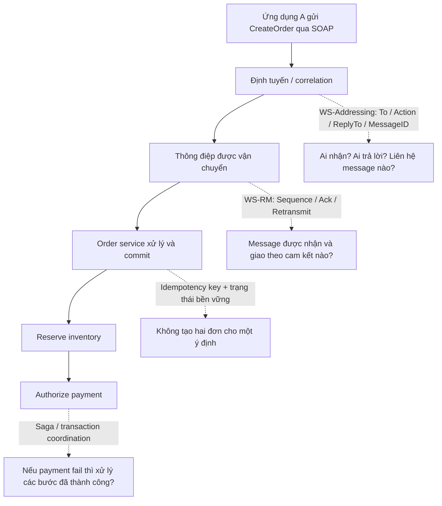
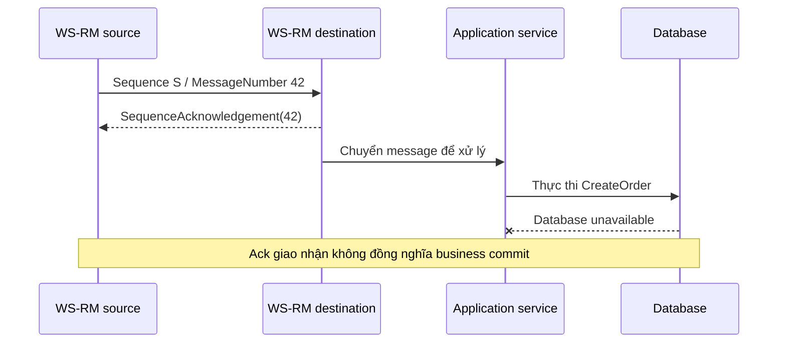
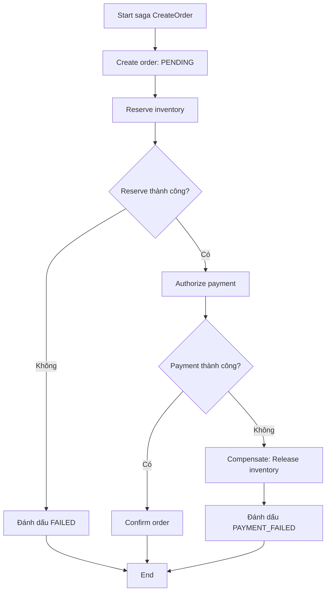

# Phân biệt WS-Addressing với giao nhận tin cậy và điều phối giao dịch

Trong hệ thống SOAP doanh nghiệp, một thông điệp có thể **được gửi đúng địa chỉ nhưng thất lạc phản hồi**, **được nhận hai lần và gây tác dụng nghiệp vụ lặp**, hoặc **được nhận đúng một lần nhưng chuỗi nhiều dịch vụ vẫn thất bại giữa chừng**. Ba vấn đề này có vẻ giống nhau vì đều xuất hiện khi hệ thống phân tán không hoàn hảo; tuy nhiên chúng thuộc **ba lớp giải quyết khác nhau**:

1. **WS-Addressing** trả lời câu hỏi *thông điệp này hướng đến ai, thuộc hành động nào, cần trả lời/báo lỗi ở đâu, và phản hồi liên hệ với yêu cầu nào?*
2. **Giao nhận tin cậy** (ví dụ WS-ReliableMessaging, gọi tắt WS-RM) trả lời câu hỏi *đã chuyển giao những thông điệp nào, có cần gửi lại, nhận trùng hay sai thứ tự không?*
3. **Điều phối giao dịch/quy trình** (WS-Coordination, WS-AtomicTransaction, WS-BusinessActivity, saga hoặc orchestration ứng dụng) trả lời câu hỏi *nhiều bước nghiệp vụ có cùng được hoàn tất/hoàn tác/bù trừ theo một quy tắc nhất quán hay không?*

Bài thuộc chương **WS-Addressing** trong module `SPRING_WEB_SERVICES`. Nội dung gắn với Spring Web Services (Spring-WS) hướng **contract-first**, thiết kế XSD/WSDL, JAXB, SOAP endpoint và client, SOAP Fault, interceptor, XML security, WS-Security/chứng chỉ và kiểm thử tương thích. Điểm cần nắm không chỉ là tên các chuẩn, mà là **không dùng chuẩn ở lớp A để hứa hẹn bảo đảm thuộc lớp B hoặc C**.

> **Nguyên tắc:** Có `wsa:MessageID` không đồng nghĩa “đã nhận đúng một lần”; có acknowledgement của WS-RM không đồng nghĩa “đơn hàng đã commit”; có một giao dịch database cục bộ không đồng nghĩa “mọi hệ thống downstream sẽ cùng commit”.

## 1. Ba lớp vấn đề trong một tình huống thực tế

Giả sử hệ thống thương mại điện tử gọi dịch vụ SOAP `CreateOrder`. Sau đó nó phải giữ hàng trong kho và yêu cầu đối tác thanh toán. Client nhận timeout lúc tạo đơn, một lần gửi lại tạo hai đơn, rồi thao tác giữ hàng thành công nhưng thanh toán bị từ chối.



Phân tích theo từng câu hỏi:

| Câu hỏi | Công cụ/cơ chế phù hợp | Điều không được hứa |
| --- | --- | --- |
| Request đang gọi operation gì? | `wsa:Action`; WSDL action; server endpoint mapping | Không chứng minh caller có quyền |
| Response này thuộc request nào? | `wsa:RelatesTo` tham chiếu `wsa:MessageID` | Không chứng minh server đã commit nghiệp vụ |
| Gửi reply về đâu? | `wsa:ReplyTo` hoặc cơ chế response mặc định | Không bảo đảm đích callback an toàn |
| Message bị mất trên đường truyền? | WS-RM hoặc retry transport theo profile | Không tự bảo đảm business effect một lần |
| Message đã đến đích bao nhiêu lần? | Sequence/ack/dedupe của WS-RM | Không tự chứng minh số lần thanh toán |
| Client timeout sau khi tạo đơn? | Idempotency key, operation status query, reconciliation | Không thể suy “timeout = chưa xử lý” |
| Kho giữ hàng nhưng thanh toán thất bại? | Saga/compensation hoặc transaction protocol phù hợp | WS-Addressing không rollback kho |
| Một DB commit, broker publish thất bại? | Transactional outbox + consumer deduplication | WS-RM không thay thế local ACID/outbox |

### Một thông điệp có thể mang nhiều chuẩn cùng lúc

SOAP Envelope có thể chứa cả `wsa:Action`, `wsrm:Sequence` và `wsse:Security`. Điều này **không làm các chuẩn đồng nhất**. Mỗi extension có namespace, vai trò, vòng đời, security policy, khả năng hỗ trợ và fault tương ứng. Một hệ tích hợp cần thiết kế **đúng tổ hợp**, thay vì “bật WS-Addressing để có reliable delivery”.

## 2. WS-Addressing: siêu dữ liệu định tuyến và tương quan ở mức message

WS-Addressing chuẩn hóa một nhóm **Message Addressing Properties (MAPs)** và **Endpoint References (EPR)** độc lập với cách đặt tên URL/định tuyến của transport. Các property thường gặp trong WS-Addressing phiên bản 2005/08:

| SOAP Header/property | Vai trò | Không phải |
| --- | --- | --- |
| `wsa:To` | Địa chỉ đích logic của message | Xác thực người nhận hoặc quyền của bên gửi |
| `wsa:Action` | URI mô tả ngữ nghĩa action/operation | Idempotency key hoặc proof đã xử lý |
| `wsa:MessageID` | Định danh một message để tương quan | Dedupe nghiệp vụ bền vững |
| `wsa:ReplyTo` | EPR nhận reply, có thể anonymous | Bằng chứng callback URL đáng tin |
| `wsa:FaultTo` | EPR nhận SOAP Fault khi profile hỗ trợ | Cơ chế bảo đảm Fault chắc chắn được giao |
| `wsa:RelatesTo` | Liên hệ message đang gửi với message trước đó | Chứng cứ của business transaction commit |
| Reference parameters trong EPR | Tham số định danh endpoint khi chuyển message | Authentication token hoặc domain transaction ID mặc định |

WS-Addressing có nhiều bản đặc tả/namespace lịch sử. Ví dụ này nhất quán với namespace **W3C WS-Addressing 2005/08**:

```text
http://www.w3.org/2005/08/addressing
```

**Không trộn namespace trên với bản submission/phiên bản cũ** chỉ vì các header có cùng local name. Một đối tác dùng profile cũ có thể không hiểu những header 2005/08, và ngược lại.

### Tên hành động là một URI, không nhất thiết là URL để truy cập

`wsa:Action = urn:example:orders:v1:CreateOrder` cho biết loại message, không buộc client phải HTTP GET đến một URL tên `CreateOrder`. Transport endpoint có thể vẫn là `https://orders.example/ws` cho hàng chục operation.

## 3. Ví dụ SOAP request có WS-Addressing và hợp đồng XSD

Giả sử contract-first service tạo đơn công bố một phần XSD:

```xml
<?xml version="1.0" encoding="UTF-8"?>
<xs:schema xmlns:xs="http://www.w3.org/2001/XMLSchema"
           targetNamespace="https://example.com/orders/v1"
           xmlns:ord="https://example.com/orders/v1"
           elementFormDefault="qualified">
    <xs:element name="CreateOrderRequest">
        <xs:complexType>
            <xs:sequence>
                <xs:element name="requestKey" type="xs:string"/>
                <xs:element name="sku" type="xs:string"/>
                <xs:element name="quantity" type="xs:positiveInteger"/>
            </xs:sequence>
        </xs:complexType>
    </xs:element>
    <xs:element name="CreateOrderResponse">
        <xs:complexType>
            <xs:sequence>
                <xs:element name="orderId" type="xs:string"/>
                <xs:element name="status" type="xs:string"/>
            </xs:sequence>
        </xs:complexType>
    </xs:element>
</xs:schema>
```

Ví dụ SOAP 1.1 qua HTTPS (đã rút gọn các header bảo mật):

```http
POST /ws HTTP/1.1
Host: orders.example
Content-Type: text/xml; charset=utf-8
SOAPAction: "urn:example:orders:v1:CreateOrder"
```

```xml
<soap:Envelope
    xmlns:soap="http://schemas.xmlsoap.org/soap/envelope/"
    xmlns:wsa="http://www.w3.org/2005/08/addressing"
    xmlns:ord="https://example.com/orders/v1">
    <soap:Header>
        <wsa:To>https://orders.example/ws</wsa:To>
        <wsa:Action>urn:example:orders:v1:CreateOrder</wsa:Action>
        <wsa:MessageID>
            urn:uuid:5f452c31-a31b-4a24-8153-5bc4af0d4a1a
        </wsa:MessageID>
        <wsa:ReplyTo>
            <wsa:Address>
                http://www.w3.org/2005/08/addressing/anonymous
            </wsa:Address>
        </wsa:ReplyTo>
    </soap:Header>
    <soap:Body>
        <ord:CreateOrderRequest>
            <ord:requestKey>business-intent-000000041</ord:requestKey>
            <ord:sku>BOOK-007</ord:sku>
            <ord:quantity>2</ord:quantity>
        </ord:CreateOrderRequest>
    </soap:Body>
</soap:Envelope>
```

Ví dụ minh họa **cùng tồn tại** hai loại định danh:

- `wsa:MessageID` định danh **SOAP message cụ thể** để liên hệ phản hồi.
- `ord:requestKey` định danh **một ý định tạo đơn** để ứng dụng chống tạo trùng ở lần thử lại.
- `wsa:Action` phân loại **hành động SOAP**.
- `wsa:To` chỉ ra **đích logic**, có thể cần thống nhất với endpoint HTTP tùy profile.
- `wsa:ReplyTo` dùng địa chỉ **anonymous**, thông thường thuận với request–response đồng bộ; không có nghĩa bên gửi đang yêu cầu một callback HTTP riêng.

Không phải **tất cả header trong ví dụ đều bắt buộc** ở mọi message; WS-Addressing, WSDL và profile đối tác quy định các ràng buộc. Một số property có default/điều kiện tùy pattern.

## 4. Mối liên hệ request–response: `MessageID` và `RelatesTo`

Một response có thể chứa:

```xml
<soap:Envelope
    xmlns:soap="http://schemas.xmlsoap.org/soap/envelope/"
    xmlns:wsa="http://www.w3.org/2005/08/addressing"
    xmlns:ord="https://example.com/orders/v1">
    <soap:Header>
        <wsa:Action>urn:example:orders:v1:CreateOrderResponse</wsa:Action>
        <wsa:RelatesTo>
            urn:uuid:5f452c31-a31b-4a24-8153-5bc4af0d4a1a
        </wsa:RelatesTo>
        <wsa:MessageID>
            urn:uuid:0cd204f0-ed75-40ae-bd05-2afbb8d7b232
        </wsa:MessageID>
    </soap:Header>
    <soap:Body>
        <ord:CreateOrderResponse>
            <ord:orderId>ORD-9001</ord:orderId>
            <ord:status>CREATED</ord:status>
        </ord:CreateOrderResponse>
    </soap:Body>
</soap:Envelope>
```

`RelatesTo` nối response với request mà nó phản hồi. Tuy nhiên:

1. **Có response** và **có `RelatesTo` khớp** chỉ chứng minh quan hệ message theo cách server báo, không thay thế kiểm tra định danh, tính toàn vẹn hay trạng thái dữ liệu nghiệp vụ.
2. Một response có thể bị mất **sau khi server đã commit**. Client timeout không nhận được `RelatesTo`, nhưng đơn có thể đã được tạo.
3. Một bên gửi độc hại có thể tự gắn `RelatesTo` giả. Trong hệ yêu cầu tin cậy, phải áp WS-Security/trust policy cho header cần bảo vệ.
4. `MessageID` không nhất thiết lưu giữ lâu dài trong cơ sở dữ liệu hay cung cấp cơ chế truy vấn trạng thái.
5. Khi retry một ý định nghiệp vụ, SOAP message mới **có thể cần MessageID mới**, trong khi **requestKey phải giữ nguyên** nếu muốn business deduplication.

### Tại sao không dùng `MessageID` làm idempotency key?

Có thể xây một profile riêng quy định cách dùng MessageID cho deduplication, nhưng **WS-Addressing tự nó không hứa** rằng server lưu mọi ID, so payload cùng ID, ngăn concurrent duplicate hoặc trả lại kết quả cũ. Một API tài chính cần **business idempotency contract tường minh**, không dựa vào sự tồn tại của header đó.

## 5. EndpointReference, `ReplyTo` và `FaultTo` không phải đảm bảo giao nhận

Một **EndpointReference (EPR)** chỉ rõ địa chỉ endpoint và có thể có reference parameters/metadata. Ví dụ rút gọn:

```xml
<wsa:ReplyTo xmlns:wsa="http://www.w3.org/2005/08/addressing">
    <wsa:Address>https://callback.partner.example/soap-replies</wsa:Address>
    <wsa:ReferenceParameters>
        <ctx:ConversationId
            xmlns:ctx="https://example.com/context/v1">conv-42</ctx:ConversationId>
    </wsa:ReferenceParameters>
</wsa:ReplyTo>
```

EPR có thể giúp đối tác **định tuyến một response tới cuộc hội thoại** hoặc tenant logic nào đó. Nhưng:

- `ReplyTo` chỉ là **địa chỉ đích được yêu cầu**, không bảo đảm server đã gửi, phía nhận đã xử lý hay được nhận đúng một lần.
- `FaultTo` chỉ định điểm đến của Fault (nếu áp dụng); nó không cung cấp queue bền vững, retry hoặc ack.
- Một EPR do bên ngoài gửi là **dữ liệu chưa tin cậy**. Không gọi URL bất kỳ chỉ vì SOAP Header hợp lệ về cú pháp.
- Reference parameters **không mặc nhiên là credential**; giá trị tenant/role trong đó cần được xác thực/ủy quyền.

### Nguy cơ SSRF khi làm callback

Kẻ gửi có thể đặt `ReplyTo` thành một địa chỉ nội bộ:

```xml
<wsa:ReplyTo xmlns:wsa="http://www.w3.org/2005/08/addressing">
    <wsa:Address>http://127.0.0.1:8080/admin</wsa:Address>
</wsa:ReplyTo>
```

Nếu server tự mở kết nối theo địa chỉ đó, nó có thể bị lợi dụng làm **SSRF**. Thiết kế callback an toàn cần:

1. Dùng endpoint callback **đăng ký sẵn và gắn với đối tác đã xác thực** nếu có thể.
2. Kiểm tra scheme/host/port, DNS và redirect với allowlist/egress policy.
3. Chặn loopback, link-local, mạng nội bộ và tài nguyên nhạy cảm theo chính sách.
4. Ràng buộc callback vào operation được phép và quyền tenant.
5. Không chuyển tiếp token/Body nhạy cảm tới địa chỉ lạ.
6. Có cơ chế riêng cho retry, xác thực callback receiver, lưu kết quả và đối soát nếu callback thất bại.

Một `ReplyTo` được ký bằng khóa của đối tác vẫn cần **authorization đích**: chữ ký chứng minh ai đã yêu cầu URL đó, không chứng minh URL được hệ thống cho phép truy cập.

## 6. WSDL và WS-Addressing: hợp đồng action không tạo guarantee

Trong WSDL 1.1, operation và SOAP binding có thể chỉ ra action:

```xml
<!-- Fragment trong wsdl:binding, SOAP 1.1 document/literal -->
<wsdl:operation name="CreateOrder">
    <soap:operation
        soapAction="urn:example:orders:v1:CreateOrder"/>
    <wsdl:input><soap:body use="literal"/></wsdl:input>
    <wsdl:output><soap:body use="literal"/></wsdl:output>
</wsdl:operation>
```

WSDL có thể bổ sung **WS-Addressing metadata** hoặc WS-Policy phù hợp để định nghĩa `wsa:Action` cho input/output và yêu cầu addressing. Tên namespace/thuộc tính giữa các bản `wsaw`, `wsam` và những profile WS-Addressing cũ có thể khác nhau; cần kiểm tra WSDL **thực tế được công bố**.

| Điều WSDL/XSD mô tả | Điều WSDL/XSD không tự giải quyết |
| --- | --- |
| QName của global input/output element | Message có được nhận qua mạng hay không |
| Cấu trúc request/response và business fault | Duplicate delivery do retry |
| SOAP binding và SOAPAction | Idempotency của lệnh thanh toán |
| WS-Addressing action metadata nếu được khai báo | Rollback nhiều service |
| WS-Policy/profile nếu được công bố | Bảo đảm tất cả implementation tương thích và đã bật policy |

Một WS-RM policy có thể được công bố qua WS-Policy trong một hạ tầng hỗ trợ, nhưng chỉ có `wsa:Action` trong WSDL **không tự bật reliable messaging**. Tương tự, một `wsdl:fault` mô tả business error không khiến transaction trở nên atomic.

## 7. WS-Addressing trong Spring-WS: định tuyến và callback

Spring-WS có các tiện ích hỗ trợ WS-Addressing ở những phiên bản/cấu hình tương ứng. Ở phía server, annotation `@Action` cùng **`AnnotationActionEndpointMapping`** có thể ánh xạ action trong WS-Addressing tới endpoint method. Ở phía client, callback `ActionCallback` có thể gắn WS-Addressing metadata trước khi gửi.

Ví dụ server-side minh họa:

```java
import org.springframework.ws.server.endpoint.annotation.Endpoint;
import org.springframework.ws.server.endpoint.annotation.RequestPayload;
import org.springframework.ws.server.endpoint.annotation.ResponsePayload;
import org.springframework.ws.soap.addressing.server.annotation.Action;

@Endpoint
public class OrdersAddressingEndpoint {

    @Action("urn:example:orders:v1:CreateOrder")
    @ResponsePayload
    public CreateOrderResponse create(
            @RequestPayload CreateOrderRequest request) {

        // Ứng dụng thật phải kiểm tra authentication/authorization,
        // schema và business idempotency trước khi tạo order.
        return orderApplicationService.createIdempotently(request);
    }
}
```

Đây là **fragment minh họa**: `orderApplicationService` là dependency ứng dụng chưa khai báo trong đoạn code, và `CreateOrderRequest`/`CreateOrderResponse` là JAXB classes đã sinh từ XSD. Cần xác minh annotation, cách khai báo input/output action và hạ tầng mapping trên **phiên bản Spring-WS hiện có**; ví dụ không thay thế cấu hình servlet, message factory hay endpoint adapter.

Ở phía client:

```java
import java.net.URI;
import org.springframework.ws.client.core.WebServiceTemplate;
import org.springframework.ws.soap.addressing.client.ActionCallback;

public final class OrdersAddressingClient {
    private final WebServiceTemplate template;

    public OrdersAddressingClient(WebServiceTemplate template) {
        this.template = template;
    }

    public Object createOrder(CreateOrderRequest request) {
        return template.marshalSendAndReceive(
                "https://orders.example/ws",
                request,
                new ActionCallback(
                        URI.create("urn:example:orders:v1:CreateOrder")));
    }
}
```

`ActionCallback` dành cho **WS-Addressing** và khác `org.springframework.ws.soap.client.core.SoapActionCallback` dành cho SOAPAction. Một số profile yêu cầu **cả HTTP SOAPAction và `wsa:Action` nhất quán**, một số dùng action của SOAP 1.2 media type; cần dựa vào SOAP binding/WSDL/policy của đối tác.

**Không gắn `@Action` và `@SoapAction` rồi mặc định Spring-WS sẽ kiểm tra phép AND của cả hai điều kiện.** Chúng có thể được xử lý bởi endpoint mappings khác nhau; cần kiểm tra thứ tự và áp chính sách nhất quán nếu hợp đồng yêu cầu.

### Spring-WS có tự cung cấp full WS-RM hoặc WS-AT không?

**Không nên suy từ việc Spring-WS hỗ trợ WS-Addressing mà toàn bộ WS-ReliableMessaging, WS-AtomicTransaction hoặc orchestration giao dịch đã sẵn sàng.** Các cơ chế đó đòi hỏi state bền vững, sequence manager/ack/retransmit hoặc coordinator, participant registration và transaction protocol phù hợp. Nếu dự án yêu cầu tiêu chuẩn WS-* cụ thể, phải kiểm tra **tính năng thực tế của stack/phần mở rộng, phiên bản và đối tác**, hoặc xây cơ chế idempotency/saga ở tầng ứng dụng.

## 8. WS-ReliableMessaging giải quyết điều gì?

**WS-ReliableMessaging (WS-RM)** định nghĩa cơ chế để một bên nguồn và một bên đích **quản lý giao nhận SOAP message một cách tin cậy** trong phạm vi một sequence và các bảo đảm giao nhận được cấu hình. Những khái niệm thường gặp:

- **Sequence Identifier:** định danh một chuỗi message.
- **MessageNumber:** thứ tự message trong sequence.
- **SequenceAcknowledgement:** thông báo những số message/range đã được ghi nhận tại RM destination.
- **Retransmission:** gửi lại khi thiếu acknowledgement theo policy.
- **Duplicate elimination:** tránh giao nhiều lần cùng message trong phạm vi sequence/bảo đảm đã thỏa thuận.
- **Ordering:** hỗ trợ ràng buộc thứ tự khi profile yêu cầu.
- **Sequence lifecycle:** tạo/kết thúc sequence, timeout và xử lý mất đồng bộ trạng thái.

Ví dụ SOAP Header rút gọn, theo namespace WS-RM 1.1 của OASIS:

```xml
<wsrm:Sequence
    xmlns:wsrm="http://docs.oasis-open.org/ws-rx/wsrm/200702">
    <wsrm:Identifier>
        urn:uuid:b892c4b4-7ebf-47a8-b6ae-e31b0ff62d8d
    </wsrm:Identifier>
    <wsrm:MessageNumber>42</wsrm:MessageNumber>
</wsrm:Sequence>
```

Đây là **fragment**, không phải toàn bộ giao thức WS-RM: hệ thống còn cần thiết lập/lifecycle sequence, acknowledgement và các message điều khiển tương ứng.

### WS-RM khác WS-Addressing ở đâu?

| Vấn đề | WS-Addressing | WS-ReliableMessaging |
| --- | --- | --- |
| Đích logic | `wsa:To` / EPR | Dựa vào endpoint/sequence đã quản lý |
| Loại message | `wsa:Action` | Không phải cơ chế định nghĩa business operation |
| Correlation request–reply | `wsa:MessageID` / `RelatesTo` | Sequence identifier, number, acknowledgement |
| Gửi lại khi mất message | **Không định nghĩa** | Có cơ chế retransmission trong phạm vi protocol |
| Phát hiện duplicate delivery | **Không bảo đảm** | Có thể cung cấp theo delivery assurance |
| Bảo đảm thứ tự | **Không định nghĩa** | Có thể cung cấp theo policy/protocol |
| Business transaction atomicity | **Không** | **Không** |
| Hoàn tác thanh toán/kho | **Không** | **Không** |

WS-RM có thể **sử dụng WS-Addressing** cho message routing và correlation, nhưng điều đó không biến WS-Addressing thành giao thức reliable delivery.

## 9. Delivery assurances của WS-RM và phạm vi của “ExactlyOnce”

Trong tài liệu/triển khai reliable messaging, thường gặp các khái niệm:

| Delivery assurance | Ý nghĩa mong muốn tại lớp giao nhận | Rủi ro còn lại |
| --- | --- | --- |
| **AtMostOnce** | Một message không được giao cho đích nhiều hơn một lần theo scope giao thức | Có thể **không được giao** khi lỗi |
| **AtLeastOnce** | Nỗ lực bảo đảm message được giao ít nhất một lần với điều kiện giao thức/retention phù hợp | Có thể **giao trùng** |
| **ExactlyOnce** | Kết hợp tránh mất và giao trùng ở **lớp delivery được định nghĩa** | Không tự bảo đảm DB commit/payment đúng một lần |
| **InOrder** | Message được giao theo thứ tự sequence phù hợp | Không tự sắp xếp transaction giữa nhiều service độc lập |

Không được hiểu “ExactlyOnce” thành **exactly-once business effect toàn hệ thống**. Ví dụ:

1. RM destination nhận và acknowledge message `ChargePayment`.
2. Application gọi payment gateway và ghi nhận tác dụng ở bên ngoài.
3. Server crash trước khi lưu business result.
4. Sau phục hồi, cơ chế replay ở tầng ứng dụng hoặc đối tác có thể thực hiện charge lại nếu **không có business idempotency**.

Một RM acknowledgement thường phản ánh **trạng thái giao nhận ở lớp RM**, không phải chữ ký ngân hàng xác nhận đã thu tiền. Phạm vi bảo đảm phụ thuộc **durable storage của RM source/destination, transaction integration, sequence retention, cluster failover và cam kết cụ thể của implementation**. Khi các yếu tố này không được xác minh, không được tuyên bố bảo đảm tuyệt đối.

## 10. Sequence acknowledgement không phải application confirmation

Ví dụ client gửi SOAP message số 42 trong sequence S; destination trả acknowledgement cho số 42.



**Thứ tự minh họa** nhấn mạnh ranh giới giữa các lớp; implementation có thể giao message cho application và tạo acknowledgement theo thứ tự khác tùy storage/transaction. Điều cần giữ là: từ thông tin RM acknowledgement **không thể tự suy ra kết quả business transaction**.

Nếu ứng dụng muốn client biết đơn đã tạo, cần **business response hoặc operation-status API**. Nếu response mất, cần cơ chế reconciliation và idempotency. Nếu downstream đã gửi email dù transaction rollback, còn phải thiết kế outbox/compensation hoặc idempotent consumer.

### Trùng message và trùng tác dụng khác nhau

Một message có thể được giao đúng một lần nhưng application **tạo hai tác dụng** vì retry external API bên trong. Ngược lại, message có thể được giao ba lần nhưng application chỉ tạo **một đơn** nhờ idempotency key, unique constraint và trạng thái đã lưu. Do vậy cần test riêng:

- Số lần **transport/RM delivery**.
- Số lần **endpoint invocation**.
- Số lần **business effect committed**.
- Số lần **external side effect** như charge/email/event.

## 11. WS-Coordination và WS-AtomicTransaction xử lý điều gì?

Khi một operation liên quan **nhiều participant** mà kết quả phải có một quy tắc phối hợp, cần giao thức điều phối giao dịch hoặc workflow — không phải chỉ routing/correlation.

**WS-Coordination** định nghĩa cơ sở cho coordination context và các giao thức đăng ký participant. **WS-AtomicTransaction (WS-AT)** mô tả giao dịch atomic phân tán trong những môi trường hỗ trợ, thường liên quan đến **prepare/commit/rollback** của các participant. **WS-BusinessActivity (WS-BA)** hướng đến các hoạt động dài hạn, nơi compensation có thể thay cho rollback tức thời.

| Cơ chế | Câu hỏi trọng tâm | Độ phù hợp |
| --- | --- | --- |
| WS-Coordination | Ai điều phối, participant đăng ký với context nào? | Nền tảng coordination |
| WS-AtomicTransaction | Các participant hỗ trợ có cùng prepare/commit/rollback? | Giao dịch phân tán ngắn hạn với coordinator và tài nguyên phù hợp |
| WS-BusinessActivity | Một hoạt động dài cần complete/compensate thế nào? | Workflow dài hạn có bù trừ |
| Saga ứng dụng | Những bước nghiệp vụ và compensation nào được điều phối? | Microservices, hệ không hỗ trợ XA/WS-AT |
| Local DB transaction | Những thay đổi trên cùng DB có commit atomically? | Một resource manager / một transaction local |
| Transactional outbox | State và event publication intent có ghi cùng commit local? | Tích hợp DB với broker/event pipeline |

Cần phân biệt **orchestration** và **choreography**:

- **Orchestration:** có một workflow coordinator ra lệnh/thực hiện bước tiếp theo, theo dõi trạng thái và quyết định compensation.
- **Choreography:** nhiều service phản ứng với events/agreements, không nhất thiết có một coordinator trung tâm.
- Cả hai là **mô hình điều phối nghiệp vụ**, không mặc định phụ thuộc WS-Addressing hay WS-AT.

### Không có distributed atomicity chỉ bằng SOAP Header

Một `CoordinationContext` mang metadata của giao dịch **không làm mọi participant tự commit/rollback**. Cần coordinator đang chạy, participant hỗ trợ đúng protocol, transaction manager/resource enlistment, thời hạn, security/trust policy và xử lý lỗi phục hồi. Nếu đối tác **không hỗ trợ WS-AT**, chỉ thêm SOAP Header coordination vào client không tạo ra giao dịch phân tán.

## 12. Minh họa coordination context và khác biệt với MessageID

Một bản tin theo một profile WS-Coordination có thể mang **coordination context** trong SOAP Header. Về mặt khái niệm:

```text
WS-Addressing:
  To        = endpoint logic
  Action    = loại SOAP message
  MessageID = ID một message cụ thể
  RelatesTo = liên hệ message khác

WS-Coordination:
  CoordinationContext.Identifier = ID ngữ cảnh phối hợp
  CoordinationType                = protocol coordination
  RegistrationService             = nơi participant đăng ký

Business idempotency:
  requestKey = ID một ý định nghiệp vụ, lưu tại business service
```

Ba loại ID này có **vòng đời khác nhau**:

| ID | Phạm vi | Ví dụ tồn tại |
| --- | --- | --- |
| `wsa:MessageID` | Một message | Vòng đời message/correlation |
| WS-RM Sequence ID | Một sequence giao nhận | Tới khi sequence hoàn tất/expired theo RM |
| WS-Coordination context ID | Một transaction/coordination activity | Tới khi activity kết thúc hoặc timeout |
| Business idempotency key | Một ý định nghiệp vụ | Theo retention/reconciliation contract |
| Internal trace ID | Theo dấu quan sát | Theo tracing/log retention |

Không nên dùng một UUID rồi đặt cho **mọi** trường với hy vọng semantics “giống nhau”. Có thể giữ cùng business correlation để liên kết log, nhưng mỗi cơ chế cần ID/scope/policy phù hợp.

## 13. Chuỗi nghiệp vụ dài: saga và compensation

Giả sử tạo đơn gồm ba bước:

1. `CreateOrder` — ghi nhận đơn.
2. `ReserveInventory` — giữ hàng.
3. `AuthorizePayment` — giữ tiền.

Nếu bước 3 thất bại, có thể cần **release inventory** và chuyển đơn sang `PAYMENT_FAILED`. WS-Addressing có thể giúp điều hướng/correlate các message, nhưng **không quyết định** rằng phải release kho.



Đây là một **workflow nghiệp vụ**, không phải giao thức tự chạy nhờ WS-A. Mỗi step và compensation phải có:

- Business key và idempotency scope riêng.
- State lưu bền vững để tiếp tục sau crash.
- Timeout, retry, reconciliation và yêu cầu authorization.
- Trạng thái trung gian rõ như `PENDING`, `RESERVING`, `PAYMENT_UNKNOWN`.
- Compensation an toàn khi một bước đã xảy ra nhưng response bị mất.
- Monitoring cho saga quá hạn và can thiệp vận hành khi compensation thất bại.

**Compensation không phải rollback hoàn hảo.** Không thể “thu hồi” email đã gửi; hoàn tiền có thể tốn phí/đến trễ; release inventory có thể bị từ chối khi điều kiện thay đổi. Vì vậy phải thiết kế tác dụng bù trừ có ý nghĩa nghiệp vụ, không gọi chúng là transaction atomic nếu không đúng.

## 14. Timeout, retry và idempotency: mối nối giữa giao nhận và nghiệp vụ

Trong SOAP HTTP, client có thể bị read timeout **sau khi server đã commit**. Với WS-RM, source có thể retransmit một message nếu thiếu acknowledgement theo policy. Trong cả hai trường hợp, **application không nên tạo thêm tác dụng nghiệp vụ chỉ vì nhận attempt khác**.

Một mẫu xử lý bền vững:

```text
Business scope:
  (verifiedPrincipal, authorizedTenant, operation, idempotencyKey)

On first request:
  atomic claim scope/key + requestFingerprint
  execute business change and store outcome
  commit transaction

On duplicate same fingerprint:
  return stored outcome / operation status

On duplicate different fingerprint:
  reject as IDEMPOTENCY_KEY_REUSED

On in-progress / uncertain outcome:
  query / wait bounded / reconcile, do not re-execute blindly
```

### Tại sao cần kiểm tra đồng thời?

Nếu server chỉ làm:

```java
// Anti-pattern trong hệ nhiều pod:
if (!repository.existsByKey(key)) {
    createOrder(request);
    repository.save(key);
}
```

hai request đồng thời có thể cùng thấy key chưa có và **cùng tạo đơn**. Phải dùng **unique constraint, atomic claim, locking/transaction** hoặc cơ chế bền vững tương đương ở nơi phát sinh tác dụng.

### Ví dụ DDL lưu key và business outcome

```sql
CREATE TABLE order_idempotency (
    actor_id       VARCHAR(128) NOT NULL,
    tenant_id      VARCHAR(128) NOT NULL,
    operation_name VARCHAR(64)  NOT NULL,
    request_key    VARCHAR(128) NOT NULL,
    request_hash   CHAR(64)     NOT NULL,
    state          VARCHAR(24)  NOT NULL,
    order_id       VARCHAR(80),
    updated_at     TIMESTAMPTZ NOT NULL DEFAULT NOW(),
    PRIMARY KEY (actor_id, tenant_id, operation_name, request_key)
);
```

Đây là **mẫu thiết kế**, chưa giải quyết đầy đủ concurrency state transitions, transaction crash recovery, TTL hoặc external side effects. Tùy cơ sở dữ liệu, phải dùng isolation/locking phù hợp để thực thi một ý định đúng một lần tại lớp business.

**Đừng nhầm idempotency key với security token.** Bất kỳ client nào cũng có thể tự gửi một key; server vẫn phải xác thực caller và kiểm tra quyền tenant/operation/resource. Key dùng để nhận diện ý định **sau khi đã xác định danh tính và phạm vi được phép**.

## 15. Transactional outbox và inbox: khi RM không bao phủ downstream

Nếu `CreateOrder` commit vào database và cần phát sự kiện `OrderCreated`, tốt hơn nên ghi order và **outbox record trong cùng local transaction**:

```text
BEGIN TRANSACTION
  INSERT orders(order_id, ...)
  INSERT order_idempotency(..., state='SUCCEEDED')
  INSERT outbox(event_id, aggregate_id, payload, ...)
COMMIT
```

Outbox worker gửi event sau commit. Nếu worker gửi event nhưng crash trước khi ghi “đã gửi”, event có thể **được publish lại**. Consumer cần inbox/deduplication hoặc idempotent handler dựa trên `event_id`.

Điểm khác nhau:

- **WS-RM** quản lý reliable SOAP message delivery trong scope/sequence của một RM protocol.
- **Transactional outbox** gắn việc ghi ý định phát event với DB commit.
- **Inbox/deduplication** ngăn consumer nhân đôi side effect khi event được giao lại.
- **Saga** quyết định các bước nghiệp vụ và compensation xuyên service.

Một hệ có thể áp dụng cả bốn, nhưng không cái nào tự động thay thế hoàn toàn những cái còn lại. **Đúng một lần ở một đoạn pipeline không kéo theo đúng một lần ở mọi đoạn còn lại**.

## 16. So sánh bảo đảm theo từng lớp

| Tiêu chí | WS-Addressing | WS-RM | WS-AT / WS-BA | Idempotency + saga/outbox |
| --- | --- | --- | --- | --- |
| Định danh đích/action | **Chính** | Dựa trên transport/WS-A | Dùng để liên lạc participants | Cần biết operation/đích, không phải chuẩn addressing |
| Liên hệ request–reply | **Có** bằng MessageID/RelatesTo | Có sequence/correlation riêng | Có coordination context | Có business key/trạng thái |
| Retransmit message | Không | **Có** theo giao thức | Không phải chức năng chính | Ứng dụng/transport quyết định retry |
| Ack delivery | Không | **Có** | Không phải RM ack | Business ack/status riêng |
| Loại trùng delivery | Không | Có thể theo assurance | Không phải mục tiêu của WS-AT | Xử lý duplicate business intent |
| Thứ tự message | Không | Có thể bảo đảm InOrder | Không phải chức năng chính | Workflow/state machine |
| Atomic multi-resource commit | Không | Không | **WS-AT**, nếu participants hỗ trợ | Không mặc định; dùng saga/compensation |
| Compensation dài hạn | Không | Không | WS-BA có protocol tương ứng | **Saga**, do nghiệp vụ định nghĩa |
| Chống double charge | Không | **Không đủ** | Phụ thuộc phạm vi transaction | Business idempotency + downstream support |
| Cần state bền vững | Không tự hứa | Cần để bảo đảm recovery theo profile | Cần coordinator/participants | Cần DB/state store và recovery |
| Điều kiện triển khai | WS-A compatible stack | RM compatible source/destination | Coordinator và participants hỗ trợ protocol | Business contract & application architecture |

**Không có “một checkbox exactly-once cho cả hệ thống”.** Cần xác định guarantee cụ thể tại **mỗi boundary**: client → RM destination, RM destination → application, DB → broker, broker → consumer, application → payment provider.

## 17. WS-Addressing và WS-Security: phải bảo vệ MAPs đúng mức

WS-Addressing metadata thường nằm trong SOAP Header do bên gửi tạo. Một client độc hại có thể gửi:

- `wsa:To` trỏ endpoint/tenant khác.
- `wsa:Action` yêu cầu thao tác có quyền cao.
- `wsa:ReplyTo` trỏ host nội bộ hoặc địa chỉ do attacker điều khiển.
- `wsa:MessageID` trùng hoặc giả.
- `wsa:RelatesTo` trỏ request của người khác.

**Routing header không tạo danh tính hay quyền truy cập.** Để thực thi một business operation:

1. Dùng TLS/mTLS, token hoặc WS-Security theo profile để xác thực caller.
2. Xác minh chữ ký XML và **những node cụ thể được ký**; không chỉ thấy `wsse:Security` rồi tin.
3. Nếu policy yêu cầu toàn vẹn của `wsa:To`, `Action`, `MessageID`, `ReplyTo` hoặc reference parameters, bảo đảm chúng nằm trong phạm vi chữ ký thực sự được xác minh.
4. Kiểm tra **authorization theo principal–tenant–operation–resource**, không dựa vào action URI.
5. Chặn replay theo nonce/timestamp/cache bảo mật **riêng** với business idempotency.
6. Chống XML Signature Wrapping: endpoint sử dụng **đúng node** mà security component đã xác minh.
7. Giới hạn XML size/depth, chặn XXE/external entities và tránh log token/chữ ký.

### Bảo mật và lũy đẳng có thể tương tác khó

Một retry hợp lệ có thể phải **tạo SOAP message mới** để có WS-Security timestamp, nonce và chữ ký mới; nếu gửi lại nguyên một Envelope đã ký, chính sách replay prevention có thể từ chối. Trong khi đó, **business idempotency key phải giữ nguyên** để không tạo tác dụng mới.

Tức là:

```text
Attempt 1: MessageID=M1, Timestamp=T1, BusinessKey=K
Attempt 2: MessageID=M2, Timestamp=T2, BusinessKey=K
Attempt 3: MessageID=M3, Timestamp=T3, BusinessKey=K

M1/M2/M3: các SOAP messages khác nhau.
K: cùng một business intent.
```

Đừng đổi business key mỗi attempt để “qua được WS-Security replay cache”: làm vậy sẽ phá bảo vệ chống duplicate business effect.

## 18. SOAP Fault trong ba loại cơ chế

Một hệ có thể gặp các loại lỗi rất khác nhau:

| Loại lỗi | Nơi tạo/nhận biết | Phản hồi cần tìm |
| --- | --- | --- |
| WS-Addressing header không đúng | WS-A processor/mapping/policy | Addressing-related SOAP Fault theo WS-A version/profile |
| WS-A action không khớp hợp đồng | Endpoint mapping/contract check | Fault routing/contract; không mặc định là lỗi RM |
| WS-RM sequence/ack không hợp lệ | WS-RM source/destination | RM protocol Fault theo profile |
| RM retransmit hết ngân sách | RM/transport layer | Delivery failure/uncertain, cần kiểm tra state |
| WS-AT coordinator/participant fail | Transaction protocol | Transaction-specific status/fault, recovery |
| Saga không bù trừ được | Application orchestration | Trạng thái workflow cần can thiệp/đối soát |
| XSD request sai | XML/schema validation | SOAP `Client/Sender` hoặc fault policy phù hợp |
| WS-Security token/chữ ký sai | Security layer | Security Fault hoặc transport error theo profile |
| Business key trùng nhưng payload khác | Application idempotency | Business Fault ví dụ `IDEMPOTENCY_KEY_REUSED` |
| Server DB đã commit nhưng response mất | Transport/application | Client có thể chỉ thấy timeout; **không có Fault để đọc** |

SOAP 1.1 dùng những mã như `Client`, `Server`, `MustUnderstand`; SOAP 1.2 dùng `Sender`, `Receiver`, `MustUnderstand` và cấu trúc `Code/Subcode/Reason/Detail`. Các chuẩn WS-* có thể định nghĩa **fault detail/subcode riêng**, không được biến mọi lỗi thành một generic `Server` rồi mất khả năng xử lý phía client.

### Fault không thay cho trạng thái giao dịch

Nếu server đã commit order và TCP reset khiến response mất, client **không nhận được SOAP Fault cũng không nhận được success**. Cần giữ business key và tra `GetOperationStatus` hoặc retry cùng key theo guarantee mà server công bố. Một Fault `Receiver` cũng không nhất thiết có nghĩa giao dịch chưa commit; phải biết **giai đoạn lỗi**.

## 19. Các lựa chọn kiến trúc thực tế khi dùng Spring-WS

### Phương án A — SOAP HTTPS thông thường + business idempotency

Phù hợp phần lớn tích hợp request–response có request/response chuẩn:

- `WebServiceTemplate` + HTTP sender, TLS/mTLS, SOAPAction/WS-A khi hợp đồng yêu cầu.
- XSD/WSDL công bố operation, input/output và business Fault.
- Backend lưu idempotency key + fingerprint + business result trong database.
- Client có timeout, retry có giới hạn và operation-status query.
- Outbox/inbox hoặc saga khi có side effects downstream.

**Ưu điểm:** không phụ thuộc toàn bộ WS-RM/WS-AT stack. **Giới hạn:** application phải tự xây và kiểm thử dedupe/reconciliation.

### Phương án B — WS-RM với hai phía hỗ trợ đầy đủ

Phù hợp hệ thống có yêu cầu reliable SOAP delivery theo một profile chuẩn cụ thể:

- Cả client/server phải hỗ trợ **cùng WS-RM version và policy**, sequence lifecycle, ack và storage/recovery.
- Kiểm thử các tình huống message loss, duplicate, out-of-order, reconnect, failover.
- Vẫn phải có **business idempotency** cho các side effect không nằm trong delivery guarantee.
- Xem xét bảo mật sequence và độ bền RM state khi nhiều node cùng xử lý.

**Rủi ro:** không thể bật bằng cách chỉ thêm `wsa:MessageID` hoặc đổi `ActionCallback`; cần xác thực capability và interoperability thực tế.

### Phương án C — WS-AT hoặc saga cho multi-service transaction

Khi mục tiêu là giao dịch nhiều hệ thống:

- Nếu mọi participant hỗ trợ protocol coordinator/transaction manager phù hợp, đánh giá WS-AT/WS-BA theo đặc điểm transaction.
- Nếu không, xây **saga/orchestration ứng dụng** với state machine, idempotent steps và compensation.
- Với external payment/email, thường cần reconciliation và outbox hơn là kỳ vọng distributed rollback tức thì.

**Điểm chọn:** dùng đúng cơ chế cho **bảo đảm cần đạt**, không chọn chỉ vì đặc tả có chữ “reliable”, “addressing” hoặc “transaction”.

## 20. Kịch bản đối chiếu: một SOAP request, ba loại lỗi

### Kịch bản 1 — Không có `RelatesTo`

Client nhận một SOAP response bất đồng bộ nhưng không tìm được request tương ứng do thiếu hoặc sai `wsa:RelatesTo`. Đây là vấn đề **correlation/addressing**. Không thể giải quyết bằng cách bật database unique constraint của CreateOrder; cần kiểm tra profile WS-A, tạo action/MessageID và đường reply đúng.

### Kịch bản 2 — Có `RelatesTo` đúng nhưng client nhận hai reply

Server hoặc gateway gửi hai lần một reply tới callback endpoint. `RelatesTo` giúp biết hai message **liên quan đến cùng request**, nhưng không tự ngăn callback consumer thực thi hai lần. Cần reliable delivery/deduplication hoặc **idempotent consumer** theo business key/message outcome.

### Kịch bản 3 — Mọi message giao thành công, payment thất bại

WS-RM đã acknowledge request, CreateOrder và ReserveInventory đều thành công, nhưng AuthorizePayment từ chối. Đây là vấn đề **workflow/transaction coordination**, không phải lỗi `wsa:Action`. Cần saga đánh dấu `PAYMENT_FAILED`, thực hiện ReleaseInventory và có cơ chế xử lý compensation lỗi.

Ba kịch bản có thể xuất hiện đồng thời. **Phân loại đúng lớp** giúp tránh sửa symptom bằng giải pháp không liên quan.

## 21. Kiểm thử riêng từng guarantee

Không chỉ kiểm tra HTTP 200 hoặc “endpoint method được gọi một lần trong unit test”. Mỗi guarantee đòi hỏi **điểm quan sát tương ứng**.

| Tầng | Công cụ/cách kiểm tra | Cần chứng minh |
| --- | --- | --- |
| WS-A client | Spring-WS `WebServiceTemplate` / `ActionCallback`, message assertions | `To`, `Action`, `MessageID`, `ReplyTo` và security scope đúng profile |
| WS-A server | `MockWebServiceClient`/endpoint mapping test | Message được định tuyến đúng, response `RelatesTo`/fault theo contract |
| HTTP/network | Integration test qua proxy/TLS | Mất response/redirect/timeout không bị ngụy trang thành success |
| WS-RM | Bộ kiểm thử hỗ trợ sequence/ack fault injection | Retransmit/duplicate elimination/order theo policy |
| Business idempotency | DB integration, concurrent requests | Một key/same payload chỉ có một committed effect |
| Transactional outbox/inbox | Broker + consumer redelivery tests | Event publish lại không gây tác dụng trùng |
| Saga/coordination | Workflow failure injection | Compensation/recovery khi participant fail hoặc timeout |
| Liên thông đối tác | Client Java/.NET sinh từ WSDL và đúng policy | QName, action, callback, Fault, signing, version tương thích |

### Tại sao `MockWebServiceClient` chưa đủ?

Mock endpoint có thể chứng minh annotation mapping và SOAP response nhưng không tự tạo mất mạng, TLS handshake, RM retransmission hoặc database crash sau commit. Phải dùng **transport integration/fault injection có kiểm soát** cho những kịch bản này.

## 22. Ma trận 37 ca kiểm thử phân biệt WS-A, RM và transaction

| Ca | Đầu vào / sự cố | Kết quả phải xác minh |
| --- | --- | --- |
| A01 | `wsa:Action` đúng, Body QName đúng | Endpoint phù hợp được chọn |
| A02 | `wsa:Action` sai operation | Contract/mapping từ chối đúng policy |
| A03 | `wsa:To` sai địa chỉ theo profile | Addressing Fault hoặc rejection rõ ràng |
| A04 | `wsa:MessageID` thiếu khi profile bắt buộc | Bị từ chối đúng quy tắc; không suy mọi profile đều bắt buộc |
| A05 | Response có `RelatesTo` trỏ request M1 | Client ghép đúng message pair |
| A06 | Response có `RelatesTo` giả M2 | Không gắn với giao dịch người khác |
| A07 | `ReplyTo` là anonymous | Đồng bộ response qua transport theo profile |
| A08 | `ReplyTo` là URL callback hợp lệ đã đăng ký | Gửi tới đích được ủy quyền |
| A09 | `ReplyTo` trỏ loopback/IP nội bộ | Chặn SSRF trước outbound connect |
| A10 | `FaultTo` có URI ngoài allowlist | Không gửi Fault/token tới host không tin cậy |
| A11 | Reference parameter chứa tenant giả | Không nâng thành authorized tenant |
| A12 | Client sử dụng WS-A namespace cũ | Phát hiện profile/version mismatch |
| A13 | SOAPAction HTTP khác `wsa:Action` | Phát hiện mismatch khi profile yêu cầu nhất quán |
| A14 | WS-A header bị sửa sau ký | Signature validation từ chối theo security policy |
| A15 | Request đúng XML nhưng caller không có quyền | Authorization từ chối, không thực thi nghiệp vụ |
| R01 | WS-RM mất message #42 | Retransmit/ack theo đúng sequence policy |
| R02 | WS-RM gửi message #42 hai lần | Delivery assurance/dedupe hoạt động trong scope |
| R03 | Message #43 tới trước #42 | InOrder policy được kiểm thử nếu yêu cầu |
| R04 | Ack #42 thất lạc | Source retransmit/đối soát sequence đúng |
| R05 | RM source crash rồi restart | Durable RM state/sequence recovery đúng cam kết |
| R06 | RM destination crash rồi restart | Không mất/nhân đôi delivery ngoài guarantee |
| R07 | RM ack đã có nhưng DB nghiệp vụ fail | Không suy business success từ RM ack |
| R08 | RM reliable delivery nhưng downstream charge lặp | Business idempotency phát hiện/giảm duplicate |
| R09 | Sequence hết hạn | Fault/recovery phù hợp profile |
| R10 | Client/server hỗ trợ hai WS-RM version khác nhau | Interoperability test từ chối/đàm phán theo policy |
| T01 | Server commit order rồi response mất | Retry cùng business key không tạo order thứ hai |
| T02 | Cùng key, cùng request, gọi đồng thời hai pod | DB atomic claim chỉ cho một effect |
| T03 | Cùng key nhưng payload khác | `IDEMPOTENCY_KEY_REUSED`, không ghi mới |
| T04 | Cùng key nhưng principal khác | Không lộ kết quả xuyên caller/tenant |
| T05 | Payment success, local DB crash | Reconciliation/downstream key tránh double charge |
| T06 | ReserveInventory success, Payment fail | Saga chạy release/compensation |
| T07 | Compensation release fail | Workflow vào trạng thái cần retry/đối soát |
| T08 | Outbox event được publish hai lần | Consumer dedup không gửi email/charge trùng |
| T09 | WS-AT participant không hỗ trợ coordination | Không giả định giao dịch phân tán hoạt động |
| T10 | Retry SOAP message mới có WS-Security timestamp mới | Business key vẫn giữ nguyên; không đụng replay policy |
| T11 | Client timeout/HTTP 502 không có SOAP Envelope | Không parse thành SOAP Fault giả |
| T12 | Java và .NET client dùng WSDL/policy thực tế | WS-A metadata, Fault, signing và business outcome liên thông |

**Quan trọng:** Các ca `R01–R10` chỉ áp dụng nếu hệ thực sự triển khai WS-RM và có cách fault-injection cho protocol đó; không “test WS-RM” bằng cách đơn thuần gọi `WebServiceTemplate` HTTP hai lần. Các ca `T01/T05/T06/T08` mới kiểm tra **tác dụng nghiệp vụ xuyên ranh giới**.

## 23. Chẩn đoán sai lầm thường gặp

| Triệu chứng | Ngộ nhận | Cách xử lý đúng |
| --- | --- | --- |
| Có `wsa:MessageID` nhưng nhận callback trùng | “Addressing bảo đảm exactly-once” | Dùng idempotent consumer/đúng RM policy |
| Có `RelatesTo` nhưng đơn tạo hai lần | “Response correlation chống duplicate” | Business key + DB unique constraint |
| Có `ReplyTo` mà response bị mất | “Biết URL thì delivery tin cậy” | Reliable delivery/retry có kiểm soát + status query |
| RM acknowledgement thành công nhưng order không tồn tại | “Ack nghĩa là DB commit” | Phân biệt RM destination với application commit |
| RM `ExactlyOnce` nhưng charge lặp | “Delivery exactly-once = toàn hệ exactly-once” | Idempotency ở payment API và transaction boundary |
| SOAP có `CoordinationContext` nhưng participant không rollback | “Header tự kích hoạt distributed transaction” | Kiểm tra coordinator, enlistment và protocol support |
| WS-AT timeout giữ lock lâu | “Atomic transaction luôn tốt hơn saga” | Đánh giá coupling, deadline, long-running workflow |
| Payment fail nhưng kho vẫn giữ | “WS-A sẽ rollback vì cùng conversation” | Saga compensation/recovery |
| `wsa:To` trỏ host lạ được server gọi | “EPR luôn đáng tin” | Allowlist và chống SSRF, principal authorization |
| SOAPAction đúng nhưng `wsa:Action` sai | “Hai giá trị hoàn toàn giống nhau” | Kiểm tra binding/profile consistency |
| Retry bị WS-Security replay cache chặn | “Phải đổi business key” | Tạo SOAP message mới, giữ key nghiệp vụ |
| Gateway retry POST sau timeout gây duplicate | “Transport có retry thì đủ” | Kiểm soát retry owner + idempotency |
| Spring-WS hỗ trợ `ActionCallback` nhưng không thấy WS-RM sequence | “Cùng WS-* nên tự bật RM” | Xác nhận RM stack/configuration riêng |
| Tests mock PASS nhưng liên thông fail | “Mock chứng minh toàn protocol” | Kiểm thử real transport, RM/WS-AT profile và broker/DB |

### Quy trình điều tra theo ranh giới

1. **Có SOAP request/response thật không?** Kiểm tra TLS/HTTP, Content-Type, SOAP Envelope version.
2. **WS-Addressing đúng không?** Đối chiếu `To`, `Action`, `MessageID`, `RelatesTo`, EPR và WSDL/policy.
3. **Nếu cần reliable delivery, RM có được bật thật không?** Xác minh sequence ID/number, ack, source/destination state, version và policy.
4. **Application có commit không?** Tra idempotency key, transaction log/DB record; đừng chỉ nhìn HTTP 200 hoặc RM ack.
5. **Có tác dụng downstream không?** Kiểm tra outbox, consumer inbox/dedup, payment id, email event.
6. **Workflow ở trạng thái nào?** Kiểm tra saga/coordinator, participant state, compensation và recovery.
7. **Bảo mật có khớp không?** WS-Security signature scope, timestamp, caller principal, tenant và callback allowlist.
8. **Thêm regression test** đúng lớp, đặc biệt tình huống *server commit nhưng client không nhận response* và *callback được giao hai lần*.

## 24. Bài tập tình huống: thiết kế SOAP Order workflow không tạo trùng

**Bối cảnh:** Đối tác SOAP yêu cầu `wsa:Action`, `MessageID` và `ReplyTo`. Client gửi `CreateOrder` tới server A; server A tạo đơn và gửi message qua HTTP tới kho B. Sau đó gọi thanh toán C. Một số request timeout và người dùng bấm thử lại, tạo đơn trùng; đôi lúc đã giữ hàng nhưng charge thất bại.

**Yêu cầu:** thiết kế phương án tích hợp và chỉ ra mỗi cơ chế làm gì.

**Lời giải định hướng:**

1. **WS-Addressing:** dùng `To` và `Action` theo WSDL, `MessageID` riêng cho message, `RelatesTo` cho reply; `ReplyTo` chỉ được phép tới callback đã đăng ký. Kiểm thử action mismatch và Callback SSRF.
2. **Transport/reliable delivery:** đặt timeout và retry budget. Nếu cả hai phía thật sự hỗ trợ WS-RM, đánh giá sequence/ack/dedup/order theo policy; nếu không thì không giả định đã có guarantee.
3. **Business idempotency:** `CreateOrderRequest` mang `requestKey` được sinh một lần và giữ nguyên qua retry; server dùng unique constraint với principal/tenant/operation và fingerprint, lưu outcome.
4. **Tác dụng downstream:** khi order tạo thành công, ghi outbox và dùng consumer idempotent; payment provider cần transaction/request key riêng và status query để chống double charge.
5. **Workflow:** dùng saga với state `PENDING → INVENTORY_RESERVED → PAYMENT_AUTHORIZED/FAILED`; nếu payment fail, release inventory qua compensation an toàn và có retry/reconciliation.
6. **Security:** xác thực principal bằng token/chứng chỉ/WS-Security, ký những header cần bảo vệ và kiểm tra quyền tenant/operation. Không coi `wsa:MessageID` là token.
7. **Phản hồi/Fault:** contract công bố business codes như `IN_PROGRESS`, `IDEMPOTENCY_KEY_REUSED`, `PAYMENT_FAILED`. Không suy timeout nghĩa server chưa tạo đơn.
8. **Kiểm thử:** fault injection sau DB commit trước response, hai request cùng key trên nhiều pod, callback duplicate, outbox redelivery, payment success nhưng local crash và compensation fail.

**Tiêu chí thành công:** Hai lần gửi cùng một ý định chỉ tạo một order; callback trùng không gây tác dụng lặp; lỗi thanh toán khiến workflow chuyển sang trạng thái rõ ràng và bù trừ/đối soát được. Điều đó đòi hỏi **kết hợp các lớp**, không chỉ thêm `wsa:Action` vào SOAP Header.

## 25. Checklist trước khi tích hợp WS-Addressing với các bảo đảm khác

1. **Đặt đúng câu hỏi:** addressing/correlation, reliable message delivery hay business transaction coordination?
2. **Biết namespace/version WS-A** của đối tác; không trộn 2005/08 với bản cũ.
3. **Kiểm tra `To`/`Action`/`MessageID`/`RelatesTo`/`ReplyTo`/`FaultTo` theo profile**, không mặc định tất cả luôn bắt buộc.
4. **Khớp WSDL/XSD**: SOAPAction, QName payload, WS-Addressing action metadata và declared business fault.
5. **Phân biệt `@Action` và `@SoapAction`** trong Spring-WS; test endpoint mappings thực tế.
6. **Không dùng `wsa:MessageID` như bảo đảm exactly-once**, không dùng `RelatesTo` làm bằng chứng business commit.
7. **Chặn callback SSRF**: đăng ký trước/allowlist đích, xác thực caller và kiểm soát egress.
8. **Nếu cần WS-RM, xác thực cả hai phía hỗ trợ** cùng version, sequence/ack/retransmission/order và durable state.
9. **Không coi RM acknowledgement là application success**; có operation response/status/reconciliation riêng.
10. **Không coi WS-RM ExactlyOnce là exactly-once payment/DB effect** ngoài phạm vi đã kiểm chứng.
11. **Nếu cần distributed atomicity, xác minh WS-AT coordinator/participants**, không chỉ truyền coordination header.
12. **Với workflow dài, thiết kế saga/compensation** và trạng thái recoverable thay vì kỳ vọng rollback toàn cục.
13. **Áp idempotency key nghiệp vụ bền vững**, scope theo principal/tenant/operation, fingerprint và TTL rõ ràng.
14. **Chống concurrent duplicate** bằng unique constraint/atomic claim, không dùng check-then-insert.
15. **Gắn DB commit với outbox và consumer deduplication** khi có downstream event.
16. **Giữ business key qua retry, có thể đổi MessageID/timestamp/chữ ký** theo policy bảo mật.
17. **Tách SOAP Fault, transport timeout, RM faults và transaction faults** trong code/client monitoring.
18. **WS-Security bảo vệ MAPs phù hợp**, kiểm tra signature scope, replay cache, token và authorization.
19. **Kiểm thử fault injection sau commit**, duplicate callback, sequence recovery và compensation failure ở tầng phù hợp.
20. **Không tuyên bố bảo đảm tổng thể nếu chỉ test một tầng**; ghi rõ điều kiện, giới hạn lưu state và kịch bản lỗi còn lại.
21. **Có test liên thông client Java/.NET theo WSDL/policy thật**, qua HTTPS/mTLS/WS-Security và các phiên bản giao thức được yêu cầu.

**Kết luận:** **WS-Addressing** làm cho SOAP message có định danh, action, điểm đến và tương quan request–reply rõ ràng; nó **không phải** giao thức reliable delivery hoặc giao dịch phân tán. **WS-ReliableMessaging** có thể cung cấp acknowledgement, retransmission, chống trùng và thứ tự **trong phạm vi giao nhận đã thỏa thuận**, nhưng không thay thế idempotency nghiệp vụ. **WS-Coordination/WS-AtomicTransaction/WS-BusinessActivity** hoặc saga xử lý nhu cầu phối hợp nhiều participant, còn unique constraint, outbox/inbox và reconciliation bảo vệ tác dụng thực tế. Với Spring-WS contract-first, hệ thống ổn định cần **định tuyến đúng, giao nhận có kiểm soát, tác dụng nghiệp vụ không nhân đôi và quy trình có khả năng phục hồi** — mỗi cam kết đều phải được hiện thực và kiểm thử ở đúng ranh giới của nó.
