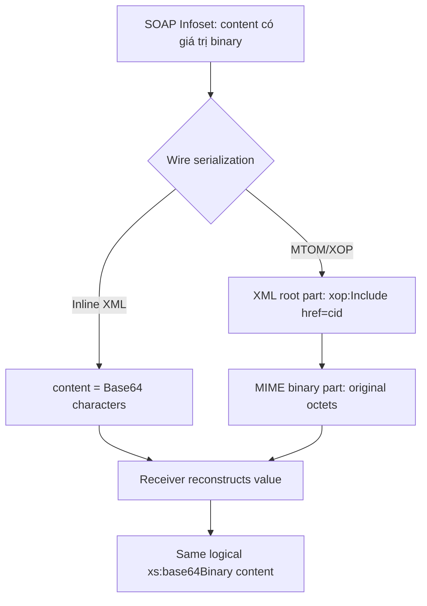
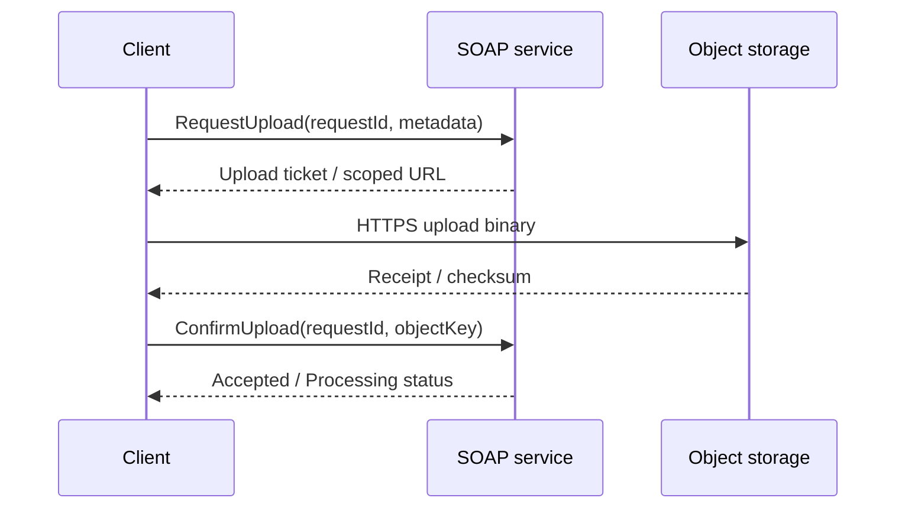

# Dữ liệu nhị phân trong XML và chi phí biểu diễn base64

## 1. Vì sao một SOAP service phải truyền dữ liệu nhị phân?

Trong các hệ thống doanh nghiệp, SOAP không chỉ truyền những trường văn bản như mã đơn hàng, trạng thái hay số tiền. Một operation có thể cần gửi **tệp PDF chứng từ, ảnh xác nhận giao hàng, dữ liệu quét, chữ ký số dưới dạng byte, bản lưu báo cáo hoặc một khối nhị phân**.

XML được thiết kế như một ngôn ngữ đánh dấu dựa trên ký tự. Nếu nhét trực tiếp các byte tùy ý vào phần tử XML, ta có thể gặp byte không phải ký tự XML hợp lệ, chuỗi không đúng encoding, ký tự điều khiển và các dấu đặc biệt như `<` hay `&`. Vì thế, cách phổ biến là **mã hóa nhị phân thành các ký tự thuộc bảng chữ cái base64** rồi đặt trong một phần tử kiểu `xs:base64Binary`.

Điều này giúp dữ liệu đi qua XML parser và JAXB/OXM, nhưng không miễn phí: phần base64 thường dài hơn khoảng **33,33%** so với byte gốc, chưa kể XML Envelope, DOM, bản sao trong bộ nhớ và chi phí mã hóa/giải mã.

Bài học thuộc chương **Tệp đính kèm** của module **SPRING_WEB_SERVICES**: phát triển dịch vụ SOAP theo hướng **contract-first** bằng XSD/WSDL, JAXB, Spring-WS endpoint/client, SOAP Fault, interceptor, XML security, WS-Security, chứng chỉ và kiểm thử tương thích. Trọng tâm ở đây là **biểu diễn nhị phân bằng base64 và những chi phí thực tế**, từ đó hiểu vì sao tồn tại MTOM/XOP và MIME attachments.

### Mục tiêu học tập

Sau bài, bạn có thể:

1. Giải thích tại sao byte bất kỳ không thể đặt nguyên xi làm text trong XML.
2. Tính đúng số ký tự base64 từ số byte nhị phân bằng công thức `4 × ceil(n / 3)`.
3. Phân biệt **giá trị nhị phân**, **ký tự base64 trong XML**, và **các MIME binary parts** ở tầng truyền tải.
4. Thiết kế `xs:base64Binary` trong XSD và operation upload/download trong WSDL.
5. Hiểu JAXB `byte[]`, `DataHandler` và tác động lên heap/streaming.
6. Phân biệt **base64 inline**, **MTOM/XOP**, **SOAP with Attachments (SwA)** và cơ chế tải tệp ngoài SOAP.
7. Cấu hình `Jaxb2Marshaller.setMtomEnabled(true)` đúng bối cảnh Spring-WS.
8. Nhận diện API `MimeMessage`/`Attachment` cho MIME attachments thủ công, không nhầm nó với MTOM tự động.
9. Thiết kế kiểm soát kích thước, content type, checksum, XML/WS-Security và chống file upload độc hại.
10. Xây dựng benchmark, contract tests và interoperability tests thay vì suy hiệu năng chỉ từ kích thước đầu vào.

## 2. Phân biệt binary, base64 và XML

Giả sử người dùng muốn gửi đúng năm byte ASCII của chữ `Hello`:

```text
Byte ở dạng hex: 48 65 6C 6C 6F
Số byte:         5
Base64:          SGVsbG8=
Số ký tự base64: 8
```

Trong XML:

```xml
<doc:content
    xmlns:doc="urn:example:document:v1">SGVsbG8=</doc:content>
```

**Bản thân dữ liệu file** vẫn là năm byte ban đầu. Chuỗi `SGVsbG8=` chỉ là **biểu diễn văn bản** của năm byte ấy. Bên nhận phải decode base64 để lấy byte chính xác.

Một chuỗi base64 **không** cung cấp mã hóa bảo mật, chữ ký số, nén hay chứng minh file an toàn. Người xem XML vẫn có thể decode chuỗi nếu có quyền đọc SOAP message.

### 2.1. Tại sao không dùng XML CDATA để chứa file?

CDATA chỉ tránh phải escape một số ký tự XML, ví dụ `<` và `&`; nó vẫn bị ràng buộc bởi encoding và tập ký tự XML. Không thể nhét mọi byte nhị phân vào CDATA một cách nguyên vẹn. Hơn nữa, CDATA không cho phép chuỗi kết thúc `]]>` xuất hiện tùy tiện trong dữ liệu.

Với file tùy ý, cần biểu diễn như base64/hex hoặc chuyển binary ra một định dạng đóng gói MIME/đường truyền khác.

### 2.2. Base64 khác hex

| Biểu diễn | Số bit trên ký tự | Mức mở rộng cơ bản | Ghi chú |
| --- | --- | --- | --- |
| Base64 | 6 | ~33,33% với dữ liệu lớn | Phổ biến trong `xs:base64Binary` |
| Hex | 4 | 100% | Hai ký tự hex biểu diễn một byte |
| MIME binary part | Binary octets | Không có overhead 4:3 do base64 | Vẫn có boundary và MIME headers |
| Binary file ngoài SOAP | Binary octets | Phụ thuộc HTTP/storage protocol | Cần thêm URL, auth, lifecycle |

`xs:hexBinary` là kiểu XSD hợp lệ, nhưng khi phải truyền nhiều megabyte, hex làm dữ liệu văn bản dài gấp đôi nên thường không thích hợp.

## 3. Base64 hoạt động như thế nào?

Base64 lấy từng **nhóm ba byte** (24 bit), chia thành **bốn nhóm sáu bit**, rồi ánh xạ mỗi nhóm sang một ký tự trong bảng chữ cái base64. Nếu nhóm cuối thiếu byte, nó được bổ sung ký tự padding `=` để có tổng số ký tự là bội số của bốn.

Ví dụ:

```text
"ABC"    -> QUJD
"AB"     -> QUI=
"A"      -> QQ==
"Hello"  -> SGVsbG8=
```

Với `ABC` có đúng ba byte nên mã hóa ra bốn ký tự. Với `AB` có hai byte nên ra bốn ký tự, một ký tự padding. Với `A` có một byte nên cũng ra bốn ký tự, hai ký tự padding.

### 3.1. Công thức chính xác

Gọi `n` là số byte dữ liệu đầu vào, với `n >= 0`.

\[
L_{\text{base64}}(n) = 4\left\lceil\frac{n}{3}\right\rceil
\]

Trong đó:

- `L_base64` là **số ký tự** base64, bao gồm padding nếu sử dụng dạng chuẩn có padding.
- `ceil` làm tròn lên số nguyên.
- Với một XML document dùng UTF-8 và các ký tự base64 ASCII thông thường, mỗi ký tự đó chiếm **một byte trên wire**, trước khi xét nén, line breaks và headers.

Độ tăng tuyệt đối là:

\[
\Delta(n) = 4\left\lceil\frac{n}{3}\right\rceil - n
\]

Tỷ lệ mở rộng đối với `n > 0`:

\[
R(n) = \frac{L_{\text{base64}}(n)}{n}
\]

Khi `n` đủ lớn, `R(n)` tiến gần `4/3 ≈ 1,3333`, tương đương tăng khoảng **33,33%**.

### 3.2. Bảng ví dụ tính chính xác

| Dữ liệu gốc | Số byte `n` | Ký tự base64 `L(n)` | Phần tăng |
| --- | ---: | ---: | ---: |
| Rỗng | 0 | 0 | 0 |
| 1 byte | 1 | 4 | +3 byte/ký tự |
| 2 byte | 2 | 4 | +2 |
| 3 byte | 3 | 4 | +1 |
| 4 byte | 4 | 8 | +4 |
| 1 KiB | 1.024 | 1.368 | +344 |
| 100 KiB | 102.400 | 136.536 | +34.136 |
| 1 MiB | 1.048.576 | 1.398.104 | +349.528 |
| 10 MiB | 10.485.760 | 13.981.016 | +3.495.256 |

**KiB = 1.024 byte**, **MiB = 1.048.576 byte**. Các giá trị ở cột thứ ba chưa tính XML tags, SOAP Envelope, HTTP headers, whitespace hoặc MIME packaging.

Với file rất nhỏ, tỷ lệ phần trăm có thể **cao hơn 33%** do padding: một byte thành bốn ký tự là tăng 300%. Vì vậy 33,33% là giới hạn tiệm cận cho dữ liệu lớn, không phải kết quả chính xác cho mọi kích thước.

## 4. Byte gốc và kích thước HTTP không hoàn toàn đồng nhất

Không nên phát biểu một cách tuyệt đối rằng “request SOAP có base64 luôn lớn hơn đúng 33,33%”. Công thức ở mục 3 áp dụng cho **phần dữ liệu base64**, trong điều kiện không có wrapping hoặc chuyển mã khác.

Một SOAP message thực còn có:

```text
HTTP request line + headers
SOAP Envelope
SOAP Header (correlation ID, security, WS-Addressing...)
SOAP Body
  <UploadEvidenceRequest>
    metadata, requestId, fileName, contentType...
    <content>...base64...</content>
  </UploadEvidenceRequest>
HTTP framing / network transport
```

Kích thước còn phụ thuộc:

- **Encoding XML:** UTF-8 giữ ký tự base64 ASCII ở một byte; các encoding khác có thể khác.
- **Whitespace/line breaks:** một số serializer thêm xuống dòng hoặc khoảng trắng.
- **HTTP compression:** nếu client, server và gateway thỏa thuận, nén có thể thay đổi số byte trên mạng. Base64 của dữ liệu vốn đã nén (JPEG/PDF/ZIP) không nhất thiết nhận lợi ích như XML text.
- **TLS framing và giao thức HTTP:** có overhead riêng.
- **SOAP Header security:** chữ ký/chứng chỉ làm Envelope dài thêm.
- **MIME/MTOM:** binary tránh overhead base64 nhưng thêm MIME headers và boundaries.

Muốn so sánh công bằng, phải đo **HTTP entity bytes thật** và chi phí CPU/heap/latency trong cùng cấu hình, không chỉ đo `String.length()`.

### 4.1. Ví dụ dung lượng

Một PDF 10 MiB thành **13.981.016 ký tự base64**. Chỉ phần dữ liệu này đã hơn file gốc 3.495.256 byte nếu biểu diễn UTF-8 không nén.

Nếu XML được giữ trong Java `String`, không thể dùng số byte mạng làm bằng chứng số byte heap chính xác: JVM có biểu diễn string và các bản sao/trung gian khác nhau. Dù vậy, khi cùng lúc có `byte[]` gốc, chuỗi base64, DOM nodes và body buffer, peak heap có thể lớn hơn đáng kể cả file gốc lẫn XML cuối cùng.

## 5. Chi phí CPU, GC và bộ nhớ ở phía Java

Với inline base64, đường đi thường có các bước:

```mermaid
flowchart LR
    A[File / InputStream] --> B[byte[] hoặc buffer]
    B --> C[Base64 encode]
    C --> D[XML character content]
    D --> E[SOAP serialize]
    E --> F[HTTP/TLS transport]
    F --> G[XML parse]
    G --> H[Base64 decode]
    H --> I[Binary validation/storage]
```

Một số thư viện có thể gộp hoặc streaming vài bước, nhưng không nên mặc định mọi stack làm điều này.

### 5.1. Các vùng cấp phát dễ gặp

- `Files.readAllBytes(...)` đưa **toàn bộ file** vào `byte[]`.
- `Base64.getEncoder().encodeToString(...)` tạo chuỗi ký tự base64.
- JAXB marshalling có thể tạo buffer trung gian.
- DOM-based SOAP message factories có thể giữ cấu trúc XML trong bộ nhớ.
- Lớp transport có thể buffer payload để tính Content-Length hoặc retry.
- Receiver lại parse XML và decode sang một `byte[]` mới.
- File validation/antivirus có thể tạo bản sao hoặc spool ra disk.

Không có một công thức “peak heap = 1,33 × file size” áp dụng cho mọi hệ thống. Phải profile theo message factory, parser, MTOM support, HTTP client, concurrent requests và GC.

### 5.2. Ví dụ Java Base64 dành cho dữ liệu nhỏ

```java
import java.nio.charset.StandardCharsets;
import java.util.Base64;
import java.util.Arrays;

public final class Base64Example {
    public static void main(String[] args) {
        byte[] raw = "Hello".getBytes(StandardCharsets.UTF_8);
        String text = Base64.getEncoder().encodeToString(raw);
        byte[] decoded = Base64.getDecoder().decode(text);

        System.out.println(text); // SGVsbG8=
        System.out.println(Arrays.equals(raw, decoded)); // true
    }
}
```

`java.util.Base64` **không** tự gắn MIME headers, không tạo SOAP Envelope và không validate một XSD. Nó chỉ chuyển đổi bytes ↔ base64.

### 5.3. Không convert file lớn thành chuỗi chỉ để debug

Một anti-pattern:

```java
String hugeLogLine =
    Base64.getEncoder().encodeToString(
        java.nio.file.Files.readAllBytes(documentPath));

log.info("Request content={}", hugeLogLine);
```

Đoạn trên vừa đọc toàn file vào memory, vừa tạo chuỗi dài, vừa có nguy cơ lộ dữ liệu nhị phân trong logs. Không log nguyên base64. Ghi những thông tin không nhạy cảm như byte count, content type đã xác thực, checksum hoặc correlation ID theo policy.

## 6. Streaming base64 không hoàn toàn xóa overhead

JDK hỗ trợ streaming encoder:

```java
import java.io.InputStream;
import java.io.OutputStream;
import java.util.Base64;

public final class Base64Streams {
    public static void encode(
            InputStream input,
            OutputStream destination) throws java.io.IOException {
        try (OutputStream encoded =
                Base64.getEncoder().wrap(destination)) {
            input.transferTo(encoded);
        }
    }
}
```

Đây là ví dụ **stream byte vào một Base64 text output**; không tự ghi XML tags, SOAP envelope hay xử lý SOAP message factory. Khi `encoded` được đóng, stream đích bên dưới cũng được đóng; **không** cắm thẳng đoạn code này vào một output stream của SOAP message đang được framework quản lý mà không hiểu lifecycle.

Streaming giúp tránh giữ toàn bộ file trong một `byte[]` và chuỗi base64 cùng lúc, nhưng:

- Kích thước base64 truyền trên wire vẫn gần 4/3 so với file.
- Serializer XML phải xử lý đúng ký tự/namespace.
- HTTP sender hoặc SAAJ/DOM pipeline có thể buffer về sau.
- Muốn streaming end-to-end cần kiểm tra thực tế từng lớp và các interceptor/security steps.

## 7. XSD: dùng xs:base64Binary cho hợp đồng nhị phân

Với contract-first, một SOAP operation nên khai báo **rõ kiểu dữ liệu nhị phân** thay vì đặt file vào `xs:string` chung chung.

Ví dụ `document-v1.xsd`:

```xml
<?xml version="1.0" encoding="UTF-8"?>
<xs:schema
    xmlns:xs="http://www.w3.org/2001/XMLSchema"
    xmlns:doc="urn:example:document:v1"
    targetNamespace="urn:example:document:v1"
    elementFormDefault="qualified">

  <xs:simpleType name="RequestIdType">
    <xs:restriction base="xs:token">
      <xs:minLength value="1"/>
      <xs:maxLength value="64"/>
    </xs:restriction>
  </xs:simpleType>

  <xs:simpleType name="BinaryContentType">
    <xs:restriction base="xs:base64Binary">
      <xs:maxLength value="10485760"/>
    </xs:restriction>
  </xs:simpleType>

  <xs:element name="UploadEvidenceRequest">
    <xs:complexType>
      <xs:sequence>
        <xs:element name="requestId" type="doc:RequestIdType"/>
        <xs:element name="fileName" type="xs:token"/>
        <xs:element name="mediaType" type="xs:token"/>
        <xs:element name="content" type="doc:BinaryContentType"/>
      </xs:sequence>
    </xs:complexType>
  </xs:element>

  <xs:element name="UploadEvidenceResponse">
    <xs:complexType>
      <xs:sequence>
        <xs:element name="requestId" type="doc:RequestIdType"/>
        <xs:element name="documentId" type="xs:string"/>
        <xs:element name="state" type="xs:string"/>
      </xs:sequence>
    </xs:complexType>
  </xs:element>
</xs:schema>
```

Ý nghĩa:

1. `content` phải biểu diễn **giá trị nhị phân** thông qua lexical form tương thích `xs:base64Binary` nếu đi dưới dạng XML text.
2. `xs:maxLength value="10485760"` đặt giới hạn **10 MiB giá trị nhị phân sau decode** theo kiểu dữ liệu, không phải 10 triệu ký tự base64. Đối chiếu khả năng áp dụng facets của validator XSD đang dùng.
3. `fileName` và `mediaType` là metadata client khai báo, **không phải thông tin đáng tin** để quyết định định dạng file hoặc đường dẫn lưu.
4. `requestId` có thể dùng cho idempotency nếu operation định nghĩa đúng semantics; XSD không tự bảo đảm duy nhất.
5. Schema vẫn cần được validate ở server; JAXB unmarshal thành công không mặc nhiên bật đầy đủ XSD validation.

### 7.1. Có nên khai báo maxLength trong XSD?

Có, nếu hợp đồng có giới hạn kích thước ổn định và mọi đối tác có thể tuân thủ. Nhưng server vẫn phải giới hạn **HTTP entity size, MIME part size, số lượng attachments, decoded bytes và disk/heap usage** trước hoặc trong khi parse. Không thể đợi decode xong một upload khổng lồ rồi mới nhìn vào `xs:maxLength`.

### 7.2. Không nhầm absent, empty và nil

- `content` absent: không hợp lệ trong ví dụ vì `minOccurs` mặc định là 1.
- `<content/>`: biểu diễn zero-length base64 value; có thể hợp lệ về schema nhưng **bị policy nghiệp vụ từ chối** nếu file phải có ít nhất một byte.
- `<content xsi:nil="true"/>`: không hợp lệ trong ví dụ vì không khai báo `nillable="true"`.

Contract và use case phải thống nhất có cho upload file rỗng hay không. Không mặc định “có element” nghĩa “file đã có dữ liệu”.

## 8. SOAP request inline base64 theo hợp đồng

Để thấy XML hợp lệ, giả sử payload nhị phân chỉ là năm byte `Hello`, với media type `application/octet-stream`:

```xml
<soapenv:Envelope
    xmlns:soapenv="http://schemas.xmlsoap.org/soap/envelope/"
    xmlns:doc="urn:example:document:v1">
  <soapenv:Header/>
  <soapenv:Body>
    <doc:UploadEvidenceRequest>
      <doc:requestId>REQ-UP-1042</doc:requestId>
      <doc:fileName>hello.bin</doc:fileName>
      <doc:mediaType>application/octet-stream</doc:mediaType>
      <doc:content>SGVsbG8=</doc:content>
    </doc:UploadEvidenceRequest>
  </soapenv:Body>
</soapenv:Envelope>
```

Sau khi decode, file content là `Hello`. Đây là ví dụ nhỏ để đọc dễ; file PDF/JPEG/ZIP thực có các byte nhị phân khác và Base64 text dài hơn nhiều.

Một response minh họa:

```xml
<doc:UploadEvidenceResponse
    xmlns:doc="urn:example:document:v1">
  <doc:requestId>REQ-UP-1042</doc:requestId>
  <doc:documentId>DOC-51042</doc:documentId>
  <doc:state>ACCEPTED</doc:state>
</doc:UploadEvidenceResponse>
```

`ACCEPTED` có thể chỉ là đã nhận để xử lý bất đồng bộ. Không tự hiểu là file an toàn, đã scan virus hoặc đã được lưu bền vững nếu contract không quy định.

## 9. WSDL: không nhầm binary field với attachment binding

XSD xác định element, WSDL xác định operation, message, binding, SOAPAction và Fault.

Một fragment WSDL 1.1 document/literal:

```xml
<wsdl:message name="UploadEvidenceInput">
  <wsdl:part name="parameters"
             element="tns:UploadEvidenceRequest"/>
</wsdl:message>

<wsdl:message name="UploadEvidenceOutput">
  <wsdl:part name="parameters"
             element="tns:UploadEvidenceResponse"/>
</wsdl:message>

<wsdl:portType name="DocumentPortType">
  <wsdl:operation name="UploadEvidence">
    <wsdl:input message="tns:UploadEvidenceInput"/>
    <wsdl:output message="tns:UploadEvidenceOutput"/>
  </wsdl:operation>
</wsdl:portType>
```

Đây là **fragment**, không phải WSDL độc lập. WSDL đầy đủ phải có `definitions`, namespace `wsdl`, `tns=urn:example:document:v1`, `types` import XSD, `binding` với document/literal và `service`/`soap:address`.

**Chỉ khai báo `xs:base64Binary` không tự chứng minh HTTP message sẽ dùng MTOM.** Bên gửi có thể inline base64 trong SOAP XML hoặc dùng wire-level optimization khi cả hai phía, SOAP message factory và binding/policy hỗ trợ. Nếu đối tác yêu cầu MIME/MTOM, phải công bố và kiểm thử điều đó ở binding/policy và integration contract.

## 10. JAXB/OXM: byte[] là mapping dễ gặp

Trong JAXB, `xs:base64Binary` thường được biểu diễn bằng `byte[]` ở generated Java model (trừ khi binding/XML MIME metadata hoặc tùy biến generator cho ra kiểu khác).

```java
// Mẫu mô phỏng một property do JAXB sinh:
// Không sửa class generated từ XSD.
private byte[] content;
```

Ưu điểm:

- Dễ sử dụng API Java, lưu hoặc tính checksum.
- JAXB tự lo chuyển đổi base64 khi marshal/unmarshal.
- Ít code XML trực tiếp.

Đánh đổi:

- `byte[]` giữ toàn bộ nội dung file trong heap.
- Nếu tạo `String` base64 thêm để log/inspect, lại tăng peak memory.
- Với 50 requests upload 10 MiB cùng lúc, riêng các mảng byte có thể chiếm khoảng 500 MiB, chưa tính SOAP message/DOM/transport buffers và các bản sao.

Không nên hiểu rằng JAXB `byte[]` **tự bật MTOM**. Dù server nhận `byte[]`, SOAP message có thể vẫn chứa text base64 nếu chưa cấu hình optimization hoặc provider quyết định giữ inline.

### 10.1. Khi nào byte[] vẫn hợp lý?

- File nhỏ và có giới hạn chặt.
- Hệ thống cần lập tức phân tích toàn bộ byte trong một thuật toán.
- Số concurrent uploads thấp và heap được đánh giá.
- Contract và client stacks không hỗ trợ MIME/MTOM.
- Chi phí triển khai streaming lớn hơn lợi ích thực tế.

Đừng dùng MTOM chỉ vì “binary luôn phải tách ra”; với vài chục byte, MIME boundaries có thể tốn nhiều hơn base64.

## 11. Chi phí khi Base64 gặp DOM và SOAP Envelope

Với một upload 10 MiB, không nên chỉ so **10 MiB vs 13,33 MiB**. Một ứng dụng có thể đồng thời giữ:

```text
Input file resource / FileDataSource
        |
        v
JAXB byte[]                     ~10 MiB (nếu đã đọc hết)
        |
        v
Base64 XML characters            ~13.33 MiB UTF-8 wire
        |
        v
SAAJ/DOM message buffer          phụ thuộc implementation
        |
        v
HTTP output buffer/TLS records   phụ thuộc sender/pool
```

Phía receiver có thể giữ SOAP XML rồi decode thành một `byte[]` khác. Khi hàng chục request đến đồng thời, memory pressure và GC pauses có thể đáng kể hơn phần overhead mạng.

### 11.1. Đừng suy memory footprint từ String.length

`String.length()` là số UTF-16 code units ở API Java, không phải số byte XML thực trên network. JVM có compact strings và cơ chế serialization riêng; DOM nodes còn giữ metadata/object overhead. Muốn đo hiệu quả, profile **heap live set, allocation rate, GC pauses và peak RSS** trong workload thật.

### 11.2. Attachment có thể cũng bị buffer

Sử dụng MIME attachment không tự bảo đảm zero-copy hoặc O(1) memory. Một số SAAJ/HTTP implementations vẫn buffer để tính Content-Length, phục vụ retry hoặc serialize multipart. Các interceptor WS-Security phải đọc/ký/encrypt content cũng có thể làm tăng lưu trữ trung gian. Kiểm tra implementation và benchmark end-to-end.

## 12. MTOM/XOP được thiết kế để giải quyết điều gì?

**MTOM (SOAP Message Transmission Optimization Mechanism)** mô tả cách tối ưu truyền giá trị nhị phân trong SOAP message, còn **XOP (XML-binary Optimized Packaging)** mô tả cách đóng gói XML Infoset với những binary parts tách ra.

Về **ngữ nghĩa XML**, application vẫn có một element `content` với giá trị `xs:base64Binary`. Về **wire format**, runtime có thể:

1. Đưa phần binary ra một MIME part theo dạng octets.
2. Trong XML root part, thay phần text base64 bằng một liên kết `xop:Include` tới MIME Content-ID.
3. Gửi `multipart/related` qua HTTP.
4. Ở bên nhận, tái dựng **XML Infoset tương đương** hoặc cung cấp binary value trực tiếp theo API.



MTOM **không đổi nghĩa element** và không tự tạo một business operation khác. Nó là tối ưu hóa cách truyền tải, không phải cách đổi schema từ `xs:base64Binary` thành `xs:string`.

### 12.1. Một giới hạn quan trọng của XOP

XOP/MTOM tối ưu những nội dung tương ứng với **canonical lexical representation** của `xs:base64Binary` theo đặc tả. Các dạng lexical có whitespace không được tùy tiện thay đổi vì có thể làm khác XML Infoset. Runtime có thể giữ inline nếu không thể/tùy policy không muốn tối ưu.

**Không giả định bật MTOM nghĩa mọi trường base64 lập tức trở thành MIME part.** Kích thước dữ liệu, loại JAXB binding, provider, threshold và khả năng hỗ trợ của SOAP stack đều ảnh hưởng.

## 13. Hình dạng một MTOM/XOP multipart message

Một request SOAP 1.2 được tối ưu có thể được đóng gói như sau:

```http
POST /ws/documents HTTP/1.1
Host: soap.example.invalid
Content-Type: multipart/related;
  boundary="MIME_BOUNDARY";
  type="application/xop+xml";
  start="<rootpart@example.invalid>";
  start-info="application/soap+xml"
```

Body MIME minh họa (nội dung được xuống dòng để đọc; không phải literal byte-for-byte của một request trên mạng):

```text
--MIME_BOUNDARY
Content-Type: application/xop+xml; charset=UTF-8;
  type="application/soap+xml"
Content-Transfer-Encoding: 8bit
Content-ID: <rootpart@example.invalid>

<env:Envelope
  xmlns:env="http://www.w3.org/2003/05/soap-envelope"
  xmlns:doc="urn:example:document:v1"
  xmlns:xop="http://www.w3.org/2004/08/xop/include">
  <env:Body>
    <doc:UploadEvidenceRequest>
      <doc:requestId>REQ-UP-1042</doc:requestId>
      <doc:fileName>hello.bin</doc:fileName>
      <doc:mediaType>application/octet-stream</doc:mediaType>
      <doc:content>
        <xop:Include href="cid:evidence-1@example.invalid"/>
      </doc:content>
    </doc:UploadEvidenceRequest>
  </env:Body>
</env:Envelope>

--MIME_BOUNDARY
Content-Type: application/octet-stream
Content-Transfer-Encoding: binary
Content-ID: <evidence-1@example.invalid>

Hello
--MIME_BOUNDARY--
```

Giá trị MIME binary part là đúng năm byte `Hello` (mẫu dễ đọc). Với file PDF/JPEG thật, phần sau MIME headers có thể chứa các byte không hiển thị được. Không dùng ví dụ này như một serializer MIME thủ công: headers/boundaries/CRLF/Content-ID phải do thư viện chuẩn tạo.

### 13.1. Ý nghĩa của Content-ID và cid URI

- MIME part có `Content-ID: <evidence-1@example.invalid>`.
- Trong XML root part, `xop:Include href="cid:evidence-1@example.invalid"` tham chiếu part ấy.
- Receiver phải resolve đúng Content-ID, kiểm duplicates và các tham chiếu không có part.
- Giá trị Content-ID thực có thể cần escaping theo quy tắc `cid:` URI khi chứa ký tự đặc biệt.

Không tạo Content-ID từ tên file chưa kiểm tra hoặc suy rằng `cid:` là một HTTP URL cần fetch từ Internet. Nó là một **tham chiếu trong MIME package**, không phải một đường dẫn web bất kỳ.

### 13.2. XML literal có xop:Include khác Infoset tái dựng

Nếu lấy riêng XML root part có `xop:Include` rồi đưa trực tiếp cho một XSD validator chỉ biết `content type=xs:base64Binary`, validator có thể báo sai kiểu. MTOM receiver phải xử lý XOP packaging/tái dựng dữ liệu đúng trước khi áp validation theo SOAP logical Infoset.

Đừng tự thay `<xop:Include .../>` bằng chuỗi `cid:...`: đó không phải nội dung base64 hợp lệ của file.

## 14. MTOM tối ưu cái gì và không tối ưu cái gì?

| Hạng mục | MTOM có giúp? | Giải thích |
| --- | --- | --- |
| Chi phí base64 cho binary lớn | Thường có | Gửi octets thay vì ký tự base64 ở MIME part |
| Khả năng giữ logic `xs:base64Binary` | Có | Logical XML Infoset được bảo toàn |
| SOAP header XML dài | Không trực tiếp | Header vẫn là XML, trừ tối ưu riêng hợp lệ |
| Metadata `fileName`, `mediaType` | Không | Vẫn là XML text thông thường |
| HTTP/TLS framing overhead | Không | Vẫn có transport overhead |
| MIME headers/boundaries | Thêm overhead | Với file nhỏ có thể tốn hơn inline |
| Heap/CPU end-to-end | Tùy stack | Nếu mọi layer vẫn buffer thì hiệu quả hạn chế |
| Compression của file | Không tự động | MTOM không phải ZIP/GZIP |
| Confidentiality/integrity | Không | Cần TLS/WS-Security và kiểm soát truy cập |
| Antivirus/file type detection | Không | Cần kiểm tra binary thực |
| Business idempotency | Không | Cần request ID/transaction/unique constraint |

**Lợi ích lớn nhất** là tránh chuyển binary lớn thành một khối ký tự base64 trên wire. Nhưng phải đo với SOAP stack, gateway và đối tác cụ thể. Một MTOM client không thể ép server không hỗ trợ XOP hiểu một MIME multipart response.

## 15. SOAP with Attachments (SwA) khác MTOM như thế nào?

Cả hai đều có thể dùng MIME multipart, nhưng ý nghĩa ở tầng contract khác nhau.

| Tiêu chí | Inline base64 | MTOM/XOP | SOAP with Attachments thủ công |
| --- | --- | --- | --- |
| Nội dung nhị phân trong XML Infoset | Có, dưới dạng base64 text | **Có về mặt logic**, nhưng tối ưu wire | Thường là liên kết/metadata tới part độc lập |
| Wire format | Một SOAP XML | Multipart/related + XOP | Multipart/related + attachments |
| XSD field | `xs:base64Binary` | Vẫn `xs:base64Binary` | Có thể dùng URI/`swaRef` hoặc mô hình riêng |
| Mapping ứng dụng | `byte[]`/text | JAXB `byte[]`/`DataHandler` với MTOM | Application đọc `MimeMessage` attachments |
| Hỗ trợ đối tác | SOAP XML thông thường | Phải hỗ trợ MTOM/XOP | Phải hỗ trợ SwA/protocol đã thỏa thuận |
| Reference đến binary | Nội dung element | `xop:Include href="cid:..."` ở root part | Thường dùng `cid:...` theo contract |
| Rủi ro | Base64 cost | MIME/XOP interoperability | CID mapping và business semantics riêng |

### 15.1. Hai hiểu nhầm dễ gây lỗi

- **Thêm MIME attachment thủ công ≠ đã bật MTOM**. Nếu JAXB Body vẫn chứa base64 và bạn cũng add file vào MimeMessage, có thể vô tình gửi **hai bản cùng dữ liệu**.
- **Bật MTOM ≠ mọi attachment có thể được application tìm bằng một field CID do mình tự đặt**. Runtime MTOM quản lý XOP references và attachment parts theo binding; không đồng nhất với một SwA schema tùy biến.

Khi tích hợp, hãy xác nhận cụ thể bên đối tác nói tới MTOM/XOP, SwA, `swaRef` hay một cơ chế đặc thù. Tên “SOAP attachments” trong tài liệu đối tác đôi khi chưa đủ xác định wire protocol.

## 16. Spring-WS: cấu hình JAXB marshaller cho MTOM

Spring Framework `Jaxb2Marshaller` có tùy chọn `setMtomEnabled(boolean)`; mặc định là `false`. Bật nó là **một phần** của việc hỗ trợ MTOM.

Ví dụ cấu hình:

```java
import org.springframework.context.annotation.Bean;
import org.springframework.context.annotation.Configuration;
import org.springframework.oxm.jaxb.Jaxb2Marshaller;
import org.springframework.ws.client.core.WebServiceTemplate;
import org.springframework.ws.soap.saaj.SaajSoapMessageFactory;

@Configuration
public class DocumentSoapClientConfig {

    @Bean
    public Jaxb2Marshaller documentMarshaller() {
        Jaxb2Marshaller marshaller = new Jaxb2Marshaller();
        marshaller.setContextPath(
            "com.example.document.contract.v1");
        marshaller.setMtomEnabled(true);
        return marshaller;
    }

    @Bean
    public SaajSoapMessageFactory documentMessageFactory() {
        return new SaajSoapMessageFactory();
    }

    @Bean
    public WebServiceTemplate documentWebServiceTemplate(
            SaajSoapMessageFactory documentMessageFactory,
            Jaxb2Marshaller documentMarshaller) {

        WebServiceTemplate template =
                new WebServiceTemplate(documentMessageFactory);

        template.setDefaultUri(
            "https://soap.example.invalid/ws/documents");
        template.setMarshaller(documentMarshaller);
        template.setUnmarshaller(documentMarshaller);
        return template;
    }
}
```

Ví dụ dùng Spring-WS/Jakarta hiện đại và SAAJ message factory. Đây là **bộ khung**, chưa có HTTP sender, TLS/mTLS, WS-Security interceptor, timeouts, Fault resolver hoặc SOAPAction. Địa chỉ `example.invalid` chỉ dùng để minh họa.

### 16.1. Chỉ setMtomEnabled(true) đã đủ chưa?

Chưa chắc. Cần đồng thời kiểm:

1. JAXB model field có thể cung cấp binary cho MTOM (ví dụ `DataHandler` và metadata MIME phù hợp), không chỉ một giá trị text đã base64 hóa từ trước.
2. Message factory thực sự hỗ trợ MIME/XOP packaging.
3. HTTP sender không làm sai multipart headers/boundaries.
4. Đối tác hỗ trợ MTOM/XOP và đúng SOAP version/binding.
5. Kích thước file và provider optimization policy có kích hoạt MTOM hay vẫn inline.
6. Security policy cho SOAP Body và attachment parts được thỏa thuận.
7. Test **HTTP wire bytes**, không chỉ assert Java property `mtomEnabled=true`.

Không gửi base64 String cho một JAXB property đã khai báo là binary rồi mong runtime decode/re-encode tối ưu tự động.

## 17. JAXB DataHandler so với byte[]

Khi làm việc với binary lớn, JAXB có thể dùng `jakarta.activation.DataHandler` thay cho `byte[]` khi binding và MIME metadata cho phép. `DataHandler` giúp biểu diễn nội dung thông qua một data source, có khả năng mở stream thay vì bắt buộc giữ toàn bộ bytes trong một mảng.

Một class JAXB thủ công *minh họa cơ chế annotation*:

```java
import jakarta.activation.DataHandler;
import jakarta.xml.bind.annotation.XmlAccessType;
import jakarta.xml.bind.annotation.XmlAccessorType;
import jakarta.xml.bind.annotation.XmlElement;
import jakarta.xml.bind.annotation.XmlMimeType;
import jakarta.xml.bind.annotation.XmlRootElement;

@XmlRootElement(
    name = "BinaryContent",
    namespace = "urn:example:document:v1")
@XmlAccessorType(XmlAccessType.FIELD)
public class BinaryContent {

    @XmlElement(
        name = "content",
        namespace = "urn:example:document:v1")
    @XmlMimeType("application/octet-stream")
    private DataHandler content;

    public DataHandler getContent() {
        return content;
    }

    public void setContent(DataHandler content) {
        this.content = content;
    }
}
```

Class này chỉ minh họa annotation và type, **không phải generated class từ XSD mục 7** và không được dùng thay `UploadEvidenceRequest` mà không thay contract cho khớp. `@XmlMimeType` là thông tin binding/MIME giúp JAXB biết media type mong đợi; không tự làm file an toàn hoặc thay authorization.

Với XJC, `xs:base64Binary` thường sinh `byte[]`, còn việc có ra `DataHandler` phụ thuộc schema XML MIME metadata/binding/toolchain. **Kiểm tra generated code thật** trước khi thiết kế bộ nhớ/streaming.

### 17.1. DataHandler cũng có lifecycle

Một `DataHandler` có thể dựa trên `FileDataSource`, in-memory data source hoặc stream tự định nghĩa. Nguồn dữ liệu phải còn tồn tại đến khi SOAP message đã được serialize; một file tạm bị xóa quá sớm có thể làm MTOM serialization thất bại.

Không đưa một `InputStream` đã đọc hết vào DataHandler rồi kỳ vọng HTTP client tự rewind. Một số implementation có thể đọc lại source khi retry hoặc xác định kích thước; nguồn dữ liệu phải có chính sách mở stream và cleanup rõ ràng.

## 18. XML MIME content type: giúp hợp đồng dễ hiểu hơn

W3C có tài liệu **Describing Media Content of Binary Data in XML**, mô tả annotation `xmime:expectedContentTypes` và metadata `xmime:contentType` cho binary elements.

Một phần tử trong XSD có thể được khai báo:

```xml
<xs:element
    name="content"
    type="xs:base64Binary"
    xmime:expectedContentTypes="application/pdf"/>
```

Đoạn trên giả định `xs` được khai báo là `http://www.w3.org/2001/XMLSchema` và `xmime` được khai báo là `http://www.w3.org/2005/05/xmlmime`. Đây là **trích đoạn schema**, có thể đặt trong complex type của `UploadEvidenceRequest` khi thiết kế contract thực.

Lưu ý:

- `xmime:expectedContentTypes` là một **schema annotation**, không phải bằng chứng payload có thực là PDF.
- Không phải mọi XJC version, JAXB runtime hoặc .NET stack đều sinh cùng một property type từ annotation này.
- Nếu XSD đã dùng `BinaryContentType` custom như mục 7, cần thay đúng phần declaration hoặc thêm annotation theo schema design đã kiểm chứng, không sao chép cùng lúc hai khai báo `content` trùng tên.
- Có thể dùng một field metadata `mediaType` riêng trong contract nếu đó là yêu cầu nghiệp vụ; hãy thống nhất giá trị giữa XML metadata và MIME Content-Type.

### 18.1. MIME Content-Type có thể bị giả mạo

Client có thể gửi `application/pdf` nhưng bytes thực là ZIP, HTML hoặc một executable. Server phải kiểm **magic bytes, cấu trúc file thực, media policy, malware scan và giới hạn parser**, không chỉ tin tên file, extension hoặc Content-Type do client khai.

Đặc biệt không render trực tiếp file upload lên browser với Content-Type do client tự khai mà không kiểm soát content sniffing, download headers và isolation.

## 19. Thêm MIME attachment thủ công với Spring-WS

Spring-WS có interface `org.springframework.ws.mime.MimeMessage` với API:

```java
Attachment addAttachment(
    String contentId,
    org.springframework.core.io.InputStreamSource source,
    String contentType);
```

Ngoài ra còn có overload nhận `File` hoặc `jakarta.activation.DataHandler`.

Ví dụ một **request callback**:

```java
import org.springframework.core.io.FileSystemResource;
import org.springframework.ws.mime.MimeMessage;
import org.springframework.ws.client.core.WebServiceMessageCallback;

import java.nio.file.Path;

public final class EvidenceAttachmentCallback {

    public static WebServiceMessageCallback addFile(
            Path path) {

        return message -> {
            if (!(message instanceof MimeMessage mime)) {
                throw new IllegalStateException(
                    "SOAP message factory does not support attachments");
            }

            mime.addAttachment(
                "evidence-1@example.invalid",
                new FileSystemResource(path),
                "application/octet-stream");
        };
    }
}
```

Đây là **ví dụ attachment thủ công**, không tự chứng minh MTOM. Phần **SOAP Body phải theo contract** và phải chứa tham chiếu thích hợp đến Content-ID nếu dùng cơ chế SwA; nếu chỉ add MIME part mà Body không biết đến nó, bên nhận có thể không biết part đó phục vụ nghiệp vụ nào.

### 19.1. InputStreamSource phải mở stream mới

Javadoc Spring-WS nêu rõ `MimeMessage.addAttachment(contentId, InputStreamSource, contentType)` có thể gọi `InputStreamSource.getInputStream()` **nhiều lần**.

Do đó:

- `FileSystemResource` thường phù hợp nếu file có sẵn và còn tồn tại suốt thời gian gửi.
- `ByteArrayResource` phù hợp với dữ liệu nhỏ đã có trong memory, nhưng không nên đọc trước file lớn chỉ để tạo nó.
- Một `InputStreamResource` gắn với cùng một stream dùng một lần có thể không phù hợp nếu runtime đọc lại.
- Nếu phải upload stream sinh động, thiết kế data source có thể tái tạo stream hoặc kiểm tra sender/provider hỗ trợ one-shot streaming và không retry ngầm.

### 19.2. Content-ID phải gắn với hợp đồng

Với SwA kiểu custom, Body có thể có `<doc:attachmentHref>cid:evidence-1@example.invalid</doc:attachmentHref>`. Nhưng **chỉ dùng mẫu này khi XSD/WSDL của đối tác thật sự mô tả nó**.

MTOM `xop:Include` do framework quản lý không đồng nghĩa với việc ứng dụng phải tự viết `attachmentHref` vào request Body.

## 20. Đọc MIME attachments phía server

Khi handler cần xử lý attachments thủ công, có thể lấy `MimeMessage` từ Spring-WS `MessageContext` (trong vùng SOAP adapter), rồi tìm hoặc duyệt các parts.

Ví dụ hướng dẫn:

```java
import java.io.IOException;
import java.io.InputStream;
import org.springframework.ws.context.MessageContext;
import org.springframework.ws.mime.Attachment;
import org.springframework.ws.mime.MimeMessage;

public final class EvidenceAttachmentReader {

    public Attachment requireAttachment(
            MessageContext context, String contentId) {

        if (!(context.getRequest() instanceof MimeMessage mime)) {
            throw new InvalidAttachmentException(
                    "MIME attachments not supported");
        }

        Attachment attachment = mime.getAttachment(contentId);

        if (attachment == null) {
            throw new InvalidAttachmentException(
                    "Missing required attachment");
        }

        return attachment;
    }
}
```

`InvalidAttachmentException` là exception ứng dụng phải định nghĩa. Hàm trên chọn một part theo Content-ID, **chưa đủ để bảo đảm** không có duplicate IDs, content-type đúng, file size trong giới hạn hoặc binary thực hợp lệ.

Với flow MTOM + JAXB, ứng dụng thường nhận binary thông qua JAXB property/`DataHandler`, không cần tự đọc MIME part bằng `getAttachment()`. Nếu dùng cả hai cơ chế, phải phân biệt rõ mỗi operation thuộc kiểu nào.

### 20.1. Đọc InputStream có giới hạn

`Attachment.getInputStream()` cho phép đọc bytes. Luôn có giới hạn kích thước thực tế, **không chỉ tin `Attachment.getSize()`** hoặc HTTP Content-Length.

Một helper copy có giới hạn:

```java
import java.io.IOException;
import java.io.InputStream;
import java.io.OutputStream;

public final class LimitedBinaryCopy {

    public static long copy(
            InputStream source,
            OutputStream target,
            long maxBytes) throws IOException {

        if (maxBytes < 0) {
            throw new IllegalArgumentException("Invalid limit");
        }

        byte[] buffer = new byte[8192];
        long count = 0;
        int read;

        while ((read = source.read(buffer)) != -1) {
            if (read > maxBytes - count) {
                throw new AttachmentTooLargeException();
            }
            target.write(buffer, 0, read);
            count += read;
        }

        return count;
    }
}
```

`AttachmentTooLargeException` là exception ứng dụng chưa được khai báo ở đây. Lớp gọi phải quản lý `try-with-resources` cho input/output streams theo ownership, rồi xóa file tạm/rollback transaction nếu thất bại.

**Đừng tiếp tục truyền request body** sau khi phát hiện vượt quota nếu HTTP parser cần drain hay đóng kết nối; xử lý theo policy và tránh để resource leak.

## 21. Tối ưu hóa lớn nhất đôi khi là không đưa file vào SOAP

Có những hệ thống nên tách **metadata/command** khỏi dữ liệu file:



Lợi ích tiềm năng:

- Không giữ file lớn bên trong SOAP message/DOM.
- Có resumable/multipart upload hoặc direct-to-storage khi storage hỗ trợ.
- SOAP vẫn điều phối quyền, metadata, trạng thái và xử lý nghiệp vụ.
- Dễ đặt quota và vòng đời file riêng.

Nhưng cách này cũng **không miễn phí**: thêm luồng giao dịch, signed URL có thời hạn, quyền truy cập object, cleanup file chưa confirm, replay protection, consistency và audit.

Chỉ chọn phương án này nếu đối tác, bảo mật và hạ tầng cho phép. Khi WSDL đã ký kết yêu cầu MTOM, không tự đổi sang URL upload mà không version hợp đồng.

## 22. Khi nào MTOM có lợi hơn base64 inline?

Có thể hình dung:

\[
S_{\text{inline}} \approx E + 4\left\lceil n/3\right\rceil
\]

\[
S_{\text{MTOM}} \approx E' + n + H_{\text{MIME}}
\]

Trong đó:

- `E`: phần SOAP Envelope và metadata inline.
- `E'`: XML root part có `xop:Include` thay base64 content.
- `H_MIME`: MIME headers, boundaries, Content-ID và framing.
- `n`: số byte nhị phân gốc.

Đây là **mô hình xấp xỉ không nén**. Khi file nhỏ, `H_MIME` có thể lớn hơn phần base64 tiết kiệm. Khi file lớn, khoản tiết kiệm gần `n/3` tăng tuyến tính theo `n`, còn overhead MIME thường nhỏ hơn nhiều.

### 22.1. Một ước lượng ngưỡng chỉ để học

Giả sử tổng chi phí MIME/XOP thêm so với inline khoảng **2 KiB** và bỏ qua các khác biệt CPU, nén, security, memory:

\[
n/3 \gtrsim 2048 \Rightarrow n \gtrsim 6144\ \text{byte}
\]

Điều này gợi ý MTOM có thể tiết kiệm byte mạng khi file trên khoảng 6 KiB **trong mô hình tưởng tượng**.

**Không coi 6 KiB là threshold khuyến nghị của Spring-WS, JAXB hoặc W3C.** Ngưỡng thực phụ thuộc MIME headers, provider, batching, network RTT, TLS, compression, streaming, message security và memory.

### 22.2. Nhỏ chưa chắc MTOM tốt, lớn chưa chắc streaming tốt

Một file 1 KiB chỉ tốn thêm 344 ký tự base64, trong khi multipart boundaries/headers có thể xấp xỉ hoặc vượt mức đó. Một file 50 MiB có thể tiết kiệm đáng kể byte mạng khi MTOM, nhưng nếu SAAJ hoặc HTTP sender buffer toàn phần thì peak heap vẫn cao.

Kết luận phải dựa vào **benchmark end-to-end và hợp đồng đối tác**, không chỉ bật một flag.

## 23. HTTP compression có xóa lợi thế của MTOM không?

Một số lập luận cho rằng HTTP gzip có thể nén base64 xuống gần byte nhị phân gốc, nên không cần MTOM. Thực tế phức tạp hơn:

- Base64 tạo thêm ký tự có tính cấu trúc, compression có thể khôi phục một phần overhead.
- File JPEG/PNG/ZIP/PDF thường **đã nén hoặc có vùng đã nén**, nên nén thêm không giống nén text thuần.
- Compression tốn CPU và có thể tạo buffer.
- SOAP intermediaries hoặc security policy có thể hạn chế transparent content compression.
- Attachment binary có thể có `Content-Transfer-Encoding: binary` nhưng multipart package không mặc định được HTTP gzip.

Vì vậy, cần đo bốn phương án trong cùng test:

1. Inline base64, không HTTP compression.
2. Inline base64, có compression nếu cả hai phía hỗ trợ.
3. MTOM/XOP, không HTTP compression.
4. MTOM/XOP, có compression nếu policy/stack cho phép.

Không tự bật compression cho dữ liệu nhạy cảm khi có rủi ro side-channel hoặc kết hợp attacker-controlled text với secret trong cùng compression context; đánh giá threat model.

## 24. Bảo mật: file binary không trở nên an toàn vì nằm trong SOAP

### 24.1. Kiểm tra trước khi lưu hoặc xử lý

Mỗi attachment cần chính sách rõ:

| Kiểm soát | Mục đích |
| --- | --- |
| Quota tổng HTTP request | Chặn request body quá lớn trước khi tiêu tốn quá nhiều tài nguyên |
| Giới hạn MIME parts/độ sâu | Chặn nhiều attachments và multipart complexity |
| Giới hạn decoded bytes | Chặn payload lớn dù Content-Length bị thiếu hoặc giả |
| Allowlist media type | Chỉ nhận loại file được phép theo hợp đồng |
| File signature/magic bytes | Phát hiện Content-Type/extension không khớp |
| Malware scanning | Giảm rủi ro file độc hại |
| Safe storage key | Chống path traversal từ `fileName` |
| SHA-256/length verification | Phát hiện hỏng hoặc nhầm nội dung |
| Authorization | Chỉ caller hợp lệ mới được upload/download |
| Retention/cleanup | Không giữ file tạm vô thời hạn |
| Rate limiting/quota theo tenant | Chống làm cạn storage và xử lý |

`fileName="../../secret.txt"` không bao giờ được nối trực tiếp vào đường dẫn lưu file. Storage nên cấp object key do server quản lý; tên gốc chỉ là metadata đã lọc.

### 24.2. XML parser security vẫn quan trọng

MTOM root part vẫn là XML. Server phải chống:

- DTD/external entities và XXE/SSRF.
- Entity expansion gây cạn CPU/memory.
- XML quá sâu, quá nhiều phần tử.
- Namespace confusion và malformed MIME boundaries.
- Duplicate/missing Content-ID và tham chiếu `cid:` sai.

Không vì binary part được gửi ngoài XML text mà tắt XML validation và parser hardening của SOAP Envelope.

### 24.3. Giới hạn phải đặt ở nhiều tầng

`xs:maxLength` kiểm giá trị nhị phân theo schema nếu validation được áp dụng. Nó **không thay thế** reverse proxy request-size limits, servlet/container multipart quotas, heap limits, storage quotas hoặc streaming read limits.

Nếu lỗi quá kích thước bị chặn ở gateway, client có thể nhận **HTTP 413** hoặc transport error mà không có SOAP Fault. Không mặc định mọi lỗi upload đều trả typed SOAP Fault.

## 25. TLS, WS-Security và chữ ký lên attachments

SOAP service có thể yêu cầu:

- HTTPS/TLS để bảo vệ transport.
- mTLS để xác thực client workload.
- WS-Security UsernameToken/X.509 signature/timestamp cho SOAP message.
- Chính sách ký/mã hóa **binary attachment** nếu dữ liệu cần message-level integrity/confidentiality xuyên trung gian.

**Không giả định chữ ký SOAP Body tự động bảo vệ mọi MIME part được thêm thủ công.** SOAP XML Signature, MTOM/XOP và WS-Security attachment security profiles có yêu cầu xử lý/canonicalization khác nhau, cần được cả hai phía hỗ trợ đúng.

### 25.1. Vấn đề ký và biến đổi XML

Nếu SOAP Body đã ký mà một intermediary đổi XML prefix/whitespace theo cách ảnh hưởng canonicalization hoặc thay binary part/reference không phù hợp profile, verification có thể thất bại. Không tự sửa `xop:Include` hoặc reserialize SOAP message đã ký mà chưa kiểm tra WS-Security stack.

Đối với dữ liệu nhạy cảm:

1. Xác định chính xác **những phần nào phải được ký và mã hóa** theo policy.
2. Dùng interceptor/stack chuẩn hỗ trợ profile đó, ví dụ tích hợp WSS4J khi phù hợp.
3. Kiểm MIME attachment references và content integrity.
4. Kiểm chứng client Java và đối tác (.NET/ESB) có cùng thuật toán và cách canonicalization.
5. Không đưa private key, token, raw attachment hay full SOAP XML vào log.

### 25.2. Transport authentication khác file authorization

Một caller được mTLS xác thực và gửi SOAP đúng schema chưa mặc nhiên được tải file của tenant khác. Application service phải kiểm quyền trên document ID/owner/resource cụ thể; không chỉ tin `documentId` hoặc `tenantCode` trong SOAP Body/Header.

## 26. SOAP Fault và lỗi upload nhị phân

Một service cần phân biệt lỗi hợp đồng, nghiệp vụ, kỹ thuật và bảo mật:

| Lỗi | Tầng phát hiện | Phản hồi gợi ý theo contract |
| --- | --- | --- |
| Text không phải base64 hợp lệ | XML/XSD/JAXB | SOAP Client/Sender Fault nếu xử lý SOAP được |
| Base64 hợp lệ nhưng file rỗng không được phép | Business validation | Typed business Fault hoặc `REJECTED` |
| File vượt `xs:maxLength` | XSD validation | Contract Fault nếu tới SOAP layer |
| HTTP entity vượt gateway limit | Reverse proxy/HTTP | Có thể HTTP 413, không có SOAP Envelope |
| MIME part thiếu/trùng Content-ID | MIME/XOP processing | Protocol/contract rejection, không xử lý nghiệp vụ |
| Content-Type tự khai không khớp bytes | File policy | Typed business/security rejection |
| File chứa malware | Security scan | Quarantine/rejected state theo workflow |
| Attachment không được ký theo policy | WS-Security | Security rejection; không lưu file |
| Storage unavailable | Infrastructure | Server/Receiver Fault hoặc async failure |
| Timeout sau khi server đã lưu | Transport/unknown outcome | Client phải tra trạng thái theo request ID |

Một client không nên retry tạo upload với `requestId` mới mỗi lần timeout: dữ liệu có thể đã được lưu, gây trùng chứng từ hoặc storage leak.

### 26.1. Fault detail phải có hợp đồng

Nếu muốn client đọc mã như `FILE_TOO_LARGE`, `CONTENT_TYPE_UNSUPPORTED` hay `CHECKSUM_MISMATCH`, nên công bố typed `ShipmentFaultDetail`/`DocumentFaultDetail` tương ứng trong XSD/WSDL thay vì đưa tên Java exception vào `faultstring`.

Trong WSDL request-response, có thể khai báo `wsdl:fault`/`soap:fault`; SOAP 1.1 và SOAP 1.2 dùng Fault formats khác. Khi lỗi xảy ra trước SOAP stack (TLS/gateway limit), không có gì bảo đảm client sẽ nhận typed Fault.

## 27. Kiểm thử đúng thứ: byte sau decode chứ không chỉ XML string

### 27.1. Unit test Base64

```java
import static org.junit.jupiter.api.Assertions.*;

import java.util.Base64;
import org.junit.jupiter.api.Test;

class Base64SizeTest {

    @Test
    void usesFourCharactersPerThreeBytes() {
        byte[] raw = new byte[] {
            0, 1, 2, (byte) 0xFF
        };

        String encoded =
                Base64.getEncoder().encodeToString(raw);

        assertEquals("AAEC/w==", encoded);
        assertArrayEquals(
                raw, Base64.getDecoder().decode(encoded));

        long expectedLength =
                4L * ((raw.length + 2L) / 3L);

        assertEquals(expectedLength, encoded.length());
    }
}
```

Test này chứng minh đúng công thức và round-trip cho một dữ liệu nhỏ. Với kích thước lớn, dùng `long` để tránh overflow khi tính `n + 2`; không tạo một `byte[]` khổng lồ chỉ để test công thức.

### 27.2. Contract test với XSD

Dùng các fixtures:

- `content = SGVsbG8=`: decode ra năm bytes.
- Base64 không hợp lệ (ký tự ngoài bảng hoặc padding sai).
- `<content/>`: zero-length binary theo policy.
- XML sai thứ tự `xs:sequence`.
- File name/mediaType rỗng.
- Content > `xs:maxLength` khi đã decode.
- QName sai namespace v1/v2.
- Response `documentId` đúng schema.

Nên kiểm **byte equality**, kích thước và checksum, không chỉ so text XML hay dùng string `contains("SGVsbG8=")`.

### 27.3. MTOM wire test

Không đủ để assert `marshaller.isMtomEnabled()` hoặc `content instanceof DataHandler`. Test qua HTTP/SOAP sender/receiver thật cần kiểm:

1. HTTP `Content-Type` là `multipart/related` khi message được tối ưu.
2. Root MIME part có `application/xop+xml` phù hợp binding.
3. XML root part có đúng `xop:Include href="cid:..."`.
4. MIME part có Content-ID khớp, byte count đúng.
5. Bên nhận nhận đúng bytes gốc, bất kể có inline hoặc MTOM.
6. Không gửi thừa một bản base64 inline **và** một bản MIME binary trùng.
7. Chữ ký/security policy và SOAP Fault behavior hoạt động đúng.
8. Client Java và stack đối tác có thể đọc cùng contract.

Lưu ý runtime được phép giữ inline cho payload nhỏ; test phải quy định rõ khi nào kỳ vọng MTOM thay vì giả định mọi file đều tối ưu.

### 27.4. Kiểm thử attachment thủ công

Nếu dùng `MimeMessage.addAttachment`, kiểm:

- `getAttachment(contentId)` tìm đúng part, không nhầm ID với tên file.
- `getAttachments()` có đúng số parts và không chứa part orphan.
- `getContentType()` phù hợp policy và dữ liệu thực.
- `getInputStream()` đọc đúng bytes.
- InputStreamSource cung cấp **stream mới** nếu runtime đọc lại.
- Duplicate/missing Content-ID bị xử lý.
- Tệp tạm còn tồn tại đến khi gửi xong và được cleanup dù lỗi.
- WS-Security protection cho attachment đúng profile nếu yêu cầu.

### 27.5. Test bảo mật

Kiểm tình huống:

- Tệp zip bomb hoặc file được khai sai MIME type.
- `fileName` có path traversal.
- MIME multipart boundary sai hoặc nhiều parts bất thường.
- XML chứa DTD/XXE.
- Chữ ký WS-Security trên Body/attachment bị sửa.
- Caller không có quyền trên document/tenant.
- Upload size limit được áp dụng trước khi hết heap/disk.
- Timeout sau commit không tạo tài liệu trùng nếu retry.

## 28. Benchmark: so sánh inline và MTOM trong cùng điều kiện

Một kế hoạch benchmark thực tế:

| Biến số | Giá trị minh họa |
| --- | --- |
| Kích thước file | 1 KiB, 16 KiB, 256 KiB, 1 MiB, 8 MiB |
| Dữ liệu | Random bytes, JPEG/PNG, PDF, text đã nén/chưa nén |
| Cách truyền | Inline base64, MTOM/XOP |
| SOAP version | SOAP 1.1 hoặc 1.2 theo binding |
| Security | HTTPS, WS-Security bật/tắt theo profile được phép |
| Concurrency | 1, 5, 20 requests |
| Metrics | HTTP entity bytes, p50/p95/p99, CPU, heap, GC, peak RSS |
| Functional checks | Checksums, exact bytes, Fault, retry behavior |

### 28.1. Đo đúng dữ liệu

- **File size**: số bytes gốc.
- **Base64 characters**: `4 × ceil(n/3)`, không gồm XML tags.
- **HTTP entity bytes**: SOAP XML hoặc multipart binary, trước/hoặc sau compression phải ghi rõ.
- **Total bytes on wire**: cộng HTTP/TLS framing nếu tool đo được; không đồng nhất với entity bytes.
- **Latency**: đo từ trước serialization đến khi nhận và xử lý response.
- **Server heap**: đo peak concurrent memory, không chỉ trung bình.
- **CPU/GC**: so lượng encode/decode/parse và đối tượng được cấp phát.

Các số đo không thể so sánh nếu một đường dùng TLS+WS-Security mà đường kia tắt bảo mật để nhanh hơn. Đảm bảo cùng trust/authorization policy.

### 28.2. Không tối ưu hóa chỉ theo mạng

Đôi khi MTOM giảm bytes gửi nhưng tăng thời gian MIME parsing ở receiver cũ. Đôi khi inline + gzip nhỏ hơn MTOM nếu dữ liệu dễ nén. Đôi khi SAAJ buffer làm heap thành nút thắt mặc dù network giảm. Quyết định production cần dựa trên **SLA, giới hạn phần cứng và tính tương thích với đối tác**.

## 29. Một quy trình triển khai file upload SOAP an toàn

1. **Đọc WSDL/XSD và security policy**: xác nhận `xs:base64Binary`, SOAP version, MIME/MTOM/SwA requirements và Fault.
2. **Chốt mô hình dữ liệu**: file size limit, media type allowlist, checksum, file name policy, retention, request ID.
3. **Chọn wire format**: inline base64 cho file nhỏ; MTOM/XOP khi đối tác hỗ trợ và benchmark chứng minh lợi ích; SwA chỉ khi contract yêu cầu.
4. **Sinh JAXB** từ XSD và xác định generated binary field là `byte[]` hay `DataHandler`.
5. **Cấu hình Spring OXM**: bật `setMtomEnabled(true)` nếu dùng MTOM, message factory hỗ trợ MIME.
6. **Cấu hình HTTP/TLS**: timeout, pooling, proxy, auth, truststore/mTLS certificate.
7. **Cấu hình WS-Security**: xác nhận phần nào phải được ký/mã hóa; test attachment profile nếu cần.
8. **Áp giới hạn đa tầng**: gateway/container, MIME part count, decoded bytes, disk quota, thread concurrency.
9. **Kiểm dữ liệu thực**: format, checksum, malware, authorization, storage path safety.
10. **Thiết kế transaction/idempotency**: upload cùng request ID không tạo đối tượng trùng sau timeout.
11. **Tạo SOAP Fault/response** theo WSDL, phân biệt rejected/pending/accepted.
12. **Kiểm thử XML, MIME, binary equality, security và interoperability** trên client stack thật.
13. **Benchmark và quan sát**: entity bytes, CPU, heap, latency, số kết nối và lỗi upload.
14. **Vận hành/cleanup**: file tạm, orphan MIME uploads, storage retention, credential/certificate rotation.

## 30. Bài tập thực hành

### Bài tập 1 — Tính overhead chính xác

Tính `L(n)` và `Δ(n)` với `n = 0, 1, 2, 3, 4, 1024, 1048576`. Giải thích tại sao một file 1 byte tăng 300%, còn file lớn tiến gần tăng 33,33%.

### Bài tập 2 — Upload inline theo XSD

Dùng XSD ở mục 7 và JAXB client gửi `Hello` bằng `xs:base64Binary`. Kiểm SOAP Body chứa `SGVsbG8=`, rồi ở server xác minh bytes sau decode là `48 65 6C 6C 6F`. Thử file rỗng và base64 sai padding.

### Bài tập 3 — Chuyển JAXB sang DataHandler/MTOM

Thiết kế binding/MIME annotation để model có `DataHandler` thay cho `byte[]` nếu toolchain hỗ trợ, bật `Jaxb2Marshaller.setMtomEnabled(true)` và gửi file 1 MiB. Ghi lại HTTP `Content-Type`/MIME parts; **không chỉ assert flag**.

### Bài tập 4 — Phân biệt MTOM và attachment thủ công

Tạo một `MimeMessage.addAttachment(...)` và một SOAP Body tham chiếu Content-ID theo một SwA contract tự thiết kế. So sánh với MTOM/XOP: ai tạo `xop:Include`, binary xuất hiện trong XML Infoset thế nào và khi nào body bị orphan/duplicate.

### Bài tập 5 — Kiểm giới hạn và an ninh

Tạo upload với media type giả, tên `../secret.txt`, file lớn hơn quota, MIME duplicate Content-ID và client không có quyền. Đảm bảo các request bị chặn mà không làm đầy heap/disk và không lộ dữ liệu trong Fault.

### Bài tập 6 — Ký SOAP message có attachment

Thiết lập WS-Security policy yêu cầu ký cả phần SOAP và binary attachment theo profile được hỗ trợ. Thử thay một byte attachment sau ký: xác minh receiver từ chối và không lưu file. So sánh với chỉ dùng TLS mà không có message-level signature.

### Bài tập 7 — Benchmark thực nghiệm

Đo inline base64 và MTOM/XOP với file 1 KiB, 256 KiB, 1 MiB và 8 MiB. So entity bytes, p95, CPU, allocation rate và GC. Giải thích trường hợp MIME overhead làm file nhỏ kém hiệu quả hoặc DOM buffer làm MTOM chưa giảm heap.

## 31. Checklist trước khi phát hành

- [ ] File content được khai báo là `xs:base64Binary` hoặc một binary contract tương đương đúng XSD/WSDL.
- [ ] Đã hiểu base64 sizing `4 × ceil(n/3)`, padding và ảnh hưởng của XML encoding/compression.
- [ ] Không để chuỗi base64 hoặc raw bytes nhạy cảm xuất hiện trong logs.
- [ ] Có giới hạn HTTP request, MIME parts, decoded bytes, storage quota và concurrency.
- [ ] Schema validation được bật đúng; `xs:maxLength` không là lớp bảo vệ duy nhất.
- [ ] Chính sách absent/empty/nil và file 0 byte rõ ràng.
- [ ] JAXB `byte[]` hoặc `DataHandler` khớp generated classes và kích thước dữ liệu.
- [ ] Nếu dùng MTOM, `Jaxb2Marshaller.setMtomEnabled(true)`, SOAP message factory và HTTP sender đã được test.
- [ ] Không coi việc add MIME attachment thủ công là đồng nghĩa MTOM.
- [ ] MIME Content-ID/`cid:` references đúng, không thiếu/trùng/orphan.
- [ ] `InputStreamSource` có thể mở stream mới nếu library đọc lại; tài nguyên giữ sống đến khi gửi xong.
- [ ] MIME Content-Type, filename, extension và file contents được kiểm tra độc lập.
- [ ] Dùng safe storage key, malware scan, checksum, cleanup và retention.
- [ ] XOP logical Infoset được tái dựng và validate đúng thay vì coi `xop:Include` là base64 literal.
- [ ] SOAP 1.1/1.2 binding và MTOM interoperability đã được test với đối tác.
- [ ] TLS/mTLS và WS-Security ký/mã hóa đúng các phần theo policy, bao gồm attachments khi cần.
- [ ] Authorization kiểm tra caller/resource, không tin documentId/tenant client tự khai.
- [ ] Có SOAP Fault hoặc business rejection theo WSDL, phân biệt HTTP 413/transport error.
- [ ] Timeout sau commit có idempotency key/status query và không tạo duplicate.
- [ ] Có unit test Base64, XSD/contract test, MTOM wire test, MIME attachment test và security tests.
- [ ] Benchmark ghi rõ bytes gốc, entity bytes, p95, CPU, heap/GC và concurrency.
- [ ] Không tự dùng MTOM chỉ vì binary; quyết định dựa vào threshold/compatibility/SLA đã đo.

## 32. Tài liệu đối chiếu

- [W3C — XML Schema Datatypes](https://www.w3.org/TR/xmlschema-2/): các kiểu `xs:base64Binary`, `xs:hexBinary`, lexical/value space và facets.
- [W3C — SOAP Message Transmission Optimization Mechanism (MTOM)](https://www.w3.org/TR/soap12-mtom/): tối ưu SOAP Infoset và wire format.
- [W3C — XML-binary Optimized Packaging (XOP)](https://www.w3.org/TR/xop10/): `xop:Include`, MIME packaging và việc tái dựng Infoset.
- [W3C — Describing Media Content of Binary Data in XML](https://www.w3.org/TR/xml-media-types/): `xmime:expectedContentTypes` và `xmime:contentType`.
- [Spring Framework — Jaxb2Marshaller Javadoc](https://docs.spring.io/spring-framework/docs/6.2.14/javadoc-api/org/springframework/oxm/jaxb/Jaxb2Marshaller.html): `setMtomEnabled`, JAXB/OXM và schema options.
- [Spring Web Services — MimeMessage Javadoc](https://docs.spring.io/spring-ws/docs/4.0.6/api/org/springframework/ws/mime/MimeMessage.html): API thêm, tìm và duyệt attachments.
- [Spring Web Services — Attachment Javadoc](https://docs.spring.io/spring-ws/docs/4.0.0-M2/api/org/springframework/ws/mime/Attachment.html): `getContentId`, `getContentType`, `getInputStream` và `getSize`.
- [Spring Web Services — SaajSoapMessage Javadoc](https://docs.spring.io/spring-ws/docs/4.0.9/api/org/springframework/ws/soap/saaj/SaajSoapMessage.html): SOAP message implementation có MIME/XOP support.
- [Microsoft — WCF Large Data and Streaming](https://learn.microsoft.com/en-us/dotnet/framework/wcf/feature-details/large-data-and-streaming): base64 overhead và cân nhắc streaming/MTOM đa nền tảng.
- [OWASP — Unrestricted File Upload](https://owasp.org/www-community/vulnerabilities/Unrestricted_File_Upload): kiểm soát input file, nội dung và lưu trữ an toàn.

Các tài liệu trên hỗ trợ đối chiếu giao thức và API. Cấu hình thật phải phù hợp **phiên bản Spring-WS/JAXB/Jakarta, SOAP message factory, security profile và WSDL/MTOM policy của đối tác**. Bài tập nên dùng bản thử nghiệm/sandbox, không dùng file hoặc credential production.

## 33. Tổng kết

**Base64 giải quyết vấn đề đưa dữ liệu nhị phân vào XML bằng những ký tự hợp lệ, nhưng đánh đổi dung lượng gần 4/3 và có thể làm tăng chi phí CPU, heap, GC và latency.** Công thức chính xác là `4 × ceil(n/3)` ký tự cho `n` byte. Con số 33,33% là mức tăng tiệm cận của phần base64, **không phải số tăng chính xác của mọi HTTP SOAP message**.

Với file nhỏ, inline `xs:base64Binary` thường đơn giản và tương thích tốt. Với file lớn, **MTOM/XOP** cho phép tối ưu wire format bằng MIME binary parts nhưng vẫn bảo toàn giá trị XML logical Infoset. **SOAP with Attachments** thủ công là cơ chế khác, cần contract/Content-ID mapping riêng; không nên trộn hai cơ chế hoặc gửi trùng file.

Trong **Spring Web Services contract-first**, cần thiết kế XSD/WSDL đúng, chọn JAXB `byte[]` hay `DataHandler` theo dữ liệu, cấu hình `Jaxb2Marshaller.setMtomEnabled(true)` và message factory khi dùng MTOM, rồi **kiểm chứng multipart wire thực**. Cuối cùng, bảo mật XML, TLS/mTLS, WS-Security cho attachments, giới hạn kích thước, kiểm file độc hại, Fault, idempotency và interop với .NET/ESB quan trọng không kém khoản tiết kiệm base64. Mục tiêu là một SOAP integration **đúng hợp đồng, an toàn và có hiệu năng được đo**, không chỉ làm cho một file “gửi đi được”.
