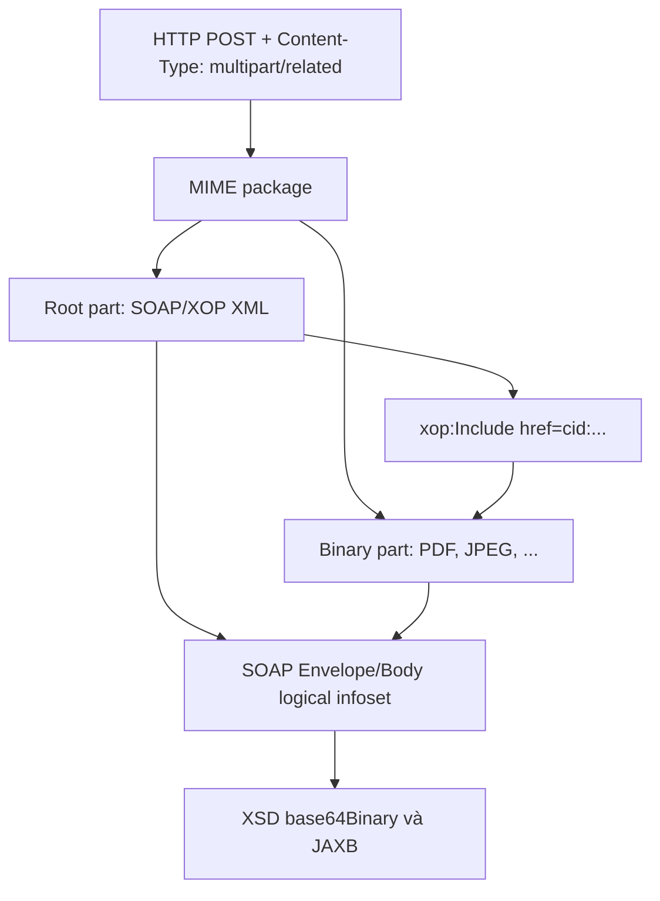
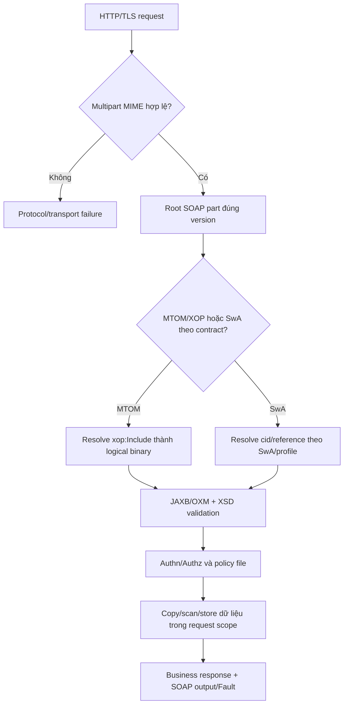
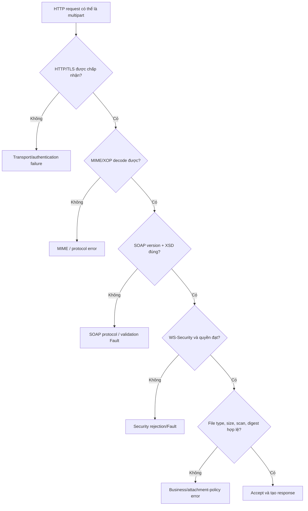

# SOAP with Attachments, MTOM, XOP và các mục đích khác nhau

Một dịch vụ SOAP không phải lúc nào cũng chỉ trao đổi các trường văn bản nhỏ. Trong tích hợp doanh nghiệp, thông điệp còn có thể mang **PDF hợp đồng**, **hình ảnh biên nhận**, **tệp XML đối soát**, **ảnh chụp chứng từ** hoặc một tài liệu có kích thước hàng chục megabyte. Nếu đưa toàn bộ bytes nhị phân trực tiếp vào XML, dữ liệu thường phải mã hóa thành **Base64**. Cách này hợp lệ theo XML Schema nhưng làm lượng dữ liệu truyền tăng, tạo thêm công việc encode/decode và có thể tiêu tốn bộ nhớ.

Có ba khái niệm liên quan thường bị gọi chung là “SOAP attachment”:

- **SOAP with Attachments (SwA)**: mô hình đóng gói một SOAP Envelope cùng các MIME parts khác trong một thông điệp `multipart/related`. Các part được đính kèm cạnh Envelope, nhưng **không tự động** trở thành nội dung của một element `xs:base64Binary` trong SOAP Body.
- **XML-binary Optimized Packaging (XOP)**: cơ chế serialization cho phép tối ưu **dữ liệu nhị phân vốn là nội dung Base64 trong XML Infoset** bằng cách thay biểu diễn văn bản bằng `xop:Include` tham chiếu đến part nhị phân trong MIME package.
- **Message Transmission Optimization Mechanism (MTOM)**: cơ chế tối ưu truyền SOAP dựa trên XOP, bảo toàn ngữ nghĩa của SOAP message trong khi cho phép binary data truyền dưới dạng part nhị phân thay vì một chuỗi Base64 dài.

Trong module **SPRING_WEB_SERVICES**, chúng ta học phát triển SOAP **contract-first** bằng XSD/WSDL, ánh xạ JAXB/OXM, `@Endpoint` và `WebServiceTemplate`, rồi vận hành an toàn với SOAP Fault, interceptor, XML security, WS-Security, TLS/chứng chỉ và kiểm thử tương thích. Bài này giúp chọn **đúng cơ chế đính kèm** thay vì chỉ đặt `multipart/related` trên HTTP request và cho rằng mọi client SOAP đều hiểu.

> **Thông điệp trọng tâm:** SwA là mô hình **đóng gói attachment**; XOP là cách **biểu diễn tối ưu XML chứa Base64**; MTOM là cơ chế **tối ưu SOAP message** dựa trên XOP. Một file nằm trong MIME package không mặc nhiên có nghĩa JAXB sẽ ánh xạ nó vào trường `byte[]` hoặc `DataHandler`, và bật MTOM không có nghĩa mọi file luôn được gửi thành MIME part riêng.

## 1. Mục tiêu học tập

Sau bài này, bạn có thể:

1. Phân biệt SwA, XOP và MTOM theo **mục đích**, **wire format**, **liên hệ với SOAP Infoset** và **cách mô tả contract**.
2. Đọc cấu trúc `multipart/related`, MIME boundary, root SOAP part, `Content-ID` và liên kết `cid:...`.
3. Giải thích cách `xs:base64Binary` tồn tại trong hợp đồng XML dù MTOM có thể truyền dữ liệu nhị phân ngoài chuỗi Base64.
4. Xác định vai trò của `xop:Include`, `application/xop+xml`, MIME `Content-Type` và `Content-Transfer-Encoding` trong bản wire đã tối ưu.
5. Thiết kế XSD/WSDL cho operation gửi tài liệu và nhận biên nhận; không nhầm `wsdl:part` với một MIME attachment bất kỳ.
6. Dùng JAXB `byte[]`, `jakarta.activation.DataHandler`, `@XmlMimeType` và `Jaxb2Marshaller.setMtomEnabled(true)` đúng ngữ cảnh.
7. Phân biệt xử lý MTOM tự động qua OXM với việc thêm/đọc MIME attachment thủ công bằng API Spring-WS.
8. Thiết kế lifecycle xử lý file lớn, stream, attachment và connection để tránh lỗi “stream closed” hoặc cạn heap.
9. Nhận biết giới hạn bảo mật của TLS, WS-Security, XML Signature và khả năng ký attachment; kiểm tra kích thước, content type, malware và quyền truy cập.
10. Kiểm thử gửi/nhận **trên wire thật**, kể cả SOAP 1.1/1.2, multipart boundaries, Fault và khả năng tương thích giữa các SOAP stacks.

## 2. Vì sao SOAP cần cách truyền dữ liệu nhị phân?

XML là định dạng dựa trên ký tự. Những bytes nhị phân tùy ý như `0x00`, bytes ảnh nén hoặc PDF không thể đặt nguyên xi thành nội dung text XML theo cách phổ quát. XML Schema hỗ trợ kiểu `xs:base64Binary` để biểu diễn bytes thành chuỗi ký tự.

Ví dụ với bốn bytes:

```text
Bytes gốc:              41 42 43 44  (hex)
Ký tự minh họa:         A B C D
Base64:                 QUJDRA==
```

Base64 biểu diễn ba bytes thành bốn ký tự (chưa kể padding), nên overhead kích thước lý thuyết xấp xỉ **33%** với dữ liệu đủ lớn. Ngoài dung lượng mạng, hệ thống còn phải:

- Encode phía gửi và decode phía nhận.
- Giữ String, byte array hoặc buffer trong bộ nhớ tùy cách triển khai.
- Serialize XML và parse/unmarshal phần tử có nội dung Base64 lớn.
- Ghi log hoặc xử lý XML lớn hơn nhiều so với nhu cầu metadata nghiệp vụ.

Ví dụ đưa một PDF 12 MiB vào `xs:base64Binary` có thể tạo chuỗi Base64 xấp xỉ **16 MiB**, chưa tính SOAP Envelope, transport encoding hay các bản sao tạm trong heap. Đây là **ước lượng toán học**, không phải đo benchmark cụ thể của Spring-WS.

### Khi nào XML Base64 trực tiếp vẫn hợp lý?

- Dữ liệu rất nhỏ, chẳng hạn thumbnail hoặc hash bytes vài chục byte.
- Đối tác chỉ hỗ trợ SOAP XML thuần, không hỗ trợ multipart/MTOM.
- Độ phức tạp vận hành của MIME lớn hơn lợi ích giảm kích thước.
- Hợp đồng yêu cầu `xs:base64Binary` nhưng dữ liệu nhỏ và provider chọn không tối ưu.

MTOM **không thay đổi business meaning** của giá trị bytes trong XML Infoset. Đó là lý do nó thường là lựa chọn tốt khi một contract XSD hiện có cần truyền binary payload lớn.

## 3. So sánh nhanh SwA, XOP, MTOM và Base64 inline

| Tiêu chí | Base64 trong SOAP Body | SwA | XOP | MTOM |
|---|---|---|---|---|
| Mục đích | Biểu diễn bytes hợp lệ trong XML | Gắn thêm MIME parts cạnh SOAP Envelope | Tối ưu serialization của XML Infoset chứa Base64 | Tối ưu việc truyền SOAP message bằng XOP |
| XML Body chứa | Text Base64 | SOAP content; có thể chứa tham chiếu `cid:` tùy contract/profile | `xop:Include` tại vị trí được tối ưu | SOAP payload được serialize theo XOP khi tối ưu |
| File nằm ở MIME part riêng | Không | Có | Có khi XOP package | Có khi MTOM thực sự tối ưu |
| XML Infoset có `xs:base64Binary` | Có | Không mặc nhiên | Có, qua logical reconstruction | Có, cùng ngữ nghĩa trước/sau tối ưu |
| Contract phù hợp | XSD `xs:base64Binary` | WSDL MIME binding/profile hoặc quy ước `cid` | Dùng trong cơ chế serialization XML | XSD `base64Binary` + MTOM capability/policy |
| Liên quan JAXB | `byte[]`/binary mapping | Có thể phải xử lý MIME part riêng | `DataHandler`/JAXB optimization | `Jaxb2Marshaller` với MTOM enabled |
| Vấn đề tương thích | Client XML chuẩn thường xử lý được | Yêu cầu hỗ trợ SwA/profile tương ứng | Yêu cầu hiểu XOP packaging | Hai đầu cần hỗ trợ MTOM đúng binding |
| Rủi ro | XML lớn/heap lớn | Part rời/URI reference, ký attachment | Resolve nhầm Content-ID, stream | Nhầm tưởng MIME part đã được ký/xác thực |

**Không phải** SwA → XOP → MTOM là ba “phiên bản nâng cấp tuần tự” có thể chuyển đổi bằng cách đổi MIME `Content-Type`. Chúng giải quyết các nhu cầu khác nhau và có hợp đồng liên thông khác nhau.

## 4. Ba lớp cần phân biệt: HTTP, MIME và SOAP Infoset

Một SOAP request có MTOM thường đi qua các lớp:



Diễn giải:

1. **HTTP transport** chuyển một MIME package, không phải chỉ một chuỗi XML.
2. **MIME multipart/related** chia body thành các part, được phân tách bằng `boundary`.
3. **Root part** chứa SOAP Envelope hoặc serialization XML thích hợp.
4. **Non-root parts** chứa bytes thực tế, thường xác định bằng `Content-ID`.
5. **XOP processor** giải quyết `xop:Include` để dựng lại ngữ nghĩa Base64 trong XML Infoset.
6. **Spring-WS/JAXB** đọc logical payload theo XSD thay vì đòi ứng dụng tự thay `xop:Include` bằng Base64 string.

### Không nhầm các từ “body”

- **HTTP message body**: toàn bộ bytes sau HTTP headers; với MTOM có thể là cả MIME package.
- **MIME part body**: bytes của riêng một MIME part.
- **SOAP Body**: phần tử `soap:Body` bên trong SOAP Envelope.
- **Business payload**: phần tử nghiệp vụ trong SOAP Body, ví dụ `doc:SubmitDocumentRequest`.

Sự khác biệt này quan trọng khi chẩn đoán. Kiểm tra SOAP Body bằng XML parser mà vô tình đưa vào toàn bộ HTTP multipart body sẽ nhận lỗi ký tự đầu là MIME boundary, chứ không phải lỗi SOAP/XSD.

## 5. Contract mẫu: gửi PDF và trả mã tiếp nhận

Giả sử hệ thống doanh nghiệp có operation `SubmitDocument`. Client gửi một PDF cùng metadata, server trả ID và digest xác nhận. Namespace hợp đồng:

```text
urn:example:documents:v1
```

XSD `documents-v1.xsd`:

```xml
<?xml version="1.0" encoding="UTF-8"?>
<xs:schema
    xmlns:xs="http://www.w3.org/2001/XMLSchema"
    xmlns:doc="urn:example:documents:v1"
    xmlns:xmime="http://www.w3.org/2005/05/xmlmime"
    targetNamespace="urn:example:documents:v1"
    elementFormDefault="qualified">

    <xs:simpleType name="DocumentIdType">
        <xs:restriction base="xs:token">
            <xs:minLength value="1"/>
            <xs:maxLength value="64"/>
        </xs:restriction>
    </xs:simpleType>

    <xs:element name="SubmitDocumentRequest">
        <xs:complexType>
            <xs:sequence>
                <xs:element name="requestId" type="doc:DocumentIdType"/>
                <xs:element name="fileName" type="xs:string"/>
                <xs:element name="contentType" type="xs:string"/>
                <xs:element name="fileContent"
                            type="xs:base64Binary"
                            xmime:expectedContentTypes="application/pdf"/>
            </xs:sequence>
        </xs:complexType>
    </xs:element>

    <xs:element name="SubmitDocumentResponse">
        <xs:complexType>
            <xs:sequence>
                <xs:element name="requestId" type="doc:DocumentIdType"/>
                <xs:element name="documentId" type="doc:DocumentIdType"/>
                <xs:element name="digestSha256" type="xs:hexBinary"/>
            </xs:sequence>
        </xs:complexType>
    </xs:element>
</xs:schema>
```

**Ý nghĩa các trường:**

- `fileContent` thuộc kiểu XSD `xs:base64Binary`. Đây là điểm quyết định cho việc tối ưu hóa MTOM/XOP; logical value của element là bytes.
- `xmime:expectedContentTypes="application/pdf"` là **gợi ý media type ở XSD** có thể ảnh hưởng code generation/binding. Nó không tự kiểm file có đúng nội dung PDF, không thay thế MIME verification và không ép MTOM luôn được kích hoạt.
- `contentType` là metadata nghiệp vụ do client khai báo; **không được tin hoàn toàn**. Server cần kiểm MIME headers và nhận dạng nội dung theo chính sách.
- `fileName` là tên client cung cấp, **không phải đường dẫn hệ thống** được phép sử dụng nguyên xi.
- `digestSha256` là hash sau khi server tiếp nhận nội dung; nó hỗ trợ kiểm toàn vẹn nghiệp vụ khi được gắn với response xác thực, nhưng **không thay XML Signature/WS-Security**.

Có thể bỏ `xmime:expectedContentTypes` nếu không cần gợi ý code generator. Ngược lại, không đặt `type="xs:string"` cho nội dung PDF rồi chỉ bật MTOM và mong framework tự hiểu chuỗi là binary.

### Ví dụ SOAP Body khi KHÔNG tối ưu MTOM

```xml
<doc:SubmitDocumentRequest
    xmlns:doc="urn:example:documents:v1">
    <doc:requestId>REQ-1001</doc:requestId>
    <doc:fileName>contract.pdf</doc:fileName>
    <doc:contentType>application/pdf</doc:contentType>
    <doc:fileContent>JVBERi0xLjQK...</doc:fileContent>
</doc:SubmitDocumentRequest>
```

`JVBERi0xLjQK...` là **đoạn Base64 minh họa bị cắt**, không phải dữ liệu của một file PDF hoàn chỉnh và không dùng nguyên mẫu để validate `xs:base64Binary`. Trên wire thực tế, nếu không tối ưu, `fileContent` phải chứa một lexical Base64 hợp lệ cho toàn bộ bytes.

### WSDL 1.1: operation không đổi vì MTOM

Ở binding document/literal, input message thường tham chiếu:

```xml
<wsdl:message
    xmlns:wsdl="http://schemas.xmlsoap.org/wsdl/"
    xmlns:doc="urn:example:documents:v1"
    name="SubmitDocumentInput">
    <wsdl:part name="parameters"
               element="doc:SubmitDocumentRequest"/>
</wsdl:message>
```

Output message tham chiếu `doc:SubmitDocumentResponse`. `wsdl:operation` và `soap:body use="literal"` xác định SOAP contract. Khi MTOM được áp dụng trên cùng logical Infoset, **không phải tạo operation khác chỉ vì bytes được chuyển sang một MIME part riêng**.

Nếu hợp đồng yêu cầu MTOM qua policy, phải công bố/kiểm thử **MTOM policy assertion** thích hợp với stack của đối tác; chỉ có `xs:base64Binary` chưa đủ khẳng định server luôn nhận/gửi MTOM.

## 6. SwA: SOAP with Attachments làm gì?

SwA đóng gói SOAP Envelope như root MIME part và một hoặc nhiều attachment parts trong một `multipart/related` entity. Một ví dụ gần với wire (rút gọn, boundary và nội dung giả):

```http
POST /ws/documents HTTP/1.1
Host: partner.example.org
Content-Type: multipart/related;
  boundary="MIME_BOUNDARY_123";
  type="text/xml";
  start="<soap-root@example.org>"
SOAPAction: "urn:example:documents:SubmitDocument"

--MIME_BOUNDARY_123
Content-Type: text/xml; charset=UTF-8
Content-ID: <soap-root@example.org>

<soap:Envelope xmlns:soap="http://schemas.xmlsoap.org/soap/envelope/">
  <soap:Body>
    <doc:SubmitDocumentRequest
        xmlns:doc="urn:example:documents:v1">
      <doc:requestId>REQ-1001</doc:requestId>
      <doc:attachmentRef>cid:pdf-1@example.org</doc:attachmentRef>
    </doc:SubmitDocumentRequest>
  </soap:Body>
</soap:Envelope>

--MIME_BOUNDARY_123
Content-Type: application/pdf
Content-ID: <pdf-1@example.org>
Content-Transfer-Encoding: binary

[PDF binary bytes omitted]
--MIME_BOUNDARY_123--
```

**Quan trọng:** trên đây là ví dụ **SwA với hợp đồng SOAP Body riêng**, sử dụng `doc:attachmentRef`; nó **không tuân XSD của mục 5** vì XSD mẫu định nghĩa `fileContent` kiểu `base64Binary` chứ không khai báo `attachmentRef`. Để có một contract SwA thực, phải thêm một element tham chiếu `cid` hoặc áp WS-I Attachments Profile/`swaRef` và binding phù hợp. Không mang nguyên ví dụ SwA này đi so sánh XSD-valid với ví dụ MTOM mà chưa thay contract.

### Các điểm nhận diện SwA

- HTTP `Content-Type` thường dùng `multipart/related` với root part là SOAP XML, ví dụ `text/xml` cho SOAP 1.1.
- Attachment part có `Content-ID`, `Content-Type` và bytes riêng.
- SOAP Body có thể tham chiếu attachment thông qua URI `cid:...` hoặc quy tắc do WSDL/profile mô tả.
- **Không có bước XOP logical reconstruction bắt buộc** biến `cid:...` thành giá trị `xs:base64Binary` chỉ vì SOAP có MIME attachment.
- Việc client lấy đúng attachment phụ thuộc **contract/profile**, MIME reader và mapping ứng dụng; JAXB không tự suy đoán mọi `attachmentRef` là PDF bytes.

### SwA phù hợp khi nào?

SwA có thể phù hợp với **hợp đồng tích hợp cũ** đã công bố MIME attachments theo WSDL MIME binding hoặc WS-I Attachments Profile. Nó cũng hữu ích khi tài liệu được gửi như một phần MIME độc lập với phần SOAP nghiệp vụ và đối tác đã thống nhất cách tham chiếu/nhận dạng.

Không chọn SwA mới chỉ vì bạn muốn “gửi nhiều file” mà chưa kiểm khả năng client codegen, signature requirements, cách quản lý `cid` và test interoperability. Với contract XSD chứa `xs:base64Binary`, MTOM thường cho mô hình dữ liệu tự nhiên hơn nếu hai bên đều hỗ trợ.

## 7. MTOM và XOP: SOAP vẫn có cùng nội dung logic

MTOM tối ưu **một giá trị nhị phân vốn xuất hiện trong XML Infoset dưới dạng Base64 text**. Khi chọn tối ưu, XOP serialization thay vị trí text Base64 bằng phần tử `xop:Include` trỏ đến MIME part nhị phân.

Logical SOAP element:

```xml
<doc:fileContent xmlns:doc="urn:example:documents:v1">
    JVBERi0xLjQK...
</doc:fileContent>
```

Bản wire được tối ưu có thể trông như:

```xml
<doc:fileContent
    xmlns:doc="urn:example:documents:v1">
    <xop:Include
        xmlns:xop="http://www.w3.org/2004/08/xop/include"
        href="cid:pdf-1@example.org"/>
</doc:fileContent>
```

**Không hiểu sai rằng XSD đã đổi `fileContent` từ `xs:base64Binary` thành “complexType chứa Include”.** Trong mô hình XOP, `xop:Include` là cấu trúc **serialization**, dùng để phục hồi logical bytes của element. JAXB/MTOM-aware SOAP stack sẽ giải quyết `cid` rồi trả về binary value tương ứng.

### Vì sao đây là khác biệt quan trọng?

- Một schema validator chỉ được cấp **XML fragment XOP thô** có thể không chấp nhận `xop:Include` ở vị trí `xs:base64Binary`.
- Trong mô hình MTOM đúng, xử lý XOP/MIME phải xây dựng **logical SOAP Infoset** trước khi kiểm semantic XSD/JAXB theo phần dữ liệu tương ứng.
- Người dùng API JAXB nhận `byte[]` hoặc `DataHandler`, không phải một DOM node `xop:Include` có nghĩa nghiệp vụ.
- WS-Security và XML Signature cần được áp dụng với quy tắc hỗ trợ MTOM/XOP tương ứng, không tự ký chuỗi `cid:...` rồi coi đã bảo vệ nội dung binary.

**Một ảnh hưởng liên thông:** nếu một bên gửi Base64 inline cho cùng `fileContent`, bên kia có thể vẫn xử lý được theo contract `xs:base64Binary` nếu policy không yêu cầu tối ưu bắt buộc. Nếu bên gửi dùng MTOM/XOP thì bên nhận cần khả năng decode package, không thể chỉ trỏ DOM parser vào toàn bộ MIME bytes.

## 8. Một HTTP multipart/related MTOM/XOP trông như thế nào?

Ví dụ SOAP 1.1 MTOM trên wire (đã giản lược; các header/đường xuống dòng MIME thực phải tuân RFC tương ứng):

```http
POST /ws/documents HTTP/1.1
Host: partner.example.org
SOAPAction: "urn:example:documents:SubmitDocument"
Content-Type: multipart/related;
  type="application/xop+xml";
  start="<rootpart@example.org>";
  boundary="MIME_BOUNDARY_456";
  start-info="text/xml"

--MIME_BOUNDARY_456
Content-Type: application/xop+xml;
  charset=UTF-8; type="text/xml"
Content-Transfer-Encoding: 8bit
Content-ID: <rootpart@example.org>

<soap:Envelope
    xmlns:soap="http://schemas.xmlsoap.org/soap/envelope/"
    xmlns:doc="urn:example:documents:v1"
    xmlns:xop="http://www.w3.org/2004/08/xop/include">
  <soap:Body>
    <doc:SubmitDocumentRequest>
      <doc:requestId>REQ-1001</doc:requestId>
      <doc:fileName>contract.pdf</doc:fileName>
      <doc:contentType>application/pdf</doc:contentType>
      <doc:fileContent>
        <xop:Include href="cid:pdf-1@example.org"/>
      </doc:fileContent>
    </doc:SubmitDocumentRequest>
  </soap:Body>
</soap:Envelope>

--MIME_BOUNDARY_456
Content-Type: application/pdf
Content-Transfer-Encoding: binary
Content-ID: <pdf-1@example.org>

[PDF binary bytes omitted]
--MIME_BOUNDARY_456--
```

Trong ví dụ:

1. `multipart/related` nói rằng HTTP body là một package có nhiều MIME parts liên quan.
2. `type="application/xop+xml"` ở outer media type cho biết root part dùng XOP format.
3. `start="<rootpart@example.org>"` xác định MIME root part bằng `Content-ID`.
4. `start-info="text/xml"` tương ứng ngữ cảnh SOAP 1.1 XML. Với SOAP 1.2, kiểu SOAP liên quan có thể là `application/soap+xml` và chi tiết action/content type khác.
5. Root part chứa SOAP Envelope và `xop:Include`.
6. `href="cid:pdf-1@example.org"` trỏ tới MIME part có `Content-ID: <pdf-1@example.org>`.
7. Binary part chứa **bytes thực của PDF**, không phải chuỗi `JVBER...` Base64.
8. XSD vẫn định nghĩa `fileContent` là `xs:base64Binary`.

**Đây là wire sketch**, không phải ví dụ raw HTTP hoàn chỉnh có thể paste vào client mà không thêm CRLF, Content-Length/chunked framing và binary bytes chuẩn. Một message factory/SOAP library nên tạo MIME boundaries và Content-IDs thay cho việc nối chuỗi bằng tay.

### Nếu có nhiều binary fields?

Mỗi binary field được tối ưu có thể có `xop:Include` trỏ tới một MIME part tương ứng; các phần dữ liệu **nhỏ hoặc không được tối ưu** vẫn có thể xuất hiện inline dạng Base64. Hệ thống không được giả định “có 3 `xs:base64Binary` thì chắc chắn có đúng 3 MIME binary parts”.

### Content-ID không phải filename

`Content-ID` là định danh MIME part, thường được tham chiếu bằng URI scheme `cid:`. Nó không nên dùng như file path, URL tải từ Internet hay tên do client áp đặt không kiểm soát. Bất kỳ logic resolve `cid` nào cũng phải tham chiếu **đúng package hiện tại** và chặn ID trùng/missing hoặc reference lạ.

## 9. XOP hoạt động như một serialization optimization, không phải API nghiệp vụ

XOP không định nghĩa operation `UploadFile`, không yêu cầu REST endpoint riêng và cũng không giải quyết việc lưu file. Nó chỉ mô tả cách truyền **XML Infoset chứa binary text** dưới dạng một MIME package được tối ưu.

Một chuỗi dữ liệu:

```text
Java bytes / DataHandler
    ↓ JAXB marshal / SOAP MTOM
Logical XML Infoset: xs:base64Binary value
    ↓ XOP serialization
XML root part: <xop:Include href="cid:..."/>
Binary MIME part: raw bytes
    ↓ HTTP transport
Receiver MIME/XOP decoding
    ↓ logical XML Infoset phục hồi
JAXB unmarshal / schema validation
    ↓ Java bytes / DataHandler
```

Những ràng buộc XML vẫn còn:

- Root QName `{urn:example:documents:v1}SubmitDocumentRequest` không đổi.
- `xs:sequence` vẫn yêu cầu các child theo thứ tự đã công bố.
- `fileContent` vẫn có kiểu `xs:base64Binary`.
- `fileName`/`contentType` vẫn là các trường nghiệp vụ, không tự chuyển sang MIME-only metadata.
- `xop:Include` không tự tạo quy tắc authorization cho file.
- SOAP Header và Fault xử lý theo phiên bản SOAP thực, không theo tên MIME part.

### Điều kiện để XOP tối ưu

XOP optimization không có nghĩa mọi content bất kỳ trong XML đều được tách. Nó hướng tới nội dung binary được biểu diễn phù hợp bằng **Base64 lexical form** theo mô hình XOP. Những XML strings bình thường, XML element structure, SOAP Fault reason hay business IDs không nên được “tối ưu” bằng cách đóng vào MIME parts tùy tiện.

## 10. WSDL contract-first: SwA binding và MTOM policy khác nhau

Hai hướng mô tả contract:

**A. Hợp đồng MTOM**

- XSD request/response vẫn dùng `xs:base64Binary`.
- WSDL document/literal định nghĩa message parts cho SOAP Body như thường lệ.
- Policy/cấu hình cho biết MTOM được hỗ trợ/yêu cầu; nếu dùng policy assertion phải kiểm kiểu assertion namespace/version phù hợp đối tác.
- Client codegen/JAXB có thể ánh xạ binary content thành `DataHandler` hoặc `byte[]`.
- Trên wire, sender có thể chọn inline Base64 hoặc MTOM optimization tùy chính sách/cấu hình.

**B. Hợp đồng SwA**

- WSDL MIME binding có thể dùng `mime:multipartRelated`, `mime:part`, `mime:content` hoặc cơ chế profile liên quan để mô tả phần SOAP và file parts.
- Nếu SOAP Body chứa reference, schema phải mô tả reference đó như một phần hợp đồng, chẳng hạn một URI với quy tắc `cid:` hoặc kiểu profile `swaRef`.
- Client/server cần thống nhất attachment naming, Content-ID, multiplicity và cách phát hiện thiếu/trùng part.
- Không thể chỉ bật `setMtomEnabled(true)` rồi mong client tự hiểu SwA WSDL MIME binding.

Một trích đoạn khái niệm WSDL MIME binding SwA:

```xml
<wsdl:input
    xmlns:wsdl="http://schemas.xmlsoap.org/wsdl/"
    xmlns:mime="http://schemas.xmlsoap.org/wsdl/mime/"
    xmlns:soap="http://schemas.xmlsoap.org/wsdl/soap/">
    <mime:multipartRelated>
        <mime:part>
            <soap:body parts="parameters" use="literal"/>
        </mime:part>
        <mime:part>
            <mime:content part="attachment"
                          type="application/pdf"/>
        </mime:part>
    </mime:multipartRelated>
</wsdl:input>
```

Đây là **fragment**, chỉ có nghĩa trong một `wsdl:binding` có message và `wsdl:part` tương ứng được khai báo. Không phải WSDL standalone. Tùy mô hình SwA/profile, cách tham chiếu part và binding sẽ khác; phải xem generated client của đối tác hỗ trợ mô hình đó đến đâu.

### Dùng MIME binding không có nghĩa server tự áp XSD lên attachment

Một file PDF part độc lập trong SwA thường **không được XSD validator của SOAP Body kiểm byte-level**. MIME type, file signature, kích thước, virus scanning, checksum và authorization là trách nhiệm ngoài XSD schema. Ngay cả MTOM, XSD chỉ biết giá trị `xs:base64Binary`, không chứng minh bytes ấy là PDF lành tính.

## 11. JAXB/OXM: `byte[]`, `DataHandler` và `@XmlMimeType`

Khi sinh JAXB từ XSD, trường `fileContent` có thể được ánh xạ thành `byte[]` hoặc `DataHandler` tùy bindings và công cụ. Với `xmime:expectedContentTypes="application/pdf"`, nhiều toolchains nhận dạng media type để chọn representation tối ưu; tuy nhiên **không có một quy tắc luôn cho ra cùng kiểu Java trên mọi XJC/JAXB version**.

Ví dụ Java mapping minh họa cho MTOM:

```java
import jakarta.activation.DataHandler;
import jakarta.xml.bind.annotation.XmlAccessorType;
import jakarta.xml.bind.annotation.XmlAccessType;
import jakarta.xml.bind.annotation.XmlElement;
import jakarta.xml.bind.annotation.XmlMimeType;
import jakarta.xml.bind.annotation.XmlRootElement;
import jakarta.xml.bind.annotation.XmlType;

@XmlRootElement(
    name = "SubmitDocumentRequest",
    namespace = "urn:example:documents:v1"
)
@XmlAccessorType(XmlAccessType.FIELD)
@XmlType(propOrder = {
    "requestId", "fileName", "contentType", "fileContent"
})
public class SubmitDocumentRequest {

    @XmlElement(
        name = "requestId",
        namespace = "urn:example:documents:v1",
        required = true
    )
    private String requestId;

    @XmlElement(
        name = "fileName",
        namespace = "urn:example:documents:v1",
        required = true
    )
    private String fileName;

    @XmlElement(
        name = "contentType",
        namespace = "urn:example:documents:v1",
        required = true
    )
    private String contentType;

    @XmlElement(
        name = "fileContent",
        namespace = "urn:example:documents:v1",
        required = true
    )
    @XmlMimeType("application/pdf")
    private DataHandler fileContent;

    // Getters/setters hoặc constructor do ứng dụng cung cấp.
}
```

Đây là **lớp JAXB minh họa**, không phải source XJC đã sinh. Trong dự án contract-first, hãy sinh lại model từ XSD (và binding customization nếu cần), không tự chỉnh generated JAXB classes rồi quên cập nhật contract.

**Giới hạn của mapping:**

- `@XmlMimeType` là metadata về MIME type cho JAXB binding, **không phải** bộ kiểm định nội dung PDF.
- `DataHandler` có thể đại diện cho nguồn dữ liệu lazy/streaming; không mặc định mọi `DataHandler` là một `byte[]` đã nằm trọn trong heap.
- `byte[]` dễ dùng nhưng có thể khiến file lớn nằm toàn bộ trong bộ nhớ.
- JAXB `Marshaller`/`Unmarshaller` riêng không được chia sẻ mutable instance giữa các thread; Spring `Jaxb2Marshaller` có thể là bean dùng chung khi cấu hình/adapter an toàn.
- Nếu request chứa field được XSD yêu cầu nhưng Java DTO null, chỉ có metadata JAXB không bảo đảm mọi validation facet đã được kiểm đầy đủ.

### `javax.activation` và `jakarta.activation`

Với Spring Boot 3 / Spring-WS 4 và JAXB Jakarta, thường dùng `jakarta.activation.DataHandler` và `jakarta.xml.bind.*`. Stack cũ dựa trên `javax.xml.bind`/`javax.activation` có package khác. Không trộn generated classes từ stack cũ với runtime Jakarta chỉ bằng cách sửa import thủ công.

Trong cả hai stack, `javax.xml.namespace.QName` vẫn là QName API chuẩn của JDK.

## 12. Bật MTOM trong Spring `Jaxb2Marshaller`

Spring OXM `Jaxb2Marshaller` cung cấp cấu hình MTOM:

```java
import org.springframework.context.annotation.Bean;
import org.springframework.context.annotation.Configuration;
import org.springframework.oxm.jaxb.Jaxb2Marshaller;

@Configuration
public class DocumentOxmConfiguration {

    @Bean
    public Jaxb2Marshaller documentMarshaller() {
        Jaxb2Marshaller marshaller = new Jaxb2Marshaller();

        marshaller.setContextPath(
            "org.example.documents.contract"
        );

        marshaller.setMtomEnabled(true);
        return marshaller;
    }
}
```

Cấu hình này báo cho OXM sử dụng MTOM khi điều kiện marshal/unmarshal, kiểu nguồn dữ liệu và SOAP message/attachment infrastructure phù hợp. **Nó không phải phép biến đổi tự động mọi XML String thành file attachment**, cũng không đảm bảo một file rất nhỏ luôn thành binary MIME part.

Để thực sự gửi MTOM:

1. XSD/WSDL có binary content với binding hợp lệ.
2. JAXB model nhận diện field binary (`byte[]` hoặc `DataHandler`/`@XmlMimeType`).
3. SOAP message factory hỗ trợ MIME attachment/MTOM.
4. Marshaller và unmarshaller có MTOM enabled theo nhu cầu.
5. Client và server đều hỗ trợ MTOM/XOP packaging theo SOAP version/binding.
6. Security interceptors ký/xác minh những phần cần thiết theo policy.
7. Test **actual HTTP Content-Type và MIME package**; không chỉ assert Java object unmarshalling thành công.

Một test Spring chạy qua message factory in-memory có thể chứng minh JAXB value đúng nhưng chưa chứng minh HTTP sender đã phát `multipart/related`.

## 13. `WebServiceTemplate` gửi request MTOM

Giả sử XJC tạo đúng `SubmitDocumentRequest` và `SubmitDocumentResponse`, với `fileContent` là `DataHandler` hoặc kiểu tương ứng. Spring SOAP client:

```java
import org.springframework.context.annotation.Bean;
import org.springframework.context.annotation.Configuration;
import org.springframework.oxm.jaxb.Jaxb2Marshaller;
import org.springframework.ws.client.core.WebServiceTemplate;

@Configuration
public class DocumentClientConfiguration {

    @Bean
    public WebServiceTemplate documentTemplate(
            Jaxb2Marshaller documentMarshaller) {

        WebServiceTemplate template =
            new WebServiceTemplate();

        template.setMarshaller(documentMarshaller);
        template.setUnmarshaller(documentMarshaller);
        template.setDefaultUri(
            "https://partner.example.org/ws/documents"
        );

        return template;
    }
}
```

Gọi:

```java
public SubmitDocumentResponse submit(
        SubmitDocumentRequest request) {

    Object result = documentTemplate.marshalSendAndReceive(
        request,
        message -> {
            if (message instanceof
                    org.springframework.ws.soap.SoapMessage soap) {
                soap.setSoapAction(
                    "urn:example:documents:SubmitDocument"
                );
            }
        }
    );

    if (result instanceof jakarta.xml.bind.JAXBElement<?> e) {
        result = e.getValue();
    }

    if (!(result instanceof SubmitDocumentResponse response)) {
        throw new IllegalStateException(
            "Unexpected SOAP response contract"
        );
    }

    return response;
}
```

Đoạn code là **method thuộc client class có inject `documentTemplate`** và import generated classes; không phải tệp Java standalone. Nếu XJC tạo global element qua `ObjectFactory`/`JAXBElement<SubmitDocumentRequest>`, caller cần truyền **JAXB root đúng QName**, không chỉ complex-type object thiếu `@XmlRootElement`.

### Đặt `DataHandler` từ nguồn dữ liệu

```java
import jakarta.activation.DataHandler;
import jakarta.activation.FileDataSource;
import java.nio.file.Path;

// Đặt helper trong lớp ứng dụng; caller đã kiểm và cấp Path.
public static DataHandler forApprovedFile(Path approvedPath) {
    return new DataHandler(
        new FileDataSource(approvedPath.toFile())
    );
}

// Caller dùng request.setFileContent(
//     forApprovedFile(approvedPath)
// ) theo JAXB model.
```

Nếu DataHandler tham chiếu file local, **file phải còn tồn tại và đọc được trong toàn bộ giai đoạn marshal/gửi**. Không xóa file ngay sau khi tạo DataHandler rồi hy vọng SOAP library đã copy xong. Cũng không tin `fileName` do client bên ngoài gửi để dựng `approvedPath` mà không chống path traversal.

Đối với file lớn, tùy JAXB provider/message factory, `DataHandler` có thể giảm số bản sao so với `byte[]`; phải benchmark bằng network stack thật, không khẳng định mọi cấu hình là zero-copy.

## 14. Spring-WS endpoint nhận binary content

Một endpoint Spring-WS điển hình nhận request object đã được JAXB unmarshal:

```java
import org.springframework.ws.server.endpoint.annotation.Endpoint;
import org.springframework.ws.server.endpoint.annotation.PayloadRoot;
import org.springframework.ws.server.endpoint.annotation.RequestPayload;
import org.springframework.ws.server.endpoint.annotation.ResponsePayload;

@Endpoint
public final class DocumentEndpoint {

    private static final String NAMESPACE =
        "urn:example:documents:v1";

    private final DocumentService documentService;

    public DocumentEndpoint(DocumentService documentService) {
        this.documentService = documentService;
    }

    @PayloadRoot(
        namespace = NAMESPACE,
        localPart = "SubmitDocumentRequest"
    )
    @ResponsePayload
    public SubmitDocumentResponse submit(
            @RequestPayload SubmitDocumentRequest request) {

        return documentService.acceptDocument(request);
    }
}
```

**Phân định trách nhiệm:**

- `@PayloadRoot` chọn endpoint bằng QName của phần tử nghiệp vụ **trong SOAP Body**. MIME boundary/Content-ID không thay tên operation.
- JAXB/Spring OXM chuyển logical binary content thành Java field khi cấu hình hỗ trợ.
- `DocumentService` phải kiểm quyền, metadata, content type thực, size, checksum và lưu trữ an toàn.
- Nếu JAXB model chứa `DataHandler` lazy, hãy **consume/copy dữ liệu trong phạm vi request còn hợp lệ**, tránh lưu chính DataHandler/attachment stream vào queue hoặc DB record để đọc muộn.
- Transaction business không nên mở quá lâu khi stream một attachment hàng trăm MB; có thể dùng storage tạm và finalize nghiệp vụ theo các trạng thái rõ ràng.
- Lỗi parse MIME/XOP có thể xảy ra **trước khi** method endpoint được gọi; `@SoapFault` trên exception nghiệp vụ không đảm bảo xử lý các lỗi protocol này.

### Nhận PDF “được khai báo” không có nghĩa PDF an toàn

Server phải xác minh content type/magic bytes theo chính sách, giới hạn kích thước, chống archive bomb nếu nhận file nén, loại bỏ đường dẫn độc hại, kiểm malware và xác định tên lưu trữ do **server cấp**, không lấy tên file client làm path thực.

Nếu phải phục vụ yêu cầu scan bất đồng bộ, lưu file vào vùng **quarantine** chưa được publish rồi chỉ cho phép tải sau khi có kết quả kiểm tra. Cần có cơ chế xóa file hỏng/quá hạn và liên kết file với tenant đã xác thực.

## 15. Thêm attachment thủ công: khác với bật MTOM

Đôi khi contract cũ yêu cầu **SwA** hoặc một MIME part độc lập không được ánh xạ qua `xs:base64Binary`. Spring-WS có API MIME attachment để tương tác với message khi message factory hỗ trợ.

Ví dụ **phác thảo callback**:

```java
import jakarta.activation.DataHandler;
import org.springframework.ws.WebServiceMessage;
import org.springframework.ws.mime.MimeMessage;

// Dùng cho hợp đồng SwA/profile được xác nhận.
// handler phải còn nguồn đọc hợp lệ trong lượt gửi.
WebServiceMessageCallback callback = message -> {
    if (!(message instanceof MimeMessage mime)) {
        throw new IllegalStateException(
            "SOAP message factory does not support MIME attachments"
        );
    }

    // Marshal SOAP Body với attachment reference/cid theo
    // XSD/WSDL SwA đã công bố; không dùng schema MTOM
    // ở mục 5 nếu nó vẫn yêu cầu fileContent base64Binary.
    writeSwaSoapBody(message);

    mime.addAttachment(
        "pdf-1@example.org",
        handler
    );
};
```

`WebServiceMessageCallback`, `writeSwaSoapBody` và `handler` ở đây là các dependency/điểm mở rộng minh họa; code chưa phải một client độc lập. Khi dùng API MIME thực, cần kiểm:

- API `MimeMessage` của phiên bản Spring-WS (và DataHandler package của stack).
- Content-ID có trùng với SOAP reference `cid:pdf-1@example.org` hay không.
- Mô hình WSDL MIME/`swaRef` mà đối tác mong đợi.
- Thứ tự/nhận dạng root part và Content-Type của attachment.
- Streaming/attachment size và cách đóng tài nguyên nguồn.
- Các rule WS-Security dành cho **attachment parts**, không chỉ SOAP Body.

**Không** trộn cách “thêm file MIME thủ công” với `Jaxb2Marshaller` MTOM một cách ngẫu nhiên: nếu cả hai cùng tạo binary part cho một trường, có thể có duplicate attachments hoặc references không khớp.

### Nhận attachment thủ công

Nếu message hỗ trợ `MimeMessage`, có thể tra attachment qua Content-ID hoặc duyệt các parts theo API. Đối tượng attachment thường cho phép lấy metadata và `InputStream`. Chỉ đọc stream **khi message đang còn hợp lệ** và chỉ copy các bytes đã qua kiểm soát.

```java
// Pseudocode phù hợp với API MimeMessage/Attachment:
// MimeMessage mime = (MimeMessage) responseMessage;
// Attachment file = mime.getAttachment("pdf-1@example.org");
// if (file == null) throw new MissingAttachmentException();
// try (InputStream in = file.getInputStream()) {
//     copyLimitedAndVerified(in, destination);
// }
// return immutable metadata; không return InputStream.
```

Đây là đoạn **pseudocode có chủ đích** vì exception, storage interface và cách resolve MIME ID phụ thuộc ứng dụng. Không mặc định một `Content-ID` nằm trong SOAP `href` có thể dùng để fetch file từ URL mạng ngoài; `cid:` phải được resolve trong **message MIME hiện tại**.

## 16. Chuỗi xử lý đúng: contract, MIME, XOP, JAXB, business



Sơ đồ là **phân tách chức năng**, không phải cam kết thứ tự interceptor bảo mật trong mọi Spring-WS version. WS-Security verification có thể cần được thực hiện trước khi dữ liệu được dùng hoặc ở pha message processing cụ thể; quan trọng là **không có side effect nghiệp vụ trên nội dung chưa qua xác thực/kiểm tra**.

### Không cố dùng XSD validation cho cả MIME envelope

`PayloadValidatingInterceptor` hoặc JAXB schema validation xử lý phần XML logical payload; chúng không tự giới hạn số MIME parts, MIME headers, file type thực hoặc virus. Hệ thống cần **hai lớp validation bổ sung**:

1. XML/SOAP contract: XSD/WSDL/QName/type/sequence.
2. Attachment policy: MIME structure, content ID, part counts, size, media type, integrity, malware, authorization.

XSD `xs:base64Binary` có thể chấp nhận bytes của một file thực ra là executable, dù field tên `fileContent` và `expectedContentTypes` ghi PDF. Cần kiểm nội dung thực, không chỉ giá trị khai báo.

## 17. MTOM không đồng nghĩa luôn tạo attachment: kích thước và threshold

Một nhầm lẫn thường gặp là: “Đã `setMtomEnabled(true)` nhưng gửi một file rất nhỏ mà vẫn thấy Base64 inline, chắc cấu hình sai.” Điều đó **không đủ để kết luận**. Một số JAXB/attachment marshalling implementations có thể dựa vào kích thước binary content, kiểu dữ liệu, khả năng lấy bytes, policy hoặc cơ chế tối ưu của provider để quyết định khi nào tạo MIME attachment.

Đối với mỗi contract cần kiểm:

- Field có phải logical `xs:base64Binary` hoặc binary representation được provider hỗ trợ không?
- JAXB value thực là `byte[]` hay `DataHandler`, có `@XmlMimeType`/metadata phù hợp không?
- SOAP message factory có hỗ trợ MIME attachments không?
- MTOM có bật cho phía **marshal** và **unmarshal** cần thiết không?
- Provider có threshold/strategy riêng hay luôn optimize một số kiểu?
- Sender có bị adapter/gateway nào serialize lại thành SOAP XML thường không?
- WSDL/WS-Policy của đối tác có yêu cầu MTOM, hay chấp nhận fallback inline?

### Quyết định optimization phải dựa trên số liệu

| Dữ liệu | Nhận xét |
|---|---|
| 32 bytes | Inline Base64 thường đơn giản; overhead MIME headers có thể lớn hơn lợi ích |
| 1 KiB | Cần benchmark; tối ưu không nhất thiết đáng giá |
| 1 MiB | MTOM có thể giảm kích thước wire và chi phí encode/decode đáng kể |
| 100 MiB | Cần MTOM **và** xử lý streaming/storage/timeout phù hợp; chỉ bật MTOM chưa đủ |
| File nguồn đang ở memory dưới dạng `byte[]` | MTOM không tự lấy lại dung lượng heap đã cấp cho byte[] |
| File nguồn `DataHandler` từ stream | Có thể thuận lợi hơn cho streaming, phụ thuộc JAXB/message factory thực tế |

Các mức trên chỉ là **ví dụ định tính**, không phải threshold kỹ thuật bắt buộc trong MTOM. Đừng gán một con số “ngưỡng mặc định của Spring-WS” nếu chưa kiểm version, provider và các thông số thật.

### Đo ba chi phí riêng

1. **Wire size**: bytes của HTTP multipart so với SOAP inline Base64.
2. **CPU và allocation**: encode/decode, XML parser, serializer, buffering.
3. **Latency và tài nguyên**: thời gian giữ HTTP connection, heap, disk I/O và storage.

Một message có MTOM vẫn có SOAP Envelope, MIME headers, attachments metadata và chi phí lookup; MTOM **không** đồng nghĩa zero-copy, không tự cải thiện mọi response nhỏ.

## 18. Đọc file trong vòng đời message còn hợp lệ

Đối với Spring-WS client sử dụng `WebServiceTemplate`, dữ liệu từ SOAP response/attachment thường thuộc vòng đời mà template quản lý. Một `WebServiceMessageExtractor<T>` được gọi trong lượt xử lý response. Hãy **đọc và chuyển thành một kết quả không phụ thuộc stream** ngay trong extractor.

### Anti-pattern: giữ attachment stream sau khi gửi/nhận

```java
java.io.InputStream stream =
    template.sendAndReceive(
        endpointUri,
        requestCallback,
        message -> obtainAttachmentInputStream(message)
    );

// Rủi ro: Template có thể đã đóng response/connection.
// "Stream closed" hoặc đọc thiếu bytes trong production.
processLater(stream);
```

`obtainAttachmentInputStream` và `processLater` là helper giả định minh họa lỗi thiết kế. Một mock message có toàn bộ bytes trong memory có thể vô tình chạy được; nhưng một SOAP message streaming/MTOM qua HTTP thực có thể không giữ resource đến lúc consumer đọc.

### Phương án 1: binary nhỏ, copy bounded trong extractor

```java
public record DocumentBytes(
    String contentType,
    byte[] bytes
) {}

WebServiceMessageExtractor<DocumentBytes> extractor =
    message -> {
        Attachment attachment =
            findExpectedAttachment(message);

        try (InputStream in = attachment.getInputStream()) {
            byte[] value = readUpToLimit(in, MAX_BYTES);
            return new DocumentBytes(
                attachment.getContentType(),
                value
            );
        }
    };
```

Đoạn trên dùng các helper `findExpectedAttachment` và `readUpToLimit` do ứng dụng định nghĩa, cùng các import `InputStream`/`Attachment`, giới hạn `MAX_BYTES`. Điểm quan trọng là phải **đọc hết phần cần thiết trong callback**, không giữ stream. `byte[]` trả về là dữ liệu độc lập nhưng **có giới hạn**.

Nếu dữ liệu có thể chứa secret hoặc thông tin cá nhân, record vẫn phải được xử lý theo chính sách bảo mật; `byte[]` không tự biến dữ liệu thành không nhạy cảm.

### Phương án 2: file lớn, stream tới storage rồi trả ID

```text
extractData(responseMessage):
    xác định attachment theo Content-ID/QName contract
    mở stream từ attachment
    tạo file temp/quarantine hoặc storage writer do ứng dụng sở hữu
    copy theo chunk, đếm bytes, enforce max size
    kiểm SHA-256/magic bytes/virus scan theo policy
    finalize storage khi copy hoàn tất
    đóng stream/writer do ứng dụng mở trong finally
    return DetachedDocument(storageId, contentType, size, digest)
```

Nếu đoạn copy gặp IOException giữa chừng, **không công bố file tạm** như đã tiếp nhận thành công. Có thể dùng trạng thái `UPLOADING` → `STORED_UNVERIFIED` → `VERIFIED` hoặc transaction record riêng; chỉ cấp quyền download khi toàn bộ chính sách được đáp ứng.

### Không đưa `DataHandler` lazy thẳng vào hàng đợi

```java
// Không nên:
queue.publish(request.getFileContent());
// request/message kết thúc, nguồn DataHandler có thể không còn hợp lệ.
```

Thay vào đó, copy nội dung có kiểm soát vào storage, truyền `storageId` và metadata đã kiểm tới worker. Phải quản lý lifecycle file/queue, tránh orphaned data khi một bước thành công nhưng bước sau thất bại.

## 19. MIME validation: những lỗi mà XSD không bắt

Một MIME package có thể chứa SOAP XML hoàn toàn hợp lệ nhưng binary parts có vấn đề. Các tình huống cần kiểm riêng:

| Lỗi | Ví dụ | Rủi ro |
|---|---|---|
| Missing Content-ID | `xop:Include href="cid:part-1"` nhưng không có part | Không resolve bytes, SOAP không thể xây logical payload |
| Duplicate Content-ID | Hai MIME parts cùng ID | Ambiguity, chọn nhầm file, signature/reference confusion |
| Content-ID không khớp `cid` | SOAP trỏ part A, MIME chỉ có B | Validation/processing failure |
| Boundary bị cắt | Thiếu closing delimiter, body chưa đủ | Parse error, partial attachment |
| Sai Content-Type | Header nói PDF nhưng bytes là executable | Rủi ro xử lý nội dung độc hại |
| Quá nhiều parts | Hàng nghìn attachments nhỏ | Memory/CPU/FD exhaustion |
| Một part quá lớn | File nhiều GB | Hết heap/disk, giữ connection lâu |
| Tổng multipart vượt giới hạn | Nhiều parts nhỏ vượt tổng quota | Resource exhaustion |
| Filename độc hại | `../../...` hoặc ký tự điều khiển | Path traversal/log injection |
| Header MIME quá dài | Content-ID hoặc metadata dài bất thường | Parser/resource exhaustion |
| Bất thường transfer encoding | Binary bytes bị biến đổi qua gateway | Digest mismatch, data corruption |
| `cid:` bị giải quyết sai phạm vi | Lấy attachment từ message trước | Rò dữ liệu chéo request |

XSD `maxLength` cho `fileName` không tự bảo vệ mọi trường `Content-Disposition filename` hoặc MIME `Content-ID`. Phải có **giới hạn trên cả metadata lẫn binary payload**.

### Quy tắc validate file đầu vào

1. Kiểm caller đã xác thực và quyền upload tới tenant/document type.
2. Giới hạn tổng request HTTP bytes trước hoặc trong quá trình parse, không chỉ tin `Content-Length`.
3. Giới hạn số MIME parts, kích thước từng part, tổng bytes, độ sâu XML và thời gian xử lý.
4. Kiểm contract XML và MIME reference consistency.
5. Validate content type bằng allowlist và kiểm tra chữ ký file/định dạng thực khi phù hợp.
6. Không dùng filename từ client làm path trên đĩa; tạo ID do server cấp.
7. Tính digest bằng thuật toán phù hợp như SHA-256 trong lúc copy; đối chiếu checksum đã được **bảo vệ** nếu contract cần.
8. Quét malware hoặc áp chính sách quarantine trước khi cho người dùng tải nội dung.
9. Log metadata an toàn và kết quả validation, không ghi raw PDF hoặc toàn SOAP Envelope.
10. Dọn dữ liệu tạm khi bị từ chối hoặc khi request bị hủy.

**Quét malware thành công không chứng minh file hoàn toàn an toàn**, nhưng là một lớp kiểm soát bổ sung. Không thay đổi file (ví dụ “làm sạch PDF”) mà không xác định ảnh hưởng đến checksum, XML Signature và hợp đồng đối tác.

## 20. TLS, WS-Security và chữ ký attachment

MTOM giúp **truyền bytes hiệu quả**; không phải một chuẩn xác thực hay mã hóa. Một SOAP message có `xop:Include` không tự có bảo đảm bí mật/toàn vẹn.

Các lớp bảo mật có nhiệm vụ khác nhau:

| Lớp | Bảo vệ gì? | Không tự đảm bảo |
|---|---|---|
| HTTPS/TLS | Kênh giữa hai TLS peers, bảo mật trong khi truyền | File không bị đọc bởi hệ thống log/storage sau khi giải mã |
| mTLS | Xác thực certificate của client ở transport khi cấu hình đúng | User/tenant authorization nghiệp vụ |
| WS-Security UsernameToken/Token | Danh tính theo policy | File được phép xử lý với mọi tenant |
| WS-Security XML Signature | Toàn vẹn/xác thực cho **những phần được ký** | Mọi MIME attachment đều được ký |
| WS-Security Encryption | Bí mật cho dữ liệu/parts theo policy | Toàn bộ dữ liệu trong storage đã được mã hóa |
| Application checksum | Phát hiện sai bytes khi so digest đáng tin | Xác thực nguồn gửi nếu digest không được bảo vệ |
| Storage encryption/authorization | Bảo vệ dữ liệu sau khi nhận | Tự kiểm XSD/MIME contract |

### Chữ ký SOAP Body có bao phủ binary attachment không?

**Không thể khẳng định chỉ từ việc thấy `ds:Signature` trong `wsse:Security`.** Phải kiểm:

- Policy yêu cầu ký **logical binary content** hay ký **MIME attachment bytes** như một part riêng?
- Dạng XOP/MTOM được canonicalize và chuyển đổi thế nào khi tạo/xác minh chữ ký?
- Các reference URI và transforms trong XML Signature có bao phủ các phần cần bảo vệ không?
- Có cần **WS-Security SOAP Messages with Attachments Profile** hoặc cơ chế ký attachment tương thích stack đối tác không?
- Nếu gateway chuyển đổi Base64 inline ↔ MTOM, chữ ký có được bảo toàn/xác minh theo phương thức tương thích hay không?
- Nếu attachment là SwA part độc lập, bên nhận có thực sự kiểm chữ ký của part ấy theo policy không?

Một hệ thống có thể xác minh XML Signature trên SOAP Body nhưng **không bảo vệ file MIME part rời** nếu policy/kỹ thuật chưa ký part đó. Điều này đặc biệt nguy hiểm khi SOAP XML chứa `cid` tham chiếu đến tài liệu được sử dụng để ra quyết định tài chính hoặc pháp lý.

### Thiết kế một policy hợp lý

Với một operation nhận tài liệu quan trọng, có thể yêu cầu:

- TLS/mTLS theo danh tính đối tác đã được cấp.
- WS-Security Signature và Timestamp theo chính sách nhận dạng.
- Bảo vệ **nội dung attachment/binary** theo đúng profile/WS-Security implementation mà hai bên hỗ trợ.
- Ràng buộc requestId/documentId/tenant với caller identity đã xác thực.
- Digest SHA-256 được ký hoặc xác nhận qua kênh đáng tin; không chỉ tin một trường checksum do client tự khai.
- Kiểm replay/idempotency với requestId ở storage giao dịch.
- Hạn chế log/raw dump, encrypt at rest và access audit.

Cấu hình **Apache WSS4J/Spring-WS Security** thay đổi theo phiên bản và policy; không tự chế chuỗi XML Signature hoặc tin rằng việc bật interceptor mặc định đã bảo vệ mọi MIME part. Test phải làm trên **wire có attachment thật**.

## 21. SOAP Fault và lỗi multipart không giống nhau

Trong một dịch vụ SOAP contract-first, lỗi có thể xảy ra ở nhiều tầng:



Tùy việc parser, message factory, interceptor, gateway và HTTP transport đã đi đến bước nào, **không phải lỗi nào cũng tạo được SOAP Fault XML**. Ví dụ:

| Tình huống | Tầng lỗi | Kết quả có thể có |
|---|---|---|
| TLS handshake fail | Transport | Không có HTTP response/SOAP Fault |
| HTTP 413 Request Entity Too Large | Gateway/HTTP | Không có SOAP Envelope nếu bị chặn sớm |
| MIME boundary sai | MIME parser/message factory | Parser/transport error, có thể chưa tới endpoint |
| `xop:Include` trỏ `cid` không tồn tại | XOP decoder | Lỗi MTOM parse/attachment reference |
| XML Body sai namespace | SOAP mapping/XSD | Endpoint mismatch hoặc SOAP Fault |
| File sai media type | Application validation | SOAP Client/Sender Fault theo contract hoặc business response |
| WS-Security signature sai | Security layer | Security Fault hoặc rejection theo policy |
| File đã qua validation nhưng DB/storage down | Server processing | SOAP Server/Receiver Fault hoặc transport fail |
| Business requestId trùng | Business dedup logic | Trả response trước đó, conflict hoặc Fault theo contract |
| SOAP Fault response chứa attachment | SOAP application contract | Phải kiểm interoperability; không mặc định mọi client xử lý |

### Không tự trả binary data trong Fault detail

Một SOAP Fault nên có **mã lỗi ổn định và metadata tối thiểu**. Không đính nguyên file lỗi, nội dung ký số nhạy cảm, raw stack trace hoặc credential vào Fault detail để “giúp debug”. Ví dụ mã nghiệp vụ:

```xml
<soap:Fault
    xmlns:soap="http://schemas.xmlsoap.org/soap/envelope/"
    xmlns:err="urn:example:documents:fault:v1">
    <faultcode>soap:Client</faultcode>
    <faultstring>Invalid attachment</faultstring>
    <detail>
        <err:AttachmentFault>
            <err:code>ATTACHMENT_TOO_LARGE</err:code>
        </err:AttachmentFault>
    </detail>
</soap:Fault>
```

`err:AttachmentFault` là **ví dụ contract riêng** chưa có trong XSD mẫu ở mục 5. Muốn đưa vào production phải công bố XSD global element, WSDL `wsdl:fault` và test mapping đúng. Cấu trúc là SOAP 1.1; SOAP 1.2 dùng `env:Code`/`Reason`/`Detail`.

## 22. HTTP response khi gửi/nhận multipart attachment

HTTP status và SOAP Fault không đồng nhất. Một client có thể nhận:

```text
HTTP 200 + SOAP normal response:                 xử lý theo WSDL
HTTP 500 + SOAP 1.1 Fault:                      fault resolver
HTTP 413 + trang lỗi gateway:                  lỗi transport/size, không có SOAP Fault
HTTP 401/403 + không có SOAP message:           lỗi authentication/authorization
HTTP 200 + multipart bị cắt:                   lỗi MIME/stream, không có kết quả hợp lệ
HTTP 200 + SOAP response sai QName:            contract mismatch
Timeout sau khi server đã lưu tài liệu:        kết quả nghiệp vụ có thể không xác định
```

Với upload có side effect, timeout không chứng minh server **chưa lưu file**. Một retry cần:

1. Dùng **idempotency key** ổn định theo cùng một thao tác logic.
2. Server quản lý unique key/transaction ở storage/DB một cách nguyên tử.
3. Tránh tạo hai tài liệu khi nhận lại request sau timeout.
4. Có status query hoặc reconciliation nếu response bị mất.
5. Có hạn mức retry, backoff/jitter và tổng deadline.
6. Không gửi lại file dung lượng lớn vô hạn khi server đang quá tải.

**Lưu ý:** `wsa:MessageID` và `requestId`/idempotency key có thể phục vụ mục đích khác nhau. Không thay trực tiếp một ID bằng ID khác nếu contract chưa thống nhất và server chưa có xử lý trùng lặp an toàn.

## 23. MTOM interoperability: khi hai stack SOAP không hiểu nhau

Đối tác dùng Java/Spring-WS, .NET/WCF hoặc một SOAP gateway thương mại có thể hỗ trợ MTOM theo cách khác nhau. Một lời gọi hoạt động với SOAP XML Base64 inline nhưng thất bại với MTOM cần kiểm cả **SOAP/MIME wire** và **hợp đồng**.

### Checklist liên thông

| Hạng mục | Câu hỏi |
|---|---|
| SOAP version | Hai bên cùng SOAP 1.1 hay SOAP 1.2? |
| Binding | WSDL document/literal và SOAPAction/Action có đúng? |
| Capability | Bên nhận có hỗ trợ MTOM/XOP và MIME package thật không? |
| Policy | MTOM là tùy chọn hay bắt buộc; policy assertion được hiểu ra sao? |
| XML schema | Root QName và field `xs:base64Binary` đúng namespace không? |
| JAXB/provider | `byte[]`/`DataHandler` có mapping phù hợp không? |
| Outer Content-Type | `multipart/related`, `type`, `start`, `start-info` đúng không? |
| Root part | `application/xop+xml` và `type` bên trong đúng SOAP version không? |
| MIME boundary | Có đóng đúng, Content-Length/chunked framing không bị cắt không? |
| `Content-ID` | References `cid` resolve đúng part, không missing/duplicate không? |
| Part Content-Type | PDF/ảnh/binary được khai đúng, phù hợp policy không? |
| HTTP proxy | Có gateway loại bỏ/chỉnh sửa multipart hoặc chặn kích thước không? |
| WS-Security | Signed parts và XOP/attachment transforms tương thích không? |
| Schema validation | Validator nhìn logical XML đã resolve XOP hay raw Include? |
| Resource limits | Max body/part count/size và timeouts của hai bên là gì? |
| Fault | Khi lỗi, server trả SOAP Fault hay HTTP/gateway response? |

### Hai lỗi rất dễ nhầm

**Lỗi A:** Client gửi MTOM hợp lệ, gateway đọc body bằng một XML parser trực tiếp mà không giải mã `multipart/related`. Nó nhìn thấy chuỗi `--MIME_BOUNDARY` và báo “XML document expected”. Đây là lỗi **gateway/MIME handling**, không phải sai XSD business payload.

**Lỗi B:** Client gửi SOAP root part có `xop:Include` tới một endpoint chỉ hỗ trợ XML thuần. Endpoint coi `xop:Include` như element con xa lạ của `xs:base64Binary` và validation fail. Đây là **thiếu XOP/MTOM decoder hoặc policy mismatch**, không phải lỗi JAXB field name.

### MTOM fallback

Một đối tác có thể cho phép binary content truyền inline Base64 khi MTOM không được kích hoạt. Nếu contract/policy yêu cầu optimization bắt buộc thì fallback có thể bị từ chối. Cần xác định rõ khả năng hỗ trợ/fallback qua WSDL/policy và test với client thực; đừng tự mặc định “MTOM optional” cho mọi hệ thống.

## 24. Kiểm thử Spring-WS: mock và wire test có vai trò khác nhau

### 24.1. Test contract JAXB/XSD

Một unit/integration test nhỏ nên tạo object request có `fileContent` chứa **bytes synthetic**, marshal/unmarshal, kiểm:

- Root QName đúng `{urn:example:documents:v1}SubmitDocumentRequest`.
- `fileContent` là logical binary value đúng sau round-trip.
- `fileName`, `contentType`, `requestId` đúng thứ tự/ngữ nghĩa XSD.
- Dữ liệu không bị thay đổi do charset hoặc MIME transfer encoding.
- Cấu hình MTOM bật/tắt **không làm mất bytes logic**.

Một kiểm thử mấu chốt:

```java
byte[] original = new byte[] {
    0x00, 0x01, 0x02, 0x03,
    (byte) 0x80, (byte) 0xFF
};

// Marshal request qua JAXB/MTOM-aware SOAP message.
// Unmarshal response/copy document bytes về detached byte[].
// Assert Array.equals(original, restoredBytes).
```

Đây là **mã ý tưởng**; cần model JAXB, test setup và assertions tương ứng. Dùng bytes synthetic có giá trị ngoài ASCII để phát hiện việc xử lý nhầm binary như text.

### 24.2. `MockWebServiceClient` kiểm phía server

`MockWebServiceClient` gọi vào Spring-WS application context và kiểm endpoint response/Fault. Nó có thể chứng minh:

- `@PayloadRoot` route đúng theo QName.
- JAXB/OXM đọc request và chuyển thành Java object.
- Business service được gọi sau khi validation/security policy phù hợp.
- SOAP Fault dùng đúng code và không lộ dữ liệu.

Nhưng **không nên** xem test mock message memory là đủ để xác nhận MIME boundaries, raw HTTP Content-Type hoặc connection-level streaming. Một mock có thể diễn giải logical message sau khi attachment đã được tạo mà không bao giờ đi qua HTTP.

### 24.3. `MockWebServiceServer` kiểm phía client

`MockWebServiceServer` giả lập SOAP response cho `WebServiceTemplate`. Nó hữu ích để kiểm request JAXB/Body, response mapping và SOAP Fault client behavior.

Ví dụ test ý tưởng:

```java
import static org.springframework.ws.test.client.RequestMatchers.payload;
import static org.springframework.ws.test.client.ResponseCreators.withPayload;

MockWebServiceServer mock =
    MockWebServiceServer.createServer(documentTemplate);

mock.expect(payload(expectedRequestXml))
    .andRespond(withPayload(responseXml));

SubmitDocumentResponse result =
    documentClient.submit(requestWithSyntheticFile);

mock.verify();
```

Các biến `expectedRequestXml`, `responseXml`, `documentTemplate`, `documentClient` và `requestWithSyntheticFile` thuộc test fixture, không phải code standalone. Nếu matcher chỉ so **logical Body payload**, nó **không chứng minh** file đã được chuyển sang MIME part nhị phân; cần raw-wire assertions riêng.

### 24.4. HTTP/MIME integration test mới khẳng định MTOM thực

Dùng test SOAP endpoint qua HTTP/TLS trong môi trường cô lập và thu bytes **synthetic** từ request/response. Cần assert:

1. HTTP `Content-Type` thực là `multipart/related` khi case yêu cầu MTOM.
2. `type="application/xop+xml"` và root part phù hợp SOAP 1.1/1.2.
3. MIME boundary đóng đúng, part count hợp lệ.
4. `xop:Include` trỏ tới `Content-ID` tồn tại trong package.
5. Binary attachment bytes **trùng bytes nguồn** sau decode.
6. JAXB ở bên nhận dựng đúng `xs:base64Binary` value.
7. SOAP response/Fault đọc được bằng SOAP client độc lập.
8. TLS, WS-Security signatures và gateway/proxy không thay đổi dữ liệu/coverage ngoài policy.
9. Sau khi request xong, HTTP connection lease/stream được release.
10. Các lỗi missing part/truncated body/oversize được từ chối đúng tầng.

Test này cần thiết ngay cả khi unit test `setMtomEnabled(true)` pass.

## 25. Ma trận kiểm thử dương/âm cho SwA, MTOM và XOP

| ID | Điều kiện | Kỳ vọng |
|---|---|---|
| P01 | Base64 inline hợp lệ, MTOM không bắt buộc | Receiver hỗ trợ XSD đọc đúng binary value |
| P02 | MTOM request có `xop:Include` và matching `Content-ID` | Receiver phục hồi bytes chính xác |
| P03 | MTOM response với field PDF | Client nhận bytes đúng, DTO/storage tách khỏi stream |
| P04 | Prefix SOAP/XSD thay đổi, QName không đổi | Payload được xử lý tương đương |
| P05 | SwA theo WSDL MIME/profile đã công bố | Attachment được lấy đúng reference/part |
| P06 | MTOM field nhỏ vẫn inline Base64 | Không coi đây tự động là lỗi khi policy cho phép |
| P07 | SOAP 1.2 + MTOM theo binding | Media type và Action đúng phiên bản, bytes đúng |
| P08 | Two parallel uploads ở các tenant khác nhau | Attachment/data/Content-ID không bị lẫn |
| N01 | `xop:Include` trỏ part không tồn tại | Reject tại MIME/XOP processing |
| N02 | Hai parts có cùng Content-ID | Reject ambiguity, không chọn ngẫu nhiên |
| N03 | Multipart boundary bị cắt giữa binary | Reject incomplete content, xóa file tạm |
| N04 | Tổng bytes quá giới hạn | Reject sớm, không giữ memory/lease vô hạn |
| N05 | MIME says PDF nhưng bytes không đúng | Attachment policy từ chối |
| N06 | Attachment filename chứa `../` | Không dùng làm path; sanitize/replace |
| N07 | XML root QName v2 tới endpoint chỉ hỗ trợ v1 | Schema/endpoint mismatch |
| N08 | MTOM tới receiver chỉ hỗ trợ plain XML | Interoperability/protocol failure rõ ràng |
| N09 | SwA MIME part gửi mà SOAP Body chỉ khai Base64 MTOM | Không tự coi là một binding hợp lệ |
| N10 | XML signature không bao phủ binary part bắt buộc | Từ chối theo signed-parts policy |
| N11 | WS-Security timestamp hết hạn | Security rejection, không lưu file |
| N12 | Client timeout sau khi server lưu file | Retry giữ idempotency key/reconcile |
| N13 | DataHandler stream đọc sau khi template trả | Test hiện lỗi vòng đời; không chấp nhận thiết kế |
| N14 | Payload request XSD-valid nhưng file malware | Business/attachment security từ chối |
| N15 | HTTP 413 HTML từ proxy | Không parse HTML thành SOAP Fault nghiệp vụ |
| N16 | SOAP Fault detail chứa raw PDF/credential | Privacy/security test fail |
| N17 | File nhiều GB copy hết vào `byte[]` | Memory policy fail; cần streaming |
| N18 | Kết nối bị ngắt giữa binary part | Không báo upload thành công; cleanup |
| N19 | Client gửi attachments không được contract định nghĩa | Từ chối/ghi nhận theo policy; không tin part lạ |
| N20 | Gateway chuyển MTOM ↔ inline nhưng phá chữ ký | Fail signature; điều chỉnh theo policy, không bỏ verify |

**Bài học từ ma trận:** có thể **SOAP XML đúng nhưng MIME sai**, hoặc **MIME đúng nhưng XSD sai**. Định vị lỗi ở đúng tầng giúp tránh “sửa” nhầm JAXB mapping hay tắt WS-Security.

## 26. Quan sát và giới hạn tài nguyên trong production

Một hệ thống nhận attachment lớn cần observability **không lưu raw bytes**:

```text
event=soap_document_receive_completed
operation=SubmitDocument
contractVersion=documents-v1
transport=MIME_MTOM
declaredMediaType=application/pdf
validatedMediaType=application/pdf
attachmentCount=1
binaryBytes=10485760
result=ACCEPTED
storageRef=doc-9f2a
durationMs=412
correlationId=corr-1001
```

Đây là **định dạng log đề xuất**, không phải output mặc định của Spring-WS. Không log bí mật, raw file, access token, chữ ký XML, nội dung Body hoặc tên file chứa dữ liệu nhạy cảm. Nếu `storageRef` được coi là dữ liệu nhạy cảm trong hệ thống, hạn chế hoặc băm/redact theo policy.

### Những chỉ số nên theo dõi

| Metric | Điều cần quan sát |
|---|---|
| Tổng bytes attachments theo operation | Tải IO và network thực |
| Tỷ lệ MTOM vs Base64 inline | Hiệu quả optimization và thay đổi hành vi client |
| Thời gian marshal/unmarshal | Chi phí XML/JAXB |
| Thời gian copy attachment tới storage | Disk/object storage throughput |
| Heap/GC trong upload | Có bị materialize quá nhiều `byte[]` không |
| Connection leased/pending | File lớn giữ HTTP lease, tác động pool |
| Multipart decode failures | Boundary/Content-ID/part count issues |
| Security rejects | Timestamp/signature/policy failure |
| File policy rejects | Oversize, invalid media type, scan failure |
| SOAP Fault categories | Lỗi contract vs transport vs business |
| Storage orphan rate | File tạm chưa được finalization/xóa |
| Retry và duplicate requestId | Rủi ro tạo file/tài liệu trùng |

**Không dùng raw SOAP logging** làm công cụ duy nhất để debug binary attachment. Nó có thể khiến hệ thống log tạo thêm bản sao dữ liệu cực lớn, kéo theo lưu trữ nhạy cảm vượt quy định.

## 27. Quy trình chẩn đoán khi “MTOM không hoạt động”

Đi theo thứ tự này để tránh suy đoán:

1. **Xác nhận WSDL/XSD**: field binary có thật là `xs:base64Binary`? SOAP operation/input part đúng QName?
2. **Xác nhận SOAP version**: client/server cùng SOAP 1.1 hoặc SOAP 1.2 với Content-Type/Action phù hợp?
3. **Xác nhận contract policy**: MTOM optional hay required? Đối tác có dùng SwA MIME binding/profile thay MTOM không?
4. **Đọc Java mapping**: `byte[]`, `DataHandler`, `@XmlMimeType` và JAXB context/binding đúng không?
5. **Kiểm OXM**: `setMtomEnabled(true)` có được áp trên marshaller/unmarshaller thực đang được template/endpoint sử dụng không?
6. **Kiểm message factory**: có hỗ trợ MIME/attachments, có bị cấu hình khác ở runtime không?
7. **Quan sát HTTP header**: outer `multipart/related`, type/start/start-info/boundary đúng không?
8. **Kiểm root MIME part**: `application/xop+xml` và SOAP Envelope đúng version không?
9. **Đọc `xop:Include`**: `href=cid` có matching `Content-ID` trong package không?
10. **Kiểm binary bytes**: decode/resolve rồi so checksum với nguồn synthetic, không so raw XML string prefix.
11. **Kiểm intermediate proxy**: gateway có thay đổi MIME, rewrite Content-Type hoặc chặn body lớn không?
12. **Kiểm security**: attachment có được ký/xác minh theo policy; certificate/truststore đúng không?
13. **Kiểm stream lifetime**: caller có giữ attachment `InputStream` sau request/template return không?
14. **Phân loại Fault/error**: MIME parse, XSD, SOAP Fault, WS-Security, HTTP 413 hay timeout?
15. **Lặp lại bằng integration test** với hai stacks độc lập nếu một bên báo không giải mã được.

### Bảng chẩn đoán nhanh

| Triệu chứng | Khả năng cao | Kiểm tra |
|---|---|---|
| Content-Type vẫn `text/xml` | Inline Base64 hoặc chưa kích hoạt MTOM | Size, JAXB binding, message factory, MTOM policy |
| Có multipart nhưng không có `xop:Include` | Có thể là SwA hoặc multipart khác | Root part content type, WSDL MIME/profile |
| JAXB thấy `xop:Include` thay vì bytes | XOP decoder thiếu/không được dùng | MTOM-capable SOAP stack |
| XML validator báo element `xop:Include` sai | Validate raw XOP fragment thay logical Infoset | Thứ tự MIME/XOP decode và validation |
| PDF có size 0 khi nhận | Missing/truncated content, stream consumed | Content-ID, InputStream, boundary |
| “Unexpected MIME part” | Binding/profile không khớp | SwA vs MTOM policy |
| File đúng ở mock nhưng sai qua proxy | MIME transfer encoding/transformation | Raw wire test synthetic |
| Chữ ký sai khi MTOM bật | Reference/transform/attachment coverage | WS-Security signed parts policy |
| File lớn gây OOM | `byte[]`/DOM/copy/log raw | Streaming, size limit, storage |
| Response là SOAP Fault không có PDF | Lỗi nghiệp vụ/protocol, không phải attachment parse | Fault resolver và SOAP Body |
| HTTP 413 HTML | Gateway limit, không phải SOAP business | Proxy/server request size |
| Retry tạo nhiều tài liệu giống nhau | Không có atomic dedup | Idempotency key và transaction |

## 28. Bài thực hành: chọn công nghệ đúng cho ba đối tác

**Bối cảnh:** nền tảng quản lý chứng từ phải tích hợp ba nhà cung cấp:

**Đối tác A:** WSDL hiện hữu dùng MIME binding và phần SOAP chỉ chứa `cid` reference tới file scan. Đối tác không hỗ trợ MTOM.

**Đối tác B:** WSDL document/literal với `fileContent xs:base64Binary`; tài liệu thường 20 MiB; server hỗ trợ MTOM/XOP.

**Đối tác C:** SOAP thuần, field `thumbnail xs:base64Binary` chỉ khoảng 200 bytes; không có multipart support.

### Câu hỏi

1. Nên chọn SwA, MTOM hay Base64 inline cho từng đối tác?
2. Vì sao không thể thay SwA của A bằng `setMtomEnabled(true)` mà giữ nguyên WSDL?
3. Đối với B, XSD `fileContent` có phải đổi từ `base64Binary` thành `xop:Include` không?
4. Với B, MIME root part Content-Type có thể là gì khi dùng SOAP 1.1 MTOM?
5. Có nên gửi C một MTOM package chỉ để “đồng bộ cấu hình” với B không?
6. Nếu B gửi 20 MiB file nhưng Java DTO dùng `byte[]`, MTOM có đảm bảo heap gần như không đổi không?
7. Trường `xmime:expectedContentTypes="application/pdf"` có đủ để ngăn file executable giả PDF không?
8. Nếu `xop:Include` trỏ tới hai parts cùng `Content-ID`, nên chọn part đầu hay từ chối?
9. Nếu XML Signature chỉ ký một header, có thể kết luận PDF attachment đã được xác thực không?
10. Nếu B timeout sau khi đã gửi hết file, có nên tạo `requestId` mới rồi retry ngay không?
11. Cách nào chứng minh B **thực sự** gửi multipart/related trên HTTP?
12. Sau khi `WebServiceTemplate` trả về, có nên đưa attachment stream vào background worker?
13. Khi SOAP response là Fault, có phải luôn có binary attachment không?
14. Nếu muốn kiểm nội dung file không bị sửa qua gateway, cần thêm kiểm chứng gì?
15. Nếu upload bị cắt ở giữa MIME part, có được đánh dấu lưu thành công vì HTTP status ban đầu là 200 không?

### Đáp án tham khảo

1. **A: SwA theo binding/profile hiện hữu; B: MTOM/XOP với XSD `base64Binary`; C: Base64 inline** nếu hai bên không hỗ trợ multipart.
2. SwA có contract/binding/reference semantics riêng; MTOM chỉ tối ưu logical Base64 content theo XOP, không tự chuyển đổi hợp đồng.
3. **Không.** Logical field vẫn là `xs:base64Binary`; `xop:Include` chỉ nằm ở serialization optimized.
4. Outer `multipart/related; type="application/xop+xml"`, root `application/xop+xml; type="text/xml"` theo SOAP 1.1 context.
5. Không; đối tác C không hỗ trợ multipart và dữ liệu quá nhỏ.
6. Không; `byte[]` đã materialize file trong memory; MTOM không hứa zero-copy.
7. Không; cần kiểm content type/bytes, giới hạn size và chính sách malware.
8. Từ chối ambiguity; không tự chọn.
9. Không; signed parts phải bao phủ đúng binary/attachment theo policy.
10. Không retry mù; giữ idempotency key, kiểm trạng thái và dùng dedup atomic.
11. HTTP integration test thu raw headers/MIME package synthetic và kiểm Content-IDs/bytes.
12. Không; copy vào storage trong vòng đời message rồi chuyển `storageId`.
13. Không; Fault có thể là SOAP XML thường và attachment không bắt buộc.
14. Digest SHA-256 đáng tin cộng với WS-Security/transport verification và policy phù hợp.
15. Không; message không hoàn chỉnh, phải fail và cleanup.

### Thử thách mở rộng

Thiết kế hai bộ test:

**Bộ MTOM:** tạo PDF giả bằng bytes synthetic có chứa `0x00` và `0xFF`, gửi qua Spring-WS `WebServiceTemplate` tới test server, kiểm logical JAXB bytes, raw MIME boundaries/Content-ID, đồng thời test mất part, duplicate part và response bị cắt.

**Bộ SwA:** dùng WSDL MIME binding của đối tác A làm nguồn, gửi SOAP Body có `cid` reference đúng contract; nhận attachment qua MIME API, kiểm part count và checksum. Khẳng định code không tự coi `cid` là XOP Base64 binary.

Với cả hai bộ, thêm TLS/WS-Security test nếu hợp đồng yêu cầu ký nội dung file; không dùng khóa production trong test fixtures.

## 29. Checklist triển khai an toàn trước production

- [ ] Xác định đối tác dùng **SwA**, **MTOM/XOP** hay **Base64 inline**; không đánh đồng.
- [ ] WSDL/XSD, namespace/QName, SOAPAction và SOAP version đã được xác nhận.
- [ ] MTOM policy được công bố/kiểm thử nếu là yêu cầu của hợp đồng.
- [ ] XSD dùng `xs:base64Binary` cho logical binary MTOM; không đưa `xop:Include` thành business schema element.
- [ ] JAXB generated classes và `Jaxb2Marshaller` dùng stack Jakarta/Javax tương thích.
- [ ] Message factory/client/server thực hỗ trợ MIME attachment phù hợp.
- [ ] File lớn không bị giữ nguyên trong heap vô hạn; dùng streaming/storage có giới hạn.
- [ ] Không trả `InputStream`, `DataHandler` lazy hay `Source` phụ thuộc response ra background worker.
- [ ] Content-ID/cid resolution có kiểm missing/duplicate, không lấy part từ message khác.
- [ ] Số MIME parts, từng part và tổng bytes có giới hạn tài nguyên.
- [ ] Kiểm declared media type và nội dung file thực; filename không trở thành path trực tiếp.
- [ ] Có quarantine/malware scanning, checksum, storage encryption và lifecycle xóa.
- [ ] TLS/mTLS, authentication, authorization và truststore/hostname validation đúng chính sách.
- [ ] WS-Security signature/encryption bao phủ **đúng binary/attachments bắt buộc** theo policy.
- [ ] Không log raw SOAP Envelope, PDF, credential hoặc token.
- [ ] SOAP Fault, HTTP lỗi, MIME/XOP parse failure và application validation được phân loại riêng.
- [ ] Retry có idempotency key và trạng thái reconciliation cho operation upload có side effect.
- [ ] Unit tests kiểm JAXB logical bytes; HTTP/MIME tests kiểm format trên wire thật.
- [ ] Negative tests bao gồm missing Content-ID, duplicate part, oversized body, malformed boundary, truncated response và signature failure.
- [ ] Concurrency, connection pool release, graceful shutdown và storage cleanup có kiểm thử.
- [ ] Client độc lập sinh từ WSDL của đối tác đã chạy interoperability tests.
- [ ] Versioning khi đổi từ SwA sang MTOM hay ngược lại có kế hoạch migration, không thay trên production mà không thỏa thuận.

## 30. Tổng kết

**SOAP with Attachments (SwA)**, **XML-binary Optimized Packaging (XOP)** và **Message Transmission Optimization Mechanism (MTOM)** là ba khái niệm liên quan nhưng **không thay thế nhau**. SwA đóng gói SOAP và các MIME parts độc lập theo quy tắc MIME/reference contract; XOP tạo cách serialization tối ưu cho những giá trị nhị phân vốn được biểu diễn Base64 trong XML Infoset; MTOM đưa cách tối ưu XOP vào trao đổi SOAP, giúp truyền binary content hiệu quả mà vẫn giữ **logical XSD `xs:base64Binary`**.

Trong Spring Web Services theo hướng **contract-first**, hãy bắt đầu từ XSD/WSDL và khả năng của đối tác: dùng JAXB `byte[]`/`DataHandler`/`@XmlMimeType` đúng binding, bật `Jaxb2Marshaller.setMtomEnabled(true)` khi cần MTOM, và dùng MIME attachment API thủ công **chỉ khi hợp đồng thực sự đòi SwA hoặc part độc lập**. Không kết luận “MTOM hoạt động” chỉ vì Java object có file: phải kiểm MIME/XOP **trên HTTP wire**, giải quyết `cid` đúng và xác minh binary bytes nguyên vẹn.

Cuối cùng, tối ưu băng thông không thay yêu cầu bảo mật. Attachment lớn cần **giới hạn kích thước, streaming đúng vòng đời, storage an toàn, TLS/mTLS, WS-Security signed-parts policy, kiểm malware, SOAP Fault phân loại rõ và kiểm thử tương thích liên hệ thống**. Khi ba cơ chế được phân biệt đúng vai trò, dịch vụ SOAP có thể trao đổi tài liệu hiệu quả, tránh lỗi MIME/JAXB khó chẩn đoán và vận hành ổn định giữa các hệ thống doanh nghiệp.
