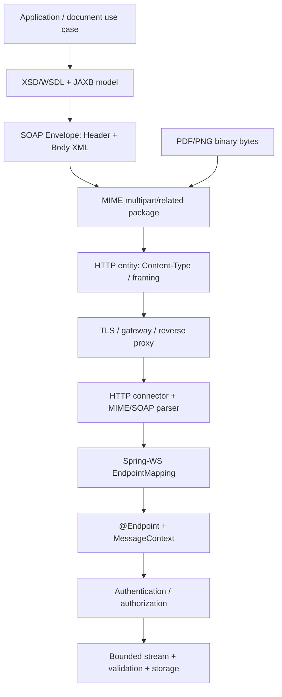

# MIME multipart, Content-ID và liên kết dữ liệu với payload

## Mục tiêu học tập

Trong chương **Tệp đính kèm** của module **SPRING_WEB_SERVICES**, bài này giải thích cách một thông điệp SOAP có thể mang **XML nghiệp vụ và dữ liệu nhị phân** trong cùng một gói MIME, cùng cơ chế dùng **Content-ID** để liên kết phần dữ liệu nằm bên ngoài SOAP Body với một tham chiếu trong payload. Chủ đề đặc biệt quan trọng khi tích hợp doanh nghiệp theo hướng **contract-first** với XSD/WSDL, JAXB, Spring Web Services (Spring-WS), SOAP client, WS-Security và nhiều hệ thống đối tác khác nhau.

Sau bài học, bạn có thể:

1. Phân biệt SOAP Envelope, HTTP entity, MIME `multipart/related`, MIME part, boundary, `Content-ID`, `Content-Type`, `Content-Transfer-Encoding` và URI `cid:`.
2. Đọc một thông điệp SOAP có tệp PDF hoặc ảnh được đóng gói thành nhiều MIME parts, xác định **root SOAP part** và các **attachment parts**.
3. Hiểu `type`, `start` và `start-info` trong `Content-Type: multipart/related` theo RFC 2387; biết khi nào root part không phải part đầu tiên.
4. Liên kết đúng `cid:document-42@example.test` với `Content-ID: <document-42@example.test>` theo RFC 2392, tránh nhầm dấu ngoặc nhọn, URL encoding và trường tên tệp.
5. Phân biệt **SOAP with Attachments (SwA)** kiểu tham chiếu `cid:` do ứng dụng/contract quy định với **MTOM/XOP** tối ưu dữ liệu `xs:base64Binary` mà vẫn giữ XML Infoset.
6. Dùng `org.springframework.ws.mime.MimeMessage` và `Attachment` để thêm, liệt kê, truy xuất attachment từ Spring-WS 4.1.x.
7. Viết client dùng `WebServiceTemplate` và `WebServiceMessageCallback` để gửi payload XML có tham chiếu CID cùng attachment; kiểm tra bằng `MockWebServiceServer`.
8. Viết endpoint nhận `MessageContext`, tra attachment theo Content-ID, kiểm tra giới hạn kích thước, định dạng và quyền trước khi đưa tệp cho application service.
9. Bật `Jaxb2Marshaller.setMtomEnabled(true)` khi contract và JAXB model phù hợp, hiểu khi nào runtime có thể tạo `xop:Include`.
10. Thiết kế chính sách xử lý multipart an toàn: không dereference URL tùy ý, không tin MIME type/filename, chống tệp quá lớn, duplicate CID, replay, mã độc và XML parser abuse.
11. Kiểm thử **hợp đồng XSD/WSDL**, **SOAP message + attachment**, **MIME bytes trên wire**, **TLS/WS-Security** và tương thích với client đối tác.
12. Chẩn đoán các lỗi thiếu part, Content-ID không khớp, MIME boundary lỗi, HTTP framing, JAXB/MTOM và chữ ký XML.

## 1. Vấn đề: gửi tài liệu nhị phân qua dịch vụ SOAP

Giả sử hệ thống quản lý chứng từ cung cấp SOAP operation `SubmitDocument`. Bên gửi cần chuyển:

- Mã chứng từ `DOC-2026-0042`.
- Mã doanh nghiệp/tenant cần xử lý.
- Loại tài liệu `application/pdf`.
- Nội dung PDF dung lượng vài MB đến hàng trăm MB.
- Thông tin integrity như `sha256` hoặc `length` nếu hợp đồng yêu cầu.

SOAP Body chủ yếu là XML. Có ít nhất ba cách phổ biến để thể hiện nội dung nhị phân:

| Cách | Dữ liệu nhị phân được biểu diễn ở đâu? | Khi nào phù hợp |
| --- | --- | --- |
| **Base64 inline** | Chuỗi `xs:base64Binary` bên trong phần tử XML. | Tệp nhỏ hoặc client/server không hỗ trợ MIME attachments. |
| **SOAP with Attachments (SwA)** | Binary được đóng thành MIME part riêng; SOAP XML chứa tham chiếu `cid:...` theo contract. | Hợp đồng cũ, đối tác yêu cầu SwA hoặc tệp tách rõ khỏi payload. |
| **MTOM/XOP** | XML Infoset vẫn là `xs:base64Binary`; wire có thể thay base64 bằng `xop:Include href="cid:..."` và MIME part nhị phân. | Hợp đồng hỗ trợ MTOM; truyền binary lớn hơn mà tránh base64 inline khi tối ưu. |

**Không đồng nhất SwA với MTOM chỉ vì cả hai đều dùng `multipart/related`.** Chúng khác nhau ở **ngữ nghĩa hợp đồng XML** và cách runtime xử lý tham chiếu.

### 1.1. Base64 tăng kích thước nhưng đơn giản

Với `N` byte dữ liệu, độ dài base64 là xấp xỉ `4 * ceil(N/3)` ký tự trước khi tính thêm XML/transport. Mức tăng thường được diễn đạt khoảng **33%**, chưa kể bộ nhớ và chi phí chuyển đổi. Tuy vậy, base64 inline có lợi thế là payload XML tự chứa và không cần MIME parser riêng.

MTOM có thể tránh phải biểu diễn toàn bộ bytes bằng chuỗi base64 **trên wire**; còn SwA đưa file ra part riêng theo một cách liên kết khác. Chọn cơ chế dựa trên WSDL, profile đối tác, giới hạn kích thước, signing và khả năng streaming thực tế.

### 1.2. Contract-first vẫn là nguồn chân lý

Không tự quyết định “tôi sẽ gửi attachment” chỉ vì Java có `byte[]` hoặc `DataHandler`. Cần kiểm tra:

1. WSDL/XSD định nghĩa `SubmitDocumentRequest` ra sao.
2. WSDL binding/đặc tả tích hợp yêu cầu SwA, MTOM hay base64 inline.
3. SOAP version (1.1 hay 1.2) và media type.
4. Đối tác yêu cầu filename, MIME type, CID format, hash, chữ ký và kích thước thế nào.
5. Cơ chế xử lý SOAP Fault khi attachment thiếu/sai và giới hạn HTTP/gateway.

## 2. Bốn lớp cần tách bạch

Một lời gọi upload SOAP thường có các lớp sau:



- **SOAP Body** chứa yêu cầu nghiệp vụ; phần tử có thể mang CID URI hoặc `xs:base64Binary` theo contract.
- **MIME package** tổ chức nhiều body parts thành một HTTP entity; từng part có metadata và bytes riêng.
- **HTTP layer** quyết định `Content-Length` hoặc `Transfer-Encoding` cho **toàn bộ entity**, không cho riêng SOAP Body.
- **TLS/WS-Security** cung cấp bảo vệ theo policy khác nhau; chỉ có MIME part và Content-ID không tạo authentication.
- **Application service** cần kiểm tra quyền trên tenant/tài nguyên và lưu trữ tài liệu an toàn.

Việc file được gửi dưới dạng một MIME part **không làm nó trở thành một lời gọi HTTP multipart/form-data** như REST upload. Đó là hai định dạng multipart và contract khác nhau.

## 3. `multipart/related` theo RFC 2387

`multipart/related` là một MIME media type dùng để truyền **một tập các phần có quan hệ với nhau**. Đầu vào có thể là SOAP XML part và nhiều attachment binary parts.

Một HTTP header mẫu:

```http
POST /ws/documents HTTP/1.1
Host: api.example.test
Content-Type: multipart/related; boundary="MIME_B42"; type="text/xml"; start="<root-b42@example.test>"
SOAPAction: "urn:example:documents:v1/SubmitDocument"
```

Dòng `Content-Type` trên minh họa **SOAP 1.1 SwA**. Một MTOM package có media type `type="application/xop+xml"` khác, xem phần sau.

### 3.1. Các tham số quan trọng

| Tham số | Vai trò | Có bắt buộc? |
| --- | --- | --- |
| `boundary` | Chuỗi phân tách các MIME parts. | Bắt buộc theo cú pháp multipart MIME. |
| `type` | Media type của **root part**. | RFC 2387 yêu cầu cho `multipart/related`. |
| `start` | Content-ID xác định **root part**. | Tùy chọn; nếu thiếu thì part đầu tiên là root. |
| `start-info` | Thông tin bổ sung cho application/profile, chẳng hạn media type nền trong MTOM. | Tùy chọn theo RFC 2387; có profile yêu cầu. |

`type` phải khớp media type thực của root part theo định dạng áp dụng. Đừng cấu hình `type="application/pdf"` chỉ vì PDF là attachment; root ở đây là SOAP XML, không phải PDF.

### 3.2. Root part không nhất thiết đứng đầu

Nếu HTTP `Content-Type` có:

```http
start="<root-b42@example.test>"
```

thì MIME processor tìm part có `Content-ID: <root-b42@example.test>` làm root. Việc cố định “part đầu tiên luôn là SOAP” mà bỏ qua `start` có thể khiến parser đọc nhầm PDF thành XML nếu bên gửi thay thứ tự parts hợp lệ.

Nếu không có `start`, RFC 2387 quy định root mặc định là part đầu tiên. Dù vậy, ứng dụng Spring-WS nên để MIME/SOAP message factory xác định root thay vì tự split byte stream theo thứ tự.

### 3.3. Boundary và dấu kết thúc

`boundary="MIME_B42"` tương ứng các delimiter trong body:

```text
--MIME_B42
[Headers of first MIME part]

[First part bytes]
--MIME_B42
[Headers of second MIME part]

[Second part bytes]
--MIME_B42--
```

Dấu `--` phía trước delimiter và `--` bổ sung ở delimiter cuối đều quan trọng. Các đường ranh phải được thể hiện bằng **CRLF trên wire** theo MIME, không chỉ newline của source code.

**Không tự chọn boundary trùng dữ liệu binary hoặc hard-code lại boundary trong nhiều request.** Để MIME message factory quản lý việc sinh boundary và serialize chính xác.

## 4. Ví dụ một SOAP with Attachments multipart message

Ví dụ sau mô tả một HTTP entity có root SOAP XML và một PDF attachment.

```mime
Content-Type: multipart/related; boundary="MIME_B42"; type="text/xml"; start="<soap-root-b42@example.test>"
MIME-Version: 1.0

--MIME_B42
Content-Type: text/xml; charset=utf-8
Content-Transfer-Encoding: 8bit
Content-ID: <soap-root-b42@example.test>

<soap:Envelope xmlns:soap="http://schemas.xmlsoap.org/soap/envelope/"
               xmlns:doc="urn:example:documents:v1">
  <soap:Header/>
  <soap:Body>
    <doc:SubmitDocumentRequest>
      <doc:documentId>DOC-2026-0042</doc:documentId>
      <doc:contentRef>cid:pdf-42@example.test</doc:contentRef>
    </doc:SubmitDocumentRequest>
  </soap:Body>
</soap:Envelope>

--MIME_B42
Content-Type: application/pdf
Content-Transfer-Encoding: binary
Content-ID: <pdf-42@example.test>
Content-Disposition: attachment; filename="document.pdf"

[Binary PDF bytes, không phải chuỗi literal này]
--MIME_B42--
```

**Đây là mô phỏng để đọc cấu trúc**, không phải byte stream có thể copy nguyên vào HTTP client: các dòng hiển thị không mã hóa CRLF/binary bytes, và phần PDF là placeholder. Header `Content-Type` thực sẽ nằm ở HTTP request; được lặp trên đầu block MIME để minh họa toàn bộ package.

### 4.1. Những gì liên kết với nhau

1. `start="<soap-root-b42@example.test>"` xác định **root SOAP MIME part**.
2. SOAP Body có `contentRef=cid:pdf-42@example.test`.
3. Part PDF có `Content-ID: <pdf-42@example.test>`.
4. Client/server áp quy ước `cid:` để tra part khớp với giá trị trong Body.
5. `Content-Type: application/pdf` gợi ý loại dữ liệu, **không chứng minh** bytes là PDF thật.
6. `Content-Disposition: attachment; filename="document.pdf"` là metadata tên tệp tùy chọn, **không phải Content-ID và không dùng làm khóa liên kết**.

Trong SwA, việc nối `contentRef` tới part PDF là **quy tắc của ứng dụng/hợp đồng**; WSDL/XSD cần thể hiện và document được trường này. Không phải SOAP parser tự hiểu bất kỳ phần tử tên `contentRef` nào.

### 4.2. Phân biệt hai Content-ID

Mỗi part có thể có Content-ID:

- Root SOAP part: `soap-root-b42@example.test`.
- PDF part: `pdf-42@example.test`.

Nếu Body tham chiếu `cid:pdf-42@example.test`, nó **không trỏ tới root SOAP part**. Một code review nên phát hiện trường hợp nhầm root ID và attachment ID.

## 5. `Content-ID` và URI `cid:` theo RFC 2392

Một MIME part có thể mang:

```mime
Content-ID: <document-42@example.test>
```

Trong SOAP/XML, tham chiếu tương ứng là:

```xml
<doc:contentRef xmlns:doc="urn:example:documents:v1">
    cid:document-42@example.test
</doc:contentRef>
```

### 5.1. Dấu ngoặc góc thuộc dạng header

| Biểu diễn | Ví dụ |
| --- | --- |
| MIME `Content-ID` header | `Content-ID: <document-42@example.test>` |
| URI tham chiếu trong XML | `cid:document-42@example.test` |
| Key API Spring-WS dùng để thêm/truy cập attachment | Thường là ID phần nội dung: `document-42@example.test`; kiểm tra implementation/case cụ thể. |

Đừng tự gắn `< >` vào trường XML `xs:anyURI` hoặc truyền cả `cid:` vào API `getAttachment(String contentId)` rồi tin nó tự chuẩn hóa trong mọi thư viện.

### 5.2. Trường hợp cần percent-encoding

RFC 2392 quy định URI scheme `cid:` và cách mã hóa những ký tự không hợp lệ trong URL. Ví dụ header có ID chứa ký tự đặc biệt:

```mime
Content-ID: <foo%bar@example.test>
```

URI cần mã hóa ký tự `%`:

```text
cid:foo%25bar@example.test
```

Khi đối chiếu, phải giải mã phần URI một cách chính xác để tìm ID thực; không so sánh chuỗi raw một cách tùy tiện và cũng không dùng bộ giải mã form URL tự thay `+` thành dấu cách.

**Giải pháp dễ kiểm soát:** trong dự án mới, quy định ID do ứng dụng sinh theo tập ký tự ASCII bảo thủ, ví dụ `document-42@service.example`. Khi phải tương tác với CID từ đối tác, dùng parser URI/MIME phù hợp RFC 2392 và có test đối với percent-encoding.

### 5.3. Content-ID không phải URL truy cập mạng

`cid:document-42@example.test` là **tham chiếu tới part trong MIME message**, không phải:

```text
https://example.test/document-42
file:///var/lib/documents/document-42
classpath:documents/document-42
```

Nếu attachment không tồn tại, **không fallback sang fetch HTTP URL, filesystem hoặc classpath** từ giá trị request. Điều đó có thể tạo SSRF, path traversal hoặc đọc tệp ngoài quyền.

### 5.4. Unique ID và duplicate ID

Theo nguyên tắc MIME Content-ID, ID cần phân biệt rõ các parts. Trong một SOAP package, nhiều parts có cùng ID khiến tham chiếu có thể nhập nhằng hoặc implementation chọn part khác nhau.

Ứng dụng nên:

- Sinh ID mới/có tính duy nhất cho từng attachment nếu cần.
- Không dùng filename làm CID.
- Không dùng tenant/user tự khai trong CID như bằng chứng quyền.
- Reject hoặc xử lý theo profile khi **duplicate Content-ID**.
- Không mặc định part đầu tiên khớp là part được ứng dụng muốn ký/xử lý.
- Kiểm tra số lượng parts và danh sách phần tử được tham chiếu.

### 5.5. Nội dung định danh có thể thay đổi qua thư viện

Một MIME implementation có thể trả `Attachment.getContentId()` theo một dạng đã chuẩn hóa; implementation khác có thể thể hiện header với dấu ngoặc hoặc ký tự escape theo cách khác. Khi sử dụng Spring-WS, **test với message factory và sender thực tế** trước khi viết comparator tự chế dựa trên string.

## 6. SwA và MTOM/XOP: giống container, khác ngữ nghĩa

| Tiêu chí | SOAP with Attachments | MTOM/XOP |
| --- | --- | --- |
| XML contract điển hình | Body có URI tham chiếu, ví dụ `contentRef` kiểu `xs:anyURI`. | Body có phần tử binary logic kiểu `xs:base64Binary`. |
| Liên kết trên wire | `cid:...` do contract/app quy định. | `xop:Include href="cid:..."` do XOP serializer tạo. |
| MIME parts | SOAP XML root + attachment parts. | XOP XML root + các binary parts được trích từ base64; có thể có parts khác. |
| Lợi ích | Phân tách tệp khỏi XML, hỗ trợ profile legacy. | Tối ưu base64 wire representation trong khi bảo toàn XML Infoset. |
| JAXB model | Có thể chứa URI String và attachment riêng. | Có thể chứa `byte[]` hoặc `DataHandler` theo binding/JAXB setup. |
| XSD validation | Kiểm tra URI field theo schema nhưng không kiểm tra bytes của part. | XML Infoset logic vẫn tuân `xs:base64Binary`; MIME integrity cần kiểm tra thêm. |
| Không tự động | Việc nối CID và xử lý tệp trong application. | Việc chọn vùng tối ưu, signed parts, ngưỡng tối ưu và khả năng tương thích. |

### 6.1. Vì sao không tự thêm `xop:Include` vào XSD?

Trong MTOM, **XOP là cách serialize/đóng gói** một XML Infoset có thể chứa base64 binary. XML contract hợp lý thường dùng `xs:base64Binary`, không yêu cầu client tự điền một `xop:Include` vào model nghiệp vụ.

Nếu code tự chèn `xop:Include` như một phần tử business độc lập vào XML trước khi runtime xử lý XOP, bạn có thể làm mất khả năng round-trip hoặc tạo XML không hợp lệ với XSD, vì XOP có các điều kiện nghiêm ngặt về Infoset nguồn.

### 6.2. Vì sao SwA cũng có thể dùng MIME nhưng không phải MTOM?

Một SwA message có `contentRef=cid:...` là tham chiếu ứng dụng tới MIME part. Khi XML schema quy định `contentRef` là URI, file bytes **không phải giá trị XML logic của trường `xs:base64Binary`**.

Trong MTOM, các bytes bên ngoài được logic tái cấu trúc thành giá trị base64 thuộc XML Infoset. Một client MTOM-aware có thể unmarshall trở lại `byte[]`/`DataHandler` dù wire có `xop:Include`.

## 7. Từ XSD đến payload SwA: tham chiếu CID rõ ràng

Một hợp đồng SwA cơ bản có thể mô tả metadata và URI tham chiếu.

**`documents-swa-v1.xsd`**:

```xml
<?xml version="1.0" encoding="UTF-8"?>
<xs:schema
    xmlns:xs="http://www.w3.org/2001/XMLSchema"
    xmlns:tns="urn:example:documents:v1"
    targetNamespace="urn:example:documents:v1"
    elementFormDefault="qualified">

    <xs:element name="SubmitDocumentRequest">
        <xs:complexType>
            <xs:sequence>
                <xs:element name="documentId" type="xs:string"/>
                <xs:element name="contentRef" type="xs:anyURI"/>
                <xs:element name="declaredMediaType" type="xs:string"/>
            </xs:sequence>
        </xs:complexType>
    </xs:element>

    <xs:element name="SubmitDocumentResponse">
        <xs:complexType>
            <xs:sequence>
                <xs:element name="accepted" type="xs:boolean"/>
                <xs:element name="trackingId" type="xs:string"/>
            </xs:sequence>
        </xs:complexType>
    </xs:element>
</xs:schema>
```

Ví dụ payload:

```xml
<doc:SubmitDocumentRequest
    xmlns:doc="urn:example:documents:v1">
    <doc:documentId>DOC-2026-0042</doc:documentId>
    <doc:contentRef>cid:pdf-42@example.test</doc:contentRef>
    <doc:declaredMediaType>application/pdf</doc:declaredMediaType>
</doc:SubmitDocumentRequest>
```

### 7.1. `xs:anyURI` không chứng minh part tồn tại

XSD validation có thể xác nhận field hợp lệ ở cấp cú pháp URI theo các ràng buộc schema, nhưng:

- Không bảo đảm scheme **chỉ là `cid:`** nếu không có rule bổ sung.
- Không bảo đảm Content-ID tương ứng có mặt.
- Không bảo đảm MIME part chỉ có một, chưa bị sửa hoặc đúng loại tệp.
- Không bảo đảm người gửi có quyền upload chứng từ.
- Không chứng minh dữ liệu binary không chứa malware.

Application/adapter vẫn phải xác minh **link integrity**, policy và attachment bytes.

### 7.2. Nên quy định một profile CID trong hợp đồng

Ví dụ yêu cầu:

```text
contentRef:
  scheme = "cid"
  một MIME attachment với Content-ID tương ứng
  không trỏ tới SOAP root part
  không duplicate Content-ID
  declaredMediaType = application/pdf
  tối đa 20 MiB mỗi file, tối đa 3 files mỗi message
  file có kiểm tra định dạng, hash, malware và quyền upload
```

Đây là **profile ví dụ cho bài học**, không phải giới hạn mặc định của Spring-WS. Khi xây hệ thống thật, kích thước và loại file theo yêu cầu nghiệp vụ và năng lực hạ tầng.

### 7.3. WSDL mô tả operation, còn attachment convention cần được công bố

WSDL 1.1 có extension MIME như `mime:multipartRelated`, `mime:part`, `mime:content` để mô tả binding của các parts khi sử dụng đúng profile. Ví dụ trích đoạn **mang tính ý tưởng**:

```xml
<wsdl:message name="SubmitDocumentInput">
    <wsdl:part name="payload" element="doc:SubmitDocumentRequest"/>
    <wsdl:part name="document" type="xs:base64Binary"/>
</wsdl:message>

<wsdl:binding name="DocumentsSoapBinding"
              type="tns:DocumentsPortType">
    <soap:binding
        style="document"
        transport="http://schemas.xmlsoap.org/soap/http"/>

    <wsdl:operation name="SubmitDocument">
        <soap:operation
            soapAction="urn:example:documents:v1/SubmitDocument"/>
        <wsdl:input>
            <mime:multipartRelated>
                <mime:part>
                    <soap:body use="literal" parts="payload"/>
                </mime:part>
                <mime:part>
                    <mime:content part="document"
                                  type="application/pdf"/>
                </mime:part>
            </mime:multipartRelated>
        </wsdl:input>
        <wsdl:output>
            <soap:body use="literal"/>
        </wsdl:output>
    </wsdl:operation>
</wsdl:binding>
```

**Chỉ là trích đoạn WSDL binding**: cần khai báo namespace `wsdl`/`soap`/`mime`/`tns`/`doc`/`xs`, `portType`, output message, service/port và definition hợp lệ; tooling MIME WSDL extensions khác nhau giữa các SOAP stacks. Đặc biệt, `mime:content` trỏ tới một WSDL message part **không tự sinh đúng chuỗi `contentRef=cid:...` trong JAXB payload** nếu profile/serializer không hỗ trợ. Hãy thử với đối tác/codegen và document rõ quy tắc CID.

## 8. MTOM/XOP: XML logic là base64, wire là binary part

Trong MTOM, payload logic có thể chứa binary field:

```xml
<doc:SubmitBinaryRequest
    xmlns:doc="urn:example:documents:v1">
    <doc:documentId>DOC-2026-0042</doc:documentId>
    <doc:content>JVBERi0xLjcK...</doc:content>
</doc:SubmitBinaryRequest>
```

Ở XML Infoset, `content` là dữ liệu base64 theo `xs:base64Binary`. Khi được tối ưu bởi XOP, serializer thay nội dung base64 trên **wire** bằng `xop:Include`:

```xml
<doc:SubmitBinaryRequest
    xmlns:doc="urn:example:documents:v1"
    xmlns:xop="http://www.w3.org/2004/08/xop/include">
    <doc:documentId>DOC-2026-0042</doc:documentId>
    <doc:content>
        <xop:Include href="cid:binary-42@example.test"/>
    </doc:content>
</doc:SubmitBinaryRequest>
```

Phần binary tương ứng nằm ở MIME part:

```mime
Content-ID: <binary-42@example.test>
Content-Type: application/pdf
Content-Transfer-Encoding: binary

[PDF bytes]
```

**Không hiểu `xop:Include` là một trường mới của domain.** Khi XOP deserializer tái dựng Infoset, giá trị `content` mang ý nghĩa các byte base64 của XML gốc.

### 8.1. XSD cho trường binary

```xml
<xs:schema
    xmlns:xs="http://www.w3.org/2001/XMLSchema"
    xmlns:xmime="http://www.w3.org/2005/05/xmlmime"
    targetNamespace="urn:example:documents:v1"
    elementFormDefault="qualified">

    <xs:element name="SubmitBinaryRequest">
        <xs:complexType>
            <xs:sequence>
                <xs:element name="documentId" type="xs:string"/>
                <xs:element name="content" type="xs:base64Binary"
                    xmime:expectedContentTypes="application/pdf"/>
            </xs:sequence>
        </xs:complexType>
    </xs:element>
</xs:schema>
```

`xmime:expectedContentTypes` là gợi ý media type cho binary. Tùy JAXB/XJC binding và version, generated Java field có thể là `byte[]` hoặc `jakarta.activation.DataHandler`; **phải kiểm tra output XJC thật** thay vì giả định mọi schema cùng một Java type.

### 8.2. MIME package MTOM đúng ngữ nghĩa

Với **SOAP 1.2 MTOM** theo W3C MTOM Recommendation, outer HTTP media type là `multipart/related`, `type="application/xop+xml"` và `start-info` thể hiện `application/soap+xml`:

```mime
Content-Type: multipart/related;
    boundary="MIME_MTOM_42";
    type="application/xop+xml";
    start="<soap-mtom-42@example.test>";
    start-info="application/soap+xml"

--MIME_MTOM_42
Content-Type: application/xop+xml;
    charset=UTF-8; type="application/soap+xml"
Content-Transfer-Encoding: 8bit
Content-ID: <soap-mtom-42@example.test>

[SOAP 1.2 Envelope có xop:Include href="cid:binary-42@example.test"]

--MIME_MTOM_42
Content-Type: application/pdf
Content-Transfer-Encoding: binary
Content-ID: <binary-42@example.test>

[PDF bytes]

--MIME_MTOM_42--
```

Mẫu được xuống dòng để đọc, chưa chứa binary/CRLF thật. Với SOAP 1.1 + MTOM, media type nội bộ có thể là `text/xml` theo binding, không thể copy thông số SOAP 1.2 rồi kỳ vọng mọi client 1.1 chấp nhận.

### 8.3. Những điều kiện của XOP

Theo W3C XOP:

- Phần được tối ưu phải có ngữ nghĩa dữ liệu base64 phù hợp.
- `xop:Include` trỏ bằng `cid:` tới MIME part tương ứng.
- Trong optimized XML, `xop:Include` là phần tử nằm ở vị trí thay cho base64.
- Không tự thêm `xop:Include` vào original XML Infoset như một phần tử business độc lập.
- Không phải mọi phần tử có kiểu `xs:base64Binary` đều bắt buộc được tách ra; quyết định tối ưu phụ thuộc runtime, độ lớn và cấu hình.
- Tái dựng XML Infoset phải bảo toàn giá trị logic tương đương.

Vì thế, **bật MTOM không có nghĩa mọi request đều là multipart**. Với dữ liệu nhỏ hoặc điều kiện optimization không đạt, runtime có thể giữ base64 inline nếu profile cho phép.

## 9. Đọc multipart qua ba nhóm header

Trong một request có attachment, cần phân biệt rõ:

| Nhóm | Ví dụ | Thuộc trách nhiệm |
| --- | --- | --- |
| **HTTP headers** | `Content-Type: multipart/related`, `Content-Length`, `Transfer-Encoding`, `SOAPAction` | HTTP transport/binding, entity framing. |
| **MIME part headers** | `Content-ID`, `Content-Type: application/pdf`, `Content-Transfer-Encoding`, `Content-Disposition` | MIME package và từng part. |
| **SOAP Headers trong XML** | `wsse:Security`, `wsa:Action`, `soap:mustUnderstand` | SOAP protocol và message security. |
| **SOAP Body** | `SubmitDocumentRequest`, `contentRef`, `content` | XSD/WSDL business payload. |

### 9.1. Không nhầm MIME Content-Transfer-Encoding với HTTP Transfer-Encoding

`Content-Transfer-Encoding: binary` là một **MIME part header** cho cách biểu diễn dữ liệu của part. Nó không tương đương:

```http
Transfer-Encoding: chunked
```

trong HTTP/1.1. HTTP `chunked` dùng để định khung **toàn HTTP entity**; MIME boundary chia body thành **các parts bên trong entity**. Hai cơ chế có thể cùng tồn tại đúng chuẩn ở các lớp khác nhau.

### 9.2. Không đặt Content-Length cho riêng XML part rồi dùng làm HTTP length

HTTP `Content-Length` phải đại diện cho byte count của **toàn bộ HTTP message content** khi không có Transfer-Encoding. Với multipart, tổng bytes gồm mọi part, MIME headers, boundaries và binary data.

Nếu bạn chỉ tính `soapEnvelope.length()` rồi set CL, bên nhận có thể đọc thiếu MIME package, khiến attachment “mất” hoặc request bị treo. Để HTTP sender/Servlet container quản lý framing.

### 9.3. Content-Disposition không phải security metadata

Một attachment có:

```mime
Content-Disposition: attachment; filename="../../orders.pdf"
```

không được phép khiến server ghi tệp theo đường dẫn đó. Filename (nếu có) là metadata **do caller cung cấp**; nên sinh tên lưu trữ nội bộ, dùng allowlist extension/media type và tránh path traversal.

## 10. Spring-WS 4.1.x: `MimeMessage` và `Attachment`

Spring-WS định nghĩa:

```java
org.springframework.ws.mime.MimeMessage
org.springframework.ws.mime.Attachment
```

`SoapMessage` kế thừa `MimeMessage`, vì vậy một SOAP message có API xử lý attachment.

### 10.1. API chính của `MimeMessage`

Rút gọn chữ ký:

```java
Attachment addAttachment(
        String contentId, jakarta.activation.DataHandler handler);

Attachment addAttachment(
        String contentId, java.io.File file);

Attachment addAttachment(
        String contentId,
        org.springframework.core.io.InputStreamSource source,
        String contentType);

Attachment getAttachment(String contentId);

Iterator<Attachment> getAttachments();

boolean isXopPackage();
boolean convertToXopPackage();
```

Các chữ ký trên là **tài liệu API để nhận diện**, không phải interface cần tự khai báo. Một số method có `AttachmentException` khi không truy cập được part; kiểm tra javadoc đúng Spring-WS version.

### 10.2. API chính của `Attachment`

```java
String getContentId();
String getContentType();
jakarta.activation.DataHandler getDataHandler();
InputStream getInputStream() throws IOException;
long getSize();
```

Những điều phải nhớ:

- `getSize()` có thể trả `-1` nếu không xác định được kích thước.
- `getContentType()` và `getContentId()` có thể thiếu tùy message/implementation.
- Người sử dụng **chịu trách nhiệm đóng InputStream** nhận từ `getInputStream()`.
- Một `DataHandler` không mặc nhiên làm toàn bộ pipeline streaming: message factory có thể cache hoặc materialize dữ liệu.
- Thêm attachment có thể làm HTTP content type thành multipart khi serialize; hãy để message factory xử lý outer MIME metadata.

### 10.3. Ba cách thêm attachment

| API | Điểm mạnh | Rủi ro cần xem |
| --- | --- | --- |
| `addAttachment(id, File)` | Dễ dùng file sẵn có. | Media type được suy theo tên file; file tạm `.tmp` dễ sai, lifetime của file phải đủ dài. |
| `addAttachment(id, InputStreamSource, contentType)` | Rõ content type; hỗ trợ Resource như `FileSystemResource`. | Source cần cung cấp **stream mới mỗi lần** vì runtime có thể gọi nhiều lần. |
| `addAttachment(id, DataHandler)` | Tích hợp Jakarta Activation và DataSource phù hợp. | Cần quản lý DataSource, media type, quyền đọc và lifecycle. |

Với Spring-WS 4.x, lưu ý `jakarta.activation.DataHandler`, không vô tình trộn `javax.activation.DataHandler` của thế hệ cũ.

## 11. Client SwA: thêm PDF attachment bằng `WebServiceMessageCallback`

Ta tạo một client gọi `SubmitDocument`. Mẫu này **không bật MTOM**; nó dùng **SwA với explicit `cid:` reference** đúng như XSD `contentRef` ở mục 7.

### 11.1. Code client minh họa theo Java 17+

**`SubmitDocumentSoapClient.java`**

```java
package com.example.documents.soapclient;

import java.io.File;

import javax.xml.transform.stream.StreamResult;

import org.springframework.core.io.FileSystemResource;
import org.springframework.ws.client.core.WebServiceTemplate;
import org.springframework.ws.mime.MimeMessage;
import org.springframework.xml.transform.StringSource;

public final class SubmitDocumentSoapClient {

    private static final String ACTION =
            "urn:example:documents:v1/SubmitDocument";

    private final WebServiceTemplate template;

    public SubmitDocumentSoapClient(WebServiceTemplate template) {
        this.template = template;
    }

    public String submit(
            String endpointUri, String documentId, File authorizedFile) {

        // File phải được chọn/kiểm soát bởi ứng dụng,
        // không lấy trực tiếp path từ SOAP client hoặc user input.
        String contentId = "document-" + java.util.UUID.randomUUID()
                + "@service.example";

        String payload = """
            <doc:SubmitDocumentRequest
                xmlns:doc="urn:example:documents:v1">
                <doc:documentId>DOCUMENT_ID</doc:documentId>
                <doc:contentRef>CONTENT_REF</doc:contentRef>
                <doc:declaredMediaType>application/pdf</doc:declaredMediaType>
            </doc:SubmitDocumentRequest>
            """;

        // Chỉ là demo XML template: production cần JAXB/DOM builder
        // hoặc escaping/validation nếu đưa dữ liệu động.
        payload = payload
                .replace("DOCUMENT_ID", documentId)
                .replace("CONTENT_REF", "cid:" + contentId);

        java.io.StringWriter response = new java.io.StringWriter();

        boolean received = template.sendSourceAndReceiveToResult(
                endpointUri,
                new StringSource(payload),
                message -> {
                    if (!(message instanceof MimeMessage mime)) {
                        throw new IllegalStateException(
                                "SOAP MIME-capable message is required");
                    }

                    mime.addAttachment(
                            contentId,
                            new FileSystemResource(authorizedFile),
                            "application/pdf");

                    if (message instanceof org.springframework.ws.soap.SoapMessage soap) {
                        soap.setSoapAction(ACTION);
                    }
                },
                new StreamResult(response));

        if (!received) {
            throw new IllegalStateException("No SOAP response");
        }

        return response.toString();
    }
}
```

**Giải thích phạm vi:** ví dụ minh họa cách gọi đúng `MimeMessage.addAttachment(...)` và nối cùng content ID vào payload. Nó **không phải implementation production an toàn để copy nguyên** vì thay chuỗi trong XML có thể gây XML injection nếu `documentId` đến từ input không tin cậy. Trong dự án thật hãy dùng **JAXB generated classes** hoặc XML builder/marshaller đúng XSD. Cũng cần validate kích thước file, MIME type, authn/authz, retries và expected SOAP response.

### 11.2. Quy tắc quan trọng về stream

`FileSystemResource` có thể mở stream mới nhiều lần, phù hợp yêu cầu `InputStreamSource` của API này. Không dùng một `InputStream` chỉ đọc một lần rồi nhét vào custom source không hỗ trợ mở lại, trừ khi đã kiểm tra message factory/sender thật.

Với file lớn, **đừng hiểu “dùng FileSystemResource” là đảm bảo zero-copy**. SAAJ hoặc các interceptor có thể buffer cả SOAP message; cần đo heap, throughput và memory trên stack thật.

### 11.3. SOAPAction không phải Content-ID

`SoapMessage.setSoapAction(ACTION)` đặt chỉ dấu operation trong binding, còn `mime.addAttachment(contentId, ...)` đặt định danh MIME. Hai chuỗi khác nhau, không nên lấy action làm Content-ID hoặc ngược lại.

### 11.4. Dùng JAXB thay vì nối chuỗi XML

Giả sử XJC tạo:

```java
SubmitDocumentRequest request = new SubmitDocumentRequest();
request.setDocumentId(documentId);
request.setContentRef("cid:" + contentId);
request.setDeclaredMediaType("application/pdf");
```

Khi đã cấu hình `Jaxb2Marshaller` đúng package generated, dùng:

```java
Object response = template.marshalSendAndReceive(
        endpointUri, request, message -> {
            ((MimeMessage) message).addAttachment(
                    contentId,
                    new FileSystemResource(authorizedFile),
                    "application/pdf");
            ((org.springframework.ws.soap.SoapMessage) message)
                    .setSoapAction(ACTION);
        });
```

Đoạn này thay thế logic tạo `StringSource` trong demo; typed request chỉ có nếu generated class và JAXB mappings tương ứng đã tồn tại. Nếu output XJC dùng `JAXBElement<T>`, cần marshal root element đúng `ObjectFactory`.

**Điểm bảo vệ:** tham chiếu CID và attachment được tạo **trong cùng request callback**, theo cùng một giá trị content ID do ứng dụng kiểm soát.

## 12. Đọc attachment trong Spring-WS endpoint

Ở server, method `@Endpoint` có thể nhận `MessageContext` nhờ `MessageContextMethodArgumentResolver` và truy cập `context.getRequest()`.

**`DocumentEndpoint.java`**

```java
package com.example.documents.soapserver;

import java.io.IOException;
import java.io.InputStream;

import org.springframework.ws.context.MessageContext;
import org.springframework.ws.mime.Attachment;
import org.springframework.ws.mime.MimeMessage;
import org.springframework.ws.server.endpoint.annotation.Endpoint;
import org.springframework.ws.server.endpoint.annotation.PayloadRoot;
import org.springframework.ws.server.endpoint.annotation.RequestPayload;
import org.springframework.ws.server.endpoint.annotation.ResponsePayload;

@Endpoint
public final class DocumentEndpoint {

    private static final String NS =
            "urn:example:documents:v1";

    private final DocumentIngestionService ingestion;
    private final VerifiedCallerProvider callers;

    public DocumentEndpoint(
            DocumentIngestionService ingestion,
            VerifiedCallerProvider callers) {
        this.ingestion = ingestion;
        this.callers = callers;
    }

    @PayloadRoot(
        namespace = NS,
        localPart = "SubmitDocumentRequest")
    @ResponsePayload
    public SubmitDocumentResponse submit(
            @RequestPayload SubmitDocumentRequest request,
            MessageContext context) throws IOException {

        VerifiedCaller caller = callers.requireAuthenticatedCaller();
        ingestion.requireUploadPermission(
                caller, request.getDocumentId());

        if (!(context.getRequest() instanceof MimeMessage mime)) {
            throw new InvalidAttachmentException(
                    "MIME message required");
        }

        String contentId =
                CanonicalContentId.fromCidUri(request.getContentRef());

        Attachment attachment = mime.getAttachment(contentId);

        if (attachment == null) {
            throw new InvalidAttachmentException(
                    "Referenced attachment missing");
        }

        // Content-Type và Content-ID không phải chứng cứ tin cậy.
        ingestion.requireAllowedMediaType(attachment.getContentType());

        try (InputStream input = attachment.getInputStream()) {
            ingestion.ingestWithLimits(
                    caller, request.getDocumentId(), input);
        }

        SubmitDocumentResponse response =
                new SubmitDocumentResponse();
        response.setAccepted(true);
        response.setTrackingId("tracking-generated-by-service");
        return response;
    }
}
```

**Các kiểu `DocumentIngestionService`, `VerifiedCallerProvider`, `CanonicalContentId`, `InvalidAttachmentException` và JAXB classes là abstraction của ứng dụng, chưa được định nghĩa đầy đủ trong đoạn code**. Mục đích là minh họa trách nhiệm phân tầng và các API Spring-WS thật.

Điểm quan trọng:

1. `@PayloadRoot` chỉ chọn operation theo QName.
2. `MessageContext` cung cấp request `WebServiceMessage`; kiểm tra `MimeMessage` khi cần attachment.
3. `getAttachment(contentId)` truy xuất attachment theo **ID**, không theo filename.
4. Xác thực và quyền upload được kiểm tra **trước khi xử lý/tồn trữ bytes**.
5. Thực hiện streaming/bounded copy thay vì `readAllBytes()` cho file lớn.
6. Response theo JAXB/WSDL; exception được mapper/resolver chuyển thành SOAP Fault an toàn.
7. Không suy ra tính xác thực chỉ từ `Content-ID` hoặc `Content-Type`.

### 12.1. Parser CID mẫu có giới hạn chủ đích

Để tránh giải mã RFC 2392 không đầy đủ, một hệ thống có thể quy định **profile CID bảo thủ**. Ví dụ dưới đây **không phải parser cho mọi CID hợp lệ theo RFC**; nó chỉ nhận định dạng mà hợp đồng ví dụ cho phép.

**`CanonicalContentId.java`**:

```java
package com.example.documents.soapserver;

import java.util.regex.Pattern;

public final class CanonicalContentId {

    private static final Pattern ALLOWED =
            Pattern.compile(
                "[A-Za-z0-9._-]{1,80}@[A-Za-z0-9.-]{1,100}");

    private CanonicalContentId() {
    }

    public static String fromCidUri(String raw) {
        if (raw == null || !raw.startsWith("cid:")) {
            throw new IllegalArgumentException(
                    "A cid: URI is required");
        }

        String contentId = raw.substring("cid:".length());

        if (!ALLOWED.matcher(contentId).matches()) {
            throw new IllegalArgumentException(
                    "Unsupported Content-ID syntax");
        }

        return contentId;
    }
}
```

Profile này tránh percent-encoded ký tự đặc biệt, dấu ngoặc, dấu cách và xuống dòng; chỉ dùng khi **hai bên đã thỏa thuận**. Với đối tác gửi ID phức tạp theo RFC 2392, phải dùng parser/canonicalizer đầy đủ và test percent-encoding, không âm thầm đổi định danh hợp lệ thành ID khác.

### 12.2. Trường hợp phải kiểm tra duplicate CID

API `getAttachment(String)` có thể tìm một part theo ID. Nếu yêu cầu bảo mật cao, nên liệt kê `mime.getAttachments()` và kiểm tra tính duy nhất/giới hạn số part theo dạng Content-ID đã chuẩn hóa, nhất là với hệ thống tích hợp nhiều MIME stack.

Không đơn giản kết luận “getAttachment trả một object, chắc chắn package không có duplicate ID”.

## 13. Đọc bytes an toàn: giới hạn dung lượng và đóng stream

`Attachment.getSize()` có thể trả `-1`. Vì vậy, **size metadata không đủ để enforce giới hạn**. Cần kiểm tra trong khi đọc bytes thật.

### 13.1. Hàm copy có giới hạn

**`BoundedAttachmentCopy.java`**:

```java
package com.example.documents.soapserver;

import java.io.IOException;
import java.io.InputStream;
import java.io.OutputStream;

public final class BoundedAttachmentCopy {

    private BoundedAttachmentCopy() {
    }

    public static long copy(
            InputStream input,
            OutputStream output,
            long maxBytes) throws IOException {

        if (maxBytes < 0) {
            throw new IllegalArgumentException(
                    "maxBytes must not be negative");
        }

        byte[] buffer = new byte[64 * 1024];
        long total = 0;

        int read;
        while ((read = input.read(buffer)) != -1) {
            if (read == 0) {
                continue;
            }

            if (total > maxBytes - read) {
                throw new AttachmentTooLargeException();
            }

            output.write(buffer, 0, read);
            total += read;
        }

        return total;
    }
}
```

`AttachmentTooLargeException` là runtime exception của ứng dụng, cần map thành Fault/transport error phù hợp. Để tránh rủi ro trên connection lâu sống, môi trường thật còn cần timeout, request body limits và tránh busy-loop nếu stream không trả tiến độ hợp lý.

### 13.2. Cách dùng với temporary/quarantine storage

Mô hình an toàn hơn:

```text
1. Authentication/authorization: caller được upload tài liệu này?
2. Xác minh CID → part, Content-Type và giới hạn parts.
3. Mở Attachment InputStream.
4. Copy tối đa limit vào file tạm trong thư mục riêng có quyền hạn chế.
5. Tính hash trong khi copy; xác minh checksum nếu có.
6. Kiểm tra magic bytes/file structure, antivirus/content scanner.
7. Khi hợp lệ: move/commit vào storage cuối theo tên server sinh.
8. Khi thất bại: xóa file tạm, trả Fault an toàn.
```

Đừng đưa filename từ `Content-Disposition` vào path lưu; dùng ID server sinh và thư mục/quarantine được cấu hình, chống symlink/path traversal. Phải thiết kế cleanup khi exception/timeouts trước commit.

### 13.3. Không đọc toàn bộ attachment vào RAM nếu không cần

Anti-pattern:

```java
byte[] all = attachment.getInputStream().readAllBytes();
repository.save(all);
```

Ngay cả khi giới hạn file danh nghĩa là 20 MiB, nhiều uploads song song hoặc nhiều parts có thể tạo áp lực heap. Trong Spring-WS dùng SAAJ, message factory cũng có thể đã buffer dữ liệu trước khi endpoint nhìn thấy stream; đo **peak memory thực** thay vì chỉ nhìn vòng copy.

## 14. MTOM với JAXB: cấu hình marshaller theo contract

Với binary field `xs:base64Binary` và message factory phù hợp, Spring OXM `Jaxb2Marshaller` hỗ trợ:

```java
marshaller.setMtomEnabled(true);
```

Mặc định property này là `false`.

**`DocumentMtomConfiguration.java`**:

```java
package com.example.documents.soap;

import org.springframework.context.annotation.Bean;
import org.springframework.context.annotation.Configuration;
import org.springframework.oxm.jaxb.Jaxb2Marshaller;
import org.springframework.ws.client.core.WebServiceTemplate;

@Configuration
public class DocumentMtomConfiguration {

    @Bean
    public Jaxb2Marshaller documentMarshaller() {
        Jaxb2Marshaller marshaller = new Jaxb2Marshaller();
        marshaller.setContextPath(
                "com.example.documents.contract");
        marshaller.setMtomEnabled(true);
        return marshaller;
    }

    @Bean
    public WebServiceTemplate documentTemplate(
            Jaxb2Marshaller documentMarshaller) {

        WebServiceTemplate template = new WebServiceTemplate();
        template.setMarshaller(documentMarshaller);
        template.setUnmarshaller(documentMarshaller);
        template.setDefaultUri(
                "https://partner.example.test/ws/documents");
        return template;
    }
}
```

**Điều kiện cần có ngoài bean này:** đúng JAXB generated classes, Jakarta Activation/runtime, SOAP/SAAJ hoặc Axiom implementation hỗ trợ attachments, SOAP version đúng binding, sender/transport phù hợp và security profile. **Bật MTOM không thay thế những cấu hình này.**

### 14.1. JAXB `DataHandler` và `@XmlMimeType`

Một model JAXB ví dụ rút gọn:

```java
package com.example.documents.contract;

import jakarta.activation.DataHandler;
import jakarta.xml.bind.annotation.XmlElement;
import jakarta.xml.bind.annotation.XmlMimeType;

public class BinaryDocument {

    @XmlElement(name = "content", required = true)
    @XmlMimeType("application/pdf")
    private DataHandler content;

    public DataHandler getContent() {
        return content;
    }

    public void setContent(DataHandler content) {
        this.content = content;
    }
}
```

Đây là một **đoạn mô tả field/getter/setter**, không phải JAXB root class đầy đủ để marshal độc lập. Trong dự án contract-first, ưu tiên tạo model từ XSD/XJC; tùy binding, `content` có thể là `DataHandler` hoặc `byte[]`. Không copy class thủ công rồi sửa XSD để phù hợp với một ví dụ Java.

### 14.2. Đặt binary data vào DataHandler

Với file thật, có thể tạo `jakarta.activation.DataHandler` từ `jakarta.activation.FileDataSource` hoặc `DataSource` riêng phù hợp. Tuy nhiên:

- File path phải thuộc nguồn ứng dụng đã cho phép.
- MIME type phải được xác minh; không chỉ dựa vào đuôi file.
- Stream phải còn tồn tại đến khi SOAP message được serialize.
- JAXB/MTOM runtime có thể gọi đọc nhiều lần hoặc buffer tùy implementation.
- Không tự thêm một `xop:Include` bằng string vào JAXB property.

### 14.3. Không đòi `xop:Include` luôn xuất hiện

MTOM là **cơ chế tối ưu**; message factory/binding có thể giữ base64 inline theo cấu hình hoặc độ lớn. Một test tốt nên kiểm tra **giá trị binary tái dựng giống nhau**, đồng thời có test wire riêng nếu đối tác **bắt buộc** nhận multipart optimized form.

### 14.4. Kiểm tra `isXopPackage()`

`MimeMessage` có `isXopPackage()` để phản ánh package XOP theo implementation và `convertToXopPackage()` để chuyển dạng khi phù hợp. Không nên gọi `convertToXopPackage()` tùy tiện trên mọi message để “ép” hỗ trợ MTOM; phải hiểu message factory và XOP constraints. **Cấu hình JAXB/SOAP message factory và test interop** mới là đường chính.

## 15. Những lỗi Content-ID thường gặp

| Lỗi | Triệu chứng | Hướng xử lý |
| --- | --- | --- |
| XML `cid:pdf-42@example.test` nhưng MIME ID `<pdf-43@example.test>` | Không tìm thấy attachment. | Sinh ref và part ID từ một giá trị chung; test matching. |
| Đưa `<...>` vào URI | `cid:<pdf-42@example.test>` không theo profile dự kiến. | Phân biệt cú pháp MIME header với CID URI. |
| Gọi `getAttachment("cid:pdf-42@example.test")` | Không tìm được nếu API cần ID thuần. | Trích/chuẩn hóa ID, test implementation. |
| Mã hóa `%` sai | URI giải mã ra ID khác với header. | Áp RFC 2392, test encoding đặc biệt. |
| Trùng Content-ID giữa hai parts | Parser chọn nhầm part hoặc kết quả phụ thuộc implementation. | Từ chối duplicate ID theo profile; tránh ambiguity. |
| `start` trỏ tới PDF thay vì SOAP | Root XML parse thất bại. | So `start` với root `Content-ID`. |
| Không có `start` và root nằm part thứ hai | Parser coi part đầu tiên là root. | Gắn start đúng hoặc đặt SOAP trước theo contract. |
| Chỉ có XML `contentRef` nhưng không gửi MIME part | SOAP payload có vẻ hợp lệ nhưng file thiếu. | Test cả payload và attachment presence. |
| Có MIME part nhưng payload không tham chiếu | Attachment orphaned, lãng phí hoặc bề mặt tấn công. | Kiểm tra/giới hạn parts dư thừa. |
| Tên file trùng Content-ID | Dùng tên file làm khóa liên kết sai. | Tách MIME `Content-ID` khỏi `Content-Disposition filename`. |
| Body chứa `https://...` thay `cid:` | Ứng dụng có thể vô tình fetch external URL. | Allowlist `cid`, tuyệt đối không tự fetch URL khi thiếu part. |

### 15.1. Chỉ so khớp Content-ID chưa đủ

Ngay cả khi `getAttachment(contentId)` trả đúng một object, cần xác minh:

- Part có phải định dạng được hỗ trợ không?
- Kích thước thực có vượt giới hạn không?
- Có mã độc hoặc cấu trúc file lỗi không?
- Caller có quyền tải tệp này không?
- Hash/metadata có khớp nếu contract yêu cầu không?
- WS-Security policy có bảo vệ payload/attachment và quan hệ giữa chúng không?

## 16. WS-Security, chữ ký và tính toàn vẹn của attachment

Đây là chỗ đặc biệt dễ nhầm: **HTTP/TLS bảo vệ một kênh**, trong khi **WS-Security có thể bảo vệ SOAP message** theo phạm vi đã ký/mã hóa.

### 16.1. Một SOAP Body được ký không mặc định bao phủ mọi MIME part

Nếu WS-Security signature chỉ ký SOAP Body chứa:

```xml
<doc:contentRef>cid:pdf-42@example.test</doc:contentRef>
```

thì chữ ký có thể bảo vệ **chuỗi tham chiếu**, nhưng **chưa chắc bảo vệ bytes của PDF attachment**. Đối tác/gateway trung gian hoặc attacker trong một trust boundary yếu có thể thay bytes mà vẫn giữ CID nếu security profile không bảo vệ phần này.

Đối với MTOM/XOP, cơ chế ký cần tôn trọng **SOAP Infoset** và tương tác giữa canonicalization, XOP và attachment bytes. Không tự kết luận “xop:Include đã nằm trong Body nên PDF chắc chắn được ký”.

### 16.2. Phương án chính sách

- Dùng **WS-Security attachment signature/encryption profile** nếu hệ thống đối tác và security stack hỗ trợ, kiểm tra signed parts thực sự.
- Nếu hợp đồng ghi hash của tệp trong SOAP Body, bảo vệ integrity và authenticity của **hash đó** theo security policy, rồi so khớp **bytes attachment thực nhận** với hash. Đây là kiểm tra bổ sung; không tương đương mọi thuộc tính của WS-Security attachment transforms.
- Dùng mTLS/TLS cho transport, nhưng nhận thức rõ điểm TLS được kết thúc tại gateway.
- Chặn XML Signature Wrapping, duplicate IDs/part ambiguity và kiểm tra phần XML **thực sự được endpoint xử lý**.
- Authorization vẫn dựa trên **authenticated principal + operation + tenant + tài nguyên**, không dựa vào filename/CID.

### 16.3. Hash và signed metadata

Nếu một payload có:

```xml
<doc:sha256>6f5902ac237024bdd0c176cb93063dc4...</doc:sha256>
```

đó chỉ là **giá trị minh họa không phải SHA-256 hoàn chỉnh**. Trong production, dùng hash đầy đủ (64 hex characters cho SHA-256) và verify bằng bytes thực. Nếu hash không được ký/xác minh bằng cơ chế đáng tin, attacker có thể thay cả file lẫn hash.

### 16.4. SOAP Fault và authentication

Nếu attachment bị thiếu, sai hash, vượt giới hạn hoặc không có quyền, có thể tạo SOAP Fault theo WSDL/security profile khi request đã vào SOAP pipeline. Lỗi phát sinh **trước SOAP parsing** (HTTP 413/gateway rejection/mTLS handshake) có thể không có SOAP Fault. Không dùng `EndpointExceptionResolver` để “bắt hết” mọi attachment transport error.

## 17. MIME type và filename là dữ liệu không tin cậy

### 17.1. `Content-Type` chỉ là nhãn

Một MIME part có:

```mime
Content-Type: application/pdf
```

nhưng bytes có thể là file khác. Cần kiểm tra signature/magic, cấu trúc PDF (nếu cần), policy về active content và antivirus. Đừng dùng `Content-Type` làm bằng chứng file vô hại.

### 17.2. `Content-Disposition filename` không phải đường dẫn lưu trữ

`filename="report.pdf"` có thể hữu ích khi hiển thị, nhưng:

- Có thể chứa `../`, ký tự đặc biệt hoặc tên reserved.
- Có thể trùng tên với file khác hoặc gây Unicode normalization issues.
- Có thể có nhiều biến thể encoding của MIME header.
- Có thể rò thông tin máy client hoặc dữ liệu riêng tư.
- Không phải MIME `Content-ID`.

Hệ thống nên sinh **storage key** riêng, dùng tên file gốc chỉ dưới dạng metadata đã làm sạch và không dùng để quyết định quyền.

### 17.3. ZIP, XML, Office và polyglot files

Tệp ZIP có thể giải nén thành nhiều GB dù nén chỉ vài MB. XML attachment có thể chứa DTD/entities, file Office có macro, PDF có active content. Vì vậy cần giới hạn **kích thước sau giải nén**, số lượng entries, MIME allowlist và scanning theo ứng dụng, không chỉ dựa vào `Attachment.getSize()`.

## 18. Giới hạn kích thước, memory và backpressure

MIME package có thể tiêu thụ tài nguyên ở nhiều lớp:

```text
HTTP connector buffering
 → SOAP/SAAJ message parsing
 → MIME parsing and attachment object
 → JAXB unmarshal
 → application reading attachment stream
 → scanning and storage
```

Một giới hạn ở application service **không nhất thiết ngăn** server đã dùng quá nhiều memory trước khi endpoint chạy. Vì vậy:

1. Đặt **request-body size limit tại gateway/Servlet container**.
2. Giới hạn **số lượng MIME parts**, mỗi part và tổng package.
3. Cấu hình XML parser an toàn và giới hạn độ sâu/độ phức tạp.
4. Dùng streaming hoặc disk-backed buffering nếu stack hỗ trợ và có test.
5. Hạn chế concurrent uploads và áp timeout/read limits.
6. Chống **zip bombs**, malware và tệp active content.
7. Theo dõi heap, temp disk, file descriptors và network throughput.
8. Định nghĩa retry/idempotency khi upload có tác động ghi.

### 18.1. SAAJ và streaming

Spring-WS `SaajSoapMessageFactory` dựa trên SAAJ/DOM. Không nên giả định `InputStream` của attachment luôn streaming end-to-end từ socket. Một số MIME implementations có thể buffer nội dung, đặc biệt khi cần message logging, signing hoặc resend.

`AxiomSoapMessageFactory` có đặc tính xử lý streaming khác trong các phiên bản được hỗ trợ. Nhưng không chuyển message factory chỉ vì “Axiom nhanh hơn” mà chưa kiểm tra Jakarta dependencies, MTOM, WSS4J, interoperability và lifecycle ở đúng Spring-WS version.

### 18.2. Repeatable InputStreamSource

API `MimeMessage.addAttachment(String, InputStreamSource, String)` cảnh báo source phải có khả năng mở **stream mới mỗi lần**. Nguyên nhân: implementation có thể gọi `getInputStream()` nhiều lần, ví dụ serialize, ký, retry hoặc tính metadata.

Các lựa chọn:

- `ByteArrayResource`: repeatable nhưng dùng memory; phù hợp file nhỏ/test.
- `FileSystemResource`: có thể mở stream mới, nhưng file phải tồn tại tới khi serialization hoàn tất.
- Custom one-shot stream: **không mặc định an toàn**; cân nhắc spool lên disk hoặc dùng một API streaming đúng contract.

## 19. HTTP framing của multipart: CL, chunked và MIME boundary

Một SOAP multipart request là **một HTTP entity**. HTTP/1.1 có thể dùng:

```http
Content-Length: 2097152
```

hoặc:

```http
Transfer-Encoding: chunked
```

tùy sender và khi biết trước độ dài.

**Không gửi đồng thời `Content-Length` và `Transfer-Encoding` trong HTTP/1.1.** Việc có MIME `Content-Transfer-Encoding: binary` không thay quy tắc HTTP này.

### 19.1. Không tính length từ riêng PDF hoặc SOAP XML

Với multipart, HTTP content length gồm:

- MIME root part headers và SOAP bytes.
- Mọi binary part headers và bytes.
- Tất cả MIME boundaries, CRLF và kết thúc.
- Các biến đổi ở lớp HTTP representation như compression nếu có.

Tự đặt `Content-Length` bằng file size hoặc độ dài Java String có thể khiến server đọc thiếu/thừa, mất attachment hoặc gateway từ chối.

### 19.2. HTTP 411/413/502 không tự thành SOAP Fault

- **411 Length Required**: một thành phần HTTP muốn request length theo chính sách.
- **413 Content Too Large**: payload vượt giới hạn.
- **502 Bad Gateway**: gateway có lỗi khi giao tiếp upstream; có thể liên quan transport.
- **SOAP Fault**: nằm trong SOAP Envelope khi request đã được xử lý theo pipeline tương ứng.

Không catch mọi lỗi HTTP rồi đổi thành `DocumentNotFound`. Phân biệt transport, protocol, MIME validation, security và domain errors.

### 19.3. Hạn chế retry mù

Nếu `SubmitDocument` đã lưu file nhưng HTTP response mất trên mạng, client có thể nghĩ upload thất bại. Retry mà không có idempotency key có thể tạo bản ghi trùng hoặc overwrite nhầm. Thiết kế document ID, request ID, hash, transaction và idempotency theo yêu cầu nghiệp vụ.

## 20. Kiểm thử client Spring-WS với `MockWebServiceServer`

`MockWebServiceServer` có thể nhận SOAP request từ `WebServiceTemplate` trong test mà không mở HTTP socket thật. Ta có thể dùng custom `RequestMatcher` để kiểm tra **attachment object** trong message.

### 20.1. Test gửi một MIME attachment nhỏ

**`SubmitDocumentAttachmentTest.java`** (minh họa đầy đủ luồng callback/test):

```java
package com.example.documents.soapclient;

import static org.junit.jupiter.api.Assertions.*;
import static org.springframework.ws.test.client.ResponseCreators.withPayload;

import java.nio.charset.StandardCharsets;
import java.io.StringWriter;

import javax.xml.transform.stream.StreamResult;

import org.junit.jupiter.api.Test;
import org.springframework.core.io.ByteArrayResource;
import org.springframework.ws.client.core.WebServiceTemplate;
import org.springframework.ws.mime.Attachment;
import org.springframework.ws.mime.MimeMessage;
import org.springframework.ws.test.client.MockWebServiceServer;
import org.springframework.xml.transform.StringSource;

class SubmitDocumentAttachmentTest {

    @Test
    void sendsPayloadAndMatchingContentId() throws Exception {
        byte[] pdf = "%PDF-1.7\nfake-test-file"
                .getBytes(StandardCharsets.UTF_8);

        String id = "pdf-test-42@example.test";
        String xml = """
            <doc:SubmitDocumentRequest
                xmlns:doc="urn:example:documents:v1">
                <doc:documentId>DOC-2026-0042</doc:documentId>
                <doc:contentRef>cid:pdf-test-42@example.test</doc:contentRef>
                <doc:declaredMediaType>application/pdf</doc:declaredMediaType>
            </doc:SubmitDocumentRequest>
            """;

        WebServiceTemplate template = new WebServiceTemplate();
        MockWebServiceServer server =
                MockWebServiceServer.createServer(template);

        server.expect((uri, message) -> {
            assertEquals(
                    "https://partner.example.test/ws/documents",
                    uri.toString());
            assertTrue(message instanceof MimeMessage);
            MimeMessage mime = (MimeMessage) message;

            Attachment attachment = mime.getAttachment(id);
            assertNotNull(attachment);
            assertEquals("application/pdf",
                    attachment.getContentType());

            try (var in = attachment.getInputStream()) {
                assertArrayEquals(pdf, in.readAllBytes());
            }
        }).andRespond(withPayload(new StringSource("""
            <doc:SubmitDocumentResponse
                xmlns:doc="urn:example:documents:v1">
                <doc:accepted>true</doc:accepted>
                <doc:trackingId>server-42</doc:trackingId>
            </doc:SubmitDocumentResponse>
            """)));

        StringWriter response = new StringWriter();

        boolean received = template.sendSourceAndReceiveToResult(
                "https://partner.example.test/ws/documents",
                new StringSource(xml),
                message -> {
                    ((MimeMessage) message).addAttachment(
                            id,
                            new ByteArrayResource(pdf),
                            "application/pdf");
                },
                new StreamResult(response));

        assertTrue(received);
        assertTrue(response.toString().contains("server-42"));
        server.verify();
    }
}
```

**Để code biên dịch:** các thư viện cần gồm Spring-WS Test, JUnit Jupiter, SAAJ runtime và Jakarta Activation theo dependency management. `ByteArrayResource` dùng trong test nhỏ; không áp cho tệp lớn production.

Test chứng minh **đúng attachment ID/content type/bytes trong SOAP message**, nhưng **không chứng minh multipart wire headers** hay HTTP framing. Hãy dùng test server HTTP thật cho phần đó.

### 20.2. Test thêm SOAPAction

Có thể thêm matcher `RequestMatchers.soapAction("urn:example:documents:v1/SubmitDocument")` trong chain expectations khi callback thực sự set action. Khi kiểm tra nhiều điều kiện **cho cùng request**, hãy dùng `andExpect(...)` của một expectation thay vì tạo nhiều expected HTTP requests khác nhau.

### 20.3. Những gì MockWebServiceServer không kiểm tra

- HTTP `Content-Type: multipart/related` thật và MIME boundaries sau serialization.
- `Content-Length`/`Transfer-Encoding` đúng trên wire.
- TLS/mTLS, reverse proxy, certificate trust.
- MTOM/XOP content type và attachment streaming khi đi qua HTTP sender thật.
- Khả năng SOAP đối tác deserialize/verify signature.
- Servlet body size limits hoặc gateway rejection.

## 21. Kiểm thử server: MIME part, cid reference và negative cases

Một Spring-WS dispatcher test sử dụng `MockWebServiceClient` có thể kiểm tra routing JAXB và SOAP Fault, nhưng để kiểm tra **attachment đi vào endpoint**, cần sender/request creator có khả năng tạo SOAP message chứa MIME parts, hoặc integration test qua HTTP thật.

### 21.1. Danh sách case bắt buộc

| Case | Payload XML | MIME parts | Kỳ vọng |
| --- | --- | --- | --- |
| A | `cid:pdf-42@example.test` | Part PDF ID tương ứng | Được xử lý nếu caller có quyền và bytes hợp lệ. |
| B | `cid:pdf-42@example.test` | Không có part | SOAP Fault/validation error hợp đồng; không ghi file. |
| C | `cid:pdf-42@example.test` | Chỉ có `pdf-43` | Từ chối; không fallback URL/file. |
| D | `cid:pdf-42@example.test` | Hai parts cùng ID | Từ chối hoặc policy rõ để tránh ambiguous binding. |
| E | `https://evil.example/file` | Không cần part | Từ chối scheme; không fetch external URL. |
| F | `cid:<pdf-42@example.test>` | Part ID đúng | Từ chối trong profile CID bảo thủ. |
| G | CID có `%25` hợp lệ RFC | Part ID tương ứng ký tự `%` | Parser profile RFC đầy đủ phải match đúng; profile bảo thủ cần phản hồi rõ. |
| H | `cid:pdf-42@example.test` | MIME type tự khai PDF nhưng bytes khác | File-type validation từ chối. |
| I | CID đúng | 50 MiB trong service giới hạn 20 MiB | Bị chặn tại gateway/stream boundary và cleanup. |
| J | CID đúng | PDF nhiễm mã độc | Quarantine/scanner từ chối. |
| K | CID đúng | Part có tên `../../admin.pdf` | Không dùng filename làm storage path. |
| L | CID đúng | File có hash khác metadata đã ký | Integrity check thất bại. |
| M | MTOM `xs:base64Binary` | `xop:Include` trỏ part thiếu | MTOM/XOP decode bị từ chối an toàn. |
| N | MTOM binary lớn | MIME parts đúng | JAXB tái dựng dữ liệu đúng với tối ưu hóa thực tế. |
| O | Caller đã xác thực nhưng không quyền tenant | MIME part hợp lệ | Authorization từ chối trước lưu dữ liệu. |
| P | SOAP Body đã ký, attachment không bảo vệ | Part bị thay | Không chấp nhận nếu security profile yêu cầu attachment integrity. |
| Q | MIME root ở part thứ hai và `start` đúng | PDF đứng đầu, SOAP đứng sau | MIME parser chọn đúng root theo RFC 2387/profile. |
| R | MIME root part có Content-Type sai | Bytes XML hợp lệ | Từ chối/mapping lỗi theo policy; không đoán loại. |
| S | SOAP 1.2 MTOM | `application/xop+xml` + start-info đúng | Client/server tái dựng Infoset. |
| T | HTTP multipart được chunked | Một entity đủ boundaries/parts | HTTP client/server xử lý framing hợp lệ, không truncate. |

### 21.2. Wire-level test

Một test HTTP thực có thể dùng server stub chỉ trên loopback để:

1. Capture HTTP Content-Type và MIME boundary.
2. Đọc nguyên HTTP body bytes **đã được HTTP parser bóc framing**.
3. Dùng MIME parser đáng tin để enumerate parts theo boundary.
4. Kiểm tra `start` trỏ tới đúng SOAP root.
5. Kiểm tra `cid:` và Content-ID match, part bytes đúng kỳ vọng.
6. Kiểm tra không có CL+TE đồng thời trong HTTP/1.1.
7. Trả SOAP response/Fault theo binding, xác minh client xử lý đúng.
8. Chạy thêm test qua HTTPS/mTLS và gateway theo yêu cầu.

Đừng tự viết parser MIME bằng `String.split("--boundary")` trên binary bytes; chuỗi boundary, CRLF, encoding, nesting, headers và attachment binary cần parser đúng chuẩn.

## 22. Tối ưu streaming và memory: không vội gắn “zero-copy”

Một bài benchmark nhỏ nên đo:

| Kích thước | Truyền base64 inline | SwA | MTOM |
| --- | --- | --- | --- |
| 1 KiB | Rẻ, đơn giản. | MIME overhead có thể lớn hơn lợi ích. | Có thể không tối ưu thành part riêng. |
| 1 MiB | Base64 tăng byte và chi phí xử lý. | Có thể tiết kiệm overhead base64. | Có thể tối ưu binary trên wire. |
| 100 MiB | Dễ tốn heap nếu JAXB/SAAJ materialize. | Có lợi nếu streaming được cấu hình thật. | Có lợi nếu runtime support MTOM/streaming thật. |

Đây là **định tính**, không phải số benchmark đã chạy. Kết quả thực phụ thuộc message factory, SOAP security signing, gzip/MTOM, HTTP sender, gateway và storage.

### 22.1. Streaming không có nghĩa không có buffering ở nơi khác

Dù ứng dụng dùng `InputStream`, những lớp sau có thể buffer:

- MIME parser hoặc SAAJ implementation.
- WS-Security signed/encrypted parts.
- Client interceptor logging.
- Retry/repeatable HTTP entity.
- Gateway/WAF malware inspection.
- Servlet container hoặc reverse proxy.

Bài toán production là đo **peak memory, temp disk, throughput, latency** dưới tải đồng thời và payload lớn, không chỉ số byte do method `BoundedAttachmentCopy.copy` trả.

### 22.2. Content-ID và retry

Nếu retry cùng business request, client có thể sinh Content-ID mới trong mỗi SOAP message. Content-ID là định danh **của MIME part/message**, không phải idempotency key bền vững. Dùng một business request ID/transaction ID có kiểm chứng và unique constraint ở application layer để chống duplicate upload.

## 23. Troubleshooting theo từng lớp

| Triệu chứng | Nguồn lỗi có thể | Kiểm tra |
| --- | --- | --- |
| SOAP XML parse fail, request multipart | Root part sai hoặc `start` trỏ nhầm CID. | Outer `type/start/boundary`, root Content-ID. |
| “Attachment not found” | `cid:` khác `Content-ID`, thiếu part, percent-encoding sai. | So raw + canonicalized IDs, duplicate detection. |
| Client nhận XML nhưng mất file | Chỉ serialize SOAP Body, chưa thêm MIME part. | Callback `addAttachment` và wire test. |
| Media type PDF nhưng parser báo không phải PDF | Content-Type tự khai sai. | Magic bytes, file structure, scanner. |
| Đầu vào large gây OOM | SAAJ/cache/logging hoặc readAllBytes. | Memory profile, size limits, streaming/caching. |
| Attachment bị cắt | HTTP framing CL/TE, proxy, MIME boundary lỗi. | Capture bytes và Content-Type trên wire. |
| SOAP 1.2 client báo Unsupported Media Type | `start-info`, `application/xop+xml`, SOAP version sai. | WSDL binding, MTOM package media types. |
| JAXB không nhận `xop:Include` | MTOM chưa bật, schema/model/marshaller không tương thích. | `setMtomEnabled(true)`, generated classes, message factory. |
| API `DataHandler` không tương thích | `javax.activation` trộn với `jakarta.activation`. | Spring-WS/Jakarta version, BOM và imports. |
| MTOM “bật” nhưng wire chỉ base64 | Runtime không tối ưu phần đó hoặc threshold/config khác. | XOP constraints, media type, tests. |
| Chữ ký SOAP hợp lệ nhưng file bị sửa | Signed parts chưa bảo vệ attachment bytes. | WS-Security attachment policy/hash verification. |
| Attachment Stream bị đọc hết từ interceptor | Logging/antivirus đọc stream trước endpoint và không reset. | Repeatability, order, quarantine design. |
| Proxy trả HTTP 413/502 | Size/framing/gateway limit. | Gateway logs, transport metrics, wire framing. |
| Lỗi FileNotFound khi gửi | File nguồn bị xóa trước khi sender serialize. | FileSystemResource lifecycle. |
| Upload xong nhưng retry tạo bản ghi trùng | Thiếu idempotency/transaction boundary. | Business request ID, unique constraint, reconcile. |
| Test mock pass, production fail | Chưa test MIME serialization/HTTP sender/TLS. | Integration tests với server/proxy thực. |

### 23.1. Quy trình điều tra cụ thể

```text
1. HTTP request có được gửi tới server?
   → Nếu không: sender/connection/TLS.

2. HTTP Content-Type có phải multipart/related?
   → Nếu sai: message factory/binding.

3. Boundary/start/type có nhất quán?
   → Nếu sai: MIME package.

4. Root part có SOAP Envelope đúng SOAP version?
   → Nếu sai: SOAP parser/protocol.

5. Payload QName và cid URI hợp đồng có đúng?
   → Nếu sai: JAXB/XSD/WSDL.

6. Attachment Content-ID và bytes có match?
   → Nếu sai: link / MIME parsing.

7. WS-Security/TLS/authorization có hợp lệ?
   → Nếu sai: security boundary.

8. Ứng dụng giới hạn, scan và lưu file an toàn?
   → Nếu sai: storage/validation.

9. SOAP response/Fault và retry có đúng contract?
   → Nếu sai: resolver/client/interoperability.
```

## 24. Các anti-pattern thường gặp

### 24.1. Coi multipart là `multipart/form-data`

SOAP with Attachments/MTOM thường dùng `multipart/related`. Không chuyển nó sang REST-style `multipart/form-data` chỉ vì cả hai có nhiều phần; các header, hợp đồng và parser khác nhau.

### 24.2. Dùng filename làm Content-ID

Filename là thông tin trình bày; Content-ID là định danh MIME part để tham chiếu. Hai trường có thể khác hoàn toàn.

### 24.3. Cho phép `cid` fallback thành HTTP download

Đây là đường mở cho SSRF hoặc file access khi attachment thiếu. Chỉ lookup trong **message đang xử lý**.

### 24.4. Chỉ xác minh root SOAP Body đã ký

Nếu security policy yêu cầu bảo vệ binary bytes, cần ký/kiểm tra cả attachment hoặc hash đã được bảo vệ với liên kết rõ; Body signature không mặc nhiên bao trùm MIME parts.

### 24.5. Gọi `readAllBytes()` với file bất kỳ

Rủi ro OOM và resource exhaustion. Thực thi giới hạn byte trên luồng và có giới hạn trước SOAP parser ở gateway.

### 24.6. Dùng `getSize()` như giới hạn tuyệt đối

API có thể trả `-1`, size khai báo có thể khác bytes thật. Phải giới hạn trong khi copy/stream.

### 24.7. Tự sửa `Content-Length` hoặc `Transfer-Encoding`

Đó là HTTP framing của **cả multipart entity**, không phải attachment. Để HTTP sender tạo đúng, kiểm tra wire.

### 24.8. Đặt `xop:Include` thủ công vào field business

MTOM/XOP là optimization của base64 Infoset, không phải arbitrary business XML tag. Để serializer thực hiện theo contract và message factory.

### 24.9. Tin rằng MIME `Content-Type` là chứng cứ an toàn

MIME header do sender khai; cần kiểm tra file bytes/scan và authorization.

### 24.10. Lưu attachment vào static field của `@Endpoint`

Spring endpoint thường singleton, request đồng thời dễ rò dữ liệu/điều kiện race. Chỉ xử lý trong request scope hoặc application service có kiểm soát.

### 24.11. Dùng Content-ID làm idempotency key

CID có thể thay theo từng lần gửi lại; dùng business request ID được bảo vệ riêng.

### 24.12. Chỉ có unit test JAXB

JAXB test không chứng minh MIME boundaries, CID normalization, HTTP sender hay security tương thích với đối tác. Cần test toàn bộ tầng.

## 25. Bài tập thực hành có đáp án

### Bài 1 — Xác định root part

Outer Content-Type có `start="<root-1@example.test>"`, trong package PDF đứng đầu và SOAP XML đứng thứ hai với Content-ID `root-1@example.test`. Root là part nào?

**Đáp án:** SOAP XML part thứ hai, vì `start` xác định root theo Content-ID. Không mặc định root là part đầu khi đã có `start`.

### Bài 2 — Ghép CID

SOAP Body có `cid:invoice-42@example.test`. Part nào khớp?

**Đáp án:** Part có `Content-ID: <invoice-42@example.test>`. Dấu ngoặc góc thuộc MIME header; URI không mang dấu ngoặc.

### Bài 3 — Content-ID có percent escape

Header là `Content-ID: <file%42@example.test>`. URI `cid:file%2542@example.test` trỏ đến ID nào?

**Đáp án:** Sau giải mã đúng RFC 2392, `%25` là ký tự `%`, nên CID đích là `file%42@example.test`. Không dùng form decoder tự đổi dấu `+` thành dấu cách.

### Bài 4 — SwA khác MTOM thế nào?

Hai hệ thống đều gửi `multipart/related`. Hệ thống A có `contentRef=cid:...` kiểu `xs:anyURI`; hệ thống B có `xs:base64Binary` được thay bằng `xop:Include` trên wire. Có phải cùng hợp đồng XML không?

**Đáp án:** Không. A dùng liên kết ứng dụng tới một MIME part; B dùng XOP optimization của giá trị base64 trong XML Infoset. Cần client tương ứng và WSDL/binding/profile phù hợp.

### Bài 5 — MIME type có đủ tin?

Attachment khai `application/pdf` nhưng bytes không bắt đầu bằng cấu trúc PDF hợp lệ. Nên làm gì?

**Đáp án:** Từ chối/quarantine theo file validation policy; không tin Content-Type header. Kiểm tra magic bytes, cấu trúc, malware và giới hạn dung lượng.

### Bài 6 — Thiếu part

SOAP Body chứa `cid:doc-42@example.test` nhưng MIME message không có ID đó. Có nên tự truy cập `https://.../doc-42` không?

**Đáp án:** Không. URI CID chỉ lookup part nội bộ; fallback fetch network/filesystem có thể tạo SSRF/path traversal. Trả lỗi hợp đồng an toàn.

### Bài 7 — Kích thước không biết trước

`attachment.getSize() == -1`, ứng dụng giới hạn 20 MiB. Có được đọc toàn bộ rồi mới kiểm tra không?

**Đáp án:** Không. Đọc theo chunks, đếm bytes và ngắt khi vượt giới hạn. Có thêm gateway/transport limits để chống tấn công trước endpoint.

### Bài 8 — InputStreamSource dùng một lần

Client dùng `addAttachment(id, source, "application/pdf")` mà `source.getInputStream()` chỉ trả stream một lần. Có nguy cơ gì?

**Đáp án:** Spring-WS MIME implementation có thể gọi `getInputStream()` nhiều lần; request có thể lỗi hoặc bytes thiếu khi serialize/retry. Dùng repeatable Resource hay spool có kiểm soát.

### Bài 9 — MTOM và JAXB

XSD có `xs:base64Binary`, nhưng client luôn tạo base64 inline. Cần kiểm tra gì?

**Đáp án:** `Jaxb2Marshaller.setMtomEnabled(true)`, JAXB generated model/`DataHandler`, SOAP message factory, optimization conditions, SOAP version và test wire. Bật một flag không bảo đảm mọi binary value thành part.

### Bài 10 — Chữ ký XML

WS-Security chỉ ký `contentRef` trong SOAP Body. Attachment bị thay bytes nhưng giữ nguyên CID. Chữ ký Body có tự phát hiện không?

**Đáp án:** Chưa chắc. Chữ ký trên tham chiếu không mặc nhiên ký bytes; cần attachment signature policy hoặc signed hash được kiểm tra với bytes thực, cùng principal/tenant authorization.

### Bài 11 — HTTP headers

Một multipart SOAP request có MIME part `Content-Transfer-Encoding: binary` và HTTP header `Transfer-Encoding: chunked`. Điều này có tự mâu thuẫn không?

**Đáp án:** Không. Hai header thuộc **hai lớp khác nhau**. Nhưng HTTP/1.1 không được gửi `Content-Length` đồng thời với HTTP `Transfer-Encoding` theo RFC 9112.

### Bài 12 — Tên file và bảo mật

Part có `filename="../../private.pdf"`. Có được nối filename vào đường dẫn upload không?

**Đáp án:** Không. Tên file do caller khai, cần sanitize và chỉ giữ làm metadata nếu phù hợp; storage path/key phải do server sinh và kiểm soát.

### Bài 13 — Mock test so với wire test

`MockWebServiceServer` xác nhận `mime.getAttachment(id)` và bytes đúng. Có thể kết luận outer HTTP `Content-Type`, boundary và chunked framing đúng chưa?

**Đáp án:** Chưa. Mock chỉ kiểm tra SOAP message; cần integration test qua HTTP sender/server thực để xác minh MIME package serialization và framing.

### Bài 14 — Trùng Content-ID

Hai MIME parts cùng có ID `doc-42@example.test` nhưng nội dung khác nhau. Một API trả về part đầu tiên. Có thể coi an toàn không?

**Đáp án:** Không. Việc chọn một part có thể khác giữa signature validator và application parser. Cần reject ambiguity và thống nhất canonicalization/profile.

### Bài 15 — Chọn giới hạn

Hệ thống cho phép file 20 MiB nhưng nhận 30 attachments mỗi SOAP message và nhiều request đồng thời. Giới hạn một file đã đủ chưa?

**Đáp án:** Chưa. Cần giới hạn **tổng package, số parts, từng part, concurrent uploads, memory/temp disk, timeout** và giới hạn ở gateway trước parser.

### Bài 16 — SOAP fault và HTTP 413

Gateway chặn multipart 500 MiB bằng HTTP 413, client chờ typed SOAP Fault. Lỗi ở đâu?

**Đáp án:** Request bị chặn **trước SOAP dispatcher**, nên có thể không có SOAP Fault. Client phải phân biệt transport/HTTP errors với SOAP Fault đã được server tạo.

## 26. Checklist trước khi phát hành tích hợp MIME attachments

- [ ] Hợp đồng xác định rõ base64 inline, SwA hay MTOM/XOP; không suy từ việc dùng `multipart/related`.
- [ ] XSD/WSDL và profile mô tả binary field hoặc CID reference đúng ngữ nghĩa.
- [ ] SOAP version, binding và HTTP `Content-Type` tương thích với đối tác.
- [ ] `multipart/related` có `boundary`, `type` và `start`/`start-info` theo profile.
- [ ] SOAP root part được xác định đúng bằng Content-ID, không phụ thuộc part order khi có `start`.
- [ ] Mỗi `cid:` tham chiếu đúng một part có `Content-ID` tương ứng.
- [ ] Có quy tắc percent-encoding/canonicalization theo RFC 2392 hoặc profile CID bảo thủ đã thỏa thuận.
- [ ] Không dùng filename hoặc HTTP URL làm CID, không fallback fetch external URL.
- [ ] Không có duplicate Content-ID hoặc orphaned parts ngoài policy cho phép.
- [ ] Attachment `Content-Type`/`Content-Disposition` được coi là untrusted metadata.
- [ ] Có giới hạn HTTP body, tổng MIME package, số parts, từng part và kích thước thực sau giải mã/giải nén.
- [ ] InputStream được đóng, streaming được đo thực tế; không đọc file lớn vào heap.
- [ ] Với `InputStreamSource`, có thể mở stream mới nếu implementation cần.
- [ ] Nếu dùng MTOM, `Jaxb2Marshaller` và message factory hỗ trợ, generated JAXB classes đúng schema.
- [ ] Không tự thêm `xop:Include` vào business model.
- [ ] WS-Security/TLS/chữ ký và integrity attachment/hash theo policy được xác minh thực.
- [ ] Authentication và tenant/resource authorization được kiểm tra trước lưu trữ.
- [ ] Có scanning/quarantine, magic-byte validation và storage keys do server sinh.
- [ ] SOAP Fault không lộ file path, token, private key, dữ liệu tenant hoặc tên hệ thống nội bộ.
- [ ] HTTP framing CL/TE do sender/container quản lý; test wire với multipart lớn.
- [ ] Unit test CID parser, missing/duplicate ID, size limit, MIME type mismatch và cleanup.
- [ ] `MockWebServiceServer` test payload/attachment, thêm HTTP integration test test MIME boundary/bytes.
- [ ] Có test SOAP 1.1/1.2, SwA/MTOM, WSDL client codegen, TLS/mTLS/WS-Security với đối tác.
- [ ] Retry thao tác ghi có idempotency/reconciliation, không dựa CID làm idempotency key.
- [ ] Logging/tracing không giữ raw binary/WS-Security token theo mặc định.
- [ ] Khi đổi Spring-WS/Jakarta/HTTP sender, kiểm tra lại MIME/MTOM serialization và interoperability.

## 27. Tài liệu tham khảo chính thức

Các API Java minh họa được đối chiếu với **Spring Web Services 4.1.4**, còn quy tắc MIME/CID/XOP theo các tài liệu tiêu chuẩn sau. Khi dùng Spring-WS 5.x hoặc phiên bản legacy, cần kiểm tra package, message factory, Jakarta Activation, JAXB runtime và dependency management của **đúng nhánh**.

1. [Spring-WS 4.1.4 — Reference Documentation](https://docs.spring.io/spring-ws/docs/4.1.4/reference/html/) — message factory/SAAJ/Axiom, MTOM và SOAP client/server.
2. [Spring-WS — MimeMessage API](https://docs.spring.io/spring-ws/docs/4.1.4/api/org/springframework/ws/mime/MimeMessage.html) — `addAttachment`, `getAttachment`, `getAttachments`, `isXopPackage` và `convertToXopPackage`.
3. [Spring-WS — Attachment API](https://docs.spring.io/spring-ws/docs/4.1.4/api/org/springframework/ws/mime/Attachment.html) — `getContentId`, `getContentType`, `getSize` và `getInputStream`.
4. [Spring-WS — SoapMessage API](https://docs.spring.io/spring-ws/docs/4.1.4/api/org/springframework/ws/soap/SoapMessage.html) — SOAP message extends MIME message, SOAP Header/Body.
5. [Spring-WS — MessageContextMethodArgumentResolver](https://docs.spring.io/spring-ws/docs/4.1.4/api/org/springframework/ws/server/endpoint/adapter/method/MessageContextMethodArgumentResolver.html) — nhận `MessageContext` trong `@Endpoint`.
6. [Spring Framework — Jaxb2Marshaller API](https://docs.spring.io/spring-framework/docs/6.2.14/javadoc-api/org/springframework/oxm/jaxb/Jaxb2Marshaller.html) — `setMtomEnabled(boolean)` và JAXB marshalling.
7. [Spring-WS — MockWebServiceServer](https://docs.spring.io/spring-ws/docs/4.1.4/api/org/springframework/ws/test/client/MockWebServiceServer.html) và [RequestMatcher](https://docs.spring.io/spring-ws/docs/4.1.4/api/org/springframework/ws/test/client/RequestMatcher.html) — client SOAP tests với custom matcher.
8. [RFC 2387 — The MIME Multipart/Related Content-type](https://www.rfc-editor.org/rfc/rfc2387.html) — `type`, `start`, `start-info` và root part.
9. [RFC 2392 — Content-ID and Message-ID URLs](https://www.rfc-editor.org/rfc/rfc2392.html) — `cid:`, dấu ngoặc `< >` trong header và percent-encoding.
10. [RFC 9112 — HTTP/1.1](https://www.rfc-editor.org/rfc/rfc9112.html) — Content-Length/Transfer-Encoding framing và rủi ro gửi thông điệp mâu thuẫn.
11. [W3C — XML-binary Optimized Packaging (XOP)](https://www.w3.org/TR/xop10/) — `xop:Include`, tái dựng XML Infoset và MIME package.
12. [W3C — SOAP Message Transmission Optimization Mechanism (MTOM)](https://www.w3.org/TR/soap12-mtom/) — optimized `multipart/related` serialization và SOAP 1.2 HTTP binding.
13. [W3C — WSDL 1.1](https://www.w3.org/TR/wsdl11/) — operations/messages/bindings và MIME extension.
14. [Jakarta XML SOAP with Attachments](https://jakarta.ee/specifications/soap-attachments/) — nền tảng SAAJ và SOAP attachments.

**Phạm vi ví dụ:** Mã client/endpoint/test dùng Java 17+, Spring-WS 4.1.x và một số interface domain/JAXB generated classes chưa được triển khai trong bài. Các đoạn code đã phân biệt giữa mã API thật, khung kiến trúc và dữ liệu mô phỏng; chưa chạy Maven/Gradle/JUnit ở workspace. Trước khi dùng production cần thử với binding, generated model, security profile và HTTP/gateway thực của đối tác.

## Tổng kết

**`multipart/related` là lớp đóng gói nhiều MIME parts; `Content-ID` định danh từng part; URI `cid:` nối nội dung SOAP với part nhị phân tương ứng.** `start` xác định SOAP root part, `boundary` phân tách các parts và `type` phải phù hợp media type của root. Dấu `<...>` thuộc dạng MIME Content-ID header, còn `cid:...` xuất hiện trong XML/URI theo RFC 2392.

Điều quan trọng nhất trong dịch vụ SOAP contract-first là **không nhầm SwA với MTOM/XOP**: SwA dùng một liên kết attachment do hợp đồng/ứng dụng quy định; MTOM tối ưu cách truyền `xs:base64Binary` mà vẫn bảo toàn XML Infoset. Với Spring-WS, hãy dùng đúng `MimeMessage.addAttachment/getAttachment` hoặc JAXB MTOM configuration, kiểm tra CID và bytes một cách nhất quán, giới hạn tài nguyên, bảo vệ attachment theo WS-Security/integrity policy, kiểm thử cả SOAP message lẫn MIME/HTTP wire thực và giữ authorization/idempotency rõ ràng. Khi đó tệp đính kèm mới thật sự **gắn đúng với payload, được truyền an toàn và tương thích ổn định giữa các hệ thống doanh nghiệp**.

