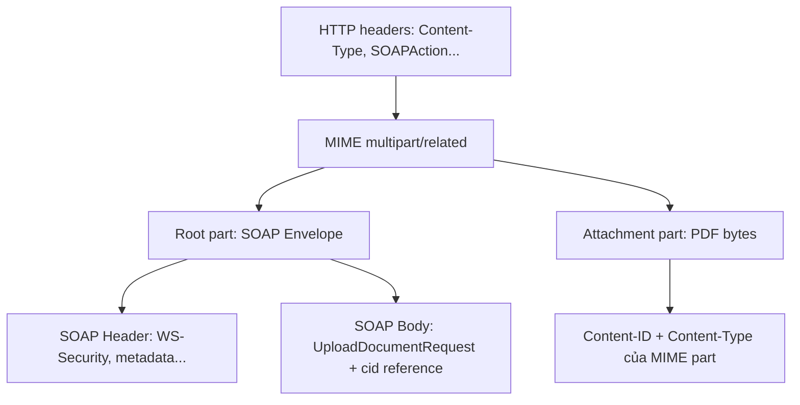
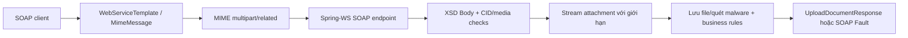

# MimeMessage, Attachment và truy cập tệp đính kèm

Trong nhiều dịch vụ SOAP doanh nghiệp, dữ liệu trao đổi không chỉ là các trường văn bản trong XML. Hệ thống có thể cần gửi **hóa đơn PDF**, ảnh chứng từ, tệp scan, dữ liệu ký số hoặc một tài liệu nhị phân lớn kèm theo yêu cầu. Nếu chuyển toàn bộ byte sang Base64 rồi nhúng trực tiếp vào SOAP Body, nội dung XML phình ra, khó quan sát, có thể tốn bộ nhớ và thời gian mã hóa/giải mã. Một phương án khác là đóng gói **SOAP message cùng các MIME attachment**, để phần XML mô tả yêu cầu còn dữ liệu nhị phân đi trong những phần riêng của cùng một thông điệp.

Spring Web Services (Spring-WS) biểu diễn một message có thể chứa tệp đính kèm qua **`org.springframework.ws.mime.MimeMessage`** và từng tệp qua **`org.springframework.ws.mime.Attachment`**. Hiểu hai API này giúp SOAP client và endpoint thêm, liệt kê, tìm và đọc attachment mà không phải tự parse ranh giới `multipart/related`.

Bài thuộc chương **Tệp đính kèm** của module **SPRING_WEB_SERVICES**, trong bối cảnh phát triển SOAP **contract-first** với XSD/WSDL, JAXB/Spring OXM, endpoint, SOAP client, interceptor, SOAP Fault, XML security, WS-Security, chứng chỉ và kiểm thử tương thích khi tích hợp hệ thống doanh nghiệp. Trọng tâm là **`MimeMessage`, `Attachment` và truy cập nội dung đính kèm**; đồng thời phân biệt chúng với MTOM/XOP, quản lý vòng đời stream và bảo vệ dữ liệu nhị phân.

Ví dụ sử dụng Java 17+, Spring-WS theo hệ Jakarta và SOAP 1.1 qua HTTP. Các URI, mã tài liệu và chính sách file chỉ mang tính minh họa; cần đối chiếu với XSD/WSDL và hợp đồng của đối tác khi triển khai.

## 1. Vì sao SOAP cần một cơ chế cho attachment?

Hãy xét operation `UploadDocument`:

```text
Ứng dụng A                                      Dịch vụ B
──────────                                      ─────────
UploadDocumentRequest
  documentId = DOC-1001
  contentType = application/pdf
  attachmentRef = cid:doc-...@files.example.org
       │
       └─ MIME attachment: actual PDF bytes ──► Lưu tài liệu
                                                 │
UploadDocumentResponse  ◄───────────────────────┘
  accepted = true
```

SOAP Body mô tả **tài liệu nào**, kiểu nội dung, mối liên hệ tới tệp; attachment chứa **byte thực tế**. Điều đó cho phép metadata tiếp tục tuân thủ XSD, trong khi file không phải được chèn thành một chuỗi XML khổng lồ.

Ba phương án thường gặp:

| Phương án | Dữ liệu nhị phân ở đâu? | Điểm mạnh | Lưu ý |
| --- | --- | --- | --- |
| Base64 nhúng trực tiếp | Text `xs:base64Binary` bên trong SOAP Body | Dễ đóng gói thành một XML document | Base64 tăng dung lượng khoảng 1/3, phải decode/encode; có thể tốn bộ nhớ |
| **SOAP with Attachments (SwA)** | MIME parts độc lập; Body có thể tham chiếu bằng `cid:` | Phân tách metadata và file, hỗ trợ truyền nhiều phần | Phải thống nhất cách liên kết Content-ID, kiểu MIME và xử lý lỗi |
| **MTOM/XOP** | Binary được tối ưu hóa thành MIME parts, trong XOP có `xop:Include` | Giữ mô hình XML Infoset của `base64Binary` nhưng truyền binary hiệu quả hơn | Cần marshaller/message factory và hai phía hỗ trợ đúng MTOM |

**SwA và MTOM không đồng nghĩa.** Cả hai có thể sử dụng MIME multipart nhưng cách liên hệ với XML, quy tắc đóng gói và hỗ trợ JAXB khác nhau. Một service hỗ trợ SwA không mặc nhiên hỗ trợ MTOM.

## 2. Thông điệp MIME thực tế có cấu trúc thế nào?

Với HTTP, một SOAP message mang attachment có thể sử dụng `multipart/related`. Phần đầu là SOAP Envelope (root part), các phần sau là tài liệu nhị phân.

```text
HTTP POST /soap/documents
Content-Type: multipart/related;
  type="text/xml";
  boundary="MIME_BOUNDARY_42";
  start="<root-envelope@example.org>"

--MIME_BOUNDARY_42
Content-Type: text/xml; charset=utf-8
Content-ID: <root-envelope@example.org>

<soap:Envelope ...>
  <soap:Body>
    <d:UploadDocumentRequest>
      <d:documentId>DOC-1001</d:documentId>
      <d:attachmentRef>cid:doc-1001@files.example.org</d:attachmentRef>
    </d:UploadDocumentRequest>
  </soap:Body>
</soap:Envelope>

--MIME_BOUNDARY_42
Content-Type: application/pdf
Content-ID: <doc-1001@files.example.org>
Content-Transfer-Encoding: binary

%PDF-... [các byte nhị phân thực tế]
--MIME_BOUNDARY_42--
```

**Đây là bản minh họa dạng text, không phải HTTP wire dump byte-for-byte:** trong thông điệp thật, MIME boundary dùng CRLF và phần PDF chứa byte nhị phân. Một MIME parser phải xử lý encoding, MIME headers, ranh giới và thứ tự parts đúng chuẩn; không được cắt chuỗi bằng cách tìm dấu `--MIME_BOUNDARY_42` trong body.

Các thành phần:

| Khái niệm | Vai trò |
| --- | --- |
| `multipart/related` | Gói nhiều MIME parts thành một đơn vị liên quan |
| Root MIME part | Mang SOAP Envelope và thông tin về XML message |
| Attachment MIME part | Mang tài liệu nhị phân hoặc media khác |
| `Content-ID` | Định danh một MIME part trong gói |
| `cid:...` | URI tham chiếu đến MIME part bằng Content-ID |
| `Content-Type` của part | Khai báo loại nội dung, ví dụ `application/pdf` |
| MIME boundary | Phân tách parts ở tầng MIME/transport |

Chú ý **`Content-ID: <doc-1001@files.example.org>`** trong MIME header thường có dấu ngoặc nhọn `<...>`, trong khi URI `cid:doc-1001@files.example.org` không có dấu đó. Khi đối chiếu ID cần hiểu cách thư viện chuẩn hóa, URL escaping và cú pháp hợp đồng; không so sánh bằng một phép nối chuỗi thiếu kiểm soát.

### 2.1. SOAP Header không phải MIME Header



Một `Content-ID` của MIME part **không phải** một element `<Content-ID>` trong SOAP Header. Ngược lại, `wsse:Security` nằm trong SOAP Header của Envelope, không phải file attachment. Việc phân biệt ba tầng **HTTP → MIME → SOAP** rất quan trọng khi debug wire format.

## 3. `MimeMessage` của Spring-WS là gì?

Trong Spring-WS, `org.springframework.ws.mime.MimeMessage` là interface của **web-service message có hỗ trợ MIME attachment**. Nó mở rộng `org.springframework.ws.WebServiceMessage`; interface `org.springframework.ws.soap.SoapMessage` cũng hỗ trợ năng lực MIME message. Các implementation có thể là SAAJ hoặc message factory khác do ứng dụng chọn.

Các API nổi bật trong Spring-WS hiện đại:

```java
import java.io.File;
import java.util.Iterator;
import jakarta.activation.DataHandler;
import org.springframework.core.io.InputStreamSource;
import org.springframework.ws.mime.Attachment;
import org.springframework.ws.mime.MimeMessage;

// Những chữ ký đại diện, để học API; không khai báo lại interface:
Attachment addAttachment(String contentId, File file);
Attachment addAttachment(
        String contentId,
        InputStreamSource inputStreamSource,
        String contentType);
Attachment addAttachment(
        String contentId,
        DataHandler dataHandler);

Attachment getAttachment(String contentId);
Iterator<Attachment> getAttachments();
boolean isXopPackage();
boolean convertToXopPackage();
```

**Lưu ý quan trọng:** overload thứ hai nhận **`InputStreamSource`**, **không nhận `InputStream` trực tiếp**. Với `InputStreamSource`, có implementation có thể gọi `getInputStream()` nhiều lần. Một nguồn chỉ có thể đọc một lần không đáp ứng giả định đó và dễ dẫn tới EOF khi framework serialize message.

### 3.1. Hai loại `MimeMessage` dễ nhầm tên

| Class/interface | Package | Ý nghĩa |
| --- | --- | --- |
| **`MimeMessage`** | `org.springframework.ws.mime` | Spring-WS web-service message có attachment |
| `MimeMessage` | `jakarta.mail.internet` | MIME email message, thuộc Jakarta Mail |
| `Attachment` | `org.springframework.ws.mime` | Một attachment của Spring-WS MIME message |
| `DataHandler` | `jakarta.activation` | Abstraction dữ liệu/media, có thể dùng làm nguồn attachment |

Không import `jakarta.mail.internet.MimeMessage` vào callback của `WebServiceTemplate` rồi cast SOAP message sang email message. Hai API dùng một thuật ngữ MIME nhưng khác vai trò.

### 3.2. `WebServiceMessage` và `MimeMessage`

Ở client callback hoặc endpoint có thể nhận `WebServiceMessage`:

```java
import org.springframework.ws.WebServiceMessage;
import org.springframework.ws.mime.MimeMessage;

void inspect(WebServiceMessage message) {
    if (!(message instanceof MimeMessage mime)) {
        throw new IllegalStateException(
                "Configured message does not support MIME attachments");
    }
    // Có thể dùng mime.getAttachments()...
}
```

Không phụ thuộc vào một concrete class như `SaajSoapMessage` nếu chỉ cần thao tác attachment; kiểm tra interface giúp dễ thay message factory. Tuy nhiên, **khả năng hỗ trợ một định dạng attachment cụ thể** vẫn phụ thuộc message factory, SOAP version, MTOM/SwA và transport của hệ thống thực.

## 4. `Attachment` biểu diễn điều gì?

Một phần MIME được Spring-WS cung cấp dưới dạng `org.springframework.ws.mime.Attachment`, có những method:

```java
import java.io.InputStream;
import jakarta.activation.DataHandler;
import org.springframework.ws.mime.Attachment;

// Các method đại diện, không khai báo lại interface:
String getContentId();
String getContentType();
InputStream getInputStream();    // IOException khi đọc có vấn đề
DataHandler getDataHandler();
long getSize();
```

| Method | Ý nghĩa | Cảnh báo |
| --- | --- | --- |
| `getContentId()` | ID của MIME part | Có thể `null`; định dạng/bao ngoặc tùy provider |
| `getContentType()` | MIME media type | Khai báo từ phía gửi có thể bị giả mạo |
| `getSize()` | Kích thước nếu xác định được | Có thể trả **`-1`**, không dùng như cơ chế chặn dung lượng duy nhất |
| `getInputStream()` | Mở stream để đọc byte | **Caller chịu trách nhiệm đóng stream** khi đọc xong |
| `getDataHandler()` | Nguồn dữ liệu qua Jakarta Activation | Quản lý lifecycle của dữ liệu nguồn, không giữ vô hạn |

**`Attachment#getSize()` không chứng minh attachment an toàn hoặc có kích thước thực như khai báo.** Phải giới hạn **số byte đọc thực tế**. Đối với file lớn, không nên gọi `readAllBytes()` rồi giữ toàn bộ trong RAM.

### 4.1. `DataHandler` dùng làm gì?

`jakarta.activation.DataHandler` có thể bọc một `DataSource` chứa tên, MIME type, input/output streams. Nó giúp truyền dữ liệu theo mô hình activation/JAXB và có thể liên kết với MTOM. Nhưng **`DataHandler` không tự mã hóa bảo mật, xác thực nội dung, quét virus hay áp giới hạn size**.

Trong ứng dụng Spring Boot 3+/Jakarta, tránh trộn `javax.activation.DataHandler` (thế hệ cũ) và `jakarta.activation.DataHandler` trong cùng đường xử lý. Kiểm tra JAXB runtime, SAAJ/activation provider và versions từ dependency management.

## 5. Hợp đồng SOAP cho ví dụ `UploadDocument`

Trong mô hình **SwA với tham chiếu `cid:` thủ công**, có thể quy định Body chứa ID file, loại MIME và URI của attachment:

```xml
<?xml version="1.0" encoding="UTF-8"?>
<xs:schema
    xmlns:xs="http://www.w3.org/2001/XMLSchema"
    targetNamespace="https://example.org/documents/v1"
    xmlns:d="https://example.org/documents/v1"
    elementFormDefault="qualified">

    <xs:element name="UploadDocumentRequest">
        <xs:complexType>
            <xs:sequence>
                <xs:element name="documentId" type="xs:string"/>
                <xs:element name="attachmentRef" type="xs:anyURI"/>
                <xs:element name="declaredContentType" type="xs:string"/>
            </xs:sequence>
        </xs:complexType>
    </xs:element>

    <xs:element name="UploadDocumentResponse">
        <xs:complexType>
            <xs:sequence>
                <xs:element name="documentId" type="xs:string"/>
                <xs:element name="accepted" type="xs:boolean"/>
            </xs:sequence>
        </xs:complexType>
    </xs:element>
</xs:schema>
```

SOAP Body:

```xml
<d:UploadDocumentRequest
    xmlns:d="https://example.org/documents/v1">
    <d:documentId>DOC-1001</d:documentId>
    <d:attachmentRef>cid:doc-1001@files.example.org</d:attachmentRef>
    <d:declaredContentType>application/pdf</d:declaredContentType>
</d:UploadDocumentRequest>
```

Trong XSD này, `xs:anyURI` kiểm tra **kiểu cú pháp XML**, không đảm bảo URI thực sự trỏ đến một MIME part tồn tại, không đảm bảo Content-ID duy nhất, cũng không xác thực file là PDF. Những điều đó là kiểm tra **ràng buộc liên phần và nghiệp vụ**.

**WSDL 1.1** vẫn cần khai báo operation input/output, `wsdl:message`, `soap:binding` và endpoint; nếu đính kèm file là phần bắt buộc của hợp đồng, cần nêu rõ **chế độ SwA/MTOM, liên hệ CID, số lượng parts, media types, kích thước và xử lý lỗi** trong WSDL extensions/profile/policy hoặc tài liệu tích hợp. Một WSDL chỉ mô tả XSD Body chưa đủ để consumer tự hiểu attachment.

### 5.1. Luồng xử lý contract-first



Kết quả cần nhất quán: không nên trả `accepted=true` nếu Body đã được xử lý nhưng file chưa được lưu thành công theo chính sách. Với dịch vụ lưu file, phải thiết kế rollback, trạng thái tạm hoặc cơ chế bù trừ nếu lưu metadata/database và lưu blob không thể nằm trong một transaction nguyên tử.

## 6. Thêm attachment vào SOAP request ở client

`WebServiceTemplate` gửi request theo message factory và marshaller đã cấu hình. Với `marshalSendAndReceive`, JAXB tạo **SOAP Body** và một `WebServiceMessageCallback` bổ sung MIME attachment.

### 6.1. Ví dụ gửi PDF nhỏ bằng `ByteArrayResource`

Đây là ví dụ cho file **đã nằm trong memory và có size được giới hạn trước**. `ByteArrayResource` cung cấp một `InputStream` mới mỗi lần được đọc, phù hợp hơn một stream đã tiêu thụ.

```java
import java.util.UUID;
import org.springframework.core.io.ByteArrayResource;
import org.springframework.ws.client.core.WebServiceTemplate;
import org.springframework.ws.mime.MimeMessage;
import org.springframework.ws.soap.SoapMessage;
import org.springframework.ws.soap.client.core.SoapActionCallback;

public final class DocumentSoapClient {
    private static final String SOAP_ACTION =
            "urn:example:documents:UploadDocument";
    private static final int MAX_INLINE_BYTES = 2 * 1024 * 1024;

    private final WebServiceTemplate template;
    private final String endpointUri;

    public DocumentSoapClient(
            WebServiceTemplate template, String endpointUri) {
        this.template = template;
        this.endpointUri = endpointUri;
    }

    public UploadDocumentResponse uploadPdf(
            String documentId, byte[] pdfBytes) {
        if (pdfBytes == null || pdfBytes.length == 0
                || pdfBytes.length > MAX_INLINE_BYTES) {
            throw new IllegalArgumentException("Invalid PDF size");
        }

        String contentId =
                "doc-" + UUID.randomUUID() + "@files.example.org";

        UploadDocumentRequest request = new UploadDocumentRequest();
        request.setDocumentId(documentId);
        request.setAttachmentRef("cid:" + contentId);
        request.setDeclaredContentType("application/pdf");

        Object result = template.marshalSendAndReceive(
                endpointUri,
                request,
                message -> {
                    if (!(message instanceof MimeMessage mime)) {
                        throw new IllegalStateException(
                                "MIME message support required");
                    }

                    mime.addAttachment(
                            contentId,
                            new ByteArrayResource(pdfBytes),
                            "application/pdf");

                    if (message instanceof SoapMessage soap) {
                        soap.setSoapAction(SOAP_ACTION);
                    }
                });

        if (!(result instanceof UploadDocumentResponse response)) {
            throw new IllegalStateException(
                    "Unexpected SOAP response root");
        }
        return response;
    }
}
```

Các lớp `UploadDocumentRequest`/`UploadDocumentResponse` giả định được sinh từ XSD và có root JAXB phù hợp. Nếu JAXB tạo `JAXBElement<?>`, cần wrapper/unwrapper qua `ObjectFactory` theo binding. Marshaller/unmarshaller của `WebServiceTemplate` và SOAP message factory phải được cấu hình trước; SOAPAction phải lấy từ **WSDL SOAP 1.1 binding thực tế**.

**Chỉ vì callback đã gọi `addAttachment` không chứng minh request gửi đi là SwA mà đối tác chấp nhận.** Cần kiểm tra `multipart/related`, Content-ID, media type, SOAPAction, WSDL profile và security trên wire.

### 6.2. Sai lầm: truyền một `InputStream` đã đọc trước

Đoạn sau **không phải API được `MimeMessage` hỗ trợ**:

```java
InputStream input = fileResource.getInputStream();
// mime.addAttachment(contentId, input, "application/pdf"); // Sai overload.
```

Thay bằng `InputStreamSource` có khả năng mở stream mới:

```java
import org.springframework.core.io.FileSystemResource;

mime.addAttachment(
        contentId,
        new FileSystemResource(trustedPdfFile),
        "application/pdf");
```

`trustedPdfFile` là file do ứng dụng kiểm soát; ví dụ này là fragment trong callback đã có biến `mime` và `contentId`. **File phải còn tồn tại/đọc được cho tới khi framework hoàn tất serialize/gửi**. Đừng tạo file tạm, đăng ký attachment rồi xóa file ngay trước khi request được ghi ra transport.

### 6.3. `addAttachment(File)` và nhận diện MIME type

Spring-WS còn có overload:

```java
mime.addAttachment(contentId, trustedPdfFile);
```

API này có thể suy luận `Content-Type` dựa trên tên file. Khi file tạm có tên `blob-123.tmp` hoặc extension không đáng tin, kết quả media type có thể không khớp hợp đồng. Đối với hợp đồng yêu cầu `application/pdf`, ưu tiên overload có **`contentType` tường minh** và xác minh loại file bằng kiểm tra thực tế.

### 6.4. Gửi bằng `DataHandler`

Nếu nguồn dữ liệu được cung cấp dưới dạng Jakarta Activation:

```java
import jakarta.activation.DataHandler;
import jakarta.activation.DataSource;

DataSource source = /* DataSource được kiểm soát từ ứng dụng */;
DataHandler handler = new DataHandler(source);
mime.addAttachment(contentId, handler);
```

`DataSource` phải có vòng đời và khả năng mở stream phù hợp. Không sử dụng `DataHandler` như cách bỏ qua size limit; serializer vẫn phải đọc các byte thực tế.

## 7. Truy cập attachment ở Spring-WS endpoint

Một `@Endpoint` có thể nhận JAXB Body cùng `MessageContext`. Từ đó lấy `WebServiceMessage` và yêu cầu nó hỗ trợ `MimeMessage`:

```java
import org.springframework.ws.context.MessageContext;
import org.springframework.ws.WebServiceMessage;
import org.springframework.ws.mime.MimeMessage;

MimeMessage requireMimeMessage(MessageContext context) {
    WebServiceMessage webMessage = context.getRequest();
    if (!(webMessage instanceof MimeMessage mime)) {
        throw new InvalidAttachmentException(
                "SOAP message has no MIME attachment support");
    }
    return mime;
}
```

Đoạn này là helper minh họa; `InvalidAttachmentException` là exception nghiệp vụ được định nghĩa ở phần sau. **Không nhầm `MessageContext#getRequest()` với `@RequestPayload`**: một bên lấy toàn message, bên kia ánh xạ phần tử SOAP Body theo JAXB/XSD.

### 7.1. Duyệt danh sách attachment

`MimeMessage#getAttachments()` trả `Iterator<Attachment>`:

```java
import java.util.Iterator;
import org.springframework.ws.mime.Attachment;
import org.springframework.ws.mime.MimeMessage;

void inspectAttachments(MimeMessage mime) {
    Iterator<Attachment> attachments = mime.getAttachments();
    while (attachments.hasNext()) {
        Attachment item = attachments.next();
        String contentId = item.getContentId();
        String contentType = item.getContentType();
        long size = item.getSize();

        // Log metadata đã chuẩn hóa và giới hạn, không log byte file.
        // size có thể là -1 nếu không xác định được.
    }
}
```

Không có lý do phải đọc toàn bộ file chỉ để biết có attachment hay không. Nếu chỉ cần kiểm tra phần tử tham chiếu một CID cụ thể, có thể sử dụng `getAttachment(contentId)` hoặc duyệt để kiểm tra **trùng Content-ID, media type và số lượng parts** theo hợp đồng.

### 7.2. Tìm theo `Content-ID`

API trực tiếp:

```java
Attachment item = mime.getAttachment("doc-1001@files.example.org");
if (item == null) {
    throw new InvalidAttachmentException(
            "Referenced attachment is missing");
}
```

Giá trị cần truyền là **Content-ID phù hợp**, không phải nguyên chuỗi `cid:...` từ Body nếu provider không quy định nhận URI dạng ấy. Giữa các implementation có thể khác nhau về dấu ngoặc nhọn quanh Content-ID; phải kiểm tra kết quả serialize/readback.

Trong hợp đồng có yêu cầu **một CID chỉ xuất hiện đúng một lần**, nên kiểm tra duplicate khi duyệt attachments, vì một `getAttachment` thành công không chứng minh các part còn lại đều hợp lệ.

### 7.3. Không xử lý attachment sau khi request đã kết thúc

Không làm:

```java
// Anti-pattern: giữ attachment/stream vào task chạy nền.
queue.submit(() -> processLater(item.getInputStream()));
```

`MimeMessage` và `Attachment` gắn với vòng đời request/message factory. Stream có thể đã bị đóng, xóa hoặc chỉ đọc được khi message còn sống. Muốn xử lý async, hãy **đọc và chuyển dữ liệu vào vùng lưu trữ do ứng dụng sở hữu** với size limit và policy bảo mật trước khi trả response, rồi queue một **object immutable hoặc storage key**. Không queue nguyên `MessageContext`/SOAP message.

## 8. Đọc byte attachment một cách có giới hạn

Một phương pháp an toàn cho tài liệu nhỏ: giới hạn số byte trước khi lưu vào memory và **đếm thực tế trong vòng lặp**, không chỉ tin `getSize()`.

```java
import java.io.ByteArrayOutputStream;
import java.io.IOException;
import java.io.InputStream;

public final class AttachmentBytes {
    private AttachmentBytes() { }

    public static byte[] readAtMost(
            InputStream input, long maxBytes) throws IOException {
        if (maxBytes <= 0) {
            throw new IllegalArgumentException(
                    "maxBytes must be positive");
        }

        ByteArrayOutputStream output = new ByteArrayOutputStream();
        byte[] buffer = new byte[8192];
        long count = 0;

        int n;
        while ((n = input.read(buffer)) != -1) {
            if (n == 0) {
                continue;
            }
            if (n > maxBytes - count) {
                throw new IOException("Attachment exceeds size limit");
            }
            output.write(buffer, 0, n);
            count += n;
        }
        return output.toByteArray();
    }
}
```

Giá trị `maxBytes` phải đủ nhỏ cho bộ nhớ và response workload, vì `ByteArrayOutputStream` vẫn **giữ toàn bộ file đã đọc**. Đây là ví dụ cho file nhỏ (như giới hạn 2 MiB trong bài). Với PDF hàng trăm MiB, nên **stream vào file tạm hoặc object storage bằng cơ chế chunk/bounded copy**, rồi quét malware và chuyển trạng thái lưu trữ khi thành công.

Sử dụng:

```java
final long MAX_PDF_BYTES = 2L * 1024 * 1024;

if (attachment.getSize() > MAX_PDF_BYTES) {
    throw new InvalidAttachmentException("Attachment too large");
}

byte[] pdf;
try (InputStream input = attachment.getInputStream()) {
    pdf = AttachmentBytes.readAtMost(input, MAX_PDF_BYTES);
}

if (pdf.length == 0) {
    throw new InvalidAttachmentException("Attachment is empty");
}
```

Ở đây `attachment` là `org.springframework.ws.mime.Attachment` đã chọn. Spring-WS quy định caller đóng `InputStream` lấy từ `getInputStream()` khi dùng xong. Giá trị `getSize()==-1` có nghĩa kích thước chưa xác định: vòng lặp `readAtMost` vẫn giới hạn byte thực tế.

**Không kiểm tra PDF chỉ bằng ba ký tự `%PDF` rồi tin rằng file an toàn.** Content-Type, magic bytes, PDF parser, active content, antivirus/CDR và quy tắc lưu trữ là các lớp kiểm tra khác nhau. Chỉ cấp quyền mở/xem file sau khi thỏa chính sách sản phẩm và bảo mật.

## 9. Endpoint nhận một file được tham chiếu bằng CID

Ví dụ xử lý nghiệp vụ `UploadDocument`:

```java
import java.io.IOException;
import java.io.InputStream;
import java.util.Iterator;
import org.springframework.ws.context.MessageContext;
import org.springframework.ws.mime.Attachment;
import org.springframework.ws.mime.MimeMessage;
import org.springframework.ws.server.endpoint.annotation.Endpoint;
import org.springframework.ws.server.endpoint.annotation.PayloadRoot;
import org.springframework.ws.server.endpoint.annotation.RequestPayload;
import org.springframework.ws.server.endpoint.annotation.ResponsePayload;

@Endpoint
public final class DocumentEndpoint {
    private static final String NS =
            "https://example.org/documents/v1";
    private static final long MAX_BYTES = 2L * 1024 * 1024;

    private final DocumentStore store;

    public DocumentEndpoint(DocumentStore store) {
        this.store = store;
    }

    @PayloadRoot(namespace = NS, localPart = "UploadDocumentRequest")
    @ResponsePayload
    public UploadDocumentResponse upload(
            @RequestPayload UploadDocumentRequest request,
            MessageContext context) throws IOException {

        if (!(context.getRequest() instanceof MimeMessage mime)) {
            throw new InvalidAttachmentException("MIME is required");
        }

        String contentId = parseSupportedCid(
                request.getAttachmentRef());
        Attachment selected = findExactlyOne(mime, contentId);

        String mediaType = selected.getContentType();
        if (mediaType == null ||
                !mediaType.split(";", 2)[0].trim()
                    .equalsIgnoreCase("application/pdf") ||
                !"application/pdf".equalsIgnoreCase(
                    request.getDeclaredContentType())) {
            throw new InvalidAttachmentException(
                    "Unsupported attachment media type");
        }

        if (selected.getSize() > MAX_BYTES) {
            throw new InvalidAttachmentException(
                    "Attachment exceeds size limit");
        }

        byte[] bytes;
        try (InputStream stream = selected.getInputStream()) {
            bytes = AttachmentBytes.readAtMost(stream, MAX_BYTES);
        }
        if (bytes.length == 0) {
            throw new InvalidAttachmentException("Empty attachment");
        }

        // Store phải kiểm tra quyền, scan nội dung và lưu an toàn.
        store.save(request.getDocumentId(), bytes);

        UploadDocumentResponse response = new UploadDocumentResponse();
        response.setDocumentId(request.getDocumentId());
        response.setAccepted(true);
        return response;
    }

    private static String parseSupportedCid(String ref) {
        if (ref == null || !ref.startsWith("cid:")) {
            throw new InvalidAttachmentException(
                    "Expected cid: attachment reference");
        }
        String id = ref.substring(4);
        if (!id.matches(
                "doc-[0-9a-fA-F-]{36}@files[.]example[.]org")) {
            throw new InvalidAttachmentException(
                    "Unsupported attachment Content-ID");
        }
        return id;
    }

    private static Attachment findExactlyOne(
            MimeMessage mime, String wantedId) {
        Attachment selected = null;
        int matches = 0;

        Iterator<Attachment> it = mime.getAttachments();
        while (it.hasNext()) {
            Attachment part = it.next();
            String candidate = part.getContentId();
            if (candidate != null) {
                candidate = candidate.trim();
                if (candidate.startsWith("<")
                        && candidate.endsWith(">")) {
                    candidate = candidate.substring(
                            1, candidate.length() - 1);
                }
            }
            if (wantedId.equals(candidate)) {
                selected = part;
                matches++;
            }
        }

        if (matches != 1) {
            throw new InvalidAttachmentException(
                    "Exactly one referenced attachment required");
        }
        return selected;
    }
}
```

Ví dụ **giới hạn quy ước CID vào một dạng đơn giản** do hệ thống kiểm soát, đủ cho client minh họa ở mục 6. Không coi regex đó là parser `cid:` tổng quát: RFC 2392 cho phép biểu diễn URI escaping và các trường hợp phức tạp hơn; khi tích hợp các đối tác khác phải dùng thư viện/quy tắc canonicalization phù hợp, tránh tự decode hai lần hoặc so sánh ID lệch.

Những thành phần dự án cần có:

```java
public interface DocumentStore {
    void save(String documentId, byte[] content);
}

public final class InvalidAttachmentException
        extends RuntimeException {
    public InvalidAttachmentException(String message) {
        super(message);
    }
}
```

Hai kiểu `public` là **hai file Java riêng**. `DocumentStore` là port nghiệp vụ cần implementation thực; ví dụ endpoint không phải một dịch vụ lưu trữ hoàn chỉnh. Trong hệ thống thật, phải xác minh caller được phép gửi tài liệu cho `documentId`, quét file, ngăn path traversal, xử lý transaction metadata–blob và quyết định phản hồi khi file bị từ chối.

### 9.1. Vì sao phải kiểm tra cả Body và MIME?

Một đối tượng gửi có thể:

- Khai báo `declaredContentType=application/pdf` nhưng MIME part thực tế là `text/html`.
- Khai báo `cid:doc-A` nhưng attachment có Content-ID `doc-B`.
- Gửi **hai** MIME parts cùng Content-ID khiến consumer không biết lấy part nào.
- Gửi thêm các part không được tham chiếu hoặc số lượng vượt quota.
- Gửi file có Content-Type đúng nhưng byte là một chương trình độc hại.

XSD của Body **không giải quyết các sai lệch liên phần này**. Phải có **MIME validation + content validation + authorization** riêng. Chính sách có thể yêu cầu đúng một attachment và không có part thừa; ví dụ trên mới kiểm tra “tham chiếu đúng một part”, chưa chặn các part lạ. Muốn áp chính sách nghiêm ngặt, đếm mọi attachment và từ chối phần không nằm trong allowlist.

### 9.2. Không dùng `getContentId()` như tên file

`Content-ID` là định danh MIME, không phải đường dẫn lưu trữ và không phải `filename` được phê duyệt. Không làm:

```java
// Nguy hiểm nếu Content-ID do client tùy ý cung cấp.
Path destination = uploadDirectory.resolve(
        attachment.getContentId());
```

Nếu cần tạo tên file, sinh tên ngẫu nhiên ở server, lưu metadata riêng và kiểm tra canonical path/authorization. Không để CID, MIME filename, document ID hoặc SOAP Header do client gửi quyết định trực tiếp đường dẫn filesystem.

## 10. Đọc attachment từ SOAP response ở client

Khi server gửi file đính kèm trong response, `marshalSendAndReceive` thường trả JAXB object của **SOAP Body**; việc tự động trả `Attachment` cùng object phụ thuộc thiết kế JAXB/MTOM. Nếu ứng dụng muốn **chủ động truy cập MIME parts**, có thể sử dụng `WebServiceTemplate#sendAndReceive` với:

1. `WebServiceMessageCallback` tạo outbound SOAP Body.
2. `WebServiceMessageExtractor<T>` đọc **inbound SOAP message** trước khi vòng đời kết thúc.

Ví dụ một client nhận Body `DownloadDocumentResponse` và file PDF:

```java
import java.io.IOException;
import java.io.InputStream;
import java.util.Iterator;
import org.springframework.oxm.jaxb.Jaxb2Marshaller;
import org.springframework.ws.WebServiceMessage;
import org.springframework.ws.client.core.WebServiceTemplate;
import org.springframework.ws.mime.Attachment;
import org.springframework.ws.mime.MimeMessage;

public final class DocumentDownloadClient {
    private static final long MAX_BYTES = 2L * 1024 * 1024;

    private final WebServiceTemplate template;
    private final Jaxb2Marshaller oxm;
    private final String endpointUri;

    public DocumentDownloadClient(
            WebServiceTemplate template,
            Jaxb2Marshaller oxm,
            String endpointUri) {
        this.template = template;
        this.oxm = oxm;
        this.endpointUri = endpointUri;
    }

    public DownloadedDocument download(DownloadDocumentRequest request) {
        return template.sendAndReceive(
                endpointUri,
                outbound -> oxm.marshal(
                        request, outbound.getPayloadResult()),
                inbound -> {
                    Object decoded = oxm.unmarshal(
                            inbound.getPayloadSource());
                    if (!(decoded instanceof DownloadDocumentResponse body)) {
                        throw new InvalidAttachmentException(
                                "Unexpected download response");
                    }
                    if (!(inbound instanceof MimeMessage mime)) {
                        throw new InvalidAttachmentException(
                                "Response does not support MIME");
                    }

                    Iterator<Attachment> it = mime.getAttachments();
                    if (!it.hasNext()) {
                        throw new InvalidAttachmentException(
                                "Missing response attachment");
                    }
                    Attachment file = it.next();
                    if (it.hasNext()) {
                        throw new InvalidAttachmentException(
                                "Unexpected extra attachment");
                    }

                    String partId = file.getContentId();
                    if (partId != null && partId.startsWith("<")
                            && partId.endsWith(">")) {
                        partId = partId.substring(1, partId.length() - 1);
                    }
                    if (partId == null || body.getAttachmentRef() == null
                            || !body.getAttachmentRef()
                                    .equals("cid:" + partId)) {
                        throw new InvalidAttachmentException(
                                "Response CID does not match MIME part");
                    }

                    if (file.getSize() > MAX_BYTES) {
                        throw new InvalidAttachmentException(
                                "Attachment too large");
                    }

                    byte[] bytes;
                    try (InputStream stream = file.getInputStream()) {
                        bytes = AttachmentBytes.readAtMost(
                                stream, MAX_BYTES);
                    }
                    return new DownloadedDocument(
                            body.getDocumentId(),
                            file.getContentType(),
                            bytes);
                });
    }
}
```

Result là một record của ứng dụng. Vì mảng `byte[]` có thể bị thay đổi sau khi trả về, nên sử dụng **defensive copy** ở constructor và accessor nếu muốn kết quả thực sự không cho caller sửa dữ liệu bên trong:

```java
public record DownloadedDocument(
        String documentId,
        String contentType,
        byte[] content) {

    public DownloadedDocument {
        if (content == null) {
            throw new IllegalArgumentException("content is required");
        }
        content = content.clone();
    }

    @Override
    public byte[] content() {
        return content.clone();
    }
}
```

Đoạn code minh họa **truy cập inbound message trong extractor** và đọc stream khi nó còn sống. Các kiểu `DownloadDocumentRequest`/`DownloadDocumentResponse` là JAXB model giả định từ một XSD download tương ứng, không phải hai kiểu đã có trong XSD upload ở mục 5; response cần có `documentId` và `attachmentRef`. Khi dùng JAXB generated model không có `@XmlRootElement`, phải xử lý `JAXBElement<?>`. Mẫu trên chỉ phù hợp file nhỏ và giả định **một attachment duy nhất**; trong production còn phải kiểm tra MIME type, nội dung file, filename policy và checksum/chữ ký.

**Không trả trực tiếp `Attachment` hoặc `InputStream` từ extractor ra tầng nghiệp vụ để đọc sau**. Khi method `sendAndReceive` kết thúc, message/transport có thể đã dọn resource. Với file lớn, streaming vào vùng storage do client sở hữu **ngay trong extractor**, trả storage key/path đã kiểm soát thay vì byte array.

### 10.1. Khi response là SOAP Fault

Một SOAP Fault thông thường được `WebServiceTemplate` xử lý theo **fault resolver** trước khi application extractor nhận response thành công. Đừng giả định response Fault luôn mang MIME attachment hoặc một `DownloadDocumentResponse` hợp lệ. Client phải phân loại:

- **SOAP Fault:** lỗi hợp đồng/nghiệp vụ/protocol, đọc Fault code/detail theo WSDL.
- **HTTP/transport error:** không nhất thiết có SOAP body (timeout, mTLS, gateway 502).
- **MIME decode error:** thiếu part, Content-ID sai, kích thước vượt hạn, parser lỗi.
- **Security error:** chữ ký, token, chứng chỉ hoặc signed attachment không đạt chính sách.

Không convert mọi lỗi thành “không tìm thấy tệp”, vì điều đó che mất sự cố bảo mật hoặc lỗi tích hợp.

### 10.2. Server thêm attachment vào SOAP response

Chiều ngược lại cũng sử dụng `MimeMessage`. Một `@Endpoint` có thể lấy response message từ `MessageContext#getResponse()` — Spring-WS sẽ tạo response nếu chưa có, tùy implementation — rồi thêm MIME part trước khi return JAXB response Body:

```java
import java.util.UUID;
import org.springframework.core.io.ByteArrayResource;
import org.springframework.ws.context.MessageContext;
import org.springframework.ws.mime.MimeMessage;
import org.springframework.ws.server.endpoint.annotation.Endpoint;
import org.springframework.ws.server.endpoint.annotation.PayloadRoot;
import org.springframework.ws.server.endpoint.annotation.RequestPayload;
import org.springframework.ws.server.endpoint.annotation.ResponsePayload;

@Endpoint
public final class DocumentDownloadEndpoint {
    private static final String NS =
            "https://example.org/documents/v1";
    private static final int MAX_BYTES = 2 * 1024 * 1024;

    private final DocumentLookup lookup;

    public DocumentDownloadEndpoint(DocumentLookup lookup) {
        this.lookup = lookup;
    }

    @PayloadRoot(namespace = NS, localPart = "DownloadDocumentRequest")
    @ResponsePayload
    public DownloadDocumentResponse download(
            @RequestPayload DownloadDocumentRequest request,
            MessageContext context) {

        // DocumentLookup phải kiểm tra quyền xem file trước khi trả bytes.
        byte[] data = lookup.readAuthorized(request.getDocumentId());
        if (data == null || data.length == 0
                || data.length > MAX_BYTES) {
            throw new InvalidAttachmentException(
                    "Document cannot be returned");
        }

        if (!(context.getResponse() instanceof MimeMessage mime)) {
            throw new IllegalStateException(
                    "Response does not support MIME attachments");
        }

        String cid = "doc-" + UUID.randomUUID()
                + "@files.example.org";
        mime.addAttachment(
                cid, new ByteArrayResource(data), "application/pdf");

        DownloadDocumentResponse response =
                new DownloadDocumentResponse();
        response.setDocumentId(request.getDocumentId());
        response.setAttachmentRef("cid:" + cid);
        return response;
    }
}

public interface DocumentLookup {
    byte[] readAuthorized(String documentId);
}
```

Hai kiểu `public` trong ví dụ phải nằm ở **hai file Java riêng**. Các class JAXB `DownloadDocumentRequest`/`DownloadDocumentResponse` phải được sinh từ hợp đồng download có trường `attachmentRef`; không dùng nguyên XSD `UploadDocument` ở mục 5 để suy chúng tự tồn tại. `DocumentLookup` minh họa việc ủy quyền cho service đã kiểm tra quyền truy cập. Với file lớn, thay `byte[]` bằng tài nguyên có thể đọc lại, quản lý lifecycle rõ và không load hết vào heap.

**Lưu ý vòng đời:** `getResponse()` có thể khởi tạo response lazily, còn adapter xử lý `@ResponsePayload` sau khi method trả về. Cần test với endpoint adapter/message factory thực tế để bảo đảm JAXB Body được ghi vào **cùng response message** đã chứa attachment. Không tự gọi `setResponse(...)` tạo message khác rồi làm mất MIME parts đã thêm.

## 11. MTOM/XOP và JAXB: liên quan nhưng không phải thao tác `Attachment` thủ công

**MTOM (Message Transmission Optimization Mechanism)** là cách tối ưu hóa truyền nội dung nhị phân được nhìn nhận trong XML Infoset như `xs:base64Binary`. XOP package dùng `xop:Include` để tham chiếu phần MIME chứa byte thực tế.

Ví dụ biểu diễn XML của một MIME/XOP message:

```xml
<d:UploadDocumentRequest
    xmlns:d="https://example.org/documents/v1"
    xmlns:xop="http://www.w3.org/2004/08/xop/include">
    <d:documentId>DOC-1001</d:documentId>
    <d:content>
        <xop:Include href="cid:doc-1001@files.example.org"/>
    </d:content>
</d:UploadDocumentRequest>
```

Trong mô hình MTOM, `d:content` có thể được khai báo `xs:base64Binary` trong XSD; `xop:Include` là **biểu diễn tối ưu hóa trên wire**, không phải bạn tùy ý thêm `xop:Include` vào một element XSD `xs:anyURI` rồi coi đó là cùng hợp đồng.

### 11.1. Cấu hình JAXB MTOM

Spring OXM có thể bật hỗ trợ MTOM:

```java
import org.springframework.context.annotation.Bean;
import org.springframework.context.annotation.Configuration;
import org.springframework.oxm.jaxb.Jaxb2Marshaller;

@Configuration
public class DocumentMtomConfiguration {
    @Bean
    public Jaxb2Marshaller documentMtomMarshaller() {
        Jaxb2Marshaller mapping = new Jaxb2Marshaller();
        mapping.setClassesToBeBound(
                MtomUploadRequest.class,
                MtomUploadResponse.class);
        mapping.setMtomEnabled(true);
        mapping.setSupportDtd(false);
        mapping.setProcessExternalEntities(false);
        return mapping;
    }
}
```

`MtomUploadRequest`/`MtomUploadResponse` là JAXB types minh họa cho **một hợp đồng XSD MTOM khác** (có binary element), không phải những class bắt buộc đã sinh từ XSD SwA ở mục 5.

Ví dụ JAXB field:

```java
import jakarta.activation.DataHandler;
import jakarta.xml.bind.annotation.XmlElement;
import jakarta.xml.bind.annotation.XmlMimeType;

// Bên trong JAXB request class:
@XmlElement(
    name = "content",
    namespace = "https://example.org/documents/v1")
@XmlMimeType("application/pdf")
private DataHandler content;
```

Nội dung nhị phân có thể được JAXB/MTOM provider ánh xạ bằng `DataHandler` thay vì byte array, tùy generated binding và schema annotations. Có thể bổ sung `xmime:expectedContentTypes` trong XSD theo profile để ảnh hưởng JAXB binding; phải kiểm chứng codegen và runtime provider thực tế.

**Bật `setMtomEnabled(true)` không phải bằng chứng mọi binary element sẽ nằm trong part riêng.** Quyết định tối ưu hóa phụ thuộc giá trị, threshold/provider, message factory, khả năng JAXB và contract. Hãy kiểm tra MIME `Content-Type` của root part, `xop:Include`, actual parts và khả năng round-trip với đối tác.

### 11.2. SwA và MTOM: cách chọn

| Vấn đề | SwA / `MimeMessage.addAttachment` | MTOM / JAXB `DataHandler` |
| --- | --- | --- |
| Cách gắn tệp với Body | Thường tự định nghĩa CID/reference trong hợp đồng | Binary trong XML Infoset, XOP tối ưu hóa truyền |
| Chỗ xử lý | Chủ động dùng `MimeMessage`/`Attachment` | JAXB/OXM và MTOM-aware message factory |
| Trường XSD tiêu biểu | `xs:anyURI` hoặc element tham chiếu riêng | `xs:base64Binary`, có thể kèm xmime annotation |
| Thích hợp khi | Đối tác công bố profile MIME parts và CID rõ | Đối tác yêu cầu MTOM/XOP, muốn mapping theo binary field |
| Lỗi hay gặp | CID mismatch, part thiếu/trùng | XOP không bật, fallback Base64, provider không tương thích |
| Xác thực | Contract + MIME/header/content rules | Contract XML Infoset + MTOM package/security policy |

**Không thêm cùng một file bằng `addAttachment` và đồng thời JAXB marshalling MTOM mà không có thiết kế rõ.** Hệ thống có thể gửi file hai lần, tạo CID khác nhau hoặc khiến consumer nhận sai part.

## 12. Quản lý bộ nhớ, stream và trách nhiệm đóng tài nguyên

Attachment có thể được lưu trong RAM, file tạm hoặc stream tùy message factory/provider. Đừng giả định chỉ vì API có chữ “stream” mà toàn pipeline không buffer.

### 12.1. Ba vòng đời cần hiểu

| Vòng đời | Đối tượng | Quy tắc |
| --- | --- | --- |
| Tạo outbound request | `InputStreamSource`, `DataHandler`, file source | Nguồn phải còn đọc được cho tới khi serializer gửi xong |
| Đọc inbound attachment | `Attachment#getInputStream()` | Đọc trong callback/endpoint/extractor rồi **đóng stream** |
| Lưu file hoặc xử lý async | Storage do ứng dụng quản lý | Copy/spool trong request với quota, sau đó truyền key cho worker |

Một lỗi thường gặp:

```java
// SAI: tài nguyên đã đóng trước khi SOAP serializer đọc.
try (InputStream stream = Files.newInputStream(file)) {
    // Tự bọc một InputStreamSource chỉ trả cùng stream ở đây...
}
// callback sau đó cố serialize từ stream đã bị đóng.
```

Đúng hơn, dùng `FileSystemResource` hoặc `InputStreamSource` mở được stream **mới** mỗi khi framework yêu cầu, và giữ tài nguyên nguồn còn hiệu lực.

### 12.2. Size limit áp ở nhiều tầng

Không chỉ kiểm tra `getSize()` trong endpoint:

1. **Reverse proxy/gateway:** giới hạn tổng request body và timeout.
2. **Transport/HTTP message sender:** kiểm soát streaming/buffering, connection và read timeout.
3. **MIME parser/message factory:** giới hạn tổng parts, kích thước header và bộ nhớ/temp files nếu có cấu hình hỗ trợ.
4. **Application endpoint:** kiểm tra từng part, đếm **actual bytes**, MIME type và số lượng parts.
5. **Storage/processing:** quota, antivirus, decompression limits và retention.

`getSize()==-1` là tình huống hợp lệ; không thể áp dụng chính sách bằng điều kiện `getSize()>MAX` duy nhất. Kiểm tra size ngay khi đọc byte luôn cần thiết.

### 12.3. Attachment và transaction

Một yêu cầu tải tài liệu có thể lưu DB metadata và object storage:

```text
1. Parse SOAP Body + MIME
2. Validate size/type/security và authorization
3. Stream file tới vùng tạm cách ly
4. Scan + verify checksum/signature
5. Ghi metadata và chuyển file sang vùng chính thức
6. Trả SOAP Response
```

Nếu bước 5 thất bại, phải có cơ chế xóa file tạm/ghi trạng thái lỗi. **Transaction database không tự rollback object storage**. Để tránh dữ liệu mồ côi, dùng storage keys, cleanup job, idempotency và reconciliation theo thiết kế nghiệp vụ.

## 13. XML security, WS-Security và MIME attachment

Thêm file vào SOAP message tạo thêm **bề mặt tấn công ngoài XML**:

| Rủi ro | Cách phòng ngừa |
| --- | --- |
| File chứa mã độc hoặc nội dung không đúng MIME | Sniffing, antivirus/CDR, sandbox parser, không tin `Content-Type` |
| File quá lớn hoặc nhiều parts | Limit tổng bytes/parts, bounded streaming, quota và timeout |
| ZIP/PDF bomb hoặc parser exploit | Giới hạn giải nén/độ sâu, sandbox và resource policy |
| MIME header/Content-ID độc hại | Kiểm tra cú pháp, độ dài, uniqueness, tránh log/HTTP header injection |
| Path traversal qua tên file | Sinh tên lưu trữ ở server; không dùng CID/filename làm path |
| Dữ liệu khách hàng khác tenant | Authentication, authorization theo document/tenant |
| SOAP Body đúng nhưng attachment bị thay | Bảo vệ **attachment content** theo signed/encrypted attachment policy khi cần |
| WS-Security ký XML nhưng bỏ file | Không mặc định file cũng được ký; kiểm tra signed parts và attachment signature support |
| XML External Entity qua Body/XML attachment | Cấu hình JAXP/JAXB/SAAJ parser an toàn, chặn DTD/external entities |
| Lộ dữ liệu qua logging/Fault | Không log raw attachment, token, path nội bộ hoặc stack trace |

### 13.1. WS-Security ký những gì?

Một XML Signature trên SOAP Body **không mặc nhiên bảo vệ mọi MIME part**. Nếu tệp là dữ liệu có giá trị pháp lý hoặc cần chống sửa đổi giữa các node, hợp đồng phải yêu cầu **chữ ký/kiểm tra toàn vẹn của attachment** bằng cơ chế và profile mà cả client lẫn server hỗ trợ. WS-Security có các profile cho attachment; cấu hình WSS4J/security interceptor thực tế quyết định phần nào được ký, mã hóa và xác minh.

Nếu sử dụng MTOM, phải hiểu mối quan hệ giữa XML Infoset, XOP optimization và canonicalization; **không tự tách/ghép lại MIME parts sau khi ký** mà không đánh giá kết quả signature. Test phải thay đổi một byte attachment rồi xác minh policy phát hiện; chỉ test sai SOAP Body là chưa đủ.

### 13.2. TLS và chứng chỉ

**TLS/mTLS** bảo vệ kết nối/đối tác transport và hostname/trust chain. Khi SOAP qua gateway hay intermediary, chính sách **end-to-end message/attachment integrity** có thể cần WS-Security hoặc chữ ký tài liệu riêng. Một kết nối TLS thành công không chứng minh file chưa bị thay đổi ở từng hop khi các node trung gian có quyền giải mã.

Không tắt certificate verification, không gửi file tới endpoint URL tùy ý do client cung cấp, không đưa private key/truststore password vào SOAP Fault hoặc log.

### 13.3. SOAP Fault an toàn khi attachment sai

| Lỗi | Phân loại thường dùng | Điều không nên công bố |
| --- | --- | --- |
| Thiếu part được Body tham chiếu | Request/contract fault | Stack trace của MIME parser |
| CID trùng hoặc không hợp lệ | Request/contract fault | Raw MIME headers/bytes dài |
| Media type không được hỗ trợ | Request/policy fault | Đường dẫn lưu trữ, parser internals |
| Vượt quota/file quá lớn | Request/policy fault hoặc HTTP 413 trước SOAP | Dung lượng/giới hạn nội bộ nhạy cảm nếu policy không công bố |
| Quét malware không đạt | Security/business policy fault | Chẩn đoán scanner/engine nội bộ |
| Lưu object storage thất bại | Server-side fault | Access key, bucket nội bộ, connection string |
| SOAP WS-Security verification thất bại | Security fault | Key alias, certificate secret, signature bytes |

Một lỗi ở HTTP proxy trước khi SOAP message được parse có thể trả **HTTP error không chứa SOAP Fault**. Vì vậy client phải phân biệt Fault theo SOAP version với lỗi transport và xử lý retry/idempotency theo chính sách.

## 14. Kiểm thử MIME message và attachment

Kiểm thử tốt phải bao phủ **XML Body**, **MIME parts thực tế** và **bảo mật của file**, không chỉ gọi `addAttachment` mà không inspect kết quả.

### 14.1. Unit test `MimeMessage` và `Attachment` bằng SAAJ

```java
import java.io.InputStream;
import java.nio.charset.StandardCharsets;
import java.util.Iterator;
import org.junit.jupiter.api.Test;
import org.springframework.core.io.ByteArrayResource;
import org.springframework.ws.mime.Attachment;
import org.springframework.ws.mime.MimeMessage;
import org.springframework.ws.soap.saaj.SaajSoapMessageFactory;

import static org.junit.jupiter.api.Assertions.*;

class AttachmentApiTest {
    @Test
    void canAddAndReadMimeAttachment() throws Exception {
        SaajSoapMessageFactory factory = new SaajSoapMessageFactory();
        factory.afterPropertiesSet();

        MimeMessage message =
                (MimeMessage) factory.createWebServiceMessage();
        byte[] bytes = "test-pdf-bytes".getBytes(
                StandardCharsets.UTF_8);

        message.addAttachment(
                "doc-unit-test@files.example.org",
                new ByteArrayResource(bytes),
                "application/pdf");

        Iterator<Attachment> parts = message.getAttachments();
        assertTrue(parts.hasNext());
        Attachment part = parts.next();
        assertEquals("application/pdf", part.getContentType());
        try (InputStream input = part.getInputStream()) {
            assertArrayEquals(bytes, input.readAllBytes());
        }
        assertFalse(parts.hasNext());
    }
}
```

Test này chứng minh các API nội bộ với message factory đang dùng; `test-pdf-bytes` cố ý **không phải PDF thật**, vì bài test đang kiểm tra cơ chế MIME chứ không kiểm tra nhận diện file. Khi thử upload endpoint, phải dùng fixture PDF hợp lệ, có size limit và policy quét phù hợp.

### 14.2. Test request SOAP client bằng `MockWebServiceServer`

Với `MockWebServiceServer`, tạo một `WebServiceTemplate` có JAXB marshaller và message factory. Gateway gọi `marshalSendAndReceive`; test có thể:

- Assert payload `UploadDocumentRequest` có `documentId` và `attachmentRef` đúng XSD.
- Inspect `MimeMessage#getAttachments()` trên outbound message trong một request matcher/callback phù hợp với Spring-WS Test version.
- Assert **Content-ID** trùng giá trị trong `cid:`, media type và byte được gửi.
- Assert SOAPAction và SOAP Header WS-Security (nếu có).
- Mock response JAXB hợp lệ; assert gateway trả đúng result.

Một matcher chỉ so `payload(...)` không chứng minh đã có attachment. Hãy capture/inspect MIME message hoặc thực hiện integration test transport để xác nhận multipart serialization.

### 14.3. Test inbound endpoint bằng `MockWebServiceClient`

Với `MockWebServiceClient`:

1. Gửi Body hợp lệ nhưng **thiếu attachment** → phải bị từ chối.
2. Gửi Body tham chiếu CID A nhưng MIME chỉ có CID B → fault.
3. Gửi hai attachments cùng CID → fault nếu contract chỉ cho phép một.
4. Gửi media type sai hoặc size vượt hạn → fault.
5. Gửi file hợp lệ → lưu đúng bytes, trả `accepted=true`.
6. Gửi SOAP Header WS-Security sai → security layer từ chối trước khi lưu file.

Không phải mọi phiên bản mock test tool đều cung cấp API tiện lợi tạo multipart attachment; nếu không thể dựng attachment qua request creator một cách đúng, dùng test message factory/callback hoặc HTTP integration test được kiểm soát, không bỏ các ca kiểm thử.

### 14.4. Ma trận negative và security tests

| Trường hợp | Điều cần chứng minh |
| --- | --- |
| Body không well-formed | SOAP parser chặn đúng |
| Body đúng XML nhưng sai namespace/XSD | XSD validation chặn |
| Body tham chiếu `cid:` không tồn tại | Không lưu file, Fault ổn định |
| Content-ID trùng | Không nhận file mơ hồ |
| `getSize() == -1` | Vẫn áp **byte-count limit** |
| MIME `Content-Type` sai | Bị từ chối theo contract |
| Header nói PDF, byte thực tế không phải PDF | Content validation/phân tích file từ chối |
| Tệp rỗng | Không coi là upload thành công nếu policy cấm |
| File nhiều MiB vượt quota | Không đọc hết vào RAM rồi mới kiểm tra |
| Nhiều attachment phần thừa | Áp giới hạn số parts và policy unused parts |
| `cid:` có ký tự lạ/percent encoding | Parser/canonicalization đúng hoặc từ chối theo profile |
| MIME header có CRLF injection | Không ảnh hưởng response/log/headers |
| InputStream bị đóng sớm | Client fail rõ; tránh sai lifecycle |
| InputStreamSource trả cùng stream đã EOF | Test phát hiện data corruption/missing bytes |
| Concurrent requests | Không trộn CID/file giữa các request |
| File chứa malware/test signature | Quarantine/scanner policy hoạt động |
| XML body được ký nhưng MIME part bị sửa | Attachment integrity policy phát hiện khi bắt buộc |
| MTOM/XOP với JAXB DataHandler | Round-trip đúng binary content, không nhân đôi file |
| Proxy HTTP 413 | Client xử lý transport error, không ép parse SOAP Fault |
| TLS/mTLS certificate sai | Không bypass verification |
| Fault từ server khi lưu thất bại | Không lộ bucket/path/token/stack trace |

### 14.5. Kiểm thử wire-format thật

Mock unit test chỉ chứng minh một phần. End-to-end test nên capture **MIME structure đã được redaction** ở môi trường test:

```text
HTTP Content-Type: multipart/related; boundary=...
  root part Content-ID: ...
  SOAP Envelope: đúng version
  SOAP Body QName: đúng XSD
  cid reference: trùng attachment Content-ID
  attachment part Content-Type: application/pdf
  attachment bytes: đúng checksum/size
  WS-Security: signed parts/policy đúng (nếu bắt buộc)
```

Đừng đưa private key, token, PDF thật của khách hàng hoặc raw SOAP message nhạy cảm vào CI artifacts. Test nên dùng dữ liệu giả, giá trị Content-ID được kiểm tra định dạng và file nhỏ có checksum xác định.

## 15. Chẩn đoán lỗi thường gặp

| Triệu chứng | Nguyên nhân thường gặp | Hướng kiểm tra |
| --- | --- | --- |
| `ClassCastException` sang `jakarta.mail.internet.MimeMessage` | Import nhầm email MIME class | Dùng `org.springframework.ws.mime.MimeMessage` |
| `addAttachment` không nhận `InputStream` | API đòi `InputStreamSource`/`DataHandler`/`File` | Dùng `ByteArrayResource`/`FileSystemResource` |
| Attachment trong request có 0 byte | Stream đã đóng/EOF hoặc bị đọc hai lần | Sử dụng source mở được stream mới, kiểm tra lifecycle |
| SOAP Body đúng nhưng server bảo thiếu file | CID không trùng Content-ID hoặc không gửi multipart | Capture MIME headers và `cid:` thực |
| `getAttachment` trả `null` | Truyền nguyên `cid:`, ID khác casing/bao ngoặc hoặc thật sự không có part | Kiểm tra ID/normalization/provider |
| Server đọc nhầm file | CID trùng hoặc chọn attachment đầu tiên tùy ý | Liên kết Body→CID, từ chối duplicate |
| MIME type thành `application/octet-stream` | `addAttachment(File)` suy type không đúng | Dùng overload có Content-Type tường minh |
| `getSize() == -1` | Provider chưa biết kích thước | Đếm byte thực trong stream |
| OutOfMemoryError khi upload lớn | `readAllBytes()`/buffer toàn file hoặc provider materialize | Áp quota, spool/stream giới hạn, profiling message factory |
| MTOM gửi Base64 inline | MTOM chưa bật/provider không tối ưu/threshold | Kiểm tra `setMtomEnabled`, XOP package, JAXB mapping |
| Dữ liệu xuất hiện hai MIME parts | Vừa add thủ công vừa tạo MTOM cho cùng field | Chọn một mô hình truyền |
| Chữ ký WS-Security không hợp lệ | Attachment không được ký đúng hoặc message biến đổi sau ký | Xác nhận signature/attachment transform policy |
| SOAP Fault khi gửi file nhưng Body JAXB đúng | MIME/WS-Security/size policy khác XSD | Phân tầng SOAP, MIME, security và business |
| HTTP 415/VersionMismatch | Multipart root content-type/SOAP version sai | Đối chiếu WSDL binding và message factory |
| HTTP 413 trước endpoint | Gateway/HTTP container từ chối size | Kiểm tra transport limit và client handling |
| Temporary files còn sau request | Cleanup không bao phủ Fault/crash | try/finally, retention janitor, quota |
| SOAP client không đọc được response attachment | Chỉ unmarshal JAXB Body, không trích MIME parts | Dùng response extractor/MTOM-aware OXM |

**Quy trình chẩn đoán:** kiểm tra transport Content-Type → MIME root/parts → SOAP Envelope version → Body QName/XSD → CID và media type → byte-count → WS-Security → nghiệp vụ. Không sửa JAXB model trước khi xác nhận vấn đề có thật nằm ở XML; attachment là một tầng dữ liệu riêng.

## 16. Bài tập tự kiểm tra

**Câu 1.** `MimeMessage` trong Spring-WS có phải `jakarta.mail.internet.MimeMessage` không?

**Đáp án:** Không. Spring-WS sử dụng `org.springframework.ws.mime.MimeMessage` để thao tác SOAP message và MIME attachments; Jakarta Mail `MimeMessage` chủ yếu là email.

**Câu 2.** Vì sao `mime.addAttachment(contentId, inputStream, "application/pdf")` không phải ví dụ API đúng trong Spring-WS hiện đại?

**Đáp án:** Overload cần `InputStreamSource` (hoặc `File`/`DataHandler` trong overload khác), không trực tiếp `InputStream`. `InputStreamSource` phải cung cấp stream đọc được cho các lượt mà serializer cần.

**Câu 3.** Body chứa `cid:doc-1@files.example.org` nhưng MIME part có `Content-ID: <doc-2@files.example.org>`. Có được chọn part đầu tiên để lưu không?

**Đáp án:** Không. Phải kiểm tra tham chiếu CID và định danh MIME part theo hợp đồng, từ chối thiếu/mismatch hoặc duplicate; không lấy file chỉ theo thứ tự MIME.

**Câu 4.** `Attachment#getSize()` trả `-1`. Có nghĩa file trống không?

**Đáp án:** Không. `-1` nghĩa là kích thước **không xác định được**. Phải đọc stream với byte-count limit và kiểm tra file rỗng theo policy.

**Câu 5.** Vì sao `Attachment#getInputStream()` nên dùng trong `try-with-resources`?

**Đáp án:** Người gọi có trách nhiệm đóng stream sau khi đọc. Nếu không đóng, resource có thể bị giữ; cũng không nên giữ stream sau khi SOAP request/response kết thúc.

**Câu 6.** Gửi attachment có `Content-Type: application/pdf` có chứng minh dữ liệu là PDF an toàn không?

**Đáp án:** Không. MIME type là metadata có thể giả mạo; cần content sniffing, parser an toàn, kiểm tra định dạng/virus và policy lưu trữ.

**Câu 7.** SwA và MTOM có dùng cùng một XSD model bắt buộc không?

**Đáp án:** Không. SwA có thể tham chiếu CID qua `xs:anyURI` theo hợp đồng riêng, còn MTOM tối ưu hóa nội dung `base64Binary`/XOP và thường đi cùng JAXB `DataHandler`. Hai phía phải thống nhất profile.

**Câu 8.** `setMtomEnabled(true)` có chắc chắn mọi binary field trở thành MIME part không?

**Đáp án:** Không. Phụ thuộc JAXB binding, provider, threshold, message factory và giá trị thực. Cần inspect message trên wire và kiểm thử round-trip.

**Câu 9.** Một SOAP Body được ký WS-Security, tệp PDF trong MIME part bị thay một byte. Body signature có tự phát hiện không?

**Đáp án:** Không mặc định. Phải yêu cầu và kiểm tra attachment integrity/signature theo profile phù hợp nếu attachment cần bảo vệ end-to-end.

**Câu 10.** Vì sao không trả `Attachment` từ client response extractor rồi đọc nó ở luồng khác sau vài phút?

**Đáp án:** Attachment thuộc vòng đời SOAP message/transport và có thể đã được dọn. Phải copy/spool dữ liệu an toàn trong extractor, trả storage key hoặc immutable result được ứng dụng sở hữu.

**Câu 11.** Một request bị gateway từ chối HTTP 413. Có chắc sẽ có SOAP Fault không?

**Đáp án:** Không. Gateway có thể từ chối trước khi Spring-WS parse SOAP message; client phải xử lý HTTP/transport error riêng.

**Câu 12.** Có thể dùng `attachment.getContentId()` trực tiếp làm tên file trên server không?

**Đáp án:** Không. Content-ID là dữ liệu do đối tác có thể kiểm soát, không phải đường dẫn an toàn. Dùng tên lưu trữ do server sinh, giới hạn quyền và quản lý metadata độc lập.

## Ghi nhớ

- **`org.springframework.ws.mime.MimeMessage`** là Spring-WS message có MIME attachment; **`org.springframework.ws.mime.Attachment`** đại diện từng part. Đừng nhầm `MimeMessage` SOAP với class email Jakarta Mail.
- **`addAttachment` nhận `InputStreamSource`, `DataHandler` hoặc `File`**, không trực tiếp `InputStream`. Nguồn outbound phải sống đủ lâu và có thể mở stream mới theo yêu cầu serializer.
- **`getAttachments()`/`getAttachment()` truy cập parts; `getInputStream()` phải được đóng**. Kích thước `getSize() == -1` là chưa xác định, cần chặn kích thước theo số byte thực đọc.
- **Liên kết `cid:` ở SOAP Body với MIME `Content-ID`** là một quy tắc ngoài XSD đơn thuần; kiểm tra trùng/missing parts, media type và nội dung thực.
- **SwA khác MTOM/XOP** dù đều có thể đóng gói MIME. MTOM thường gắn với `xs:base64Binary`/JAXB `DataHandler` và cần hỗ trợ đúng ở cả hai phía.
- **Không coi tệp đính kèm là an toàn vì SOAP Body hợp lệ.** Áp quota, scanner, storage policy, authorization, TLS và WS-Security attachment integrity khi cần.
- **Kiểm thử cả SOAP Body lẫn MIME wire format và Fault/transport errors**, đặc biệt CID, Content-Type, byte count, file lifecycle và xử lý file lớn.

## Tham khảo API chính thức

- Spring-WS `MimeMessage`: https://docs.spring.io/spring-ws/docs/4.1.4/api/org/springframework/ws/mime/MimeMessage.html
- Spring-WS `Attachment`: https://docs.spring.io/spring-ws/docs/4.1.4/api/org/springframework/ws/mime/Attachment.html
- Spring Framework `Jaxb2Marshaller` (có cấu hình MTOM): https://docs.spring.io/spring-framework/docs/6.0.23/javadoc-api/org/springframework/oxm/jaxb/Jaxb2Marshaller.html
