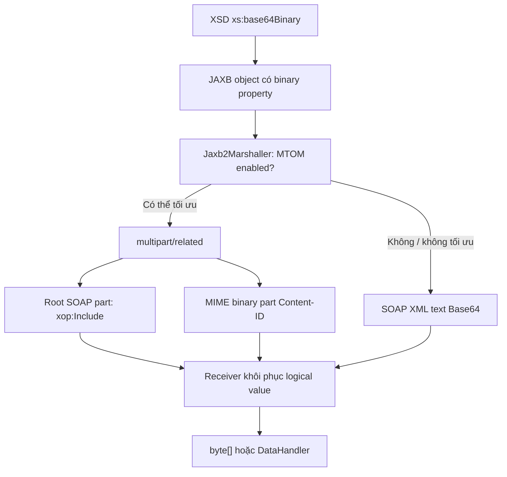

# Jaxb2Marshaller, mtomEnabled và ánh xạ dữ liệu nhị phân

## 1. Vì sao SOAP cần tệp đính kèm?

Trong **Spring Web Services (Spring-WS)** theo hướng **contract-first**, SOAP Body thường chứa XML về đơn hàng, chứng từ, giao dịch hoặc thông tin đối tác. Nhưng một SOAP operation còn có thể cần gửi **file PDF, ảnh, bảng tính, hóa đơn điện tử, bản quét, tài liệu ký số hoặc những khối dữ liệu nhị phân**.

XML là văn bản, không thể tùy ý nhúng raw bytes vào text element. XML Schema dùng kiểu **`xs:base64Binary`** để biểu diễn bytes dưới dạng Base64. Cách này tương thích XML nhưng với file lớn có chi phí đáng kể về dung lượng và bộ nhớ: Base64 tăng kích thước khoảng một phần ba, cộng thêm chi phí tạo String, byte arrays và SOAP Envelope.

**MTOM** (*Message Transmission Optimization Mechanism*) kết hợp **XOP** (*XML-binary Optimized Packaging*) cho phép gửi binary content dưới dạng **MIME attachments riêng** trong một HTTP `multipart/related` package. Phía nhận vẫn thấy **giá trị XML logic tương đương `xs:base64Binary`**, không cần thay đổi mô hình dữ liệu nghiệp vụ trong XSD.

Trong hệ sinh thái Spring, **`Jaxb2Marshaller#setMtomEnabled(true)`** cho phép JAXB/OXM dùng MIME-aware attachment marshalling/unmarshalling khi **đường xử lý thật sự có SOAP message hỗ trợ MIME**. Các kiểu Java thường gặp gồm `byte[]` và `jakarta.activation.DataHandler`.

### Mục tiêu bài học

1. Phân biệt **Base64 inline**, **MTOM/XOP** và SOAP with Attachments (SwA).
2. Thiết kế XSD với `xs:base64Binary` và `xmime:expectedContentTypes`.
3. Hiểu JAXB mapping với `byte[]`, `DataHandler`, `@XmlMimeType`.
4. Cấu hình `Jaxb2Marshaller`, SOAP message factory và `WebServiceTemplate`.
5. Hiểu **MTOM được bật** khác với **binary thực sự được đóng gói thành MIME part**.
6. Gửi/nhận file theo streaming có giới hạn, an toàn bộ nhớ và vòng đời nguồn dữ liệu.
7. Tách XML Schema validation, business validation, SOAP Fault và WS-Security.
8. Kiểm thử XOP/Content-ID trên wire với một SOAP client/server thật.

Ví dụ xuyên suốt: SOAP operation `UploadDocument` ở namespace `https://example.org/documents/v1`. Namespace là định danh XML, **không phải địa chỉ HTTP**. Client gửi metadata cùng file tài liệu; server trả document ID và checksum thực tế.

## 2. Base64 inline so với MTOM/XOP

Giả sử byte sequence mẫu là:

```text
25 50 44 46
```

Đây là bốn byte đầu của nhiều file PDF, diễn giải theo ASCII thành %PDF. Giá trị Base64 của bốn bytes trên là:

```text
JVBERg==
```

### 2.1. Nội dung inline trong XML

```xml
<doc:UploadDocumentRequest
    xmlns:doc="https://example.org/documents/v1">
  <doc:clientRequestId>REQ-2026-0001</doc:clientRequestId>
  <doc:fileName>invoice.pdf</doc:fileName>
  <doc:mediaType>application/pdf</doc:mediaType>
  <doc:declaredBytes>4</doc:declaredBytes>
  <doc:content>JVBERg==</doc:content>
</doc:UploadDocumentRequest>
```

Đây là một XML payload bình thường; element `content` chứa text Base64. Các bytes mẫu **không cấu thành một PDF hoàn chỉnh**.

Kích thước Base64 không xuống dòng của dữ liệu gốc dài `n` bytes là:

\[
4 \times \left\lceil \frac{n}{3} \right\rceil
\]

Ví dụ 3 MiB binary tạo xấp xỉ 4 MiB ký tự Base64, chưa tính XML/HTTP và các bản sao tạm bên trong JVM. Đây là lý do một file vài chục MiB có thể tốn rất nhiều heap nếu dùng `byte[]` và Base64 String tại nhiều tầng.

### 2.2. Nội dung khi tối ưu bằng MTOM

Với MTOM/XOP, XML **trong MIME root part** có thể thay text Base64 bằng tham chiếu:

```xml
<doc:UploadDocumentRequest
    xmlns:doc="https://example.org/documents/v1"
    xmlns:xop="http://www.w3.org/2004/08/xop/include">
  <doc:clientRequestId>REQ-2026-0001</doc:clientRequestId>
  <doc:fileName>invoice.pdf</doc:fileName>
  <doc:mediaType>application/pdf</doc:mediaType>
  <doc:declaredBytes>4</doc:declaredBytes>
  <doc:content>
    <xop:Include href="cid:pdf-123@example.org"/>
  </doc:content>
</doc:UploadDocumentRequest>
```

Bytes thực được đưa vào MIME binary part có Content-ID tương ứng. MTOM tối ưu việc **truyền tải**, không thay `xs:base64Binary` trong logical XML Infoset.

### 2.3. Không nhầm MTOM với SwA

| Đặc điểm | Base64 inline | MTOM/XOP | SwA / swaRef |
|---|---|---|---|
| Data contract logic | `xs:base64Binary` | Vẫn `xs:base64Binary` | Có thể dùng kiểu attachment reference |
| Wire transport | XML text | MIME multipart + XOP Include | MIME multipart + attachment reference |
| Java mapping | Thường `byte[]` | `byte[]` hoặc `DataHandler` | Có thể dùng `@XmlAttachmentRef` |
| Hỗ trợ hai phía | XML/SOAP cơ bản | Cần MTOM/XOP support | Cần SwA support/profile tương ứng |
| Mục đích | Đơn giản, tương thích | Tối ưu binary transport | Attachments theo cơ chế tham chiếu riêng |

**`@XmlAttachmentRef` không phải nút bật MTOM cho mọi `xs:base64Binary`.** Nó gắn với các cơ chế attachment reference khác, có thể làm thay đổi binding và wire contract. Bài này chỉ xét MTOM/XOP cho logical binary value.

## 3. Cấu trúc MIME multipart và Content-ID

Một HTTP request SOAP 1.1 có MTOM có thể nhìn như sau:

```http
POST /ws/documents HTTP/1.1
Host: documents.example.org
MIME-Version: 1.0
Content-Type: multipart/related; boundary="BND42";
  type="application/xop+xml";
  start="<root-42@example.org>";
  start-info="text/xml"

--BND42
Content-Type: application/xop+xml; charset=UTF-8; type="text/xml"
Content-ID: <root-42@example.org>

<soap:Envelope xmlns:soap="http://schemas.xmlsoap.org/soap/envelope/"
               xmlns:doc="https://example.org/documents/v1"
               xmlns:xop="http://www.w3.org/2004/08/xop/include">
  <soap:Body>
    <doc:UploadDocumentRequest>
      <doc:clientRequestId>REQ-2026-0001</doc:clientRequestId>
      <doc:fileName>invoice.pdf</doc:fileName>
      <doc:mediaType>application/pdf</doc:mediaType>
      <doc:declaredBytes>4</doc:declaredBytes>
      <doc:content>
        <xop:Include href="cid:pdf-42@example.org"/>
      </doc:content>
    </doc:UploadDocumentRequest>
  </soap:Body>
</soap:Envelope>

--BND42
Content-Type: application/pdf
Content-Transfer-Encoding: binary
Content-ID: <pdf-42@example.org>

%PDF
--BND42--
```

**Mẫu này rút gọn để dạy cấu trúc**: MIME thật yêu cầu CRLF/boundaries chính xác, binary bytes không thể hiển thị đầy đủ bằng text và phần %PDF chỉ là 4 bytes đầu. Không dùng nó làm nguyên văn fixture production.

Các thành phần:

1. HTTP `Content-Type: multipart/related` thông báo message có nhiều parts.
2. Part đầu chứa SOAP Envelope được encode dưới dạng XOP, media type `application/xop+xml`.
3. Element `xop:Include` có URI `cid:pdf-42@example.org`.
4. MIME part chứa bytes thật có `Content-ID: <pdf-42@example.org>`.
5. Receiver kết nối hai phần bằng Content-ID rồi khôi phục binary value logic.

Nếu `href` không khớp Content-ID, file không thể được giải quyết đúng. Prefix `xop` có thể đổi, nhưng namespace URI phải đúng `http://www.w3.org/2004/08/xop/include`.

SOAP 1.2 dùng media type SOAP khác (chẳng hạn `application/soap+xml` bên trong XOP root), cấu trúc Fault khác và quy tắc action theo binding khác. Đừng cố ép `text/xml` hoặc SOAPAction SOAP 1.1 cố định vào mọi multipart request; để message factory/wire serializer làm việc theo version.

### 3.1. Logical XML khác wire XML



**XSD validation nhắm vào logical XML value** sau xử lý XOP, không phải chỉ ném raw XOP root XML vào schema validator đang chờ text Base64 rồi kết luận message sai.

## 4. Thiết kế XSD contract-first cho `UploadDocument`

```xml
<?xml version="1.0" encoding="UTF-8"?>
<xs:schema xmlns:xs="http://www.w3.org/2001/XMLSchema"
           xmlns:tns="https://example.org/documents/v1"
           xmlns:xmime="http://www.w3.org/2005/05/xmlmime"
           targetNamespace="https://example.org/documents/v1"
           elementFormDefault="qualified">

  <xs:simpleType name="DocumentIdType">
    <xs:restriction base="xs:string">
      <xs:pattern value="DOC-[0-9]{6}"/>
    </xs:restriction>
  </xs:simpleType>

  <xs:simpleType name="Sha256HexType">
    <xs:restriction base="xs:string">
      <xs:pattern value="[0-9a-fA-F]{64}"/>
    </xs:restriction>
  </xs:simpleType>

  <xs:element name="UploadDocumentRequest">
    <xs:complexType>
      <xs:sequence>
        <xs:element name="clientRequestId" type="xs:token"/>
        <xs:element name="fileName" type="xs:token"/>
        <xs:element name="mediaType" type="xs:token"/>
        <xs:element name="declaredBytes" type="xs:long"/>
        <xs:element name="sha256Hex" type="tns:Sha256HexType"/>
        <xs:element name="content"
                    type="xs:base64Binary"
                    xmime:expectedContentTypes="application/octet-stream"/>
      </xs:sequence>
    </xs:complexType>
  </xs:element>

  <xs:element name="UploadDocumentResponse">
    <xs:complexType>
      <xs:sequence>
        <xs:element name="documentId" type="tns:DocumentIdType"/>
        <xs:element name="acceptedBytes" type="xs:long"/>
        <xs:element name="sha256Hex" type="tns:Sha256HexType"/>
      </xs:sequence>
    </xs:complexType>
  </xs:element>
</xs:schema>
```

| Trường | XML type | Trách nhiệm |
|---|---|---|
| `clientRequestId` | `xs:token` | Idempotency/correlation đã được ứng dụng thẩm định |
| `fileName` | `xs:token` | Tên tệp, chưa an toàn để dùng làm filesystem path |
| `mediaType` | `xs:token` | MIME type client khai báo, cần xác minh bằng file signature |
| `declaredBytes` | `xs:long` | Kích thước được khai, server phải tự đếm |
| `sha256Hex` | Hex string 64 ký tự | Checksum được khai, server phải tính lại |
| `content` | **`xs:base64Binary`** | Binary data logic, có thể tối ưu hóa MTOM |
| `xmime:expectedContentTypes` | MIME metadata | Gợi ý cho JAXB/XJC về kiểu dữ liệu |

**Giới hạn cố ý:** `xs:long` cho phép số âm; muốn từ chối ngay ở schema cần tạo custom simpleType có `minInclusive=0`, còn business layer vẫn phải đếm bytes thực. `fileName` cần whitelist/path traversal defense, `mediaType` cần file signature check, checksum cần so với bytes thật. Không nên coi XML hợp lệ theo XSD là file đã an toàn.

### 4.1. `xmime:expectedContentTypes` là hint, không phải lệnh bật MTOM

XML MIME annotation giúp công cụ sinh binding hiểu content type; với một số XJC/JAXB providers có thể sinh `DataHandler` thay vì `byte[]`. **Không đảm bảo tất cả generators đều sinh cùng một Java type** hoặc luôn xuất MIME part. Phải kiểm tra class được sinh, JAXB runtime và actual SOAP transport.

### 4.2. Không đưa `xop:Include` vào XSD nghiệp vụ

Không định nghĩa `content` là «XOP Include element» thay `xs:base64Binary`. MTOM là optimization của **wire representation**, nên hợp đồng logic về dữ liệu vẫn là `xs:base64Binary`. Nếu doanh nghiệp sử dụng SwA/swaRef thì đó là một contract khác và cần được công bố rõ.

### 4.3. WSDL, SOAPAction và MTOM

Trong WSDL 1.1, `wsdl:part` document/literal thường tham chiếu global element `UploadDocumentRequest`. WSDL binding quy định SOAP operation và action; khả năng MTOM có thể được quảng bá/thoả thuận qua policy/profile tương ứng.

**Không kết luận WSDL có `xs:base64Binary` nghĩa là endpoint bắt buộc hỗ trợ `multipart/related`.** Consumer/provider phải thỏa thuận MTOM và kiểm thử thật. Đối tác chỉ hỗ trợ inline Base64 có thể từ chối XOP multipart dù logical XSD giống nhau.

## 5. Java mapping: `byte[]` hay `DataHandler`?

### 5.1. `byte[]`

```java
@XmlElement(required = true)
@XmlMimeType("application/octet-stream")
private byte[] content;
```

- Dễ dùng khi dữ liệu nhỏ và đã nằm trong heap.
- JAXB có thể encode/decode Base64; provider có thể tối ưu MTOM khi cấu hình/đường đi phù hợp.
- Mảng bytes **đã chiếm toàn bộ heap** của file; bật MTOM không làm cho mảng đó thành streaming.
- Nhiều concurrent requests có thể gây GC pressure hoặc OOM khi file lớn.

### 5.2. `DataHandler`

Jakarta Activation cung cấp `jakarta.activation.DataHandler` và `jakarta.activation.DataSource` để biểu diễn binary data từ nguồn dữ liệu.

```java
import jakarta.activation.DataHandler;
import jakarta.xml.bind.annotation.XmlElement;
import jakarta.xml.bind.annotation.XmlMimeType;

@XmlElement(required = true)
@XmlMimeType("application/octet-stream")
private DataHandler content;
```

Lợi ích:

- Có thể lấy InputStream khi cần thay vì đọc sẵn toàn bộ file bằng `Files.readAllBytes(...)`.
- Cung cấp MIME type qua `DataSource#getContentType()`.
- JAXB với MTOM có thể dùng `AttachmentMarshaller` để chuyển bytes ra MIME part.
- Receiver có thể trả `DataHandler` để ứng dụng đọc stream có kiểm soát.

**Không bảo đảm zero-copy hay memory O(1) end-to-end**: JAXB runtime, SAAJ message factory, HTTP sender, security signing/encryption và MIME parser có thể buffer/materialize dữ liệu. Cần đo heap và tải thật.

### 5.3. `@XmlMimeType` có và không có tác dụng gì?

Annotation `@XmlMimeType("application/octet-stream")` cho JAXB metadata MIME của binary property. Nó không:

- Bật HTTP multipart một mình.
- Tạo một attachment khi SOAP message factory không hỗ trợ MIME.
- Xác minh file thật là PDF/ảnh hoặc không có malware.
- Giới hạn kích thước file, bảo vệ memory, chống replay hay ký số.
- Bảo đảm mọi binary field có `xop:Include` bất kể kích thước.

### 5.4. JAXB class minh họa

```java
package org.example.documents.contract;

import jakarta.activation.DataHandler;
import jakarta.xml.bind.annotation.XmlAccessType;
import jakarta.xml.bind.annotation.XmlAccessorType;
import jakarta.xml.bind.annotation.XmlElement;
import jakarta.xml.bind.annotation.XmlMimeType;
import jakarta.xml.bind.annotation.XmlRootElement;
import jakarta.xml.bind.annotation.XmlType;

@XmlRootElement(
    name = "UploadDocumentRequest",
    namespace = "https://example.org/documents/v1")
@XmlAccessorType(XmlAccessType.FIELD)
@XmlType(propOrder = {
    "clientRequestId", "fileName", "mediaType",
    "declaredBytes", "sha256Hex", "content"
})
public class UploadDocumentRequest {
    @XmlElement(required = true)
    private String clientRequestId;
    @XmlElement(required = true)
    private String fileName;
    @XmlElement(required = true)
    private String mediaType;
    @XmlElement(required = true)
    private long declaredBytes;
    @XmlElement(required = true)
    private String sha256Hex;
    @XmlElement(required = true)
    @XmlMimeType("application/octet-stream")
    private DataHandler content;

    public UploadDocumentRequest() {}

    // Getters/setters tương ứng: lược bỏ để tập trung mapping.
}
```

Đây là **class minh họa**; trong contract-first hãy ưu tiên dùng code sinh từ XSD đã được phê duyệt. Nếu XJC sinh `JAXBElement`/`ObjectFactory` thì client phải marshal đúng root object. Không sửa tay generated classes vì bị ghi đè khi sinh lại.

**Chú ý namespace cho các element con:** XSD ở mục 4 khai báo `elementFormDefault="qualified"`. Nếu tự viết JAXB class như trên, cần thêm annotation cấp package để các local elements cùng thuộc target namespace:

```java
// package-info.java
@jakarta.xml.bind.annotation.XmlSchema(
    namespace = "https://example.org/documents/v1",
    elementFormDefault = jakarta.xml.bind.annotation.XmlNsForm.QUALIFIED)
package org.example.documents.contract;
```

Nếu không, JAXB có thể xuất element con **không namespace**, gây lỗi XSD dù root QName đúng. Trong dự án contract-first, XJC thường sinh `package-info.java` phù hợp; nên kiểm tra và giữ file đó cùng generated classes.

### 5.5. Không trộn `jakarta` và `javax`

Spring Boot 3+/Spring Framework 6 sử dụng Jakarta APIs như `jakarta.activation.DataHandler` và `jakarta.xml.bind.*`; thế hệ cũ có `javax.activation`, `javax.xml.bind`. Chọn JAXB runtime/XJC/version nhất quán với Spring-WS đang dùng. Không fix `ClassNotFoundException` bằng cách trộn hai thế hệ binding một cách ngẫu nhiên.

## 6. `Jaxb2Marshaller#setMtomEnabled(true)` thực sự kích hoạt gì?

Spring OXM `Jaxb2Marshaller` hỗ trợ JAXB marshalling và các đường MIME-aware qua `MimeMarshaller`/`MimeUnmarshaller`. Khi:

```java
marshaller.setMtomEnabled(true);
```

marshaller được phép dùng attachment marshaller/unmarshaller của JAXB **khi kết quả/nguồn XML nằm trong SOAP MIME-capable container phù hợp**.

Muốn thật sự có MTOM cần **đồng thời**:

1. JAXB object chứa binary property được map phù hợp.
2. Spring `Jaxb2Marshaller` được cấu hình MTOM.
3. Request thực sự dùng **đúng bean marshaller đó**.
4. SOAP message factory tạo và serialize attachments.
5. Message sender giữ multipart headers và MIME content.
6. Partner SOAP endpoint hỗ trợ MTOM/XOP theo SOAP binding.
7. Provider quyết định tối ưu dữ liệu, có thể phụ thuộc kích thước/loại field.

**Bật khả năng MTOM không đồng nghĩa mọi file chắc chắn thành MIME attachment.** Với payload nhỏ hoặc cách mapping khác, JAXB/stack có thể vẫn dùng inline Base64.

### 6.1. Bean Spring OXM minh họa

```java
import org.springframework.context.annotation.Bean;
import org.springframework.context.annotation.Configuration;
import org.springframework.oxm.jaxb.Jaxb2Marshaller;

@Configuration
public class DocumentsOxmConfiguration {

    @Bean
    public Jaxb2Marshaller documentsMarshaller() {
        Jaxb2Marshaller marshaller = new Jaxb2Marshaller();
        marshaller.setContextPath(
            "org.example.documents.contract");
        marshaller.setMtomEnabled(true);
        return marshaller;
    }
}
```

Package phải chứa JAXB metadata do XJC sinh (ví dụ `ObjectFactory` hoặc `jaxb.index` phù hợp). Một số dự án dùng `setClassesToBeBound(...)` thay thế. Chỉ định marshaller bean **không tự đảm bảo** tất cả endpoint/server paths dùng bean đó.

### 6.2. Bẫy `StreamResult` và `StringWriter`

Nếu tự marshal:

```java
marshaller.marshal(request, new StreamResult(writer));
```

thì `StreamResult` không mang **SOAP MIME container** để giữ binary attachments. Kết quả có thể là Base64 inline, dù marshaller đã bật MTOM. Đó không phải bằng chứng MTOM transport bị lỗi: bài test chưa đi qua SOAP message/HTTP packaging.

### 6.3. Bean đúng nhưng caller dùng bean khác

Ví dụ marshaller MTOM ở `documentsMarshaller` nhưng `WebServiceTemplate` được cấu hình bằng một `Jaxb2Marshaller` khác hoặc JAXB processor tự tạo, nên flag không áp dụng. Kiểm tra Spring context và wiring thực:

```java
template.setMarshaller(documentsMarshaller);
template.setUnmarshaller(documentsMarshaller);
```

## 7. Cấu hình SOAP message factory và `WebServiceTemplate`

### 7.1. SAAJ SOAP message factory

```java
import org.springframework.context.annotation.Bean;
import org.springframework.ws.soap.SoapVersion;
import org.springframework.ws.soap.saaj.SaajSoapMessageFactory;

@Bean
public SaajSoapMessageFactory documentsSoapFactory() {
    SaajSoapMessageFactory factory =
        new SaajSoapMessageFactory();

    // SOAP version phải khớp WSDL binding.
    factory.setSoapVersion(SoapVersion.SOAP_11);
    return factory;
}
```

SAAJ hỗ trợ SOAP messages có attachments. Để SOAP 1.2, phải dùng `SoapVersion.SOAP_12` nếu hợp đồng và message factory/runtime hỗ trợ. Content-Type root và SOAP Fault shape phải khớp SOAP version.

### 7.2. `WebServiceTemplate` dùng đúng marshaller và factory

```java
import org.springframework.oxm.jaxb.Jaxb2Marshaller;
import org.springframework.ws.client.core.WebServiceTemplate;
import org.springframework.ws.soap.saaj.SaajSoapMessageFactory;

@Bean
public WebServiceTemplate documentsWebServiceTemplate(
        SaajSoapMessageFactory documentsSoapFactory,
        Jaxb2Marshaller documentsMarshaller) {

    WebServiceTemplate template =
        new WebServiceTemplate(documentsSoapFactory);

    template.setMarshaller(documentsMarshaller);
    template.setUnmarshaller(documentsMarshaller);
    template.setDefaultUri(
        "https://documents.example.org/ws/documents");

    return template;
}
```

Địa chỉ SOAP service phải được externalize theo môi trường và hợp đồng. Trong production cần message sender có TLS/mTLS, timeouts, connection pool và proxy policies. Phần trên chủ yếu cho thấy **đường đi của JAXB marshaller đã bật MTOM**.

### 7.3. Sender phải giữ MIME multipart

Khi gửi MTOM, HTTP sender cần giữ Content-Type/boundary, root SOAP part, binary parts và Content-ID tương ứng. Không tự overwrite mọi request với `Content-Type: text/xml` hoặc xóa `SOAPAction`.

Với Apache HttpClient custom sender, cần kiểm tra SOAP framing headers `Content-Length`/`Transfer-Encoding` do message factory/HttpClient đặt; đó là vấn đề HTTP transport khác với `mtomEnabled`. Bật pooling không tự bật MTOM và ngược lại.

### 7.4. Không giả định MTOM trên server từ client bean

Một `WebServiceTemplate` dùng `documentsMarshaller` có MTOM **chỉ chứng minh cấu hình ở client path**. Server `@Endpoint` có thể dùng `MethodArgumentResolver`/JAXB processor riêng thay vì bean đó. Với provider phải kiểm chứng attachment-aware unmarshal, response marshal, SOAP factory và interceptor chain ở **server ApplicationContext**.

## 8. Tạo `DataHandler` từ `DataSource` an toàn

### 8.1. Vì sao `Files.readAllBytes(...)` không phù hợp với file lớn?

```java
byte[] bytes = Files.readAllBytes(filePath);
```

Câu lệnh này giữ **toàn bộ file** trong một mảng heap. Với file 50 MiB và 20 requests đồng thời, chỉ raw bytes đã có thể chiếm gần 1 GiB, chưa tính JAXB, SAAJ, Base64, response buffers và copies trong HTTP transport.

Khi có nguồn file trên đĩa hoặc object storage, `DataHandler` kết hợp với `DataSource` giúp mô hình hóa nội dung nhị phân mà không nhất thiết đọc hết vào heap trước. Nhưng cần kiểm thử vì **các thư viện SOAP/MIME có thể buffer** dù API nguồn là stream.

### 8.2. Ví dụ một `DataSource` đọc file theo yêu cầu

```java
package org.example.documents.soap.binary;

import jakarta.activation.DataSource;
import java.io.IOException;
import java.io.InputStream;
import java.io.OutputStream;
import java.nio.file.Files;
import java.nio.file.Path;

public final class PathDataSource implements DataSource {
    private final Path path;
    private final String contentType;

    public PathDataSource(Path path, String contentType) {
        this.path = path;
        this.contentType = contentType;
    }

    @Override
    public InputStream getInputStream() throws IOException {
        return Files.newInputStream(path);
    }

    @Override
    public OutputStream getOutputStream() throws IOException {
        throw new IOException("Read-only data source");
    }

    @Override
    public String getContentType() {
        return contentType;
    }

    @Override
    public String getName() {
        return path.getFileName().toString();
    }
}
```

Ứng dụng có thể tạo handler:

```java
import jakarta.activation.DataHandler;
import java.nio.file.Path;

Path trustedPath = Path.of("/trusted/staging/document.pdf");
DataHandler content = new DataHandler(
    new PathDataSource(trustedPath, "application/pdf"));
```

**Đây là nguồn từ đường dẫn đã được ứng dụng kiểm soát, không phải đường dẫn do SOAP client gửi.** Nếu sử dụng trực tiếp `fileName` từ request làm path filesystem, có nguy cơ path traversal và truy cập file không được phép.

### 8.3. Phải duy trì nguồn dữ liệu đến khi gửi hoàn tất

Khi `DataHandler` giữ tham chiếu đến một `DataSource` đọc file:

1. File phải tồn tại **đến khi SOAP marshalling và HTTP transport hoàn tất**.
2. Nếu implementation đọc attachment trễ/lazy, xóa file tạm ngay sau khi tạo `DataHandler` có thể gây lỗi.
3. Nếu nguồn không mở lại được, các trường hợp library cần đọc nhiều lần để tính kích thước/chữ ký hoặc retry có thể gặp stream đã cạn.
4. Tốt nhất nguồn dữ liệu có cách mở lại stream một cách an toàn, hoặc công khai rằng đó là nguồn dùng một lần và tắt cơ chế tự retry.
5. File tạm và stream cần được cleanup theo phạm vi công việc, kể cả khi SOAP call bị lỗi.

Không giữ một `InputStream` mở trong singleton hoặc gắn nó làm mutable global field để phục vụ nhiều SOAP calls. Nếu dùng datasource từ object storage, cần kiểm soát credentials, read timeout và kết thúc stream đúng lifecycle.

## 9. SOAP client: tạo request và gửi bằng `WebServiceTemplate`

Giả sử XJC đã sinh class `UploadDocumentRequest` từ XSD, và field `content` có setter nhận `DataHandler`. Một SOAP client tương đối nhỏ:

```java
package org.example.documents.soap.client;

import org.springframework.ws.client.core.WebServiceTemplate;
import org.springframework.ws.soap.client.core.SoapActionCallback;

public final class DocumentsSoapClient {
    private final WebServiceTemplate webServiceTemplate;

    public DocumentsSoapClient(WebServiceTemplate webServiceTemplate) {
        this.webServiceTemplate = webServiceTemplate;
    }

    public Object upload(UploadDocumentRequest request) {
        return webServiceTemplate.marshalSendAndReceive(
            request,
            new SoapActionCallback(
                "urn:example:documents:UploadDocument"));
    }
}
```

Một caller minh họa:

```java
UploadDocumentRequest request = new UploadDocumentRequest();

request.setClientRequestId("REQ-2026-0001");
request.setFileName("invoice.pdf");
request.setMediaType("application/pdf");
request.setDeclaredBytes(actualFileSize);
request.setSha256Hex(actualSha256);
request.setContent(new DataHandler(
    new PathDataSource(trustedStagingPath, "application/pdf")));

Object response = documentsSoapClient.upload(request);
```

Ví dụ cần các biến `actualFileSize`, `actualSha256` và `trustedStagingPath` được tính từ file thật; imports của JAXB classes, `DataHandler` và `PathDataSource` phù hợp project. SOAPAction minh họa phải thay bằng giá trị công bố trong **WSDL binding**, không suy từ method `upload`.

**Chú ý contract-first:** XJC có thể sinh `ObjectFactory.createUploadDocumentRequest(...)` trả `JAXBElement<T>` thay vì class có `@XmlRootElement`. Khi đó cần marshal đúng root object mà contract yêu cầu. Không sửa XSD chỉ để tiện code Java.

### 9.1. `setMtomEnabled(true)` không thay đổi `WebServiceTemplate` một cách kỳ diệu

Cần cả hai cấu hình:

```java
marshaller.setMtomEnabled(true);

template.setMarshaller(marshaller);
template.setUnmarshaller(marshaller);
```

và tạo SOAP message từ factory có hỗ trợ MIME. Nếu `WebServiceTemplate` thực tế dùng marshaller khác, kết quả wire có thể vẫn inline Base64.

### 9.2. SOAP Fault khác lỗi MIME/transport

- **SOAP Fault:** nhận được SOAP Envelope hợp lệ có Fault từ provider, có thể do quota, file sai hoặc nghiệp vụ từ chối.
- **HTTP transport error:** không kết nối được, timeout, TLS/mTLS lỗi.
- **MIME parsing error:** multipart boundary hỏng, Content-ID thiếu hoặc XOP URI không resolve.
- **JAXB/XML mapping error:** không bind được root QName, kiểu `DataHandler` không tương thích hoặc class bị sinh sai.

Không gom tất cả thành «JAXB không tải được file». Phải chẩn đoán theo tầng và chỉ retry khi operation có idempotency policy phù hợp.

## 10. SOAP server: nhận nhị phân từ `@RequestPayload`

Một endpoint Spring-WS có thể nhận JAXB request class:

```java
import org.springframework.ws.server.endpoint.annotation.Endpoint;
import org.springframework.ws.server.endpoint.annotation.PayloadRoot;
import org.springframework.ws.server.endpoint.annotation.RequestPayload;
import org.springframework.ws.server.endpoint.annotation.ResponsePayload;

@Endpoint
public class DocumentsEndpoint {
    private static final String NS =
        "https://example.org/documents/v1";

    private final DocumentIngestionService ingestion;

    public DocumentsEndpoint(DocumentIngestionService ingestion) {
        this.ingestion = ingestion;
    }

    @PayloadRoot(namespace = NS, localPart = "UploadDocumentRequest")
    @ResponsePayload
    public UploadDocumentResponse upload(
            @RequestPayload UploadDocumentRequest request) {

        DocumentRecord record = ingestion.accept(
            request.getClientRequestId(),
            request.getFileName(),
            request.getMediaType(),
            request.getDeclaredBytes(),
            request.getSha256Hex(),
            request.getContent());

        UploadDocumentResponse response = new UploadDocumentResponse();
        response.setDocumentId(record.documentId());
        response.setAcceptedBytes(record.actualBytes());
        response.setSha256Hex(record.sha256Hex());
        return response;
    }
}
```

**Mã trên là mẫu cấu trúc**, không phải một Java file chạy riêng: `DocumentIngestionService`, `DocumentRecord` và các JAXB classes là domain/generated types cần triển khai. Với XJC sinh `JAXBElement` hoặc resolver không nhận kiểu direct, cần dùng method signature phù hợp Spring-WS version và JAXB processor thực tế.

### 10.1. Phân biệt endpoint JAXB processor với client OXM bean

Một lỗi nhận thức phổ biến: cấu hình một `Jaxb2Marshaller` có MTOM ở client và giả định server `@Endpoint` sẽ tự sử dụng nó. Thực tế, Spring-WS endpoint adapter có thể dùng JAXB method argument/return value handlers riêng.

Phải xác minh **server runtime**:

- SOAP message factory có đọc được `multipart/related` và attachments không?
- `@RequestPayload` được resolver nào xử lý? Resolver đó có hỗ trợ XOP/MTOM cho `DataHandler` không?
- Content-ID có được resolve thành nội dung đúng bytes?
- Server có giới hạn HTTP body và số/độ lớn MIME parts trước khi buffer không?
- Response chứa binary (nếu có) có đi qua MTOM-capable marshalling path không?
- XML/XSD validation interceptor và WS-Security có hoạt động đúng trên message này không?

Nếu cần xử lý MIME ở mức thấp, dùng các API attachment-aware của `SoapMessage`/`MimeMessage` hoặc cách marshalling của Spring-WS có hỗ trợ `MimeContainer`. Không chỉ lấy text của `xop:Include` bằng XPath rồi tưởng đó là Base64 của file.

### 10.2. Có thể đọc raw XML payload để lấy file không?

Nếu nhìn vào **XOP root part trên wire**, element `content` chứa:

```xml
<xop:Include href="cid:file-42@example.org"
             xmlns:xop="http://www.w3.org/2004/08/xop/include"/>
```

Khi đó biểu thức XPath tìm `content/text()` có thể trả chuỗi rỗng, không phải binary content. Cần attachment-aware parser/unmarshaller để dựng logical binary value, hoặc resolve `cid:` theo MIME API với đầy đủ kiểm tra.

**Không tự viết parser MIME bằng string split trên boundary**: nhị phân có thể chứa bytes bất kỳ; Content-Type, encoding, nested parts và escaping cần thư viện MIME chuyên dụng.

## 11. Đọc file dạng stream, giới hạn kích thước và xác minh checksum

Dữ liệu `declaredBytes`/`sha256Hex` do client gửi **không được tin trực tiếp**. Server cần đo bytes thật, giới hạn dung lượng, tính hash và validate nội dung trước khi commit.

### 11.1. Java bounded copy và SHA-256

```java
import java.io.IOException;
import java.io.InputStream;
import java.io.OutputStream;
import java.security.MessageDigest;
import java.security.NoSuchAlgorithmException;
import java.util.HexFormat;
import jakarta.activation.DataHandler;

public final class BinaryReader {

    private static final long MAX_BYTES = 25L * 1024L * 1024L;

    public static Result copyAndHash(
            DataHandler data, OutputStream destination)
            throws IOException {

        final MessageDigest digest;
        try {
            digest = MessageDigest.getInstance("SHA-256");
        } catch (NoSuchAlgorithmException e) {
            throw new IllegalStateException("SHA-256 unavailable", e);
        }

        byte[] buffer = new byte[16 * 1024];
        long total = 0;

        try (InputStream source = data.getInputStream()) {
            int count;
            while ((count = source.read(buffer)) != -1) {
                if (count == 0) {
                    continue;
                }
                if (count > MAX_BYTES - total) {
                    throw new IllegalArgumentException(
                        "Document size exceeds configured limit");
                }

                digest.update(buffer, 0, count);
                destination.write(buffer, 0, count);
                total += count;
            }
        }

        return new Result(
            total,
            HexFormat.of().formatHex(digest.digest()));
    }

    public record Result(long actualBytes, String sha256Hex) {}
}
```

Code cần Java 17+ cho `HexFormat`. `OutputStream destination` do caller mở và **caller chịu trách nhiệm đóng**; method cố ý chỉ đóng InputStream mở từ DataHandler. Phần code trên không tự đảm bảo file có thực sự là PDF, không có malware hoặc đã được commit giao dịch.

### 11.2. Không lưu file chưa xác minh trực tiếp vào storage chính

Một pipeline an toàn:

1. Giới hạn HTTP body, MIME parts và tổng request size **trước khi** SAAJ/JAXB buffer toàn bộ request.
2. Kiểm tra authentication, authorization, quota và policy WS-Security.
3. Đọc `DataHandler` có giới hạn bytes, ghi vào **quarantine/temp storage**.
4. Tính checksum, so với giá trị khai báo và kích thước thực.
5. Xác minh MIME type từ signature/format parser; không tin `mediaType` hoặc extension.
6. Kiểm tra antivirus/malware/content rules nếu nghiệp vụ yêu cầu.
7. Kiểm soát filename/path, tạo storage key do server quyết định.
8. Chỉ commit file/metadata đã được xác minh.
9. Cleanup file tạm trong cả happy path, SOAP Fault, timeout hoặc bị hủy.
10. Trả SOAP response an toàn; không log full bytes/WS-Security Header.

Nếu giới hạn bị vượt **sau khi đã ghi một phần file**, phải xóa/rollback file tạm. Đọc stream không tự bảo đảm transaction.

### 11.3. SHA-256 xác minh integrity nhưng không tự xác minh identity

Một client không tin cậy có thể tự tạo file độc hại và tính checksum chính xác của chính nó. Vì vậy checksum khớp chỉ cho biết **bytes nhận được giống bytes được khai báo**; không chứng minh đó là tài liệu an toàn hay người gửi được phép upload.

Muốn xác minh nguồn, cần TLS/mTLS, identity, authorization, WS-Security signatures và chính sách nghiệp vụ theo hợp đồng.

### 11.4. Không dùng `DataHandler#getContentType()` làm bằng chứng file an toàn

`getContentType()` là thông tin metadata do DataSource/producer cung cấp, không phải kết quả phân tích file. File tên `invoice.pdf` có thể chứa payload không phải PDF. Dùng content sniffing/file signature parser đáng tin và danh sách media types được cho phép. Không lấy fileName do client gửi để ghép thẳng vào filesystem path.

## 12. Logical XML/XSD validation khác kiểm tra file thật

Một MTOM message có thể **hoàn toàn hợp lệ theo XSD** vì element `content` có logical value `xs:base64Binary`. Nhưng file nhị phân vẫn có thể:

- Không đúng declared size.
- Có checksum sai.
- Là định dạng không được phép.
- Chứa nội dung nguy hiểm hoặc malware.
- Vượt quota của tenant/người dùng.
- Có tên/metadata gây path traversal hoặc injection.
- Thiếu quyền thực hiện operation upload.

### 12.1. Không nhầm raw XOP root với logical XML

Nếu bạn lấy root MIME part chứa `<xop:Include>` rồi chạy XSD 1.0 validator vốn yêu cầu `xs:base64Binary`, nó có thể báo sai cấu trúc. MTOM/XOP cần **khôi phục XML Infoset** theo quy tắc trước khi đánh giá binary value logic. Trên server, phải kiểm tra validation pipeline có MTOM support, không chỉ nạp raw XML root part.

### 12.2. `PayloadValidatingInterceptor` không phải bộ quét file

`PayloadValidatingInterceptor` của Spring-WS kiểm tra SOAP Body theo XSD, nhưng nó không chứng minh checksum, file type thật, antivirus hay quyền tải. Một phần đường xử lý validation có thể materialize payload; cần benchmark memory với MIME data lớn.

### 12.3. Base64 inline và MTOM nên dùng cùng business rules

Một đối tác có thể gửi cùng logical `xs:base64Binary` ở hai wire formats. Nếu hợp đồng cho phép cả hai, business service phải áp dụng cùng giới hạn byte count, checksum, file type, quyền và quota, thay vì bỏ qua kiểm tra với một định dạng «đã được tối ưu».

## 13. MTOM threshold, lazy streaming và memory

### 13.1. Không có một threshold MTOM chuẩn áp dụng cho mọi provider

Khi `mtomEnabled=true`, implementation có thể cân nhắc kích thước binary field trước khi tạo MIME part. Những file nhỏ có thể vẫn được inline Base64 vì MIME headers/boundary tốn overhead.

Không mặc định mọi Spring-WS/JAXB runtime đều hỗ trợ một property chung tên `mtomThreshold`. Kiểm tra JAXB implementation và SOAP message factory cụ thể nếu cần kiểm soát ngưỡng tối ưu; cố định version trong tests để tránh đổi wire representation ngoài ý muốn.

### 13.2. Streaming `DataHandler` không bảo đảm zero-copy end-to-end

Một số bước có thể làm tăng memory:

- JAXB marshaller/AttachmentMarshaller.
- SAAJ message construction và MIME serialization.
- HTTP sender buffering hoặc retry policies.
- SOAP WS-Security ký/mã hóa attachments.
- Validation interceptor hoặc audit interceptor parse/copy payload.
- Application đọc file vào byte[] trước khi tạo DataHandler.

Vì thế, cần đo heap peak, allocation, GC và throughput dưới tải gồm **nhiều concurrent large attachments**, không chỉ đo kích thước request đơn.

### 13.3. Backpressure và giới hạn số upload đồng thời

Một service cho phép file 25 MiB và 100 uploads đồng thời có thể gây áp lực rất lớn nếu SOAP stack materialize multipart. Giới hạn tổng HTTP request size, attachments count/bytes, số concurrent ingestions, timeouts và temporary storage capacity. Dùng bulkhead/semaphore và rate limiting khi cần.

Đừng chỉ tăng JVM heap để chữa mọi lỗi OOM: cũng cần sửa việc buffer, giới hạn upload và thiết kế streaming/staging.

## 14. Vòng đời và lỗi nguồn dữ liệu

| Triệu chứng | Nguyên nhân thường gặp | Hướng xử lý |
|---|---|---|
| `IOException: stream closed` | Stream/file bị đóng trước khi SOAP send hoàn tất | Đảm bảo datasource còn sống tới cuối send |
| Attachment rỗng | DataHandler trỏ vào file đã bị xóa hoặc stream cạn | Dùng source có thể mở lại an toàn |
| Server đọc được một lần rồi lần hai lỗi | Nguồn dữ liệu không repeatable | Không tự re-read; thiết kế one-pass hoặc spool |
| OOM với file lớn | SAAJ/JAXB/HTTP đang materialize bytes | Đo heap, giới hạn file, cân nhắc streaming stack |
| Upload bị cắt giữa chừng | Client timeout/connection reset | Cleanup temp, idempotency và retry policy |
| File tồn tại dù SOAP Fault | Ghi storage trước validation/rollback | Transactional staging + cleanup |
| HTTP retry tạo tài liệu trùng | POST bị replay thiếu idempotency key | Unique clientRequestId và status lookup |
| MIME type không đúng | Client khai `application/pdf` nhưng bytes khác | File signature và content policy |

Với operation tạo tài liệu, **clientRequestId** là gợi ý cho idempotency nhưng không tự có hiệu lực: server phải lưu/truy vấn request ID theo transaction/uniqueness policy, và quyết định cách trả kết quả khi cùng request được gửi lại.

## 15. WS-Security, chữ ký số và binary attachments

SOAP MTOM không tự giải quyết **xác thực, tính toàn vẹn, phân quyền hoặc chống replay**.

### 15.1. Ba cơ chế độc lập

| Cơ chế | Bảo vệ gì? | Không tự giải quyết |
|---|---|---|
| HTTPS/TLS | Kênh kết nối giữa hai endpoints hoặc các hops được bảo vệ | Người dùng có quyền upload không; dữ liệu lưu có an toàn không |
| mTLS/X.509 client auth | Xác thực hai đầu kết nối theo trust policy | Tính toàn vẹn ở mọi hop nếu message qua intermediaries |
| WS-Security signature/encryption | SOAP message/parts theo security policy, timestamp/token | XML schema, quota, malware, file type thật |
| MTOM/XOP | Tối ưu truyền tải bytes | Xác thực danh tính, ký nội dung hoặc mã hóa |
| XSD/JAXB | Wire contract và Java/XML mapping | File signature, checksum, quyền, malicious payload |

Nếu SOAP message được ký số, cần làm rõ **phần nào được ký**: chỉ SOAP Body root hay cả MIME attachments; những refs/transform nào được security implementation và partner hỗ trợ.

### 15.2. Rủi ro ký SOAP Body nhưng không bảo vệ attachment

Trong MTOM wire, SOAP Body có `xop:Include href="cid:..."` trỏ đến MIME part. Nếu security policy chỉ ký một biểu diễn XML không bao gồm binary part hoặc không dùng transform/profile phù hợp, hệ thống có thể không bảo đảm bytes của attachment được bảo vệ đúng ý đồ.

Để tránh:

1. Xác định chính sách **WS-Security attachment protection** giữa hai bên.
2. Xác minh reference/signature thực sự bảo vệ content bytes tương ứng, không chỉ chuỗi Content-ID.
3. Kiểm tra XOP/MTOM transform và SOAP message security provider của cả hai phía.
4. Test sửa một byte của MIME attachment sau khi ký: receiver phải **từ chối** nếu policy yêu cầu integrity.
5. Test thay đổi Content-ID/href, thêm MIME part ngoài ý muốn hoặc lặp Content-ID.
6. Kiểm tra timestamp, certificate chain/truststore, token authorization và chống replay.

Đừng mặc định `Jaxb2Marshaller#setMtomEnabled(true)` sẽ tự ký attachments. Nó là cấu hình **OXM/optimization**, không phải cấu hình WSS4J.

### 15.3. Không log dữ liệu nhạy cảm

Trong các môi trường tích hợp doanh nghiệp, tài liệu có thể chứa dữ liệu khách hàng, hợp đồng, thông tin thanh toán và chữ ký. Không log raw `DataHandler` stream, Base64 text, MIME bytes, SOAP Security Header hoặc key material.

Chỉ ghi metadata được phép như document ID, số bytes, SHA-256 (nếu policy cho phép), correlation ID đã chuẩn hóa, latency và mã lỗi. Nếu cần giữ bản gốc để kiểm tra nghiệp vụ, dùng storage và access controls chuyên dụng.

## 16. Phân loại lỗi MTOM và SOAP Fault

Một lỗi có thể phát sinh ở nhiều tầng:

| Tầng | Ví dụ | Hướng xử lý |
|---|---|---|
| HTTP transport | Connect timeout, TLS trust failure | Transport/client exception; có thể chưa nhận SOAP Fault |
| MIME parser | Sai boundary hoặc Content-ID | Reject malformed multipart, không tin payload |
| XOP reconstruction | `cid:` không resolve, duplicate content ID | Reject invalid attachment reference |
| JAXB/OXM | Field binary không map được `DataHandler` | Xác minh XJC/runtime/bean và bindings |
| XSD validation | Thiếu `content`, sai QName hoặc metadata | SOAP request fault theo contract |
| Business validation | Vượt quota, hash không khớp, file type bị cấm | Business Fault công khai, có error code |
| Security | Chữ ký/WS-Security sai, certificate hết hạn | Security Fault hoặc transport rejection theo policy |
| Storage | Disk full, object store timeout | Server fault an toàn, cleanup staging |

### 16.1. Ví dụ typed business fault (fragment minh họa)

Nếu hợp đồng **đã khai báo** global Fault Detail element tương ứng trong XSD và `wsdl:fault`:

```xml
<doc:UploadDocumentFault
    xmlns:doc="https://example.org/documents/v1">
  <doc:code>SIZE_LIMIT_EXCEEDED</doc:code>
  <doc:message>Document exceeds allowed size</doc:message>
</doc:UploadDocumentFault>
```

Đây chỉ là **XML fragment**: XSD mẫu mục 4 chưa khai báo `UploadDocumentFault`. Muốn dùng trong production cần thiết kế và phê duyệt fault schema, WSDL fault binding, exception resolver và client interoperability. Không thêm Fault Detail mới một cách tùy tiện vào hợp đồng đang chạy.

### 16.2. Trả lỗi thế nào cho file không hợp lệ?

- File vượt dung lượng/quota: lỗi request/business được công bố, không để server OOM.
- MIME part không resolve: malformed wire/attachment error, không tự coi file rỗng hợp lệ.
- Checksum mismatch: mã lỗi business/validation phù hợp, xóa file staging.
- File chứa nội dung nguy hiểm: từ chối theo security policy và hạn chế thông tin tiết lộ.
- Storage timeout: lỗi server/receiver; không nói lỗi do file của client nếu không đúng.
- SOAP Fault của partner: client phân biệt với local parsing/HTTP exception.

SOAP 1.1 và 1.2 có Fault structures khác nhau. Resolver/framework phải tạo đúng phiên bản. Đừng tự string-concatenate XML Fault khi có API Spring-WS chuyên dụng.

### 16.3. Idempotency khi upload bị timeout

Client có thể gửi xong toàn bộ attachment, server commit file, nhưng HTTP response bị mất. Nếu client retry mù, có thể tạo tài liệu trùng hoặc tính phí hai lần.

Cần:

1. `clientRequestId` duy nhất trong scope tenant/operation đã định nghĩa.
2. Persist request status và kết quả đã tạo một cách nguyên tử (hoặc dùng cơ chế bù trừ).
3. Retry với cùng request identifier và cùng file hash/metadata.
4. Khi gặp duplicate ID nhưng hash khác, trả conflict theo contract, không ghi đè âm thầm.
5. Có endpoint hoặc business workflow tra cứu trạng thái nếu kết quả không chắc chắn.

MTOM chỉ tối ưu binary transport; nó **không làm SOAP POST trở nên idempotent**.

## 17. Kiểm thử JAXB/OXM trong bộ nhớ

### 17.1. Khi nào test đơn vị có ích?

Một unit test gọi `Jaxb2Marshaller.marshal(...)` ra `StreamResult` giúp kiểm tra XML element names, JAXB root, namespace và logical Base64 mapping. Tuy nhiên nó **không test HTTP MIME package** và không chứng minh wire MTOM.

Ví dụ skeleton JUnit 5:

```java
@Test
void jaxbCanMarshalBinaryLogicalValue() throws Exception {
    Jaxb2Marshaller marshaller = new Jaxb2Marshaller();
    marshaller.setClassesToBeBound(UploadDocumentRequest.class);
    marshaller.setMtomEnabled(true);
    marshaller.afterPropertiesSet();

    UploadDocumentRequest request = makeSmallRequest();

    StringWriter writer = new StringWriter();
    marshaller.marshal(request, new StreamResult(writer));

    String xml = writer.toString();
    assertTrue(xml.contains("UploadDocumentRequest"));

    // Chưa thể khẳng định HTTP multipart/XOP có xảy ra.
}
```

Imports cần bổ sung `StringWriter`, `StreamResult`, JUnit assertions và helper `makeSmallRequest()`. Đây là **skeleton unit test**; nếu JAXB class cần `ObjectFactory/JAXBElement`, sửa cho đúng. Trong ví dụ này, marshal ra StringWriter không có MIME container nên Base64 inline là kết quả hợp lý.

### 17.2. Test round-trip chưa phải interoperability

Nếu một JAXB provider tự marshal rồi chính nó unmarshal nội dung đó thành công, bạn chỉ biết **hai chiều của cùng implementation** nhất quán. Test với một SOAP toolkit khác mới giúp xác nhận wire MTOM/XOP, MIME Content-ID và XSD/WSDL metadata tương thích bên ngoài.

### 17.3. Test những trường hợp nil/empty

- `content` vắng mặt nhưng XSD required → lỗi schema.
- `content` hiện diện nhưng bytes rỗng → `xs:base64Binary` có thể có giá trị rỗng; nghiệp vụ phải quyết định có chấp nhận không.
- `content xsi:nil="true"` khi XSD không `nillable` → lỗi schema.
- MIME `xop:Include` trỏ tới Content-ID không có → lỗi reconstruction.
- File content lớn hơn quota → từ chối trước khi commit.
- `declaredBytes` không bằng số bytes thực → business invalid.

## 18. Kiểm thử MTOM qua HTTP thật mới chứng minh wire optimization

`MockWebServiceServer` (client-side) và `MockWebServiceClient` (server-side) hữu ích để test SOAP payload, JAXB, mapping, response/fault. Nhưng các mock không nhất thiết sử dụng HTTP transport/MIME serialization hoàn chỉnh.

Muốn khẳng định `multipart/related`, cần **HTTP stub/embedded server thật** nhận raw request bytes hoặc MIME-aware SOAP toolkit có khả năng kiểm tra attachments.

### 18.1. Cách dựng test MTOM wire-level

1. Chuẩn bị file binary fixture vài MiB có nội dung ngẫu nhiên hoặc magic bytes xác định; không dùng dữ liệu khách hàng thật.
2. Tính SHA-256 của bytes fixture.
3. Tạo `DataHandler` từ datasource có thể mở InputStream mới.
4. Gửi request bằng **`WebServiceTemplate` thật** được cấu hình `Jaxb2Marshaller#setMtomEnabled(true)` và SOAP message sender.
5. HTTP stub thu request và dùng thư viện MIME để parse `multipart/related`, không tách chuỗi bằng tay.
6. Kiểm tra root part `application/xop+xml` và SOAP Body QName.
7. Tìm `xop:Include href="cid:..."`; xác nhận có binary part Content-ID tương ứng.
8. Đọc binary part và so **byte-for-byte/SHA-256** với fixture.
9. Gửi SOAP response hợp lệ và xác minh client nhận.
10. Test inline Base64 fallback khi cấu hình không tối ưu hoặc khi partner chỉ hỗ trợ inline, nếu hợp đồng cho phép.

**Không** coi việc HTTP request gửi được là bằng chứng MTOM: nếu JAXB đã inline toàn bộ Base64, server vẫn có thể trả thành công mà không có MIME attachment.

### 18.2. Những assertion nên kiểm tra

| Assertion | Chứng minh |
|---|---|
| HTTP `Content-Type` là `multipart/related` | Request dùng MIME packaging |
| Root MIME part là `application/xop+xml` | Envelope sử dụng XOP |
| Body có `xop:Include` đúng namespace | Binary element được tham chiếu |
| Href `cid:...` khớp Content-ID part | Attachment reference resolve được |
| Binary part checksum trùng fixture | Bytes không mất/hỏng |
| SOAP Body root QName đúng XSD | Contract request vẫn đúng |
| SOAPAction hoặc SOAP 1.2 action đúng | Operation binding chính xác |
| Response/JAXB unmarshalling thành công | Client nhận được kết quả |
| SOAP Fault được xử lý đúng | Không nhầm business rejection với MIME parser error |
| No unrestricted raw content logging | Không lộ tài liệu nhạy cảm |

### 18.3. Bộ test server-side

Đối với server:

1. Gửi một HTTP `multipart/related` MTOM request hợp lệ từ client thật.
2. Xác minh server nhận `DataHandler` hoặc logical bytes đúng.
3. Xác minh domain reader đếm bytes, so checksum và lưu file staging.
4. Thử Content-ID sai: server phải từ chối, không sử dụng file rỗng.
5. Thử checksum sai: xóa staging và trả business fault theo hợp đồng.
6. Thử file vượt limit: request bị từ chối trước khi lưu hoàn toàn.
7. Thử WS-Security invalid: domain service không được thực thi.
8. Thử cùng request ID hai lần: cơ chế idempotency trả kết quả ổn định.
9. Thử nhiều concurrent uploads để đo heap, temp storage và worker threads.
10. Xác minh SOAP Fault không có stack trace, raw binary hoặc đường dẫn storage.

### 18.4. Kiểm thử liên thông

Dùng ít nhất một consumer/provider khác stack, chẳng hạn .NET WCF hoặc Apache CXF, khi dự án có khả năng tích hợp như vậy. Kiểm tra SOAP version, MTOM policy, XML MIME type, WSDL XSD imports, MIME Content-ID, chunking/proxy và chữ ký WS-Security. Một bên có thể hỗ trợ Base64 inline mà **không** hỗ trợ MTOM; cần phát hiện điều đó trước khi phát hành.

## 19. Hiệu năng: MTOM có đáng bật cho mọi file?

### 19.1. Chi phí mạng

Base64 tăng số bytes trên wire so với nhị phân gốc; MTOM giảm overhead này với dữ liệu lớn, nhưng multipart headers/boundaries và xử lý attachments có chi phí riêng. Với vài bytes hoặc vài trăm bytes, MIME package có thể lớn hơn dữ liệu Base64 inline.

### 19.2. Chi phí CPU và memory

MTOM có thể giảm encode/decode Base64, nhưng **không tự loại tất cả copy**. Đo các chỉ số:

- Wire bytes trung bình và p95 theo kích thước attachment.
- CPU encode/decode và SOAP marshalling.
- Heap allocation/GC, peak heap khi concurrent uploads.
- Số temporary files và storage occupancy.
- Thời gian SOAP upload request→response.
- HTTP connection reuse, request queue, network timeouts.
- Tỷ lệ MIME parsing error/XOP unresolved references.
- SOAP signature verification time nếu bảo vệ attachments.

### 19.3. Hạn chế buffer ở gateway

Gateway/proxy/WAF có thể buffer toàn bộ HTTP body trước khi chuyển tới SOAP server, hoặc có body size limit khác ứng dụng. Khi rollout MTOM cần kiểm tra:

- Proxy có cho `multipart/related` không?
- Có tự thay/chuẩn hóa Content-Type, Content-ID hoặc transfer encoding không?
- Có request/response body size limit và timeout phù hợp file lớn không?
- Có virus scanning/offload ở gateway, và cách truyền kết quả đó vào application không?
- Có giới hạn bandwidth, disk spool và connection pool ở từng hop không?

Một SOAP service có code đúng vẫn có thể thất bại trước khi vào endpoint do gateway từ chối `multipart/related` hoặc body size vượt giới hạn.

## 20. Bảng lỗi thường gặp

| Triệu chứng | Nguyên nhân khả dĩ | Hướng điều tra |
|---|---|---|
| Bật `mtomEnabled` nhưng Body vẫn Base64 | Không có MIME container; field/provider không tối ưu; dữ liệu nhỏ | Kiểm tra WebServiceTemplate wiring, message factory và wire |
| `Content-Type=text/xml` dù mong multipart | Sender/message factory không xuất MIME, bị overwrite header | Bắt raw HTTP và cấu hình sender |
| Có `xop:Include` nhưng không đọc được file | MIME Content-ID/href không khớp | Kiểm tra boundary, CID, MIME parts |
| Server `DataHandler=null` | JAXB binding sai, schema field missing, resolver không hỗ trợ | XSD root QName, generated class, adapter |
| `ClassCastException` giữa Activation types | Trộn `javax.activation` và `jakarta.activation` | Đồng bộ Spring/JAXB/XJC versions |
| JAXB `NoSuchMethodException` / binding lỗi | XJC-generated types không hợp runtime | Kiểm tra JAXBContext, ObjectFactory, module dependencies |
| File lớn gây OOM | `byte[]` hoặc SOAP stack buffer toàn bộ | Đo heap, giới hạn input, streaming/staging |
| File rỗng sau upload | Source bị đóng/xóa, stream đã đọc trước | Duy trì repeatable datasource đến send complete |
| SOAP Fault validation cho MTOM | Validator chạy trên raw XOP root, không logical XML | Test MIME-aware schema validation |
| Đọc SOAP Body bằng XPath ra text rỗng | Raw XML có XOP Include, bytes ở MIME part | Dùng attachment-aware marshalling |
| Server báo sai MIME type | MIME metadata sai, policy cấm loại file | Phân tích file signature, mapping, allowlist |
| SOAP Fault bị nhầm transport timeout | Client gom lỗi HTTP/SOAP/MTOM | Tách exception taxonomy |
| HTTPS/mTLS handshake fail | CA/client cert/hostname/TLS mismatch | Truststore, cert rotation, test TLS |
| WS-Security signature lỗi sau MTOM | Attachment không được ký đúng hoặc transform khác | Kiểm tra security policy, attachment profile |
| Client khác công nghệ không đọc được | Không hỗ trợ MTOM/SwA, SOAP version mismatch | Interoperability test với WSDL/XSD thật |
| File bị ghi đè hoặc path traversal | Dùng `fileName` do client cung cấp làm path | Server-generated storage key và path validation |
| Duplicate upload sau retry | Thiếu idempotency | Unique request ID, status lookup |
| MIME parsing chiếm disk cao | Gateway/SAAJ spool temp files | Limits, cleanup và capacity metrics |

### Cách điều tra có hệ thống

1. Xác định request được gửi **inline Base64 hay MTOM multipart** trên wire.
2. Kiểm tra SOAP version, Content-Type, XOP namespace, CID và MIME parts.
3. Kiểm tra XSD/QName, JAXB-generated field type và bean marshaller đang dùng.
4. Kiểm tra runtime `javax`/`jakarta` alignment.
5. Xác nhận SOAP client/server message factory thật sự MIME-aware.
6. Chẩn đoán lỗi file bytes và checksum trước khi xử lý nghiệp vụ.
7. Xem temp storage, heap, memory copies, body-size limits và timeouts.
8. Kiểm tra WS-Security/authorization riêng, không thay bằng JAXB validation.
9. Thêm regression test HTTP/interop cho lỗi vừa tái hiện.

## 21. Bài tập thực hành tích hợp

Xây một dịch vụ `UploadDocument` contract-first:

1. Tạo XSD ở mục 4 với `xs:base64Binary` và `xmime:expectedContentTypes`.
2. Tạo hoặc sử dụng WSDL 1.1 được phê duyệt, khai báo request/response và SOAP binding.
3. Dùng XJC sinh JAXB classes, kiểm tra `byte[]` hay `DataHandler` và cách tạo root object.
4. Cấu hình `Jaxb2Marshaller#setMtomEnabled(true)`.
5. Dùng `SaajSoapMessageFactory` và `WebServiceTemplate` có marshaller/unmarshaller đúng.
6. Tạo file PDF fixture an toàn và `DataHandler` từ file datasource.
7. Gửi SOAP request với JAXB client; bắt raw HTTP và xác minh `multipart/related`.
8. Kiểm tra `xop:Include href` khớp attachment `Content-ID`.
9. So sánh SHA-256 của MIME binary part với file gốc.
10. Triển khai server nhận logical bytes bằng JAXB/MTOM path tương thích.
11. Đọc stream có kích thước tối đa, tính checksum và lưu staging.
12. Test file vượt quota, checksum mismatch, file type giả mạo, file rỗng và thiếu content.
13. Test `cid:` sai hoặc MIME part thiếu, không cho server dùng file rỗng.
14. Test idle/timeout và retry với `clientRequestId`.
15. Thử request Base64 inline nếu đối tác cho phép, kiểm tra business rules giống MTOM.
16. Bật WS-Security theo profile được hai bên chấp thuận, test sửa byte attachment sau khi ký.
17. Test SOAP Fault và HTTP transport errors là hai nhóm riêng.
18. Gọi từ client công nghệ khác và lưu fixtures/contract regression tests trong CI.
19. Load test nhiều file lớn đồng thời, quan sát heap/temp storage, backpressure và throughput.

### Câu hỏi tự kiểm tra

1. Vì sao kiểu `xs:base64Binary` vẫn được dùng khi bật MTOM?
2. `xop:Include` là nghiệp vụ XML element hay cách biểu diễn wire optimization?
3. MTOM có giống SwA/swaRef không?
4. `DataHandler` khác `byte[]` ở đâu về mô hình đọc dữ liệu?
5. `@XmlMimeType` có tự bật HTTP multipart không?
6. Vì sao `setMtomEnabled(true)` trên bean không được dùng thì không có tác dụng?
7. Tại sao unit test marshal vào `StringWriter` có thể vẫn ra Base64 inline?
8. Có thể suy ra MTOM đã hoạt động chỉ từ JAXB round-trip test không?
9. Vì sao Content-ID phải khớp `cid:` trong XOP Include?
10. Dùng `DataHandler` có bảo đảm không buffer file trong SAAJ hay JAXB không?
11. XSD có phát hiện được file PDF chứa malware hoặc checksum sai không?
12. Vì sao phải giới hạn HTTP body ở gateway trước khi JAXB unmarshalling?
13. WS-Security ký SOAP Body có luôn bảo vệ MIME attachment bytes không?
14. Response timeout sau upload có nghĩa server chưa lưu file không?
15. Bài test nào chứng minh trên wire có XOP MIME và bytes thật không hỏng?

## 22. Definition of Done

Một tích hợp MTOM/Spring-WS chỉ nên được đánh dấu sẵn sàng khi:

- [ ] XSD/WSDL công bố `xs:base64Binary` và policy MTOM/attachment phù hợp với partner.
- [ ] JAXB-generated model được kiểm tra; chọn `byte[]` hay `DataHandler` có chủ đích.
- [ ] `Jaxb2Marshaller#setMtomEnabled(true)` được bật **trên instance mà WebServiceTemplate thật sự dùng**.
- [ ] SOAP message factory và HTTP sender hỗ trợ MIME, không phá Content-Type, CID hoặc SOAPAction.
- [ ] Server endpoint/unmarshal path đã được kiểm chứng hỗ trợ attachment-aware processing.
- [ ] MTOM wire-level test chứng minh `multipart/related`, `application/xop+xml`, `xop:Include` và binary part khớp.
- [ ] Không dựa vào JAXB unit test/round-trip để tuyên bố đã kiểm thử HTTP MTOM.
- [ ] Không buffer file lớn không giới hạn; có body/attachment count/size limits, temp cleanup và backpressure.
- [ ] Stream/source tồn tại đến lúc send hoàn tất; có ownership/close policy rõ ràng.
- [ ] Server đo bytes thực, SHA-256 và file type; không tin client-declared metadata.
- [ ] Có antivirus/content policy, authorization, quota và storage isolation nếu nghiệp vụ yêu cầu.
- [ ] WS-Security attachment integrity và TLS/mTLS được kiểm thử theo hợp đồng.
- [ ] SOAP Fault, MIME parsing error, JAXB binding error và transport timeout được phân loại riêng.
- [ ] Operation upload có idempotency và retry policy; không phát sinh tài liệu trùng khi response bị mất.
- [ ] Có test inline Base64 compatibility nếu partner chấp nhận cả hai cách.
- [ ] Có test SOAP 1.1/1.2 và client interoperability khi service hỗ trợ các binding tương ứng.
- [ ] Quan sát memory, temp disk, latency, lỗi MIME và tỷ lệ upload dưới tải đồng thời.

**Ghi nhớ:** `mtomEnabled=true` cho phép tối ưu nhị phân trong **đường JAXB/OXM có MIME container**, nhưng không tự thay đổi XSD, không bảo đảm luôn có attachment, không chứng minh end-to-end streaming và không cung cấp WS-Security. Để tích hợp SOAP ổn định, cần **kiểm tra đúng logical XML contract và MIME bytes trên wire**, rồi bảo vệ file thật bằng giới hạn tài nguyên, checksum, phân quyền, chữ ký và kiểm thử liên thông.

## 23. Tài liệu tham khảo

- [Spring Framework — Jaxb2Marshaller API](https://docs.spring.io/spring-framework/docs/current/javadoc-api/org/springframework/oxm/jaxb/Jaxb2Marshaller.html): `setMtomEnabled`, JAXB context, marshalling và MIME support.
- [Spring Framework — MimeMarshaller](https://docs.spring.io/spring-framework/docs/current/javadoc-api/org/springframework/oxm/mime/MimeMarshaller.html): mô hình MIME attachment marshalling.
- [Spring Web Services — Reference Documentation](https://docs.spring.io/spring-ws/docs/current/reference/html/): SOAP client/server, attachments, MTOM, endpoint và SOAP Fault.
- [Spring Web Services — WebServiceTemplate API](https://docs.spring.io/spring-ws/docs/current/api/org/springframework/ws/client/core/WebServiceTemplate.html): marshalling, message sender và SOAP client operations.
- [Spring Web Services — SaajSoapMessageFactory API](https://docs.spring.io/spring-ws/docs/current/api/org/springframework/ws/soap/saaj/SaajSoapMessageFactory.html): SOAP message factory và SOAP version.
- [W3C — SOAP Message Transmission Optimization Mechanism](https://www.w3.org/TR/soap12-mtom/): mô hình tối ưu SOAP MTOM.
- [W3C — XML-binary Optimized Packaging](https://www.w3.org/TR/xop10/): XOP package và `xop:Include`.
- [W3C — Describing Media Content of Binary Data in XML](https://www.w3.org/TR/xml-media-types/): `xmime:expectedContentTypes` và metadata media type.
- [W3C — XML Schema Part 2: Datatypes](https://www.w3.org/TR/xmlschema-2/): `xs:base64Binary` và validation.
- [W3C — WSDL 1.1](https://www.w3.org/TR/wsdl.html): SOAP operation, message part và binding.
- [Jakarta Activation Specification](https://jakarta.ee/specifications/activation/): `DataHandler` và `DataSource`.
- [Jakarta XML Binding Specification](https://jakarta.ee/specifications/xml-binding/): `@XmlMimeType`, JAXB data binding và attachments.
- [OASIS — WS-Security SOAP Message Security](https://docs.oasis-open.org/wss-m/wss/v1.1.1/os/wss-SOAPMessageSecurity-v1.1.1-os.html): ký/xác thực SOAP message.
- [OASIS — WS-Security SOAP Message with Attachments (SwA) Profile](https://docs.oasis-open.org/wss-m/wss/v1.1.1/os/wss-SwAProfile-v1.1.1-os.html): bảo vệ attachments trong thông điệp SOAP.
- [OWASP — Web Service Security Cheat Sheet](https://cheatsheetseries.owasp.org/cheatsheets/Web_Service_Security_Cheat_Sheet.html): giới hạn input, XML/SOAP security và xử lý file an toàn.
