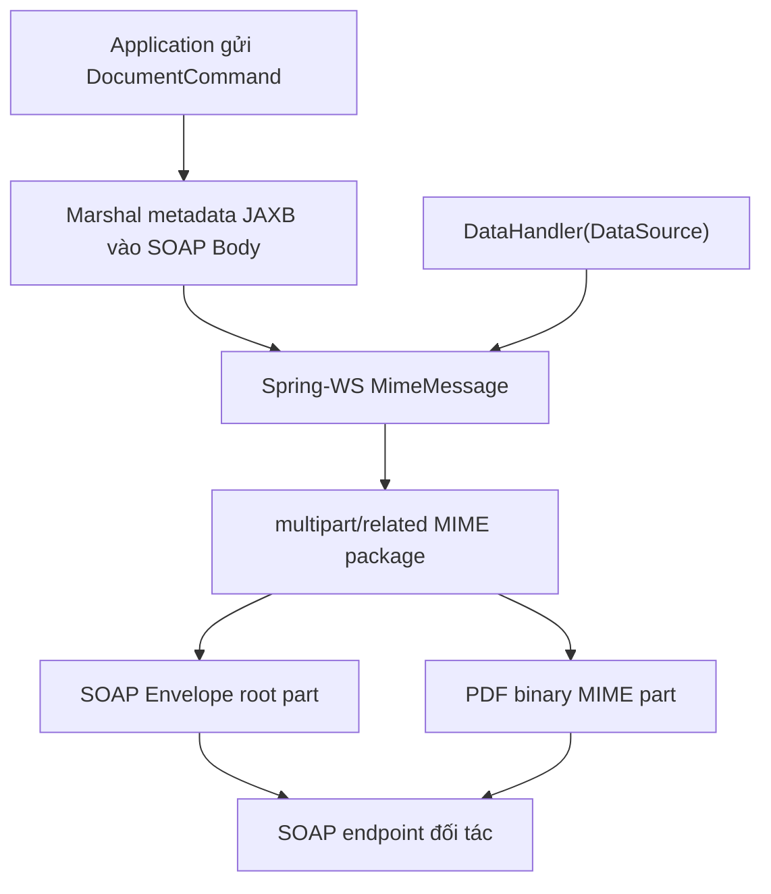
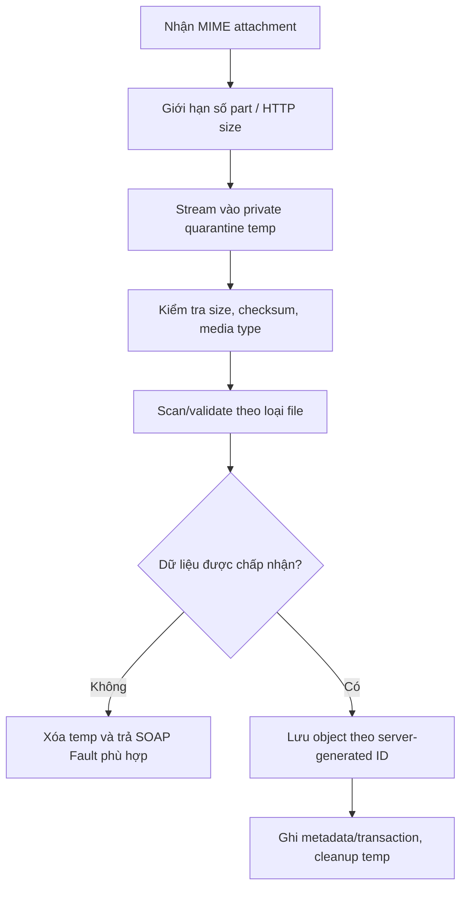
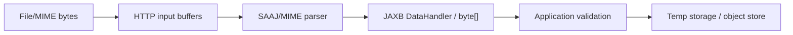
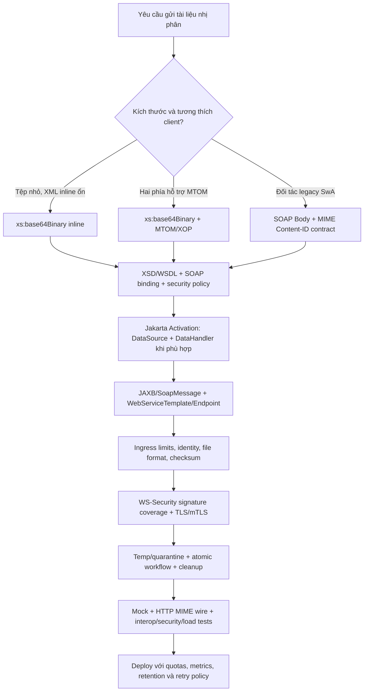

# DataHandler, DataSource và các kiểu Jakarta Activation

## 1. Bài toán: SOAP truyền hóa đơn PDF, ảnh và chứng từ dung lượng lớn

Giả sử một công ty xây dựng dịch vụ `UploadInvoice` bằng **Spring Web Services (Spring-WS)**. Client gửi mã hóa đơn, loại tài liệu, checksum và **nội dung tệp PDF**. Một phiên bản khác trả về tệp ảnh chữ ký hoặc biên bản đã duyệt. Phần metadata có thể biểu diễn bằng các phần tử XML trong SOAP Body; nhưng nội dung nhị phân không phải một chuỗi nghiệp vụ bình thường.

Nếu nhét mọi byte trực tiếp vào `String`, sau đó tự Base64-encode rồi ghép XML, ứng dụng dễ gặp:

- Bộ nhớ tăng vọt do giữ nhiều bản sao `byte[]`, chuỗi Base64, SOAP DOM và JAXB object.
- XML bị sai do xử lý nhầm escape, charset hoặc namespace.
- Thông điệp lớn làm tăng thời gian parse/serialize và chi phí chữ ký XML.
- Không biết tệp nào thuộc request nào khi SOAP Body và MIME attachments cùng tồn tại.
- Lỗ hổng khi tin MIME type hoặc tên file do client khai mà không kiểm tra nội dung.
- Lỗi tương thích do một phía dùng inline Base64, phía kia chờ MTOM/XOP hoặc SOAP with Attachments.

**Jakarta Activation** cung cấp những abstraction cốt lõi giúp Java làm việc với **nội dung dữ liệu, MIME type và nguồn byte**:

- `jakarta.activation.DataSource`: mô tả nơi có thể đọc/ghi dữ liệu và metadata loại nội dung.
- `jakarta.activation.DataHandler`: bọc nguồn dữ liệu hoặc một đối tượng, cung cấp API truy cập/ghi nội dung theo MIME.
- `FileDataSource`, `URLDataSource`, `FileTypeMap`, `DataContentHandler` và các kiểu liên quan: hỗ trợ nguồn file/URL, nhận diện MIME và chuyển đổi nội dung.

Trong hệ sinh thái SOAP, `DataHandler` đặc biệt hữu ích khi **JAXB/MTOM** hoặc **SOAP attachments** muốn trì hoãn việc đọc byte thay vì bắt buộc chứa toàn bộ trong một `byte[]`.

Bài này thuộc chương **Tệp đính kèm** của module **SPRING_WEB_SERVICES**: phát triển SOAP contract-first với XSD/WSDL, ánh xạ JAXB, xây endpoint và SOAP client, xử lý SOAP Fault, interceptor, XML security, WS-Security, chứng chỉ và kiểm thử tích hợp doanh nghiệp. **Đề mục trực tiếp là “DataHandler, DataSource và các kiểu Jakarta Activation”.**

**Sau bài học, bạn có thể:**

1. Giải thích khác biệt `DataSource`, `DataHandler` và các lớp dữ liệu MIME trong Jakarta Activation.
2. Biết khi nào dùng `FileDataSource`, nguồn trong bộ nhớ hay `DataSource` tự viết.
3. Dùng `DataHandler` trong JAXB/MTOM và trong MIME attachment của Spring-WS.
4. Phân biệt inline `xs:base64Binary`, MTOM/XOP và SOAP with Attachments (SwA).
5. Quản lý vòng đời InputStream, giới hạn kích thước, content ID, checksum và an toàn dữ liệu nhị phân.
6. Thiết kế test kiểm tra bytes trên dây, XSD/WSDL, SOAP Fault, TLS/WS-Security và tải thực tế.

## 2. Ba cách biểu diễn dữ liệu nhị phân trong SOAP

Trước khi đi vào Java API, cần nắm **hợp đồng trên dây**.

### 2.1. Cách 1: Base64 inline trong SOAP Body

XSD cho phép một phần tử có kiểu `xs:base64Binary`:

```xml
<xs:element name="content" type="xs:base64Binary"/>
```

SOAP Body có thể mang text Base64:

```xml
<doc:UploadDocumentRequest
    xmlns:doc="urn:example:documents:v1">
  <doc:documentId>DOC-1001</doc:documentId>
  <doc:content>JVBERi0xLjQKJ...</doc:content>
</doc:UploadDocumentRequest>
```

**Lợi ích:** payload là XML thuần; một stack JAXB có thể map phần tử thành `byte[]`. **Đánh đổi:** Base64 làm kích thước dữ liệu tăng khoảng 4/3 trước overhead XML/transport, và nhiều stack tạo thêm bản sao trong bộ nhớ.

Không đồng nhất độ dài Base64 với dung lượng trên heap: XML parser, SAAJ, JAXB và security có thể giữ thêm representation. Khi lượng dữ liệu tăng, độ trễ và peak memory có thể cao hơn nhiều so với kích thước tệp gốc.

### 2.2. Cách 2: MTOM/XOP — tối ưu biểu diễn của `xs:base64Binary`

**MTOM (Message Transmission Optimization Mechanism)** cho phép tối ưu hóa dữ liệu nhị phân mà **XML Information Set** vẫn tương ứng với `xs:base64Binary` trong hợp đồng. Với **XOP (XML-binary Optimized Packaging)**, phần XML trong MIME root part có thể chứa một tham chiếu:

```xml
<doc:UploadDocumentRequest
    xmlns:doc="urn:example:documents:v1"
    xmlns:xop="http://www.w3.org/2004/08/xop/include">
  <doc:documentId>DOC-1001</doc:documentId>
  <doc:content>
    <xop:Include href="cid:document-1001%40example.org"/>
  </doc:content>
</doc:UploadDocumentRequest>
```

Một MIME part khác giữ bytes của PDF và có `Content-ID` tương ứng. Đây là **minh họa wire representation**, không phải phần tử `xop:Include` nên được viết trực tiếp vào XSD nghiệp vụ thay cho `xs:base64Binary`.

**Điều quan trọng:**

- SOAP/XSD contract vẫn mô tả `content` là dữ liệu nhị phân kiểu `xs:base64Binary`.
- Khi MTOM được bật và implementation quyết định optimize, bytes có thể nằm ở MIME part riêng.
- Không phải mọi payload `xs:base64Binary` đều chắc chắn được tối ưu; implementation có thể dùng threshold, khả năng của provider và policy.
- MTOM không nén PDF hay ảnh; nó chủ yếu tránh overhead Base64-inline và có thể cải thiện cách truyền nhị phân.
- Receiver phải hỗ trợ MTOM/XOP để hiểu nội dung MIME optimized.

### 2.3. Cách 3: SOAP with Attachments (SwA) — MIME attachment riêng

Với SwA, SOAP Envelope có thể chứa **tham chiếu tới một attachment** như `cid:...`; attachment được đóng gói như MIME part độc lập. Mối liên hệ giữa XML Body và part phải tuân một **quy ước hợp đồng** của dịch vụ.

Ví dụ SOAP Body chỉ mô tả:

```xml
<doc:UploadDocumentRequest
    xmlns:doc="urn:example:documents:v1">
  <doc:documentId>DOC-1001</doc:documentId>
  <doc:attachmentContentId>document-1001@example.org</doc:attachmentContentId>
</doc:UploadDocumentRequest>
```

MIME attachment có thể có:

```text
Content-ID: <document-1001@example.org>
Content-Type: application/pdf
Content-Transfer-Encoding: binary

...bytes PDF...
```

Trong ví dụ này, `attachmentContentId` là field metadata do **hợp đồng riêng** quy định, không phải thuộc tính tự phát sinh từ `xs:base64Binary`. Không giả định một generated JAXB `byte[]` tự trỏ đến SwA attachment.

### 2.4. Bảng quyết định nhanh

| Cách truyền | Dạng contract | Bytes trên dây | Phù hợp khi | Cần chú ý |
|---|---|---|---|---|
| Inline Base64 | `xs:base64Binary` | Text Base64 trong XML | Tệp nhỏ, client rất đa dạng | Overhead Base64 và bộ nhớ |
| **MTOM/XOP** | `xs:base64Binary`, metadata MIME khi phù hợp | MIME optimized part, `xop:Include` trong XML | Hai phía hỗ trợ MTOM, tệp vừa/lớn | MTOM config, JAXB, XOP parsing, security coverage |
| **SwA** | SOAP Body + quy ước CID/attachment | MIME part độc lập | Đối tác legacy quy định SwA | CID linking, contract riêng, interceptor/security |

Không chọn MTOM chỉ vì ứng dụng “có PDF”. Trước tiên phải xác định **WSDL, XSD, WS-Policy và khả năng client/đối tác thực tế**.

## 3. `DataSource` — hợp đồng của nguồn dữ liệu

Interface lõi:

```java
package jakarta.activation;

public interface DataSource {
    java.io.InputStream getInputStream() throws java.io.IOException;
    java.io.OutputStream getOutputStream() throws java.io.IOException;
    String getContentType();
    String getName();
}
```

Đây là **chữ ký minh họa**, không cần copy interface vào project vì nó đã tồn tại trong Jakarta Activation API.

### 3.1. Bốn method và ý nghĩa

| Method | Trách nhiệm | Ví dụ |
|---|---|---|
| `getInputStream()` | Mở stream để đọc dữ liệu | Đọc bytes từ file PDF hoặc một nguồn khác |
| `getOutputStream()` | Mở stream để ghi, nếu nguồn cho phép | Ghi vào nguồn mutable; nguồn read-only có thể ném `IOException` |
| `getContentType()` | MIME media type của dữ liệu | `application/pdf`, `image/png`, `application/octet-stream` |
| `getName()` | Tên mô tả nguồn dữ liệu | `invoice-1001.pdf` hoặc định danh nguồn |

**Không nhầm `getName()` với tên tệp đáng tin trên server hoặc HTTP `Content-Disposition`.** Một `DataSource` có tên để mô tả, nhưng tên này không tự trở thành đường dẫn lưu trữ hoặc metadata đã được kiểm tra.

### 3.2. `DataSource` không phải `javax.sql.DataSource`

Tên trùng nhau nhưng chức năng khác hoàn toàn:

```java
jakarta.activation.DataSource // Nội dung nhị phân/MIME.
javax.sql.DataSource          // Connection tới cơ sở dữ liệu.
```

Trong Spring Boot, khi import `DataSource` trong một SOAP attachment adapter, phải kiểm tra package. Nếu IDE auto-import nhầm `javax.sql.DataSource`, bạn sẽ không có các method `getInputStream`/`getContentType` tương ứng.

### 3.3. Vòng đời stream thuộc trách nhiệm caller

`DataSource#getInputStream()` mở một resource đọc; code **gọi method này** phải đóng stream khi dùng xong, hoặc framework phải quản lý stream theo contract. `DataSource` không tự đảm bảo GC sẽ đóng file descriptor.

```java
import jakarta.activation.DataSource;
import java.io.IOException;
import java.io.InputStream;

public long countBytes(DataSource source) throws IOException {
    long count = 0;
    byte[] buffer = new byte[8192];
    try (InputStream input = source.getInputStream()) {
        int read;
        while ((read = input.read(buffer)) != -1) {
            count += read;
        }
    }
    return count;
}
```

Đây là code minh họa; **không dùng cách đếm byte bằng cách đọc toàn bộ input** rồi gọi serialize lại nếu nguồn chỉ có thể đọc một lần. Nhiều consumer sẽ cần đọc lại tệp khi marshal, checksum hoặc retry. Nếu muốn dùng lại, cần một nguồn **repeatable** hoặc chiến lược lưu tạm có kiểm soát.

## 4. `DataHandler` — lớp bọc nội dung và MIME

`jakarta.activation.DataHandler` là đối tượng đại diện cho nội dung dữ liệu kèm MIME type. Nó có thể được tạo từ:

1. Một `DataSource`.
2. Một Java object và MIME type, khi Java Activation có handler để chuyển object theo loại đó.

### 4.1. Dùng `DataHandler(DataSource)` cho attachments

```java
import jakarta.activation.DataHandler;
import jakarta.activation.DataSource;
import jakarta.activation.FileDataSource;
import java.nio.file.Path;

Path approvedFile = Path.of("/srv/documents/outgoing/invoice-1001.pdf");
DataSource source = new FileDataSource(approvedFile.toFile());
DataHandler handler = new DataHandler(source);

System.out.println(handler.getName());
System.out.println(handler.getContentType());
```

Giả định file tồn tại và **đã qua quy trình xác nhận/quyền truy cập**. Chỉ định `Path` cố định trong ví dụ không có nghĩa ứng dụng được ghép đường dẫn từ `../../` hoặc tên file do client gửi.

`DataHandler` không bắt buộc tải mọi byte lên heap ngay tại constructor. Với `FileDataSource`, bản chất nguồn là file; stream có thể được mở khi consumer cần đọc. Tuy nhiên **đây không phải lời hứa end-to-end streaming**: JAXB, SAAJ, XOP processor hoặc transport có thể buffer dữ liệu.

### 4.2. Các API quan trọng của `DataHandler`

| API | Vai trò |
|---|---|
| `getDataSource()` | Truy cập `DataSource` mà handler đang đại diện |
| `getInputStream()` | Mở stream đọc dữ liệu theo handler/content conversion |
| `getContentType()` | Lấy MIME type |
| `getName()` | Lấy tên gợi ý từ DataSource nếu có |
| `writeTo(OutputStream)` | Ghi nội dung sang output stream |
| `getContent()` | Lấy nội dung dạng object nếu DataContentHandler thích hợp; không mặc định là `byte[]` |
| `getTransferData(...)` | Lấy representation theo Activation data flavor khi được hỗ trợ |

Ví dụ copy nội dung:

```java
import jakarta.activation.DataHandler;
import java.io.IOException;
import java.io.OutputStream;
import java.nio.file.Files;
import java.nio.file.Path;

public void copyToFile(DataHandler handler, Path destination)
        throws IOException {
    try (OutputStream out = Files.newOutputStream(destination)) {
        handler.writeTo(out);
    }
}
```

Đây chỉ là **thao tác ghi dữ liệu**. Trong production phải kiểm tra path đích, giới hạn số byte, quyền filesystem, loại nội dung, checksum và đóng/cleanup tệp tạm; đừng để bên gửi quyết định `destination`.

### 4.3. `DataHandler` không phải “mọi thứ đều là file”

Một `DataHandler` có thể bọc dữ liệu đến từ:

- File trên filesystem.
- Nội dung trong bộ nhớ.
- URL/resource đã được kiểm soát.
- Nguồn stream tùy chỉnh.
- MIME attachment nhận từ SOAP message.

Nó không phải một API “upload file” hoàn chỉnh, cũng không tự định danh người gửi, xác thực MIME, quét virus hay kiểm soát path traversal.

### 4.4. Constructor từ object khác với constructor từ DataSource

```java
import jakarta.activation.DataHandler;

DataHandler text = new DataHandler(
        "sample text",
        "text/plain; charset=UTF-8");
```

Trường hợp này dựa vào khả năng chuyển nội dung object sang representation MIME của **DataContentHandler** tương ứng. Không suy rộng rằng truyền một POJO tùy ý cùng `"application/pdf"` sẽ tự mã hóa POJO thành PDF. Với **bytes tệp có sẵn**, `DataHandler(DataSource)` thường rõ ràng, dễ kiểm soát hơn.

## 5. `FileDataSource` — nguồn đính kèm phổ biến nhất

`jakarta.activation.FileDataSource` bọc một file trên đĩa:

```java
import jakarta.activation.DataHandler;
import jakarta.activation.FileDataSource;
import java.nio.file.Files;
import java.nio.file.Path;

public DataHandler createPdfHandler(Path trustedPath)
        throws java.io.IOException {
    if (!Files.isRegularFile(trustedPath) ||
            !Files.isReadable(trustedPath)) {
        throw new java.io.IOException("Approved file is unavailable");
    }
    return new DataHandler(new FileDataSource(trustedPath.toFile()));
}
```

**Hai giới hạn quan trọng:**

1. `FileDataSource` dùng cơ chế `FileTypeMap` để xác định content type, có thể suy ra từ tên/extension. Nếu `.pdf` bị đổi thành `.bin`, content type có thể khác dù bytes y hệt. **Không dùng tên file làm bằng chứng duy nhất của định dạng**.
2. `Files.isRegularFile`/`isReadable` là kiểm tra trước, nhưng file có thể bị thay sau kiểm tra (*time-of-check/time-of-use*). Khi dữ liệu bảo mật cao, cần kiểm soát thư mục, ownership, symlink policy, quyền file và vòng đời nguồn; không coi kiểm tra này đã giải quyết toàn bộ race.

### 5.1. Đừng để InputStream sống ngắn hơn vòng serialize

Ví dụ sai:

```java
public DataHandler unsafeHandler(Path file) throws Exception {
    try (var stream = Files.newInputStream(file)) {
        // Nếu DataSource giữ stream này để dùng sau,
        // stream sẽ đóng trước khi marshal SOAP message.
        return new DataHandler(new OneShotDataSource(stream));
    }
}
```

Ở đây `OneShotDataSource` là tên lớp giả định để minh họa anti-pattern: nguồn chỉ giữ một stream đã đóng. Đối tượng `DataHandler` tồn tại không có nghĩa underlying stream còn đọc được.

Với tệp, dùng `FileDataSource`/nguồn có khả năng **mở stream mới mỗi lần** và bảo đảm file tồn tại cho đến khi Spring-WS/transport gửi xong. Không xóa file tạm ngay sau khi tạo `DataHandler` nếu quá trình marshal còn chưa bắt đầu.

### 5.2. Content type cần định nghĩa theo hợp đồng

Nếu hợp đồng chỉ cho PDF:

```text
expected media type: application/pdf
maximum size:      theo chính sách, ví dụ 10 MiB
allowed contents:  PDF hợp lệ, không phải tệp bất kỳ đổi đuôi .pdf
```

`application/pdf` trong `DataSource#getContentType()` giúp hệ thống truyền đúng MIME, nhưng chỉ là **metadata**. Receiver cần kiểm tra nội dung thực, kích thước và policy xử lý file, nhất là trước khi lưu công khai hoặc chạy parser PDF.

## 6. `DataSource` trong bộ nhớ và cách tránh sai package

Một người học có thể tìm kiếm `ByteArrayDataSource` và tưởng nó luôn nằm trong `jakarta.activation`. Trên thực tế, lớp phổ biến **`jakarta.mail.util.ByteArrayDataSource`** thuộc **Jakarta Mail**, **không phải** interface/cấu phần lõi luôn có sẵn chỉ với dependency Jakarta Activation.

Để không phụ thuộc Jakarta Mail, bạn có thể tự tạo một `DataSource` read-only cho nội dung nhỏ:

```java
package com.example.documents.soap.activation;

import jakarta.activation.DataSource;
import java.io.ByteArrayInputStream;
import java.io.IOException;
import java.io.InputStream;
import java.io.OutputStream;
import java.util.Objects;

public final class InMemoryDataSource implements DataSource {
    private final byte[] data;
    private final String contentType;
    private final String name;

    public InMemoryDataSource(
            byte[] content, String contentType, String name) {
        this.data = Objects.requireNonNull(content).clone();
        this.contentType = Objects.requireNonNull(contentType);
        this.name = Objects.requireNonNull(name);
    }

    @Override
    public InputStream getInputStream() {
        return new ByteArrayInputStream(data);
    }

    @Override
    public OutputStream getOutputStream() throws IOException {
        throw new IOException("This DataSource is read-only");
    }

    @Override
    public String getContentType() {
        return contentType;
    }

    @Override
    public String getName() {
        return name;
    }
}
```

Sử dụng:

```java
import jakarta.activation.DataHandler;

byte[] smallPng = loadApprovedSmallPng(); // hàm do ứng dụng cung cấp
DataHandler image = new DataHandler(
        new InMemoryDataSource(
                smallPng, "image/png", "thumbnail.png"));
```

Lưu ý:

- Constructor `clone()` dữ liệu để một caller khác không sửa buffer sau khi tạo source.
- `getInputStream()` tạo stream đọc **mới** cho mỗi lượt gọi, nên phù hợp hơn một stream một lần.
- Vì dữ liệu nằm trong bộ nhớ và constructor copy buffer, cách này **không phù hợp cho tệp lớn**.
- Method `loadApprovedSmallPng()` là pseudocode ứng dụng; chỉ load tệp đã giới hạn kích thước và được phép truy cập.
- `getOutputStream()` ném `IOException` vì nguồn read-only, không trả `null` gây lỗi khó chẩn đoán.

### 6.1. Nếu có Jakarta Mail

Trong project đã dùng Jakarta Mail, có thể cân nhắc:

```java
import jakarta.activation.DataHandler;
import jakarta.mail.util.ByteArrayDataSource;

byte[] bytes = obtainSmallApprovedDocument();
DataHandler handler = new DataHandler(
        new ByteArrayDataSource(bytes, "application/pdf"));
```

Đây là **ví dụ phụ thuộc thư viện Jakarta Mail**. Nó không được đảm bảo compile nếu project chỉ thêm `jakarta.activation-api`. Không nhầm `jakarta.mail.util.ByteArrayDataSource` với một class `jakarta.activation.ByteArrayDataSource` không thuộc bộ API Activation lõi.

## 7. Các kiểu Jakarta Activation khác cần biết

`DataHandler` và `DataSource` là hai thành phần quan trọng nhất cho SOAP attachments, nhưng Jakarta Activation còn có những abstraction khác.

| Kiểu | Package | Dùng để làm gì? | Lưu ý |
|---|---|---|---|
| `DataHandler` | `jakarta.activation` | Truy cập/ghi nội dung và representation MIME | Không tự xác minh dữ liệu file |
| `DataSource` | `jakarta.activation` | Giao diện nguồn dữ liệu và content type | Có thể là read-only hoặc mutable |
| `FileDataSource` | `jakarta.activation` | `DataSource` bọc file trên đĩa | MIME thường suy theo file type map |
| `URLDataSource` | `jakarta.activation` | Đọc dữ liệu từ URL | Tuyệt đối kiểm soát URL; nguy cơ SSRF |
| `FileTypeMap` | `jakarta.activation` | Trừu tượng phân loại file theo content type | Chỉ là suy luận MIME, không kiểm tra nội dung |
| `MimetypesFileTypeMap` | `jakarta.activation` | Implementation tra media type theo tên/extension | Không dùng làm antivirus/file validation |
| `MimeType` | `jakarta.activation` | Parse/làm việc với media type và tham số | Cần xử lý lỗi parse type |
| `MimeTypeParseException` | `jakarta.activation` | Báo MIME type string không hợp lệ | Đừng bỏ qua để nhận mọi content |
| `DataContentHandler` | `jakarta.activation` | Chuyển object/data theo MIME representation | Phụ thuộc provider/handler |
| `CommandMap` | `jakarta.activation` | Tra handler/command cho MIME type | Không thay cơ chế business dispatcher |
| `MailcapCommandMap` | `jakarta.activation` | CommandMap sử dụng khai báo mailcap | Chủ yếu hạ tầng activation/content |
| `ActivationDataFlavor` | `jakarta.activation` | Mô tả flavor của representation dữ liệu | Không phải XML schema type |

### 7.1. `URLDataSource` không đồng nghĩa URL an toàn

```java
import jakarta.activation.DataHandler;
import jakarta.activation.URLDataSource;
import java.net.URL;

// Chỉ dùng URL từ cấu hình/nguồn đã được phê duyệt.
URL approvedUrl = new URL(
        "https://files.partner.example.test/contracts/sample.pdf");
DataHandler handler = new DataHandler(
        new URLDataSource(approvedUrl));
```

Với `URLDataSource`, việc gọi `getInputStream()` có thể **mở kết nối tới URL**. Nếu nhận URL từ SOAP request, client có thể cố truy cập `file:`, loopback, metadata service, intranet hoặc hệ thống quản trị thông qua server.

**Không dùng `URLDataSource` để tải URI do client cung cấp mà chưa kiểm tra.** Khi business thật sự phải fetch URL bên ngoài, nên thiết kế fetch service riêng với:

1. Chỉ cho phép scheme/host/port được phê duyệt.
2. Chặn IP private/link-local/loopback và tái kiểm tra DNS/redirect theo threat model.
3. Giới hạn độ lớn, thời gian, MIME và số redirect.
4. Áp dụng proxy/network egress policy và audit.
5. Tách tải file khỏi bước SOAP marshal để có thể scan và lưu tạm an toàn.

Đừng coi `new URL(...)` là một thao tác kiểm soát trust; nó chỉ tạo object URL.

### 7.2. `FileTypeMap` không phải validator PDF

Ví dụ tra content type:

```java
import jakarta.activation.FileTypeMap;

FileTypeMap types = FileTypeMap.getDefaultFileTypeMap();
String mime = types.getContentType("invoice-1001.pdf");
```

Kết quả có thể là `application/pdf` nếu map biết extension đó. Nhưng một file HTML độc hại tên `invoice.pdf` vẫn có thể được coi là PDF **ở tầng metadata**. Receiver phải xác minh:

- Loại dữ liệu thực tế bằng parser/format validation đáng tin cậy khi phù hợp.
- File signature/magic bytes chỉ như một tín hiệu, không chứng minh nội dung file toàn vẹn.
- Chính sách loại file, antivirus/malware scanning hoặc sandbox nếu cần.
- Không mở/nạp trực tiếp nội dung không tin cậy vào trình xử lý có lỗ hổng.

### 7.3. `MimeType` và tham số MIME

`application/pdf`, `image/png`, `application/octet-stream` là các MIME media types. Một header có thể kèm tham số, ví dụ:

```text
text/plain; charset=UTF-8
multipart/related; boundary="----example"; type="application/xop+xml"
```

Không nên dùng so sánh nguyên chuỗi `contentType.equals("text/plain")` khi media type có tham số. Với policy đòi một type chính xác, parse/normalize bằng API phù hợp rồi kiểm tra type/subtype và các tham số quan trọng. Đừng chỉ dùng `String.startsWith("application/pdf")` làm lớp kiểm tra an toàn duy nhất.

## 8. Jakarta Activation và chuyển đổi từ `javax.activation` sang `jakarta.activation`

Đây là điểm dễ gặp khi nâng Spring Boot/Spring-WS.

| Stack thế hệ cũ | Stack Jakarta hiện đại |
|---|---|
| `javax.activation.DataHandler` | `jakarta.activation.DataHandler` |
| `javax.activation.DataSource` | `jakarta.activation.DataSource` |
| `javax.activation.FileDataSource` | `jakarta.activation.FileDataSource` |
| `javax.xml.bind.annotation.*` | `jakarta.xml.bind.annotation.*` |
| `javax.xml.soap.*` | `jakarta.xml.soap.*` |

**Hai kiểu có tên giống nhau nhưng khác package là hai class khác nhau.** Nếu code Spring-WS hiện đại cần `jakarta.activation.DataHandler` mà generated JAXB class import `javax.activation.DataHandler`, vấn đề không thể sửa bằng cách ép cast.

Cần đồng bộ:

- Phiên bản Spring Framework, Spring-WS và Spring Boot.
- Jakarta XML Binding API/runtime và tool XJC dùng khi generate.
- Jakarta Activation API cùng implementation/provider cần thiết ở runtime.
- Jakarta SAAJ API/implementation cho SOAP message factory khi dùng SAAJ.
- Jakarta Mail nếu project thật sự sử dụng các utility thuộc Mail.

### 8.1. Phân biệt API và runtime implementation

Khai báo API tạo các interface/classes công khai nhưng **không luôn đủ** cho mọi khả năng chuyển nội dung trong runtime. Tùy classpath/Jakarta version, `DataHandler`/`DataContentHandler` có thể cần một Activation implementation/provider.

Maven dependency định hướng:

```xml
<dependencies>
  <!-- Đặt version theo BOM / dependency management của dự án. -->
  <dependency>
    <groupId>jakarta.activation</groupId>
    <artifactId>jakarta.activation-api</artifactId>
  </dependency>

  <!-- Runtime provider nếu dependency graph chưa cung cấp. -->
  <dependency>
    <groupId>org.eclipse.angus</groupId>
    <artifactId>angus-activation</artifactId>
    <scope>runtime</scope>
  </dependency>
</dependencies>
```

Đây là **gợi ý dependency**, không phải yêu cầu thêm trùng nếu `spring-boot-starter-web-services`/JAXB/Email đã mang implementation phù hợp. Kiểm tra dependency tree của **chính build** trong bước phát triển thực tế, tránh trộn `javax.activation` và `jakarta.activation` trên một integration path.

### 8.2. JDK class vẫn có prefix `javax` không có nghĩa là Activation cũ

Một số API Java chuẩn không chuyển sang Jakarta, ví dụ:

```java
javax.xml.transform.Source
javax.xml.namespace.QName
javax.xml.datatype.XMLGregorianCalendar
```

Sự tồn tại của các kiểu JAXP/JDK trên là bình thường. Vấn đề ở bài này là **Activation/JAXB/SAAJ** thuộc hai hệ API Java EE cũ/Jakarta mới phải thống nhất theo phiên bản framework.

## 9. XSD, JAXB và `@XmlMimeType` trong hợp đồng MTOM

Để client và server xử lý nhị phân theo contract-first, XSD có thể mô tả tệp như `xs:base64Binary` và bổ sung thông tin loại MIME.

### 9.1. XSD minh họa cho UploadDocument

```xml
<?xml version="1.0" encoding="UTF-8"?>
<xs:schema
    xmlns:xs="http://www.w3.org/2001/XMLSchema"
    xmlns:doc="urn:example:documents:v1"
    xmlns:xmime="http://www.w3.org/2005/05/xmlmime"
    targetNamespace="urn:example:documents:v1"
    elementFormDefault="qualified">

  <xs:element name="UploadDocumentRequest">
    <xs:complexType>
      <xs:sequence>
        <xs:element name="documentId" type="xs:string"/>
        <xs:element name="mediaType" type="xs:string"/>
        <xs:element name="content"
                    type="xs:base64Binary"
                    xmime:expectedContentTypes="application/pdf"/>
      </xs:sequence>
    </xs:complexType>
  </xs:element>

  <xs:element name="UploadDocumentResponse">
    <xs:complexType>
      <xs:sequence>
        <xs:element name="documentId" type="xs:string"/>
        <xs:element name="accepted" type="xs:boolean"/>
      </xs:sequence>
    </xs:complexType>
  </xs:element>
</xs:schema>
```

`xmime:expectedContentTypes` là metadata XML MIME hỗ trợ biểu đạt kỳ vọng media type. Nó có thể hướng công cụ JAXB/XJC đến mapping liên quan `DataHandler`, **nhưng không đảm bảo mọi generator sẽ sinh cùng một Java type hoặc tự bật MTOM**.

Hai trường `mediaType` và `content` được dùng để dạy cách đối chiếu metadata với payload; trong hợp đồng thật cần quyết định có cần field `mediaType` riêng không, hay chỉ sử dụng MIME metadata nhất quán. Không coi field XML khai `application/pdf` là bằng chứng PDF an toàn.

### 9.2. JAXB class minh họa có `DataHandler`

Nếu muốn mô tả một Java JAXB DTO ở phía ứng dụng, có thể dùng:

```java
package com.example.documents.soap.dto;

import jakarta.activation.DataHandler;
import jakarta.xml.bind.annotation.XmlAccessType;
import jakarta.xml.bind.annotation.XmlAccessorType;
import jakarta.xml.bind.annotation.XmlElement;
import jakarta.xml.bind.annotation.XmlMimeType;
import jakarta.xml.bind.annotation.XmlRootElement;
import jakarta.xml.bind.annotation.XmlType;

@XmlRootElement(
    name = "UploadDocumentRequest",
    namespace = "urn:example:documents:v1")
@XmlAccessorType(XmlAccessType.FIELD)
@XmlType(propOrder = {"documentId", "mediaType", "content"})
public class UploadDocumentRequest {

    @XmlElement(required = true)
    private String documentId;

    @XmlElement(required = true)
    private String mediaType;

    @XmlElement(required = true)
    @XmlMimeType("application/pdf")
    private DataHandler content;

    public String getDocumentId() {
        return documentId;
    }

    public void setDocumentId(String documentId) {
        this.documentId = documentId;
    }

    public String getMediaType() {
        return mediaType;
    }

    public void setMediaType(String mediaType) {
        this.mediaType = mediaType;
    }

    public DataHandler getContent() {
        return content;
    }

    public void setContent(DataHandler content) {
        this.content = content;
    }
}
```

**Chú ý QName của child elements:** code Java này được thiết kế minh họa; khi dùng JAXB trong một package thực, cần `@XmlSchema(elementFormDefault = QUALIFIED)` hoặc namespace tường minh trên các `@XmlElement` để bảo đảm các child elements thuộc đúng namespace XSD. Trong dự án contract-first, **ưu tiên generated DTO** và kiểm tra XML output bằng schema tests. Không sửa tay generated code để thêm `@XmlMimeType`: dùng external bindings, generator configuration hoặc handwritten adapter ở boundary.

`@XmlMimeType` giúp mô tả media type của property cho JAXB binding. Nó **không bắt buộc receiver bật MTOM**, không xác nhận bytes là PDF thật và không tự ký MIME attachments.

### 9.3. `byte[]` và `DataHandler` trong JAXB khác nhau thế nào?

| Property JAXB | Ưu điểm | Đánh đổi |
|---|---|---|
| `byte[] content` | Đơn giản, dễ test/parse cho tệp nhỏ | Mọi bytes nằm trong heap; dễ tạo thêm bản sao |
| `DataHandler content` | Có thể đại diện file/stream, phù hợp MIME/MTOM integration | Nguồn phải còn sống, repeatability/cleanup cần thiết |
| `JAXBElement<DataHandler>` | Hỗ trợ element reference khi generator sinh wrapper | Phải kiểm tra QName và cách unwrap |

Một `byte[]` cũng có thể được tối ưu qua MTOM bởi JAXB/provider ở một số cấu hình. Ngược lại, `DataHandler` không tự bảo đảm MTOM sẽ được dùng. **Hành vi cuối cùng phải xác minh bằng MIME wire test**.

## 10. Cấu hình `Jaxb2Marshaller` và MTOM cho Spring-WS

Đối với một SOAP client dùng JAXB, nhóm có thể bật hỗ trợ MTOM ở marshaller và sử dụng message factory hỗ trợ MIME attachments.

### 10.1. Bean configuration

```java
package com.example.documents.soap.client;

import org.springframework.context.annotation.Bean;
import org.springframework.context.annotation.Configuration;
import org.springframework.oxm.jaxb.Jaxb2Marshaller;
import org.springframework.ws.client.core.WebServiceTemplate;
import org.springframework.ws.soap.SoapVersion;
import org.springframework.ws.soap.saaj.SaajSoapMessageFactory;

@Configuration
public class DocumentsMtomClientConfiguration {

    @Bean
    public Jaxb2Marshaller documentsMarshaller() {
        Jaxb2Marshaller marshaller = new Jaxb2Marshaller();
        marshaller.setContextPath(
                "com.example.documents.soap.generated.v1");
        marshaller.setMtomEnabled(true);
        return marshaller;
    }

    @Bean
    public SaajSoapMessageFactory documentsSoap11Factory() {
        SaajSoapMessageFactory factory =
                new SaajSoapMessageFactory();
        factory.setSoapVersion(SoapVersion.SOAP_11);
        return factory;
    }

    @Bean
    public WebServiceTemplate documentsTemplate(
            Jaxb2Marshaller documentsMarshaller,
            SaajSoapMessageFactory documentsSoap11Factory) {
        WebServiceTemplate template =
                new WebServiceTemplate(documentsSoap11Factory);
        template.setMarshaller(documentsMarshaller);
        template.setUnmarshaller(documentsMarshaller);
        template.setDefaultUri(
                "https://partner.example.org/soap/documents");
        return template;
    }
}
```

Code giả định XJC đã sinh JAXB package `com.example.documents.soap.generated.v1` từ hợp đồng đúng, và dự án sử dụng Spring-WS/Spring OXM có hỗ trợ API `setMtomEnabled` tương ứng. Cần kiểm tra SAAJ provider, sender, policy MTOM của đối tác và schema JAXB output trong dependency version thực tế.

Đừng hiểu `setMtomEnabled(true)` là “mọi `byte[]` được đóng thành MIME part”. Khi optimizer có threshold hoặc tính năng/provider giới hạn, một số giá trị nhỏ có thể vẫn xuất inline. **Cách đúng là kiểm thử MIME on-wire và khả năng receiver**.

### 10.2. Gọi `marshalSendAndReceive` với DataHandler

Giả sử generated request type có setter `setContent(DataHandler)`:

```java
import jakarta.activation.DataHandler;
import jakarta.activation.FileDataSource;
import java.nio.file.Path;
import org.springframework.ws.soap.client.core.SoapActionCallback;

public Object uploadDocument(Path approvedPdf, String documentId) {
    UploadDocumentRequest request = new UploadDocumentRequest();
    request.setDocumentId(documentId);
    request.setMediaType("application/pdf");
    request.setContent(new DataHandler(
            new FileDataSource(approvedPdf.toFile())));

    return documentsTemplate.marshalSendAndReceive(
            request,
            new SoapActionCallback(
                    "urn:example:documents:v1:UploadDocument"));
}
```

Đây là **đoạn code trong SOAP gateway** có sẵn `documentsTemplate`/generated class. Không gắn URI action theo tên method Java tùy ý: lấy từ **WSDL binding**. `approvedPdf` là đường dẫn đã được server kiểm soát, không lấy nguyên chuỗi filepath từ caller.

**Vòng đời:** file phải tồn tại cho đến khi lời gọi đồng bộ `marshalSendAndReceive` thực sự hoàn tất. Nếu caller xóa temp file trước khi MTOM marshaller/transport đọc xong, request có thể hỏng dù DTO đã được tạo.

Nếu SOAP client chạy async bằng một task/executor khác, không thể dựa vào scope của phương thức tạo handler ở thread gọi; cần chuyển ownership và cleanup file sang task có trách nhiệm thực hiện send.

### 10.3. XSD không tự quy định wire optimizer

`xs:base64Binary` là một **kiểu giá trị trong XSD**. MTOM là tối ưu hóa biểu diễn trên dây. Một số stack có thể gửi dữ liệu inline Base64 mặc dù service sẵn sàng nhận MTOM. Cần đàm phán rõ:

- Bên gửi có bật MTOM hay chỉ gửi inline XML?
- Bên nhận chấp nhận cả hai hay bắt buộc một hình thức?
- Có threshold tối ưu hóa không?
- SOAP 1.1 hoặc 1.2, policy WS-Security, Content-Type và attachment limits là gì?
- Hợp đồng có typed Fault cho dữ liệu sai/attachment thiếu không?

Với các hợp đồng không hỗ trợ MTOM, đừng gửi `multipart/related` một cách ngẫu nhiên rồi kỳ vọng server tự hiểu.

## 11. SwA: dùng `DataHandler` với MIME attachments của Spring-WS

Đối với hợp đồng SOAP with Attachments, client có thể thêm MIME attachment rõ ràng ngoài phần JAXB payload.

### 11.1. Sơ đồ SwA



Một điểm phân biệt MTOM và SwA: **SwA attachment có thể tồn tại độc lập với một property JAXB `xs:base64Binary`**. Hợp đồng phải quy định XML Body dẫn tới attachment qua CID như thế nào; JAXB không tự suy ra quan hệ đó chỉ từ `addAttachment(...)`.

### 11.2. Client callback thêm attachment

```java
package com.example.documents.soap.client;

import jakarta.activation.DataHandler;
import jakarta.activation.FileDataSource;
import java.nio.file.Path;
import org.springframework.oxm.Marshaller;
import org.springframework.ws.WebServiceMessage;
import org.springframework.ws.WebServiceMessageCallback;
import org.springframework.ws.mime.MimeMessage;
import org.springframework.ws.soap.SoapMessage;

public final class DocumentAttachmentCallback
        implements WebServiceMessageCallback {

    private final Marshaller marshaller;
    private final Object soapMetadata;
    private final Path approvedPdf;
    private final String contentId;

    public DocumentAttachmentCallback(
            Marshaller marshaller,
            Object soapMetadata,
            Path approvedPdf,
            String contentId) {
        this.marshaller = marshaller;
        this.soapMetadata = soapMetadata;
        this.approvedPdf = approvedPdf;
        this.contentId = contentId;
    }

    @Override
    public void doWithMessage(WebServiceMessage message)
            throws java.io.IOException, javax.xml.transform.TransformerException {
        if (!(message instanceof SoapMessage soap) ||
                !(message instanceof MimeMessage mime)) {
            throw new IllegalStateException(
                    "SOAP MIME-capable message factory required");
        }

        marshaller.marshal(
                soapMetadata, soap.getPayloadResult());

        mime.addAttachment(
                contentId,
                new DataHandler(
                        new FileDataSource(approvedPdf.toFile())));
    }
}
```

**Ý tưởng của code:** SOAP Body chứa metadata mà `soapMetadata` đại diện, và `MimeMessage` thêm part theo `contentId`. Với Spring-WS phiên bản cụ thể, exception signatures và MIME API phải được kiểm tra bằng compiler/test của dependency đang dùng. Đây là **một callback tùy biến SwA**; nó không cần đồng thời cho `WebServiceTemplate` marshal cùng metadata bằng một callback khác.

Ví dụ gọi SOAP client ở mức message:

```java
Object response = template.sendAndReceive(
        "https://partner.example.org/soap/documents",
        new DocumentAttachmentCallback(
                marshaller,
                metadata,
                approvedPdf,
                "document-1001@example.org"),
        message -> unmarshaller.unmarshal(
                message.getPayloadSource()));
```

Đây là snippet trong gateway có `template`, `marshaller`, `unmarshaller` và `metadata` đã được cấu hình. Dạng `sendAndReceive` trả giá trị từ `WebServiceMessageExtractor<T>`; **response extractor không nhận một file đính kèm tự động** nếu bạn chỉ unmarshal XML payload.

### 11.3. Vì sao không dùng `marshalSendAndReceive` như ví dụ MTOM?

`marshalSendAndReceive` tự marshal object bằng marshaller đã cấu hình. Với SwA nơi SOAP Body chỉ mang metadata và attachment MIME được thêm bằng callback, có thể:

- Dùng `sendAndReceive` với callback tự marshal metadata **một lần** như ví dụ.
- Hoặc dùng `marshalSendAndReceive(metadata, callback)` và để callback **chỉ thêm attachment**, không marshal metadata thêm lần nữa.

Nếu một callback tự marshal trong khi `marshalSendAndReceive` cũng marshal, SOAP Body có nguy cơ chứa payload trùng/sai. Hãy chọn **một người chịu trách nhiệm ghi payload**.

### 11.4. Không biến callback singleton thành kho request state

`DocumentAttachmentCallback` trong ví dụ chứa `approvedPdf`, `contentId` của một request. Nên **tạo instance mới per invocation**. Không đưa nó thành một singleton Spring bean có setters `setCurrentFile`, `setCurrentPartner` hay `setContentId`: hai request đồng thời có thể trộn tài liệu.

Mặt khác, `Marshaller`/`WebServiceTemplate` được cấu hình phù hợp có thể dùng chung sau initialization; còn metadata và DataHandler của lần gửi là per-call.

## 12. Content-ID, `cid:` URI và liên kết SOAP Body ↔ MIME part

Một MIME package có thể gồm:

```text
MIME-Version: 1.0
Content-Type: multipart/related; boundary="boundary-42"; type="text/xml"

--boundary-42
Content-Type: text/xml; charset=utf-8
Content-ID: <root-part@example.org>

<soap:Envelope>...<doc:attachmentContentId>document-1001@example.org
  </doc:attachmentContentId>...</soap:Envelope>

--boundary-42
Content-Type: application/pdf
Content-ID: <document-1001@example.org>
Content-Transfer-Encoding: binary

...PDF bytes...
--boundary-42--
```

Đây là **minh họa cấu trúc MIME**, không phải output byte chính xác của bất kỳ SAAJ provider nào. `Content-Type` của root part và `type` outer media type tùy SOAP 1.1/1.2/MTOM policy; boundary thực tế do MIME serializer tự tạo.

### 12.1. Bốn biểu diễn dễ bị nhầm

| Biểu diễn | Ví dụ | Ý nghĩa |
|---|---|---|
| MIME `Content-ID` | `<document-1001@example.org>` | Header định danh MIME part |
| `cid:` URI | `cid:document-1001%40example.org` | URI tham chiếu content ID; có thể percent-encode ký tự |
| `DataSource#getName()` | `invoice-1001.pdf` | Tên nguồn dữ liệu, không tự là Content-ID |
| SOAP XML field | `<doc:attachmentContentId>document-1001@example.org</...>` | Quy ước nghiệp vụ của hợp đồng SwA |

Với MTOM/XOP, `xop:Include/@href` thường chứa `cid:` URI. Với SwA, contract có thể yêu cầu một element mang content ID theo định dạng riêng. **Không tự thêm `<...>` hoặc `cid:` khi chuyển giữa APIs**; phải hiểu API nhận giá trị normalized hay raw header.

### 12.2. Content ID phải duy nhất trong message

Nếu hai attachments cùng `Content-ID`, receiver có thể lấy nhầm bytes. Một chính sách tốt là tạo ID duy nhất bằng server-generated UUID/định danh ổn định trong phạm vi thông điệp:

```java
import java.util.UUID;

String contentId = UUID.randomUUID() + "@attachments.example.org";
```

Đây là format minh họa. `Content-ID` có quy tắc MIME riêng; một provider có thể tự thêm angle brackets khi serialize. Test phải kiểm tra **tham chiếu XML khớp đúng MIME part** trong thông điệp thật, không chỉ so chuỗi trong Java source.

### 12.3. Không dùng Content-ID làm quyền truy cập

`document-1001@example.org` không chứng minh người gửi sở hữu tài liệu. Authentication/authorization phải dựa trên identity đã được xác minh qua kênh/mức message và policy nghiệp vụ. Một attacker có thể tự đặt Content-ID trông hợp lệ nếu không có bảo vệ khác.

## 13. Spring-WS endpoint nhận MIME attachments

Một endpoint có thể đọc `MessageContext` của **request hiện tại**, truy cập SOAP message và duyệt attachments. Đây là cách tiếp cận cho hợp đồng **SwA** có metadata XML riêng, không phải cách bắt buộc khi dùng JAXB `DataHandler`/MTOM.

### 13.1. Đọc attachment theo Content-ID

```java
package com.example.documents.soap.server;

import jakarta.activation.DataHandler;
import java.util.Iterator;
import org.springframework.ws.context.MessageContext;
import org.springframework.ws.mime.Attachment;
import org.springframework.ws.mime.MimeMessage;

public final class IncomingAttachments {

    public DataHandler requireByContentId(
            MessageContext context, String expectedContentId) {

        if (!(context.getRequest() instanceof MimeMessage message)) {
            throw new IllegalArgumentException(
                    "Request has no MIME attachment capability");
        }

        Iterator<Attachment> attachments = message.getAttachments();
        DataHandler found = null;
        while (attachments.hasNext()) {
            Attachment part = attachments.next();
            String actualId = normalizeContentId(part.getContentId());
            if (actualId.equals(normalizeContentId(expectedContentId))) {
                if (found != null) {
                    throw new IllegalArgumentException(
                            "Duplicate attachment Content-ID");
                }
                found = part.getDataHandler();
            }
        }

        if (found == null) {
            throw new IllegalArgumentException(
                    "Required attachment is missing");
        }
        return found;
    }

    private static String normalizeContentId(String value) {
        if (value == null) {
            return "";
        }
        String id = value.trim();
        if (id.startsWith("<") && id.endsWith(">")) {
            return id.substring(1, id.length() - 1);
        }
        return id;
    }
}
```

Code trên minh họa cách duyệt `org.springframework.ws.mime.Attachment` và lấy `DataHandler` của part phù hợp. Nó cho phép phân biệt **nhiều attachments trong cùng SOAP request**, nhưng chỉ hỗ trợ normalization đơn giản `<id>` vs `id` để dễ hiểu.

**Trong production:** parser `cid:` URI, percent-encoding, canonicalization và cú pháp Content-ID phải tuân một quy ước đầy đủ; không cố tự giải mã mọi ký tự bằng vài câu `replace(...)`. Hãy thống nhất giữa metadata trong Body và API MIME đang dùng, giới hạn độ dài, cho phép ký tự hợp lệ và từ chối ID không rõ ràng. Một message có các CID gần giống nhau không được làm receiver chọn nhầm tệp.

### 13.2. Endpoint SwA minh họa

```java
package com.example.documents.soap.server;

import com.example.documents.soap.generated.v1.UploadDocumentRequest;
import com.example.documents.soap.generated.v1.UploadDocumentResponse;
import java.io.IOException;
import org.springframework.ws.context.MessageContext;
import org.springframework.ws.server.endpoint.annotation.Endpoint;
import org.springframework.ws.server.endpoint.annotation.PayloadRoot;
import org.springframework.ws.server.endpoint.annotation.RequestPayload;
import org.springframework.ws.server.endpoint.annotation.ResponsePayload;

@Endpoint
public final class DocumentSwAEndpoint {
    private static final String NS = "urn:example:documents:v1";

    private final IncomingAttachments attachmentReader;
    private final DocumentIntakeService documentService;

    public DocumentSwAEndpoint(
            IncomingAttachments attachmentReader,
            DocumentIntakeService documentService) {
        this.attachmentReader = attachmentReader;
        this.documentService = documentService;
    }

    @PayloadRoot(namespace = NS, localPart = "UploadDocumentRequest")
    @ResponsePayload
    public UploadDocumentResponse upload(
            @RequestPayload UploadDocumentRequest request,
            MessageContext messageContext) throws IOException {

        // Ví dụ SwA: XSD có field attachmentContentId.
        var binary = attachmentReader.requireByContentId(
                messageContext, request.getAttachmentContentId());

        var result = documentService.accept(
                request.getDocumentId(),
                binary);

        UploadDocumentResponse response =
                new UploadDocumentResponse();
        response.setDocumentId(result.documentId());
        response.setAccepted(result.accepted());
        return response;
    }
}
```

Đây là **khung kiến trúc cho hợp đồng SwA**, **khác** XSD MTOM ở phần 9. Nó giả định XSD SwA đã sinh `getAttachmentContentId()` và có một `DocumentIntakeService` do dự án định nghĩa. Cần chọn **một hợp đồng thực tế** chứ không copy lẫn hai ví dụ MTOM/SwA vào cùng generated class.

Trong triển khai đầy đủ, `documentService.accept(...)` phải:

1. Kiểm tra caller identity và quyền upload tài liệu của `documentId`.
2. Áp dụng giới hạn kích thước và định dạng.
3. Lưu file tạm/quarantine an toàn và kiểm tra checksum, scan nếu cần.
4. Chuyển file thành tài sản được lưu quản lý theo transaction/lifecycle phù hợp.
5. Trả kết quả, hoặc báo lỗi để exception resolver tạo SOAP Fault đúng hợp đồng.

Không dùng `MessageContext` như đối tượng sống dài để đưa vào queue/background job; nếu cần async, **đọc/stage tệp** trong request, rồi chuyển một reference an toàn cùng immutable metadata cho job.

### 13.3. Endpoint MTOM thường không phải tự tìm attachment bằng CID

Với JAXB `DataHandler` property được binding MTOM hỗ trợ, phía endpoint có thể nhận:

```java
@PayloadRoot(
    namespace = "urn:example:documents:v1",
    localPart = "UploadDocumentRequest")
@ResponsePayload
public UploadDocumentResponse uploadMtom(
        @RequestPayload UploadDocumentRequest request) {

    DataHandler content = request.getContent();
    // Kiểm tra content != null, giới hạn/validate và chuyển vào service.
    return documentService.acceptMtom(request.getDocumentId(), content);
}
```

Đây là **phác thảo một method**, giả định generated DTO MTOM có `getContent(): DataHandler` và service trả kiểu response JAXB tương ứng. Không thể dùng đồng thời một method `@PayloadRoot` SwA và một method MTOM trùng QName trong cùng endpoint mapping mà không có cơ chế phân biệt rõ. Nếu service hỗ trợ nhiều encoding, phải định nghĩa contract và behavior được kiểm thử với từng client.

Điều quan trọng: MTOM/XOP ở lớp MIME có thể được JAXB/SAAJ **giải quyết thành DataHandler property**, nên endpoint không cần tự parse `xop:Include` thủ công.

## 14. Lưu tệp lớn an toàn bằng stream và file tạm

Đọc một attachment không tin cậy bằng `handler.getInputStream().readAllBytes()` có thể đẩy cả nội dung vào heap mà không có giới hạn. Một SOAP request lớn có thể tiêu tốn tài nguyên gấp nhiều lần kích thước bytes gốc do XML/SAAJ/MIME/JAXB.

### 14.1. Ví dụ lưu có giới hạn và tính SHA-256 trong một lượt đọc

```java
package com.example.documents.soap.storage;

import jakarta.activation.DataHandler;
import java.io.IOException;
import java.io.InputStream;
import java.io.OutputStream;
import java.nio.file.Files;
import java.nio.file.Path;
import java.nio.file.StandardOpenOption;
import java.security.MessageDigest;
import java.security.NoSuchAlgorithmException;
import java.util.HexFormat;

public final class AttachmentStager {
    private static final long MAX_BYTES = 10L * 1024 * 1024;

    public record StagedFile(Path path, long size, String sha256) {
    }

    public StagedFile stage(
            DataHandler handler, Path privateQuarantineDir)
            throws IOException {

        // Directory do server quản lý, không lấy từ filename do client gửi.
        Path temp = Files.createTempFile(
                privateQuarantineDir, "soap-upload-", ".bin");

        boolean completed = false;
        try {
            MessageDigest digest = sha256();
            long total = 0;

            try (InputStream input = handler.getInputStream();
                 OutputStream output = Files.newOutputStream(
                         temp, StandardOpenOption.TRUNCATE_EXISTING)) {

                byte[] buffer = new byte[8192];
                int read;
                while ((read = input.read(buffer)) != -1) {
                    total += read;
                    if (total > MAX_BYTES) {
                        throw new IOException(
                                "SOAP attachment exceeds maximum size");
                    }
                    digest.update(buffer, 0, read);
                    output.write(buffer, 0, read);
                }
            }

            completed = true;
            return new StagedFile(
                    temp, total,
                    HexFormat.of().formatHex(digest.digest()));
        } finally {
            if (!completed) {
                Files.deleteIfExists(temp);
            }
        }
    }

    private static MessageDigest sha256() {
        try {
            return MessageDigest.getInstance("SHA-256");
        } catch (NoSuchAlgorithmException ex) {
            throw new IllegalStateException("SHA-256 unavailable", ex);
        }
    }
}
```

**Giải thích từng quyết định:**

- `Files.createTempFile` tạo một file duy nhất trong **thư mục riêng do server cấp quyền**.
- Không dùng `attachment.getName()` hoặc `DataSource#getName()` làm filesystem path.
- Đọc 8192 byte/lần, kiểm tra giới hạn **trước khi ghi** chunk vượt ngưỡng.
- Tính SHA-256 đồng thời với việc đọc, tránh phải mở file thêm một lượt chỉ để hash.
- `try-with-resources` đóng input/output trong cả đường thành công và lỗi.
- Khi lỗi xảy ra, xóa file tạm; khi thành công, trả `StagedFile` cho lớp sở hữu quy trình scan/commit/cleanup.

**Giới hạn của ví dụ:** nó chỉ giới hạn bytes **khi luồng nội dung được đọc**. Nếu SOAP message factory đã buffer toàn bộ MIME part trước khi gọi endpoint, code này **không bảo vệ được peak memory ở tầng ingress**. Hệ thống thật phải bổ sung giới hạn HTTP request size, MIME part count/size, SAAJ provider, proxy, thread/concurrency và storage quota **trước** khi tạo DataHandler.

Code này cũng không tự thực hiện PDF validation, AV scan, content type validation, virus quarantine workflow, storage encryption hay transactional commit; đó là các bước phải ghép vào pipeline trước khi đưa file thành tài sản tin cậy.

### 14.2. Không sử dụng checksum như bằng chứng danh tính

SHA-256 từ bytes giúp kiểm tra **tính toàn vẹn dữ liệu giữa các bước** và phát hiện mismatch. Nhưng nếu client gửi cả file và checksum qua một kênh chưa xác thực, attacker có thể đổi **cả hai**.

Muốn chứng minh nguồn gốc, phải dựa trên TLS/mTLS hoặc signature/authorization phù hợp. Với WS-Security, cần kiểm tra chính sách ký **MIME attachments**, không chỉ ký phần tử metadata XML chứa checksum.

### 14.3. Tệp tạm: phải có owner và cleanup

Khi lưu tạm thành công, trách nhiệm cleanup chuyển sang workflow lưu trữ:



Một background scanner chỉ nhận **server-generated storage reference**, không giữ sống `DataHandler` của SOAP request sau khi HTTP exchange kết thúc. Nếu dùng queue/object store, cần phân quyền, TTL, mã hóa và chống thay đổi nội dung giữa lúc scan và lúc phát hành.

## 15. Những vấn đề chỉ xuất hiện khi chạy đồng thời hoặc retry

### 15.1. DataSource có khả năng mở lại stream

Một `DataHandler` có thể bị consumer đọc lại trong các giai đoạn:

- JAXB marshalling/MTOM optimization.
- Tính checksum hoặc xác thực nội dung.
- Re-serialize khi lỗi hoặc retry ở tầng ứng dụng.
- Logging/diagnostics nếu ai đó vô tình dump bytes.

**Không giả định Java/Activation sẽ đọc đúng một lần**. Với `FileDataSource` và nguồn bộ nhớ ở phần 6, `getInputStream()` thường cho một stream mới mỗi lần. Với source chỉ có một `InputStream`, lần đọc sau có thể trả EOF hoặc ném lỗi.

Nếu không thể bảo đảm repeatable source, cần thiết kế rõ rằng payload **chỉ được tiêu thụ một lần** và không có retry tự động; với tích hợp quan trọng, staging file/quarantine có kiểm soát thường đơn giản hơn.

### 15.2. Một DataHandler không được gắn vào nhiều lời gọi rồi xóa file giữa chừng

Ví dụ anti-pattern:

```java
// Không an toàn: shared mutable state ở SOAP client singleton.
private DataHandler currentAttachment;

public void setCurrentAttachment(DataHandler handler) {
    this.currentAttachment = handler;
}
```

Khi request A và B chạy đồng thời, một handler có thể bị ghi đè, gây gửi nhầm chứng từ. Giữ `DataHandler` trong local variable, DTO riêng hoặc immutable request context **theo invocation**.

Tương tự, không ghi MIME Content-ID cố định cho nhiều attachments trong một message, và không dùng filename hay partner ID làm shared mutable field của interceptor singleton.

### 15.3. Timeout không có nghĩa server chưa nhận tài liệu

SOAP client gửi `UploadDocumentRequest`; server lưu tệp thành công nhưng HTTP response bị mất. Nếu client tự gửi lại bằng một document ID mới, dữ liệu có thể bị lưu hai lần.

Với operation có side effect, nên có:

- `clientRequestId`/idempotency key **ổn định qua retry** theo hợp đồng.
- SHA-256 và server-side content identifier để hỗ trợ đối chiếu, nhưng không thay thế business idempotency.
- Giao dịch cập nhật metadata/storage rõ, tránh “lưu tệp xong nhưng DB báo lỗi” mà không có reconciliation.
- Retry giới hạn, timeout/deadline, backoff/jitter và trạng thái không chắc chắn.
- API truy vấn trạng thái upload hoặc cách xác nhận đã nhận tài liệu.

`wsa:MessageID` hoặc correlation ID dùng cho tracing/message correlation, **không tự là khóa idempotency của nghiệp vụ**.

## 16. XML security, MIME security và WS-Security bảo vệ những gì?

Một hệ thống chỉ kiểm tra `<wsse:Security>` hoặc TLS handshake chưa đủ để đảm bảo binary attachment không bị sửa hoặc đánh tráo.

### 16.1. Bốn bề mặt cần bảo vệ

| Bề mặt | Nguy cơ | Biện pháp chính |
|---|---|---|
| SOAP Envelope/XML parser | XXE, entity expansion, XML bomb, sai namespace | Parser hardening, XSD validation, giới hạn payload |
| MIME multipart packaging | Part quá nhiều/quá lớn, CID giả, Content-Type sai, boundary bất thường | Size/count limits, MIME parser safety, CID/schema binding |
| Binary file content | Malware, parser exploit, zip bomb, tệp giả định dạng | Quarantine, validation, scanning, kích thước/loại cho phép |
| Transport/security | MITM, replay, sửa attachment/metadata, chứng chỉ sai | HTTPS/mTLS, WS-SecurityPolicy, signature/encryption, authorization |

### 16.2. Chữ ký SOAP Body không mặc định ký cả MIME attachment

Ví dụ SOAP Body chỉ chứa metadata:

```xml
<doc:UploadDocumentRequest
    xmlns:doc="urn:example:documents:v1">
  <doc:documentId>DOC-1001</doc:documentId>
  <doc:attachmentContentId>document-1001@example.org</doc:attachmentContentId>
</doc:UploadDocumentRequest>
```

Nếu WS-Security XML Signature chỉ tham chiếu SOAP Body, bytes PDF ở MIME part riêng **có thể không nằm trong vùng dữ liệu được ký**. Attacker có thể cố thay part trong môi trường không có bảo vệ khác, hoặc có một hop trung gian phá tính toàn vẹn.

Hãy dùng profile/policy hỗ trợ **Attachment Signature/Encryption** và các attachment transforms thích hợp khi cần bảo vệ nội dung nhị phân ở mức message. Cấu hình WSS4J/Spring-WS của phiên bản thực tế phải được kiểm chứng bằng test: thay một byte trong MIME part phải dẫn đến kết quả bị từ chối nếu policy yêu cầu ký attachment.

**Không khẳng định chỉ bật Wss4jSecurityInterceptor là attachment đã được ký.** Cần xác minh cả signature references, transforms, content ID resolution, thuật toán, trusted certificate và chính sách attachment security tương thích với đối tác.

### 16.3. MTOM/XOP và WS-Security

MTOM là tối ưu wire representation của XML information set. XML Signature có quy tắc canonicalization/optimization và WS-Security interoperability riêng. Không nên:

- Tự sửa `xop:Include` hay MIME part sau khi ký.
- Giả định ký literal `xop:Include href="cid:..."` cũng bảo vệ mọi bytes được tham chiếu.
- Giả định Java library sẽ chọn đúng attachment transforms nếu policy không khai báo.
- Dùng XPath validator chỉ nhìn SOAP XML rồi kết luận PDF bytes đã được xác thực.

Trong tích hợp cần ký cả attachment, dùng test với **client và server độc lập**, truyền MTOM bytes hợp lệ rồi sửa một byte, thay Content-ID hoặc thay Content-Type để kiểm chứng behavior của stack.

### 16.4. TLS/mTLS bảo vệ kênh, không thay kiểm tra file

HTTPS/mTLS giúp xác thực peer và bảo vệ dữ liệu **trong từng transport connection**. Nhưng vẫn cần:

- Authorization người gửi được upload vào `documentId` nào.
- Giới hạn file size và quota theo tenant.
- Kiểm tra content type và nội dung.
- Chính sách lưu trữ, encryption at rest và retention.
- Phát hiện độc hại trước khi cho downstream mở file.
- Chính sách xử lý khi proxy/gateway terminate TLS rồi gửi tiếp nội bộ.

Một certificate hợp lệ không có nghĩa file PDF mà peer gửi là an toàn để parser.

### 16.5. XML/XSLT chuyển đổi payload không phải bộ lọc MIME

`PayloadTransformingInterceptor` hoặc XSLT có thể đổi XML trong SOAP Body, nhưng nó **không tự chuyển nội dung MIME attachment** hoặc cập nhật `Content-ID` tương ứng. Nếu version mới đổi mapping attachment, cần một compatibility adapter xử lý **cả SOAP Body và MIME parts**, rồi test integrity/signature mới.

Đặc biệt, nếu XSLT sửa element `attachmentContentId` mà không sửa MIME Content-ID tương ứng, client có thể nhận XML “đúng” nhưng không tìm được part.

## 17. Lỗi và SOAP Fault khi tệp đính kèm không hợp lệ

Không phải mọi lỗi tệp đều là lỗi HTTP thuần túy. Hãy phân biệt:

| Tình huống | Thời điểm phát hiện | Cách xử lý gợi ý |
|---|---|---|
| XML metadata thiếu `documentId` | XSD validation | SOAP Sender/Client Fault theo contract |
| Body chỉ tham chiếu CID nhưng thiếu part | MIME/endpoint adapter | SOAP Fault “attachment missing” an toàn |
| Có hai parts cùng Content-ID | MIME validation | Từ chối do message mơ hồ |
| MIME type không được phép | Application validation | Business/contract Fault rõ ràng |
| File vượt quota | HTTP ingress hoặc streamed stager | Từ chối; có thể HTTP 413 nếu transport từ chối trước SOAP |
| Tệp sai định dạng | File validation/scanner | Typed fault hoặc trạng thái rejected |
| Không có quyền upload | Authentication/authorization | Security Fault hoặc business fault theo policy |
| Xác thực WS-Security fail | Security processing | Từ chối trước lưu/tác động nghiệp vụ |
| InputStream hỏng giữa chừng | MIME/transport/storage | Có thể trả server fault hoặc connection error |
| Storage hết dung lượng | Hạ tầng | Server Fault/503 phù hợp, không lộ path nội bộ |
| Client timeout sau khi gửi | Network | Trạng thái server có thể không chắc chắn; reconciliation/idempotency |

Nếu lỗi xảy ra **trước khi SOAP Envelope được parse**, server có thể không tạo được SOAP Fault hợp lệ. HTTP 413, TLS handshake failure hay connection reset là những trường hợp như vậy. Không viết code client chỉ bắt `SoapFaultClientException` rồi xem mọi lỗi upload đã được xử lý.

### 17.1. Exception resolver phía server

Spring-WS có `SoapFaultMappingExceptionResolver` và các cách tạo SOAP Fault riêng cho từng exception. Một contract-first service nên định nghĩa các loại lỗi có thể công bố:

```text
INVALID_DOCUMENT_FORMAT
ATTACHMENT_MISSING
ATTACHMENT_TOO_LARGE
CHECKSUM_MISMATCH
DOCUMENT_ACCESS_DENIED
UPLOAD_ALREADY_PROCESSED
```

Đây là các mã **minh họa**, cần đưa vào XSD/WSDL typed fault detail nếu client phải xử lý bằng code generated. Đừng trả raw stack trace, đường dẫn temp, token, certificate hoặc nội dung tệp như `faultstring`.

### 17.2. Khi đọc stream hỏng sau khi response bắt đầu gửi

Một lỗi I/O xảy ra sau khi HTTP response headers/body đã gửi một phần có thể khiến server **không thể sửa thành SOAP Fault hoàn chỉnh**. Tương tự, outbound client có thể mất kết nối khi đang upload file lớn. Vì vậy:

- Với dữ liệu cần validation nặng, cân nhắc staging/scan trước khi xác nhận thành công.
- Không stream response thành công trước khi biết các bước nghiệp vụ bắt buộc đã hoàn tất, trừ khi contract định nghĩa xử lý async.
- Với upload lâu, thiết kế operation nhận/chấp nhận và operation truy vấn trạng thái tách biệt nếu phù hợp.
- Kiểm thử partial send, connection reset và cleanup file tạm.

## 18. Hiệu năng: DataHandler giúp giảm copy ở một số bước, không phải lời hứa zero-copy

Một request có attachment 20 MiB có thể tiêu thụ bộ nhớ lớn hơn 20 MiB vì:



Trong một cấu hình, message factory có thể buffer MIME part; trong cấu hình khác, implementation có thể hỗ trợ stream. `DataHandler` cho phép **trì hoãn/abstraction việc đọc**, nhưng end-to-end streaming còn phụ thuộc parser, SAAJ, JAXB provider, MTOM optimizer, transport sender và code ứng dụng.

### 18.1. Những chi phí cần đo

| Chi phí | Tại sao xuất hiện? | Cách đánh giá |
|---|---|---|
| Base64 overhead | Inline binary biến thành text | So kích thước SOAP XML và MTOM package |
| Heap/GC | `byte[]`, SAAJ DOM/MIME, JAXB object | Heap profiles ở nhiều kích thước file |
| Số lần mở stream | Checksum + validation + serialize | Instrument DataSource `getInputStream()` |
| Temp disk I/O | Staging, AV scan, metadata commit | Dung lượng/quota, disk throughput |
| TLS/WS-Security | Encryption/signature/canonicalization | CPU/latency theo policy |
| Concurrency | Nhiều upload đồng thời giữ thread/resources | In-flight operations, bounded executor/semaphore |
| MIME multipart overhead | Boundary, headers, nhiều parts | Wire capture và parser timing |
| Retry | Tệp bị gửi lại sau timeout | Idempotency, bandwidth, reconciliation |

### 18.2. Một benchmark có ý nghĩa

Hãy đo với 100 KiB, 1 MiB, 10 MiB và 50 MiB, tùy giới hạn hợp đồng. So sánh:

1. Inline `byte[]` Base64.
2. MTOM/JAXB `DataHandler` dựa trên file.
3. SwA `addAttachment(...)` từ `FileDataSource`.

Đo bytes on-wire, peak heap, GC time, CPU, p50/p95 latency, số file descriptors, disk usage và effect của 1/10/50 requests đồng thời. **Không có kết luận MTOM luôn nhanh nhất** nếu payload nhỏ, thêm chi phí MIME parsing hoặc provider vẫn buffer.

Đừng tự tăng HTTP max request size lên vô hạn để “cho upload chạy”. Với tài liệu rất lớn, có thể cần API chunked upload, object storage trực tiếp, batch hoặc một giao thức khác, tùy yêu cầu doanh nghiệp.

## 19. Kiểm thử Jakarta Activation ở mức unit

Trước khi chạy SOAP server, hãy kiểm tra `DataSource`/`DataHandler` độc lập: chúng có giữ nguyên bytes, content type và khả năng đọc lại không?

### 19.1. `InMemoryDataSource` phải trả đúng bytes và stream mới

```java
import static org.junit.jupiter.api.Assertions.*;

import jakarta.activation.DataHandler;
import java.io.ByteArrayOutputStream;
import java.nio.charset.StandardCharsets;
import org.junit.jupiter.api.Test;

class ActivationDataSourceTest {

    @Test
    void handlerPreservesContentAndCanBeReadAgain() throws Exception {
        byte[] original =
                "file-content-test".getBytes(StandardCharsets.UTF_8);

        InMemoryDataSource source = new InMemoryDataSource(
                original, "application/octet-stream", "test.bin");
        DataHandler handler = new DataHandler(source);

        // Sửa buffer caller không làm thay nguồn đã được clone.
        original[0] = (byte) 'X';

        byte[] first;
        byte[] second;
        try (var in = handler.getInputStream()) {
            first = in.readAllBytes();
        }
        try (var in = handler.getInputStream()) {
            second = in.readAllBytes();
        }

        assertArrayEquals(
                "file-content-test".getBytes(StandardCharsets.UTF_8),
                first);
        assertArrayEquals(first, second);
        assertEquals("application/octet-stream",
                handler.getContentType());
        assertEquals("test.bin", handler.getName());

        ByteArrayOutputStream output = new ByteArrayOutputStream();
        handler.writeTo(output);
        assertArrayEquals(first, output.toByteArray());
    }
}
```

`readAllBytes()` ở đây chỉ dùng với **fixture nhỏ do test sở hữu**. Không sao chép cách này vào endpoint nhận file không giới hạn từ client.

Test giúp phát hiện DataSource một lần đọc, buffer bị mutate hoặc `writeTo` làm biến dạng dữ liệu. Nhưng test không chứng minh đối tác SOAP nhận được MIME message đúng format; cần thêm integration test.

### 19.2. Test read-only source và null input

Những test nên có:

- `getOutputStream()` của read-only source ném `IOException` rõ ràng.
- Constructor không nhận `null` cho content/type/name.
- `getInputStream()` đọc lại nhiều lần không bị mất bytes.
- Khi source mở file đã bị xóa, lỗi được báo thay vì trả success với tệp rỗng.
- `Content-Type` không tự thay đổi qua các lần đọc.
- File size vượt giới hạn ở `AttachmentStager` bị từ chối và temp được xóa.

Một test sâu có thể tạo `DataSource` đếm số lần `getInputStream()` hoặc giả lập `IOException` tại byte thứ N, rồi kiểm tra cleanup. Cách này rất hữu ích khi tích hợp với SAAJ/JAXB providers khác nhau.

## 20. Kiểm thử Spring-WS với attachment: nhìn cả MIME package, không chỉ XML Body

**`MockWebServiceClient`** phù hợp kiểm thử inbound `@Endpoint`; **`MockWebServiceServer`** phù hợp kiểm thử outbound `WebServiceTemplate`. Cả hai giúp xác minh SOAP payload và business behavior mà không cần HTTP server bên ngoài.

Tuy nhiên, khi chủ đề là attachments:

- XML Body hợp lệ không bảo đảm MIME part tồn tại.
- `DataHandler#getContentType()` đúng không bảo đảm HTTP Content-Type đúng.
- SOAP response đúng không bảo đảm binary bytes được truyền nguyên vẹn.
- Mock có thể bỏ qua việc **serialize/parse multipart MIME trên network**.

Vì vậy, cần tối thiểu hai lớp test: **application/endpoint tests** và **HTTP wire-format integration tests**.

### 20.1. Ma trận kiểm thử theo contract và security

| Test | Dạng input | Kỳ vọng |
|---|---|---|
| Inline Base64 nhỏ | `xs:base64Binary` inline | JAXB đọc đúng bytes, XSD hợp lệ |
| MTOM có PDF | `xop:Include` + MIME part | DataHandler property chứa bytes chính xác |
| SwA có metadata CID | Body + MIME part | Endpoint lấy đúng part theo Content-ID |
| Nhiều SwA parts | Hai file có CID riêng | Không đảo file, không mất part |
| Missing attachment | XML có CID không có MIME part | SOAP Fault/invalid request theo contract |
| Duplicate Content-ID | Hai parts trùng ID | Reject, không lấy part tùy tiện |
| Namespace sai | QName request hoặc `xop:Include` sai | Reject/validation error |
| Content-Type giả | `application/pdf` nhưng bytes không phải PDF | Format validation từ chối |
| Trùng tên file | Hai files cùng `getName()` | Không overwrite storage, dùng server ID |
| Tệp quá lớn | Bytes vượt quota | Reject sớm nhất có thể, cleanup temp |
| MIME quá nhiều parts | Multipart chứa hàng nghìn phần | Ingress limits từ chối |
| EOF giữa chừng | Kết nối ngắt khi đang nhận | Không đánh dấu upload thành công |
| One-shot DataSource | Stream chỉ đọc một lần | Test phát hiện bất tương thích retry/serializer |
| WS-Security Body ký | Attachment bị thay sau khi ký | Không được mặc nhiên cho là an toàn |
| WS-Security attachment ký | Đổi một byte trong MIME part | Signature verification fail theo policy |
| HTTPS/mTLS | Certificate hợp lệ/sai | Chấp nhận/từ chối theo trust policy |
| Client .NET/Java khác | Cùng WSDL/MTOM policy | Cùng bytes, tương thích QName/Fault |
| Retry sau timeout | Cùng idempotency key | Không tạo tài liệu trùng nghiệp vụ |

### 20.2. Test XML payload không kiểm tra attachment

Một `MockWebServiceServer` test cơ bản:

```java
import static org.springframework.ws.test.client.RequestMatchers.payload;
import static org.springframework.ws.test.client.ResponseCreators.withPayload;

import org.springframework.ws.test.client.MockWebServiceServer;
import org.springframework.xml.transform.StringSource;

// Bên trong một test method có template và client đã cấu hình.
MockWebServiceServer server =
        MockWebServiceServer.createServer(template);

String expectedMetadata = """
    <d:UploadDocumentRequest xmlns:d="urn:example:documents:v1">
      <d:documentId>DOC-1001</d:documentId>
      <d:attachmentContentId>document-1001@example.org</d:attachmentContentId>
    </d:UploadDocumentRequest>
    """;
String responseXml = """
    <d:UploadDocumentResponse xmlns:d="urn:example:documents:v1">
      <d:documentId>DOC-1001</d:documentId>
      <d:accepted>true</d:accepted>
    </d:UploadDocumentResponse>
    """;

server.expect(payload(new StringSource(expectedMetadata)))
      .andRespond(withPayload(new StringSource(responseXml)));

client.upload(approvedPdf, "DOC-1001");
server.verify();
```

Code này là **snippet ý tưởng cho SwA** với `client`/`approvedPdf` và DTO metadata được thiết lập theo test fixture. Assertion `payload(...)` xác minh **SOAP Body**, không kiểm tra MIME attachment. Nếu test pass, bạn mới biết phần XML metadata đúng.

Để kiểm tra part, dùng message-level matcher/inspection phù hợp `spring-ws-test` phiên bản đang dùng hoặc một HTTP integration test. Đừng kết luận “SwA chạy đúng” chỉ từ assertion XML.

### 20.3. Kiểm thử HTTP MIME thật

Một local HTTP/HTTPS test server có thể ghi nhận **bytes của HTTP request**, parse MIME multipart an toàn và xác minh:

1. HTTP request dùng đúng `Content-Type: multipart/related` khi MTOM/SwA được kích hoạt.
2. Root MIME part là SOAP Envelope đúng SOAP 1.1/1.2.
3. Với MTOM: root XML dùng `xop:Include` và `href=cid:...` khớp một binary MIME part.
4. Với SwA: field metadata `attachmentContentId` liên kết chính xác MIME `Content-ID`.
5. Binary part có MIME `Content-Type` hợp đồng và bytes có SHA-256 bằng nguồn file.
6. Số part không vượt expected, không có duplicate CID hoặc bytes phát sinh.
7. Đối tác nhận response/Fault với namespace XSD/WSDL chính xác.

**Không khuyến nghị tự split MIME bằng chuỗi boundary trong production.** Dùng MIME parser đáng tin, được cấu hình giới hạn số part/kích thước và test với binary chứa các byte đặc biệt. Một bài test tách bằng `String.split("--boundary")` có thể sai khi phân tích binary hoặc MIME headers phức tạp.

### 20.4. Test MTOM cần kiểm tra cả hai chiều

Một client có thể **gửi** MTOM đúng nhưng **đọc** response MTOM sai do không bật unmarshaller hoặc MIME provider phù hợp. Hãy kiểm tra:

- Request JAXB object có `DataHandler`/`byte[]` theo generated binding.
- Response JAXB object chứa đúng bytes khi đối tác trả attachment.
- MIME part không bị đóng stream trước khi application đọc hết.
- Receiver xử lý đúng Content-ID và namespace XOP.
- Khi provider quyết định inline Base64 thay vì XOP, contract vẫn hoạt động nếu policy cho phép.
- Kiểm thử bằng implementation độc lập (ví dụ .NET WCF hoặc SOAP stack khác) để bắt lỗi interoperable MIME packaging.

### 20.5. Test bảo mật attachment độc lập

Tạo fixture **không chứa dữ liệu production** và thử:

- Thay một byte của part sau khi đã ký.
- Thay `Content-ID` trong MIME nhưng không đổi `href` trong SOAP.
- Thay `application/pdf` thành một MIME type khác.
- Thay bytes bằng tệp nén chứa nội dung có tỉ lệ giải nén bất thường.
- Tạo attachment vượt giới hạn và quá nhiều parts.
- Gửi XML có DTD/external entities và MIME malformed.

Kỳ vọng phụ thuộc security policy, nhưng không được là “parser lỗi rồi application vẫn trả `accepted=true`”. Hãy kiểm tra **không có side effect**, cleanup temp và thông tin lỗi không lộ secrets.

## 21. Vận hành và quản trị tệp đính kèm

### 21.1. Giới hạn ở nhiều lớp

Một chính sách production thường cần:

| Lớp | Giới hạn điển hình cần định nghĩa |
|---|---|
| Reverse proxy/load balancer | Tổng HTTP request body, request timeout |
| SOAP message factory | Envelope depth, SAAJ/MIME part behavior |
| MIME parser | Số parts, kích thước từng part, header length, boundary limits |
| Application | File type, bytes theo tài liệu, quota theo đối tác |
| Storage | Disk quota, tệp tạm, retention và lifecycle cleanup |
| Security | WS-Security token/signature/decryption constraints |
| Concurrency | Số uploads đồng thời, memory/CPU bandwidth |
| Network | Deadline và retry policy theo operation |

Một giới hạn 10 MiB trong `AttachmentStager` **không bù đắp** việc reverse proxy cho payload 2 GiB đi vào SAAJ trước khi gọi code.

### 21.2. Logging/metrics không chứa nội dung nhạy cảm

Nên log:

- Operation alias và phiên bản hợp đồng.
- `documentId` đã được sanitize hoặc alias không nhạy cảm.
- Content-ID đã chuẩn hóa/được giới hạn nếu policy cho phép.
- MIME type, kích thước bytes, số lượng parts, latency.
- Status/fault category, retry count, trace/correlation ID.
- SHA-256 khi policy bảo mật cho phép dùng fingerprint và không tạo rủi ro công bố dữ liệu.

Không log raw:

- PDF/ảnh/chứng từ khách hàng.
- SOAP `wsse:Security` Header chứa token/password.
- TLS private key, keystore password.
- Header `Authorization`.
- Nội dung file độc hại để debug dưới dạng text.

Nếu cần kiểm tra dữ liệu trong sự cố, dùng môi trường cách ly, quyền tối thiểu và cơ chế retention rõ ràng, không đẩy attachment vào log tập trung mặc định.

### 21.3. Idempotency và dữ liệu đã nhận một phần

Một upload cần phân biệt:

```text
RECEIVING  -> bytes đang vào, chưa đáng tin
STAGED     -> đã lưu temp và kiểm tra kích thước/checksum
SCANNING   -> đang kiểm tra format/malware
ACCEPTED   -> lưu durable và metadata commit
REJECTED   -> không dùng, dọn temp
```

Đây là **mô hình trạng thái minh họa**. Trong hệ thống thật, cần transaction/outbox/reconciliation phù hợp với storage và DB. Một SOAP response `accepted=true` chỉ nên có semantics được quy định rõ: “đã nhận tạm” hay “đã duyệt an toàn”; không được gộp hai trạng thái khác nhau nếu downstream cần biết.

Nếu lựa chọn xử lý dài qua queue, SOAP operation có thể trả tracking ID rồi client poll kết quả. Khi đó DataHandler/stream của request phải được **staged trước khi trả ACK**, không gửi nguyên một resource chỉ sống trong HTTP request sang background worker.

## 22. Bảng chẩn đoán lỗi thường gặp

| Triệu chứng | Nguyên nhân có thể | Hướng kiểm tra |
|---|---|---|
| `ClassNotFoundException: jakarta.activation.DataHandler` | Thiếu Jakarta Activation API/runtime | Kiểm tra dependency Jakarta stack |
| `javax.activation.DataHandler cannot be converted` | Trộn Java EE và Jakarta APIs | Đồng bộ JAXB/Activation generation/runtime |
| Không import được `ByteArrayDataSource` | Tưởng nó thuộc `jakarta.activation` | Xem `jakarta.mail.util.ByteArrayDataSource` hoặc tự viết DataSource |
| DataHandler đọc lần hai trả EOF | Một-shot InputStreamDataSource | Dùng repeatable source hoặc staging |
| `IOException: Stream closed` khi SOAP serialize | InputStream đóng trước khi marshaller đọc | Quản lý lifetime đến hết send |
| PDF gửi đi có Content-Type chung | `FileTypeMap` suy ra `application/octet-stream` | Khai MIME theo contract, validate file thật |
| JAXB property `byte[]` thay vì `DataHandler` | XJC binding/schema metadata khác kỳ vọng | Kiểm tra generated code, external JAXB binding |
| `@XmlMimeType` nhưng không thấy XOP | Chưa bật MTOM, optimizer chọn inline, provider/policy | Test wire, marshaller, message factory |
| SOAP Body đúng nhưng thiếu MIME part | Không addAttachment hoặc mock chỉ kiểm XML | Test multipart on-wire |
| Endpoint không thấy attachment | MIME message factory/Content-ID mismatch | Kiểm tra `MimeMessage`, CIDs và reference |
| Có duplicate Content-ID | Client tạo ID cố định cho nhiều tệp | Sinh ID duy nhất per message, reject duplicates |
| MIME đúng nhưng server trả HTTP 415 | Binding/Content-Type root part không phù hợp | SOAP 1.1/1.2, MTOM/SwA policy |
| SOAP Fault do invalid attachment | MIME type/size/schema/security | Kiểm tra fault code/detail theo contract |
| OOM trong file upload | SAAJ/JAXB/input buffer quá lớn, không có ingress limit | Hard limits và benchmark peak heap |
| Tệp bị sửa dù SOAP Body signature pass | Attachment không nằm trong signature coverage | WS-Security attachment policy, tamper test |
| File lưu trùng sau timeout | Retry không có idempotency | Key ổn định, trạng thái upload/reconciliation |
| Tên file ghi đè file khác | Tin `getName()` từ client | Server-generated storage ID, path validation |
| `URLDataSource` gọi nội bộ | URL không qua egress validation | Chặn SSRF, allowlist/network policy |
| Mock test pass nhưng .NET client lỗi | Khác MIME/XOP/MTOM serialization | Cross-platform HTTP integration |
| Tệp tạm không được dọn | Exceptions/async ownership không rõ | Stage/cleanup lifecycle và alerts |
| HTTPS pass nhưng tệp độc hại vẫn được lưu | Tin peer thay cho file validation | Scanner, validation, authorization, quarantine |

## 23. Quy trình thiết kế attachment theo hướng contract-first



Các bước triển khai:

1. **Chốt use case:** upload/download, loại file, kích thước lớn nhất, số attachments, cần response sync hay nhận xử lý async.
2. **Chốt XSD/WSDL:** request metadata, `xs:base64Binary` nếu MTOM/inline hoặc reference field nếu SwA; định nghĩa typed faults.
3. **Chốt wire format với đối tác:** SOAP 1.1/1.2, MTOM/XOP hay SwA, media types, Content-ID, response attachments và khả năng client độc lập.
4. **Chọn Activation source:** `FileDataSource` cho file đã được phép đọc, nguồn bộ nhớ chỉ cho fixture/tệp nhỏ, custom source có hợp đồng repeatability rõ.
5. **Cấu hình Spring-WS:** `Jaxb2Marshaller`/MTOM hoặc `MimeMessage.addAttachment`, SAAJ factory và transport sender.
6. **Áp dụng policy bảo mật:** TLS/mTLS, WS-Security, signature coverage của attachments, authorization và anti-replay khi cần.
7. **Thêm giới hạn và cleanup:** ingress payload, MIME parts, quotas, private temp storage, scanner/format validation và ownership.
8. **Xử lý lỗi rõ ràng:** missing part, invalid type, checksum mismatch, storage failure, SOAP Fault/HTTP error.
9. **Test đầy đủ:** unit Activation, JAXB/XSD, Spring-WS mock, MIME HTTP thật, client khác công nghệ, tamper và performance tests.
10. **Vận hành:** metrics latency/bytes, file storage quotas, certificate rotation, retry/idempotency, retention và alert cleanup failures.

### Checklist trước production

- [ ] XSD/WSDL và policy chỉ rõ inline Base64, MTOM/XOP hay SwA.
- [ ] JAXB binding là `byte[]`/`DataHandler` đúng contract và version Jakarta.
- [ ] Không trộn `javax.activation`/`jakarta.activation` hoặc nhầm Jakarta Mail với Activation.
- [ ] `DataSource` có MIME type đúng, vòng đời stream và repeatability được thiết kế.
- [ ] `Content-ID` duy nhất và XML reference trỏ đúng MIME part.
- [ ] Không dùng filename/URL do client cung cấp để mở file/URL tùy ý.
- [ ] Ingress giới hạn tổng request và từng part, ngay trước khi SAAJ buffer.
- [ ] Tệp được stream vào private quarantine, kiểm tra size/type/checksum và scan theo policy.
- [ ] HTTP(S)/mTLS và WS-Security bảo vệ các node/attachments được yêu cầu.
- [ ] Lỗi SOAP Fault/HTTP/IO được phân biệt và không lộ secrets.
- [ ] Retry có idempotency key và xử lý trạng thái không chắc chắn.
- [ ] Mock và HTTP MIME integration tests kiểm tra bytes thực tế.
- [ ] Có benchmark heap/GC, quota, cleanup và retention.

## 24. Bài tập thực hành

### Bài tập A — Phân biệt `DataHandler` và `DataSource`

Viết một `InMemoryDataSource` read-only trả `application/octet-stream`. Dùng `DataHandler`:

1. Đọc bytes hai lần và so bằng `assertArrayEquals`.
2. Gọi `writeTo` để ghi vào `ByteArrayOutputStream` rồi so checksum.
3. Thử `getOutputStream()` và giải thích vì sao read-only source ném `IOException`.
4. Sửa buffer caller sau khi tạo source, kiểm tra defensive copy.
5. Giải thích vì sao `getName()` không được dùng trực tiếp làm storage path.

### Bài tập B — `FileDataSource` và lifecycle

Chuẩn bị PDF test 1 MiB, tạo `DataHandler(new FileDataSource(...))` và gửi qua SOAP gateway thử nghiệm. Thử:

- Giữ file đến khi request kết thúc.
- Xóa file trước khi transport đọc.
- Thay file trong lúc request đang chạy (môi trường test cách ly).
- Dùng path chứa `../` từ input và chứng minh code application từ chối.
- Thử phần mở rộng sai MIME type và kiểm tra format validation.

Giải thích vì sao constructor `DataHandler` không xác nhận tệp đã được tải vào bộ nhớ hoặc được “khóa” khỏi thay đổi.

### Bài tập C — MTOM/JAXB

Tạo XSD có `xs:base64Binary` và `xmime:expectedContentTypes="application/pdf"`. Generate JAXB theo toolchain Jakarta. Nếu generated field là `DataHandler`, cấu hình `Jaxb2Marshaller` với MTOM enabled và SOAP message factory tương thích.

Kiểm tra:

1. Request nhỏ và lớn có được optimize thành XOP khác nhau không?
2. Wire package có `multipart/related`, `xop:Include` và MIME binary part không?
3. MIME Content-ID có khớp `href` không?
4. Server đọc đúng file và SHA-256 không?
5. Client khác công nghệ có đọc được cùng WSDL không?

Nếu generated field là `byte[]`, tìm hiểu ngoại lệ của generator/binding trước khi sửa schema hoặc thêm external binding; **không sửa generated class trực tiếp**.

### Bài tập D — SwA với nhiều attachments

Thiết kế SOAP Body:

```xml
<doc:UploadBundleRequest xmlns:doc="urn:example:documents:v1">
  <doc:bundleId>BUNDLE-01</doc:bundleId>
  <doc:documents>
    <doc:document>
      <doc:documentId>DOC-A</doc:documentId>
      <doc:attachmentContentId>a@example.org</doc:attachmentContentId>
    </doc:document>
    <doc:document>
      <doc:documentId>DOC-B</doc:documentId>
      <doc:attachmentContentId>b@example.org</doc:attachmentContentId>
    </doc:document>
  </doc:documents>
</doc:UploadBundleRequest>
```

Gắn hai MIME attachments bằng `MimeMessage.addAttachment(...)`. Endpoint phải chọn đúng part theo CID; từ chối khi thiếu part hoặc trùng CID; không trộn file A/B khi gửi request đồng thời.

### Bài tập E — Security và checksum

Tạo một tệp PDF fixture và tính SHA-256 khi staging. Thiết kế negative tests:

- Tệp bị sửa một byte khi đi qua gateway.
- Content-ID trong XML bị đổi nhưng MIME part giữ nguyên.
- MIME type `application/pdf` nhưng bytes là text.
- Attachment vượt giới hạn hoặc có nhiều parts bất thường.
- WS-Security chỉ ký SOAP Body mà không ký attachment.

Giải thích khác nhau giữa **checksum để phát hiện thay đổi**, **signature để xác thực tính toàn vẹn/nguồn gốc**, **TLS để bảo vệ kết nối** và **authorization để quyết định quyền upload**.

### Bài tập F — Tải và độ bền

Benchmark các tệp 100 KiB, 1 MiB, 10 MiB và 50 MiB khi dùng inline Base64, MTOM và SwA:

1. Đo kích thước HTTP request thực tế.
2. Đo peak heap/GC, disk I/O và thời gian marshal/transport.
3. Thử 1, 10 và 50 uploads đồng thời.
4. Thêm timeout/network reset giữa chừng.
5. Xem có tệp tạm bị bỏ lại không và idempotency có ngăn tạo trùng không.
6. Đề xuất giới hạn phù hợp với SLO; không kết luận “DataHandler = zero-copy”.

## 25. Tổng kết

**`DataSource` định nghĩa cách truy cập dữ liệu và MIME metadata; `DataHandler` bọc nguồn đó để các API Java, JAXB và MIME attachment xử lý nội dung dễ hơn.** `FileDataSource` phù hợp file đã được quản lý, nguồn bộ nhớ phù hợp payload nhỏ, và custom `DataSource` chỉ an toàn khi vòng đời stream, repeatability, cleanup và giới hạn được thiết kế rõ.

Trong Spring Web Services, **inline `xs:base64Binary`**, **MTOM/XOP** và **SOAP with Attachments** giải quyết những bài toán liên quan nhưng **khác nhau về contract và biểu diễn trên dây**. MTOM giữ semantics dữ liệu nhị phân trong XML Infoset; SwA đòi hỏi liên kết rõ giữa SOAP Body và MIME parts. Không tự giả định `@XmlMimeType` hoặc `DataHandler` có nghĩa mọi client/serializer đã bật MTOM.

Đối với tích hợp doanh nghiệp ổn định, hãy giữ **XSD/WSDL là nguồn hợp đồng**, **JAXB/Activation** xử lý dữ liệu, **Spring-WS endpoint/client/message factory** quản lý SOAP/MIME, **SOAP Fault** báo lỗi đúng contract, và **TLS/mTLS/WS-Security** bảo vệ transport/message theo chính sách. Chứng minh an toàn và tương thích bằng kiểm thử **bytes thực tế, MIME Content-ID, streaming/lifetime, giới hạn tài nguyên, chữ ký attachments và retry/idempotency** — không chỉ bằng việc XML payload đúng hoặc JAXB marshal không ném exception.
