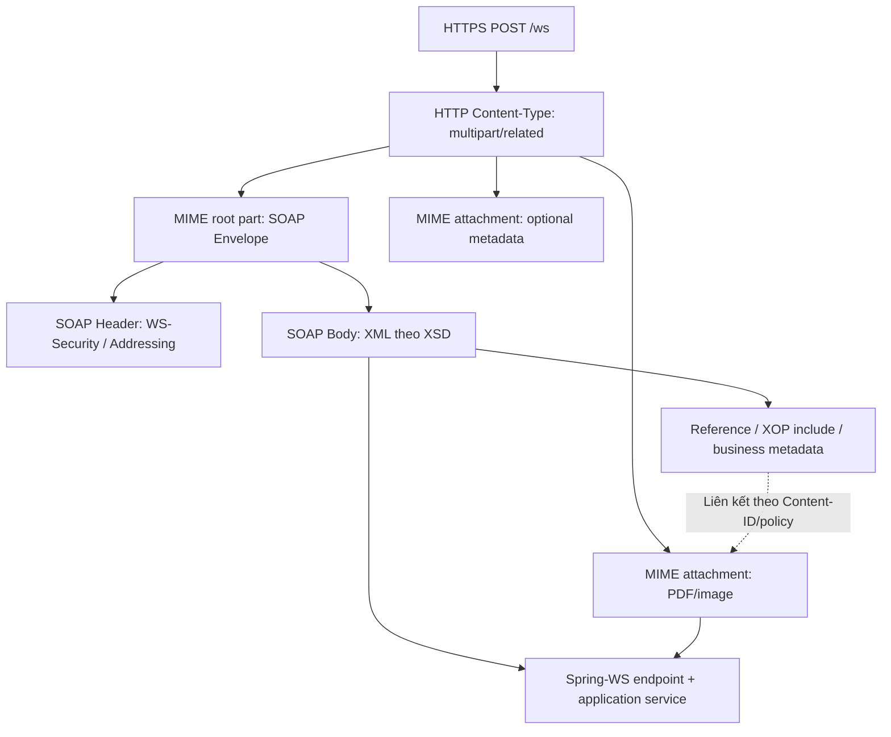
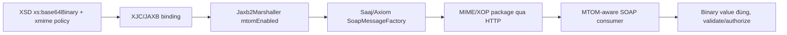
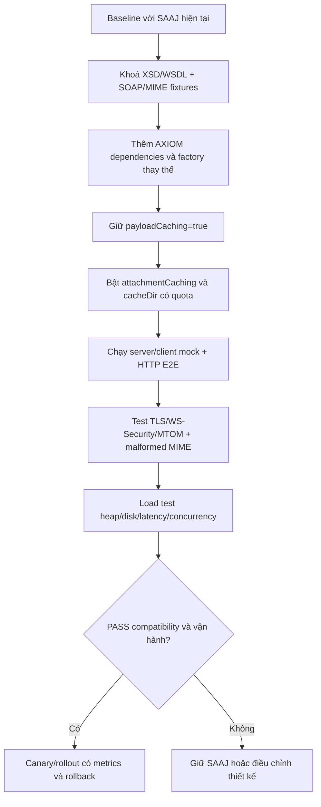
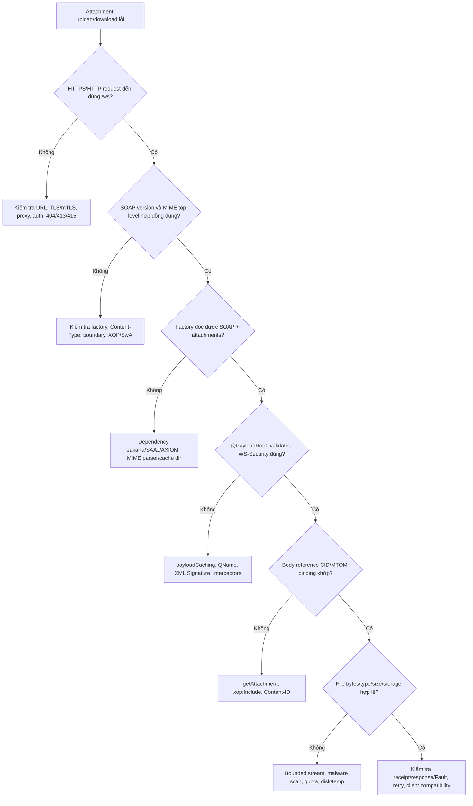

# Cấu hình message factory hỗ trợ tệp đính kèm theo phiên bản

## 1. Tại sao chọn message factory là quyết định quan trọng khi SOAP có tệp đính kèm?

Trong module **SPRING_WEB_SERVICES**, một dịch vụ SOAP theo hướng **contract-first** sử dụng **XSD/WSDL** để thống nhất thông điệp, **JAXB/OXM** để ánh xạ XML thành đối tượng Java, `@Endpoint` và `WebServiceTemplate` để xử lý và gọi dịch vụ, còn các interceptor xử lý **SOAP Fault, XML security, WS-Security, chứng chỉ và kiểm thử tương thích**. Khi thông điệp mang một tệp PDF, hình ảnh, tài liệu scan hoặc chứng từ nhị phân lớn, chỉ biết cách marshal XML không còn đủ.

Spring Web Services dùng **`WebServiceMessageFactory`** để tạo và đọc SOAP message. Factory quyết định kiểu triển khai `SoapMessage`, cách parse/serialize Envelope và khả năng xử lý **MIME attachments**. Hai lựa chọn phổ biến là:

- **`SaajSoapMessageFactory`**: sử dụng API **SOAP with Attachments (SAAJ)**, dễ phù hợp với các tích hợp SOAP thông thường; SAAJ dựa nhiều trên mô hình DOM nên cần đánh giá bộ nhớ với thông điệp lớn.
- **`AxiomSoapMessageFactory`**: dựa trên **AXIOM/StAX**, có các tùy chọn **payload caching**, **attachment caching**, ngưỡng lưu tệp lớn xuống đĩa. Nó có thể phù hợp với khối lượng dữ liệu lớn, nhưng một số chế độ streaming **không tương thích** với mapping/interceptor cần đọc payload nhiều lần.

Điểm mấu chốt: **cả hai có thể hỗ trợ tệp đính kèm** khi dependency, SOAP version và cấu hình phù hợp. Không nên đánh đồng “có tệp đính kèm” với “bắt buộc dùng AXIOM” hoặc “cứ đổi factory là tự có MTOM”.

### Mục tiêu học tập

Sau bài thuộc chương **Tệp đính kèm**, bạn sẽ:

1. Phân biệt **SwA/MIME attachment**, **MTOM/XOP** và `xs:base64Binary` nội tuyến.
2. Hiểu `WebServiceMessageFactory`, `SoapMessageFactory`, `MimeMessage`, `Attachment` và vai trò của JAXB `Jaxb2Marshaller`.
3. Chọn và cấu hình **SAAJ** hoặc **AXIOM** theo **Spring-WS generation**, **SOAP 1.1/1.2** và nhu cầu bộ nhớ.
4. Giải thích chính xác ý nghĩa `setAttachmentCaching`, `setAttachmentCacheThreshold`, `setPayloadCaching` và điểm xung đột với `@PayloadRoot`.
5. Viết client/server Spring-WS gửi, nhận và kiểm tra tệp đính kèm qua `MimeMessage`/`MessageContext`.
6. Thiết kế JAXB MTOM từ XSD, không để binary data vô tình trở thành chuỗi base64 khổng lồ.
7. Kiểm thử MIME headers, `Content-ID`, lỗi thiếu tệp, attachment lớn, WS-Security, chứng chỉ, SOAP Fault và khả năng tương thích với đối tác.

> **Nguyên tắc:** Message factory và JAXB marshaller là **hai quyết định khác nhau**. Factory tạo/đọc SOAP Envelope cùng MIME parts; JAXB ánh xạ payload XML và có thể phối hợp MTOM theo hợp đồng. Cần cấu hình và kiểm thử **cả hai**.

## 2. Tệp đính kèm nằm ở đâu trong một SOAP message?

Một SOAP request thông thường có **HTTP headers** và một **SOAP Envelope**. Với tệp nhị phân, HTTP entity có thể trở thành **MIME multipart package**, trong đó root part là SOAP/XML và một hoặc nhiều part khác chứa nhị phân.



Hình trên là **sơ đồ khái niệm**, không phải khẳng định mọi attachment đều có một `xop:Include` trong SOAP Body. Cách tham chiếu attachment phụ thuộc **SwA hay MTOM/XOP** và contract đã công bố.

### 2.1. Vai trò của các API Spring-WS

| API | Vai trò chính |
| --- | --- |
| `WebServiceMessageFactory` | Tạo message mới hoặc đọc message từ `InputStream`; không phải service nghiệp vụ. |
| `SoapMessageFactory` | Factory SOAP với thuộc tính `soapVersion`; các implementation gồm SAAJ và AXIOM. |
| `SoapMessage` | Đại diện SOAP Envelope, Header, Body, Fault, SOAPAction; cũng là `MimeMessage`. |
| `MimeMessage` | Truy cập/tạo attachments qua `addAttachment(...)`, `getAttachment(...)`, `getAttachments()`; hỗ trợ thông tin XOP package. |
| `Attachment` | Truy cập `contentId`, `contentType`, `size`, `InputStream` hoặc `DataHandler` của một MIME part. |
| `Jaxb2Marshaller` | Marshal/unmarshal XML payload; `mtomEnabled` hỗ trợ tối ưu binary field theo điều kiện binding. |
| `WebServiceTemplate` | Tạo request bằng factory, gọi HTTP sender, xử lý SOAP response/Fault. |
| `MessageContext` | Cho endpoint/interceptor truy cập SOAP request và response đang xử lý. |

Các tên API được dùng theo thế hệ **Spring Web Services 4.1.x / Spring Framework 6+** với các kiểu Jakarta tương ứng; ở phiên bản cũ cần kiểm tra dependency/package tương thích.

### 2.2. Content-Type của MIME package không giống Content-Type của từng part

Một HTTP request SOAP 1.1 **không có attachment** thường dùng:

```http
Content-Type: text/xml; charset=utf-8
SOAPAction: "https://example.com/documents/UploadDocument"
```

Khi có MIME parts, top-level `Content-Type` có thể là:

```http
Content-Type: multipart/related; boundary="----soap-boundary-01"; type="text/xml"; start="<soap-root@example.org>"
```

Mỗi MIME part sẽ có `Content-Type` riêng (ví dụ `text/xml` hoặc `application/pdf`) cùng `Content-ID`. Không được dùng HTTP `Content-Type: application/pdf` cho **cả** SOAP request chỉ vì Body có một attachment PDF.

Tương tự, với **MTOM/XOP**, top-level thường là `multipart/related` với `type="application/xop+xml"`, còn SOAP binding thật được thể hiện qua `start-info` và root part parameters.

## 3. Phân biệt inline base64, SOAP with Attachments và MTOM/XOP

Trước khi chọn factory, cần biết **dạng payload mà XSD/WSDL và đối tác yêu cầu**.

### 3.1. Inline base64Binary: dễ dùng nhưng phình XML

Ví dụ XSD:

```xml
<xs:element name="documentData" type="xs:base64Binary"/>
```

XML sau khi marshal có thể chứa:

```xml
<doc:documentData>JVBERi0xLjQKJcfs...</doc:documentData>
```

Base64 làm tăng kích thước dữ liệu nhị phân **xấp xỉ một phần ba** trước khi xét XML, headers, compression và các buffer trung gian. Một `byte[]` JAXB lớn cũng có thể gây áp lực heap vì ứng dụng giữ toàn bộ nội dung và marshaller tạo representation khác.

**Phù hợp:** binary nhỏ, contract/stack chỉ hỗ trợ inline base64, chi phí tài nguyên đã được đo. **Không phù hợp mặc định:** PDF hàng trăm MB với nhiều request đồng thời.

### 3.2. SwA: các MIME parts là attachments của SOAP message

**SOAP with Attachments (SwA)** đặt SOAP Envelope trong một MIME part và gửi những phần khác như attachment. Spring-WS hỗ trợ thao tác thông qua `MimeMessage`.

Với SwA, một application có thể tự định nghĩa Body metadata, ví dụ:

```xml
<doc:UploadDocumentRequest
    xmlns:doc="https://example.com/documents/v1">
    <doc:documentId>DOC-2026-001</doc:documentId>
    <doc:attachmentCid>cid:report-001@example.org</doc:attachmentCid>
</doc:UploadDocumentRequest>
```

**Ràng buộc ở đây do hợp đồng ứng dụng định nghĩa:** chỉ có text `cid:...` trong XML **không tự liên kết** với `MimeMessage.getAttachment(...)`; server phải đối chiếu nó với `Content-ID` thực tế, kiểm tra sự tồn tại và quyền truy cập. WSDL/XSD cần thể hiện quy tắc này nếu muốn client của nhiều công nghệ tương tác ổn định.

Một số hệ thống dùng **WS-I Attachments Profile/swaRef** để mô tả tham chiếu attachment; cách làm cụ thể phụ thuộc WSDL binding và toolchain. Không coi mọi client sinh từ WSDL bất kỳ đều tự hiểu SwA.

### 3.3. MTOM/XOP: tối ưu phần tử kiểu binary trong XML Infoset

**MTOM (Message Transmission Optimization Mechanism)** kết hợp với **XOP (XML-binary Optimized Packaging)** để cho phép một phần dữ liệu `xs:base64Binary` được truyền dưới dạng MIME part nhưng vẫn giữ ý nghĩa XML Infoset của phần tử theo schema.

Ví dụ XML trong root MIME part ở dạng XOP:

```xml
<doc:UploadDocumentRequest
    xmlns:doc="https://example.com/documents/v1"
    xmlns:xop="http://www.w3.org/2004/08/xop/include">
    <doc:documentId>DOC-2026-001</doc:documentId>
    <doc:content>
        <xop:Include href="cid:binary-001@example.org"/>
    </doc:content>
</doc:UploadDocumentRequest>
```

Khi truyền MTOM, `xop:Include` tham chiếu MIME part chứa binary; **XSD nghiệp vụ vẫn mô tả `doc:content` như binary data**, không đơn giản khai `xop:Include` làm element thông thường trong XSD contract. Máy nhận MTOM-aware dựng lại giá trị logic theo Infoset/stack.

**MTOM không phải SwA tùy ý:** SwA có thể chứa MIME parts độc lập với một phần tử `base64Binary`, còn MTOM ràng buộc tối ưu nội dung nhị phân của XML element. Hai hệ thống “đều hỗ trợ attachment” nhưng khác mô hình vẫn có thể **không tương thích**.

### 3.4. Bảng quyết định nhanh

| Tiêu chí | Inline base64 | SwA / MIME attachments | MTOM/XOP |
| --- | --- | --- | --- |
| XML Body chứa binary | Base64 text. | Thường chứa metadata/reference theo contract, file ở part riêng. | Binary logic theo XSD, wire XML có thể chứa `xop:Include`. |
| HTTP top-level MIME | SOAP media type bình thường. | `multipart/related`. | `multipart/related` với XOP media type/parameters. |
| JAXB integration | Dễ bind `byte[]` nhưng tốn heap. | Thường tự thao tác `MimeMessage`, hoặc binding/tooling hỗ trợ SwA. | `Jaxb2Marshaller.setMtomEnabled(true)` cùng binary binding hợp lệ. |
| Điều kiện client | Hiểu XML/XSD và base64. | Hiểu MIME attachment và cách Body tham chiếu. | Hiểu MTOM/XOP và phải thống nhất policy. |
| Kích thước phù hợp | Nhỏ/vừa; phải benchmark. | Có thể cho file lớn tùy factory/storage. | Có thể tối ưu binary lớn, tùy stack và buffering. |
| Rủi ro | Base64 phình dữ liệu, giữ `byte[]` lớn. | MIME CID mismatch, orphan attachment, file lifecycle. | MTOM mismatch, XOP namespace/MIME parameters, chữ ký. |

**Bắt đầu từ contract.** Đừng bật MTOM trên server mà chưa thống nhất WSDL/XSD, generated client, SOAP version và chính sách bảo mật với đối tác.

## 4. Chọn message factory theo phiên bản: có ba “phiên bản” cần tách

Trong tiêu đề bài, **“theo phiên bản”** cần hiểu rõ **ba trục độc lập**:

1. **Phiên bản Spring Web Services / Spring / Jakarta API**, quyết định dependency, package class và implementation khả dụng.
2. **Phiên bản SOAP 1.1 hay SOAP 1.2**, quyết định Envelope namespace, Content-Type/action binding và Fault format.
3. **Phiên bản hợp đồng XSD/WSDL của đối tác**, quyết định binary element/MTOM/SwA, namespace và khả năng client đã sinh code.

Không thể suy “Spring-WS 4.x nghĩa là SOAP 1.2” hoặc “dùng Jakarta nghĩa là MTOM tự được bật”. Những phiên bản này phải được cấu hình, kiểm tra và version hóa riêng.

### 4.1. Theo Spring-WS generation và Java API

| Ngữ cảnh triển khai | SOAP factory cần xem xét | Package ecosystem cần đồng bộ |
| --- | --- | --- |
| Spring-WS thế hệ cũ (thường 2.x/3.x) | `SaajSoapMessageFactory` hoặc `AxiomSoapMessageFactory` theo dependencies thực tế. | Thường `javax.xml.soap`, `javax.activation`, `javax.xml.bind`; xác minh version chính xác. |
| Spring-WS 4.x (Spring Framework 6+, Jakarta) | `SaajSoapMessageFactory`; `AxiomSoapMessageFactory` khi artifact/dependencies AXIOM khả dụng. | `jakarta.xml.soap`, `jakarta.activation`, `jakarta.xml.bind` và implementation tương thích. |
| Ứng dụng Spring Boot auto-config | Kiểm tra factory bean đang được container/`WebServiceTemplate` sử dụng. | Không tạo factory thứ hai ngoài ý muốn hoặc phụ thuộc auto-config mà chưa kiểm tra. |

**Quan trọng:** AxiomSoapMessageFactory vẫn có Javadoc và support trong nhánh Spring-WS 4.1.x; không nên ghi nhớ máy móc rằng “đã bị xóa ở 4.x”. Ngược lại, **có class trong một phiên bản không có nghĩa project đã tải đủ AXIOM dependencies** hoặc hỗ trợ mọi hành vi streaming qua SOAP security/interceptors.

**Không trộn** mã sinh JAXB dùng `javax.xml.bind` và runtime chỉ hỗ trợ `jakarta.xml.bind`. Việc nâng Boot/Spring-WS có thể cần regenerate JAXB và rà lại SAAJ/Activation provider; không phải chỉ đổi một import.

### 4.2. Theo SOAP version

| Thuộc tính | SOAP 1.1 | SOAP 1.2 |
| --- | --- | --- |
| Factory `soapVersion` | `SoapVersion.SOAP_11` | `SoapVersion.SOAP_12` |
| Envelope namespace | `http://schemas.xmlsoap.org/soap/envelope/` | `http://www.w3.org/2003/05/soap-envelope` |
| HTTP media type không multipart | `text/xml` | `application/soap+xml` |
| Action theo HTTP binding thông dụng | Header `SOAPAction` | `action` parameter của `application/soap+xml` khi có. |
| SOAP Fault | `faultcode`/`faultstring`/`detail` | `Code`/`Reason`/`Detail` |
| Tệp đính kèm | SwA hoặc MTOM theo contract. | SwA/MTOM theo contract với MIME binding tương ứng. |

**Đổi SOAP 1.1 sang SOAP 1.2 không chỉ là đổi factory property**: WSDL binding, Content-Type/MIME root part, Fault, HTTP sender, WS-Security policy và client phải tương thích với phiên bản mới.

### 4.3. Theo contract version

Ví dụ XSD v1 dùng:

```xml
<xs:element name="content" type="xs:base64Binary"/>
```

Việc chuyển từ inline base64 sang MTOM **có thể giữ nguyên XML Infoset logic** nếu client hỗ trợ MTOM và WSDL/policy đồng thuận. Nhưng đối tác cũ chỉ hiểu inline base64 có thể không giải mã được MIME/XOP package. Với SwA, thay đổi Body reference từ string thành `cid:...` cũng có thể là **thay đổi hợp đồng thực sự**.

Vì vậy cần test cả **producer mới ↔ consumer cũ chưa regenerate**, không chỉ test hai phía đều nâng cấp cùng lúc.

## 5. SaajSoapMessageFactory: lựa chọn cơ bản có MIME attachments

### 5.1. SAAJ dùng DOM nhưng không có nghĩa “không hỗ trợ file”

`SaajSoapMessageFactory` sử dụng Jakarta/Javax **SOAP with Attachments API for Java**; sản phẩm là `SaajSoapMessage`, vốn hỗ trợ `MimeMessage`. Nó có thể `addAttachment`, `getAttachment` và làm việc với multipart SOAP messages. Với SOAP services quy mô nhỏ/vừa hoặc hệ thống có sẵn SAAJ, đây thường là cách triển khai dễ tích hợp.

**Giới hạn hiệu năng:** SAAJ dựa vào DOM cho SOAP message, nên có chi phí bộ nhớ với Envelope/Body lớn. Attachment cũng có thể được giữ hoặc materialize tùy provider và cách sử dụng, vì vậy đừng kết luận file lớn chắc chắn được stream ra đĩa chỉ vì factory tên SAAJ.

### 5.2. Cấu hình SOAP 1.1 server với bean messageFactory

```java
import org.springframework.context.annotation.Bean;
import org.springframework.context.annotation.Configuration;
import org.springframework.ws.soap.SoapVersion;
import org.springframework.ws.soap.saaj.SaajSoapMessageFactory;

@Configuration
public class SaajMessageFactoryConfig {

    @Bean("messageFactory")
    public SaajSoapMessageFactory messageFactory() {
        SaajSoapMessageFactory factory =
            new SaajSoapMessageFactory();
        factory.setSoapVersion(SoapVersion.SOAP_11);
        return factory;
    }
}
```

Đây là cấu hình **minh họa cho server có Spring-WS infrastructure**, giả định `@EnableWs`, `MessageDispatcherServlet`, endpoint mapping và XSD/WSDL đã được cấu hình riêng. Tên bean `messageFactory` quan trọng đối với cách `MessageDispatcherServlet` tìm factory trong các cấu hình truyền thống; nếu ứng dụng dùng Spring Boot auto-configuration hoặc servlet context khác, phải kiểm tra bean **thực sự được chọn**.

**Chỉ đăng ký một lựa chọn factory phục vụ một dispatcher khi không có chiến lược định tuyến riêng.** Không thêm cả bean SAAJ và AXIOM cùng tên rồi mong Spring tự quyết định theo kích thước file gửi tới.

### 5.3. SOAP 1.2 với SAAJ

```java
@Bean("messageFactory")
public SaajSoapMessageFactory soap12MessageFactory() {
    SaajSoapMessageFactory factory =
        new SaajSoapMessageFactory();
    factory.setSoapVersion(SoapVersion.SOAP_12);
    return factory;
}
```

**Đây là một phương án thay thế** cấu hình SOAP 1.1 ở trên, không phải bean thứ hai trùng tên trong cùng context. Nó chỉ chạy khi provider SAAJ hỗ trợ SOAP 1.2 và hạ tầng WSDL/transport/security đi cùng.

Nếu dùng constructor truyền một `jakarta.xml.soap.MessageFactory` đã tạo sẵn vào `SaajSoapMessageFactory`, cấu hình SOAP version có thể **phụ thuộc vào chính MessageFactory được inject**, và setter `setSoapVersion(...)` không nhất thiết còn tác dụng. Hãy đối chiếu Javadoc đúng phiên bản và test Envelope/MIME thực tế.

### 5.4. Dependency và runtime generation

Với thế hệ Jakarta (Spring-WS 4.x), bạn cần dependency tương thích cho **Jakarta XML SOAP API + SAAJ implementation**, **Jakarta Activation API + provider** nếu dùng attachments/DataHandler, và JAXB API/runtime khi sử dụng OXM. Cách khai báo cụ thể do **Spring Boot dependency management / BOM / build tool** của dự án kiểm soát.

Không tạo một ma trận version số giả định từ tên package; trong project thật hãy xác minh:

- Classpath có `SaajSoapMessageFactory` và `jakarta.xml.soap.MessageFactory` implementation phù hợp không?
- `Jaxb2Marshaller` có runtime Jakarta JAXB provider không?
- `jakarta.activation.DataHandler` có provider hỗ trợ MIME dữ liệu không?
- SOAP message factory có tạo được SOAP 1.1/1.2 message và gửi/nhận attachment thành công không?
- Nếu nâng từ javax sang Jakarta, generated XJC classes và code dùng SAAJ `AttachmentPart` có được chuyển đồng bộ không?

**Một lỗi class-loading `ClassNotFoundException`/`NoClassDefFoundError` ở SOAP factory thường là vấn đề dependency generation**, không nên “sửa” bằng cách đổi XSD.

## 6. AxiomSoapMessageFactory: attachment caching và streaming phải cấu hình riêng

AXIOM dùng **AXis Object Model**, có nền tảng **StAX**. Spring-WS cung cấp `AxiomSoapMessageFactory` để tạo SOAP message. Khi nhận/gửi tài liệu nhị phân lớn, AXIOM có các cấu hình hữu ích để giảm áp lực bộ nhớ, đặc biệt khả năng **cache attachment lớn trên đĩa**.

### 6.1. Bốn thuộc tính không được nhầm lẫn

| Thuộc tính | Giá trị mặc định theo Javadoc 4.1.x | Ảnh hưởng |
| --- | --- | --- |
| `payloadCaching` | `true` | Cho phép payload SOAP Body được đọc lại khi mapping/interceptor cần; `false` có thể tối ưu đọc một lần nhưng làm nhiều thành phần Spring-WS không dùng được. |
| `attachmentCaching` | `false` | Khi `true`, AXIOM có thể cache **attachment lớn** xuống đĩa thay vì giữ trong memory, theo ngưỡng. |
| `attachmentCacheThreshold` | `4096` byte | Ngưỡng nhận diện attachment đủ lớn để cache xuống đĩa khi attachment caching bật. |
| `attachmentCacheDir` | Thư mục tạm hệ điều hành | Vị trí tệp cache; cần tồn tại, có thể ghi và được bảo vệ về quyền/dung lượng. |

**Hai cơ chế độc lập:**

- `payloadCaching`: liên quan **SOAP Body payload XML**, tác động mapping/interceptor/validator.
- `attachmentCaching`: liên quan **MIME attachment content** và vị trí giữ dữ liệu nhị phân.

Đặt `attachmentCaching=true` **không đòi** `payloadCaching=false`. Với dịch vụ chủ yếu dùng `@PayloadRoot`, thường nên **giữ `payloadCaching=true`** trừ khi đã thiết kế lại toàn bộ endpoint mapping và interceptor.

### 6.2. Java configuration cho AXIOM và thư mục cache

```java
import java.io.File;
import org.springframework.context.annotation.Bean;
import org.springframework.context.annotation.Configuration;
import org.springframework.core.env.Environment;
import org.springframework.ws.soap.SoapVersion;
import org.springframework.ws.soap.axiom.AxiomSoapMessageFactory;

@Configuration
public class AxiomMessageFactoryConfig {

    @Bean("messageFactory")
    public AxiomSoapMessageFactory messageFactory(Environment environment) {
        String cachePath = environment.getRequiredProperty(
            "soap.attachments.cache-dir");
        File directory = new File(cachePath);
        if (!directory.isDirectory() || !directory.canWrite()) {
            throw new IllegalStateException(
                "Thư mục lưu attachment cache không sẵn sàng");
        }

        AxiomSoapMessageFactory factory =
            new AxiomSoapMessageFactory();
        factory.setSoapVersion(SoapVersion.SOAP_11);

        // Tệp lớn hơn ngưỡng có thể được cache xuống disk.
        factory.setAttachmentCaching(true);
        factory.setAttachmentCacheDir(directory);
        factory.setAttachmentCacheThreshold(256 * 1024);

        // Quan trọng khi dùng @PayloadRoot/validator/log interceptor.
        factory.setPayloadCaching(true);

        // Không cho phép đọc external entities từ XML không tin cậy.
        factory.setSupportingExternalEntities(false);
        return factory;
    }
}
```

Đây là **cấu hình thay thế cho SAAJ** ở mục 5, **không đăng ký hai bean cùng tên**. Giá trị `256 * 1024` (256 KiB) chỉ minh họa, **không phải ngưỡng tối ưu cho mọi dự án**. Hãy chọn theo heap, disk throughput, concurrency, kích thước trung bình và lớn nhất của file, chi phí bảo mật, tải thực tế.

Đối với môi trường Windows/containers, property `soap.attachments.cache-dir` phải được cấu hình bằng đường dẫn thực có quyền ghi và đủ dung lượng; ví dụ này cố ý **không hard-code** `/tmp` hoặc một ổ đĩa cố định.

### 6.3. Sai lầm thường gặp: tắt payloadCaching để “streaming mọi thứ”

```java
// KHÔNG sử dụng cấu hình này với @PayloadRoot/validator như mặc định.
factory.setPayloadCaching(false);
```

Theo tài liệu Spring-WS của `AxiomSoapMessageFactory`, khi `payloadCaching=false`, SOAP Body được đọc trực tiếp theo stream và **chỉ có thể tiêu thụ một lần**. Những thành phần như:

- `PayloadRootAnnotationMethodEndpointMapping`;
- `PayloadValidatingInterceptor`;
- `PayloadLoggingInterceptor`;
- Các interceptor/mapping tự viết dùng `getPayloadSource()` để đọc trước;

đều có thể cần đọc XML payload. **Chúng không tương thích với cơ chế đọc một lần theo cách sử dụng thông thường**. Nếu metadata QName đã bị consume ở bước mapping, endpoint có thể không còn dữ liệu để unmarshalling.

Spring-WS gợi ý với chế độ này dùng endpoint mapping **không tiêu thụ Body**, chẳng hạn `SoapActionAnnotationMethodEndpointMapping`, nhưng:

1. Cần xác minh SOAP action của contract/WSDL và endpoint được chọn đúng.
2. Không dùng SOAPAction như bằng chứng xác thực/authorization.
3. Nếu cần XSD validation, phải thiết kế pipeline khác, không đơn thuần bỏ qua validation để chạy stream.
4. Security/XML Signature và logging có thể vẫn cần materialize payload.
5. Test phải chứng minh dữ liệu được đọc **đúng một lần** mà vẫn đáp ứng quy tắc nghiệp vụ.

**Chốt ý:** cần giảm heap do file lớn thì **thử attachment caching trước**; đừng mặc định tắt `payloadCaching`. Hai vấn đề này khác nhau.

### 6.4. Quản lý disk cache là trách nhiệm vận hành

Khi attachment được spool/cache xuống disk:

- Thư mục phải **không public**, hạn chế quyền đọc/ghi theo process account.
- Không để dữ liệu nhạy cảm nằm trên shared volume không kiểm soát; cân nhắc encryption at rest theo chính sách.
- Giới hạn **disk quota, inode count, tổng byte, số request đồng thời** và dung lượng tối đa cho mỗi file.
- Kiểm soát vòng đời cleanup khi kết thúc request, lỗi parser/WS-Security, timeout, hủy kết nối hoặc restart.
- Test thử thư mục đầy, không có quyền ghi, quota hết hoặc volume tạm bị mất.
- Không tin tên file do client cung cấp để tạo đường dẫn cache; chỉ dùng ID/path server kiểm soát.
- Quan sát disk I/O, thời gian parse, heap, GC, latency, orphan temporary files và tác động tới container/node.

**Attachment caching không phải cơ chế lưu file nghiệp vụ.** Một bản scan đã được chấp nhận cần được ghi bằng storage service có policy xác minh/retention/idempotency riêng. Tệp cache trung gian có thể bị xóa khi SOAP message kết thúc; không giữ path cache làm bản ghi business.

### 6.5. Hiểu giới hạn “streaming end-to-end”

Ngay cả AXIOM/StAX không tự bảo đảm bộ nhớ ổn định nếu:

- SOAP security xử lý **XML Signature/canonicalization** qua DOM;
- XSD validator/interceptor cần đọc Body nhiều lần;
- Application service đọc attachment vào `byte[]` hoặc `ByteArrayOutputStream`;
- API logging in toàn bộ SOAP/MIME package thành `String`;
- JAXB bind dữ liệu XML dài thành `List`;
- Reverse proxy buffer request/response trước khi chuyển đi;
- HTTP client cần retry và phải lưu lại message không thể đọc lại;
- Bộ tạo response xuất một tài liệu lớn rồi gặp lỗi sau khi HTTP stream đã commit.

Vì vậy “Axiom + `payloadCaching=false`” không phải công thức mặc định. **Benchmark với đúng SOAP stack, WS-Security policy, proxy, message factory, marshaller và concurrency**.

## 7. Đặt message factory ở đúng nơi: server khác client

### 7.1. Luồng server

Ở server, `MessageDispatcherServlet` lấy message factory trong Spring context tương ứng để:

1. Đọc SOAP request từ HTTP transport.
2. Giải mã MIME package/attachments thành `SoapMessage` hỗ trợ `MimeMessage`.
3. Chạy SOAP security/interceptors và endpoint mappings.
4. Gọi endpoint xử lý Body và attachment.
5. Tạo SOAP response/Fault cùng MIME parts tương ứng nếu có.

Ví dụ server infrastructure:

```java
import org.springframework.boot.web.servlet.ServletRegistrationBean;
import org.springframework.context.ApplicationContext;
import org.springframework.context.annotation.Bean;
import org.springframework.context.annotation.Configuration;
import org.springframework.ws.config.annotation.EnableWs;
import org.springframework.ws.transport.http.MessageDispatcherServlet;

@EnableWs
@Configuration
public class DocumentSoapServerConfig {
    @Bean
    public ServletRegistrationBean<MessageDispatcherServlet>
            documentSoapServlet(ApplicationContext context) {
        MessageDispatcherServlet servlet =
            new MessageDispatcherServlet();
        servlet.setApplicationContext(context);
        servlet.setTransformWsdlLocations(true);
        return new ServletRegistrationBean<>(servlet, "/ws/*");
    }
}
```

Kết hợp lớp trên với **một** cấu hình `@Bean("messageFactory")` tương ứng SAAJ/AXIOM, `@Endpoint`, XSD/WSDL và security interceptor. Đó là hai đoạn code của một application Spring Boot dùng servlet transport, không phải WSDL/endpoint đầy đủ.

Một ứng dụng có nhiều servlet hoặc Spring contexts cần xem **factory nào nằm trong context nào**. Đặt một bean có tên `messageFactory` ở context khác không chứng minh servlet nhận được nó. Tốt nhất kiểm tra bean thực và phát một request MIME attachment qua HTTP.

### 7.2. Luồng client

Ở client, `WebServiceTemplate` có thể được tạo với factory đã chọn:

```java
import org.springframework.beans.factory.annotation.Qualifier;
import org.springframework.context.annotation.Bean;
import org.springframework.context.annotation.Configuration;
import org.springframework.oxm.jaxb.Jaxb2Marshaller;
import org.springframework.ws.client.core.WebServiceTemplate;
import org.springframework.ws.soap.saaj.SaajSoapMessageFactory;

@Configuration
public class DocumentSoapClientConfig {

    @Bean
    public Jaxb2Marshaller documentMarshaller() {
        Jaxb2Marshaller binding = new Jaxb2Marshaller();
        binding.setContextPath("com.example.documents.contract.v1");
        return binding;
    }

    @Bean
    public WebServiceTemplate documentTemplate(
            @Qualifier("soap11ClientFactory")
            SaajSoapMessageFactory clientFactory,
            Jaxb2Marshaller documentMarshaller) {
        WebServiceTemplate template =
            new WebServiceTemplate(clientFactory);
        template.setMarshaller(documentMarshaller);
        template.setUnmarshaller(documentMarshaller);
        return template;
    }
}
```

Đoạn này **giả định** có bean `soap11ClientFactory` đã được đăng ký. Nếu server cũng có `messageFactory`, qualifier giúp tránh inject nhầm bean server vào template client.

**Client và server không bắt buộc dùng cùng một implementation factory.** Một SAAJ client có thể gọi AXIOM server qua SOAP/MIME contract đúng; Spring-WS và Java implementation ở hai phía là chi tiết nội bộ. Thứ cần thống nhất là **SOAP version, WSDL/XSD, MIME/MTOM, WS-Security và truyền tải**.

### 7.3. Có thể cấu hình SOAP 1.1 và SOAP 1.2 cùng lúc không?

Có thể có **hai WebServiceTemplate riêng** trên client, mỗi template dùng factory tương ứng:

```text
WebServiceTemplate SOAP 1.1
  → SaajSoapMessageFactory(SOAP_11)
  → WSDL/HTTP SOAP 1.1 binding

WebServiceTemplate SOAP 1.2
  → SaajSoapMessageFactory(SOAP_12)
  → WSDL/HTTP SOAP 1.2 binding
```

Ở server, một `SaajSoapMessageFactory` với `setSoapVersion(SOAP_11)` **không tự hỗ trợ đồng thời mọi SOAP versions**. Nếu muốn công bố cả hai, phải thiết kế đường nhận factory/servlet hoặc cấu hình stack hỗ trợ cụ thể và kiểm thử từng binding, Header, Fault và MTOM. Đừng đặt `setSoapVersion(SOAP_12)` rồi kỳ vọng client SOAP 1.1 tiếp tục gọi như cũ.

### 7.4. Không tự set multipart Content-Type theo tên factory

Factory phải phối hợp serializer và HTTP sender để tạo MIME boundary, root part `Content-ID`, Content-Type/Content-Transfer-Encoding và body bytes đúng. Application code không nên tự gắn:

```http
Content-Type: multipart/related; boundary="hard-coded"
```

nếu SOAP message factory đang tạo package với một boundary khác. Hãy dùng **Spring-WS `MimeMessage`/MTOM API**, để stack chịu trách nhiệm MIME serialization rồi kiểm tra headers thực tế ở wire-level tests.

## 8. Gửi tệp đính kèm SwA bằng WebServiceTemplate

Giả sử dịch vụ `UploadDocument` có một request JAXB chỉ chứa metadata:

```xml
<doc:UploadDocumentRequest
    xmlns:doc="https://example.com/documents/v1">
    <doc:documentId>DOC-2026-001</doc:documentId>
    <doc:attachmentCid>cid:report-001@example.org</doc:attachmentCid>
</doc:UploadDocumentRequest>
```

Trong XSD, `attachmentCid` có thể khai báo `xs:anyURI` hoặc một kiểu string được giới hạn theo chính sách, nhưng phải mô tả rõ **đây là tham chiếu CID của MIME attachment** và server sẽ kiểm tra sự tồn tại/trùng khớp. Nếu hai đối tác hỗ trợ WS-I swaRef, có thể xem xét kiểu binding đã được profile tiêu chuẩn hóa thay vì quy ước riêng.

### 8.1. Client dùng WebServiceMessageCallback để gắn MIME part

```java
import java.nio.file.Path;
import org.springframework.core.io.FileSystemResource;
import org.springframework.ws.client.core.WebServiceTemplate;
import org.springframework.ws.soap.SoapMessage;

public final class DocumentSoapClient {
    private final WebServiceTemplate template;

    public DocumentSoapClient(WebServiceTemplate template) {
        this.template = template;
    }

    public UploadDocumentResponse upload(
            Path filePath,
            String documentId) {

        String cid = "report-001@example.org";
        UploadDocumentRequest request = new UploadDocumentRequest();
        request.setDocumentId(documentId);
        request.setAttachmentCid("cid:" + cid);

        Object received = template.marshalSendAndReceive(
            "https://api.example.com/ws",
            request,
            message -> {
                SoapMessage soap = (SoapMessage) message;
                soap.setSoapAction(
                    "https://example.com/documents/UploadDocument");
                soap.addAttachment(
                    cid,
                    new FileSystemResource(filePath),
                    "application/pdf"
                );
            }
        );
        return (UploadDocumentResponse) received;
    }
}
```

Ví dụ này minh họa **SwA/manual MIME attachment**, không phải JAXB MTOM. Những điều kiện cần được đặt rõ:

- `UploadDocumentRequest`/`UploadDocumentResponse` là các lớp giả định sinh từ XSD, `WebServiceTemplate` đã có factory SOAP + marshaller/unmarshaller phù hợp.
- `SoapMessage` là `MimeMessage`, có `addAttachment(contentId, InputStreamSource, contentType)`.
- `FileSystemResource` có khả năng cấp một `InputStream` mới khi được yêu cầu; tài liệu Spring-WS lưu ý **`InputStreamSource.getInputStream()` có thể được gọi nhiều lần**. Không truyền một nguồn chỉ đọc được một lần nếu factory/sender còn cần đọc lại.
- `filePath` phải trỏ đến tệp **được ứng dụng cho phép sử dụng**, tồn tại trong suốt quá trình marshalling/gửi; không nhận đường dẫn file tùy ý của người dùng rồi mở trực tiếp.
- `cid` thực tế phải **duy nhất và khớp reference** trong SOAP Body; ví dụ dùng ID cố định để dễ đọc, không phải quy tắc cho production.
- Khi sử dụng SOAP 1.2, action/binding phải theo SOAP 1.2; `soap.setSoapAction(...)` là API khái niệm, cần test actual MIME/HTTP action do factory tạo.

**Không tự ghép multipart body bằng chuỗi**. Spring-WS và HTTP sender sẽ quản lý MIME boundaries, content transfer encoding, `Content-ID` của các parts và HTTP entity headers tương ứng.

### 8.2. Vì sao không dùng ByteArrayResource cho mọi file?

`ByteArrayResource` đơn giản với một test chứa vài byte:

```java
byte[] testPdfHeader = "%PDF-1.7\n".getBytes(
    java.nio.charset.StandardCharsets.US_ASCII);
soap.addAttachment(
    "test-001@example.org",
    new org.springframework.core.io.ByteArrayResource(testPdfHeader),
    "application/pdf");
```

Nhưng `ByteArrayResource` giữ **toàn bộ dữ liệu trong heap**. Với tệp lớn và nhiều request đồng thời, điều này có thể triệt tiêu lợi ích tối ưu của AXIOM/disk cache. Trong production, ưu tiên nguồn dữ liệu có vòng đời rõ như file/resource stream có thể đọc lại, kèm giới hạn byte, I/O và permission thích hợp.

Đoạn `"%PDF-1.7\n"` chỉ là **một header test giả**, không phải một PDF hoàn chỉnh. Đừng dùng nó để khẳng định khả năng xử lý một chứng từ PDF thật.

### 8.3. Chọn Content-ID: tham chiếu phải đối chiếu được

Trong một MIME message, `Content-ID` là định danh MIME part. Khi tham chiếu bằng URI, ứng dụng có thể dùng `cid:report-001@example.org`. Nhưng cần phân biệt cách biểu diễn:

```text
MIME header:  Content-ID: <report-001@example.org>
SOAP Body:    cid:report-001@example.org
Java API:     getAttachment("report-001@example.org")
```

API có thể chuẩn hóa/loại dấu ngoặc nhọn hoặc prefix theo provider; **phải kiểm tra trên chính SAAJ/AXIOM runtime được dùng**. Không lấy dấu `<...>` của raw MIME header rồi thêm mù quáng vào `getAttachment(...)`. Mỗi request phải kiểm tra **reference duy nhất, format hợp lệ và không trỏ nhầm part**.

Đối với nhiều attachments, có thể duyệt `getAttachments()`, kiểm tra duplicate CID và đối chiếu với danh sách reference trong Body thay vì tin file đầu tiên trả về. Không coi phần tử XML `attachmentCid` hợp XSD là bằng chứng MIME part tồn tại.

## 9. Đọc attachment ở @Endpoint bằng MessageContext

Spring-WS hỗ trợ `MessageContext` làm tham số cho endpoint method thông qua `MessageContextMethodArgumentResolver`. Đây là cách thuận tiện để lấy **SOAP request đầy đủ**, không chỉ JAXB object từ Body.

### 9.1. Endpoint xác minh Body reference và MIME part

```java
import java.io.IOException;
import java.io.InputStream;
import org.springframework.ws.context.MessageContext;
import org.springframework.ws.mime.Attachment;
import org.springframework.ws.mime.MimeMessage;
import org.springframework.ws.server.endpoint.annotation.Endpoint;
import org.springframework.ws.server.endpoint.annotation.PayloadRoot;
import org.springframework.ws.server.endpoint.annotation.RequestPayload;
import org.springframework.ws.server.endpoint.annotation.ResponsePayload;

@Endpoint
public final class DocumentUploadEndpoint {
    private static final String NS =
        "https://example.com/documents/v1";
    private static final long MAX_BYTES = 25L * 1024 * 1024;

    private final DocumentStoreService documentStore;

    public DocumentUploadEndpoint(DocumentStoreService documentStore) {
        this.documentStore = documentStore;
    }

    @PayloadRoot(namespace = NS, localPart = "UploadDocumentRequest")
    @ResponsePayload
    public UploadDocumentResponse upload(
            @RequestPayload UploadDocumentRequest request,
            MessageContext context) throws IOException {

        String uri = request.getAttachmentCid();
        if (uri == null || !uri.startsWith("cid:")) {
            throw new InvalidDocumentFault("Thiếu attachment CID");
        }
        String contentId = uri.substring(4);
        if (!contentId.matches(
                "[A-Za-z0-9._-]{1,80}@[A-Za-z0-9.-]{1,100}")) {
            throw new InvalidDocumentFault("CID không hợp lệ");
        }

        if (!(context.getRequest() instanceof MimeMessage requestMime)) {
            throw new InvalidDocumentFault(
                "SOAP message không hỗ trợ MIME");
        }

        Attachment attachment = requestMime.getAttachment(contentId);
        if (attachment == null) {
            throw new InvalidDocumentFault(
                "Không tìm thấy phần tệp được tham chiếu");
        }

        long declaredSize = attachment.getSize(); // Có thể là -1.
        if (declaredSize > MAX_BYTES) {
            throw new InvalidDocumentFault("Tệp vượt giới hạn");
        }

        try (InputStream input = attachment.getInputStream()) {
            // Application service kiểm tra principal/permissions, MIME,
            // số byte thực, signature/malware policy và idempotency.
            String receiptId = documentStore.savePdfBounded(
                request.getDocumentId(), input, MAX_BYTES);

            UploadDocumentResponse response =
                new UploadDocumentResponse();
            response.setReceiptId(receiptId);
            return response;
        }
    }
}
```

Đây là **mã minh họa các thành phần của endpoint**, không phải một project có thể compile ngay:

- `UploadDocumentRequest`/`UploadDocumentResponse` là types của XSD/JAXB đã sinh và `DocumentStoreService`/`InvalidDocumentFault` là interfaces/classes do ứng dụng triển khai.
- `DocumentStoreService.savePdfBounded` **phải đọc và giới hạn số byte thực nhận**, không dựa vào `getSize()` vì giá trị có thể là `-1` (không biết) hoặc metadata chưa đáng tin.
- `Attachment.getInputStream()` phải được đóng sau khi xử lý; API công bố trách nhiệm đóng stream thuộc caller.
- Kiểm tra `Content-Type` của attachment là cần nhưng **chưa đủ** để khẳng định tệp thật là PDF. Có thể kiểm tra magic bytes/parse an toàn, virus scanning và policy loại tệp.
- Authentication/authorization phải dựa vào danh tính **đã xác thực**, không dựa vào `documentId` hoặc metadata do client tự khai.
- Không đổ toàn bộ stream vào `byte[]` chỉ để kiểm tra; thực hiện bounded streaming/staging và xử lý atomically theo yêu cầu.

**Rất quan trọng:** mã trên chỉ kiểm tra **một** CID tham chiếu. Nếu hợp đồng yêu cầu **chính xác một attachment**, hãy kiểm tra `getAttachments()` để từ chối các MIME part thừa. Đối với nhiều file, phải bảo đảm mọi reference có part tương ứng và không có orphan/duplicate attachments theo policy.

### 9.2. Vì sao @RequestPayload không tự chứa file MIME?

`@RequestPayload UploadDocumentRequest` chỉ yêu cầu Spring-WS unmarshalling **SOAP Body payload** theo adapter. Một MIME attachment không tự biến thành field Java của một request JAXB SwA chỉ vì nó được gửi trong cùng HTTP entity. Ở SwA/manual attachments, endpoint cần `MessageContext` hoặc tầng SOAP attachment tương đương để đọc part ngoài Body.

Với **MTOM**, ranh giới khác: binary field của JAXB object có thể được ánh xạ theo XSD/MTOM binding mà không cần endpoint tự gọi `getAttachment`, nếu marshaller/adapter/provider hỗ trợ đúng. Hai phong cách không được đánh đồng.

### 9.3. Tạo response có MIME attachment

Một endpoint cần trả về biên nhận XML **kèm file** cũng có thể truy cập response message:

```java
// Trong endpoint đã có MessageContext context:
MimeMessage responseMime = (MimeMessage) context.getResponse();
responseMime.addAttachment(
    "receipt-001@example.org",
    new org.springframework.core.io.FileSystemResource(receiptFile),
    "application/pdf"
);
// Trả về JAXB response có reference CID tương ứng
// (khi handler/adapter sau đó marshal @ResponsePayload).
```

Mã trên là một **fragment**, phụ thuộc `receiptFile`, response JAXB và hỗ trợ của endpoint adapter, không phải method hoàn chỉnh. Ghi file vào response phải thực hiện **trước khi HTTP response commit**, bảo đảm nguồn còn mở/đọc lại được trong vòng đời serialize. Nếu ký hoặc mã hóa SOAP response theo WS-Security policy, phải kiểm tra MIME attachments có được bảo vệ theo đúng attachment profile hay không.

### 9.4. Kiểm thử vòng đời attachment

Sau khi xử lý tệp:

- Đóng input stream/temporary output một cách an toàn kể cả khi parser/storage ném exception.
- Không ghi file vào đường dẫn ghép từ tên file client; có thể tạo server-side generated ID.
- Quản trị transaction và idempotency: nếu file đã lưu nhưng response bị timeout, retry phải không tạo bản sao ngoài ý muốn.
- Không tự xóa file nguồn trước khi HTTP sender đọc xong.
- Bảo đảm dữ liệu staging bị dọn khi lỗi XML/schema, Fault hoặc WS-Security.
- Tách **temporary cache của message factory** với **business storage** có retention/ACL.

## 10. JAXB/MTOM: bật ở marshaller khác với bật ở factory

Một lỗi triển khai dễ gặp: developer đã tạo `SaajSoapMessageFactory` hoặc `AxiomSoapMessageFactory` rồi nghĩ MTOM được sử dụng tự động. **Factory hỗ trợ MIME chỉ là một điều kiện.** Để một field `xs:base64Binary` được truyền tối ưu dưới dạng XOP/MIME attachment, còn cần JAXB binding, marshaller, SOAP message/provider và đối tác đồng thuận MTOM.

### 10.1. XSD mẫu cho binary field

```xml
<?xml version="1.0" encoding="UTF-8"?>
<xs:schema xmlns:xs="http://www.w3.org/2001/XMLSchema"
           xmlns:doc="https://example.com/documents/v1"
           xmlns:xmime="http://www.w3.org/2005/05/xmlmime"
           targetNamespace="https://example.com/documents/v1"
           elementFormDefault="qualified">

    <xs:element name="UploadDocumentRequest">
        <xs:complexType>
            <xs:sequence>
                <xs:element name="documentId" type="xs:string"/>
                <xs:element name="content"
                            type="xs:base64Binary"
                            xmime:expectedContentTypes="application/pdf"/>
            </xs:sequence>
        </xs:complexType>
    </xs:element>
</xs:schema>
```

`xmime:expectedContentTypes` giúp mô tả loại nội dung mong đợi trong XML Schema/MTOM binding; cách XJC sinh field có thể là `DataHandler` hoặc kiểu binary tương ứng, **phụ thuộc generator, binding customization và runtime**. XSD không tự cấu hình factory/HTTP sender hoặc áp dụng antivirus scanning.

Đây là **một hợp đồng thay thế** trường `attachmentCid` của SwA ở mục 8–9; không dùng đồng thời cả hai kiểu request rồi giả định cùng một payload shape.

### 10.2. Cấu hình Jaxb2Marshaller bật MTOM

```java
import org.springframework.context.annotation.Bean;
import org.springframework.context.annotation.Configuration;
import org.springframework.oxm.jaxb.Jaxb2Marshaller;

@Configuration
public class DocumentMtomBindingConfig {

    @Bean
    public Jaxb2Marshaller mtomDocumentMarshaller() {
        Jaxb2Marshaller binding = new Jaxb2Marshaller();
        binding.setContextPath("com.example.documents.mtom.v1");
        binding.setMtomEnabled(true);
        return binding;
    }
}
```

Ở đây:

- Package `com.example.documents.mtom.v1` là package JAXB/XJC giả định từ XSD MTOM.
- `setMtomEnabled(true)` bật hỗ trợ MTOM trong **bean marshaller đó**; không đặt SOAP version.
- SOAP factory vẫn phải hỗ trợ `MimeMessage`/XOP và HTTP sender serialize MIME đúng.
- Client/server đều phải **được kiểm tra** là dùng chính bean marshaller MTOM; không phải mọi annotation-based JAXB method adapter mặc định đều tự dùng một bean `Jaxb2Marshaller` bạn mới khai báo.
- Một số giá trị nhỏ có thể vẫn được gửi inline base64 hoặc được provider tối ưu khác nhau; **đừng test MTOM chỉ bằng assert “không có base64 text”** nếu threshold/serialization policy chưa được quy định.

### 10.3. JAXB field kiểu DataHandler

Với JAXB Jakarta trên Java hiện đại, một mô hình JAXB minh họa có thể có:

```java
import jakarta.activation.DataHandler;
import jakarta.xml.bind.annotation.XmlAccessType;
import jakarta.xml.bind.annotation.XmlAccessorType;
import jakarta.xml.bind.annotation.XmlElement;
import jakarta.xml.bind.annotation.XmlMimeType;
import jakarta.xml.bind.annotation.XmlRootElement;

@XmlRootElement(
    name = "UploadDocumentRequest",
    namespace = "https://example.com/documents/v1")
@XmlAccessorType(XmlAccessType.FIELD)
public class UploadDocumentRequest {
    @XmlElement(
        namespace = "https://example.com/documents/v1",
        required = true)
    private String documentId;

    @XmlElement(
        namespace = "https://example.com/documents/v1",
        required = true)
    @XmlMimeType("application/pdf")
    private DataHandler content;

    // Getters/setters minh họa bị lược bỏ.
}
```

Đây là **class minh họa hình dạng binding**, không phải lời khuyên sửa file generated trực tiếp. Trong dự án **contract-first**, hãy dùng XJC/binding customization để sinh đúng type và annotation theo XSD, sau đó quản trị source generated bằng build. Với Spring-WS/JAXB 2.x cũ, `DataHandler`/`XmlMimeType` ở `javax.activation`/`javax.xml.bind.annotation` thay vì Jakarta.

### 10.4. Đặt DataHandler từ nguồn file

```java
import jakarta.activation.DataHandler;
import jakarta.activation.FileDataSource;

// Trong client đã tạo object hợp đồng:
UploadDocumentRequest request = new UploadDocumentRequest();
request.setDocumentId("DOC-2026-001");
request.setContent(new DataHandler(
    new FileDataSource(pdfFile)));

// WebServiceTemplate dùng mtomDocumentMarshaller
// và message factory hỗ trợ MIME/XOP đã cấu hình.
Object response = webServiceTemplate.marshalSendAndReceive(
    "https://api.example.com/ws", request);
```

Giả định `pdfFile` là `java.io.File` do ứng dụng kiểm soát và lớp JAXB có getter/setter tương ứng. Nguồn file phải tồn tại đến khi message được marshal/gửi xong. Nếu cần gửi qua WSDL SOAP 1.1 action, thêm `SoapActionCallback` phù hợp; không tự đặt MIME boundary.

Nếu JAXB giữ `byte[]` lớn và runtime copy dữ liệu nhiều lần, bật MTOM **không đồng nghĩa** tự động biến nguồn đó thành streaming ít bộ nhớ. Cân nhắc `DataHandler`/`DataSource` được cung cấp hợp lệ và đo tổng heap/CPU theo implementation.

### 10.5. MTOM và SOAP message factory phải khớp

Đường đi đúng cần tất cả các điều kiện:



Nếu một mắt xích chưa phù hợp, kết quả có thể trở thành inline base64, MIME package không được đối tác hiểu, mất attachment hoặc lỗi JAXB. Đặc biệt, **chữ ký WS-Security trên MTOM/XOP** yêu cầu thống nhất cơ chế bảo vệ XML Infoset/attachments; đừng cho rằng mỗi MIME part đã được ký chỉ vì SOAP Body có `Signature`.

## 11. MIME wire format: kiểm tra những gì trên HTTP?

Một SOAP client có thể xử lý thành công với một test mock chỉ dựa vào JAXB object nhưng lại gửi **MIME headers sai** trên network. Với attachments, cần kiểm tra **top-level Content-Type**, từng MIME part, `Content-ID`, `Content-Transfer-Encoding`, boundary và tính nhất quán giữa reference trong Body với part ngoài Body.

### 11.1. Khung MIME package cho MTOM SOAP 1.2

Ví dụ dưới đây là **wire-format minh họa** (không phải HTTP request hoàn chỉnh theo byte, không dùng làm multipart parser production):

```http
POST /ws HTTP/1.1
Host: api.example.com
Content-Type: multipart/related; boundary="mime-boundary-01"; type="application/xop+xml"; start="<root-001@example.org>"; start-info="application/soap+xml"

--mime-boundary-01
Content-Type: application/xop+xml; charset=utf-8; type="application/soap+xml"
Content-Transfer-Encoding: 8bit
Content-ID: <root-001@example.org>

<env:Envelope
  xmlns:env="http://www.w3.org/2003/05/soap-envelope"
  xmlns:doc="https://example.com/documents/v1"
  xmlns:xop="http://www.w3.org/2004/08/xop/include">
  <env:Body>
    <doc:UploadDocumentRequest>
      <doc:documentId>DOC-2026-001</doc:documentId>
      <doc:content>
        <xop:Include href="cid:binary-001@example.org"/>
      </doc:content>
    </doc:UploadDocumentRequest>
  </env:Body>
</env:Envelope>

--mime-boundary-01
Content-Type: application/pdf
Content-Transfer-Encoding: binary
Content-ID: <binary-001@example.org>

...PDF binary bytes...
--mime-boundary-01--
```

**Điểm cần kiểm tra:**

1. Top-level media type **`multipart/related`**, có boundary và thông tin root part.
2. Root part biểu diễn **SOAP/XOP** đúng binding SOAP version.
3. `xop:Include/@href` trỏ đúng `Content-ID` của binary MIME part.
4. Binary part có `Content-Type` phù hợp với contract, bytes đúng và không bị chuyển thành chuỗi text.
5. Dấu đóng boundary, CRLF/framing và MIME headers do serializer tạo; không tự ghép chuỗi Java như ví dụ.
6. Trên HTTP, `Content-Length`/chunking do transport quản lý; ví dụ lược bỏ vì chỉ minh họa định dạng.

Với **SOAP 1.1 + MTOM**, MIME parameters và root part phải phản ánh SOAP 1.1 binding (`text/xml`) thay vì `application/soap+xml` của ví dụ SOAP 1.2. Không chỉ đổi namespace Envelope mà giữ nguyên media type/action MIME.

### 11.2. MIME package của SwA khác MTOM ở liên kết với XML

Một SwA request có thể có root part `text/xml` chứa metadata và attachment `application/pdf`. **Không bắt buộc có `xop:Include`**. Nếu Body chỉ chứa `<attachmentCid>cid:binary-001@example.org</attachmentCid>`, server cần thực hiện bước đối chiếu CID theo contract.

Nếu WSDL biểu diễn SwA qua `mime:multipartRelated`, `mime:part` và `mime:content`, client codegen cần hiểu đúng WSDL MIME extension. Nếu một phía kỳ vọng MTOM/XOP còn phía kia gửi SwA reference thông thường, dù cả hai MIME packages có file PDF, mapping vào JAXB object có thể khác nhau.

### 11.3. Content-Type của MIME part là input không đáng tin

`Content-Type: application/pdf` do client gửi **không chứng minh** bytes thật là PDF. Một tệp cố ý độc hại có thể dùng đuôi `.pdf` hoặc `application/pdf` nhưng chứa nội dung khác. Nên:

- Allowlist content types theo operation và client policy;
- Kiểm tra magic bytes/file structure bằng parser an toàn, không chỉ đuôi;
- Giới hạn kích thước cả **toàn request lẫn từng MIME part**;
- Virus/malware scanning, nội dung nhúng, macro/scripts hoặc archive policy theo môi trường;
- Lưu bằng tên/ID do server tạo, không ghép path từ `Content-Disposition filename`;
- Không cho phép path traversal/symlink/overwriting;
- Tách staging/quarantine khỏi vùng file phục vụ công khai.

WSDL/XSD validation của SOAP Body **không tự kiểm tra tất cả bytes của MIME attachment**. Chúng phải được kiểm tra ở media/file application layer và security policy tương ứng.

## 12. Bảo mật SOAP attachments và WS-Security

### 12.1. Tấn công và biện pháp tương ứng

| Rủi ro | Cách có thể xảy ra | Kiểm soát bắt buộc |
| --- | --- | --- |
| **Attachment quá lớn** | Một request upload file vượt heap/disk. | Quota HTTP/part, bounded stream, concurrency, timeout, disk monitoring. |
| **Nhiều MIME parts** | Mỗi part nhỏ nhưng tổng cộng rất lớn. | Giới hạn tổng bytes, số part, số header và kích thước metadata. |
| **Duplicate Content-ID** | Hai parts cùng CID, Body trỏ không xác định. | Kiểm tra unique CID và chính sách reject duplicates. |
| **Missing/orphan part** | Body tham chiếu part không tồn tại hoặc có part không tham chiếu. | Đối chiếu 1–1 theo contract, loại bỏ/từ chối phần không hợp lệ. |
| **Content-Type giả** | File nguy hiểm giả là PDF. | Content sniffing/file parser an toàn, malware scanning, allowlist. |
| **Path traversal** | Filename trong MIME chứa `../` hoặc đường dẫn tuyệt đối. | Dùng server-generated filename, không nối raw client filename. |
| **XXE từ XML nhúng** | Attachment chứa XML/SVG/Office XML có external entity. | Harden mọi parser chuyên xử lý tệp, không chỉ SOAP parser. |
| **ZIP/decompression bomb** | File nén mở rộng rất lớn sau giải nén. | Giới hạn tổng bytes sau giải nén, depth, số entry, ratio và timeout. |
| **Dữ liệu tạm rò rỉ** | AXIOM cache giữ file bí mật trong temp directory. | ACL, disk encryption, cleanup, retention, quota và incident policy. |
| **Chữ ký không bảo vệ attachment** | Chỉ SOAP Body XML được ký, bytes file bị thay đổi. | Thỏa thuận WS-Security attachment protection, verify thực tế bytes/part. |
| **Replay request** | Một file upload/operation được gửi lại. | Idempotency key, authenticated principal, dedup, timestamps và business rules. |
| **Rò thông tin qua Fault/log** | Log raw MIME hoặc filename/token của client. | Redaction, trace ID, giới hạn log; Fault công khai không chứa raw file content. |

### 12.2. SOAP message signature không mặc nhiên bảo vệ mọi MIME part

Một SOAP message có `wsse:Security` và XML Signature không tự chứng minh attachment bytes đã nằm trong **phạm vi chữ ký**. Phải xác định:

- Các tham chiếu chữ ký bảo vệ **Body element nào** và những attachment(s) nào;
- Có dùng WS-Security **SOAP Message Security / SwA attachment profile** hoặc cơ chế bảo vệ MTOM/XOP được đối tác hỗ trợ hay không;
- Người nhận có xác minh đúng bytes phần MIME mà application sau đó dùng hay không;
- Có thể xảy ra thay thế MIME part, trùng CID hoặc signature wrapping không;
- Khi có encryption, decryption diễn ra ở đâu và staging file bảo vệ thế nào;
- Certificate chain, truststore, algorithm policy và timestamp/replay detection phù hợp không.

**Không chỉ nhìn thấy `Signature` element rồi coi file đã an toàn.** Cần kiểm thử sửa **một byte trong attachment** có bị phát hiện theo policy đã thỏa thuận. Với SOAP Fault hoặc upload thất bại trước xác thực, không đưa dữ liệu file bí mật vào detail chỉ để giúp debug.

### 12.3. TLS/mTLS và transport security

HTTP attachment bytes cần được bảo vệ khi truyền qua Internet:

- HTTPS với certificate chain/hostname verification đúng.
- mTLS nếu đối tác yêu cầu xác thực danh tính bằng client certificate.
- Nếu reverse proxy terminate TLS, bảo vệ kênh backend và tin `Forwarded` headers chỉ từ proxy được cấu hình.
- Kiểm tra quota/size ở gateway **và** backend; gateway có thể trả `413` hoặc `415` trước khi SOAP stack nhận.
- Không dùng `TrustManager` chấp nhận mọi certificate hoặc tắt hostname verification để chữa test TLS.

TLS bảo vệ **kênh truyền**, không thay thế authorization trên `documentId`, XML Signature/WS-Security hoặc malware scanning của file đã nhận.

### 12.4. MIME parser và XML parser phải được harden độc lập

Một SOAP message multipart đi qua nhiều parser: HTTP, MIME, XML/Envelope, XSD, đôi khi parser PDF/ZIP/XML riêng cho attachment. Một parser được harden không tự bảo vệ các parser khác.

Đặt giới hạn ở từng lớp:

```text
Gateway:
  max request bytes, header bytes, timeout, concurrency
      ↓
MIME parser:
  max parts, part bytes, header length, boundary sanity
      ↓
SOAP parser:
  Envelope size, XML entity/DTD policy, depth
      ↓
WS-Security:
  trusted certificate, signatures, timestamps, references
      ↓
XSD/JAXB:
  Body QName, required fields, type, cardinality
      ↓
Attachment handler:
  CID, file type, actual bytes, malware scanning, storage ACL
      ↓
Business:
  authorization, dedup/idempotency, retention, audit
```

Đây là một **sơ đồ trách nhiệm**, không cố định thứ tự vật lý tuyệt đối khi message được mã hóa hoặc interceptor cần xác minh trước một số bước. Quan trọng là **không bỏ qua lớp nào chỉ vì đã bật attachmentCaching hoặc MTOM**.

## 13. SOAP Fault và HTTP errors khi attachment có vấn đề

### 13.1. Phân biệt lỗi trước và sau khi vào endpoint

| Trường hợp | Tầng thường phát hiện | Hướng xử lý cần kiểm tra |
| --- | --- | --- |
| HTTP entity lớn hơn gateway limit | HTTP gateway/servlet | Có thể trả `413` không có SOAP Fault; endpoint không chạy. |
| Top-level `Content-Type` không phải binding MIME được hỗ trợ | HTTP/SOAP message receiver | Có thể trả `415` hoặc lỗi protocol; không cố JAXB-unmarshal. |
| Multipart thiếu boundary hoặc MIME malformed | MIME parser/message factory | Có thể lỗi trước endpoint mapping; Fault không luôn tạo được. |
| SOAP Envelope 1.2 đi vào factory chỉ hỗ trợ 1.1 | SOAP parser/protocol | Version mismatch/lỗi binding, không tự đổi factory theo filename. |
| Body CID thiếu part tương ứng | Endpoint/application validation | Business Fault `INVALID_ATTACHMENT_REFERENCE` theo schema/policy nếu công bố. |
| Tệp có content type không được chấp nhận | Attachment validation | Fault phía Sender/Client hoặc lỗi nghiệp vụ đã công bố. |
| Tệp vượt `MAX_BYTES` khi stream thực | Application/storage | Dừng đọc an toàn, rollback/staging cleanup, Fault theo policy. |
| WS-Security signature của part bị thay đổi | Security processing | Security Fault phù hợp, không gọi business handler. |
| Disk cache/volume lưu trữ đầy | Message factory/storage | Lỗi hệ thống; có thể không tạo được Fault nếu transport đã thất bại. |
| Backend đã lưu file nhưng response mất | Connection/transport | Client không biết trạng thái; dùng receipt/idempotency/status lookup. |

**Không ép mọi lỗi thành một SOAP Fault có HTTP 500:** những lỗi ở TLS/gateway/MIME parser có thể xảy ra khi chưa có SOAP message hợp lệ. Phân loại đúng giúp client quyết định sửa request, kiểm tra hợp đồng, retry có giới hạn hay liên hệ vận hành.

### 13.2. Typed Fault detail cho lỗi attachment

Một schema lỗi doanh nghiệp có thể công bố global element `DocumentFaultDetail`:

```xml
<docerr:DocumentFaultDetail
    xmlns:docerr="https://example.com/documents/fault/v1">
    <docerr:code>ATTACHMENT_NOT_FOUND</docerr:code>
    <docerr:message>Tệp đính kèm không hợp lệ</docerr:message>
    <docerr:correlationId>req-20261127-aaa</docerr:correlationId>
</docerr:DocumentFaultDetail>
```

Đây là **phần tử nghiệp vụ để đặt trong SOAP Fault detail**, không phải một SOAP Envelope/Fault hoàn chỉnh. Nếu sử dụng, phải có **XSD/WSDL fault message** công bố mã lỗi hợp lệ, giới hạn các trường và `SoapFaultMappingExceptionResolver`/resolver khác sinh ra dữ liệu đúng schema.

Không đưa raw `Content-ID`, filename bí mật, nội dung file, đường dẫn cache, SQL hoặc exception stack trace vào public Fault. `correlationId` nên do server tạo/chuẩn hóa để hỗ trợ tra cứu log.

### 13.3. Side effects và retry của upload

SOAP `UploadDocument` thường là **HTTP POST có side effects**. Nếu server đã ghi thành công file nhưng response bị mất, client có thể retry và tạo thêm một bản ghi trùng. Vì vậy cần thiết kế:

- `documentId`/idempotency key hoặc checksum gắn với principal và operation;
- Quy tắc duplicate (trả cùng receipt, từ chối hoặc versioning có chủ đích);
- Transaction/staging để tránh file được lưu nhưng metadata DB chưa commit;
- API/operation `GetUploadStatus` khi cần xác minh trạng thái;
- Giới hạn retry, backoff và cleanup;
- Cách phân biệt tệp cần upload lại và tệp đã lưu đúng checksum.

`Retry-After` HTTP hay `retryable=true` trong typed Fault **không phải giấy phép gửi lại vô điều kiện**. Các hành vi này phải nằm trong contract và được test với timeout ở nhiều vị trí khác nhau.

## 14. Kiểm thử message factory và attachments

Một test JAXB chỉ thấy Java object không chứng minh HTTP request đã được tạo thành **MIME multipart** với đúng attachment. Ngược lại, một test MIME chỉ thấy `application/pdf` không chứng minh Body hợp XSD hay file đã được kiểm soát bảo mật. Cần nhiều cấp độ test.

### 14.1. Ma trận test theo thành phần

| Cấp độ | Kiểm tra điều gì? | Không chứng minh được |
| --- | --- | --- |
| **XSD/JAXB unit** | `documentId`/`content` hoặc `attachmentCid`, QName, enum, required fields, binary binding. | MIME headers, `Content-ID`, HTTP/WS-Security thực tế. |
| **Message factory unit** | `SaajSoapMessage`/`AxiomSoapMessage` tạo attachment, MIME APIs hoạt động. | Proxy/TLS, HTTP Content-Type và on-wire serializer qua sender. |
| **MockWebServiceClient server** | Endpoint mapping, `MessageContext`, lấy attachment, application validation, SOAP Fault. | HTTP framing/boundary/ngưỡng gateway hoặc certificate. |
| **MockWebServiceServer client** | `WebServiceTemplate` tạo `MimeMessage`, callback gắn part và CID đúng. | Actual HTTP bytes, proxy/compression, transport. |
| **HTTP E2E** | `multipart/related`, root part, XOP/SwA CID, MIME boundaries, SOAP versions, status/Fault. | Một số nguy cơ tải cực lớn nếu chỉ test payload nhỏ. |
| **Load/security** | Heap/GC/disk quota/cleanup, WS-Security, TLS/mTLS, file validation, concurrency. | Không tự kiểm tra compatibility client cũ nếu không có fixtures. |

### 14.2. Test phía client: MockWebServiceServer kiểm tra attachment

Ví dụ trong một JUnit test đã có bean `WebServiceTemplate template`, JAXB request và `FileSystemResource` hợp lệ:

```java
import java.io.InputStream;
import java.nio.file.Path;
import org.springframework.core.io.FileSystemResource;
import org.springframework.ws.mime.Attachment;
import org.springframework.ws.mime.MimeMessage;
import org.springframework.ws.test.client.MockWebServiceServer;
import org.springframework.xml.transform.StringSource;

import static org.junit.jupiter.api.Assertions.*;
import static org.springframework.ws.test.client.ResponseCreators.withPayload;

String cid = "report-001@example.org";
MockWebServiceServer server =
    MockWebServiceServer.createServer(template);

server.expect((uri, message) -> {
    assertInstanceOf(MimeMessage.class, message);
    MimeMessage mime = (MimeMessage) message;
    Attachment filePart = mime.getAttachment(cid);
    assertNotNull(filePart, "Thiếu attachment CID");
    assertEquals("application/pdf", filePart.getContentType());
    try (InputStream data = filePart.getInputStream()) {
        assertTrue(data.read() >= 0, "Attachment rỗng bất ngờ");
    }
}).andRespond(withPayload(new StringSource("""
    <doc:UploadDocumentResponse
       xmlns:doc="https://example.com/documents/v1">
      <doc:receiptId>REC-001</doc:receiptId>
    </doc:UploadDocumentResponse>
    """)));

UploadDocumentRequest request = new UploadDocumentRequest();
request.setDocumentId("DOC-2026-001");
request.setAttachmentCid("cid:" + cid);

template.marshalSendAndReceive(
    "https://api.example.com/ws",
    request,
    message -> {
        ((org.springframework.ws.soap.SoapMessage) message)
            .addAttachment(
                cid,
                new FileSystemResource(pdfPath),
                "application/pdf");
    });
server.verify();
```

**Đây là thân test minh họa**, không phải một class đầy đủ: `pdfPath` là `Path` được tạo bởi test fixture PDF hợp lệ, `template` đã có marshaller/JAXB binding; cặp request/response có XML global elements tương ứng. `MockWebServiceServer` test **logical MIME API** của message trong Spring-WS, không thay kiểm thử raw HTTP `Content-Type` hay MIME boundary. Với file type và size policy, cần test thêm ngoài `assertTrue(data.read() >= 0)`; phép thử trên chỉ chứng minh phần dữ liệu không rỗng.

### 14.3. Test phía server: tạo request có MIME part cho MockWebServiceClient

`MockWebServiceClient` nhận một `RequestCreator`; có thể tạo SOAP payload và thêm attachment **trước khi dispatcher chạy**:

```java
import org.springframework.core.io.ByteArrayResource;
import org.springframework.ws.WebServiceMessage;
import org.springframework.ws.mime.MimeMessage;
import org.springframework.ws.test.server.MockWebServiceClient;
import org.springframework.xml.transform.StringSource;

import static org.springframework.ws.test.server.RequestCreators.withPayload;
import static org.springframework.ws.test.server.ResponseMatchers.noFault;

MockWebServiceClient client =
    MockWebServiceClient.createClient(applicationContext);

client.sendRequest(messageFactory -> {
    WebServiceMessage requestMessage = withPayload(
        new StringSource("""
          <doc:UploadDocumentRequest
              xmlns:doc="https://example.com/documents/v1">
            <doc:documentId>DOC-2026-001</doc:documentId>
            <doc:attachmentCid>cid:test-001@example.org</doc:attachmentCid>
          </doc:UploadDocumentRequest>
          """)).createRequest(messageFactory);

    ((MimeMessage) requestMessage).addAttachment(
        "test-001@example.org",
        new ByteArrayResource(new byte[]{37, 80, 68, 70, 45}),
        "application/pdf");
    return requestMessage;
}).andExpect(noFault());
```

Đây cũng là **thân test minh họa**, cần Spring test context và mock application storage nhận fixture phù hợp. Năm bytes `{37, 80, 68, 70, 45}` là text đầu `%PDF-`, **không phải PDF hợp lệ hoàn chỉnh**; nếu service thật kiểm tra file structure, test phải dùng một PDF fixture hợp lệ hoặc mock chính xác lớp lưu trữ/kiểm tra. `noFault()` chỉ phù hợp nếu mọi điều kiện nghiệp vụ/test fixture tạo phản hồi thành công.

Nên có các test âm tính riêng:

- Body tham chiếu CID không tồn tại → bị từ chối, không lưu file.
- Hai MIME parts trùng CID → không đọc nhầm file.
- Attachment có MIME type không được phép → bị từ chối.
- `Attachment.getSize() == -1` → vẫn phải giới hạn byte khi đọc thực.
- File rỗng, file quá lớn, file bị cắt giữa stream → cleanup/staging an toàn.
- Request không có MIME message nhưng Body ghi `cid:...` → không xử lý như success.
- `@PayloadRoot` và `PayloadValidatingInterceptor` vẫn hoạt động sau khi đổi factory sang AXIOM.

### 14.4. Không xem @PayloadRoot test là wire-level attachment test

Hai test ở trên chủ yếu xác nhận **Spring-WS dispatcher/message API**. Chúng không nhất thiết tạo một HTTP `multipart/related` byte stream đầy đủ, không xác minh proxy, TLS hoặc MIME parser thực tế đọc network bytes. Để kiểm thử đúng integration contract, phải có HTTP E2E với client/receiver thật.

### 14.5. Kiểm thử trên HTTP thực

Một wire test cần ghi lại an toàn:

```text
Request:
  HTTP method: POST
  SOAP version: 1.1 hoặc 1.2
  Content-Type: multipart/related (+ type, boundary, start, start-info)
  Root part: SOAP/XOP XML đúng binding
  Binary part: Content-Type, Content-ID, Content-Transfer-Encoding
  SOAP Body: QName + cid reference/XOP include
  Request bytes: tổng, mỗi MIME part, checksum của file

Response:
  HTTP status + Content-Type
  SOAP Envelope version, Body, Fault/Detail khi có
  Binary response parts nếu contract yêu cầu
  Kết quả business: receiptId, checksum, idempotency

Runtime:
  factory thực tế, peak heap/GC, disk cache, temp cleanup
  TLS/mTLS, WS-Security validation, gateway limits
```

Nếu dùng network capture để debug, không lưu raw file của khách hàng hoặc WS-Security Header vào log công khai. Có thể dùng tệp test vô hại với ID/bytes giả, hash và kích thước để đối chiếu.

## 15. Ma trận tương thích theo phiên bản và công nghệ

### 15.1. Đổi factory không phải đổi hợp đồng XML

Một nguyên tắc thiết kế tốt: **wire contract ở WSDL/XSD/MIME policy không phụ thuộc tên Java factory**. Nếu server chuyển SAAJ → AXIOM nhưng vẫn công bố cùng SOAP version và attachment contract, client cũ **có thể** tiếp tục hoạt động. Tuy nhiên cần test thật vì serializer/provider có thể khác về MIME boundary, Content-ID formatting, inline vs optimized binary, SOAPAction/Content-Type và Fault.

| Server factory/binding | Client | Điều kiện để PASS |
| --- | --- | --- |
| SAAJ SOAP 1.1 + SwA | SAAJ client SOAP 1.1 + SwA | Body CID/attachment, SOAPAction, MIME root/parts khớp. |
| AXIOM SOAP 1.1 + SwA | **Client SAAJ cũ** | Client nhận đúng MIME parts, CID, XML response và Fault. |
| SAAJ SOAP 1.1 + MTOM | Java/.NET MTOM client | XOP package, JAXB binary binding và WSDL/WS-Security policy tương thích. |
| AXIOM SOAP 1.2 + MTOM | SOAP 1.2 MTOM client | Envelope/action/Content-Type, XOP, attachments và SOAP Fault 1.2 đúng. |
| Server SOAP 1.2 | Client chỉ hỗ trợ SOAP 1.1 | Không mặc định tương thích; cần binding/endpoint tương ứng. |
| Server MTOM mới | Client cũ chỉ hiểu inline base64 | Có thể thất bại với MIME package; đánh giá hỗ trợ fallback/versioning. |
| Server SwA CID contract | Client kỳ vọng `xs:base64Binary` nội tuyến | Không mặc định tương thích dù đều “có file”. |
| Server Spring-WS 4.x Jakarta | Client .NET SOAP 1.1/1.2 | Java package khác không trực tiếp ảnh hưởng wire XML, nhưng MIME/SOAP policy vẫn phải test. |

### 15.2. Migration từ javax sang jakarta

Trong một đợt nâng Spring Framework/Spring-WS lên thế hệ Jakarta, kiểm tra:

1. `javax.xml.soap.*` → `jakarta.xml.soap.*` ở SAAJ API khi relevant.
2. `javax.activation.*` → `jakarta.activation.*` ở `DataHandler`/`DataSource`.
3. `javax.xml.bind.*` → `jakarta.xml.bind.*` ở JAXB/XJC classes.
4. SAAJ/Activation/JAXB implementation providers và versions tương thích runtime.
5. Plugin XJC/Binding customization có sinh annotation đúng thế hệ không.
6. Bean `messageFactory` của servlet và factory trong `WebServiceTemplate` có thực sự được sử dụng không.
7. SOAP 1.1/1.2, MTOM/SwA interoperability với đối tác legacy **chưa nâng cấp**.

**Java `javax.xml.transform.*`, `javax.xml.namespace.QName` và `javax.xml.datatype.*` vẫn là Java XML APIs chuẩn** ở JDK hiện đại; không thay bừa mọi import có tiền tố `javax` thành `jakarta`.

### 15.3. Migration SAAJ sang AXIOM

Một kế hoạch chuyển đổi an toàn:



**Đặc biệt:** Không gộp ba thay đổi **“SAAJ → AXIOM”, “SOAP 1.1 → 1.2” và “SwA → MTOM”** vào cùng một bước nếu có thể tách, vì sẽ khó xác định nguyên nhân khi client cũ hỏng. Thay từng trục, giữ XML fixtures và đo riêng.

### 15.4. SAAJ hay AXIOM cho trường hợp nào?

| Tình huống | Khuyến nghị ban đầu | Điều cần chứng minh |
| --- | --- | --- |
| SOAP nhỏ, ít file, hệ thống legacy SAAJ ổn định | **Giữ SAAJ** nếu đạt mục tiêu. | Attachment, MIME, performance/security đều đạt. |
| Có file PDF vừa, tải thấp | **SAAJ hoặc AXIOM** tùy stack hiện hữu. | Không cần đổi factory khi chưa có bottleneck. |
| Upload lớn, nhiều request đồng thời, heap/GC khó chịu | **Thử AXIOM attachmentCaching** và resource limits. | Heap peak giảm, disk quota/cleanup ổn, security/mapping không vỡ. |
| Endpoint dùng `@PayloadRoot` + `PayloadValidatingInterceptor` | Cả hai factory có thể phù hợp; **AXIOM giữ payloadCaching=true**. | Root mapping/validation vẫn hoạt động chính xác. |
| Yêu cầu streaming Body một lần | Cân nhắc AXIOM với pipeline riêng. | Không dùng mappings/interceptors consume Body hoặc có thiết kế thay thế hợp lệ. |
| Client bắt buộc MTOM | Cả hai có thể hỗ trợ với JAXB/MTOM provider phù hợp. | XOP wire format và client interoperability được chứng minh. |
| File cực lớn, business cần transaction dài | Xem thêm batch/async upload hoặc object storage link qua contract mới. | Throughput, retry/idempotency, quota và security được giải quyết. |

**Không có ngưỡng kiểu “file trên 10 MB bắt buộc AXIOM” áp dụng cho mọi máy.** Phải đo payload thật, số request đồng thời, heap, disk, GC, latency và ảnh hưởng của WS-Security.

## 16. Chẩn đoán lỗi cấu hình factory và attachment

### 16.1. Bảng sự cố thường gặp

| Triệu chứng | Nguyên nhân có thể | Bước kiểm tra |
| --- | --- | --- |
| `NoClassDefFoundError: jakarta/xml/soap/...` | Thiếu Jakarta SAAJ implementation/API hoặc trộn javax/jakarta. | Dependency generation, runtime classpath, provider. |
| `NoClassDefFoundError: jakarta/activation/DataHandler` | Thiếu Activation dependency tương thích. | Jakarta Activation API/provider, JAXB runtime. |
| `NoSuchMethodError` ở JAXB/SAAJ | JAR versions xung đột. | Khóa BOM/dependency tree phù hợp, không copy jars cũ vào classpath. |
| Bean `messageFactory` không được chọn | Auto-config/servlet Spring context/bean name không phù hợp. | Kiểm tra factory runtime của `MessageDispatcherServlet` và `WebServiceTemplate`. |
| Chuyển sang AXIOM rồi `@PayloadRoot` không hoạt động | `setPayloadCaching(false)` hoặc interceptor đã consume Body. | Giữ `true`/đổi pipeline có chủ đích; test mapping + validation. |
| Attachment trả `null` khi `getAttachment(cid)` | CID sai, raw angle brackets, MIME part thiếu hoặc khác reference. | So QName metadata, `cid:` URI và `Content-ID` của part thực. |
| Request có PDF nhưng JAXB field `content` là null | Client gửi SwA thay vì MTOM hoặc JAXB/binding sai. | XSD `base64Binary`, `xmime`, `setMtomEnabled`, wire XOP. |
| Response vẫn chứa base64 text sau bật MTOM | Marshaller không được sử dụng, binding/provider chọn inline hoặc binary nhỏ. | Kiểm tra JAXB type/`DataHandler`, factory, actual MIME package, runtime options. |
| `415 Unsupported Media Type` với attachment | MIME top-level `Content-Type`/SOAP binding sai. | Inspect `multipart/related`, `type`/`start-info`/boundary, SOAP 1.1/1.2. |
| MIME parser báo boundary lỗi | Multipart tự ghép không đồng nhất boundary/body hoặc bytes bị sửa. | Để factory serialize, kiểm tra proxy/HTTP sender. |
| Tệp tải về bị hỏng | Base64/Content-Transfer-Encoding, newline/transcoding hoặc stream bị đóng sớm. | Checksum original/received, Content-ID, bytes, lifecycle. |
| SAAJ heap tăng mạnh khi request lớn | DOM và provider buffering; code đọc file thành `byte[]`. | Heap profile, concurrency, file size; xem AXIOM/batch alternatives. |
| AXIOM disk temp tăng không dừng | Cache dir cleanup/lifecycle, request lỗi giữa chừng, quota chưa có. | Disk quota, temp files, test Fault/timeout/cancel và provider behavior. |
| AXIOM báo không ghi được cache dir | Thư mục không tồn tại/ACL/volume đầy. | Kiểm tra init, process user, disk quota và container mount. |
| PDF được lưu nhưng response HTTP timeout | Server có thể đã commit storage trước khi gửi receipt. | Idempotency/receipt lookup, correlation ID, không retry mù. |
| XSD validation báo lỗi `xop:Include` | Validator đang nhìn raw XOP package thay vì XML Infoset/binding phù hợp hoặc schema sai. | Kiểm tra MTOM-aware unmarshalling/validation pipeline. |
| SOAP security signature không hợp lệ khi có MTOM | Attachment signing/canonicalization/policy không tương thích. | Xác định signed references, WS-Security attachment profile. |
| File upload bị gateway chặn nhưng endpoint không log | `413`/`415`/TLS/auth xảy ra trước dispatcher. | Gateway/HTTP logs, request quotas và MIME. |
| SOAP Fault không có business detail | Lỗi ở transport/parser/security trước endpoint. | Chẩn đoán tầng trước, không ép mọi lỗi vào một resolver. |
| Client Java và .NET nhận file khác nhau | WSDL/MIME binding interoperability, CID normalization, inline vs MTOM. | Gửi cùng fixture, so on-wire bytes/checksum và SOAP versions. |

### 16.2. Quy trình điều tra nhanh



Ưu tiên theo thứ tự **transport → SOAP/MIME parsing → mapping/security → attachment binding → business/storage**. Không sửa `@PayloadRoot` hay schema business chỉ để che một `Content-Type` sai.

## 17. Benchmark và giám sát production

### 17.1. Không chỉ đo kích thước file

Hai hệ thống cùng nhận PDF 20 MB có thể tiêu thụ tài nguyên rất khác nhau theo:

- Số request đồng thời và kích thước SOAP Envelope;
- Có dùng JAXB `byte[]`/base64 inline hay `DataHandler`/file streaming;
- SAAJ DOM, AXIOM payload caching/attachment caching;
- Kiểm tra virus, PDF parser, encryption, WS-Security signature;
- HTTP client/proxy buffering và compression;
- Disk throughput của cache/storage, RAM, garbage collector;
- Retrying cùng một file sau timeout.

Một benchmark công bằng phải giữ nguyên **XSD/WSDL, SOAP version, MIME/MTOM contract, nội dung file, security/validation** và nghiệp vụ khi so SAAJ với AXIOM. Không chọn bản AXIOM bỏ qua schema validation rồi tuyên bố nó nhanh hơn server SAAJ đã validate đầy đủ.

### 17.2. Ma trận benchmark

| Trường hợp | Dữ liệu | Điều cần đo |
| --- | --- | --- |
| Không attachment | SOAP request/response nhỏ | Baseline của từng factory: overhead không tải file. |
| Attachment nhỏ | Tệp vài KiB | MIME overhead, serializer, latency. |
| Gần ngưỡng AXIOM cache | Tệp nhỏ hơn/bằng/lớn hơn threshold | Khi nào disk cache hoạt động; heap/disk thay đổi. |
| Attachment thường gặp | File đúng distribution production | Throughput, p95/p99, CPU, heap peak, disk I/O. |
| Tệp tối đa được phép | File sát hard limit | Từ chối/nhận an toàn, không hết tài nguyên. |
| Nhiều request đồng thời | Tải theo kế hoạch | GC pauses, pool/thread saturation, inode/volume pressure. |
| WS-Security bật đầy đủ | Cùng file và policy chữ ký | Attachment có được bảo vệ? Chi phí XML Signature/encryption. |
| Request bị hủy/timeout | Đang ghi cache/storage | Dọn temp file, rollback/staging và idempotency. |
| Malformed MIME / thiếu CID | Tệp fixture sai cấu trúc | Fault/error đúng tầng, không side effects. |
| Client cũ chưa nâng cấp | WSDL/XSD & JAXB client cũ | MIME compatibility, SOAP Fault và kết quả nghiệp vụ. |

### 17.3. Metrics và logs nên có

Ví dụ metrics phù hợp:

```text
soap_attachment_requests_total{operation, outcome}
soap_attachment_bytes_received_total{operation}
soap_attachment_bytes_sent_total{operation}
soap_attachment_rejected_total{reason}
soap_attachment_processing_seconds{operation, outcome}
soap_attachment_cache_disk_bytes
soap_attachment_cache_failures_total
soap_attachment_content_type_rejections_total
soap_fault_total{public_code}
```

Đây là **tên metric đề xuất**, không phải bộ chỉ số Spring-WS tự cung cấp. Không dùng `documentId`, `Content-ID`, filename, correlation ID hay raw SOAPAction làm metric label vì có thể gây cardinality bùng nổ và rò thông tin.

Logs thường chỉ nên chứa **operation, public error code, correlation ID, bytes count, MIME category đã chuẩn hóa, latency và outcome**. Chỉ lưu raw MIME/attachment cho môi trường kiểm thử chuyên biệt đã redaction và cấp quyền nghiêm ngặt; không ghi file của khách hàng vào logs production.

### 17.4. Quản trị temporary volume

Với container/Kubernetes/cloud VM:

1. Xác định temp path thực tế được AXIOM sử dụng.
2. Cấp quyền truy cập tối thiểu và giới hạn dung lượng cho workload.
3. Theo dõi `DiskPressure`/filesystem quotas, inode, và lỗi I/O.
4. Cân nhắc cấu hình cleanup khi process bị kill thay vì chỉ tin happy-path.
5. Không dùng business data store lâu dài làm cache directory không có policy.
6. Nếu temp volume được mã hóa hoặc có security controls riêng, kiểm tra hiệu năng.
7. Test rolling restart/cancel request với file đang upload, bảo đảm không để lại tệp nhạy cảm vô hạn.

**Tối ưu bộ nhớ có thể chuyển áp lực sang đĩa.** Nếu chỉ so heap trước/sau mà không đo I/O, quota và cleanup, kết luận “AXIOM tốt hơn” có thể bỏ sót rủi ro vận hành mới.

## 18. Case study: từ SAAJ sang AXIOM để tiếp nhận PDF lớn

### 18.1. Bối cảnh

Một cổng tích hợp doanh nghiệp dùng **Spring-WS SOAP 1.1**, XSD/WSDL version v1 và `@PayloadRoot` để nhận PDF chứng từ. Trong thời gian cao điểm, có hàng chục request đồng thời và một số PDF lớn hơn nhiều so với bình thường. Server dùng `SaajSoapMessageFactory` cùng JAXB request và SwA attachments.

Vấn đề đo được: **heap peak/GC cao khi upload**, nhưng không muốn làm thay đổi WSDL/XSD hoặc bắt đối tác .NET thay client.

### 18.2. Cách tiếp cận sai

Một developer thay factory thành AXIOM và viết:

```java
factory.setPayloadCaching(false);
factory.setAttachmentCaching(false);
```

Họ kỳ vọng stream nhanh hơn, nhưng `@PayloadRoot` và `PayloadValidatingInterceptor` cần đọc Body. Ngoài ra, `attachmentCaching=false` lại không bật cơ chế disk cache cho file lớn. Kết quả có thể là endpoint mapping/validator không hoạt động như cũ, còn file vẫn gây áp lực tài nguyên.

### 18.3. Thiết kế lại có kiểm soát

Giải pháp thử nghiệm:

1. **Giữ contract v1**: SOAP 1.1, `UploadDocumentRequest`, `attachmentCid`, WSDL SOAPAction, typed Fault.
2. **Giữ `payloadCaching=true`** để bảo toàn `@PayloadRoot` và validator.
3. **Bật `attachmentCaching=true`**, chọn threshold theo benchmark và cache directory có quota.
4. Chuyển application service từ `byte[]` lớn sang bounded `InputStream`/staging nếu đang giữ toàn bộ file trong heap.
5. Test đúng **MIME CID**, Content-Type, checksum, size/part count, WS-Security và authorization.
6. Test lỗi thiếu attachment, tệp lớn, disk full, mất kết nối, rollback/cleanup.
7. Chạy đối tác Java/.NET cũ với WSDL v1 **chưa regenerate**.
8. So sánh p95 latency, heap, GC, disk I/O, throughput và error rate.
9. Triển khai canary và có cách quay về SAAJ nếu interoperability/storage gặp lỗi.

**Không có khẳng định AXIOM sẽ luôn nhanh hơn:** nếu app vẫn giữ `byte[]` hoặc phần lớn tải nhỏ, hiệu năng có thể không cải thiện, thậm chí tăng chi phí disk. Quyết định phải dựa trên số đo.

### 18.4. Khi nào cần thay hợp đồng thay vì chỉ đổi factory?

Nếu một yêu cầu cho phép upload hàng trăm MB hoặc hàng GB, vượt khả năng SOAP/gateway và cần xử lý bất đồng bộ, cân nhắc một **contract mới**:

```text
BeginUpload(documentId, metadata)
    → uploadToken / allowedSize / expiry

UploadBinary(...) hoặc kênh object storage có xác thực
    → uploadedBytes / checksum

CompleteUpload(documentId, checksum)
    → receiptId / status

GetUploadStatus(receiptId)
    → PENDING / ACCEPTED / REJECTED
```

Đây là **mô hình thiết kế tham khảo**, không phải chức năng Spring-WS tự có. Tách binary transfer khỏi SOAP chỉ hợp lý khi security, authorization, signed URLs, expiry, idempotency và đối tác có thể hỗ trợ. Vì thay đổi contract, cần giữ endpoint v1 theo kế hoạch migration; không âm thầm đổi đường truyền nhị phân.

## 19. Những ngộ nhận thường gặp

| Ngộ nhận | Cách hiểu đúng |
| --- | --- |
| “Chỉ AXIOM mới hỗ trợ SOAP attachments.” | Cả SAAJ và AXIOM đều có `MimeMessage` attachments nếu runtime/dependencies phù hợp. |
| “Bật AxiomSoapMessageFactory tự bật MTOM.” | Cần XSD/JAXB MTOM binding, marshaller, provider và consumer tương thích. |
| “Đổi JAXB sang DataHandler thì Content-Type tự thành multipart/related.” | Phải có MTOM/attachment-aware marshalling và SOAP factory/transport phù hợp. |
| “Tắt `payloadCaching` là bước tối ưu mặc định.” | Nó khiến payload chỉ đọc một lần, không tương thích với nhiều mappings/interceptors phổ biến. |
| “`attachmentCaching=true` và `payloadCaching=false` luôn đi cùng nhau.” | Chúng xử lý **hai nội dung khác nhau**: MIME binary part và XML Body. |
| “SAAJ dùng DOM nghĩa là không thể có MIME file.” | SAAJ có API attachments; vấn đề là kiểm soát hiệu năng/heap. |
| “AXIOM tự đảm bảo streaming đầu cuối ít bộ nhớ.” | JAXB, WS-Security, proxy, storage và logging có thể vẫn buffer. |
| “Bản Spring-WS 4.x không còn AXIOM.” | Javadoc nhánh 4.1.x có `AxiomSoapMessageFactory`; phải xác minh artifact/dependencies của build cụ thể. |
| “SOAP 1.2 là phiên bản Spring-WS 4.2.” | SOAP version và framework release là hai trục khác nhau. |
| “SAAJ/AXIOM của server và client phải giống nhau.” | Chỉ cần wire contract/binding tương thích; implementation có thể khác. |
| “Có Content-ID trong Body là attachment tồn tại.” | Phải kiểm tra MIME part thực và đối chiếu CID. |
| “File có Content-Type application/pdf là PDF an toàn.” | MIME type do sender khai, cần kiểm tra actual bytes/file policy. |
| “`getSize()` luôn cho kích thước thật.” | Có thể trả `-1`; bắt buộc bounded reading và limits ở HTTP/app. |
| “Bật MTOM giảm mọi loại SOAP XML.” | MTOM tối ưu binary field, không giải quyết tự động danh sách XML lớn. |
| “SOAP Body đã ký nghĩa là PDF attachment cũng được ký.” | Cần kiểm tra phạm vi WS-Security signature/attachment protection. |
| “MockWebServiceClient đã kiểm tra MIME boundary HTTP.” | Nó kiểm tra Spring-WS dispatcher, cần HTTP E2E để nhìn wire bytes. |
| “Có multipart là mọi client đều hiểu.” | Phải phân biệt SwA, MTOM/XOP, MIME binding và SOAP versions. |
| “Tệp cache của AXIOM là nơi lưu tài liệu lâu dài.” | Cache tạm và business storage có vòng đời, quyền và retention khác nhau. |
| “Cứ HTTP timeout thì retry upload an toàn.” | Server có thể đã lưu file; cần idempotency/status/receipt contract. |
| “Đổi từ javax sang jakarta là thay tên import duy nhất.” | Phải nâng API, implementation providers, JAXB classes, SAAJ và Activation đồng bộ. |

## 20. Checklist cấu hình message factory có attachments

### Hợp đồng và phiên bản

- [ ] XSD/WSDL **contract-first** mô tả binary field/attachment reference và operation liên quan rõ ràng.
- [ ] Đã chọn đúng **SwA, MTOM/XOP hay inline base64**, không dùng những tên này thay thế cho nhau.
- [ ] Đã xác nhận **SOAP 1.1 hoặc SOAP 1.2** và MIME/HTTP binding phù hợp.
- [ ] WSDL/WS-Security policy và client đối tác có công bố/hiểu attachment behavior không?
- [ ] Có kế hoạch versioning và test với **client cũ chưa regenerate**.

### Message factory và JAXB

- [ ] Bean `messageFactory` server được `MessageDispatcherServlet` thực sự sử dụng, không chỉ khai báo tồn tại.
- [ ] `WebServiceTemplate` client sử dụng **factory đúng** và marshaller tương thích.
- [ ] SAAJ provider/Jakarta XML SOAP + Activation implementation/runtime có đủ.
- [ ] Nếu dùng AXIOM, artifact/dependencies đúng phiên bản Spring-WS/Jakarta đã khóa.
- [ ] `soapVersion` của factory khớp WSDL, Envelope và HTTP Content-Type/action.
- [ ] Nếu có `@PayloadRoot`/`PayloadValidatingInterceptor`, AXIOM **giữ `payloadCaching=true`** hoặc đã thiết kế pipeline khác được kiểm chứng.
- [ ] Khi dùng AXIOM attachment caching, đã bật `attachmentCaching` và chọn ngưỡng qua benchmark.
- [ ] `attachmentCacheDir` tồn tại, có quyền tối thiểu, quota, monitoring và cleanup.
- [ ] JAXB `Jaxb2Marshaller.setMtomEnabled(true)` được bật trên **marshaller thực sự dùng** cho MTOM, không chỉ một bean không được wire.
- [ ] Generated classes dùng cùng thế hệ `javax` hoặc `jakarta` với runtime; XML APIs chuẩn JDK không bị đổi package bừa.

### MIME và file handling

- [ ] HTTP `Content-Type` là `multipart/related` khi có MIME parts, parameters phù hợp SwA/MTOM.
- [ ] Root MIME part và SOAP Envelope đúng version; `Content-ID`/boundary/`start` hợp lệ.
- [ ] Mọi `cid:...` trong Body/`xop:Include` có attachment tương ứng; không duplicate/orphan parts ngoài policy.
- [ ] `Attachment.getContentType()` được kiểm tra cùng **actual file content**, không tin MIME type từ client.
- [ ] Ứng dụng giới hạn **byte thực đọc**, kể cả khi `getSize()=-1`.
- [ ] Stream được đóng, file tạm được dọn ngay cả khi exception/timeout/security failure.
- [ ] Không đọc toàn bộ file thành `byte[]` nếu cần bảo đảm memory usage với file lớn.
- [ ] Không lấy file path từ `Content-Disposition filename` hoặc dữ liệu user chưa chuẩn hóa.
- [ ] Business storage, cache và quarantine có policy riêng về retention, ACL, checksum và dedup.

### Security, fault, compatibility và vận hành

- [ ] HTTPS/TLS/mTLS và certificate trust/hostname verification được kiểm thử; không bypass.
- [ ] WS-Security signature/encryption bao phủ **attachment data** theo policy khi yêu cầu.
- [ ] Authentication/authorization của principal được kiểm tra riêng với XSD, MIME và file type.
- [ ] XML parser và parser nội dung attachment (PDF/ZIP/XML) được harden chống XXE/zip bombs.
- [ ] Lỗi thiếu part, duplicate CID, file quá lớn, type sai, storage full có phản hồi an toàn và không side effect sai.
- [ ] SOAP Fault khác HTTP/proxy failure được client phân loại, không tự retry mù.
- [ ] Có `MockWebServiceClient`/`MockWebServiceServer` tests **và** HTTP MIME wire tests.
- [ ] Có test SOAP 1.1/1.2, SwA/MTOM, SAAJ/AXIOM, file nhỏ/lớn và client Java/.NET khi cần.
- [ ] Benchmark peak heap/GC, disk cache, p95/p99 latency, throughput và concurrency.
- [ ] Có metrics, log đã redaction và kế hoạch rollback nếu nâng factory làm hỏng tương thích.

## 21. Câu hỏi tự kiểm tra

1. `WebServiceMessageFactory` khác `Jaxb2Marshaller` ở những trách nhiệm nào?
2. Vì sao `SaajSoapMessageFactory` có thể gửi MIME attachments dù dựa nhiều vào DOM?
3. `AxiomSoapMessageFactory` sử dụng nền tảng XML nào và lợi ích/cái giá tiềm năng khi có file lớn?
4. Ba trục “phiên bản” — Spring-WS, SOAP và WSDL/XSD — khác nhau thế nào?
5. Vì sao Spring-WS 4.x/Jakarta không tự đồng nghĩa SOAP 1.2 hoặc MTOM?
6. Inline `xs:base64Binary`, SwA và MTOM/XOP khác nhau ở cấu trúc Body và MIME parts ra sao?
7. `xop:Include` có nên được khai báo như một element thay thế trực tiếp cho `xs:base64Binary` trong XSD nghiệp vụ không? Vì sao?
8. `attachmentCaching` và `payloadCaching` của AXIOM ảnh hưởng đến nội dung nào?
9. Điều gì có thể xảy ra khi AXIOM đặt `payloadCaching=false` nhưng ứng dụng vẫn dùng `@PayloadRoot` và `PayloadValidatingInterceptor`?
10. Nếu muốn cache attachments lớn xuống đĩa, phải quan tâm những thuộc tính và nguồn lực vận hành nào?
11. Vì sao `FileSystemResource` thường phù hợp hơn `ByteArrayResource` cho file lớn?
12. Tại sao `InputStreamSource.getInputStream()` cần có khả năng cung cấp stream mới trong một số đường xử lý?
13. `SoapMessage.addAttachment(...)` và JAXB `@XmlMimeType`/`setMtomEnabled` đại diện cho hai cách tiếp cận nào?
14. Khi Body chứa `cid:report-001@example.org`, vì sao vẫn phải gọi `getAttachment` và kiểm tra duplicate CID?
15. `Attachment.getSize() == -1` có ý nghĩa gì đối với kiểm soát kích thước?
16. Vì sao chỉ dựa vào `Content-Type: application/pdf` của MIME part là chưa đủ để cho phép lưu file?
17. Tệp AXIOM cache trên đĩa có thể được dùng như business file storage lâu dài không?
18. Nếu SOAP Body được ký, có chắc MIME attachment cũng đã được bảo vệ bởi WS-Security không?
19. Tại sao test `MockWebServiceClient` không thể thay thế wire-level HTTP/MIME test?
20. Khi nâng Spring-WS 3.x → 4.x, những package API và runtime providers nào phải rà soát?
21. Vì sao thay SAAJ bằng AXIOM nên được test độc lập với việc nâng SOAP 1.1 → 1.2?
22. Nếu server đã lưu thành công PDF nhưng response bị mất, client cần làm gì trước khi retry?

## 22. Bài tập thực hành

**Bối cảnh:** Một doanh nghiệp muốn tiếp nhận chứng từ giao hàng dạng PDF qua Spring-WS. Client Java nội bộ và client .NET của đối tác đang dùng SOAP 1.1; trung bình file khoảng vài MB, một số file lớn hơn đáng kể và có nhiều request đồng thời.

### Phần A — Lựa chọn contract

1. Thiết kế XSD/WSDL version v1 cho `UploadDocument` với `documentId`, MIME attachment reference hoặc binary `xs:base64Binary` theo một trong hai mô hình **SwA/MTOM**.
2. Lập bảng so sánh SwA với MTOM/XOP về wire format, binding, JAXB, client interoperability và bảo mật.
3. Xác định `max file bytes`, số MIME parts tối đa, danh sách loại tệp, checksum, idempotency và typed Fault codes.
4. Giải thích vì sao **không đổi SOAP version** cùng lúc chỉ để bật attachment caching.

### Phần B — SAAJ baseline

5. Cấu hình một bean `SaajSoapMessageFactory` SOAP 1.1 cho servlet `/ws/*`.
6. Cấu hình `WebServiceTemplate` + `Jaxb2Marshaller` client.
7. Nếu chọn SwA, dùng callback `addAttachment` và endpoint `MessageContext`; nếu chọn MTOM, dùng `xs:base64Binary`/JAXB binding + `setMtomEnabled(true)`.
8. Kiểm thử `Content-ID`/MIME parts và checksum file trả về; ghi heap, CPU, throughput, p95 latency.

### Phần C — AXIOM prototype

9. Thay bean factory server bằng `AxiomSoapMessageFactory` nhưng **giữ SOAP 1.1 và WSDL/XSD v1**.
10. Bật `attachmentCaching=true`, chọn cache directory với quota và thử threshold khác nhau; giữ `payloadCaching=true`.
11. Chạy lại `@PayloadRoot`/XSD validation/WS-Security tests để bảo đảm factory mới không làm lệch pipeline.
12. Benchmark file dưới/ngay trên/vượt threshold, nhiều request đồng thời, disk full và hủy request.
13. Thử tắt `payloadCaching` **chỉ trong test isolation** để quan sát các mapping/interceptor phụ thuộc Body; ghi lại nguyên nhân không nên dùng chế độ này với cấu hình hiện tại.

### Phần D — Negative, security và compatibility

14. Gửi request thiếu part, hai parts trùng CID, MIME type sai, file quá lớn, reference sai và malformed multipart.
15. Kiểm tra không có side effect khi authorization thất bại, file độc hại hoặc XML signature sai.
16. Kiểm tra WS-Security attachment protection theo policy, TLS/mTLS/chứng chỉ và cleanup của temp files.
17. Dùng client Java/.NET đã sinh từ **WSDL v1 cũ**, không regenerate, để thử server AXIOM mới.
18. Tạo báo cáo quyết định gồm factory cuối cùng, bộ nhớ/đĩa trước-sau, performance/security gaps, Fault outcomes, migration/rollback plan.

**Tiêu chí hoàn thành:** request có attachment được nhận đúng qua SOAP/MIME contract; Body QName/validation hoạt động; file được kiểm tra và lưu an toàn; memory/disk không vượt quota; SOAP Fault/HTTP error được phân loại; client cũ vẫn tương thích; lựa chọn SAAJ/AXIOM được chứng minh bằng **dữ liệu đo thực tế**, không dựa vào tên implementation.

## 23. Tài liệu API tham khảo

Khi áp dụng với một dự án thật, đối chiếu Javadoc **cùng phiên bản Spring-WS đang dùng**, nhất là setter, constructor và Jakarta dependencies:

- [Spring-WS Reference 4.1.x — Web Service Messages / Message Factories](https://docs.spring.io/spring-ws/docs/4.1.4/reference/html/) — phân biệt SAAJ và AXIOM, SOAP versions, giới hạn payload caching.
- [SoapMessageFactory API](https://docs.spring.io/spring-ws/docs/4.1.x/api/org/springframework/ws/soap/SoapMessageFactory.html) — factory tạo/đọc SOAP messages và `soapVersion`.
- [SaajSoapMessageFactory API](https://docs.spring.io/spring-ws/docs/4.1.x/api/org/springframework/ws/soap/saaj/SaajSoapMessageFactory.html) — SAAJ implementation, SOAP version, constructor/message properties.
- [AxiomSoapMessageFactory API](https://docs.spring.io/spring-ws/docs/4.1.x/api/org/springframework/ws/soap/axiom/AxiomSoapMessageFactory.html) — `payloadCaching`, `attachmentCaching`, cache dir/threshold và lưu ý endpoint mappings.
- [MimeMessage API](https://docs.spring.io/spring-ws/docs/4.1.x/api/org/springframework/ws/mime/MimeMessage.html) — thêm/tìm/duyệt MIME attachments và XOP package.
- [Attachment API](https://docs.spring.io/spring-ws/docs/4.1.4/api/org/springframework/ws/mime/Attachment.html) — `getContentId`, `getContentType`, `getSize`, `getInputStream` và đóng stream.
- [MessageContextMethodArgumentResolver API](https://docs.spring.io/spring-ws/docs/4.1.x/api/org/springframework/ws/server/endpoint/adapter/method/MessageContextMethodArgumentResolver.html) — endpoint method nhận `MessageContext`.
- [Spring Integration WS MTOM support](https://docs.spring.io/spring-integration/reference/ws.html) — cách thao tác `MimeMessage` và MTOM qua gateway/framework integration.
- [MockWebServiceClient API](https://docs.spring.io/spring-ws/docs/4.1.x/api/org/springframework/ws/test/server/MockWebServiceClient.html) — kiểm thử server dispatcher và endpoint.
- [MockWebServiceServer API](https://docs.spring.io/spring-ws/docs/4.1.x/api/org/springframework/ws/test/client/MockWebServiceServer.html) — kiểm thử SOAP client bằng mock server.

Các liên kết này là **tài liệu tra cứu**, không khẳng định dự án nhất định đang sử dụng Spring-WS 4.1.x. Khi nâng cấp/hạ phiên bản, cần xem đúng Javadoc, Spring/SOAP/JAXB/Activation providers và chạy integration tests trên chính runtime.

## 24. Tổng kết

Để **cấu hình message factory hỗ trợ tệp đính kèm theo phiên bản**, hãy bắt đầu bằng **hợp đồng SOAP/MIME** đã thống nhất, sau đó chọn factory và binding phù hợp:

- **SAAJ**: hỗ trợ MIME attachments trực tiếp, thường là lựa chọn cơ bản cho tích hợp SOAP thông thường; lưu ý DOM/heap với thông điệp lớn.
- **AXIOM**: có cơ chế attachment caching xuống disk; phù hợp để thử khi bộ nhớ/GC là bottleneck, nhưng phải quản trị cache/quota và **giữ `payloadCaching=true`** nếu dùng `@PayloadRoot` hoặc interceptor cần đọc Body.
- **SwA**: app quản lý MIME attachment và reference CID theo contract; **MTOM/XOP**: tối ưu một giá trị binary logic của XML thông qua JAXB/MTOM-aware SOAP stack; inline base64 là lựa chọn khác với chi phí riêng.
- **SOAP 1.1/1.2**, **Spring-WS javax/Jakarta generation** và **XSD/WSDL version** là **ba trục phiên bản độc lập**, không được thay đồng loạt mà không có test interoperability.

**Ghi nhớ:** message factory không thể một mình bảo đảm binary streaming, MTOM, an toàn tệp hoặc tương thích đối tác. Một dịch vụ **Spring Web Services contract-first** ổn định phải phối hợp factory, JAXB/OXM, MIME/XOP serialization, SOAP endpoint, XML security/WS-Security/chứng chỉ, SOAP Fault, storage quotas, retry/idempotency và **kiểm thử HTTP thực với client cũ**. Chọn cách đơn giản nhất đáp ứng hợp đồng và tải đo được; chỉ tối ưu khi đã xác định đúng nút thắt.
