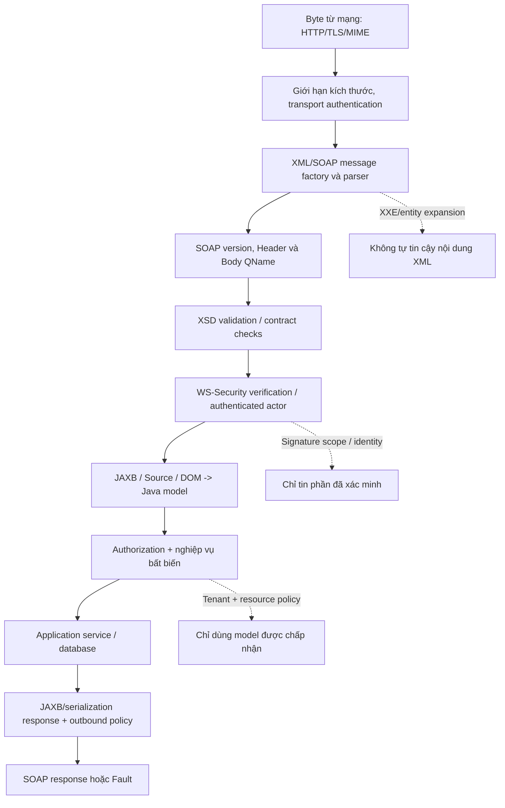
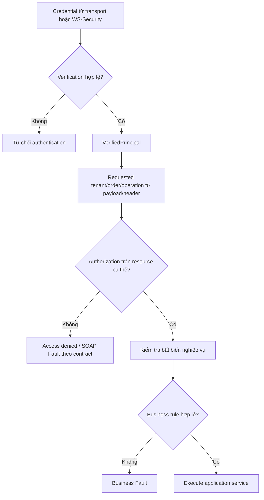

# Ranh giới tin cậy từ byte nhận được đến mô hình dữ liệu ứng dụng

Trong **Spring Web Services (Spring-WS)**, một SOAP request có thể đi từ gói tin HTTP qua XML parser, SOAP message factory, endpoint mapping, XSD validation, JAXB unmarshalling, WS-Security và cuối cùng trở thành một đối tượng Java được application service sử dụng. Mỗi bước mang lại **một dạng kiểm tra khác nhau**; không bước nào tự động làm cho toàn bộ thông tin do client gửi trở nên đáng tin cậy.

Ví dụ, XML hợp lệ không đồng nghĩa đúng XSD; XML đúng XSD không chứng minh người gửi có quyền đọc đơn hàng; một chữ ký XML hợp lệ không tự cho phép người ký truy cập mọi tenant; và một đối tượng JAXB được tạo thành công vẫn có thể chứa dữ liệu không hợp lệ về nghiệp vụ. Nếu nhầm những ranh giới này, hệ thống có thể mắc lỗi **XXE, XML Signature Wrapping, đọc chéo tenant, ghi log bí mật, xử lý message trùng** hoặc tiêu thụ quá nhiều tài nguyên.

Bài thuộc chương **Bảo vệ xử lý XML**, module `SPRING_WEB_SERVICES`. Trọng tâm là thiết kế đường đi **byte chưa tin cậy → XML được parse an toàn → SOAP hợp lệ về giao thức → payload đúng hợp đồng XSD/WSDL → danh tính/chữ ký được xác minh → quyền và bất biến nghiệp vụ được kiểm tra → dữ liệu ứng dụng được chấp nhận**. Các ví dụ gắn với JAXB/OXM, endpoint, SOAP client, interceptor, SOAP Fault, WS-Security, chứng chỉ và kiểm thử tương thích trong tích hợp doanh nghiệp.

> **Nguyên tắc cốt lõi:** Hãy coi dữ liệu bên ngoài là **untrusted ở từng ranh giới** cho đến khi chính thuộc tính cần dùng đã được xác minh. “Đã parse”, “đã validate”, “đã ký” và “đã được ủy quyền” là **bốn khẳng định khác nhau**.

## 1. Bản đồ ranh giới tin cậy của một SOAP request

Một request thông thường được xử lý qua nhiều tầng, nhưng việc kiểm tra security, schema và unmarshalling có thể được bố trí khác nhau tùy cấu hình Spring-WS và SOAP message factory.



Sơ đồ biểu diễn **các cổng kiểm tra**, không quy định thứ tự tuyệt đối. Chẳng hạn, trong thông điệp **được mã hóa**, cần giải mã theo policy trước khi xác thực schema payload rõ; trong thông điệp **được ký**, phải bảo vệ mối quan hệ giữa node mà WS-Security xác minh và node mà endpoint thật sự sử dụng. Không được chuyển đổi/sắp xếp node đã ký tùy tiện chỉ để “validate cho dễ”.

Các tầng cùng cần được bảo vệ:

| Ranh giới | Dữ liệu mới nhận | Khẳng định có thể đạt sau kiểm tra | Chưa thể suy ra |
| --- | --- | --- | --- |
| Transport | Byte từ client/proxy | Kết nối/tầng mạng đáp ứng TLS và giới hạn tương ứng | Người gửi có quyền với tenant hoặc operation |
| XML parser | Byte hoặc character stream | XML well-formed, parser không truy cập tài nguyên cấm | Đúng SOAP/XSD, an toàn nghiệp vụ |
| SOAP processing | Envelope, Header, Body | Version, cấu trúc SOAP/header rule được áp dụng | Tất cả header do client khai báo là thật |
| XSD validation | XML payload/schema | Dữ liệu có cấu trúc/kiểu theo XSD cụ thể | Danh tính, quyền truy cập hoặc trạng thái dữ liệu |
| WS-Security | Chữ ký, token, timestamp | Bằng chứng được xác minh theo **scope/policy** | Quyền làm mọi thao tác |
| JAXB/OXM | XML và Java binding | Có object Java theo mapping | Mọi trường nghiệp vụ đều được chấp nhận |
| Authorization/domain | Principal, tenant, resource, Java model | Được phép làm hành động cụ thể, bất biến được duy trì | Mọi side effect bên ngoài tự atomic |
| Outbound | Java response, SOAP Fault | Response serialize đúng hợp đồng/chính sách | Client chắc chắn nhận được phản hồi |

**Không có “cờ trusted” dùng chung cho mọi trường.** Có thể tin `principal` đã xác thực mà vẫn không tin giá trị `TenantId` từ SOAP Header; có thể tin tính toàn vẹn của một đoạn Body đã ký mà vẫn phải kiểm tra hạn sử dụng token, quyền hoặc các giá trị header không nằm trong phạm vi chữ ký.

## 2. Threat model: bên gửi kiểm soát được những gì?

Với SOAP service mở cho đối tác, một người gọi có thể kiểm soát những phần dưới đây nếu policy không ngăn chặn:

- Byte của SOAP Envelope, namespace prefix, tên phần tử, thứ tự và nội dung text.
- HTTP headers như `SOAPAction`, `Content-Type`, `X-Tenant-ID`, `X-Forwarded-For`, correlation ID.
- SOAP Headers như `wsa:Action`, `wsa:ReplyTo`, `wsse:Security`, `ctx:Role`, `ctx:TenantHint`.
- Việc chèn thêm element trùng tên, node có ID trùng, thuộc tính đặc biệt hoặc namespace giả.
- Kích thước, độ sâu, số lượng phần tử XML; giá trị string cực dài; attachments/MTOM nếu profile cho phép.
- Tần suất gửi, replay message, retry khi timeout hoặc gửi đồng thời nhiều request giống nhau.

Một client **đã được phép kết nối TLS** vẫn có thể gửi nội dung sai hoặc cố ý đánh lừa nghiệp vụ. TLS bảo vệ đường truyền **tới điểm kết thúc TLS**; nếu terminate tại reverse proxy, đường proxy–ứng dụng là ranh giới tiếp theo cần được cấu hình an toàn.

### Các nhóm tài sản cần bảo vệ

1. **Tính bí mật:** token/chứng chỉ, dữ liệu tenant, đơn hàng, thông tin khách hàng và attachments.
2. **Tính toàn vẹn:** Body đã ký, dữ liệu nghiệp vụ, quyền tenant, trạng thái giao dịch.
3. **Tính sẵn sàng:** CPU, heap, connection pool, parser threads, database và broker.
4. **Tính đúng hợp đồng:** QName, XSD/WSDL, SOAP version, SOAP Fault, XML Signature và khả năng client liên thông.
5. **Khả năng kiểm toán:** nguồn định danh đáng tin, correlation ID được quản lý, log không bị chèn/giả mạo.

## 3. Ranh giới byte HTTP/TLS: đừng bắt đầu ở JAXB

Một request SOAP HTTP thường có dạng:

```http
POST /ws HTTP/1.1
Host: api.example.com
Content-Type: text/xml; charset=utf-8
SOAPAction: "urn:example:orders:v1:GetOrder"
X-Tenant-ID: tenant-b
X-Correlation-ID: partner-7281
```

Bên gửi có thể tự viết `X-Tenant-ID` và `X-Correlation-ID`. Dù HTTP parser đã đọc được chuỗi đó, **không dùng nó làm danh tính hoặc tenant có hiệu lực** nếu không có một policy xác minh độc lập.

Những việc cần làm **trước hoặc ngay ở ranh giới nhận byte**:

| Kiểm soát | Mục tiêu |
| --- | --- |
| HTTPS/TLS và mTLS nếu yêu cầu | Xác thực channel/peer theo trust policy và bảo vệ byte trên đường truyền |
| Giới hạn request body và header size | Ngăn message quá lớn vượt tài nguyên parser |
| Giới hạn thời gian đọc, connection và concurrency | Ngăn client chiếm thread/kết nối kéo dài |
| Giới hạn số MIME parts/attachment size | Bảo vệ SOAP with Attachments/MTOM khỏi oversize |
| Kiểm soát Content-Type, charset, SOAP version | Từ chối media type/binding không được hỗ trợ |
| Gateway/proxy header hygiene | Xóa hoặc ghi đè identity headers do client tự chèn |
| Egress/redirect policy | Không gửi dữ liệu sang host lạ khi xử lý ReplyTo/callback |

**Không tin `Content-Length` như giới hạn duy nhất.** Có request transfer-encoding khác nhau, proxy có thể decompression hoặc body được chunk; giới hạn cần áp trên **số byte thực tế được tiếp nhận/decompress**, theo cấu hình container/gateway. Nếu dùng nén, phải quản lý nguy cơ **compression bomb**: kích thước trên wire nhỏ nhưng dữ liệu giải nén rất lớn.

### Charset và byte-to-character boundary

XML có encoding declaration, HTTP có charset và parser có quy tắc nhận diện byte order mark/encoding. Việc một lớp decode sai có thể làm thay đổi nội dung, khiến chữ ký hoặc dữ liệu ứng dụng không khớp.

- Để **SOAP parser** xử lý XML bytes theo chuẩn và message factory phù hợp; đừng chuyển raw body thành `new String(bytes)` dùng default charset rồi parse lại.
- Không “sửa” XML đầu vào bằng regex trên byte hoặc string trước khi xác minh chữ ký.
- Đặt giới hạn độ dài cả **trước** và **sau** các phép decode/decompress/materialize ở tầng cần thiết.
- Tránh log nguyên raw request, đặc biệt khi chứa thông tin bí mật hoặc XML vượt giới hạn.

## 4. Ranh giới parser: XML well-formed nhưng vẫn có thể nguy hiểm

Một XML parser có thể chấp nhận cấu trúc hợp lệ nhưng xử lý **Document Type Definition (DTD)**, entity hoặc tham chiếu tài nguyên ngoài. Khi cấu hình không an toàn, XML client có thể gây:

- **XXE (XML External Entity):** parser truy cập file nội bộ hoặc URL bên ngoài qua external entity.
- **SSRF qua XML parser:** tải tài nguyên từ host nội bộ thông qua DTD, schema/stylesheet.
- **Entity expansion:** khuếch đại chuỗi và tiêu tốn CPU/heap.
- **Độ sâu/quy mô XML quá lớn:** stack/memory/CPU exhaustion dù không có DTD.
- **Schema/stylesheet external access:** `xsi:schemaLocation` hoặc XSLT `document()` bị sử dụng để truy cập tài nguyên không được phép nếu parser/transformer cho phép.

Ví dụ **XML độc hại để nhận diện và kiểm thử**, không phải request được phép:

```xml
<?xml version="1.0"?>
<!DOCTYPE doc [
  <!ENTITY external SYSTEM "file:///etc/hostname">
]>
<doc:Probe xmlns:doc="https://example.com/testing/v1">
    <doc:value>&external;</doc:value>
</doc:Probe>
```

Nếu parser bất cẩn mở entity ngoài, nó có thể lộ thông tin hệ thống hoặc gây side effect network. Một parser được harden phù hợp cần **từ chối DTD/external entity** nếu ứng dụng không có use case thực sự đòi hỏi chúng.

**Hãy ưu tiên từ chối DTD** cho SOAP payload từ đối tác nếu hợp đồng không dùng DTD. XSD/WSDL ở classpath do hệ thống quản lý không phải lý do cho phép client tự chỉ định external DTD hoặc XSD URL bất kỳ.

## 5. Ví dụ JAXP DOM parser fail closed

Ví dụ dưới đây dành cho **XML fragment mà ứng dụng chủ động parse**, không phải một phép thay thế tự động cho parser nội bộ của SOAP message factory.

```java
import java.io.InputStream;
import javax.xml.XMLConstants;
import javax.xml.parsers.DocumentBuilder;
import javax.xml.parsers.DocumentBuilderFactory;
import org.w3c.dom.Document;
import org.xml.sax.SAXException;

public final class SafeXmlReader {
    private SafeXmlReader() {}

    public static Document parseBoundedPayload(InputStream input)
            throws Exception {

        // Preconditions: transport/stream wrapper đã giới hạn bytes.
        DocumentBuilderFactory f = DocumentBuilderFactory.newInstance();
        f.setNamespaceAware(true);
        f.setXIncludeAware(false);
        f.setExpandEntityReferences(false);
        f.setFeature(XMLConstants.FEATURE_SECURE_PROCESSING, true);

        // Với XML đầu vào không tin cậy: không chấp nhận DTD.
        f.setFeature(
            "http://apache.org/xml/features/disallow-doctype-decl", true);
        f.setFeature(
            "http://xml.org/sax/features/external-general-entities", false);
        f.setFeature(
            "http://xml.org/sax/features/external-parameter-entities", false);
        f.setFeature(
            "http://apache.org/xml/features/nonvalidating/load-external-dtd",
            false);

        // Hạn chế truy cập ngoài khi JAXP provider hỗ trợ.
        f.setAttribute(XMLConstants.ACCESS_EXTERNAL_DTD, "");
        f.setAttribute(XMLConstants.ACCESS_EXTERNAL_SCHEMA, "");

        DocumentBuilder builder = f.newDocumentBuilder();
        builder.setEntityResolver((publicId, systemId) -> {
            throw new SAXException("External entities are forbidden");
        });
        return builder.parse(input);
    }
}
```

Những điểm không thể bỏ qua:

1. Những feature URI trên là những cấu hình phổ biến của JAXP/Xerces; **hỗ trợ phụ thuộc parser provider**. Nếu yêu cầu bảo mật không được hỗ trợ và gây `ParserConfigurationException`/`IllegalArgumentException`, phải **fail closed** hoặc chọn parser implementation hỗ trợ; không tự catch rồi tiếp tục với parser mặc định.
2. `FEATURE_SECURE_PROCESSING` là lớp bảo vệ bổ sung, **không thay thế** việc tắt DTD/external access và giới hạn tài nguyên.
3. Code giả định `input` đã được **giới hạn kích thước** và caller quản lý việc đóng stream. DOM materialize toàn bộ XML, nên heap có thể lớn hơn byte trên wire nhiều lần.
4. `setExpandEntityReferences(false)` không nên xem là biện pháp chặn XXE duy nhất. Phải vô hiệu hóa/từ chối DTD và external entity theo policy.
5. Nếu hệ thống có XML processor provider khác, cần chạy **security regression test** trên runtime/dependency thật.
6. Đừng tự parse lại toàn SOAP Envelope bằng DOM trong endpoint nếu Spring-WS đã parse được message; điều đó có thể lãng phí bộ nhớ, gây bất đồng giữa các parser và phá xử lý WS-Security.

### Không chỉ harden parser trong endpoint

Nếu request đã được `MessageDispatcherServlet`/`SoapMessageFactory` parse **trước khi đến endpoint**, mọi cấu hình parser trong method endpoint đều **quá muộn** để ngăn các tác động xảy ra ở lần parse đầu. Phải xác nhận security properties của **message factory, SAAJ/JAXP runtime, XML transformers, schema validator và thư viện WS-Security** đang sử dụng. Một hardening helper tốt không bảo vệ được một parser khác thiếu kiểm soát.

## 6. StAX và Transformer: điểm mở XML không nằm riêng ở DOM

Nếu xử lý trực tiếp `Source`, ứng dụng có thể dùng StAX hoặc `TransformerFactory`. Chúng cũng cần cấu hình.

### StAX: parser dạng pull

```java
import javax.xml.stream.XMLInputFactory;
import javax.xml.stream.XMLStreamException;
import javax.xml.stream.XMLStreamReader;
import java.io.InputStream;

public final class SafeStaxFactory {
    public static XMLStreamReader create(InputStream input)
            throws XMLStreamException {

        XMLInputFactory f = XMLInputFactory.newFactory();
        f.setProperty(XMLInputFactory.SUPPORT_DTD, false);
        f.setProperty(
                XMLInputFactory.IS_SUPPORTING_EXTERNAL_ENTITIES, false);
        f.setXMLResolver((publicId, systemId, baseUri, namespace) -> {
            throw new XMLStreamException("External XML resource forbidden");
        });

        return f.createXMLStreamReader(input);
    }
}
```

StAX `XMLStreamReader` thường là **forward-only**: một interceptor đọc tới cuối payload có thể làm endpoint không còn dữ liệu. **Streaming không tự bảo vệ chống XML bomb**; vẫn cần giới hạn byte, số phần tử, depth, text size, thời gian và concurrency.

### Transformer: không cho stylesheet đọc file hoặc mạng

```java
import javax.xml.XMLConstants;
import javax.xml.transform.TransformerFactory;

TransformerFactory tf = TransformerFactory.newInstance();
tf.setFeature(XMLConstants.FEATURE_SECURE_PROCESSING, true);
tf.setAttribute(XMLConstants.ACCESS_EXTERNAL_DTD, "");
tf.setAttribute(XMLConstants.ACCESS_EXTERNAL_STYLESHEET, "");

// Chỉ dùng Source đầu vào và stylesheet đã được kiểm soát.
```

Tương tự parser, nếu provider không hỗ trợ policy cần thiết, đừng bỏ qua lỗi rồi xử lý XML untrusted. `Transformer` có thể **tiêu thụ** `StreamSource`/`StAXSource`; không tự dùng lại cùng một nguồn cho validator, logger và endpoint nếu message backend không có khả năng replay.

## 7. Ranh giới SOAP Envelope và SOAP Header

Một SOAP message hợp lệ cần đúng SOAP version/Envelope namespace, Body structure và quy tắc Header của SOAP 1.1 hoặc SOAP 1.2. Ví dụ SOAP 1.1:

```xml
<soap:Envelope
    xmlns:soap="http://schemas.xmlsoap.org/soap/envelope/"
    xmlns:ord="https://example.com/orders/v1"
    xmlns:ctx="https://example.com/soap/context/v1">
    <soap:Header>
        <ctx:TenantHint soap:mustUnderstand="1">tenant-b</ctx:TenantHint>
        <ctx:CorrelationId>external-7291</ctx:CorrelationId>
    </soap:Header>
    <soap:Body>
        <ord:GetOrderRequest>
            <ord:orderId>42</ord:orderId>
        </ord:GetOrderRequest>
    </soap:Body>
</soap:Envelope>
```

**Ranh giới tin cậy:** `ctx:TenantHint`, `CorrelationId` và cả `SOAPAction` đều do bên gửi khai báo. Chúng không trở thành claim đáng tin chỉ vì nằm trong SOAP Header hoặc có `mustUnderstand="1"`.

| Tín hiệu | Điều nó thật sự nói | Không tự chứng minh |
| --- | --- | --- |
| `SOAPAction` HTTP | Action được client khai báo theo SOAP binding | Caller có quyền thực hiện action |
| `wsa:Action` | Message action của WS-Addressing | Message đã được xác thực hoặc giao đúng một lần |
| `@PayloadRoot` / Body QName | Payload có root tương ứng operation | Request đúng toàn bộ schema hoặc được phép |
| `mustUnderstand` | Header phù hợp cần được hiểu/xử lý bởi node đích | Header chứa dữ liệu thật |
| `TenantHint` | Client đề xuất tenant mục tiêu | Principal được phép truy cập tenant |
| `wsse:Security` tồn tại | Có một Security header trong XML | Chữ ký/token đã được xác minh |
| `wsa:ReplyTo` | Client đề nghị nơi nhận reply | Server được phép kết nối URL đó |

Nếu client cung cấp hai `TenantHint` cùng QName hoặc dùng prefix khác nhưng namespace giống, server phải có **quy tắc số lượng và chọn giá trị** tường minh. Không để security interceptor đọc bản thứ nhất trong khi application lại dùng bản thứ hai.

### Namespace URI mới là danh tính XML

Một phần tử `<evil:GetOrderRequest>` với namespace `https://attacker.example/ns` **không phải** `{https://example.com/orders/v1}GetOrderRequest`, dù local name giống nhau. Khi kiểm tra XML, hãy so `QName` gồm **namespace URI và local name**, không so prefix hoặc local name riêng lẻ.

## 8. Ranh giới XSD: đúng cấu trúc không đồng nghĩa hợp lệ về quyền

Một XSD contract-first cho `GetOrder` có thể định nghĩa kiểu và thứ tự rõ ràng:

```xml
<?xml version="1.0" encoding="UTF-8"?>
<xs:schema xmlns:xs="http://www.w3.org/2001/XMLSchema"
           targetNamespace="https://example.com/orders/v1"
           xmlns:ord="https://example.com/orders/v1"
           elementFormDefault="qualified">

    <xs:simpleType name="OrderNumber">
        <xs:restriction base="xs:long">
            <xs:minInclusive value="1"/>
        </xs:restriction>
    </xs:simpleType>

    <xs:element name="GetOrderRequest">
        <xs:complexType>
            <xs:sequence>
                <xs:element name="orderId" type="ord:OrderNumber"/>
            </xs:sequence>
        </xs:complexType>
    </xs:element>

    <xs:element name="GetOrderResponse">
        <xs:complexType>
            <xs:sequence>
                <xs:element name="orderId" type="ord:OrderNumber"/>
                <xs:element name="status" type="xs:string"/>
            </xs:sequence>
        </xs:complexType>
    </xs:element>
</xs:schema>
```

Với XSD này:

- `orderId=-2` sai `minInclusive`.
- `orderId=abc` sai kiểu `xs:long`.
- Thêm một field không được khai báo có thể vi phạm sequence.
- Namespace khác hoặc sai root QName là lỗi contract.
- `orderId=42` có thể **đúng XSD** nhưng caller **không có quyền đọc** đơn hàng 42.

**XSD là hợp đồng về cấu trúc/ngữ nghĩa XML có thể diễn đạt bằng schema, không phải policy phân quyền hoặc kiểm tra trạng thái cơ sở dữ liệu.**

### Những điều XSD nên ràng buộc từ sớm

| Ràng buộc | Công dụng | Điều còn lại cho nghiệp vụ |
| --- | --- | --- |
| `minOccurs/maxOccurs` | Chỉ rõ thiếu/trùng element hợp lệ hay không | Field có ý nghĩa gì với caller |
| `nillable` | Phân biệt nil và element absent ở mức XML | Quy tắc chấp nhận “không có giá trị” |
| `xs:minLength/maxLength` | Giới hạn độ dài text ở schema | Giới hạn byte/heap trước khi parse |
| `xs:pattern` / `enumeration` | Giới hạn hình thức giá trị | Policy và trạng thái hiện tại |
| `xs:positiveInteger`, numeric facets | Loại giá trị không hợp lệ về số | Số có thuộc tài nguyên được phép không |
| `xs:sequence` | Thứ tự/khung cấu trúc | Không chống duplicate ở các node ngoài scope đã validate |
| `targetNamespace` | Phân biệt QName chính xác | Quyền operation của người gửi |

Lưu ý: **Schema-valid XML** phụ thuộc **đúng phiên bản XSD đang được server triển khai**. Nếu server chạy JAXB model cũ còn WSDL công bố schema mới, client có thể gửi request đúng hợp đồng công bố mà server vẫn lỗi. Đó có thể là **lỗi deploy/server contract**, không mặc nhiên là lỗi của bên gửi.

## 9. Đặt payload validation ở đâu trong Spring-WS?

Spring-WS cung cấp `PayloadValidatingInterceptor` để kiểm tra **SOAP Body payload** theo XSD. Cấu hình điển hình:

```java
import org.springframework.context.annotation.Bean;
import org.springframework.context.annotation.Configuration;
import org.springframework.core.io.ClassPathResource;
import org.springframework.ws.soap.server.endpoint.interceptor.PayloadValidatingInterceptor;
import org.springframework.xml.xsd.SimpleXsdSchema;
import org.springframework.xml.xsd.XsdSchema;

@Configuration
public class OrderSchemaConfiguration {

    @Bean
    public XsdSchema orderSchema() {
        return new SimpleXsdSchema(
                new ClassPathResource("xsd/orders.xsd"));
    }

    @Bean
    public PayloadValidatingInterceptor orderPayloadValidator(
            XsdSchema orderSchema) {

        PayloadValidatingInterceptor interceptor =
                new PayloadValidatingInterceptor();
        interceptor.setXsdSchema(orderSchema);
        interceptor.setValidateRequest(true);
        interceptor.setValidateResponse(true);
        return interceptor;
    }
}
```

**Bean validator chưa tự động tham gia mọi request**. Cần đăng ký vào endpoint interceptor chain được sử dụng thực sự, ví dụ qua `WsConfigurer#addInterceptors` dưới `@EnableWs`.

```java
import java.util.List;
import org.springframework.context.annotation.Configuration;
import org.springframework.ws.config.annotation.EnableWs;
import org.springframework.ws.config.annotation.WsConfigurer;
import org.springframework.ws.server.EndpointInterceptor;

@Configuration
@EnableWs
public class WsInterceptors implements WsConfigurer {
    private final PayloadValidatingInterceptor validator;

    public WsInterceptors(PayloadValidatingInterceptor validator) {
        this.validator = validator;
    }

    @Override
    public void addInterceptors(List<EndpointInterceptor> interceptors) {
        interceptors.add(validator);
    }
}
```

**Ranh giới validator:**

1. `setValidateRequest(true)` không tự bảo vệ XML parser **đã parse request trước đó**. Cấu hình parser/message factory vẫn cần an toàn.
2. `PayloadValidatingInterceptor` tập trung vào **payload**, không có nghĩa mọi SOAP Header/WS-Security/MTOM attachment cũng được validate.
3. `setValidateResponse(true)` giúp phát hiện server tạo response sai hợp đồng; **lỗi response sai XSD là vấn đề phía server**, không nên đổ cho client.
4. Thứ tự interceptor validation/security cần phù hợp **dữ liệu mã hóa/chữ ký** và pipeline cụ thể, không có thứ tự mặc định đúng cho mọi WS-* profile.
5. Với `xs:include`/`xs:import`, phải nạp và resolve schema **từ tài nguyên đã kiểm soát**; không tự tải schema URL tùy ý từ client.

## 10. JAXP `SchemaFactory` và nguy cơ external schema

Một số ứng dụng có thêm bước validate XML ngoài `PayloadValidatingInterceptor`. Khi sử dụng JAXP trực tiếp, hãy kiểm soát nguồn XSD và external access:

```java
import javax.xml.XMLConstants;
import javax.xml.validation.Schema;
import javax.xml.validation.SchemaFactory;
import javax.xml.validation.Validator;
import javax.xml.transform.stream.StreamSource;
import java.io.InputStream;

public final class SafeSchemaValidation {

    public static void validate(
            InputStream trustedSchema,
            InputStream untrustedXml) throws Exception {

        SchemaFactory sf = SchemaFactory.newInstance(
                XMLConstants.W3C_XML_SCHEMA_NS_URI);

        sf.setFeature(XMLConstants.FEATURE_SECURE_PROCESSING, true);
        sf.setProperty(XMLConstants.ACCESS_EXTERNAL_DTD, "");
        sf.setProperty(XMLConstants.ACCESS_EXTERNAL_SCHEMA, "");

        Schema schema = sf.newSchema(
                new StreamSource(trustedSchema));

        Validator validator = schema.newValidator();
        validator.setProperty(XMLConstants.ACCESS_EXTERNAL_DTD, "");
        validator.setProperty(XMLConstants.ACCESS_EXTERNAL_SCHEMA, "");

        validator.validate(new StreamSource(untrustedXml));
    }
}
```

Ví dụ chỉ phù hợp với schema **tự chứa** hoặc đã được chuẩn bị/resolve trước. Với nhiều XSD file có `import/include`, cần một **catalog/resource resolver offline đã kiểm soát**; cấu hình chặn toàn bộ external schema access mà không cấp resolver có thể khiến import hợp lệ không được resolve. Không khắc phục bằng cách bật quyền tải URL bất kỳ từ mạng.

Lưu ý:

- `trustedSchema` và `untrustedXml` là stream caller cung cấp, caller chịu trách nhiệm đóng. Không mở từ `xsi:schemaLocation` của request.
- Giới hạn kích thước XML trước validate; parser/validator vẫn có thể tiêu thụ rất nhiều tài nguyên.
- Một `StreamSource` có thể chỉ đọc được **một lần**. Nếu chạy validate rồi JAXB unmarshal trên **cùng InputStream đã hết**, bước thứ hai có thể gặp EOF. Cần dùng message backend hỗ trợ replay, một snapshot có giới hạn hoặc pipeline một lượt theo framework hỗ trợ.
- API/property hỗ trợ phụ thuộc JAXP provider; fail closed nếu cấu hình cần thiết không khả dụng.

## 11. JAXB/OXM: chuyển sang Java object **không** tự nâng mức tin cậy

Sau parser và endpoint adapter, request có thể trở thành JAXB class:

```java
// Ví dụ lớp được tạo bởi XJC; hình dạng thực tế tùy binding.
GetOrderRequest request = ...;
long orderId = request.getOrderId();
```

Ngay cả khi code Java thấy kiểu `long`, vẫn phải hỏi:

- Trước đó **có thực sự chạy XSD validation** đúng phiên bản không?
- JAXB mapping có chấp nhận element ngoài schema, nil, default hoặc missing value theo cách application không mong muốn không?
- Có field nào được set mặc định từ code rồi ứng dụng hiểu nhầm là giá trị do client cung cấp không?
- Kiểu số trong XSD/Java có tương đương giới hạn thực tế của database không?
- Có thành phần nào sửa object/DOM sau bước validation hoặc verification không?
- Request có quyền đọc/ghi **tài nguyên cụ thể** không?

**Unmarshal thành công không chứng minh “XSD-valid”.** Một số cấu hình JAXB unmarshalling không bật schema validation và có thể tạo object từ dữ liệu không thỏa mọi ràng buộc XSD. Nếu cần xác thực cấu trúc trước nghiệp vụ, dùng validation phù hợp ở đúng vị trí.

### JAXB marshaller và validation

`Jaxb2Marshaller` của Spring OXM có thể được cấu hình context JAXB và schema validation tương ứng tùy phiên bản:

```java
import org.springframework.context.annotation.Bean;
import org.springframework.core.io.ClassPathResource;
import org.springframework.oxm.jaxb.Jaxb2Marshaller;

@Bean
public Jaxb2Marshaller ordersMarshaller() {
    Jaxb2Marshaller marshaller = new Jaxb2Marshaller();
    marshaller.setContextPath("com.acme.orders.soap.v1");
    marshaller.setSchemas(
            new ClassPathResource("xsd/orders.xsd"));
    return marshaller;
}
```

Đây là một **phương án bổ sung** khi ứng dụng chủ động quản lý OXM; không bảo đảm bao phủ toàn bộ SOAP Envelope/Header. Khi chọn áp validation ở `PayloadValidatingInterceptor`, ở JAXB hoặc cả hai, cần đo chi phí đọc XML nhiều lượt, đồng nhất schema và **kiểm thử đường one-shot Source**.

**Không dùng JAXB object như authorization token.** `request.getTenantId()` — nếu có — vẫn là giá trị bên gửi đề nghị; tenant được phép phải xác định sau authentication/authorization, không tự đến từ kiểu Java đã sinh.

## 12. WS-Security: xác minh **node nào** và **danh tính nào**

Một SOAP Header có thể chứa `wsse:Security` với UsernameToken, Timestamp, BinarySecurityToken, XML Signature hoặc encrypted parts. **Sự tồn tại của Header không phải bằng chứng**.

Các câu hỏi phải trả lời khi kết luận một message đã được xác minh:

1. Token/chứng chỉ có **được xác minh** bằng truststore/issuer/audience/usage policy phù hợp không?
2. Chữ ký XML có xác minh được bằng thuật toán/khóa được chấp nhận và chính sách thuật toán hiện hành không?
3. **Chính xác những SOAP Body/Header nodes nào** nằm trong phạm vi chữ ký?
4. Timestamp/nonce có hợp lệ và chống replay theo cửa sổ đã định nghĩa không?
5. Endpoint có dùng **đúng node đã được xác minh** hay dùng một bản sao/phần tử cùng tên khác?
6. Principal được ánh xạ từ credential đã xác minh có được phép gọi operation/tài nguyên cụ thể không?

Một chữ ký hợp lệ chỉ chứng minh tính toàn vẹn/nguồn gốc của **nội dung thực sự được bảo vệ theo policy**, không chứng minh tất cả HTTP headers, SOAP Headers hoặc attachments đều đáng tin.

### Tấn công XML Signature Wrapping

Một lớp tấn công nguy hiểm là tạo hai Body hoặc hai node có chức năng tương tự:

- Node **A** được chữ ký tham chiếu và xác minh đúng.
- Node **B** do attacker thêm/sửa, không nằm trong phạm vi chữ ký.
- Code endpoint tìm node theo local name và xử lý **B** thay vì **A**.

Cách phòng vệ:

- Sử dụng WS-Security implementation được duy trì, ví dụ **WSS4J integration** được phiên bản Spring-WS hiện hành hỗ trợ.
- Ràng buộc ID reference, vị trí node và phần tử application xử lý với **kết quả security verification**.
- Từ chối duplicate ID, cấu trúc SOAP bất thường và header/Body trùng trái policy.
- Không tự sửa hoặc sao chép node đã ký giữa security interceptor và endpoint.
- Không tự xác minh chữ ký bằng tìm chuỗi `<ds:Signature>` hoặc chỉ kiểm tra một flag tên `signed` do client gửi.
- Kiểm thử wrapping với Body/Header trùng, QName/namespace giả và nhiều reference.

Nếu profile yêu cầu ký `wsa:Action`, `TenantHint` hoặc attachment, phải xác nhận **chúng nằm trong phạm vi bảo vệ**. Chỉ ký SOAP Body không bảo vệ một SOAP Header nằm ngoài danh sách tham chiếu.

## 13. Danh tính đã xác thực khác quyền thao tác nghiệp vụ

Sau khi kiểm tra TLS/token/WS-Security, server có thể xác định `VerifiedActor`, chẳng hạn một service account của đối tác. Nhưng một đối tác đã xác thực vẫn có thể yêu cầu tenant hoặc order không thuộc quyền.



Ví dụ:

| Giá trị | Nguồn | Có thể dùng để làm gì? |
| --- | --- | --- |
| `ctx:TenantHint=tenant-b` | SOAP Header do client gửi | Chọn tenant **đề nghị**, sau đó đối chiếu quyền |
| `@PayloadRoot` | QName của Body request | Chọn endpoint/operation, **không** cấp quyền |
| `SOAPAction=CancelOrder` | HTTP header do client gửi | Thông tin định tuyến, không phải role |
| `principal=partner-A` | Token/chứng chỉ đã được xác minh | Cơ sở xác thực actor |
| `authorization.canRead(partner-A, tenant-b, order-42)` | Policy/ACL nội bộ | Cho phép hoặc từ chối truy cập cụ thể |

Không ghi đè authorities từ `ctx:Role=ADMIN`. Nếu client có cơ chế acting-on-behalf-of/delegation, phải có **bằng chứng delegation và policy** được server xác minh, không chỉ một string.

## 14. Ví dụ endpoint: từ JAXB model đến business command đã kiểm tra

Ví dụ Spring-WS `GetOrder` phải kiểm tra danh tính, tenant và order trước khi đọc dữ liệu:

```java
import org.springframework.ws.server.endpoint.annotation.Endpoint;
import org.springframework.ws.server.endpoint.annotation.PayloadRoot;
import org.springframework.ws.server.endpoint.annotation.RequestPayload;
import org.springframework.ws.server.endpoint.annotation.ResponsePayload;

@Endpoint
public final class OrdersEndpoint {
    private static final String NS =
            "https://example.com/orders/v1";

    private final VerifiedActorProvider actors;
    private final OrderAuthorization authorization;
    private final OrderQueries queries;

    public OrdersEndpoint(
            VerifiedActorProvider actors,
            OrderAuthorization authorization,
            OrderQueries queries) {
        this.actors = actors;
        this.authorization = authorization;
        this.queries = queries;
    }

    @PayloadRoot(namespace = NS, localPart = "GetOrderRequest")
    @ResponsePayload
    public GetOrderResponse getOrder(
            @RequestPayload GetOrderRequest request) {

        // 1. Không lấy actor từ SOAP Header tự khai báo.
        VerifiedActor actor = actors.requireAuthenticated();

        // 2. JAXB chỉ biểu diễn dữ liệu đầu vào; không có quyền tự cấp.
        long requestedOrderId = request.getOrderId();
        if (requestedOrderId < 1L) {
            throw new InvalidOrderRequestException();
        }

        // 3. Policy dùng actor đã xác minh và resource thực tế.
        if (!authorization.mayRead(actor, requestedOrderId)) {
            throw new OrderAccessDeniedException();
        }

        // 4. Database query cũng phải giữ ranh giới quyền.
        OrderView view = queries.findVisibleOrder(
                actor, requestedOrderId);

        GetOrderResponse response = new GetOrderResponse();
        response.setOrderId(view.orderId());
        response.setStatus(view.status());
        return response;
    }
}
```

Đây là **ví dụ kiến trúc**, không phải project tự biên dịch: `VerifiedActorProvider`, `OrderAuthorization`, `OrderQueries`, `OrderView` và các exception là kiểu ứng dụng phải tự định nghĩa. `GetOrderRequest`/`GetOrderResponse` giả định được sinh từ XSD ví dụ và ánh xạ `OrderNumber` thành `long`; nếu JAXB binding thực tế trả `BigInteger` hoặc `JAXBElement`, cần chuyển đổi có kiểm tra range và unwrap đúng.

Các ranh giới quan trọng:

1. `actors.requireAuthenticated()` phải lấy danh tính từ **security context được cơ chế server tin cậy tạo ra**. Nếu security context được thiết lập bằng raw `X-User` của public client thì cách dùng này **không an toàn**.
2. `authorization.mayRead` cần tra entitlement/ownership hiện tại. `queries.findVisibleOrder` nên thực hiện kiểm tra phạm vi một cách an toàn ngay trong query hoặc dùng cơ chế tránh **TOCTOU**, không chỉ check quyền một lần rồi query theo ID toàn cục không ràng buộc.
3. Validation XSD phải được thực thi **trước nghiệp vụ**, nhưng endpoint vẫn kiểm tra bất biến trọng yếu khi cần; không coi XSD là nguồn kiểm soát permission.
4. Khi thất bại, chuyển exception thành SOAP Fault theo policy; không trả stack trace hoặc thông tin order thuộc tenant khác.
5. Với operation thay đổi trạng thái, còn cần idempotency/transaction và kiểm tra concurrency riêng.

**Không biến “Java object đã được tạo” thành “business object đáng tin”.** Nên tách generated DTO nhận từ bên ngoài khỏi domain command/value object chỉ được tạo **sau khi** qua authentication, authorization và business validation.

## 15. Tách request DTO, validated command và domain model

Trong một ứng dụng lớn, có thể chủ động tách ba kiểu dữ liệu:

```text
GetOrderRequest (JAXB/XJC, untrusted request DTO)
    -> validate structural contract
    -> VerifiedActor từ security infrastructure
    -> authorize (actor, operation, orderId)
    -> ReadOrderCommand(actorId, authorizedScope, orderId)
    -> application service
    -> OrderView (domain read model)
    -> GetOrderResponse (JAXB/XJC, outbound contract)
```

`ReadOrderCommand` nên là kiểu **do server tạo từ giá trị đã kiểm tra**, không để người gọi trực tiếp deserialize vào domain entity có quyền lực. Đây cũng là cách tránh **mass assignment**: không map một object untrusted có các field tùy ý thành entity chứa `role`, `isAdmin`, `tenantOwner` hoặc trường trạng thái nội bộ.

Ví dụ class immutable minh họa:

```java
public record ReadOrderCommand(
        String verifiedActorId,
        String authorizedTenantId,
        long orderId) {

    public ReadOrderCommand {
        if (verifiedActorId == null || verifiedActorId.isBlank()
                || authorizedTenantId == null
                || authorizedTenantId.isBlank()
                || orderId < 1L) {
            throw new IllegalArgumentException(
                    "Invalid authorized order query");
        }
    }
}
```

Code chỉ bảo đảm một số bất biến **về hình thức**. `authorizedTenantId` phải đến từ một bước **authorization đáng tin**, không phải chỉ đổi tên biến `requestTenantId` thành `authorizedTenantId`. Để bảo vệ ranh giới trong codebase, nên hạn chế quyền tạo loại command nhạy cảm, đưa factory/service kiểm tra policy vào đúng module và có unit test cho provenance.

## 16. SOAP Header và dữ liệu không được bảo vệ: tránh “confused deputy”

Một SOAP server có thể trở thành **confused deputy** nếu dùng quyền network hoặc credential của chính mình để thực hiện một hành động do client thiếu tin cậy chỉ định, ví dụ:

- Đọc `ctx:TargetTenant` rồi dùng service credential đọc dữ liệu tenant đó.
- Lấy `wsa:ReplyTo` làm URL callback mà không allowlist, gây SSRF.
- Đọc `ctx:Role=ADMIN` rồi gọi backend bằng admin credential.
- Tin `X-Forwarded-User` khi gateway không xóa identity header do client tự tạo.
- Chấp nhận `xsi:schemaLocation` hoặc XSLT URL do client gửi và để parser có quyền truy cập mạng nội bộ.

**Biện pháp chung:** Xác định *caller được yêu cầu gì*, *server có quyền kỹ thuật gì* và *policy có cho phép dùng quyền kỹ thuật đó thay caller không*. Quyền kết nối database/network của server không phải quyền cấp cho request.

### Phòng chống SSRF từ WS-Addressing `ReplyTo`

Nếu service hỗ trợ phản hồi bất đồng bộ, ưu tiên map **principal/partner đã xác thực → callback endpoint đăng ký sẵn**. Khi cho phép URI động, cần kiểm soát scheme/hostname/port/DNS/redirect/egress, chặn loopback/link-local/private networks theo chính sách, đồng thời kiểm tra **đích sau khi resolve và khi redirect**. Không đặt credential hoặc SOAP Body nhạy cảm vào outbound request tới host không được cho phép.

## 17. Streaming, caching và “một payload nhưng nhiều người đọc”

Trong Spring-WS, một SOAP Body có thể được cung cấp dưới dạng `Source`. Khả năng đọc lại phụ thuộc backend:

| Kiểu nguồn | Đặc trưng | Điều cần chú ý |
| --- | --- | --- |
| `StreamSource` | Bọc `InputStream` hoặc `Reader` tiến về trước | Đọc một lần có thể làm hết stream |
| `StAXSource` | Bọc `XMLStreamReader` với cursor | Không tự reset về đầu |
| `SAXSource` | Dựa trên callback/input source | Replay phụ thuộc nguồn và parser |
| `DOMSource` | Cây XML đã materialize | Có thể duyệt lại, nhưng tăng bộ nhớ/chi phí |
| SOAP message backend có cache | Có thể cung cấp nguồn mới để replay | Tính năng/cách cấu hình tùy version/implementation |

**Ví dụ sai:**

```java
// Pseudocode: không dùng với Source one-shot.
Source body = messageContext.getRequest().getPayloadSource();
transformer.transform(body, logBuffer);  // Đã tiêu thụ nguồn.
return true; // Endpoint sau đó có thể không đọc lại được Body.
```

Nếu interceptor logging đọc Body trước WS-Security, validator hoặc endpoint, một message hợp lệ có thể bị hỏng khi downstream nhận EOF. Với signed payload, việc serialize/parse lại không đúng cách còn có thể gây bất đồng node/ID/canonicalization.

**Hướng an toàn:**

1. Log **metadata đã lọc** thay vì Body/Header nguyên vẹn.
2. Nếu cần đọc lặp, xác minh message factory thực tế hỗ trợ cache/replay trong phiên bản đang dùng, đặt giới hạn heap/bytes.
3. Nếu buộc materialize, làm **một lần** rồi chuyển bản đã kiểm soát cho consumer đúng API, không dùng lại same stream đã bị tiêu thụ.
4. Kiểm thử cả `Source` one-shot và backend DOM/cache; không chỉ unit test với `StringSource`.
5. Đối với MTOM/XOP, attachment binary có **lifecycle/stream riêng**, cache Body không có nghĩa attachment tự replay.

Cache hỗ trợ replay **không bảo đảm XML an toàn** và còn có thể tăng memory footprint; phải kết hợp chống XML bomb với giới hạn concurrency.

## 18. SOAP with Attachments/MTOM: byte nhị phân có ranh giới riêng

Một SOAP request có thể dùng MTOM/XOP để đính kèm tệp. XML Body có thể chứa `xop:Include` tham chiếu phần dữ liệu trong MIME multipart, trong khi kích thước binary lớn hơn nhiều lần XML text.

Kiểm soát cần thiết:

- Giới hạn **tổng request**, từng MIME part và số lượng parts; không chỉ giới hạn SOAP Body XML.
- Kiểm tra MIME type/extension theo **nội dung và chính sách** nếu downstream xử lý file.
- Không tự tin `Content-ID` hoặc `Content-Type` do client khai báo; chống duplicate/ambiguous references.
- Quản lý `DataHandler`/attachment streams, tài nguyên tạm, disk và lifecycle; không đọc hai lần nếu backend không hỗ trợ.
- Nếu ứng dụng đưa file vào XML parser/PDF/zip/image processor khác, áp **security policy riêng cho bộ xử lý đó**.
- Chỉ tin chữ ký WS-Security ở những phần Body/Header/attachment **thực sự nằm trong signature scope** được verify.
- Không log raw attachment hoặc giữ nhiều bản copy không có giới hạn.

**XSD validation của SOAP Body không tự chứng minh nội dung binary attachment an toàn.** Một XML payload có `xop:Include` hợp lệ không đủ để kết luận tệp đính kèm được phép lưu, mở, thực thi hoặc chuyển tiếp.

## 19. Outbound boundary: response cũng phải đúng hợp đồng và an toàn

Sau khi application service trả domain result, hệ thống thường marshal một JAXB response. Dữ liệu outbound có thể bắt nguồn từ database hoặc hệ thống khác, nên vẫn cần kiểm tra trước khi đưa vào SOAP response.

Ví dụ:

- Một chuỗi chứa ký tự đặc biệt cần được **XML serializer escape** chính xác, không nối XML raw string.
- Dữ liệu thuộc tenant khác không được vô tình gắn vào response dù marshalling không lỗi.
- JAXB model và XSD response cần khớp: namespace, element order, required fields, kiểu số.
- Nếu profile yêu cầu ký/mã hóa response, WS-Security outbound phải chạy và dùng đúng key/chứng chỉ/policy.
- SOAP Fault không được rò rỉ exception class, stack trace, SQL, token hay tên tài nguyên bí mật.

`setValidateResponse(true)` ở `PayloadValidatingInterceptor` có thể phát hiện response XML sai XSD, nhưng **không tự bảo đảm kiểm tra data leakage hoặc business correctness**. Một response hợp lệ về schema vẫn có thể chứa thông tin người dùng khác.

Đừng dùng string concatenation để tạo SOAP XML từ dữ liệu untrusted. Ưu tiên JAXB, StAX XML writer hoặc serializer XML có API an toàn; kiểm tra XML output trước khi ký/gửi theo cấu hình thích hợp.

## 20. SOAP Fault: phân loại lỗi tại đúng ranh giới

Không phải mọi lỗi đều đến từ endpoint và không phải mọi lỗi đều tạo được SOAP Envelope.

| Vị trí phát hiện | Ví dụ | Hướng xử lý lỗi |
| --- | --- | --- |
| Transport/gateway | TLS fail, HTTP 413, kết nối bị ngắt | Có thể chỉ có HTTP/transport error, **không có SOAP Fault** |
| XML parser | XML malformed, DTD bị từ chối | Protocol/parser failure; nếu tạo Fault được, dùng response phù hợp |
| SOAP processing | Wrong SOAP version, `mustUnderstand` không được đáp ứng | `VersionMismatch`/`MustUnderstand` theo phiên bản SOAP |
| XSD validation | Thiếu `orderId`, kiểu dữ liệu sai | Lỗi request thường tương ứng `Client/Sender` |
| WS-Security | Chữ ký/token/timestamp invalid | Security Fault/transport response theo profile, không lộ chi tiết bí mật |
| Authentication | Principal không được xác minh | Authentication rejection, có thể trước endpoint |
| Authorization | User không được đọc order/tenant | Access-denied Fault theo contract/policy |
| Business rule | Tài nguyên không ở trạng thái cho phép | Business Fault có code/detail ổn định |
| JAXB outbound | Server không tạo được XML response đúng XSD | Lỗi server/`Server/Receiver` nếu có thể trả Fault |
| Server dependency | Database/downstream lỗi | Server/Receiver hoặc business error tùy giai đoạn và hợp đồng |

SOAP 1.1 dùng `Client/Server`, SOAP 1.2 dùng `Sender/Receiver`; `MustUnderstand` và `VersionMismatch` có nghĩa giao thức riêng. Với business Fault được công bố, nên có **XSD detail element và `wsdl:fault`** theo WSDL 1.1 nếu client cần xử lý tự động. Không yêu cầu client parse chuỗi `faultstring`/`Reason` để suy ra lỗi.

### Đừng nhầm lỗi do request với bug của server

`UnmarshalException` có thể do XML của client sai, **hoặc do JAXB class server sinh từ XSD cũ** trong khi request đúng WSDL mới. Phải xem request QName, schema đang công bố, generated bindings và root cause. Mapping mọi `RuntimeException` thành `Client` sẽ che bug server và gây khó khăn cho đối tác.

## 21. Bảo mật log, trace và correlation ID

Một SOAP request có thể có `ctx:CorrelationId` hoặc `wsa:MessageID` do bên gửi khai báo. Các giá trị này giúp nối log nhưng **không phải trusted authentication token hoặc unique business transaction ID**.

Mô hình log nên tách:

```text
internalTraceId    = server-generated and controlled
externalMessageId  = value from WS-Addressing (untrusted until policy checks)
authenticatedActor = verified principal from trusted security mechanism
authorizedTenant   = scope that passed authorization
requestQName       = {https://example.com/orders/v1}GetOrderRequest
decision           = REJECTED / ACCEPTED / FAULT
reasonCategory     = XML_PARSER / CONTRACT / SECURITY / AUTHZ / BUSINESS
```

Chính sách log:

1. Không log toàn SOAP Envelope trong production một cách mặc định.
2. **Không log WS-Security UsernameToken/password, private key, bearer token, secret, certificate material nhạy cảm** hoặc attachment.
3. Chuẩn hóa/giới hạn external correlation ID, chống ký tự điều khiển/newline gây log injection.
4. Không lấy tenant/user từ SOAP Header làm nhãn metric “đã xác thực”.
5. Giới hạn cardinality metric; không dùng raw orderId, token, XML string làm label.
6. Truy cập log theo quyền, retention và masking đã được phê duyệt.
7. Cung cấp correlation nội bộ để điều tra lỗi mà không trả stack trace cho client.

## 22. Kiến trúc kiểm thử: cần chứng minh từng cổng an toàn

Kiểm thử đường dữ liệu XML nên tách các cấp độ:

| Cấp độ | Công cụ/phương pháp | Kiểm tra |
| --- | --- | --- |
| Unit parser | JAXP/StAX/SAX với XML mẫu kiểm soát | DTD, XXE, external access, giới hạn, namespace |
| Unit validator | `SchemaFactory`/XSD fixture | Đúng/sai kiểu, cấu trúc, XSD import và schema version |
| Spring-WS endpoint | `MockWebServiceClient` | Mapping QName, interceptor, JAXB, Fault, quyền |
| Spring-WS client | `MockWebServiceServer` | Payload outbound, SOAPAction, response/Fault unmarshalling |
| Security integration | WS-Security/WSS4J với chứng chỉ test | Chữ ký, scope, trust, timestamp/replay, wrapping |
| HTTP integration | `MessageDispatcherServlet` + gateway/TLS thật | Body limit, proxy headers, Content-Type, streaming |
| MTOM integration | Multipart + attachment fixture | Limits/lifecycle, MIME, signature scope |
| Authorization/data | Database + test users/tenants | Chống cross-tenant, dữ liệu truy xuất đúng quyền |
| Resilience | Timeout/retry/fault injection | Không nhân đôi tác dụng nghiệp vụ khi response mất |

**Mock test thành công không đủ chứng minh parser đầu tiên trong HTTP stack đã an toàn.** Ví dụ `MockWebServiceClient` có thể tạo SOAP message trong bộ nhớ, bỏ qua một số bước nhận byte/HTTP decoder. Cần thêm integration test với **message factory và runtime thực tế**.

### Cần quan sát cả “business không chạy”

Với input bị từ chối vì parser, schema, security hoặc authorization, test phải khẳng định **application service/repository không bị gọi trái policy**. Việc chỉ nhận SOAP Fault không chứng minh server chưa làm side effect trước khi phát lỗi.

## 23. Ma trận 36 ca kiểm thử ranh giới tin cậy XML

| Mã | Dữ liệu đầu vào/tình huống | Kết quả cần chứng minh |
| --- | --- | --- |
| X01 | SOAP 1.1 Envelope và payload đúng XSD | Endpoint xử lý theo principal/tenant hợp lệ |
| X02 | XML có thẻ đóng thiếu | Parser từ chối; không gọi application service |
| X03 | XML chứa DTD/external entity trỏ file | Parser chặn trước truy cập file |
| X04 | XML chứa external DTD trỏ HTTP nội bộ | Không có outbound XML resource request |
| X05 | Entity expansion rất lớn | Bị chặn theo DTD policy/resource limits |
| X06 | XML cực sâu/nhiều phần tử | Từ chối có giới hạn CPU/heap |
| X07 | Body vượt request size limit | Từ chối ở transport/gateway, không parse toàn bộ |
| X08 | HTTP nén gây decompressed size lớn | Giới hạn sau giải nén hoạt động |
| X09 | SOAP Body sai Envelope namespace | Không định tuyến như request SOAP hợp lệ |
| X10 | SOAP 1.2 gửi tới SOAP 1.1-only endpoint | Version mismatch/protocol handling phù hợp |
| X11 | Body root cùng local name nhưng namespace giả | `@PayloadRoot` không chọn nhầm endpoint |
| X12 | XSD yêu cầu số dương nhưng nhận `-2` | Payload validation từ chối |
| X13 | XSD thiếu element bắt buộc | Validation từ chối trước nghiệp vụ |
| X14 | XSD có `xs:import` cần schema offline | Resolver chỉ dùng tài nguyên đã cho phép |
| X15 | XML chứa `xsi:schemaLocation` URL lạ | Không tải schema do client chỉ định |
| X16 | SOAP Header `TenantHint` giả | Authorization không tin tenant do client tự khai |
| X17 | SOAP Header chứa hai `TenantHint` mâu thuẫn | Từ chối mơ hồ, không tùy chọn đầu/cuối |
| X18 | `SOAPAction` đặt operation quyền cao | Không vượt qua policy operation/resource |
| X19 | `mustUnderstand` của header nhắm tới node mà node không hiểu | Fault theo SOAP version/rule |
| X20 | `wsse:Security` tồn tại nhưng chữ ký sai | Không xem là authenticated |
| X21 | Chữ ký hợp lệ chỉ bao phủ Body, Header tenant bị sửa | Header không được nâng thành giá trị đã ký |
| X22 | XML Signature Wrapping với node được ký và node giả | Endpoint xử lý đúng node đã verify hoặc từ chối |
| X23 | Token/chứng chỉ hết hạn hoặc không tin cậy | Authentication từ chối |
| X24 | Token đúng nhưng principal không có quyền order | Authorization từ chối trước truy vấn trái quyền |
| X25 | Client cung cấp `wsa:ReplyTo` là loopback | Không outbound callback tới địa chỉ nội bộ |
| X26 | Interceptor đọc `StreamSource` trước JAXB | Test phát hiện one-shot consumption và sửa pipeline |
| X27 | Parser/caching với payload lớn và concurrent | Heap/GC/latency trong giới hạn |
| X28 | MTOM attachment vượt limit | Không lưu/xử lý hết attachment quá lớn |
| X29 | MTOM attachment type giả | Không tin MIME type chỉ do client khai |
| X30 | JAXB unmarshal thành công nhưng domain rule sai | Business validation vẫn từ chối |
| X31 | Response JAXB thiếu field XSD bắt buộc | Response validation phát hiện server contract error |
| X32 | SOAP Fault chứa stack trace/token | Test bảo mật từ chối xuất thông tin nhạy cảm |
| X33 | Correlation ID chứa newline/log control | Chuẩn hóa/từ chối, log không bị inject |
| X34 | Gateway chuyển tiếp `X-Authenticated-User` do client giả | Proxy loại bỏ/ghi đè, server không tin |
| X35 | HTTP timeout sau server commit operation thay đổi trạng thái | Idempotency/reconciliation ngăn side effect lặp |
| X36 | Client Java và .NET dùng WSDL/policy công bố | QName, Fault, security và parser interoperable |

Các ca **X03–X08, X20–X22, X25, X28–X29 và X34** cần chạy trong môi trường cô lập, với filesystem/network/credential giả, không dùng đường dẫn hoặc thông tin production nhạy cảm. Kiểm thử bảo mật phải xác minh **không xảy ra side effect nguy hiểm**, không chỉ quan sát một exception được ném ra.

## 24. Chẩn đoán: khi đầu vào “hợp lệ” mà vẫn nguy hiểm

| Triệu chứng | Ranh giới khả nghi | Hướng điều tra |
| --- | --- | --- |
| Gửi SOAP có DTD gây outbound request | XML parser/message factory | Cấu hình DTD/external entity của **parser đầu tiên** |
| XML parse được nhưng sai schema | XSD validation chưa chạy | Đăng ký interceptor/Marshaller schema đúng |
| Request schema-valid nhưng lộ đơn tenant khác | Authentication/authorization | Kiểm tra principal, tenant scope, DB query |
| SOAP Header có chữ ký nhưng endpoint đọc node khác | WS-Security Signature Wrapping | Kiểm tra signed references và node application |
| Một SOAP Header giống nhau nhưng hai lớp đọc giá trị khác | Duplicate/QName/role/caching | Từ chối ambiguity, xác minh source/roles |
| Parser có cấu hình an toàn trong endpoint nhưng XXE vẫn xảy ra | Parse diễn ra trước endpoint | Harden `SaajSoapMessageFactory`/JAXP backend được dùng |
| Gửi XML lớn làm heap tăng đột biến | DOM/cache/concurrency | Size limit, pool, streaming có kiểm soát |
| Một attachment được scan nhưng attachment khác không | MTOM/MIME handling | Số part, Content-ID, ownership và scanning policy |
| SOAP Fault phát tán exception class | Fault mapping/logging | Sửa resolver và response detail |
| Signature valid nhưng client action không được phép | Authorization | Phân biệt signer identity và operation permission |
| `X-Forwarded-For`/`X-User` giả làm thay đổi quyền | Reverse proxy/header trust | Chặn identity spoofing ở gateway |
| Client timeout, server vẫn ghi dữ liệu | Transport vs business commit | Kiểm tra idempotency key và kết quả DB |

### Quy trình điều tra theo thứ tự

1. Xác định **điểm vào byte** và TLS termination/gateway; request có đến SOAP parser chưa?
2. Xác định **SOAP message factory và JAXP provider thực** đang parse XML đầu tiên.
3. Kiểm tra SOAP version, Envelope/Body QName và header `mustUnderstand`/role.
4. Xác định **XSD version** đang dùng trên server và WSDL thực tế client tải được.
5. Xác minh WS-Security **trên node/header mà endpoint dùng**, không chỉ nhìn log “signature OK”.
6. Kiểm tra principal và quyền trên **tenant/operation/resource thực tế**.
7. Tách JAXB request DTO và business command; kiểm tra bất biến trước database/upstream.
8. Kiểm tra Fault/response outbound, masking và không làm lộ dữ liệu.
9. Reproduce bằng test **ngay tại ranh giới lỗi**, thêm regression test transport/parser/security tương ứng.

## 25. Bài tập: SOAP request đúng XSD nhưng vượt quyền

**Tình huống:** Service `GetOrder` dùng `@RequestPayload GetOrderRequest` với XSD như phần 8, và một SOAP Header `ctx:TenantHint`. Hệ thống có `PayloadValidatingInterceptor` và TLS. Trong code hiện tại:

```java
// Anti-pattern: tenant do client cung cấp bị xem là quyền thực tế.
String tenant = readTenantHintFromSoapHeader(messageContext);
return ordersRepository.findByTenantAndId(
        tenant, request.getOrderId());
```

Một tài khoản thuộc tenant A gửi `TenantHint=tenant-b` và `orderId` của B. XML đúng XSD, TLS hợp lệ, endpoint trả dữ liệu B. Nhóm phát triển cho rằng “đã validate request trước khi vào endpoint” là đủ.

**Yêu cầu:** nhận diện ít nhất năm ranh giới bị hiểu sai, viết hướng sửa và ca kiểm thử.

**Hướng giải quyết:**

1. **TLS** bảo vệ channel nhưng không cấp quyền tenant theo header.
2. **XSD validation** kiểm tra cấu trúc `GetOrderRequest`, không xác nhận `TenantHint` thuộc quyền actor.
3. **SOAP Header** là dữ liệu do client tự khai; `mustUnderstand` cũng không tăng độ tin cậy.
4. **JAXB object** chỉ giữ dữ liệu đã deserialize, không phải security principal.
5. **`@PayloadRoot`/SOAPAction** chỉ hỗ trợ routing, không thay authorization.
6. Cần **verified principal** từ security infrastructure; nếu có WS-Security, phải xác minh token/chữ ký/timestamp và signed scope phù hợp.
7. Kiểm tra `principal–tenant–operation–orderId` ở tầng authorization, kết hợp **query giữ điều kiện tenant được phép**.
8. Dùng `TenantHint` chỉ như lựa chọn trong tập tenant đã được cấp quyền, không làm nguồn xác định quyền.
9. Trả Fault từ chối truy cập có code/detail theo contract, không lộ order tồn tại hay không nếu policy yêu cầu bảo mật thông tin.
10. Thêm test cùng request dưới các principal khác nhau, token giả, duplicate header, signed Body nhưng unsigned tenant header, và test khẳng định repository **không đọc dữ liệu ngoài scope**.

**Tiêu chí đạt:** Request cấu trúc hợp lệ nhưng actor không được phép vẫn bị từ chối; chỉ khi schema, danh tính, quyền và bất biến nghiệp vụ đều đáp ứng thì domain service mới xử lý.

## 26. Checklist triển khai bảo vệ ranh giới XML trong Spring-WS

1. **Đặt ranh giới byte ở HTTP/TLS/gateway**, giới hạn kích thước, concurrency, thời gian và giải nén trước parser.
2. **Xác định XML parser đầu tiên**, không chỉ harden parser tự gọi ở endpoint.
3. **Từ chối DTD/external entities** cho XML untrusted khi không có yêu cầu hợp lệ; dùng JAXP/StAX/Transformer policy fail closed.
4. **Giới hạn XML depth, node/text và thời gian/heap**, không xem `FEATURE_SECURE_PROCESSING` là lá chắn hoàn toàn.
5. **Không tự tải schema từ client**; kiểm soát XSD imports/includes bằng resolver/catalog và tài nguyên phát hành.
6. **Kiểm tra SOAP Envelope namespace/version, Body QName và header rules** đúng SOAP 1.1/1.2.
7. **Không dùng SOAPAction, `wsa:Action` hoặc `mustUnderstand` làm authorization**.
8. **Validate XSD đúng contract hiện hành** và chắc chắn interceptor đã đăng ký/được áp dụng.
9. **Nhớ phạm vi validation:** SOAP Body payload không bao gồm tự động mọi SOAP Header, MTOM attachment hoặc domain invariant.
10. **JAXB unmarshalling không tự xác nhận quyền hoặc XSD**, cần structural validation và kiểm tra sau mapping.
11. **Dùng WS-Security có cấu hình và thư viện được duy trì**, xác minh token/trust/algorithm/signed nodes.
12. **Chống XML Signature Wrapping và duplicate ID/node**, bảo đảm endpoint xử lý đúng dữ liệu đã verify.
13. **Tách principal xác thực khỏi tenant hint**, kiểm tra permission theo operation/resource và điều kiện truy vấn database.
14. **Không map raw DTO thẳng vào entity nhạy cảm**, tạo domain command sau khi đã kiểm tra.
15. **Không cho client chỉ định outbound callback/schema URL tự do**, chống SSRF và credential forwarding.
16. **Không tiêu thụ Source one-shot trong interceptor log**, kiểm soát caching/replay/memory và signed XML.
17. **Bảo vệ attachment và binary stream riêng**, kiểm tra limits/MIME/scan/security scope.
18. **Validate outbound response, tạo SOAP Fault an toàn**, giữ thông tin nghiệp vụ theo WSDL/XSD.
19. **Log tối thiểu và đã lọc**, không đưa token, signature material, private data, raw XML tùy ý.
20. **Phân biệt transport error, parser error, contract fault, security fault và business fault** trong metrics.
21. **Kiểm thử parser, endpoint, security, HTTP, MTOM và client liên thông**, bao gồm case không có side effect khi bị từ chối.
22. **Kiểm tra khi nâng cấp Spring-WS/JAXP/JAXB/WSS4J**, vì provider, SOAP factory và interceptor order có thể thay đổi.
23. **Đối với operation có side effect, thêm idempotency/reconciliation**, vì XML đúng và response timeout không tự bảo đảm nghiệp vụ chỉ xảy ra một lần.

**Kết luận:** Từ byte HTTP đầu vào đến đối tượng Java trong Spring-WS là **một chuỗi ranh giới tin cậy**, không phải một phép “parse xong là an toàn”. XML parser phải chặn các hành vi nguy hiểm và giới hạn tài nguyên; SOAP layer phải hiểu đúng Envelope/Header/QName; XSD/JAXB phải thực thi hợp đồng cấu trúc; WS-Security phải xác minh credential và **đúng vùng XML được ký**; ứng dụng phải kiểm tra quyền trên tenant/resource và bất biến nghiệp vụ. Chỉ khi các lớp này phối hợp, có kiểm thử ở **đúng giai đoạn** và giữ thông tin nhạy cảm khỏi log/Fault, dịch vụ SOAP contract-first mới an toàn và có khả năng tích hợp doanh nghiệp bền vững.
