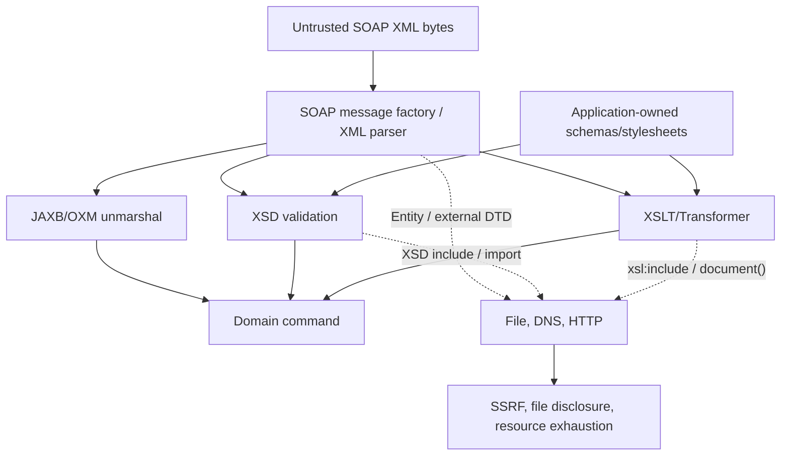
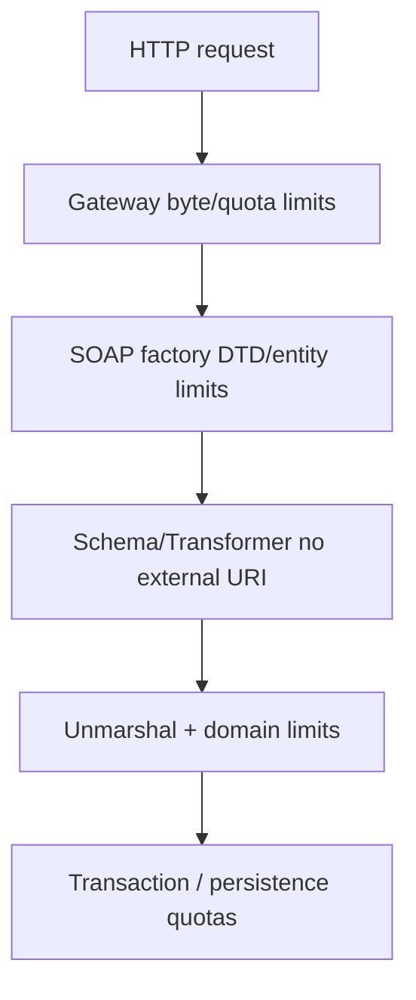

# Ngăn phân giải tài nguyên ngoài tại parser, marshaller và transformer

## 1. Vì sao SOAP XML cần một chính sách phân giải tài nguyên?

Trong **Spring Web Services (Spring-WS)**, một SOAP message có thể đi qua nhiều thành phần XML trước khi trở thành dữ liệu nghiệp vụ: SOAP message factory, parser DOM/SAX/StAX, JAXB/OXM, XSD validator, XSLT transformer và các interceptor. Nếu một thành phần được phép **tự tải tài nguyên được khai báo trong XML hoặc stylesheet**, một thông điệp nhìn có vẻ hợp lệ có thể khiến server truy cập file cục bộ, gọi URL nội bộ hoặc tốn tài nguyên ngoài dự kiến.

Đó là một nhóm rủi ro quan trọng trong **XML External Entity (XXE)**, **server-side request forgery (SSRF)** và **XML denial of service**. Đôi khi lỗi không nằm ở SOAP Body: một stylesheet XSLT có `document()`, một XSD có `xs:import` trỏ ra Internet, hoặc một `Source` đã bị parse bằng factory chưa cấu hình cũng tạo đường phân giải tài nguyên.

Bài thuộc chương **Bảo vệ xử lý XML** của module **SPRING_WEB_SERVICES**, với bối cảnh học phát triển dịch vụ SOAP **contract-first**, XSD/WSDL, JAXB, Spring-WS endpoint/client, SOAP Fault, interceptor, WS-Security, chứng chỉ và kiểm thử tương thích.

### Bạn sẽ học được gì?

Sau bài học, bạn có thể:

1. Giải thích thế nào là **external resource resolution** ở parser, XSD validator, transformer và JAXB/OXM.
2. Phân biệt **XML input ban đầu** với **tài nguyên phụ mà XML yêu cầu parser tải**.
3. Chặn `DOCTYPE`, external entities, external DTD, XInclude, schema imports và XSLT external resources.
4. Cấu hình an toàn DOM, SAX và StAX theo JAXP.
5. Hiểu giới hạn của `Jaxb2Marshaller.setSupportDtd(false)` và `setProcessExternalEntities(false)` khi đầu vào là `DOMSource` hoặc `StAXSource`.
6. Dùng `XMLConstants.ACCESS_EXTERNAL_DTD`, `ACCESS_EXTERNAL_SCHEMA` và `ACCESS_EXTERNAL_STYLESHEET` đúng từng tầng.
7. Thiết kế resolver/catalog **allowlist, offline và fail-closed**, không để `return null` mở đường cho resolver mặc định.
8. Đặt bảo vệ ở cả SOAP inbound và SOAP client nhận response, chứ không chỉ trong endpoint.
9. Kiểm thử không có file/network access ngoài ý muốn và phân biệt lỗi XML/security với SOAP Fault.
10. Biết khi nào một giải pháp “đã tắt XXE” vẫn chưa đủ trước tấn công cạn CPU/bộ nhớ, SSRF hoặc XML Signature Wrapping.

## 2. Một ranh giới quan trọng: dữ liệu XML không có quyền cấp quyền truy cập I/O

Ví dụ SOAP client gửi một request:

```xml
<sh:GetShipmentStatusRequest
    xmlns:sh="urn:example:shipment:v1">
  <sh:shipmentId>SHP-1042</sh:shipmentId>
</sh:GetShipmentStatusRequest>
```

Đây chỉ là dữ liệu nghiệp vụ. Server **không cần mở một URL hoặc file bên ngoài** để đọc `shipmentId`.

Ngược lại, XML có thể chứa những cấu trúc làm một processor nghĩ rằng nó cần tìm nội dung ở nguồn khác:

- `DOCTYPE` với external subset.
- Entity có `SYSTEM` hoặc `PUBLIC` identifier.
- `xsi:schemaLocation` hoặc `xs:import`/`xs:include`.
- `xi:include` khi XInclude được bật.
- XSLT `xsl:import`, `xsl:include` hoặc hàm `document()`.
- Một URI được truyền trực tiếp qua `StreamSource(String systemId)`, `SAXSource` hoặc resolver tùy biến.

**Nguyên tắc:** XML đến từ client/đối tác là dữ liệu thiếu tin cậy. Nó không được tự chọn file nội bộ, URL mạng, stylesheet hoặc schema mà ứng dụng sẽ tải. Những tài nguyên thật sự cần thiết phải do **application code và cấu hình đã phê duyệt** chọn.

### 2.1. Sơ đồ bề mặt tấn công



Các đường chấm biểu diễn **hành vi phải ngăn hoặc giới hạn**. Không nên giả định chặn ở `JAXB` đồng nghĩa chặn ở parser của SOAP message factory, hoặc chặn parser đồng nghĩa chặn XSLT stylesheet.

## 3. External entity, external subset và expansion

Một tài liệu XML có thể khai báo DTD và entities:

```xml
<?xml version="1.0" encoding="UTF-8"?>
<!DOCTYPE status [
  <!ENTITY label "SHP-1042">
]>
<status>&label;</status>
```

Đây là **internal entity**; nó không cần truy cập mạng hay file. Nhưng parser vẫn phải mở rộng nội dung. Nếu có các entities lồng nhau với kích thước tăng nhanh, nó có thể gây cạn tài nguyên ngay cả khi không có external URL.

Ví dụ một **external entity** chỉ dùng endpoint giả:

```xml
<?xml version="1.0" encoding="UTF-8"?>
<!DOCTYPE status [
  <!ENTITY remote SYSTEM "https://untrusted.invalid/probe.txt">
]>
<status>&remote;</status>
```

Nếu parser cho phép external entity resolution, nó có thể cố truy cập địa chỉ không do ứng dụng phê duyệt. Thay URI bằng một file URI trỏ tới tài nguyên cục bộ thì rủi ro là đọc file không được phép.

**Các đoạn XML trên là test fixtures để minh họa điều phải từ chối**, không phải cách thiết kế request SOAP hợp lệ. Trong SOAP service thông thường, cách an toàn và dễ kiểm soát nhất là **từ chối hoàn toàn `DOCTYPE`**.

### 3.1. Những gì có thể xảy ra

| Kịch bản | Tác động |
| --- | --- |
| Entity tham chiếu `file:` | Đọc nội dung file cục bộ nếu process có quyền |
| Entity tham chiếu `http:` hoặc `https:` | SSRF, request sang mạng nội bộ hoặc Internet |
| External parameter entity | Tải tài nguyên trong lúc xử lý DTD, đôi khi ngay trước khi đọc Body |
| Entity expansion lặp | CPU/memory exhaustion |
| XInclude | Đọc tài nguyên khác dù đã tắt DTD |
| XSD import/include | Tự tải schema từ URI trong contract/input |
| XSLT document()/import/include | Tải XML hoặc stylesheet bổ sung |
| Custom URI resolver không kiểm host | Vượt chính sách mặc định của JAXP |

Không phải mọi processor có cùng mặc định hay cơ chế fail. Một số bỏ qua entity, một số throw exception, một số lại tải tài nguyên. **Phải kiểm thử trên đúng JDK, XML provider và phiên bản library đang dùng.**

## 4. Ba loại tài nguyên cần phân biệt

| Loại tài nguyên | Ai chọn? | Cách kiểm soát |
| --- | --- | --- |
| **Input gốc**: SOAP XML bytes mà endpoint chủ động đọc | Transport/application | Giới hạn kích thước, nguồn đáng tin, URL allowlist nếu có tải |
| **External reference trong XML**: entity, DTD, XInclude | Nội dung XML thiếu tin cậy | Reject DTD, disable external, resolver fail-closed |
| **Phụ thuộc của stylesheet/schema**: XSLT import hoặc XSD include | XSL/XSD hoặc XML hints | Application-owned artifacts, catalog/allowlist, cấm network fallback |

Điểm tinh tế: `XMLConstants.ACCESS_EXTERNAL_*` chủ yếu kiểm **external references mà processor định phân giải**; nó **không tự cấm application gọi**:

```java
new java.net.URL(userSuppliedUrl).openStream();
```

hoặc:

```java
new javax.xml.transform.stream.StreamSource(userSuppliedUrl);
```

Nếu chính application đưa một URL thiếu tin cậy làm **input ban đầu**, parser restrictions không thay thế destination allowlist, SSRF protections và egress firewall.

## 5. Chính sách mặc định cho SOAP contract-first

Với hầu hết SOAP endpoints chỉ dùng WSDL/XSD đã phát hành:

1. **Từ chối DOCTYPE** trong XML request và response.
2. **Tắt external entities và external DTDs** ở mọi parser do code tạo.
3. **Tắt XInclude** trừ khi thật sự là một yêu cầu hợp đồng đã được phê duyệt.
4. **Cấm external schema/stylesheet access** ở validator/transformer.
5. **Tải schema và stylesheet từ resources của ứng dụng**, không dùng URI client khai.
6. Nếu cần imports/includes, dùng **catalog/resolver allowlist trỏ đến tài nguyên cục bộ**.
7. **Fail closed** khi processor không hỗ trợ một security property bắt buộc.
8. Bổ sung giới hạn byte size, XML depth, entity expansion, CPU/time/memory.
9. Áp cùng chính sách cho **SOAP server lẫn SOAP client** khi parse response đối tác.
10. Kiểm thử bằng các payload từ chối và xác minh **không có I/O ngoài ý muốn**.

Chính sách này không thay thế TLS/mTLS, WS-Security signature/timestamp, XSD validation hay authorization theo người dùng.

## 6. Ba nhóm thuộc tính JAXP phải nhớ

Trong Java, các hằng số thuộc `javax.xml.XMLConstants`, **không** thuộc `jakarta.xml`:

| Hằng số | Kiểm soát tham chiếu nào? | API thường áp dụng |
| --- | --- | --- |
| `XMLConstants.ACCESS_EXTERNAL_DTD` | External DTD và external entity references | DOM/SAX, SchemaFactory, Validator, TransformerFactory |
| `XMLConstants.ACCESS_EXTERNAL_SCHEMA` | External XSD references qua imports/includes/schema hints | SchemaFactory, Validator, parser khi validation |
| `XMLConstants.ACCESS_EXTERNAL_STYLESHEET` | Stylesheet imports/includes, XSLT `document()` | TransformerFactory/Transformer |
| `XMLConstants.FEATURE_SECURE_PROCESSING` | Yêu cầu processor áp dụng hạn chế xử lý an toàn theo provider | DOM, SAX, TransformerFactory, SchemaFactory |

Giá trị của `ACCESS_EXTERNAL_*` là danh sách **protocols** được cho phép. Giá trị `""` nghĩa là **không cho phép protocol ngoài nào**. `"all"` là cực kỳ rộng. Ví dụ `"file"` hoặc `"https"` chỉ giới hạn **scheme**, không phải thư mục hoặc host cụ thể.

### 6.1. Vì sao không chỉ bật FEATURE_SECURE_PROCESSING?

`FEATURE_SECURE_PROCESSING` (FSP) khởi động các cơ chế phòng vệ phụ thuộc provider và JDK, gồm một số hạn mức xử lý. Nhưng:

- Một số mặc định JAXP vẫn cho phép external access khi FSP chỉ ở trạng thái mặc định.
- Chỉ bật FSP không thay thế việc reject DTD, đặt `ACCESS_EXTERNAL_*=""` hoặc kiểm soát resolver.
- Custom provider có thể diễn giải/từ chối thuộc tính khác nhau.
- FSP không biết application đã tự mở URL nào trước khi gọi parser.

**Cấu hình từng processor cụ thể**, rồi chứng minh bằng tests. Oracle JAXP Security Guide phân biệt **FSP được bật rõ ràng qua API** với trạng thái mặc định của implementation; không nên suy ra một môi trường khác cũng có hiệu quả y hệt.

### 6.2. Ưu tiên deny over permissive

```java
factory.setAttribute(XMLConstants.ACCESS_EXTERNAL_DTD, "");
```

an toàn hơn nhiều so với:

```java
factory.setAttribute(XMLConstants.ACCESS_EXTERNAL_DTD, "all");
```

Đừng thêm `"file,http,https"` chỉ để “sửa lỗi không tìm thấy schema”. Hãy sửa cách phân phối schema hoặc dùng allowlist resolver/catalog.

## 7. DOM: cấu hình DocumentBuilderFactory để từ chối DTD

Đối với XML nhỏ/vừa cần DOM tree, hãy harden factory **trước** khi tạo builder:

```java
import java.io.InputStream;
import javax.xml.XMLConstants;
import javax.xml.parsers.DocumentBuilder;
import javax.xml.parsers.DocumentBuilderFactory;
import org.w3c.dom.Document;
import org.xml.sax.SAXException;

public final class SecureDom {

    public static DocumentBuilder newBuilder() throws Exception {
        DocumentBuilderFactory factory =
                DocumentBuilderFactory.newInstance();

        factory.setNamespaceAware(true);
        factory.setFeature(
            "http://apache.org/xml/features/disallow-doctype-decl",
            true);
        factory.setFeature(
            XMLConstants.FEATURE_SECURE_PROCESSING, true);

        factory.setXIncludeAware(false);
        factory.setExpandEntityReferences(false);

        factory.setAttribute(
            XMLConstants.ACCESS_EXTERNAL_DTD, "");
        factory.setAttribute(
            XMLConstants.ACCESS_EXTERNAL_SCHEMA, "");

        DocumentBuilder builder = factory.newDocumentBuilder();
        builder.setEntityResolver((publicId, systemId) -> {
            throw new SAXException(
                "External entity resolution is forbidden");
        });
        return builder;
    }

    public static Document parse(InputStream input)
            throws Exception {
        return newBuilder().parse(input);
    }
}
```

Code minh họa cho các JAXP providers phổ biến; `disallow-doctype-decl` là feature URI gắn với họ Xerces và có thể không được mọi provider hỗ trợ. **Nếu một thiết lập bắt buộc ném `ParserConfigurationException` hoặc `IllegalArgumentException`, dừng startup/request thay vì bắt rồi tiếp tục với parser không được bảo vệ.**

### 7.1. Vì sao vừa reject DOCTYPE vừa set EntityResolver?

Reject `DOCTYPE` là cơ chế chính. `EntityResolver` ném lỗi tạo thêm một hàng rào nếu provider xử lý DTD theo đường khác hoặc cấu hình thay đổi. Nó cũng giúp code review thấy chính sách **không phân giải external entities**.

`setExpandEntityReferences(false)` chỉ điều chỉnh cách xây DOM với entity reference nodes, **không phải** biện pháp thay thế cho việc chặn external resources.

### 7.2. XInclude là đường khác

`XInclude` cho phép XML tham chiếu nội dung khác qua `xi:include` nếu processor bật hỗ trợ. Nó độc lập với external DTD resolution. `factory.setXIncludeAware(false)` cần được giữ trong chính sách SOAP thông thường; một parser có DTD disabled nhưng XInclude enabled vẫn có thể có đường đọc tài nguyên khác.

### 7.3. Không truyền String path từ client cho parse

Ưu tiên `parse(InputStream)` do ứng dụng chủ động nhận từ request body đã giới hạn. Overload nhận `String uri` có thể dùng URI làm nguồn input; nếu caller điều khiển URI, đây là bài toán SSRF/file access **bên ngoài** kiểm soát entity references.

## 8. SAX: cấu hình parser và sử dụng XMLReader trực tiếp

SAX phù hợp cho XML streaming theo events, nhưng `SAXParserFactory` và `XMLReader` vẫn cần cấu hình:

```java
import java.io.InputStream;
import javax.xml.XMLConstants;
import javax.xml.parsers.SAXParserFactory;
import org.xml.sax.InputSource;
import org.xml.sax.XMLReader;
import org.xml.sax.helpers.DefaultHandler;

public final class SecureSax {

    public static XMLReader newReader() throws Exception {
        SAXParserFactory factory =
                SAXParserFactory.newInstance();
        factory.setNamespaceAware(true);

        factory.setFeature(
            "http://apache.org/xml/features/disallow-doctype-decl",
            true);
        factory.setFeature(
            XMLConstants.FEATURE_SECURE_PROCESSING,
            true);

        XMLReader reader =
                factory.newSAXParser().getXMLReader();

        reader.setFeature(
            "http://xml.org/sax/features/external-general-entities",
            false);
        reader.setFeature(
            "http://xml.org/sax/features/external-parameter-entities",
            false);
        reader.setFeature(
            "http://apache.org/xml/features/nonvalidating/load-external-dtd",
            false);

        reader.setEntityResolver((publicId, systemId) -> {
            throw new org.xml.sax.SAXException(
                "External entity resolution is forbidden");
        });

        return reader;
    }

    public static void parse(
            InputStream input, DefaultHandler handler)
            throws Exception {
        XMLReader reader = newReader();
        reader.setContentHandler(handler);
        reader.parse(new InputSource(input));
    }
}
```

`XMLReader` features cũng có những URI tùy provider. Nếu không hỗ trợ bảo vệ bắt buộc, **fail closed**. Với một `SAXSource` cấp cho JAXB/XSLT, hãy dùng đúng `XMLReader` được harden và tạo `InputSource` từ stream do ứng dụng kiểm soát.

### 8.1. Một cạm bẫy của SAXParser.parse(handler)

Một số overload `SAXParser.parse(..., DefaultHandler)` có thể cài handler làm resolver, thay thế `EntityResolver` đã gắn trước đó. Với mục tiêu kiểm soát external resolution, cách rõ ràng là **gọi `XMLReader.parse(...)` trực tiếp sau khi cài parser, handler và resolver** như trên.

### 8.2. Namespace vẫn bắt buộc

Khi làm SOAP contract-first, kiểm QName là `{namespaceURI}localPart`, không chỉ prefix. Một parser thiếu namespace-awareness có thể làm logic định tuyến/validation sai dù XXE đã bị chặn.

## 9. StAX: tắt DTD và external entities theo properties

Với `XMLInputFactory`:

```java
import java.io.InputStream;
import javax.xml.stream.XMLInputFactory;
import javax.xml.stream.XMLStreamException;
import javax.xml.stream.XMLStreamReader;

public final class SecureStax {

    public static XMLInputFactory newFactory() {
        XMLInputFactory factory =
                XMLInputFactory.newFactory();

        factory.setProperty(
            XMLInputFactory.SUPPORT_DTD, Boolean.FALSE);
        factory.setProperty(
            XMLInputFactory.IS_SUPPORTING_EXTERNAL_ENTITIES,
            Boolean.FALSE);

        factory.setXMLResolver(
            (publicId, systemId, baseUri, namespace) -> {
                throw new XMLStreamException(
                    "External resource is forbidden");
            });

        return factory;
    }

    public static void inspect(InputStream input)
            throws XMLStreamException {

        XMLStreamReader reader =
                newFactory().createXMLStreamReader(input);

        try {
            while (reader.hasNext()) {
                reader.next();
                // Chỉ xử lý events cần thiết của application.
            }
        } finally {
            reader.close();
        }
    }
}
```

`XMLInputFactory.SUPPORT_DTD=false` từ chối hoặc tắt xử lý DTD tùy provider; `IS_SUPPORTING_EXTERNAL_ENTITIES=false` chặn external entity processing. Resolver ném lỗi là defense-in-depth. Không bỏ qua exception nếu implementation không hỗ trợ một property cần thiết.

### 9.1. StAX không tự bảo vệ khỏi mọi DoS

- Một document có quá nhiều events vẫn có thể tiêu tốn CPU.
- Attribute/text values cực dài cần giới hạn kích thước.
- Nếu SAX/DOM parser đã parse XML trước rồi mới bọc vào StAX-related structure, việc tạo StAX factory ở bước sau không sửa được lần parse trước.
- Nếu ứng dụng dùng JAXB trực tiếp với `StAXSource`, security flags của JAXB adapter **không thể cấu hình lại** `XMLStreamReader` đã được tạo.

### 9.2. Đóng tài nguyên ở đúng owner

`XMLStreamReader.close()` đóng reader state; việc có đóng `InputStream` bên dưới hay không là vấn đề ownership/implementation. Bên tạo input stream phải quản lý vòng đời rõ ràng; không bỏ mặc stream vì parser có `close()`.

## 10. Chọn parser theo loại Source, không theo tên thư viện

Spring OXM và JAXP làm việc với `javax.xml.transform.Source`:

| Source | Đầu vào thật | Nơi phải harden |
| --- | --- | --- |
| `StreamSource` | Reader/InputStream/systemId | Parser được thư viện chọn để đọc source hoặc biến đổi sang hardened SAX/StAX |
| `SAXSource` | `XMLReader` + `InputSource` | **XMLReader do ứng dụng cung cấp** |
| `DOMSource` | DOM node/document **đã được tạo** | **Parser tạo DOM trước đó** |
| `StAXSource` | `XMLStreamReader`/`XMLEventReader` **đã được tạo** | **StAX factory tạo reader trước đó** |
| `JAXBSource` | JAXB object | Không phải XML bytes chưa parse; vẫn kiểm adapter/serialization |

**Điểm quan trọng:** nếu một unsafe DOM parser đã giải quyết external entity và đưa nội dung vào DOM, đặt `setProcessExternalEntities(false)` ở JAXB sau đó **không thể xóa việc đọc file đã xảy ra**. Tương tự, khi một unsafe StAX reader đã đọc events, lớp nhận `StAXSource` không tự harden reader ấy.

Do đó phải kiểm soát **nguồn sinh ra Source**, không chỉ API nhận Source.

## 11. JAXB Unmarshaller: đọc XML là nơi có rủi ro chính

JAXB `Marshaller` chủ yếu chuyển Java objects thành XML; `Unmarshaller` chuyển XML thành Java objects. **External resolution thường xảy ra khi đọc XML**, tức ở unmarshaller hoặc parser mà unmarshaller sử dụng.

Một hướng an toàn là cấp cho JAXB một StAX reader đã harden:

```java
import java.io.InputStream;
import jakarta.xml.bind.JAXBContext;
import jakarta.xml.bind.Unmarshaller;
import javax.xml.stream.XMLStreamReader;

public final class SecureJaxbRead {

    public static Object read(
            JAXBContext context, InputStream input)
            throws Exception {

        XMLStreamReader reader =
                SecureStax.newFactory()
                        .createXMLStreamReader(input);

        try {
            Unmarshaller unmarshaller =
                    context.createUnmarshaller();

            return unmarshaller.unmarshal(reader);
        } finally {
            reader.close();
        }
    }
}
```

Ví dụ dùng Jakarta JAXB trong Spring Framework/Spring-WS hiện đại. Với stack cũ dùng `javax.xml.bind.*`, API/package khác; **không trộn Jakarta và Javax generated annotations** trong một runtime.

### 11.1. Tại sao không chỉ gọi unmarshal(InputStream)?

`Unmarshaller.unmarshal(InputStream)` để JAXB provider tự lựa chọn parser. Một số providers có protections mặc định nhưng behavior có thể khác theo bản runtime và cấu hình. Cấp một hardened `XMLStreamReader` hoặc `SAXSource` cho unmarshaller giúp ứng dụng kiểm soát rõ parser dùng cho dữ liệu thiếu tin cậy.

Hãy kiểm thử chính code path thực tế; không suy ra JAXB đã an toàn chỉ vì một unit test DOM riêng được viết.

### 11.2. Unmarshal có schema validation khác parsing

Nếu gọi `unmarshaller.setSchema(schema)`, việc chuẩn bị `Schema` và resolve XSD imports cũng phải an toàn, **độc lập** với việc parser của XML request đã từ chối entities. Hai boundary này cần được harden và kiểm thử riêng.

## 12. Spring Jaxb2Marshaller: các thiết lập có thật và giới hạn của chúng

Spring Framework có `org.springframework.oxm.jaxb.Jaxb2Marshaller` dùng cho JAXB/OXM trên `@Endpoint` và `WebServiceTemplate`:

```java
import org.springframework.context.annotation.Bean;
import org.springframework.context.annotation.Configuration;
import org.springframework.oxm.jaxb.Jaxb2Marshaller;

@Configuration
public class ShipmentJaxbConfig {

    @Bean
    public Jaxb2Marshaller shipmentMarshaller() {
        Jaxb2Marshaller marshaller =
                new Jaxb2Marshaller();

        marshaller.setContextPath(
            "com.example.shipment.contract.v1");

        marshaller.setSupportDtd(false);
        marshaller.setProcessExternalEntities(false);

        return marshaller;
    }
}
```

Theo Javadoc Spring Framework 6.x, mặc định hai tùy chọn trên là **`false`**. Nên đặt rõ ở security-sensitive code để policy dễ review và kiểm chứng.

Nhưng Javadoc cũng lưu ý:

- `setProcessExternalEntities(...)` điều khiển xử lý external entities khi `Source` cấp cho `unmarshal(Source)` là **`StreamSource` hoặc `SAXSource`**.
- Nó **không có hiệu lực** với `DOMSource` hoặc `StAXSource` đã tạo sẵn.
- Đặt `setProcessExternalEntities(true)` còn bật `setSupportDtd(true)`.

### 12.1. Không nhầm tên Marshaller với toàn bộ XML parsing

`Jaxb2Marshaller` là adapter implements cả `Marshaller` và `Unmarshaller`. Tên class không có nghĩa `marshal(...)` đi đọc file bên ngoài, cũng không có nghĩa một bean đã cấu hình sẽ bảo vệ mọi parser ở ứng dụng.

Rủi ro nằm ở các phần:

1. Cách **input XML được parse** trước và trong unmarshal.
2. Việc load/compile **XSD/schema** gắn vào marshaller.
3. Custom `XmlAdapter`, resolver hoặc listener do ứng dụng viết, nếu chúng tự đọc file/network.
4. Những transformations ở trước/sau JAXB.

`Marshaller.JAXB_SCHEMA_LOCATION` có thể đưa một schema-location hint vào XML output; thuộc tính đó **không nên được lắp từ URL do caller tùy ý cung cấp** để khuyến khích bên nhận tải schema không đáng tin.

### 12.2. Spring-WS endpoint nhận JAXB object

Ví dụ:

```java
@Endpoint
public class ShipmentEndpoint {
    private static final String NS =
            "urn:example:shipment:v1";

    @PayloadRoot(
        namespace = NS,
        localPart = "GetShipmentStatusRequest")
    @ResponsePayload
    public GetShipmentStatusResponse status(
            @RequestPayload GetShipmentStatusRequest request) {
        // Dữ liệu request đã qua SOAP parser trước khi vào method.
        return applicationService.getStatus(request);
    }
}
```

Đây là **khung minh họa**, giả định generated JAXB types và application service đã tồn tại. Việc method nhận được object không chứng minh parser tạo SOAP message, validator XSD hoặc unmarshaller đều đã được harden. Cần kiểm tra *toàn bộ pipeline*.

## 13. Spring-WS MessageFactory: parse xảy ra trước endpoint

Một Spring-WS service thường có pipeline:

```text
HTTP transport / MessageDispatcherServlet
              |
              v
WebServiceMessageFactory (ví dụ SAAJ)
              |
              v
SOAP Envelope / Header / Body representation
              |
              v
Endpoint mapping / EndpointInterceptor
              |
              v
JAXB / Payload parsing / Adapter
              |
              v
@Endpoint -> Application use case
```

**Một request độc hại có thể kích hoạt parser trước khi chạy `@Endpoint` hoặc JAXB bean.** Vì vậy:

- Đừng đặt toàn bộ kế hoạch XXE prevention vào một utility được gọi từ handler method.
- Kiểm cấu hình, provider và version của **SOAP message factory/SAAJ** được dùng.
- Kiểm bộ SOAP client tương ứng khi **đọc response** từ đối tác.
- Nếu framework dùng DOM/SAX/StAX bên trong, xác nhận thực tế nó reject DTD/external references trong code path đó.
- Cấu hình gateway/container có request body limits từ sớm; tránh parser dùng quá nhiều memory trước khi interceptor kiểm quota.

Không có một thuộc tính Java duy nhất đảm bảo **mọi** XML provider, JAXB runtime, SAAJ implementation, XSLT engine và WSS4J đều không truy cập tài nguyên ngoài.

### 13.1. XML security không giống WS-Security

**XML processing security** bảo đảm dữ liệu XML không khiến server đọc URI/file tùy ý hoặc cạn tài nguyên.

**WS-Security** bảo đảm message-level authentication, integrity, confidentiality và timestamp theo policy. Chữ ký hợp lệ **không thay thế** parser hardening; parser vẫn phải đọc XML để tìm vùng cần kiểm chữ ký.

## 14. TransformerFactory: chặn external stylesheet và DTD

`javax.xml.transform.TransformerFactory` có thể dùng cho identity transform hoặc XSLT. Nó có các điểm truy cập ngoài độc lập:

- External DTD khi parse source/style.
- `xsl:import` và `xsl:include`.
- XSLT `document()`.
- Custom `URIResolver`.

Một factory có external access bị chặn:

```java
import javax.xml.XMLConstants;
import javax.xml.transform.TransformerFactory;
import javax.xml.transform.TransformerException;

public final class SecureTransformers {

    public static TransformerFactory newFactory() {
        TransformerFactory factory =
                TransformerFactory.newInstance();

        try {
            factory.setFeature(
                XMLConstants.FEATURE_SECURE_PROCESSING,
                true);
            factory.setAttribute(
                XMLConstants.ACCESS_EXTERNAL_DTD, "");
            factory.setAttribute(
                XMLConstants.ACCESS_EXTERNAL_STYLESHEET, "");

            factory.setURIResolver((href, base) -> {
                throw new TransformerException(
                    "External stylesheet/XML URI denied");
            });

            return factory;
        } catch (Exception ex) {
            throw new IllegalStateException(
                "Cannot configure secure TransformerFactory", ex);
        }
    }
}
```

Ở đây ngoại lệ từ một security setting làm **factory không được sử dụng**. Với providers chỉ chấp nhận thuộc tính ở cách khác, phải chọn cách được tài liệu provider xác nhận và kiểm thử; không bỏ qua silently.

### 14.1. Hai bước khác nhau của XSLT

1. **Compile stylesheet**: `newTransformer(stylesheetSource)` có thể resolve `xsl:import`/`xsl:include`.
2. **Transform input**: `transform(xmlSource, result)` có thể kích hoạt `document()` hoặc parse XML input.

Do đó cài policy **trước khi compile** stylesheet. Khi cần, cài resolver trên cả factory/transformer theo provider. Dùng hardened XML parser cho **source XML đầu vào**; factory restrictions không thể thu hồi một external entity đã được resolver khác đọc từ trước.

### 14.2. Identity transform cũng cần input an toàn

```java
Transformer transformer =
        SecureTransformers.newFactory().newTransformer();

transformer.transform(
        new javax.xml.transform.dom.DOMSource(safeDocument),
        new javax.xml.transform.stream.StreamResult(writer));
```

`safeDocument` phải được tạo bởi `SecureDom.newBuilder()` hoặc parser tương đương; `writer` là writer do ứng dụng sở hữu. Nếu dùng `StreamSource` raw XML, hãy kiểm chính transformer/provider sẽ tạo parser nào và các hạn chế DTD đang có hiệu lực.

Không lấy từ client một URL stylesheet rồi gọi `newTransformer(new StreamSource(url))`. Một stylesheet không tin cậy có thể dùng các tính năng processor-specific ngoài phạm vi một số external access properties.

## 15. XSLT document(), xsl:import và xsl:include

Ví dụ stylesheet chỉ để **kiểm thử policy từ chối**, không phải business transform:

```xml
<xsl:stylesheet
    version="1.0"
    xmlns:xsl="http://www.w3.org/1999/XSL/Transform">

  <xsl:template match="/">
    <out>
      <xsl:value-of
          select="document('https://untrusted.invalid/data.xml')/data"/>
    </out>
  </xsl:template>
</xsl:stylesheet>
```

Nếu XSLT engine cho phép `document()` truy cập URL, XML processing boundary đã bị vượt. Tương tự:

```xml
<xsl:import href="https://untrusted.invalid/extra.xsl"/>
```

có thể khiến processor tải stylesheet khác lúc compile.

**Cách làm đúng:**

- Stylesheet được chọn bởi application và phát hành cùng phiên bản phần mềm.
- `ACCESS_EXTERNAL_STYLESHEET=""`, `ACCESS_EXTERNAL_DTD=""`.
- `URIResolver` chỉ trả về nội dung từ allowlist hoặc ném exception.
- Không cho đối tác gửi nguyên XSLT để server thực thi như mã đáng tin.
- Test riêng ở cả **thời điểm compile** và **thời điểm transform**.

### 15.1. Chỉ hạn chế protocol chưa phải allowlist

`ACCESS_EXTERNAL_STYLESHEET="https"` vẫn có thể cho phép truy cập **mọi HTTPS URL** phù hợp của engine, không chỉ host đối tác đã cho phép. Hãy ưu tiên giá trị rỗng; nếu cần dependency, dùng resource resolver/catalog gắn cố định vào artifacts được kiểm soát.

## 16. SchemaFactory: external schema imports là một cửa riêng

Một SOAP service contract-first có thể dùng:

```xml
<xs:schema xmlns:xs="http://www.w3.org/2001/XMLSchema">
  <xs:include
      schemaLocation="https://untrusted.invalid/extra.xsd"/>
</xs:schema>
```

Ví dụ này minh họa trường hợp phải **từ chối schema reference ngoài allowlist**. Nó khác với external entity trong `DOCTYPE`; vì thế chặn DTD ở DOM parser không tự chặn schema imports.

Đối với một XSD nội bộ **không có imports/includes**, có thể compile an toàn bằng:

```java
import java.io.InputStream;
import javax.xml.XMLConstants;
import javax.xml.transform.stream.StreamSource;
import javax.xml.validation.Schema;
import javax.xml.validation.SchemaFactory;

public final class SecureSchemas {

    public static Schema compile(InputStream trustedXsd)
            throws Exception {

        SchemaFactory factory =
                SchemaFactory.newInstance(
                    XMLConstants.W3C_XML_SCHEMA_NS_URI);

        factory.setFeature(
            XMLConstants.FEATURE_SECURE_PROCESSING, true);
        factory.setProperty(
            XMLConstants.ACCESS_EXTERNAL_DTD, "");
        factory.setProperty(
            XMLConstants.ACCESS_EXTERNAL_SCHEMA, "");

        // trustedXsd do ứng dụng mở, không phải URL do client cung cấp.
        return factory.newSchema(new StreamSource(trustedXsd));
    }
}
```

`Schema` có thể được tạo lúc startup và tái sử dụng nếu implementation cho phép. `SchemaFactory` không nên được chia sẻ/tùy biến đồng thời nếu provider không bảo đảm thread safety. Application chịu trách nhiệm đóng `trustedXsd` sau khi compile.

### 16.1. Validator cũng là một processor

`SchemaFactory` biên dịch XSD; `Validator` áp dụng schema lên XML instance:

```java
import javax.xml.XMLConstants;
import javax.xml.validation.Schema;
import javax.xml.validation.Validator;
import javax.xml.transform.dom.DOMSource;
import org.w3c.dom.Document;

public static void validate(
        Schema schema, Document parsedSafely)
        throws Exception {

    Validator validator = schema.newValidator();
    validator.setProperty(
        XMLConstants.ACCESS_EXTERNAL_DTD, "");
    validator.setProperty(
        XMLConstants.ACCESS_EXTERNAL_SCHEMA, "");

    validator.validate(new DOMSource(parsedSafely));
}
```

Dùng **một Validator mới cho mỗi validation** hoặc lifecycle đúng theo API; `Validator` không được giả định thread-safe. XML đã được parse bởi `SecureDom` nên bước này không vô tình đọc entity trước khi validation.

### 16.2. Gắn resolver tại factory và validator

Nếu dùng `LSResourceResolver` tùy biến để giải quyết `xs:import`/`xs:include`, cần cấu hình nó ở `SchemaFactory` và khi thích hợp ở `Validator`/`ValidatorHandler`; **Validator không tự kế thừa custom resolver đã cài lên factory**.

Khi policy có imports hợp lệ, test phải chứng minh mọi dependencies được giải quyết **offline hoặc từ allowlist**, không tự rơi về network.

## 17. Không tin xsi:schemaLocation trong SOAP request

Client có thể gửi:

```xml
<sh:GetShipmentStatusRequest
    xmlns:sh="urn:example:shipment:v1"
    xmlns:xsi="http://www.w3.org/2001/XMLSchema-instance"
    xsi:schemaLocation="
      urn:example:shipment:v1
      https://untrusted.invalid/request-schema.xsd">
  <sh:shipmentId>SHP-1042</sh:shipmentId>
</sh:GetShipmentStatusRequest>
```

`xsi:schemaLocation` là **hint** về nơi tìm schema. Không có lý do để server SOAP contract-first tải một XSD từ URL do sender gợi ý khi server đã sở hữu schema v1 chính thức.

Chính sách đúng:

1. Application lựa chọn XSD bằng **QName/version được chấp nhận**.
2. Load XSD từ resources đã đóng gói hoặc catalog.
3. Từ chối hoặc bỏ qua hints chưa được tin theo behavior của validator đã cấu hình.
4. Đặt `ACCESS_EXTERNAL_SCHEMA=""` và harden resolver.
5. Unit/integration test rằng request chứa `xsi:schemaLocation` tới URI ngoài **không tạo outbound call**.

Đừng sửa bằng cách cho phép `https` trên toàn hệ thống XML chỉ để “hết lỗi import”.

## 18. Resolver và catalog: cho phép ngoại lệ có kiểm soát

Một hợp đồng WSDL/XSD đôi khi thật sự có dependency:

```xml
<xs:import
    namespace="urn:example:common:v1"
    schemaLocation="common-v1.xsd"/>
```

Giải pháp không phải bỏ bảo vệ mà là **đóng gói các XSD đã phê duyệt** và định nghĩa mapping rõ ràng.

### 18.1. Chính sách allowlist

Một resolver nên:

- Chỉ nhận namespace/systemId nằm trong **tập đã khai báo**.
- Trả về stream từ classpath hoặc resource bundle có checksum/version.
- Không lấy URI nhập từ XML rồi gọi `new URL(...).openStream()`.
- Từ chối nếu không match, không thay bằng URL gần giống.
- Có log an toàn để phân biệt resource thiếu và tài nguyên bị cấm.
- Đóng stream theo API/ownership để không leak.

### 18.2. Vì sao return null trong resolver có thể nguy hiểm?

Trong nhiều JAXP resolvers, trả `null` nghĩa là **“tôi không giải quyết, hãy để processor tiếp tục resolution mặc định”**. Nếu default policy cho phép network/file, nó có thể tải URL do XML đưa vào.

Vì vậy, với mục tiêu deny-by-default, hãy ném exception hoặc dùng **catalog strict** cho identifier không thuộc allowlist.

### 18.3. XML Catalog API

JDK cung cấp `javax.xml.catalog` để ánh xạ public/system identifiers hoặc URIs sang resources đã phê duyệt. Với `CatalogFeatures.Feature.RESOLVE` ở chế độ `strict`, unresolved identifiers được coi là lỗi theo chính sách catalog.

Quy trình an toàn:

```text
XSD/WSDL/XML references an identifier
              |
              v
CatalogResolver (strict, application-owned)
              |
        +-----+------+
        |            |
  Known identifier   Unknown identifier
        |            |
  Local trusted XSD  Reject, no network fallback
```

Lưu ý: catalog entries themselves cũng phải được bảo vệ. Nếu catalog mapping trỏ tới URL mạng không an toàn, cơ chế catalog không tự biến nơi đó thành đáng tin. Với production, ưu tiên artifacts local và chỉ cho phép references được review.

## 19. Phân biệt external access properties với resolver tùy biến

| Cơ chế | Kiểm soát | Không thể thay thế |
| --- | --- | --- |
| `ACCESS_EXTERNAL_DTD=""` | DTD/entity fetch theo processor | Application tự mở URL trước parse |
| `ACCESS_EXTERNAL_SCHEMA=""` | XSD imports/includes/schema hints theo processor | Resolver tự fetch URL ngoài theo code |
| `ACCESS_EXTERNAL_STYLESHEET=""` | XSLT imports/includes/document() theo processor | Untrusted stylesheet chạy extension/custom logic |
| `EntityResolver` deny | SAX/DOM external entities qua resolver | XSLT document() hoặc SchemaFactory imports |
| `LSResourceResolver` allowlist | Schema resolution | XML parser đầu vào đã mở DTD |
| `URIResolver` allowlist | XSLT resource resolution | SOAP message factory/HTTP ingress |
| Egress firewall/container permissions | Mạng và file system | XSD schema/business validation |

**External access properties thường hạn chế protocols, không phải tài nguyên cụ thể**. Một resolver có thể cung cấp stream trực tiếp và thay đổi việc processor có cần mở URL hay không. Do đó phải review **cả resolver**, không chỉ kiểm ba property có `""`.

## 20. Những điểm đọc nguồn có thể bỏ qua cấu hình của bạn

### 20.1. DOMSource đã parse

```java
Document document = unsafeBuilder.parse(input);
jaxb.unmarshal(new DOMSource(document));
```

Nếu parser đầu tiên đã đọc resource ngoài thì mọi hardening ở `jaxb` đến sau đều không giải quyết được. **Nguồn phát sinh DOM** là boundary cần bảo vệ.

### 20.2. StAXSource đã tạo reader

```java
XMLStreamReader reader =
    unsafeInputFactory.createXMLStreamReader(input);

marshaller.unmarshal(new StAXSource(reader));
```

Nếu `unsafeInputFactory` hỗ trợ DTD/external entity, `Jaxb2Marshaller.setProcessExternalEntities(false)` không điều khiển lại reader này. Dùng `SecureStax.newFactory()` từ đầu.

### 20.3. StreamSource nhận systemId

```java
Source xml = new StreamSource(userSuppliedUri);
```

Overload này có thể yêu cầu processor mở URI **làm input gốc**. External access restrictions không được thiết kế để bảo vệ việc application tự chọn một input URL không đáng tin. Dùng stream do ứng dụng đã kiểm/giới hạn nguồn.

### 20.4. Stylesheet tự lấy từ URL

```java
factory.newTransformer(
    new StreamSource(userSuppliedStylesheetUrl));
```

Dù ngăn XSLT `xsl:import`, ứng dụng vẫn vừa chọn một **stylesheet không đáng tin** làm đầu vào. Phải dùng stylesheet đã phát hành cùng ứng dụng và được duyệt.

## 21. XPath và XML object mapping không loại bỏ rủi ro parser

Một ứng dụng có thể dùng XPath trên DOM **đã parse an toàn**, nhưng nên khai báo namespace rõ thay vì chỉ lọc theo `local-name()`:

```java
import java.io.InputStream;
import java.util.Collections;
import java.util.Iterator;
import javax.xml.XMLConstants;
import javax.xml.namespace.NamespaceContext;
import javax.xml.xpath.XPathFactory;
import org.w3c.dom.Document;

public final class ShipmentXmlReader {
    private static final String NS = "urn:example:shipment:v1";

    public static String readId(InputStream input) throws Exception {
        Document safe = SecureDom.parse(input);
        var xpath = XPathFactory.newInstance().newXPath();

        xpath.setNamespaceContext(new NamespaceContext() {
            @Override
            public String getNamespaceURI(String prefix) {
                if (prefix == null) {
                    throw new IllegalArgumentException("Null prefix");
                }
                return "sh".equals(prefix) ? NS
                        : XMLConstants.NULL_NS_URI;
            }

            @Override
            public String getPrefix(String uri) {
                return NS.equals(uri) ? "sh" : null;
            }

            @Override
            public Iterator<String> getPrefixes(String uri) {
                String prefix = getPrefix(uri);
                return prefix == null
                    ? Collections.emptyIterator()
                    : Collections.singleton(prefix).iterator();
            }
        });

        return xpath.evaluate(
            "string(/sh:GetShipmentStatusRequest/sh:shipmentId)",
            safe);
    }
}
```

Đây là ví dụ `NamespaceContext` tối giản chỉ phục vụ prefix `sh`; implementation dùng chung cần xử lý thêm các mappings đặc biệt như `xml`/`xmlns` theo hợp đồng `NamespaceContext`. Kết quả XPath cũng cần được kiểm bắt buộc/độ dài theo XSD và business policy; một chuỗi rỗng không được âm thầm coi là request hợp lệ.

Điểm bảo mật: XPath nhận **Document đã parse an toàn** thì XPath expression không tự cần external entities. Nhưng overload `XPath.evaluate(InputSource, ...)` có thể **tự parse** input bằng một parser khác; nếu không kiểm được parser ấy, nên tránh với XML thiếu tin cậy.

Tương tự, dom4j, JDOM hoặc thư viện object mapping có thể bao một JAXP parser; phải kiểm đường tạo parser và việc thư viện có thay thế custom `EntityResolver` hay không.

## 22. Spring-WS XSD validation interceptor và phạm vi bảo vệ

`PayloadValidatingInterceptor` của Spring-WS giúp kiểm XML payload dựa trên XSD. Ví dụ:

```java
import org.springframework.core.io.ClassPathResource;
import org.springframework.ws.soap.server.endpoint.interceptor.PayloadValidatingInterceptor;

PayloadValidatingInterceptor validator =
        new PayloadValidatingInterceptor();
validator.setSchema(
        new ClassPathResource("xsd/shipment-v1.xsd"));
validator.setValidateRequest(true);
validator.setValidateResponse(true);
```

Đoạn trên là **mẫu cấu hình**, còn cần đăng ký interceptor trong chain của Spring-WS. Việc có một bean hoặc class chưa chứng minh validator thực sự chạy.

### 22.1. Contract validation khác external resource controls

- **XSD validation** kiểm QName, thứ tự `xs:sequence`, kiểu `xs:decimal`, cardinality và facets.
- **External resource controls** cấm parser/validator tự đọc DTD, XSD hoặc stylesheet từ nguồn ngoài không được phép.
- **Business validation** kiểm dữ liệu liên trường/trạng thái.
- **WS-Security** kiểm chữ ký, token, certificate và timestamp.

Một request có thể **hợp lệ XSD nhưng nguy hiểm khi parse** nếu entity resolution mở. Ngược lại, XML có DOCTYPE bị từ chối là đúng policy dù nội dung Body có thể thỏa XSD.

### 22.2. Schema dependencies trong Spring-WS

Nếu `shipment-v1.xsd` có imports/includes, hãy đảm bảo chúng resolve được qua resources đã phê duyệt. Kiểm security behavior của schema compilation path trong phiên bản Spring-WS/Spring XML thực tế, thay vì giả định chỉ cần `setSchema(ClassPathResource)` là toàn bộ dependency không thể ra mạng.

## 23. XML input của SOAP client cũng phải được coi là thiếu tin cậy

Khi ứng dụng là Spring-WS **SOAP client**, đối tác hoặc một trung gian có thể trả XML không phù hợp:

```text
WebServiceTemplate.sendSourceAndReceiveToResult(...)
                 |
                 v
SOAP response received
                 |
                 v
SOAP message factory parser
                 |
                 v
Result/SourceExtractor/Unmarshaller
                 |
                 v
Application gateway result
```

Hãy harden cả:

- Parser của SOAP response message factory.
- XML processor đọc `Source` trong `SourceExtractor<T>`.
- `TransformerFactory` nếu dùng identity transform hoặc XSLT trên response.
- JAXB `Unmarshaller` và schema compilation khi đọc JAXB response.
- MIME/XOP attachment parsers khi có MTOM.

Nếu client nhận SOAP Fault, đừng ép Fault XML thành response JAXB business object; Fault handling và XML parser hardening là hai trách nhiệm khác nhau.

### 23.1. HTTPS không sửa được XXE

TLS xác thực channel/peer và bảo vệ dữ liệu trên đường truyền theo cấu hình; nó không đảm bảo XML của đối tác không chứa DTD hoặc XSLT reference độc hại. Một đối tác đã xác thực bằng mTLS vẫn có thể gửi XML lỗi do bug hoặc tài khoản bị lạm dụng.

## 24. Xử lý XML đã ký bằng WS-Security

WS-Security/XML Signature có cơ chế URI references, XML canonicalization và nhiều SOAP Header elements. Các reference thường là trong cùng document (`#id`) hoặc attachment-specific khi profile cho phép. Đây là một hệ thống xử lý URI **riêng** cần kiểm policy.

### 24.1. Đừng nhầm hai loại resolver

- **JAXP EntityResolver/URIResolver**: phục vụ XML parsing, XSLT hoặc schema.
- **XML Signature reference dereferencer**: phục vụ xác định dữ liệu được ký/kiểm chữ ký.

Việc đặt `ACCESS_EXTERNAL_DTD=""` không tự buộc mọi XML Signature library từ chối external URI references. Với WSS4J/WS-Security, cần kiểm phần nào được ký, cách resolve references, hạn chế remote dereferencing, replay/timestamp và certificate trust.

### 24.2. Không parse rồi dùng một bản Body khác

Một tấn công XML Signature Wrapping có thể lợi dụng sự khác biệt giữa **phần tử được kiểm chữ ký** và **phần tử application dùng**. Hardening external entities không tự ngăn wrapping.

Hệ thống phải xử lý đúng phần tử đã được xác thực theo WS-Security profile, tránh duplicate ID/ambiguous references và không tự reserialize/chuyển DOM theo cách phá signature hoặc tạo ambiguity.

### 24.3. Signed XML không cho phép parser tự tải DTD

Một message có chữ ký XML hợp lệ không là giấy phép để parser tải `DOCTYPE` hoặc XSLT resources từ Internet. Thứ tự parser/security/validation cần được thiết kế để tránh I/O ngoài policy ngay từ bước đầu đọc thông điệp.

## 25. XML resource limits: chặn XXE chưa chặn mọi DoS

Một SOAP message không có external entity vẫn có thể dùng quá nhiều tài nguyên:

| Rủi ro | Biện pháp |
| --- | --- |
| Request XML cực lớn | Giới hạn HTTP body tại gateway/container, trước parsing |
| Rất nhiều elements/attributes | Giới hạn số node/attributes và depth |
| XML nesting quá sâu | Depth limit của parser/application |
| Entity expansion nội bộ | Reject DOCTYPE và parser processing limits |
| Tên XML dài bất thường | XML name length limits khi provider hỗ trợ |
| `xs:base64Binary` chứa file lớn | Giới hạn decoded bytes, MIME/MTOM quotas |
| XSD regex/facet quá phức tạp | Review schema và giới hạn xử lý |
| XSLT transform vòng lặp/khối lớn | Chỉ dùng stylesheet tin cậy, time/resource budgets |
| Nhiều SOAP requests đồng thời | Rate limiting, bounded concurrency, backpressure |

### 25.1. JDK có processing limit properties

JDK XML processors có các giới hạn như:

- `jdk.xml.entityExpansionLimit`.
- `jdk.xml.totalEntitySizeLimit`.
- `jdk.xml.maxElementDepth`.
- `jdk.xml.maxXMLNameLimit`.

Các tên và hành vi phải được đối chiếu với **JDK/provider**. Có thể đặt bằng JAXP config/system properties hoặc API tương ứng theo implementation. Không dùng `0` hay giá trị vô hạn tùy tiện nếu điều đó vô hiệu hóa giới hạn; chọn threshold vừa đủ cho WSDL/XSD thực tế.

### 25.2. Hardening theo tầng



Một `maxLength` trong XSD không bảo vệ được heap nếu SOAP parser đã phải giữ toàn bộ request quá lớn trước khi validator có cơ hội chạy.

## 26. Fail closed và quản lý exceptions

Giả sử provider không hỗ trợ:

```java
factory.setAttribute(XMLConstants.ACCESS_EXTERNAL_DTD, "");
```

Ví dụ sai:

```java
try {
    factory.setAttribute(
        XMLConstants.ACCESS_EXTERNAL_DTD, "");
} catch (Exception ignored) {
    // Tiếp tục parse như cũ -> nguy hiểm.
}
```

Cách đúng là xem đây là **lỗi cấu hình bảo mật**:

```java
try {
    factory.setAttribute(
        XMLConstants.ACCESS_EXTERNAL_DTD, "");
} catch (IllegalArgumentException ex) {
    throw new IllegalStateException(
        "XML provider does not support required protection", ex);
}
```

Với factory hỗ trợ checked exceptions (`ParserConfigurationException`, `SAXNotRecognizedException`, `TransformerConfigurationException`, `SAXException`...), xử lý theo API chính xác hoặc propagate lên startup failure.

**Không retry cùng XML bằng parser kém an toàn hơn** chỉ vì lần đầu bị từ chối. Đó là downgrade security.

### 26.1. Tách lỗi cấu hình và lỗi dữ liệu

- Security setting không được hỗ trợ lúc startup: **deployment/configuration failure**.
- Request có DOCTYPE bị cấm: **contract/security input rejection**.
- XSD nội bộ thiếu import local đã phê duyệt: **build/deployment artifact failure**.
- Client gửi `xsi:schemaLocation` sai: không được tự tải; có thể ignore theo policy.
- Parser mất CPU/heap do XML lớn: **resource control failure**, cần rate limits và observability.

Không đưa stack trace, hệ thống file path, bí mật môi trường hoặc nội dung XML nhạy cảm vào SOAP Fault công khai.

## 27. Kiểm thử DOM từ chối external entity

Một unit test JUnit 5 có thể xác minh DOCTYPE bị từ chối, không cần truy cập Internet:

```java
import static org.junit.jupiter.api.Assertions.*;

import java.io.StringReader;
import java.util.concurrent.atomic.AtomicInteger;
import org.junit.jupiter.api.Test;
import org.xml.sax.InputSource;
import org.xml.sax.SAXException;

class SecureDomTest {

    @Test
    void rejectsDoctypeBeforeEntityResolution() throws Exception {
        String xml = """
            <?xml version="1.0"?>
            <!DOCTYPE status [
              <!ENTITY external SYSTEM
                "https://untrusted.invalid/fixture.txt">
            ]>
            <status>&external;</status>
            """;

        AtomicInteger resolverCalls = new AtomicInteger();
        var builder = SecureDom.newBuilder();

        builder.setEntityResolver((publicId, systemId) -> {
            resolverCalls.incrementAndGet();
            throw new SAXException("Must not resolve");
        });

        assertThrows(
            SAXException.class,
            () -> builder.parse(new InputSource(
                    new StringReader(xml))));

        assertEquals(0, resolverCalls.get());
    }
}
```

Test sử dụng URI `untrusted.invalid` dành cho ví dụ; với `disallow-doctype-decl=true`, parser phải từ chối DOCTYPE trước khi cố phân giải. Chưa có network request được thực hiện trong test này. Với provider khác, kiểm tra thật behavior trong CI trước khi tuyên bố coverage.

### 27.1. Test hợp lệ phải vẫn đi qua

```xml
<sh:GetShipmentStatusRequest
    xmlns:sh="urn:example:shipment:v1">
  <sh:shipmentId>SHP-1042</sh:shipmentId>
</sh:GetShipmentStatusRequest>
```

Một parser được harden đúng vẫn đọc XML hợp lệ không có DTD, XInclude hoặc external references. Mục tiêu không phải “từ chối mọi XML”, mà là **không cho dữ liệu XML điều khiển I/O ngoài ý muốn**.

## 28. Kiểm thử schema imports và XSLT network denial

### 28.1. SchemaFactory không được tải remote include

Dùng một XSD fixture cố tình chứa:

```xml
<xs:schema xmlns:xs="http://www.w3.org/2001/XMLSchema">
  <xs:include
      schemaLocation="https://untrusted.invalid/extra.xsd"/>
</xs:schema>
```

Cho `SecureSchemas.compile(...)` biên dịch schema. Test mong đợi lỗi schema resolution/compilation **không liên hệ Internet**. Nếu có mock HTTP server nội bộ cho mục đích test, đếm requests và assert bằng 0.

### 28.2. XSLT document() phải bị chặn

Dùng stylesheet ở mục 15, compile bằng `SecureTransformers.newFactory()`, rồi transform một input DOM đã parse an toàn. Test mong đợi `TransformerException` (hoặc lỗi tương ứng provider) và không có outbound request.

### 28.3. Kiểm đầu vào ban đầu khác references phụ

Một test khác đưa một URL không được phép làm `StreamSource(systemId)`. Đừng chỉ trông cậy vào `ACCESS_EXTERNAL_*`; kiểm **application destination allowlist** từ trước khi tạo `Source`. Cách tốt nhất là API nhận bytes/stream đã qua một boundary được kiểm soát, không nhận trực tiếp arbitrary URL.

### 28.4. Mô phỏng nội bộ, không truy cập tài nguyên nhạy cảm

Không cần đọc file thật trên máy người dùng hoặc gọi metadata service để chứng minh XXE. Dùng local temporary file chứa chuỗi marker vô hại hoặc HTTP server fixture trong test environment **được cô lập**, rồi assert không có việc truy xuất. Test cũng phải tránh đưa raw secret vào logs.

## 29. Ma trận kiểm thử security theo processor

| Ca kiểm thử | Processor/điểm kiểm | Kết quả mong đợi |
| --- | --- | --- |
| SOAP Body XML hợp lệ | SOAP factory + JAXB | Parse và kiểm schema bình thường |
| Có DOCTYPE internal entity | DOM/SAX/SOAP parser | Từ chối theo policy |
| External general entity | DOM/SAX | Không mở file/URL |
| External parameter entity | DTD parser | Không tải tài nguyên |
| XInclude | DOM parser | Không tự include file/URL |
| StAX có DTD | `XMLInputFactory` | DTD bị cấm/từ chối theo provider |
| DOMSource đã parse bởi parser không an toàn | Code review/integration | Không đi vào pipeline production |
| JAXB unmarshal với hardened StAX | JAXB/OXM | Không có external reads; XML hợp lệ vẫn parse |
| XSD import remote | `SchemaFactory` | Reject, không outbound network |
| `xsi:schemaLocation` remote | `Validator` | Không fetch |
| XSD import local theo catalog | Catalog + validator | Resolve đúng resource đã duyệt |
| Catalog thiếu mapping | Resolver | Fail closed, không fallback |
| XSLT `xsl:include` remote | `TransformerFactory` | Reject ở compile |
| XSLT `document()` remote | `Transformer` | Reject ở transform |
| Arbitrary initial `StreamSource(URL)` | Application input policy | Từ chối URI từ caller trước parse |
| XML quá sâu/lớn | Gateway + parser | Bị giới hạn sớm, không cạn heap |
| SOAP response đối tác chứa DTD | SOAP client | Từ chối trước xử lý nghiệp vụ |
| SOAP có chữ ký nhưng XML reference sai | WSS4J security | Từ chối theo signature policy |
| Không hỗ trợ security feature | Startup/config | Fail closed, không downgrade |

Test phải dùng **đường xử lý production thực**: cùng SOAP message factory, marshaller, validator, transformer và JDK provider với deployment, không chỉ test một utility mà runtime không dùng.

## 30. Từ lỗi parser đến SOAP Fault: phân loại đúng tầng

Một XML security rejection có thể xảy ra **trước khi Spring-WS tạo SOAP message hợp lệ**. Vì vậy không được hứa mọi lỗi sẽ có SOAP Fault XML.

| Tình huống | Lỗi hợp lý ở đâu? | Có thể có SOAP Fault? |
| --- | --- | --- |
| XML không well-formed | XML parser/message factory | Tùy pipeline |
| DOCTYPE bị cấm ngay khi parse | XML security/parser | Tùy SOAP stack |
| Payload không khớp XSD | Schema validation interceptor | Thường có thể map Client/Sender Fault |
| XSD nội bộ lỗi khi startup | Cấu hình/deployment | Không phải client Fault |
| XSLT stylesheet được phát hành chứa import cấm | Cấu hình/transform | Có thể thành server error an toàn |
| Client HTTP request vượt gateway size limit | Reverse proxy/container | Có thể HTTP 413, không SOAP Envelope |
| XML Signature/timestamp invalid | WS-Security interceptor | Security Fault hoặc rejection theo policy |
| TLS handshake failure | TLS transport | Không có SOAP Fault |
| Lỗi domain sau parser/validation | Application service | Typed business Fault hoặc response theo WSDL |

Với SOAP 1.1, Fault thường dùng `Client` hoặc `Server`; với SOAP 1.2 là `Sender` hoặc `Receiver`, nhưng việc map phụ thuộc loại lỗi và binding. Đừng trả stack trace hoặc đường dẫn file nội bộ trong `faultstring`/`Reason`.

### 30.1. Logging và monitoring

Ghi:

```text
operation=GetShipmentStatus
contractVersion=v1
xmlSecurityEvent=DOCTYPE_REJECTED
processor=SOAP_PARSER
correlationId=CORR-1042
result=REJECTED
```

Không ghi toàn bộ payload chứa credential, attachment, private data hoặc token. Metrics nên có nhãn ổn định như `processor`, `reason` và `contractVersion`, không gắn raw URI/DTD text hoặc correlation ID làm labels có cardinality cao.

## 31. Tổ chức code để không ai tạo parser thiếu bảo vệ

Một dự án Spring-WS lớn có thể có nhiều nơi đọc XML:

```text
src/main/java/.../soap/
  config/
    SoapMessageFactoryConfig
    XmlProcessingSecurityConfig
    SoapValidationConfig
  adapter/
    ShipmentEndpoint
    ShipmentSoapClient
    ShipmentXmlDecoder
  security/
    WsSecurityConfiguration
    XmlResolverPolicy
  application/
    ShipmentUseCase
  domain/
    Shipment
```

Cấu trúc chỉ có tính gợi ý. Quan trọng là **mọi XML parsing boundary** đều dùng cấu hình được review.

### 31.1. Đưa các factory vào một utility được kiểm thử

Ví dụ `SecureDom`, `SecureSax`, `SecureStax`, `SecureSchemas` và `SecureTransformers` ở các mục trước:

- Các factory methods có tên chỉ rõ intent.
- Policy “reject DOCTYPE/external resources” nằm tập trung.
- Không lặp những magic URI rải rác.
- Tests chứng minh từng factory từ chối payload độc hại.
- Code review kiểm tất cả usages `newDocumentBuilder`, `newSAXParser`, `createXMLStreamReader`, `newTransformer` và `newSchema`.

Tuy nhiên, việc có utility **không tự bảo đảm** các parser nội bộ của SAAJ/HTTP/third-party library đã dùng utility đó. Phải có integration tests trên đường message thực.

### 31.2. Bảo vệ ở mức nền tảng

Giới hạn network egress, filesystem permissions, container read-only mounts, secret access và resource quotas giúp giảm hậu quả nếu một parser/library còn lỗ hổng. Nhưng không nên coi firewall là lý do để cố ý bật external entity resolution.

## 32. Những anti-pattern dễ lọt code review

### 32.1. “Spring/Java mới tự an toàn”

JDK và framework mới có nhiều mặc định tốt hơn, nhưng providers, user configurations và Source types có thể khác. Không bỏ test chỉ vì nâng version.

**Sửa:** cấu hình explicit, kiểm actual provider, test no-network/no-file access.

### 32.2. Chỉ gọi `setExpandEntityReferences(false)`

Nó thay cách DOM hiển thị entity nodes, **không đảm bảo** external references không bị truy cập.

**Sửa:** reject DOCTYPE và deny external resources.

### 32.3. Chỉ tắt DTD nhưng cho XSLT document()

Transformer có thể đọc URL riêng, không cần DTD.

**Sửa:** `ACCESS_EXTERNAL_STYLESHEET=""` và allowlist/rejecting URIResolver.

### 32.4. Chỉ cấu hình JAXB nhưng dùng DOMSource thiếu an toàn

JAXB nhận document đã parse; external file/network có thể đã được đọc trước.

**Sửa:** harden producer parser hoặc cấp hardened StAX/SAX source.

### 32.5. Cho phép toàn bộ HTTPS imports

`ACCESS_EXTERNAL_SCHEMA="https"` không ràng buộc hostname.

**Sửa:** catalog strict + local schemas được phê duyệt.

### 32.6. Resolver trả null khi không thấy mapping

Parser có thể fallback sang default external resolution.

**Sửa:** ném lỗi hoặc chọn strict catalog, không tự mở network.

### 32.7. Swallow exceptions khi set security flags

Một XML provider không hỗ trợ property thì code vẫn chạy insecure.

**Sửa:** fail closed ngay startup hoặc trước xử lý request.

### 32.8. Coi XSD validation là bảo vệ XXE

Schema validation kiểm contract, nhưng entity resolution và schema imports có control riêng.

**Sửa:** harden cả parser và schema loader.

### 32.9. Chỉ kiểm SOAP inbound, quên SOAP client response

Response đối tác cũng là XML thiếu tin cậy.

**Sửa:** thống nhất policy cho inbound/outbound processing và SOAP Fault path.

### 32.10. Bật resource resolution cho một legacy message trên toàn hệ thống

Một exception nghiệp vụ đặc thù làm mọi processor có quyền đọc file/network.

**Sửa:** cô lập luồng legacy, allowlist tối thiểu, giới hạn đầu vào và kế hoạch migration.

## 33. Bài tập thực hành

### Bài tập 1 — Nhận diện tất cả đường phân giải ngoài

Cho một luồng Spring-WS: HTTP SOAP request → SAAJ → JAXB → XSD → XSLT → persistence. Vẽ sơ đồ các điểm có thể đọc DTD, XInclude, XSD include, XSLT document() và custom resolver. Ghi rõ lớp nào không tự bị ràng buộc bởi JAXB flags.

### Bài tập 2 — SecureDom và SecureSax

Dùng hai factories ở mục 7–8 để parse XML hợp lệ và XML có external entity fixture. Chứng minh cả hai reject DOCTYPE, không gọi resolver, vẫn đọc request SOAP payload bình thường khi không có DTD.

### Bài tập 3 — StAX + JAXB

Dựng một JAXB class thử nghiệm, unmarshal từ hardened `XMLStreamReader` của mục 9. So sánh với `Unmarshaller.unmarshal(InputStream)` và giải thích vì sao provider behavior/mặc định phải được xác minh. Không tắt security flags chỉ để pass test.

### Bài tập 4 — DOMSource đi từ đâu?

Trong một luồng `Jaxb2Marshaller.unmarshal(DOMSource)`, cố tình tạo DOM bằng parser có cấu hình không an toàn **trong sandbox test** rồi thay bằng `SecureDom`. Xác định thời điểm external resolution có thể xảy ra và tại sao các flags JAXB không thể sửa việc parse đã thực hiện.

### Bài tập 5 — XSD catalog offline

Tạo XSD chính import `common-v1.xsd`. Dùng catalog/resolver map identifier đã công bố vào local classpath và reject các URL khác. Test cả mapping đúng và mapping thiếu; không có outbound network.

### Bài tập 6 — XSLT URIResolver

Tạo một stylesheet dùng `document('https://untrusted.invalid/data.xml')`. Cài `SecureTransformers` và test transformation bị từ chối. Tiếp tục thử `xsl:include` remote và chứng minh lỗi ở compile stage.

### Bài tập 7 — SOAP message integration

Dựng Spring-WS endpoint có XSD validation. Gửi SOAP Envelope hợp lệ và Envelope có DOCTYPE. Kiểm endpoint/use case chỉ được gọi cho message hợp lệ, và loại response/Fault hoặc HTTP rejection đúng behavior message factory thực tế.

### Bài tập 8 — Security và hiệu năng

Tạo XML rất sâu, XML có số attributes lớn và payload `xs:base64Binary` lớn trong giới hạn sandbox. Đặt byte/element/depth limits, đo heap/CPU và chứng minh request bị chặn sớm không làm cạn tài nguyên. Không sử dụng file/secret production làm dữ liệu test.

## 34. Checklist trước khi phát hành

- [ ] Có danh sách mọi nơi parse/transform/validate XML ở server và client.
- [ ] SOAP message factory, JAXB/OXM, XML parser, XSD loader và XSLT engine được kiểm trên version provider thật.
- [ ] `DOCTYPE` bị từ chối trong SOAP XML khi hợp đồng không cần DTD.
- [ ] DOM/SAX bật namespace awareness, FSP và external access restrictions phù hợp.
- [ ] DOM `XIncludeAware=false`; không coi `setExpandEntityReferences(false)` là biện pháp duy nhất.
- [ ] SAX dùng hardened `XMLReader` và không vô tình override rejecting resolver.
- [ ] StAX tắt `SUPPORT_DTD` và `IS_SUPPORTING_EXTERNAL_ENTITIES`, có resolver policy.
- [ ] JAXB `Jaxb2Marshaller` giữ `supportDtd=false`, `processExternalEntities=false` khi không cần.
- [ ] Không tin JAXB flags có thể sửa `DOMSource`/`StAXSource` đã parse.
- [ ] Không đưa untrusted URL làm `StreamSource(systemId)` hoặc initial parser input.
- [ ] `TransformerFactory` có `ACCESS_EXTERNAL_DTD=""`, `ACCESS_EXTERNAL_STYLESHEET=""` và stylesheet được chọn từ artifacts đã duyệt.
- [ ] `URIResolver` xử lý `document()`/`xsl:include`/`xsl:import` theo allowlist, không fallback.
- [ ] `SchemaFactory`/`Validator` có `ACCESS_EXTERNAL_SCHEMA=""` và `ACCESS_EXTERNAL_DTD=""`.
- [ ] `xsi:schemaLocation` từ sender không điều khiển nơi server lấy XSD.
- [ ] Khi có legitimate schema imports, catalog/resolver strict chỉ trả tài nguyên đã duyệt.
- [ ] Resolver không trả `null` vào default resolution ngoài ý muốn.
- [ ] Processor không hỗ trợ security flag bắt buộc làm startup/request fail closed.
- [ ] HTTP body, MIME attachments, XML depth, entity expansion, memory/time/concurrency có limits.
- [ ] XML client response cũng được harden như XML server inbound.
- [ ] XSD validation, WS-Security, authorization và parser hardening được phân biệt rõ.
- [ ] XML Signature references/attachment dereferencing đúng policy, không mở remote URIs tùy ý.
- [ ] Tests có DOM/SAX/StAX/JAXB/XSD/XSLT, SOAP pipeline và no-outbound-network assertions.
- [ ] Lỗi XML security không làm lộ stack trace, local path, token hoặc private key.
- [ ] Có egress/file-permission restrictions, alerting và runbook sự cố XML security.
- [ ] Có interoperability tests với client SOAP Java/.NET hoặc đối tác theo XSD/WSDL thật.

## 35. Tài liệu đối chiếu

- [OWASP XML External Entity Prevention Cheat Sheet](https://cheatsheetseries.owasp.org/cheatsheets/XML_External_Entity_Prevention_Cheat_Sheet.html): các cách harden DOM, SAX, StAX, TransformerFactory, SchemaFactory, JAXB cùng quy tắc fail-closed.
- [Oracle — JAXP Security Guide](https://docs.oracle.com/en/java/javase/24/security/java-api-xml-processing-jaxp-security-guide.html): `ACCESS_EXTERNAL_*`, FSP, processing limits, resolvers và catalog.
- [Spring Framework — Jaxb2Marshaller Javadoc](https://docs.spring.io/spring-framework/docs/6.2.14/javadoc-api/org/springframework/oxm/jaxb/Jaxb2Marshaller.html): `setSupportDtd` và `setProcessExternalEntities`, phạm vi áp dụng cho `Source` types.
- [Java SE — DocumentBuilderFactory API](https://docs.oracle.com/en/java/javase/21/docs/api/java.xml/javax/xml/parsers/DocumentBuilderFactory.html): DOM parser factories.
- [Java SE — XMLInputFactory API](https://docs.oracle.com/en/java/javase/21/docs/api/java.xml/javax/xml/stream/XMLInputFactory.html): StAX DTD/external-entity properties.
- [Java SE — TransformerFactory API](https://docs.oracle.com/en/java/javase/21/docs/api/java.xml/javax/xml/transform/TransformerFactory.html): XSLT/URIResolver và factory configuration.
- [Java SE — SchemaFactory API](https://docs.oracle.com/en/java/javase/21/docs/api/java.xml/javax/xml/validation/SchemaFactory.html): external schema resource controls.
- [Java SE — XML Catalog API](https://docs.oracle.com/en/java/javase/21/docs/api/java.xml/javax/xml/catalog/package-summary.html): offline/strict catalog resolution.
- [Spring Web Services — Reference](https://docs.spring.io/spring-ws/reference/): SOAP message factory, payload validation, endpoint và WebServiceTemplate.
- [W3C — XML Schema 1.1](https://www.w3.org/TR/xmlschema11-1/): XSD imports/includes và schema processing semantics.
- [W3C — XSL Transformations 1.0](https://www.w3.org/TR/xslt-10/): `document()`, `xsl:import` và `xsl:include`.

Các ví dụ dùng Java/JAXP trong JDK hiện đại và Jakarta JAXB phù hợp Spring Framework 6.x. Hãy đối chiếu **JDK, SOAP message factory (SAAJ/other), JAXB provider, XML parser, Transformer provider và Spring-WS version thật** trước khi dùng production. Những security settings không được provider hỗ trợ không được lặng lẽ bỏ qua.

## 36. Tổng kết

**Ngăn phân giải tài nguyên ngoài là trách nhiệm của toàn bộ XML processing pipeline, không phải một flag đơn lẻ trong JAXB.** Với SOAP contract-first, hãy từ chối `DOCTYPE`, tắt external entities và XInclude ở parser, đặt `ACCESS_EXTERNAL_DTD=""`/`ACCESS_EXTERNAL_SCHEMA=""`/`ACCESS_EXTERNAL_STYLESHEET=""` ở những processor tương ứng, và chỉ cho XSD/XSLT dependency đi qua resolver/catalog offline đã được review.

Cần nhớ rõ **`DOMSource` và `StAXSource` có thể được tạo bằng parser khác trước khi đến `Jaxb2Marshaller`**; hardening ở JAXB lúc đó không sửa được external I/O đã xảy ra. `TransformerFactory` có cửa `document()` và stylesheet imports; `SchemaFactory` có schema imports, đều độc lập với DTD parsing. Nếu không thể áp dụng security setting bắt buộc, hãy **fail closed**.

Khi kết hợp parser hardening với giới hạn tài nguyên, SOAP message factory, XSD validation, WS-Security, certificate trust, authorization và các tests chứng minh không có truy cập file/network ngoài ý muốn, một tích hợp **SPRING_WEB_SERVICES** mới thực sự an toàn và ổn định khi nhận XML từ hệ thống khác.
