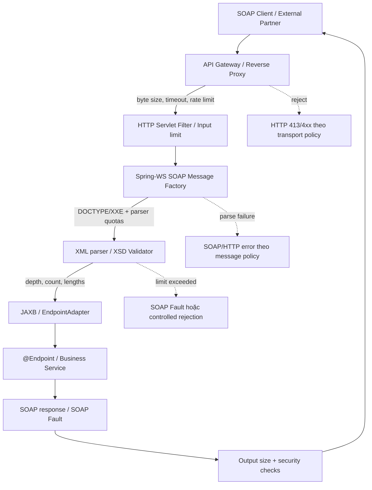

# Giới hạn độ sâu, số phần tử, độ dài và mở rộng thực thể

## 1. Tình huống: một SOAP request hợp cú pháp vẫn có thể làm cạn tài nguyên

Ứng dụng **Spring Web Services (Spring-WS)** nhận yêu cầu `SubmitOrderRequest` từ đối tác. Hợp đồng XSD/WSDL quy định đơn hàng gồm một số trường, và ứng dụng dùng JAXB để chuyển XML thành Java object. Một request trông giống XML bình thường có thể gây ra:

- **Độ sâu lồng nhau quá lớn**: parser, validator hoặc code đệ quy tốn CPU/stack và có thể phát sinh `StackOverflowError`.
- **Quá nhiều phần tử**: cùng một chiều sâu thấp nhưng có hàng trăm nghìn sibling elements khiến DOM/JAXB tiêu thụ heap.
- **Text/attribute quá dài**: một trường string vài chục MB gây cấp phát bộ nhớ, logging, XPath hoặc xử lý regex tốn kém.
- **Mở rộng thực thể (entity expansion)**: một XML ngắn dùng DTD/entity khiến lượng text/nodes phát sinh sau parse lớn hơn nhiều so với byte nhận vào.
- **Tải tài nguyên bên ngoài**: external entities, external DTD, XInclude hoặc schema imports gây rò file nội bộ, SSRF hay tiêu thụ network.
- **Payload nén hoặc attachment quá lớn sau giải nén**: HTTP `Content-Length` thấp nhưng dữ liệu thực cần xử lý rất lớn.

Một giới hạn duy nhất như “HTTP request tối đa 2 MB” **không đủ** để bao phủ mọi trường hợp. Ví dụ XML 200 KB có thể chứa hàng nghìn tầng lồng nhau; còn XML 1 MB đã nén có thể bung ra lớn hơn nhiều hoặc chứa external entity khiến parser đọc nguồn dữ liệu ngoài.

Bài này thuộc chương **Bảo vệ xử lý XML** của module `SPRING_WEB_SERVICES`. Chúng ta liên kết bảo mật parser với quá trình **contract-first (XSD/WSDL)**, SOAP message factory, JAXB, endpoint/interceptor, SOAP client, XML/WS-Security, chứng chỉ, SOAP Fault và kiểm thử tương thích hệ thống doanh nghiệp. Trọng tâm là **đặt và kiểm chứng hạn mức tài nguyên XML theo nhiều lớp**, không phải chỉ ngăn XXE bằng một flag.

### Mục tiêu học tập

Sau bài này, bạn có thể:

1. Phân loại XML resource exhaustion theo độ sâu, số node, text/attribute length, entity expansion và tài nguyên ngoài.
2. Phân biệt **byte input**, **số XML events**, **kích thước cây DOM/JAXB**, **thời gian CPU** và **heap** — những tài nguyên có điểm đo khác nhau.
3. Dùng các JAXP security properties như `jdk.xml.maxElementDepth`, `jdk.xml.entityExpansionLimit`, `jdk.xml.totalEntitySizeLimit`.
4. Từ chối DTD, hạn chế external entities, XInclude, external schema/XSLT ở đúng parser/validator/transformer.
5. Thiết kế **application-level counting limits** cho số element, độ dài text và attribute khi JAXP không cung cấp một quota tổng quát.
6. Hiểu vì sao cấu hình riêng `DocumentBuilderFactory` **không tự bảo vệ toàn bộ Spring-WS/SAAJ/JAXB pipeline**.
7. Thiết kế hạn mức ở gateway/servlet, XML parser, XSD validator, endpoint và các SOAP attachments.
8. Viết các test tại/qua ngưỡng, phát Fault/HTTP error có kiểm soát và theo dõi metrics an toàn.

## 2. Phân biệt năm kiểu “kích thước” của XML

| Tài nguyên | Ví dụ | Vì sao nguy hiểm? | Kiểm soát chính |
| --- | --- | --- | --- |
| **Số byte** | SOAP Envelope 50 MB | I/O, buffer, heap, mạng | Reverse proxy / HTTP input-stream byte quota |
| **Độ sâu** | `<a><a><a>...` lồng 2.000 cấp | Stack recursion, CPU, parser/validator | `maxElementDepth` + streaming depth counter |
| **Số phần tử / thuộc tính** | 300.000 `<item/>` hay một element có 10.000 attributes | DOM/JAXB object count, validation, GC | Element count tự đếm, `elementAttributeLimit` |
| **Text/giá trị dài** | `<description>` chứa 20 MB text | String/char arrays, regex, logs, DB | Giới hạn text và attribute, XSD length + application counters |
| **Thực thể / nguồn ngoài** | Internal entity recursion, external DTD | Giãn nở cấp số nhân, đọc file/SSRF | Cấm DTD/XXE, JAXP entity limits, external access restrictions |

Hai XML đều 100 KB trên wire vẫn có thể gây CPU/memory khác hẳn vì XML tree, JAXB allocations, signature canonicalization, schema validation hoặc XPath.

### 2.1. Độ sâu và số phần tử là hai đại lượng độc lập

XML sâu:

```xml
<root>
    <level1>
        <level2>
            <level3>
                <value>ok</value>
            </level3>
        </level2>
    </level1>
</root>
```

XML rộng:

```xml
<root>
    <item id="1"/>
    <item id="2"/>
    <item id="3"/>
    <item id="4"/>
</root>
```

XML đầu có nhiều mức lồng nhau hơn; XML sau có nhiều phần tử cùng cấp. Giới hạn **độ sâu 64** không ngăn hàng triệu `<item/>` có độ sâu 2. Ngược lại, quota **10.000 elements** chưa chắc chặn chuỗi 2.000 elements lồng nhau trước khi code đệ quy gặp giới hạn stack.

### 2.2. Độ dài của một trường và tổng lượng text là khác nhau

Một request có 100.000 phần tử `<note>`, mỗi phần tử chỉ 50 ký tự, vẫn tạo tổng text 5 triệu ký tự. Vì vậy cần ít nhất:

- Giới hạn **text length của từng field** theo contract.
- Giới hạn **tổng text/characters của message**.
- Giới hạn **số element**, kể cả element rỗng.
- Giới hạn **byte thực tế đọc** ở transport.

XML parser có thể chia cùng một text node thành nhiều `CHARACTERS` events. Khi tự kiểm tra text trong streaming, không được chỉ kiểm tra từng event riêng lẻ mà bỏ qua **tổng text qua nhiều events**.

### 2.3. Attribute count, attribute value và XML name length

`jdk.xml.elementAttributeLimit` giới hạn số **attributes trên một element** ở JDK XML processors có hỗ trợ, nhưng **không thay thế** giới hạn độ dài giá trị của attribute.

Ví dụ:

```xml
<order externalReference="ABC-123" source="PARTNER-A"/>
```

Một attacker có thể tạo **một attribute rất dài**, dù chỉ có một attribute nên không vượt `elementAttributeLimit`. `jdk.xml.maxXMLNameLimit` liên quan độ dài tên XML, không phải độ dài text/attribute values. Cần tách hai loại giới hạn.

### 2.4. Đừng hiểu `maxOccurs` trong XSD là quota cho toàn Envelope

Một XSD có:

```xml
<xs:element name="item"
            type="xs:string"
            minOccurs="0"
            maxOccurs="100"/>
```

quy định số lần xuất hiện của `item` ở **vị trí XSD cụ thể** khi schema validation thực sự được chạy. Nó không tự giới hạn:

- Toàn bộ SOAP Envelope/Header;
- Payload chưa đi tới validation;
- XML attachments;
- XML của schema ngoài hoặc WSDL;
- Các phần tử không chịu constraint này;
- Bộ nhớ/CPU do parser dùng **trước khi validation** phát hiện lỗi.

`maxOccurs` là một **ràng buộc hợp đồng**, không phải lớp chặn resource exhaustion duy nhất.

## 3. Mô hình các cuộc tấn công và hậu quả

### 3.1. Deeply nested XML

Ví dụ nhỏ:

```xml
<a><a><a><a><a>data</a></a></a></a></a>
```

Nếu nhiều lớp lập trình xử lý bằng đệ quy:

```java
void visit(Node node) {
    for (Node child = node.getFirstChild();
         child != null;
         child = child.getNextSibling()) {
        visit(child);
    }
}
```

thì độ sâu quá lớn có thể tạo call stack quá sâu. Dù parser SAX/StAX xử lý streaming, code application hoặc XML Signature/canonicalization vẫn có thể đi theo cấu trúc cây.

**Phòng vệ:** giới hạn chiều sâu **trước khi xây dựng cây lớn**, dùng JAXP `maxElementDepth` khi hỗ trợ, đồng thời giới hạn tổng số phần tử và quy tắc XSD.

### 3.2. Wide XML và nhiều object

Ví dụ một đơn hàng có 5 dòng hợp lệ:

```xml
<ord:items xmlns:ord="urn:example:orders:v1">
    <ord:item><ord:sku>A001</ord:sku></ord:item>
    <ord:item><ord:sku>A002</ord:sku></ord:item>
    <ord:item><ord:sku>A003</ord:sku></ord:item>
    <ord:item><ord:sku>A004</ord:sku></ord:item>
    <ord:item><ord:sku>A005</ord:sku></ord:item>
</ord:items>
```

Nếu một client gửi 100.000 `item` theo cùng pattern, XML có thể vẫn well-formed và độ sâu không đổi. Nhưng JAXB có thể tạo 100.000 Java objects, schema validator xử lý nhiều nodes và business service có thể thực hiện quá nhiều công việc.

**Phòng vệ:** `maxOccurs` theo nghiệp vụ, **maxTotalElements** độc lập với XSD, business collection limits, HTTP body quota, backpressure và request concurrency limits.

### 3.3. Text node, CDATA và chuỗi Unicode dài

```xml
<ord:description xmlns:ord="urn:example:orders:v1">
    Nội dung mô tả ngắn
</ord:description>
```

Một field mô tả có thể bị thay bằng text rất dài hoặc CDATA có cùng tác dụng cấp phát bộ nhớ. `CDATA` vẫn là nội dung ký tự XML, không phải một cách vượt quota tổng text.

Một chuỗi Java có `length()` đếm **UTF-16 code units**, khác số Unicode code points và số byte UTF-8. Vì vậy:

- Dùng **byte quota** để bảo vệ transport và buffer;
- Dùng **character quota** để bảo vệ xử lý XML/Java;
- Dùng giới hạn **code point/grapheme** khi hợp đồng yêu cầu chiều dài theo trải nghiệm người dùng;
- Chốt định nghĩa thống nhất giữa client và server trong XSD/business rules.

### 3.4. Entity expansion: XML nhỏ, nội dung giải nén lớn

Ví dụ đồ chơi dưới đây mô tả nguyên lý mở rộng thực thể nội bộ:

```xml
<?xml version="1.0"?>
<!DOCTYPE root [
    <!ENTITY word "AB">
    <!ENTITY pair "&word;&word;">
]>
<root>&pair;</root>
```

`&pair;` có thể được thay thành `ABAB` nếu parser xử lý internal entities. Tấn công kiểu **“billion laughs”** dùng nhiều tầng tham chiếu để nhân lượng text/nodes và làm cạn bộ nhớ/CPU. Không cần tạo payload cực lớn để hiểu mối nguy: vấn đề là **tỉ lệ giãn nở**, không chỉ bytes đầu vào.

**Ưu tiên:** với SOAP application không cần DTD, **từ chối DOCTYPE toàn bộ**. Khi thực sự phải hỗ trợ DTD legacy, vẫn cần giới hạn entity expansion, kích thước từng entity/tổng entity, external access và resource quotas.

### 3.5. External entity (XXE), đọc file và SSRF

```xml
<?xml version="1.0"?>
<!DOCTYPE order [
    <!ENTITY external SYSTEM "file:///path/to/local-file">
]>
<order>&external;</order>
```

Đây chỉ là ví dụ minh họa **cú pháp nguy hiểm**; không cần chạy với tệp thật. Nếu parser tự tải external entity từ input không tin cậy, có thể đọc file nội bộ, gọi URL không được phép (SSRF) hoặc làm chậm service.

**Phòng vệ:** từ chối DTD khi có thể; nếu không, tắt external general/parameter entities, external DTD loading, chặn external access bằng JAXP properties và resolver fail-closed.

### 3.6. External schema, XSLT và XInclude

Ngay cả khi đã chặn DTD trong parser chính, các thành phần khác có thể đọc tài nguyên ngoài:

- `xsi:schemaLocation` trong XML;
- `xs:include` / `xs:import` khi biên dịch schema;
- `xsl:import` / `xsl:include` hoặc `document()` trong XSLT;
- `xi:include` nếu XInclude được bật;
- External references trong một số XML Signature/validation flows.

Do đó **chống XXE tại DocumentBuilderFactory chưa đủ**. Mỗi XML factory/validator/transformer được dùng phải có **external resource policy riêng**, cùng với outbound network restrictions.

## 4. Thiết kế nhiều lớp phòng vệ cho Spring-WS



Các lớp phải **bổ trợ**, không thay thế nhau:

| Lớp | Kiểm soát | Điều không tự bảo đảm |
| --- | --- | --- |
| Reverse proxy/gateway | Request bytes, compressed/uncompressed limits theo stack, connection timeout, rate/concurrency | Độ sâu XML, JAXB object allocations |
| Servlet filter/transport | Đọc tối đa N bytes dù request chunked | Entity expansion sau parse |
| XML parser | DTD/external resources, JAXP processing limits | Tổng nghiệp vụ `items` hoặc text fields nếu không có quota |
| StAX/SAX stream counting | Depth/elements/characters/attributes trong XML stream | Không giúp nếu SOAP factory **đã dựng cây lớn trước đó** |
| XSD validation | `minOccurs`, `maxOccurs`, `maxLength`, types, sequence | Mọi resource quota trước validation |
| JAXB/endpoint logic | Giới hạn collections/field lengths sau mapping | Bảo vệ trước khi object đã được tạo |
| WS-Security/XML Signature | Xác thực, integrity, encryption, signed parts | Tự giới hạn toàn bộ XML CPU/memory |
| Runtime/infra | Heap, CPU, pod/container memory, concurrency, thread limits | Thay thế kiểm tra input ở application layer |

**Nguyên tắc:** từ chối input càng sớm càng tốt **ở lớp có thể đo chính xác tài nguyên đó**. Ví dụ giới hạn 1 MB tại transport giúp ngăn body 100 MB trước khi JAXB cấp phát, nhưng phải có depth/entity/element quotas độc lập để ngăn XML độc hại nhỏ.

### 4.1. Trình tự xử lý thực tế

```text
HTTP bytes (có thể chunked/compressed)
   -> (decompression khi stack hỗ trợ, có quota riêng)
   -> servlet input stream
   -> SOAP message factory / parser
   -> MessageDispatcher / EndpointMapping
   -> Interceptors (security, schema validation, ...)
   -> EndpointAdapter + JAXB
   -> @Endpoint / business
   -> SOAP response/Fault
```

`EndpointInterceptor.handleRequest` thường chạy **sau khi SOAP message đã parse để mapping**. Nếu đặt toàn bộ bảo vệ XML vào interceptor, parser/message factory có thể đã tiêu tốn nhiều tài nguyên **trước khi interceptor chạy**. Đây là sai lầm thiết kế thường gặp.

### 4.2. Đầu vào phải có chủ sở hữu giới hạn rõ ràng

Trong một tổ chức, nên xác định:

1. Đội gateway chịu trách nhiệm limit HTTP body/concurrency trước application.
2. Đội nền tảng cấu hình SOAP message factory, XML parsers/JAXP provider, external resource controls.
3. Đội API dùng XSD/WSDL với các `maxOccurs`/`maxLength` phù hợp.
4. Đội nghiệp vụ áp dụng collection/content quotas sau JAXB.
5. Đội SRE/security kiểm thử, giám sát rejection rates, thời gian parse, heap và cập nhật limit khi workload thay đổi.

Không để một giới hạn quan trọng “nằm giữa hai đội” mà không có owner và test.

## 5. Các giới hạn tài nguyên JAXP của JDK

**Java API for XML Processing (JAXP)** cung cấp một số thuộc tính hạn mức cho những XML processors đi kèm JDK. Trên JDK hiện đại, các property names thường được biểu diễn dưới dạng `jdk.xml.*`.

| JAXP system property | Đo lường | Nhóm rủi ro |
| --- | --- | --- |
| `jdk.xml.maxElementDepth` | Độ sâu element tối đa | XML lồng quá sâu |
| `jdk.xml.elementAttributeLimit` | Số attributes tối đa của **một element** | Element có quá nhiều attributes |
| `jdk.xml.maxXMLNameLimit` | Kích thước tên XML, bao gồm tên element/attribute, namespace prefix/URI | Name/namespace rất dài |
| `jdk.xml.entityExpansionLimit` | Số lần entity expansion | Entity expansion bomb |
| `jdk.xml.entityReplacementLimit` | Tổng node được tạo bởi entity references | Thực thể làm tăng số node |
| `jdk.xml.totalEntitySizeLimit` | Tổng kích thước general/parameter entities | Thực thể tạo nội dung lớn |
| `jdk.xml.maxGeneralEntitySizeLimit` | Kích thước tối đa của một general entity | Một entity quá lớn |
| `jdk.xml.maxParameterEntitySizeLimit` | Kích thước tối đa của một parameter entity | Parameter entities quá lớn |
| `jdk.xml.maxOccurLimit` | Độ phức tạp của schema content model khi dựng grammar liên quan `maxOccurs` | XSD grammar quá lớn |
| `jdk.xml.xpathExprGrpLimit` | Số nhóm trong biểu thức XPath | XPath expression phức tạp |
| `jdk.xml.xpathExprOpLimit` | Số toán tử trong một XPath expression | XPath expression phức tạp |
| `jdk.xml.xpathTotalOpLimit` | Tổng toán tử XPath trong XSLT stylesheet | XSLT phức tạp |

**Hai nhầm lẫn quan trọng:**

- `jdk.xml.maxOccurLimit` **không** giới hạn số `<item>` runtime trong một SOAP request; nó liên quan độ phức tạp khi dựng **XSD grammar**. Muốn giới hạn số XML elements, dùng bộ đếm riêng và XSD constraints.
- `jdk.xml.maxXMLNameLimit` **không** giới hạn giá trị của một element/attribute như `<description>...`. Muốn giới hạn tổng text hoặc value length, dùng application budget và schema validation.

### 5.1. Cấu hình tại JVM startup

Ví dụ cấu hình cho **một hệ thống thử nghiệm**:

```bash
java \
  -Djdk.xml.maxElementDepth=64 \
  -Djdk.xml.elementAttributeLimit=64 \
  -Djdk.xml.maxXMLNameLimit=256 \
  -Djdk.xml.entityExpansionLimit=100 \
  -Djdk.xml.totalEntitySizeLimit=65536 \
  -Djdk.xml.entityReplacementLimit=10000 \
  -jar orders-soap-service.jar
```

**Các con số chỉ là ví dụ để học**, không phải defaults hoặc giá trị production bắt buộc. Một SOAP Envelope có WS-Security Signature, namespaces/headers và JAXB payload phức tạp có thể cần hạn mức lớn hơn. Chọn ngưỡng dựa trên **contract thực tế, đo kiểm, worst-case hợp lệ và tài nguyên triển khai**.

Với JDK XML processors, một giá trị limit **nhỏ hơn hoặc bằng 0 thường mang nghĩa không giới hạn**; không dùng `0` với ý định “cấm entity expansion”. Để chặn DTD/external entities, hãy **cấm DTD** và tắt external access riêng, không phụ thuộc một limit số.

### 5.2. Cấu hình qua factory hoặc JAXP configuration

Các JAXP properties có thể được đặt theo provider/JDK thông qua **factory**, **system properties** hoặc **JAXP config file**. Quy tắc ưu tiên và cú pháp factory-level phụ thuộc provider/phiên bản. Ví dụ Oracle JDK documentation mô tả URI property:

```text
http://www.oracle.com/xml/jaxp/properties/maxElementDepth
```

liên hệ với:

```text
jdk.xml.maxElementDepth
```

**Không tự giả định** mọi XML processor bên thứ ba/SAAJ provider đều áp dụng property đó. Khi dùng các thư viện như Xerces bên ngoài, Woodstox, Axiom hoặc một SAAJ implementation khác, cần kiểm tra **tài liệu provider thực tế** và test rằng XML vượt ngưỡng bị từ chối.

### 5.3. Defaults thay đổi theo Java version và chế độ xử lý

Các JDK releases, cấu hình `FEATURE_SECURE_PROCESSING` và file `jaxp.properties` có thể cung cấp mức mặc định khác nhau. Vì vậy không nên thiết kế bảo mật bằng cách ghi cứng rằng “Java luôn giới hạn 64.000 entity expansions” hoặc “max depth mặc định là 100” cho mọi môi trường.

Quy trình đúng:

1. Xác định **JDK vendor + major/update version** chạy production.
2. Xác định XML provider thực sự được chọn cho DOM/SAX/StAX/JAXB/transformer.
3. Đặt explicit quotas phù hợp và kiểm tra settings unsupported.
4. Chạy boundary tests cho từng factory/message path.
5. Chạy lại khi nâng Spring-WS, Java, JAXB, SAAJ/AXIOM hoặc WS-Security stack.

### 5.4. `FEATURE_SECURE_PROCESSING` là cần thiết nhưng không toàn năng

`XMLConstants.FEATURE_SECURE_PROCESSING` giúp nhiều JAXP factories bật chế độ hạn chế tài nguyên/chức năng nguy hiểm. Nhưng:

- Không thay thế việc **từ chối DOCTYPE**.
- Không bảo đảm mọi external resource access đều bị chặn ở mọi provider.
- Không tự đặt **tổng số elements** hay **độ dài business fields** theo contract.
- Không giới hạn HTTP body bytes hoặc decompressed payload.
- Không thay thế giới hạn concurrency, CPU/memory và timeout.

Đặc biệt, StAX `XMLInputFactory` không có cùng cơ chế FSP như DOM/SAX; cần sử dụng các StAX properties và resource limits tương ứng.

### 5.5. Thứ tự khai báo có thể quan trọng

Khi đặt system properties, làm ở **JVM startup** trước khi các XML factories được khởi tạo để tránh phụ thuộc cache/provider và ảnh hưởng đồng thời. Không nên thay đổi `System.setProperty("jdk.xml.maxElementDepth", ...)` mỗi request; đây là cấu hình process-wide có thể tạo race hoặc làm thay đổi behavior của các service khác trong cùng JVM.

Nếu một factory hỗ trợ setting cục bộ, dùng factory-level config cho những parser do ứng dụng **thực sự sở hữu**, không tạo một parser mới nhưng framework vẫn dùng parser khác.

## 6. Từ chối DOCTYPE và external resources: phòng thủ chính cho entity expansion/XXE

Với các SOAP endpoints thông thường, XML message không có lý do hợp lệ để cung cấp DTD từ bên ngoài. Chính sách an toàn nhất thường là:

> **Không chấp nhận DOCTYPE trong SOAP messages không tin cậy.**

Khi cấm DTD, bạn đồng thời làm giảm khả năng khai thác internal/external entities từ DTD. Nhưng vẫn cần các hạn mức depth/elements/text và những điểm XML processing khác.

### 6.1. Cấu hình DOM `DocumentBuilderFactory`

Ví dụ Java 17+ dùng JDK DOM provider:

```java
import java.io.InputStream;
import javax.xml.XMLConstants;
import javax.xml.parsers.DocumentBuilder;
import javax.xml.parsers.DocumentBuilderFactory;
import org.w3c.dom.Document;
import org.xml.sax.SAXException;

public final class SecureDomParser {

    private SecureDomParser() {}

    public static Document parse(InputStream xml) throws Exception {
        DocumentBuilderFactory factory =
            DocumentBuilderFactory.newDefaultInstance();

        factory.setNamespaceAware(true);
        factory.setXIncludeAware(false);

        // Đối với SOAP đầu vào không tin cậy: từ chối DTD.
        factory.setFeature(
            "http://apache.org/xml/features/disallow-doctype-decl",
            true
        );
        factory.setFeature(
            XMLConstants.FEATURE_SECURE_PROCESSING,
            true
        );

        // Defense-in-depth: không tải tài nguyên ngoài qua parser.
        factory.setAttribute(XMLConstants.ACCESS_EXTERNAL_DTD, "");
        factory.setAttribute(XMLConstants.ACCESS_EXTERNAL_SCHEMA, "");

        DocumentBuilder builder = factory.newDocumentBuilder();
        builder.setEntityResolver(
            (publicId, systemId) -> {
                throw new SAXException(
                    "External XML entities are forbidden"
                );
            }
        );

        // InputStream phải đã được giới hạn kích thước trước đây.
        return builder.parse(xml);
    }
}
```

**Điểm quan trọng:**

- `newDefaultInstance()` là API Java 9+ ưu tiên JDK built-in provider. Trong một dự án dùng XML provider khác, phải kiểm tra feature support theo provider.
- Bất kỳ `ParserConfigurationException`/`IllegalArgumentException` nào khi đặt security feature/property phải khiến **ứng dụng không tiếp tục parse input không tin cậy**. Không `catch` rồi bỏ qua.
- `ACCESS_EXTERNAL_DTD`/`ACCESS_EXTERNAL_SCHEMA` chặn external access phát sinh trong các công đoạn được hỗ trợ; chúng **không chặn việc ứng dụng chủ động mở một URL không tin cậy làm input stream ban đầu**.
- `setExpandEntityReferences(false)` (nếu được dùng) chỉ ảnh hưởng biểu diễn entity references ở DOM; **không thay thế** việc cấm DTD/external resources.
- Đây chỉ là parser do chính hàm này tạo. Spring-WS `SaajSoapMessageFactory` không tự chuyển sang parser này vì bạn tạo bean `SecureDomParser` trong ứng dụng.

### 6.2. SAX `SAXParserFactory`

Khi dùng SAX/`XMLReader` để xử lý streaming:

```java
import java.io.InputStream;
import javax.xml.XMLConstants;
import javax.xml.parsers.SAXParserFactory;
import org.xml.sax.InputSource;
import org.xml.sax.XMLReader;
import org.xml.sax.helpers.DefaultHandler;

public final class SecureSaxParser {

    public static void parse(InputStream input) throws Exception {
        SAXParserFactory factory =
            SAXParserFactory.newDefaultInstance();

        factory.setNamespaceAware(true);
        factory.setFeature(
            "http://apache.org/xml/features/disallow-doctype-decl",
            true
        );
        factory.setFeature(
            XMLConstants.FEATURE_SECURE_PROCESSING,
            true
        );

        XMLReader reader =
            factory.newSAXParser().getXMLReader();

        reader.setEntityResolver((publicId, systemId) -> {
            throw new org.xml.sax.SAXException(
                "External XML references are denied"
            );
        });
        reader.setContentHandler(new DefaultHandler());

        reader.parse(new InputSource(input));
    }
}
```

Đây là code minh họa API; `DefaultHandler` chỉ minh họa parser hoạt động, chưa giới hạn **số elements/text**. Nếu bạn cần đếm cấu trúc SAX, hãy dùng một `ContentHandler` có state/budget như StAX ở mục 8.

**Lưu ý:** dùng `reader.parse(...)` trực tiếp giúp tránh một số overload `SAXParser.parse(..., handler)` có thể thay EntityResolver đã đăng ký trên reader. Khi cần resolver riêng, hãy kiểm thử chính xác code path được ứng dụng sử dụng.

### 6.3. StAX `XMLInputFactory`

StAX thường phù hợp để đếm XML events theo streaming, nhưng DTD và external resolution vẫn phải được cấu hình:

```java
import javax.xml.stream.XMLInputFactory;
import javax.xml.stream.XMLStreamException;
import javax.xml.stream.XMLStreamReader;
import java.io.InputStream;

public final class SecureStaxFactory {

    public static XMLStreamReader newReader(InputStream input)
            throws XMLStreamException {

        XMLInputFactory factory =
            XMLInputFactory.newDefaultFactory();

        factory.setProperty(
            XMLInputFactory.IS_NAMESPACE_AWARE, true
        );
        factory.setProperty(
            XMLInputFactory.SUPPORT_DTD, false
        );
        factory.setProperty(
            XMLInputFactory.IS_SUPPORTING_EXTERNAL_ENTITIES, false
        );
        factory.setXMLResolver(
            (publicId, systemId, baseUri, namespace) -> {
                throw new XMLStreamException(
                    "External XML references are forbidden"
                );
            }
        );
        return factory.createXMLStreamReader(input);
    }
}
```

**Lưu ý StAX:** tắt `SUPPORT_DTD` không nhất thiết làm parser **ném exception khi gặp DOCTYPE**; một số provider có thể bỏ qua DTD. Nếu policy cần **từ chối** thay vì bỏ qua, cần test hoặc phát hiện sự kiện DTD theo provider (ví dụ `XMLStreamConstants.DTD`) và fail-closed khi gặp nó.

`newDefaultFactory()` ưu tiên built-in JDK provider trên Java 9+; nếu Spring-WS/JAXB dùng Woodstox hoặc provider khác, test lại cách provider thực hiện các property này.

### 6.4. Khi bắt buộc phải hỗ trợ DTD legacy

Một số XML workflow cũ cần internal DTD. Khi đó:

1. Không cho phép external general entities.
2. Không cho phép external parameter entities.
3. Không tải external DTD tự do.
4. Có `EntityResolver`/`XMLResolver` từ chối hoặc ánh xạ **chỉ các tài nguyên đã cho phép**.
5. Đặt `entityExpansionLimit`, `totalEntitySizeLimit`, `maxGeneralEntitySizeLimit`, `maxParameterEntitySizeLimit`.
6. Vẫn đo byte, depth, element count, text length.
7. Cấm network egress không cần thiết ở hạ tầng.

Các SAX/Xerces feature thường gặp là:

```text
http://xml.org/sax/features/external-general-entities = false
http://xml.org/sax/features/external-parameter-entities = false
http://apache.org/xml/features/nonvalidating/load-external-dtd = false
```

**Không** áp dụng các feature có tên giống nhau cho mọi provider rồi bỏ qua lỗi “not recognized”. Security setting không được hỗ trợ phải được xử lý như lỗi cấu hình nếu nó là defense bắt buộc.

### 6.5. Vẫn phải chặn XInclude

`setXIncludeAware(false)` trên DOM factory (khi hỗ trợ) là một lớp bảo vệ riêng. DTD/external entity controls không đồng nghĩa mọi công cụ `xi:include` bị chặn. Cần xác nhận các XML processors khác có bật XInclude hoặc resolver riêng hay không.

## 7. Secure XML transformation và schema validation

Trong Spring-WS, XML có thể đi qua XSLT transformer, XSD schema compiler, JAXB unmarshaller hoặc WS-Security canonicalization. Bảo vệ parser đầu tiên **không tự bảo đảm** các bước sau không nạp tài nguyên ngoài.

### 7.1. `TransformerFactory` / XSLT

```java
import javax.xml.XMLConstants;
import javax.xml.transform.Transformer;
import javax.xml.transform.TransformerFactory;

public final class SecureTransformFactory {

    public static Transformer newIdentityTransformer()
            throws Exception {

        TransformerFactory factory =
            TransformerFactory.newDefaultInstance();

        factory.setFeature(
            XMLConstants.FEATURE_SECURE_PROCESSING,
            true
        );
        factory.setAttribute(
            XMLConstants.ACCESS_EXTERNAL_DTD, ""
        );
        factory.setAttribute(
            XMLConstants.ACCESS_EXTERNAL_STYLESHEET, ""
        );

        return factory.newTransformer();
    }
}
```

Việc cấm external stylesheet access ngăn các cơ chế như `xsl:include`/`xsl:import` và một số dạng `document()` tải tài nguyên ngoài thông qua processor. Tuy vậy, **đừng cho input XML không tin cậy chọn bất kỳ XSL stylesheet nào** rồi coi `FEATURE_SECURE_PROCESSING` là sandbox an toàn.

Một `Transformer` identity không tự an toàn nếu nhận một `StreamSource` từ URL không tin cậy do ứng dụng đã tự mở trước đó. Hạn chế **initial resource access** ở application input layer.

### 7.2. `SchemaFactory` và `Validator`

```java
import java.io.InputStream;
import javax.xml.XMLConstants;
import javax.xml.transform.stream.StreamSource;
import javax.xml.validation.Schema;
import javax.xml.validation.SchemaFactory;
import javax.xml.validation.Validator;

public final class SecureSchemaValidation {

    public static Validator compileValidator(
            InputStream trustedXsd) throws Exception {

        SchemaFactory factory =
            SchemaFactory.newDefaultInstance();

        factory.setFeature(
            XMLConstants.FEATURE_SECURE_PROCESSING,
            true
        );
        factory.setProperty(
            XMLConstants.ACCESS_EXTERNAL_DTD, ""
        );
        factory.setProperty(
            XMLConstants.ACCESS_EXTERNAL_SCHEMA, ""
        );

        Schema schema = factory.newSchema(
            new StreamSource(trustedXsd)
        );
        Validator validator = schema.newValidator();

        // Defense-in-depth trên Validator cụ thể.
        validator.setProperty(
            XMLConstants.ACCESS_EXTERNAL_DTD, ""
        );
        validator.setProperty(
            XMLConstants.ACCESS_EXTERNAL_SCHEMA, ""
        );
        return validator;
    }
}
```

Đoạn này giả định `trustedXsd` đến từ một **resource đã được đóng gói/chọn bởi ứng dụng**, không phải URL từ client. Nếu XSD cần nhiều includes/imports hợp lệ, dùng schema catalog/`LSResourceResolver` strict để ánh xạ **đúng các tài nguyên đã cho phép** vào local resources; không tắt toàn bộ security để schema compiler có thể truy cập Internet.

**Điểm cần nhớ:** một custom resolver đặt trên `SchemaFactory` **không đương nhiên được kế thừa bởi mọi `Validator`**. Khi cần resolver/allowlist, đặt và kiểm tra trên các đối tượng thực tế được dùng ở compile và validate phases.

### 7.3. XML parser và schema validator là hai tầng khác nhau

Một XML input:

```xml
<ord:Order xmlns:ord="urn:example:orders:v1">
    <ord:itemCount>999999999</ord:itemCount>
</ord:Order>
```

có thể hoàn toàn well-formed, không có DTD và nằm dưới byte/depth quotas. Nhưng nó có thể vi phạm business schema (ví dụ `itemCount` tối đa 1.000). **XSD validation** bắt contract violation; **parser quota** bắt resource violation.

Ngược lại, một XML quá sâu có thể làm parser tốn tài nguyên **trước** khi XSD validation xác định phần tử không hợp contract. Cần cả hai.

### 7.4. Tài nguyên ngoài không chỉ là XXE

`ACCESS_EXTERNAL_DTD` và `ACCESS_EXTERNAL_SCHEMA` giới hạn các protocol mà processor có thể dùng khi nạp dependencies. Nếu cấp `https`, điều đó **không phải host allowlist**; processor vẫn có thể truy cập những HTTPS resources không mong muốn nếu không có resolver/policy egress riêng.

Với SOAP integration doanh nghiệp, ưu tiên XSD/WSDL và transforms được đóng gói và versioned cùng ứng dụng. Chỉ cho phép tải động khi có use case thật, resource allowlist và kiểm thử phù hợp.

## 8. Tự đếm độ sâu, số phần tử và độ dài bằng StAX

JAXP có một số resource limits, nhưng **không có một thuộc tính `jdk.xml.totalElementCountLimit` phổ quát** để tự động giới hạn tổng số elements hay tổng độ dài business text cho mọi XML provider. Với yêu cầu rõ về số lượng và độ dài, cần **application-level budget**.

StAX cho phép duyệt XML theo events:

```text
START_ELEMENT  -> depth++, totalElements++
                 kiểm tra attribute count/value lengths
CHARACTERS    -> tăng textByDepth[depth], totalText
CDATA         -> cũng là text
END_ELEMENT   -> depth--
DTD           -> từ chối
ENTITY_REFERENCE -> từ chối (với policy không dùng entities)
```

Điểm khó: parser có thể chia một field `description` thành **nhiều `CHARACTERS` events**. Do đó kiểm tra từng chunk riêng lẻ không đủ; cần cộng dồn độ dài các chunk.

### 8.1. Một bộ ngân sách XML có thể kiểm tra được

Ví dụ giả định contract cho một SOAP request nhỏ:

| Giới hạn | Giá trị minh họa | Ý nghĩa |
| --- | ---: | --- |
| `maxDepth` | 32 | Tổng độ sâu XML, gồm Envelope/Header/Body |
| `maxElements` | 5.000 | Tổng số START_ELEMENT của toàn message |
| `maxAttributesPerElement` | 32 | Số attributes của một element |
| `maxAttributeValueChars` | 1.024 | Độ dài giá trị một attribute |
| `maxTotalAttributeChars` | 16.384 | Tổng độ dài các attribute values |
| `maxDirectTextCharsPerElement` | 4.096 | Text trực tiếp tích lũy trên mỗi element |
| `maxTotalTextChars` | 65.536 | Tổng text và các ký tự không thuộc element data cũng được đo |
| `maxXmlBytes` | 256 KiB | Byte đọc vào trước khi parse |

**Đây là ngưỡng minh họa để học và test, không phải production defaults.** Một SOAP Envelope có `wsse:Security`, certificate, signature, encrypted payload hoặc nhiều namespace attributes hợp lệ có thể cần ngưỡng khác. Chốt budget bằng cách đo payloads hợp lệ lớn nhất + biên độ vận hành.

### 8.2. Code StAX kiểm tra cấu trúc

Ví dụ dưới đây giả định `SecureStaxFactory.newReader(...)` ở mục 6.3 đã tạo parser tắt DTD/external entities. Code giới hạn số START_ELEMENT, độ sâu, attributes và text **trước khi tạo JAXB object**.

```java
import java.io.InputStream;
import javax.xml.stream.XMLStreamConstants;
import javax.xml.stream.XMLStreamException;
import javax.xml.stream.XMLStreamReader;

public final class XmlEventBudget {

    private static final int MAX_DEPTH = 32;
    private static final long MAX_ELEMENTS = 5_000;
    private static final int MAX_ATTRIBUTES_PER_ELEMENT = 32;
    private static final int MAX_ATTR_VALUE_CHARS = 1_024;
    private static final long MAX_ALL_ATTR_CHARS = 16_384;
    private static final long MAX_DIRECT_TEXT = 4_096;
    private static final long MAX_TOTAL_TEXT = 65_536;

    private XmlEventBudget() {}

    public static void validate(InputStream boundedInput)
            throws XMLStreamException {

        XMLStreamReader xml =
            SecureStaxFactory.newReader(boundedInput);

        int depth = 0;
        long elements = 0;
        long allAttributeChars = 0;
        long allTextChars = 0;

        // Mỗi element có tổng text trực tiếp riêng;
        // các CHARACTERS events liên tiếp đều được cộng dồn.
        long[] directText = new long[MAX_DEPTH + 1];

        try {
            while (xml.hasNext()) {
                int event = xml.next();

                switch (event) {
                    case XMLStreamConstants.START_ELEMENT -> {
                        depth++;
                        if (depth > MAX_DEPTH) {
                            reject("XML nesting depth exceeded");
                        }
                        elements++;
                        if (elements > MAX_ELEMENTS) {
                            reject("Too many XML elements");
                        }

                        directText[depth] = 0;
                        int attributes = xml.getAttributeCount();
                        if (attributes > MAX_ATTRIBUTES_PER_ELEMENT) {
                            reject("Too many attributes on an element");
                        }

                        for (int i = 0; i < attributes; i++) {
                            String value = xml.getAttributeValue(i);
                            int size = value.length();
                            if (size > MAX_ATTR_VALUE_CHARS) {
                                reject("XML attribute value too long");
                            }
                            allAttributeChars += size;
                            if (allAttributeChars >
                                    MAX_ALL_ATTR_CHARS) {
                                reject("Total attribute data too long");
                            }
                        }
                    }
                    case XMLStreamConstants.CHARACTERS,
                         XMLStreamConstants.CDATA,
                         XMLStreamConstants.SPACE -> {

                        int size = xml.getTextLength();
                        allTextChars += size;
                        if (allTextChars > MAX_TOTAL_TEXT) {
                            reject("Total XML text too long");
                        }

                        if (depth > 0) {
                            directText[depth] += size;
                            if (directText[depth] > MAX_DIRECT_TEXT) {
                                reject("XML element text too long");
                            }
                        }
                    }
                    case XMLStreamConstants.COMMENT -> {
                        allTextChars += xml.getTextLength();
                        if (allTextChars > MAX_TOTAL_TEXT) {
                            reject("XML comment/text budget exceeded");
                        }
                    }
                    case XMLStreamConstants.DTD,
                         XMLStreamConstants.ENTITY_REFERENCE -> {
                        reject("DTD or entity reference is forbidden");
                    }
                    case XMLStreamConstants.END_ELEMENT -> {
                        if (depth <= 0) {
                            reject("Unexpected XML end element");
                        }
                        directText[depth] = 0;
                        depth--;
                    }
                    default -> {
                        // Start document, processing instructions, v.v.
                        // Byte quota ở transport vẫn là bắt buộc.
                    }
                }
            }

            if (depth != 0) {
                reject("Unexpected XML nesting state");
            }
        } finally {
            xml.close();
        }
    }

    private static void reject(String reason)
            throws XMLStreamException {
        throw new XMLStreamException(reason);
    }
}
```

Ví dụ dùng Java 17 switch arrow syntax; cần `SecureStaxFactory` ở mục 6.3. Một `InputStream` được truyền vào **phải đã có byte cap** và được đóng bởi caller; `XMLStreamReader.close()` không bảo đảm đóng underlying stream ở mọi provider.

**Những giới hạn của code minh họa:**

- `MAX_DIRECT_TEXT` tính text trực tiếp của từng element, không cộng text của con cháu vào parent. `MAX_TOTAL_TEXT` bảo vệ tổng message.
- `COMMENT` được tính vào tổng text; processing instructions, namespace declarations, XML names và entity handling còn cần parser/JAXP/byte quota riêng.
- Một số parser tạo một chuỗi attribute/text lớn **trước khi code kiểm tra `length()`**; byte cap và parser-specific limits vẫn phải thực thi ở lớp trước.
- Event counter chưa xác minh **SOAP Envelope QName**, một Body duy nhất, Header semantics, schema và authorization. Đó là những kiểm tra độc lập.
- Code này không tự chặn một service đã dùng **SAAJ/DOM parse trước khi gọi hàm**. Nó chỉ ngăn object materialization **nếu thực sự chạy trước parser nặng và trên cùng input**.

### 8.3. Vì sao dùng mảng theo depth?

Với một XML:

```xml
<root>
    <description>abc<![CDATA[def]]>ghi</description>
    <description>jkl</description>
</root>
```

Giá trị `description` đầu có thể được báo thành nhiều events `abc`, `def` và `ghi`. Tổng text trực tiếp là 9 ký tự, không phải “event lớn nhất 3”. Mảng `directText[depth]` được reset khi vào/ra element để tính cộng dồn **cho element đang mở**.

Khi text nằm ở cấp cha xen giữa nhiều phần tử con, logic trên giữ counter của cha trong slot depth tương ứng khi đi xuống con, nên vẫn có thể đo text trực tiếp của cha xuyên suốt thời gian element còn mở.

### 8.4. Độ dài text và code points

`xml.getTextLength()` thường trả về số `char` trong buffer của `XMLStreamReader`, tức đơn vị **UTF-16 code units** ở Java. Nếu business contract đo Unicode code points, phải có phép đo riêng và test với ký tự ngoài Basic Multilingual Plane.

Với security quota, một giới hạn theo `char` vẫn hữu ích để tránh cấp phát; với hợp đồng XSD `maxLength` cần xác minh semantics schema/type và JAXB provider.

### 8.5. Đừng tạo bộ đếm mới sau khi parser đã tiêu tốn bộ nhớ

Sai:

```text
Servlet receives 10 MB XML
    -> SAAJ creates complete DOM in heap
    -> @Endpoint or interceptor walks DOM and counts elements
    -> rejects at 5,001st element
```

Ngay khi đếm và từ chối thành công, memory cost của DOM **đã xảy ra**.

Tốt hơn:

```text
Transport byte cap
    -> hardened XML parser with intrinsic limits
    -> stream event count before expensive object materialization
    -> JAXB / endpoint
```

Nếu kiến trúc Spring-WS message factory không cho chèn event counting trước khi nó tạo tree, hãy ưu tiên các limits **ở factory/provider và transport**, hoặc dùng một ingestion pipeline phù hợp, thay vì quảng cáo `EndpointInterceptor` như một biện pháp bảo vệ sớm.

## 9. Giới hạn byte từ transport: chống payload lớn trước XML parser

### 9.1. `Content-Length` không đủ

Một request HTTP có thể gửi `Content-Length: 10485760`, nhưng cũng có thể dùng **chunked transfer encoding** mà không có Content-Length hữu ích. Vì vậy:

- Có thể reject sớm nếu header Content-Length vượt quota.
- Vẫn phải **đếm bytes thực sự được đọc** từ request body.
- Giới hạn riêng cho request **sau giải nén** nếu stack cho phép nén HTTP.
- Không buffer toàn bộ request vô hạn rồi mới kiểm tra size.

### 9.2. Một InputStream wrapper giới hạn số byte đọc

Đoạn Java sau minh họa giới hạn byte ở **điểm bắt đầu parse**:

```java
import java.io.FilterInputStream;
import java.io.IOException;
import java.io.InputStream;

public final class ByteLimitInputStream extends FilterInputStream {

    private final long maxBytes;
    private long consumed;

    public ByteLimitInputStream(InputStream source, long maxBytes) {
        super(source);
        if (maxBytes < 1) {
            throw new IllegalArgumentException(
                "maxBytes must be positive"
            );
        }
        this.maxBytes = maxBytes;
    }

    @Override
    public int read() throws IOException {
        int value = super.read();
        if (value != -1) {
            account(1);
        }
        return value;
    }

    @Override
    public int read(byte[] buffer, int offset, int length)
            throws IOException {
        int read = super.read(buffer, offset, length);
        if (read > 0) {
            account(read);
        }
        return read;
    }

    @Override
    public long skip(long requested) throws IOException {
        // Không cho skip() vượt qua byte counter.
        byte[] scratch = new byte[4096];
        long skipped = 0;
        while (skipped < requested) {
            int count = read(
                scratch, 0,
                (int) Math.min(scratch.length, requested - skipped)
            );
            if (count == -1) {
                break;
            }
            skipped += count;
        }
        return skipped;
    }

    @Override
    public boolean markSupported() {
        return false;
    }

    @Override
    public void mark(int readlimit) {
        // mark/reset không được hỗ trợ.
    }

    @Override
    public void reset() throws IOException {
        throw new IOException("reset is not supported");
    }

    private void account(int amount) throws IOException {
        if (amount > maxBytes - consumed) {
            throw new IOException("SOAP input byte quota exceeded");
        }
        consumed += amount;
    }
}
```

Ví dụ sử dụng:

```java
try (InputStream raw = source.openStream();
     InputStream limited =
         new ByteLimitInputStream(raw, 256 * 1024)) {

    XmlEventBudget.validate(limited);
}
```

`source.openStream()` trong ví dụ là **một input source do ứng dụng đã tin tưởng/chọn**, không được là URL do client tự ý cung cấp; các class ở hai mục trên cần tồn tại. Đây là **demo scan input**, chưa phải mã cắm sẵn vào `MessageDispatcherServlet`.

**Quan trọng:** nếu kết quả scanning không được dùng để truyền cùng một payload đã kiểm tra tới Spring-WS, parser của Spring-WS vẫn có thể đọc một stream khác hoặc parse lại với cấu hình không an toàn. Đừng hiểu một scan demo là đã harden message factory thật. Phải triển khai pipeline có ownership rõ ràng và test end-to-end.

### 9.3. Một chi tiết của byte wrapper

Wrapper có thể phải đọc **byte vượt quota đầu tiên** để phát hiện input còn dữ liệu; sau đó ném `IOException`, không trả dữ liệu đó cho parser. Đây là hành vi thích hợp cho **giới hạn dữ liệu được chấp nhận**, dù số bytes network thực sự tiêu thụ có thể lớn hơn quota một chút.

Nếu parser dùng `mark/reset` hoặc wrapper khác, API trên có thể không phù hợp trực tiếp. Với servlet, cần một `HttpServletRequestWrapper`/`ServletInputStream` tương thích container và async semantics, hoặc cấu hình giới hạn tại connector/proxy. Không tự ép `InputStream` này vào một servlet API mà không kiểm tra integration.

### 9.4. Giới hạn ở reverse proxy và servlet

Một triển khai tốt thường dùng:

```text
Reverse proxy / gateway:
  max request body bytes
  max headers / header count
  request timeout / idle timeout
  rate limit / concurrency cap
  compressed/decompressed request policy

Spring servlet:
  early Content-Length check
  streaming input byte count
  reject oversized chunked body

XML stack:
  DTD/XXE restrictions
  depth/entity/attribute/name limits
  total elements/text counters
```

Giới hạn “max upload size” của multipart handler không đương nhiên áp dụng cho **mọi SOAP POST raw XML**. Phải kiểm tra endpoint mapping và content type thực tế.

### 9.5. Cẩn thận với compressed SOAP payload

Một HTTP request có `Content-Encoding: gzip` hoặc một attachment nén có thể nhỏ trên wire nhưng rất lớn sau giải nén. Nếu hạ tầng hỗ trợ automatic decompression:

- Đặt giới hạn byte **trước giải nén** và **sau giải nén** khi có thể.
- Giới hạn tỷ lệ giãn nở/CPU/timeout.
- Đặt quota riêng cho attachments, MTOM/XOP và dữ liệu ngoài SOAP Body.
- Không chỉ tin Content-Length của dữ liệu nén.

SOAP `MTOM` có thể mang binary parts lớn; một quota cho XML elements trong Envelope **không tự giới hạn attachment bytes**.

## 10. Giới hạn cấu trúc phải áp dụng trên đúng Spring-WS message factory

Trong Spring-WS, `WebServiceMessageFactory` quyết định cách XML/SOAP được tạo từ input stream. Các implementation có thể dựa trên **SAAJ** hoặc **AXIOM/StAX** tùy phiên bản và dependencies.

### 10.1. `SaajSoapMessageFactory` và DOM memory model

SAAJ thường dùng DOM-like object model. Việc đọc SOAP Envelope có thể tạo cấu trúc **trong bộ nhớ**, trước khi endpoint interceptor hoặc JAXB method chạy.

```text
HTTP input
   -> SAAJ message factory parses/builds SOAP message
   -> MessageDispatcher maps endpoint
   -> EndpointInterceptor.handleRequest
   -> EndpointAdapter/JAXB
```

Nếu muốn giới hạn độ sâu/expansion **trước** khi SAAJ xây cây lớn, phải kiểm soát parser/provider mà SAAJ **thực sự dùng**, đồng thời đặt HTTP byte cap. Việc tạo riêng một `DocumentBuilderFactory` hardened trong một Spring bean **không tự chứng minh SAAJ sử dụng nó**.

Đừng kỳ vọng rằng `PayloadValidatingInterceptor` sẽ cứu được application khỏi XML bomb đã làm parser cạn heap trong giai đoạn tạo SOAP message.

### 10.2. `AxiomSoapMessageFactory` và streaming

AXIOM dựa trên StAX và có thể phù hợp với một số trường hợp xử lý stream hiệu quả hơn; các tùy chọn caching/streaming phụ thuộc phiên bản Spring-WS. Tuy vậy:

- Streaming không tự cấm DTD/XXE.
- Streaming không tự đặt `maxTotalElements` hoặc text quotas của ứng dụng.
- Payload read-once có thể xung đột với logging, validation hoặc security interceptors cần đọc nhiều lần.
- WS-Security có thể yêu cầu xây/biến đổi cây XML, phát sinh memory/CPU đáng kể.

Do đó, chọn streaming là một **tối ưu kiến trúc có thể hỗ trợ giới hạn**, không phải security toggle hoàn chỉnh. Cần test với các SOAP operation thực tế, nhất là khi bật WS-Security/MTOM.

### 10.3. JAXB unmarshaller có thể tạo parser riêng

Nếu ứng dụng gọi trực tiếp:

```java
unmarshaller.unmarshal(new StreamSource(untrustedInput));
```

thì tùy JAXB provider và source type, implementation có thể tự tạo parser. Để kiểm soát parser theo chính sách, khi phù hợp hãy **cung cấp một `XMLStreamReader` hardened**:

```java
XMLStreamReader reader =
    SecureStaxFactory.newReader(limitedInput);

try {
    Object value = jaxbUnmarshaller.unmarshal(reader);
    // Kiểm tra JAXB root/type và business limits.
} finally {
    reader.close();
}
```

Đây là mảnh code với `jaxbUnmarshaller` là `jakarta.xml.bind.Unmarshaller` (hoặc `javax` theo stack), `limitedInput` là byte-capped stream. Khi cần đếm structure trong **cùng một lần đọc**, sử dụng một `StreamReaderDelegate`/`XMLFilter` có quota nằm trên đường dẫn parser mà JAXB thật sự sử dụng, thay vì quét một lần rồi truyền reader đã bị tiêu thụ.

### 10.4. Tránh đọc một XML stream hai lần mà không hiểu chi phí

```text
Byte stream
  -> scan toàn XML (StAX), rồi lưu lại bytes
  -> reparse toàn XML (SAAJ/JAXB)
```

Cách này có thể cần buffering lớn, tốn CPU gấp đôi và phát sinh rủi ro khi một lần parse bật security khác lần sau. Có thể dùng cho một số use cases có **bounded input buffer nhỏ**, nhưng không nên tự động coi là tối ưu.

Với dữ liệu lớn, thiết kế **một pipeline streaming đã hardened** hoặc giới hạn input đủ nhỏ ở transport rồi để provider/parser enforce những quotas nội tại. Hãy đo memory/latency dưới tải.

### 10.5. Kiểm tra runtime provider thực tế

Khi debug security settings, ghi metadata an toàn:

```text
javaVersion       = 21.x (ví dụ)
soapFactoryClass  = org.springframework.ws.soap.saaj.SaajSoapMessageFactory
xmlProvider       = JDK default / selected provider
parserQuotas      = applied and tested
requestByteCap    = configured and tested
```

Không ghi private keys, credentials hoặc raw SOAP message. Nếu container hoặc dependency bổ sung XML provider khác khi deploy, cấu hình giới hạn có thể thay đổi; regression tests phải kiểm tra behavior chứ không chỉ config file.

## 11. XSD contract: giới hạn nghiệp vụ bổ trợ parser budgets

Với Spring-WS **contract-first**, XSD/WSDL quy định kiểu dữ liệu, số lượng phần tử và độ dài field. Hạn mức parser vẫn cần hoạt động **trước schema validation**, bởi XML có thể tiêu tốn tài nguyên trước khi XSD phát hiện lỗi.

### 11.1. XSD ví dụ cho đơn hàng

```xml
<?xml version="1.0" encoding="UTF-8"?>
<xs:schema
    xmlns:xs="http://www.w3.org/2001/XMLSchema"
    xmlns:ord="urn:example:orders:v1"
    targetNamespace="urn:example:orders:v1"
    elementFormDefault="qualified">

    <xs:simpleType name="OrderIdType">
        <xs:restriction base="xs:string">
            <xs:minLength value="1"/>
            <xs:maxLength value="64"/>
            <xs:pattern value="ORD-[A-Z0-9-]+"/>
        </xs:restriction>
    </xs:simpleType>

    <xs:simpleType name="SkuType">
        <xs:restriction base="xs:string">
            <xs:minLength value="1"/>
            <xs:maxLength value="40"/>
        </xs:restriction>
    </xs:simpleType>

    <xs:simpleType name="QuantityType">
        <xs:restriction base="xs:positiveInteger">
            <xs:maxInclusive value="1000"/>
        </xs:restriction>
    </xs:simpleType>

    <xs:complexType name="OrderLineType">
        <xs:sequence>
            <xs:element name="sku" type="ord:SkuType"/>
            <xs:element name="quantity" type="ord:QuantityType"/>
        </xs:sequence>
    </xs:complexType>

    <xs:complexType name="SubmitOrderRequestType">
        <xs:sequence>
            <xs:element name="orderId" type="ord:OrderIdType"/>
            <xs:element name="item"
                        type="ord:OrderLineType"
                        minOccurs="1" maxOccurs="100"/>
        </xs:sequence>
    </xs:complexType>

    <xs:element name="SubmitOrderRequest"
                type="ord:SubmitOrderRequestType"/>
</xs:schema>
```

Contract quy định `orderId` từ 1 đến 64 ký tự, `sku` 1–40 ký tự, `quantity` từ 1 đến 1.000 và tối đa 100 `item` trong một request. Nhưng **JAXB không nhất thiết enforce mọi facets khi không có schema validation**.

### 11.2. XSD không thay thế toàn bộ quotas

| XSD constraint | Bảo vệ | Không tự bảo vệ |
| --- | --- | --- |
| `xs:maxLength` | Độ dài value tại field có type tương ứng | Byte input, tổng text toàn Envelope, bộ nhớ parser trước validation |
| `xs:maxOccurs` | Số element tại một vị trí trong content model | Tổng số element SOAP Header/Body và parser CPU |
| `xs:pattern` | Định dạng field | Regex quá phức tạp, XXE, độ sâu XML |
| `xs:sequence`/`xs:choice` | Cấu trúc payload | Parser/transport limits |
| `xs:any` | Extensibility khi được cho phép | Hạn mức extension XML nếu thiếu policy |

Một schema chứa `xs:any`/`maxOccurs="unbounded"` rộng hơn nhu cầu thật có thể mở rộng attack surface. Nếu nghiệp vụ chỉ cho 100 dòng đơn hàng, nên diễn đạt limit tại contract.

### 11.3. Validation thường chạy sau SOAP message factory

Spring-WS `PayloadValidatingInterceptor` có thể validate request theo XSD **khi được cấu hình**, nhưng:

```text
HTTP -> MessageFactory parse SOAP -> EndpointMapping
     -> PayloadValidatingInterceptor -> JAXB -> @Endpoint
```

Như vậy parser có thể đã xây SOAP message trước khi interceptor từ chối `maxLength` hay `maxOccurs`. Cần giới hạn byte/DTD/element depth tại **các lớp trước**.

### 11.4. SOAP Header cũng phải được giới hạn

```xml
<soap:Header
    xmlns:soap="http://schemas.xmlsoap.org/soap/envelope/"
    xmlns:meta="urn:example:meta:v1">
    <meta:CorrelationId>corr-42</meta:CorrelationId>
</soap:Header>
```

Ngay cả khi Body hợp schema, hàng nghìn header blocks hoặc `CorrelationId` quá dài vẫn có thể chiếm tài nguyên. Cần giới hạn số header blocks, total elements/bytes, attribute/text length, kiểm tra QName/cardinality và validate ID trước khi đưa vào logs.

### 11.5. XML Schema length và Unicode

Length facets phụ thuộc XML Schema datatype, không luôn bằng số byte UTF-8 hoặc `String.length()` trong Java (UTF-16 code units). Với dữ liệu Unicode đa byte, hãy test riêng cả **wire byte quota**, **XML text budget** và **semantic XSD maxLength**.

## 12. WS-Security, XML Signature và XML Encryption cũng cần quotas

Một SOAP request có WS-Security có thể lớn hơn payload nghiệp vụ vì:

- `wsse:Security` chứa token/certificate dạng Base64;
- `ds:Signature`, `ds:Reference` và `ds:Transforms`;
- `wsu:Timestamp`, security token references;
- `xenc:EncryptedData` và dữ liệu sau giải mã;
- MTOM/XOP binary attachments hoặc MIME parts.

### 12.1. Không chỉ giới hạn SOAP Body

```text
Whole SOAP Envelope:
    bytes, depth, element count, total text, attributes

SOAP Body:
    XSD constraints, business item count

Security Header:
    token/signature/certificate limits, signed parts,
    trust, timestamp, replay policy

Attachments:
    independent byte/count/decompression quotas
```

`MAX_DIRECT_TEXT=4096` ở ví dụ mục 8 **có thể quá thấp** cho một certificate Base64 hợp lệ. Các ngưỡng minh họa không được copy sang production trước khi đo worst-case messages và các header thật.

### 12.2. Signature không tự bảo vệ parser

XML Signature chứng minh integrity của **những parts được ký** khi verification thành công. Nó không tự:

- Chặn entity expansion/XXE trong parser.
- Giới hạn CPU của reference transforms/canonicalization.
- Chặn hàng nghìn elements ngoài phạm vi ký.
- Bảo đảm toàn SOAP Header được bảo vệ.
- Giải quyết XML Signature wrapping/ID ambiguity.

Khi dùng WSS4J, cần hạn chế allowed algorithms/transforms, references, external resource access và kiểm tra signed-parts coverage theo policy. Parser vẫn phải từ chối XML độc hại **trước khi xử lý chữ ký tốn kém**.

### 12.3. XML Encryption cần giới hạn plaintext sau giải mã

`xenc:EncryptedData` có thể che cấu trúc XML thật. Sau decryption, JAXB/validator có thể thấy XML sâu, nhiều elements hoặc text rất dài. Vì vậy giới hạn ciphertext/attachments bytes ở transport **không thay thế** quota cho decrypted XML tại lớp đọc plaintext.

### 12.4. Interceptor bảo mật không phải lớp chống XML bomb đầu tiên

`Wss4jSecurityInterceptor` thường chạy **sau khi SOAP message factory đã parse input đủ để dispatch**. Nếu SAAJ xây DOM trước, một XML bomb có thể tiêu tốn tài nguyên trước security interceptor. WS-Security verification và XML parser hardening phải được thiết kế riêng.

### 12.5. TLS/mTLS không giới hạn XML structure

Chứng chỉ TLS xác thực peer và bảo vệ kết nối, nhưng một client đã xác thực vẫn có thể gửi XML quá lớn do lỗi client hoặc tấn công. **Authentication không thay thế quotas.**

## 13. Khi vượt hạn mức: SOAP Fault, HTTP error và xử lý an toàn

Một XML input có thể bị từ chối trước hoặc sau khi Spring-WS tạo SOAP message:

| Vị trí phát hiện | Ví dụ | Phản hồi hợp lý |
| --- | --- | --- |
| Gateway/HTTP input | Request body vượt byte cap | HTTP 413 hoặc rejection theo transport policy |
| TLS/proxy | Handshake thất bại, rate limit | Connection/HTTP error; không bắt buộc có SOAP Fault |
| XML parser | DOCTYPE bị cấm, depth/entity vượt giới hạn | Controlled parse/transport error; có thể không tạo được SOAP Fault |
| SOAP processing khi còn message hợp lệ | SOAP validation/processing violation | SOAP Fault Sender/Client nếu runtime có thể tạo message |
| XSD validation interceptor | `maxOccurs`/`maxLength` sai contract | SOAP validation Fault theo service policy |
| Business endpoint | Dữ liệu đã parse nhưng vượt business quota | Public business Fault/rejection theo contract |

### 13.1. Không hứa mọi lỗi parser đều thành SOAP Fault

Nếu parser không thể tạo Envelope hợp lệ, Spring-WS có thể chưa có `SoapMessage` để ghi `soap:Fault`. Khi đó HTTP 400/413 hoặc đóng kết nối có thể hợp lý hơn cố tạo một XML fragment không chuẩn.

**SOAP 1.1** có Fault code `Client`/`Server`. **SOAP 1.2** có `Sender`/`Receiver` và cấu trúc `Code`/`Reason`/`Detail`. Không ghép SOAP 1.2 Fault vào SOAP 1.1 Envelope.

### 13.2. Ví dụ SOAP Fault công khai

Một SOAP 1.1 Fault minh họa khi XML request không đáp ứng policy:

```xml
<soap:Envelope
    xmlns:soap="http://schemas.xmlsoap.org/soap/envelope/">
    <soap:Body>
        <soap:Fault>
            <faultcode>soap:Client</faultcode>
            <faultstring>Yêu cầu XML không được chấp nhận</faultstring>
        </soap:Fault>
    </soap:Body>
</soap:Envelope>
```

Đây là **public policy minh họa**, không phải output tự động của mọi JAXP parser/`PayloadValidatingInterceptor`. Nếu contract có XSD Fault Detail, đưa vào **mã lỗi ổn định và requestId an toàn**; không công bố stack trace, parser implementation, filesystem path hoặc raw XML do đối tác gửi.

### 13.3. Không nuốt parser exception rồi cho nghiệp vụ chạy

Anti-pattern:

```java
try {
    validateXml(input);
} catch (Exception ignored) {
    // Không được tiếp tục xử lý request không đạt security policy.
}
processOrder(input);
```

Nếu một security property unsupported, XML input quá sâu hoặc DTD xuất hiện, phải **fail closed** theo policy. Không sử dụng partial SOAP object sau parse failure để gọi nghiệp vụ.

### 13.4. Không log nguyên XML bị từ chối

```java
// Anti-pattern: có thể copy XML rất lớn và lộ token/PII.
logger.warn("SOAP input rejected: {}", rawSoapXml);
```

Một input 10 MB có thể biến thành log rất lớn và gây thêm memory/IO pressure. Nên log **metadata đã lọc**:

```text
event=SOAP_XML_LIMIT_EXCEEDED
requestId=req-42
limitType=TOTAL_TEXT
limitValue=65536
operation=SubmitOrder
soapVersion=1.1
bytesReceived=...
```

Không đưa `wsse:Security`, Bearer token, password, private key, SOAP Body chứa PII hoặc full parser exception message ra log công khai. Exception details chỉ nên xuất hiện trong internal restricted logs sau redaction phù hợp.

### 13.5. Đừng cố tạo Fault sau khi JVM đã cạn tài nguyên

`OutOfMemoryError` hoặc `StackOverflowError` có thể khiến chính hành vi serialize Fault cũng thất bại. Không dùng `catch (Throwable)` để nuốt những errors này rồi cố tiếp tục xử lý request. Mục tiêu phải là **từ chối trước khi quá tải**, kết hợp process/container memory limits, concurrency quotas và health monitoring.

## 14. Logging, metrics và cảnh báo theo nhóm hạn mức

### 14.1. Các chỉ số nên theo dõi

| Chỉ số (tên đề xuất) | Mục đích | Cần lưu ý |
| --- | --- | --- |
| `soap_xml_rejections_total{reason}` | Tần suất reject do XML budgets | Label reason là tập nhỏ |
| `soap_xml_parse_duration_seconds` | Độ trễ parser | Kết hợp CPU/GC/active requests |
| `soap_xml_max_depth` | Độ sâu thực tế của accepted messages | Chọn threshold dựa trên dữ liệu hợp lệ |
| `soap_xml_elements` | Số XML elements được parse | Không cho request tiếp tục nếu vượt cap |
| `soap_xml_text_chars` | Tổng text được xử lý | Không log raw text |
| `soap_payload_bytes` | Byte request/response | Tách compressed/decompressed khi áp dụng |
| `soap_active_requests` | Mức concurrency | Cần kết hợp rate limit/backpressure |
| `jvm_memory_used_bytes` | Áp lực heap | Kết hợp GC pause/throttling |
| `soap_security_failures_total{type}` | WS-Security failure trends | Không dùng user ID làm label |

Đây là **metric suggestions**, không phải tên metrics mặc định của Spring-WS.

### 14.2. Một request ID xuyên suốt

Trong một tích hợp, HTTP trace ID, SOAP `CorrelationId` và WS-Addressing `MessageID` có thể cùng tồn tại nhưng khác nhau. Dùng một internal ID do service chọn/validate để nối logs giữa:

```text
Gateway -> Servlet -> SOAP parser -> Interceptor -> Business
                                -> SOAP Fault/response
```

Giới hạn ký tự/độ dài của client-supplied ID để tránh log injection. Cleanup MDC/thread-local sau mỗi request, kể cả nhánh từ chối trước dispatcher.

### 14.3. Alert theo pattern thay vì chỉ theo một lỗi

Ví dụ:

```text
soap_xml_rejections_total{reason="MAX_DEPTH"} tăng mạnh
soap_xml_parse_duration_seconds p99 tăng
soap_active_requests tăng
GC pressure và heap usage tăng
```

Pattern này có thể báo hiệu input độc hại, đối tác triển khai sai hoặc quota quá thấp. Dùng thông tin đã xác thực về đối tác và môi trường để điều tra, không kết luận tấn công chỉ từ một request lẻ.

### 14.4. Parser diagnostics có thể chứa dữ liệu do caller điều khiển

Một `SAXParseException` hoặc JAXB mapping exception có thể chứa path, XML snippet, schema location hoặc dữ liệu do caller gửi. Nên dùng error categories ổn định:

```text
DTD_FORBIDDEN
MAX_DEPTH_EXCEEDED
MAX_ELEMENTS_EXCEEDED
ATTRIBUTE_LIMIT_EXCEEDED
TEXT_LIMIT_EXCEEDED
TOTAL_ENTITY_SIZE_EXCEEDED
EXTERNAL_ACCESS_DENIED
```

Không trả raw exception message trong SOAP Fault hoặc gắn raw input thành metrics label.

## 15. Kiểm thử đơn vị các giới hạn bằng input nhỏ, an toàn

Để kiểm tra quota, **không cần tạo XML bomb thực sự cực lớn**. Chỉ tạo input ngay dưới, đúng và ngay trên ngưỡng demo để bảo đảm parser/rejection behavior.

### 15.1. Kiểm tra byte quota

```java
import static org.junit.jupiter.api.Assertions.*;
import org.junit.jupiter.api.Test;
import java.io.ByteArrayInputStream;
import java.io.IOException;
import java.io.InputStream;
import java.nio.charset.StandardCharsets;

class ByteLimitInputStreamTest {

    @Test
    void rejectsTheFirstByteBeyondLimit() throws Exception {
        byte[] data = "12345678901".getBytes(
            StandardCharsets.UTF_8
        );

        try (InputStream limited = new ByteLimitInputStream(
                new ByteArrayInputStream(data), 10)) {

            assertThrows(IOException.class, () -> {
                while (limited.read() != -1) {
                    // Cố tình đọc hết để chạm byte thứ 11.
                }
            });
        }
    }

    @Test
    void acceptsExactlyTheLimit() throws Exception {
        byte[] data = "1234567890".getBytes(
            StandardCharsets.UTF_8
        );

        try (InputStream limited = new ByteLimitInputStream(
                new ByteArrayInputStream(data), 10)) {
            assertArrayEquals(data, limited.readAllBytes());
        }
    }
}
```

Code sử dụng helper ở mục 9 và JUnit 5. Test thứ nhất xác nhận **không chấp nhận byte thứ 11** khi cap là 10; test thứ hai xác nhận boundary đúng ngưỡng không bị từ chối.

### 15.2. Kiểm tra depth budget

```java
import java.io.ByteArrayInputStream;
import java.nio.charset.StandardCharsets;
import javax.xml.stream.XMLStreamException;
import static org.junit.jupiter.api.Assertions.*;

class XmlEventBudgetTest {

    private static void validate(String xml) throws Exception {
        try (var stream = new ByteArrayInputStream(
                xml.getBytes(StandardCharsets.UTF_8))) {
            XmlEventBudget.validate(stream);
        }
    }

    @org.junit.jupiter.api.Test
    void rejectsElementDeeperThan32() {
        String xml = "<a>".repeat(33) + "</a>".repeat(33);
        assertThrows(XMLStreamException.class, () -> validate(xml));
    }

    @org.junit.jupiter.api.Test
    void acceptsDepthAt32() {
        String xml = "<a>".repeat(32) + "</a>".repeat(32);
        assertDoesNotThrow(() -> validate(xml));
    }
}
```

Test sử dụng `XmlEventBudget` từ mục 8 (`MAX_DEPTH=32`) và `SecureStaxFactory` từ mục 6. Đây là Java 17+ demo, không chạy trong bài viết nếu chưa tạo các class thực tế.

### 15.3. Kiểm tra total elements, không chỉ depth

```java
String wideXml =
    "<root>" + "<item/>".repeat(5_000) + "</root>";

// root + 5,000 item = 5,001 elements; cap là 5,000.
assertThrows(
    XMLStreamException.class,
    () -> validate(wideXml)
);
```

Đây là một đoạn assertion để đặt **bên trong test class mục 15.2**, không phải class độc lập. Test giúp chứng minh một XML rộng có depth nhỏ nhưng số elements cao vẫn bị chặn.

### 15.4. Kiểm tra text nối từ nhiều events

```xml
<root>
    <description>abc<![CDATA[def]]>ghi</description>
</root>
```

Một parser có thể sinh nhiều text chunks. Với quota đủ thấp trong một test-specific budget, phải kiểm tra **tổng direct text** của `description` chứ không so `MAX_DIRECT_TEXT` riêng với từng chunk. Tương tự, test một element có nhiều text segments xen kẽ comments/children.

### 15.5. Kiểm tra DOCTYPE bị cấm

Với DOM parser hardened mục 6.1:

```java
import java.io.ByteArrayInputStream;
import java.nio.charset.StandardCharsets;
import static org.junit.jupiter.api.Assertions.*;

String tinyDtd = """
    <?xml version="1.0"?>
    <!DOCTYPE root [<!ENTITY hi "hello">]>
    <root>&hi;</root>
    """;

assertThrows(
    Exception.class,
    () -> SecureDomParser.parse(
        new ByteArrayInputStream(
            tinyDtd.getBytes(StandardCharsets.UTF_8)
        )
    )
);
```

Đây là mảnh code **bên trong một test method**, dùng payload rất nhỏ để thử tính năng chặn DOCTYPE. Không cần tạo “billion laughs” thực tế. Với StAX, `SUPPORT_DTD=false` có thể **bỏ qua** DOCTYPE thay vì tự reject; nếu policy bắt buộc từ chối hoàn toàn, test riêng behavior của **provider đang dùng** và điều chỉnh implementation cho fail-closed.

### 15.6. Kiểm tra unsupported security feature

Khi một XML provider ném lỗi do không hỗ trợ `disallow-doctype-decl` hoặc `ACCESS_EXTERNAL_DTD`, test phải coi đây là **startup/config failure**, không bỏ qua rồi tiếp tục parse. Cần kiểm thử bằng cùng provider/classpath/JDK image như production.

## 16. Kiểm thử xuyên qua Spring-WS, HTTP và các tầng thực tế

Một unit test gọi trực tiếp `SecureDomParser.parse(...)` chỉ xác nhận **parser đó** được cấu hình an toàn. Nó **không** chứng minh:

- Spring-WS `SaajSoapMessageFactory` sử dụng cùng provider/settings.
- Servlet filter đặt byte cap trước parsing.
- Proxy xử lý chunked/compressed body đúng.
- JAXB hoặc WS-Security không tạo parser khác với limits yếu hơn.
- Các SOAP attachments được giới hạn.
- Request bị reject **trước khi business service gây side effect**.

### 16.1. Hai nhóm test khác nhau

| Test | Phạm vi xác minh | Không kiểm chứng |
| --- | --- | --- |
| `XmlEventBudget` unit test | Counter và StAX settings đã chọn | Servlet, SAAJ, gateway, TLS |
| `SecureDomParser` unit test | DOM DTD rejection | Parser do Spring-WS dùng |
| `MockWebServiceClient` | Spring-WS dispatcher, endpoint, interceptors | HTTP transport limits hoặc request reader của server thực |
| HTTP integration test | Servlet, message factory, parser, response policy | Proxy/CDN ngoài hệ thống test nếu không triển khai |
| Gateway end-to-end test | Proxy → servlet → SOAP stack | Chưa chắc bao phủ mọi external partner implementation |
| Load/concurrency test | Memory/CPU/latency khi nhiều requests | Không thay thế đúng/sai schema/security |

Nhiều `MockWebServiceClient` tests gửi XML bằng `withPayload` tạo nguồn payload trực tiếp và có thể **bỏ qua đường đọc HTTP bytes**. Nếu mục tiêu là kiểm tra oversized HTTP input trước SOAP parser, cần chạy test qua HTTP layer thật.

### 16.2. SOAP request tối thiểu qua HTTP

Giả sử service test chạy ở `http://localhost:8080/ws` và có operation `SubmitOrderRequest`. Lưu `submit-order.xml`:

```xml
<?xml version="1.0" encoding="UTF-8"?>
<soap:Envelope
    xmlns:soap="http://schemas.xmlsoap.org/soap/envelope/"
    xmlns:ord="urn:example:orders:v1">
    <soap:Body>
        <ord:SubmitOrderRequest>
            <ord:orderId>ORD-100</ord:orderId>
            <ord:item>
                <ord:sku>A001</ord:sku>
                <ord:quantity>2</ord:quantity>
            </ord:item>
        </ord:SubmitOrderRequest>
    </soap:Body>
</soap:Envelope>
```

Gửi request SOAP 1.1:

```bash
curl -i -X POST "http://localhost:8080/ws" \
  -H "Content-Type: text/xml; charset=utf-8" \
  -H 'SOAPAction: "urn:example:orders:v1:SubmitOrder"' \
  --data-binary @submit-order.xml
```

`localhost:8080` và SOAPAction là **giả định**; cần có service sandbox local đang chạy và lấy URL/action thật từ WSDL. Trên Windows PowerShell, dùng `curl.exe` và điều chỉnh quote/tiếp dòng. Lệnh này chỉ xác minh happy path, chưa phải security test.

### 16.3. Bộ negative tests qua HTTP

| Mã test | Input/điều kiện | Mong đợi |
| --- | --- | --- |
| HTTP-01 | SOAP hợp lệ dưới quota | Thành công, endpoint chạy đúng một lần |
| HTTP-02 | Body bytes **bằng** cap | Không bị reject *chỉ vì* byte limit (nếu XML vẫn hợp lệ) |
| HTTP-03 | Body bytes **vượt** cap một byte | Bị reject, không vào nghiệp vụ |
| HTTP-04 | Chunked body vượt cap, không có Content-Length | Vẫn bị reject khi đọc quá quota |
| HTTP-05 | SOAP XML có DOCTYPE nhỏ | Bị từ chối hoặc không được xử lý theo chính sách rõ |
| HTTP-06 | Depth = max, hợp schema | Không bị reject *chỉ vì* depth |
| HTTP-07 | Depth = max + 1 | Bị từ chối trước xử lý nghiệp vụ |
| HTTP-08 | Width vượt total element count | Bị từ chối dù depth thấp |
| HTTP-09 | Một attribute value quá dài | Bị từ chối đúng policy |
| HTTP-10 | Tổng text vượt cap qua nhiều fields | Bị từ chối dù từng field nhỏ |
| HTTP-11 | XML Header lớn nhưng Body nhỏ | Whole-Envelope budget phát hiện |
| HTTP-12 | XSD `maxOccurs`=100 nhưng 101 items | Bị từ chối bởi schema/business validation |
| HTTP-13 | SOAP 1.2 Envelope với stack chỉ hỗ trợ SOAP 1.1 | Version/protocol failure rõ ràng |
| HTTP-14 | Gzip body nhỏ, decompressed body vượt cap | Được kiểm soát theo decompress policy nếu stack hỗ trợ |
| HTTP-15 | MTOM attachment vượt quota | Bị giới hạn theo attachment policy |
| HTTP-16 | Signed SOAP message hợp lệ ở ngưỡng | Không bị reject nhầm do WS-Security headers |
| HTTP-17 | Encrypted payload lớn sau decryption | Plaintext quota phát hiện khi thích hợp |
| HTTP-18 | Nhiều concurrent requests sát quota | CPU/heap/thread limits vẫn ổn định |
| HTTP-19 | XML malformed (không có SOAP Envelope hoàn chỉnh) | Không cố tạo SOAP Fault sai chuẩn |
| HTTP-20 | Lỗi giới hạn xuất hiện | Response/log không lộ raw request/token/stack trace |

### 16.4. Test không chỉ HTTP status

Với `CancelOrder` hoặc `SubmitOrder` có side effect, mỗi rejection test cần xác nhận:

```text
Input vượt quota
    -> Không gọi OrderService.submit(...)
    -> Không ghi database/message queue
    -> Không gọi outbound SOAP/REST service phụ thuộc
    -> Response hợp policy (SOAP Fault hoặc HTTP reject)
    -> Có requestId/limit reason trong logs nội bộ an toàn
```

Nếu chỉ assert HTTP 413/400 mà backend đã xử lý một phần, hệ thống vẫn không đạt yêu cầu an toàn. Có thể sử dụng mock/spy nghiệp vụ trong integration test để chứng minh **zero side effect**.

### 16.5. Test đúng provider và dependency versions

Một test dùng `DocumentBuilderFactory.newDefaultInstance()` có thể pass trong khi production dùng một SAAJ provider khác. Khi chuẩn bị release:

1. Dùng đúng Docker image/JDK vendor/version của production.
2. Ghi nhận XML provider/SAAJ implementation thực sự được classpath lựa chọn.
3. Chạy tests qua `MessageDispatcherServlet` và actual SOAP message factory.
4. Chạy lại nếu nâng Spring-WS, JDK, JAXB, WSS4J hoặc servlet container.
5. Không chỉ kiểm tra flags bằng unit test; chứng minh input vượt ngưỡng **bị reject**.

### 16.6. Test hiệu năng với tải vừa phải

Trong sandbox, chọn fixtures có kích thước **hữu hạn và an toàn**: 10/100/1.000 elements, độ sâu 8/16/32, text 1/4/16 KiB; tăng dần trong giới hạn đã xác định. Theo dõi:

- request latency p50/p95/p99;
- CPU %, memory/GC, active threads;
- số parser-limit rejects;
- failure rate của valid requests;
- ảnh hưởng của WS-Security signing/verification và XSD validation.

Không cần tạo input hàng GB hay “billion laughs” thật để chứng minh guard. Test tại `max` và `max+1` có tính lặp lại và ít rủi ro hơn.

### 16.7. Test XSD validation sau parser không phải thay thế parser test

Nếu gửi 101 `item` và service từ chối đúng `maxOccurs=100`, đó là bằng chứng **schema validation hoạt động**. Nó chưa chứng minh DTD bị cấm, body bytes được giới hạn hoặc parser không chấp nhận 2.000 tầng XML.

Một bộ kiểm thử đầy đủ phải có **assertions riêng** cho từng lớp guard.

## 17. Chẩn đoán lỗi XML processing security thường gặp

| Triệu chứng | Nguyên nhân có thể | Hướng kiểm tra |
| --- | --- | --- |
| Bật FSP nhưng XXE vẫn tải file | Chưa cấm DOCTYPE/external entities hoặc parser khác được dùng | Hardening đúng provider, test DTD/external resolution |
| DOM unit test pass nhưng SOAP request vẫn gây OOM | SAAJ parse bằng provider khác trước interceptor | Xác minh message factory, JAXP limits, transport bytes |
| XML sâu bị reject trong test nhưng production không | Test chạy parser khác hoặc JVM properties không có hiệu lực | Kiểm tra runtime JDK/provider và integration path |
| Nhiều sibling `item` vượt giới hạn mà không bị chặn | Chỉ cấu hình `maxElementDepth` | Thêm total element counter và XSD maxOccurs |
| Value attribute 1 MB vẫn được nhận | Chỉ đặt `elementAttributeLimit` (đếm attributes) | Đặt per-value/total attribute length và byte cap |
| Field text dài nhưng mỗi event dưới limit | Chỉ kiểm tra từng `CHARACTERS` chunk | Cộng dồn text trên một element và toàn message |
| `maxXMLNameLimit` không chặn text dài | Property giới hạn **tên XML**, không phải text | Dùng application text budget/XSD maxLength |
| `maxOccurLimit` không chặn 10.000 items | Đây là limit XSD grammar, không phải runtime element count | Dùng `maxOccurs` + total elements |
| DTD StAX bị bỏ qua không báo lỗi | `SUPPORT_DTD=false` có thể cho behavior bỏ qua | Test provider, dùng fail-closed DTD policy |
| Parser chặn external entities nhưng XSLT vẫn tải URL | Transformer chưa được harden | `ACCESS_EXTERNAL_STYLESHEET` và trusted stylesheet/resolver |
| XSD compiler truy cập Internet | `xs:import`/`xs:include` được tải ngoài | `ACCESS_EXTERNAL_SCHEMA=""` và strict local catalog |
| XML dưới byte limit vẫn gây CPU cao | Depth, XPath, signature transforms hoặc schema phức tạp | Kiểm tra structural budgets/algorithm limits |
| Gzip body nhỏ nhưng sau decompress quá lớn | Chỉ cap compressed bytes | Cap post-decompression, ratio/CPU |
| SOAP Attachment làm cạn disk | Chỉ cap XML Envelope, không cap MIME/MTOM | Attachment count/bytes/storage quota |
| XML input bị reject nhưng logs nở lớn | Log raw XML/exception | Dùng metadata, truncation/redaction |
| SOAP client nhận HTML HTTP 413 thay vì Fault | Proxy từ chối trước SOAP parser | Phân biệt HTTP transport error với SOAP Fault |
| Client nhận parse exception nhưng server không có request log | Lỗi có thể xảy ra trước dispatcher/interceptor | Gateway/servlet/parser logs và tracing |
| Cấu hình security property ném exception rồi bị bỏ qua | App tiếp tục parse với defaults | Fail startup/stop request khi guard không hỗ trợ |
| SOAP response ký bị lỗi sau filter | Interceptor sửa XML sau signing | Kiểm tra security order/signed parts |
| Request valid WS-Security bị reject do text cap | Budget demo quá nhỏ cho Base64 token | Đo và điều chỉnh theo valid message worst-case |
| Parser-limit errors tăng sau nâng Java | Defaults/provider behavior thay đổi | Regression tests, explicit quotas, release notes |

### 17.1. Quy trình phân tích theo lớp

```text
1. Request đã đến gateway/servlet chưa?
    |-- no  -> DNS/TLS/proxy/security filter
    |-- yes
2. Body bytes/chunked/decompressed size có vượt quota?
    |-- yes -> HTTP/input limit
    |-- no
3. XML provider đã từ chối DTD/external resource chưa?
    |-- fail -> parser security settings
    |-- pass
4. Depth/elements/attrs/text có được đo trước object materialization?
    |-- no  -> thiếu guard đúng vị trí
    |-- yes
5. SOAP version/Envelope QName đúng?
    |-- no  -> SOAP protocol
    |-- yes
6. XSD/JAXB có kiểm tra đúng Body contract?
    |-- no  -> schema/adapter
    |-- yes
7. WS-Security/authorization/business limits đã qua?
    |-- no  -> security/business policy
    |-- yes -> invoke endpoint
```

Chẩn đoán bằng **sự kiện đầu tiên thất bại** sẽ giúp không nhầm XML parser error với SOAP Fault nghiệp vụ hoặc HTTP proxy rejection.

### 17.2. Những cách sửa sai thường gặp

- **Sai:** tăng heap để chấp nhận mọi XML sâu. **Đúng:** đặt depth/element/text budgets, sau đó sizing heap cho workload hợp lệ.
- **Sai:** chỉ bật `FEATURE_SECURE_PROCESSING` rồi tuyên bố chống XXE. **Đúng:** cấm DTD, external access và test provider.
- **Sai:** đặt `maxOccurs` trong XSD rồi bỏ byte cap. **Đúng:** schema và transport quotas bổ sung nhau.
- **Sai:** log raw SOAP bị reject để debug. **Đúng:** log IDs, limit reason/counters, dữ liệu đã lọc.
- **Sai:** thêm interceptor chạy **sau SAAJ** rồi gọi là pre-parse protection. **Đúng:** harden parser/message factory và transport từ đầu.
- **Sai:** tắt validation để đối tác cũ gửi payload lớn hơn. **Đúng:** thương lượng thay contract, có versioning/budget rõ.
- **Sai:** cho phép `https` trong `ACCESS_EXTERNAL_SCHEMA` và coi là đủ host allowlist. **Đúng:** dùng strict resolver/catalog và outbound restrictions.

### 17.3. Một policy cho nhiều kênh tích hợp

Nếu service cùng nhận SOAP qua HTTPS và JMS (khi stack hỗ trợ), **cùng XML quota** vẫn nên áp dụng tại message parser, nhưng transport byte/concurrency/ack/redelivery policies khác nhau. Không được mặc định HTTP 413 có ý nghĩa với JMS consumer. Điều quan trọng là **input phải bị từ chối trước business side effect** và không gây retry/redelivery loop không kiểm soát.

## 18. Bài thực hành có đáp án

### Bài 1. Cùng byte size nhưng khác độ sâu

Hai request SOAP đều dài 20 KiB. Request A có độ sâu XML 8, request B có độ sâu 300.

**Câu hỏi:** Chỉ có max HTTP body 256 KiB thì đã đủ chưa?

**Đáp án:** Chưa. Cả hai đều nằm dưới byte cap nhưng B có thể gây recursion/stack/CPU pressure. Cần `maxElementDepth` hoặc streaming depth counter ở parser **trước khi xây cây DOM/JAXB**, cùng schema/business validation.

### Bài 2. XML rộng có thể vượt qua depth limit

Một request có depth 4 nhưng chứa 100.000 `<item/>`.

**Đáp án:** `maxElementDepth=64` không từ chối chỉ vì số lượng sibling elements. Cần total element count, XSD `maxOccurs`, HTTP byte cap và business collection size limit.

### Bài 3. `jdk.xml.maxOccurLimit` có bắt số item runtime không?

Bạn đặt `-Djdk.xml.maxOccurLimit=100` rồi nhận request có 101 `item`.

**Đáp án:** Không thể dựa vào property này để enforce 100 items runtime; nó liên quan độ phức tạp dựng XSD grammar. Dùng `maxOccurs=100` trong XSD với validation bật, cộng thêm total elements budget.

### Bài 4. Số attributes và độ dài attribute values

Một element có một attribute `description` chứa 2 MB text. `elementAttributeLimit=32`.

**Đáp án:** Số attribute là 1 nên không vượt hạn mức 32. Phải đặt **max attribute value length**, total attribute data quota và transport byte cap.

### Bài 5. `maxXMLNameLimit` có bảo vệ `description` không?

**Đáp án:** Property giới hạn kích thước tên XML (tên element/attribute và thành phần namespace), không phải text content. Dùng application text budget và XSD `maxLength` thích hợp.

### Bài 6. XML parser chia text thành nhiều events

`description` dài 15.000 ký tự nhưng parser trả ba `CHARACTERS` events, mỗi event 5.000 ký tự. Code chỉ kiểm tra `event.getTextLength() <= 8.000`.

**Đáp án:** Code sẽ sai khi chấp nhận ba chunks. Cần cộng tổng text trên **mỗi element** xuyên suốt events và tổng text toàn message, không dựa vào kích thước event lớn nhất.

### Bài 7. Vì sao `entityExpansionLimit=0` không phải cấm entities?

**Đáp án:** Với các JDK processing limits, giá trị nhỏ hơn hoặc bằng 0 thường mang nghĩa **không giới hạn**, không phải cấm. Nếu SOAP không cần DTD, từ chối DOCTYPE và external resolution; dùng entity limits dương làm lớp phòng vệ bổ sung.

### Bài 8. `FEATURE_SECURE_PROCESSING` có đủ chặn XXE không?

**Đáp án:** Không thể khẳng định với mọi parser/provider. Cần explicit DTD rejection, external DTD/entity access restrictions, XInclude policy, schema/XSLT external access settings và test provider thực tế.

### Bài 9. StAX đã đặt `SUPPORT_DTD=false`

Một test StAX không thấy exception khi XML có DOCTYPE; parser bỏ qua DTD.

**Đáp án:** Một số StAX providers có thể bỏ qua DOCTYPE thay vì reject. Nếu security policy yêu cầu **từ chối message có DTD**, cần dùng parser/configuration hỗ trợ fail-closed hoặc kiểm tra DTD event/behavior theo provider và test. Không coi `SUPPORT_DTD=false` đồng nghĩa chắc chắn có exception.

### Bài 10. Dùng DOM parser riêng nhưng SAAJ vẫn bị quá tải

Ứng dụng có `SecureDomParser` đã test pass, nhưng `SaajSoapMessageFactory` tạo SOAP message bằng provider khác và bị OOM.

**Đáp án:** Hardened parser riêng **không tự nối vào SAAJ**. Cần kiểm tra parser do SAAJ thật sự sử dụng, giới hạn ở JAXP/provider, input bytes và chạy HTTP integration test qua message factory thực.

### Bài 11. XPath/Transformer tải external resource

Input SOAP không có DTD, nhưng hệ thống cho phép một XSLT stylesheet tải resource qua `document()`.

**Đáp án:** DTD rejection ở input parser không chặn mọi external resource access trong XSLT. Cần `ACCESS_EXTERNAL_STYLESHEET=""`, trusted stylesheets, URI resolver strict và network egress restrictions.

### Bài 12. Schema imports từ Internet

`SchemaFactory` có `xs:import schemaLocation="https://random-host/schema.xsd"`. Service tự tải bất kỳ URL nào.

**Đáp án:** Đây là external schema access không được kiểm soát; có thể gây SSRF/availability risk. Dùng trusted local XSDs và `ACCESS_EXTERNAL_SCHEMA=""`; khi cần includes/imports, dùng XML catalog/strict allowlist resolver, không cấp `https` tự do.

### Bài 13. Một request SOAP có SOAP Header rất lớn

Body chứa đúng 1 `GetOrderRequest`, nhưng Header có 10.000 metadata blocks.

**Đáp án:** XSD validation chỉ cho Body có thể không bắt Header quá lớn. Cần toàn Envelope element/byte budgets, header cardinality/size limits và security header policy riêng.

### Bài 14. Vì sao MTOM cần quota riêng?

SOAP Envelope 8 KiB, nhưng MIME attachment chứa 100 MB binary.

**Đáp án:** Element/text counters chỉ nhìn XML Envelope sẽ không tự giới hạn binary attachment. Cần attachment count, bytes, disk/temp storage và decompression quotas ở message factory/transport layer.

### Bài 15. XML Encryption và payload sau giải mã

Encrypted Body nhỏ nhưng XML plaintext giải mã ra 20 MB text.

**Đáp án:** Phải giới hạn ciphertext/transport bytes **và** output sau giải mã nếu stack có thể thực thi ở bước đó. Chỉ byte cap trên encrypted message không bảo vệ hết tài nguyên của JAXB/parser downstream.

### Bài 16. HTTP request không có Content-Length

Client gửi chunked SOAP body vượt 2 MB; filter chỉ kiểm tra `Content-Length` khi có giá trị.

**Đáp án:** Bypass được check header. Cần đếm **bytes đọc thực tế** trên input stream, không phụ thuộc Content-Length; đồng thời áp giới hạn ở proxy/connector.

### Bài 17. SOAP Fault hay HTTP 413?

Gateway từ chối body vượt max size trước khi Spring-WS tạo SOAP Envelope.

**Đáp án:** HTTP 413 là phản hồi phù hợp ở transport. Không có nghĩa vụ/phương tiện chắc chắn để tạo SOAP Fault hợp lệ khi request chưa vào SOAP processing. Client phải phân biệt transport error với SOAP Fault.

### Bài 18. SOAP Body vi phạm `maxOccurs`

XSD định nghĩa `item maxOccurs=100`, nhưng request có 101 items. `PayloadValidatingInterceptor` bật request validation.

**Đáp án:** XSD validation phải từ chối theo contract khi XML đến giai đoạn đó. Tuy nhiên còn cần parser quotas trước validation để ngăn XML rất lớn hoặc DTD/entity bomb tiêu tốn tài nguyên trước khi schema check.

### Bài 19. Hạn mức bị vượt sau khi business đã chạy

Một interceptor response phát hiện response XML quá lớn sau khi `PayOrder` đã commit.

**Đáp án:** Response-phase rejection **không tự rollback** transaction đã commit. Cần hạn mức input/side-effect trước endpoint, transaction policy và idempotency để xử lý kết quả không rõ. Đừng retry thanh toán mù chỉ vì client không nhận response.

### Bài 20. Tại sao phải test ngưỡng và ngưỡng + 1?

Byte cap là 10.240 bytes. Test chỉ gửi request 100 bytes và request 10 MB.

**Đáp án:** Chưa chứng minh xử lý **off-by-one** và boundary behavior. Cần test input đúng 10.240 bytes và 10.241 bytes, với các trường hợp XML hợp lệ/không hợp lệ riêng. Tương tự kiểm tra depth max/max+1, element count max/max+1 và text field max/max+1.

### Bài 21. Parser security feature unsupported

`setFeature("disallow-doctype-decl", true)` ném `ParserConfigurationException`, code catch rồi tiếp tục parse.

**Đáp án:** Đây là **fail-open**. Nếu feature bắt buộc để bảo vệ input, phải fail startup hoặc từ chối request, chọn provider hỗ trợ và test lại. Không được im lặng bỏ qua một security guard.

### Bài 22. Có nên log toàn bộ SOAP Body bị từ chối?

Request bị reject vì text 10 MB. Developer đề xuất `logger.warn("{}", rawXml)`.

**Đáp án:** Không. Logging raw XML có thể gây memory/log amplification và lộ secrets/PII. Log giới hạn bị vượt, cấu hình quota, request ID/operation và counters đã được lọc; giữ chẩn đoán sâu trong hệ thống hạn chế quyền truy cập.

### Bài 23. Dùng `XMLStreamReader` sau khi SAAJ đã parse

Ứng dụng chuyển DOM SOAP message do SAAJ tạo thành `Source` rồi chạy StAX counter.

**Đáp án:** Counter có thể phát hiện vi phạm nhưng **quá muộn** để ngăn bộ nhớ đã cấp cho DOM. Cần limit ở message factory/parser/transport trước khi DOM được tạo, hoặc pipeline streaming thật sự.

### Bài 24. `ReplyTo` và external references

SOAP Header có URL `wsa:ReplyTo` là địa chỉ nội bộ không được phép; ứng dụng server gửi callback tới đó.

**Đáp án:** Đây là rủi ro outbound SSRF/callback routing riêng. Giới hạn XML byte/depth không đủ; cần xác thực caller, validate/allowlist callback destinations, chặn mạng nội bộ/link-local và kiểm soát TLS/redirect. Không coi parse thành công là quyền được gọi URL bất kỳ.

## 19. Checklist cấu hình và kiểm thử production

| Lớp | Câu hỏi nghiệm thu |
| --- | --- |
| HTTP gateway | Có giới hạn body size, concurrent requests, rate, header count và timeout không? |
| Chunked | Có đếm bytes đọc thực, không chỉ Content-Length không? |
| Compressed input | Có quota sau giải nén, CPU/time và ratio nếu hỗ trợ compression không? |
| SOAP factory | Biết đang dùng `SaajSoapMessageFactory`, AXIOM hay provider khác? XML parser nào thực sự chạy? |
| DTD | DOCTYPE từ untrusted SOAP input bị từ chối theo policy? |
| XXE | External general/parameter entities và external DTD loading bị chặn? |
| XInclude | Không tự bật hoặc có policy cụ thể? |
| JAXP FSP | Bật khi hỗ trợ, không coi là biện pháp duy nhất? |
| Depth | Có explicit maximum và test max/max+1 trên path thực? |
| Element count | Có toàn Envelope counter + max occurrences trong XSD? |
| Attributes | Giới hạn count, per-value và total attribute text? |
| Text | Giới hạn per-element và tổng text, cộng dồn qua StAX/SAX events? |
| Entity expansion | `entityExpansionLimit`, total entity size và các limit khác được đặt/test? |
| XML names | `maxXMLNameLimit` phù hợp workload, không nhầm với value length? |
| Schema | Trusted XSDs, strict imports/includes resolver, `ACCESS_EXTERNAL_SCHEMA=""`? |
| XSLT | Trusted templates, `ACCESS_EXTERNAL_STYLESHEET=""`, không lấy URL từ input? |
| JAXB | Unmarshaller thực sự dùng parser đã harden hoặc provider có quotas? |
| WS-Security | Signature/reference/transforms/crypted XML có limit và trust policy phù hợp? |
| Attachments | MTOM/MIME file count/size/temp disk/decompression quotas? |
| Errors | Parser/HTTP reject không lộ XML, stack trace, credentials? |
| Side effects | XML vượt quota không gọi business service/DB/partner API? |
| Observability | Counter/metric theo reason, low-cardinality labels và log redaction? |
| Concurrency | Heap/CPU/thread limits, rate limiting và timeout khi nhiều valid/invalid requests? |
| Upgrade | Có regression tests khi nâng JDK/Spring-WS/JAXB/SAAJ/WSS4J/provider? |

### 19.1. Một mẫu thiết kế budget ban đầu

Đây là **khung điền thông số**, không phải cấu hình dùng ngay:

```text
Contract operation: SubmitOrder
SOAP version: SOAP 1.1 / SOAP 1.2
Expected max order lines: ____
Expected max header count: ____
Max compressed HTTP bytes: ____
Max decompressed SOAP XML bytes: ____
Max Envelope element depth: ____
Max total elements: ____
Max attributes per element: ____
Max attribute value characters: ____
Max total text characters: ____
Max entity expansions: ____ (hoặc cấm DTD hoàn toàn)
XSD field length constraints: ____
Max MTOM attachments / total bytes: ____
Request read timeout / processing deadline: ____
Max parallel parses and per-partner quota: ____
Expected rejection response behavior: ____
Integration test environment/provider: ____
```

Đội phát triển nên điền dựa trên WSDL/XSD, request mẫu **lớn nhất nhưng hợp lệ**, nhu cầu WS-Security/attachments và capacity test; sau đó chốt thresholds với đội vận hành và bảo mật.

### 19.2. Trình tự rollout ít rủi ro

1. **Inventory** những con đường XML vào service: HTTP SOAP, JMS nếu có, file imports, attachments, admin endpoints.
2. **Chọn policy**: cấm DTD, cấm external access trừ trusted catalog, depth/count/bytes quotas.
3. **Cấu hình provider thực**: JAXP/SAAJ/StAX/JAXB/XSLT/SchemaFactory settings.
4. **Thêm constraints tại contract**: XSD maxLength/maxOccurs, SOAP Header policies.
5. **Đặt tầng sớm nhất**: proxy/input byte limit và parser limits trước expensive processing.
6. **Thử boundary tests**: đúng cap, cap+1, version mismatch, DTD, XML Header lớn, WS-Security hợp lệ.
7. **Thử HTTP integration** trên Docker/JDK/Spring-WS đúng production, không chỉ unit parser.
8. **Thử concurrency** với workloads hợp lệ và request sát quota.
9. **Quan sát** CPU/GC/parse latency/rejection, chỉnh ngưỡng theo evidence.
10. **Khóa regression tests** và chạy lại khi nâng dependency hoặc hợp đồng XSD/WSDL.

## 20. Tổng kết

**Bảo vệ XML processing không phải chỉ đặt một thuộc tính “secure”**. Với Spring-WS SOAP, XML có nhiều kích thước và chi phí khác nhau:

- **Độ sâu**: giới hạn bằng `jdk.xml.maxElementDepth` hoặc streaming depth counter, tránh recursion/stack exhaustion.
- **Số phần tử**: kiểm tra total elements độc lập; `jdk.xml.maxOccurLimit` **không phải** runtime element quota. Dùng thêm XSD `maxOccurs`.
- **Thuộc tính và tên XML**: `elementAttributeLimit` giới hạn attribute count, `maxXMLNameLimit` giới hạn tên; cần quota **riêng** cho attribute value length.
- **Độ dài text**: kiểm tra per-element và total text, cộng qua nhiều `CHARACTERS`/CDATA events; XSD `maxLength` chỉ có ý nghĩa khi validation được thực thi.
- **Mở rộng thực thể**: ưu tiên **cấm DOCTYPE** khi không có nhu cầu DTD; sau đó dùng entity expansion/size limits làm defense-in-depth.
- **Tài nguyên ngoài**: cấm external entities/DTD/XInclude, khóa `ACCESS_EXTERNAL_SCHEMA` và `ACCESS_EXTERNAL_STYLESHEET`, dùng trusted catalogs/strict resolvers.
- **Bytes**: áp quota sớm ở HTTP/proxy/servlet, kể cả chunked input; xử lý compressed payload và MTOM attachments riêng.
- **Spring-WS pipeline**: SAAJ có thể đã dựng SOAP message trước `EndpointInterceptor`; harden **message factory/parser thật**, không chỉ một bean DOM parser riêng.
- **JAXB/WS-Security**: giới hạn trước object materialization/signature verification, kiểm soát XML sau giải mã, signed parts và attachments.
- **Fault/HTTP response**: từ chối có kiểm soát, không hứa mọi parse error thành SOAP Fault, không log raw XML/secrets.
- **Kiểm thử**: đặt ngưỡng dựa trên contract và năng lực hệ thống, test đúng cap/cap+1, provider thực, HTTP integration và side-effect prevention.

Mô hình để ghi nhớ:

```text
SOAP bytes từ đối tác
    -> Gateway byte/time/concurrency limits
    -> Servlet streaming byte limits
    -> Hardened SOAP XML parser
         DTD/XXE denied
         entity expansion/size limits
         depth/attribute/name limits
    -> Structural event budget
         total elements
         direct/total text
         attribute values
    -> XSD validation
         maxOccurs/maxLength/pattern/types
    -> JAXB / WS-Security / business checks
    -> SOAP response hoặc controlled rejection
    -> Logs/metrics không chứa dữ liệu nhạy cảm
```

**Thông điệp cuối cùng:** một request XML có kích thước nhỏ vẫn có thể rất tốn tài nguyên; một request hợp cú pháp chưa chắc hợp contract; một hệ thống có TLS/WS-Security chưa chắc an toàn trước XML resource exhaustion. Hãy áp giới hạn **đúng loại, đúng thời điểm và đúng parser**, rồi chứng minh bằng kiểm thử có thể lặp lại.

### Tài liệu tham khảo

- [Oracle — Java API for XML Processing (JAXP) Security Guide](https://docs.oracle.com/en/java/javase/25/security/java-api-xml-processing-jaxp-security-guide.html).
- [Oracle — JAXP Processing Limit Definitions](https://docs.oracle.com/javase/tutorial/jaxp/limits/limits.html).
- [OWASP — XML External Entity Prevention Cheat Sheet](https://cheatsheetseries.owasp.org/cheatsheets/XML_External_Entity_Prevention_Cheat_Sheet.html).
- [Spring Web Services — Reference Documentation](https://docs.spring.io/spring-ws/docs/current/reference/html/).
- [Spring Web Services — API Documentation](https://docs.spring.io/spring-ws/docs/current/api/).
- [Java SE 17 — SchemaFactory API](https://docs.oracle.com/en/java/javase/17/docs/api/java.xml/javax/xml/validation/SchemaFactory.html).
- [Java SE 17 — XMLInputFactory API](https://docs.oracle.com/en/java/javase/17/docs/api/java.xml/javax/xml/stream/XMLInputFactory.html).
- [W3C — XML 1.0](https://www.w3.org/TR/xml/).
- [W3C — XML Schema Part 1: Structures](https://www.w3.org/TR/xmlschema-1/).
- [W3C — SOAP 1.1](https://www.w3.org/TR/2000/NOTE-SOAP-20000508/).
- [W3C — SOAP 1.2 Part 1: Messaging Framework](https://www.w3.org/TR/soap12-part1/).
- [OASIS — Web Services Security](https://www.oasis-open.org/committees/tc_home.php?wg_abbrev=wss).
