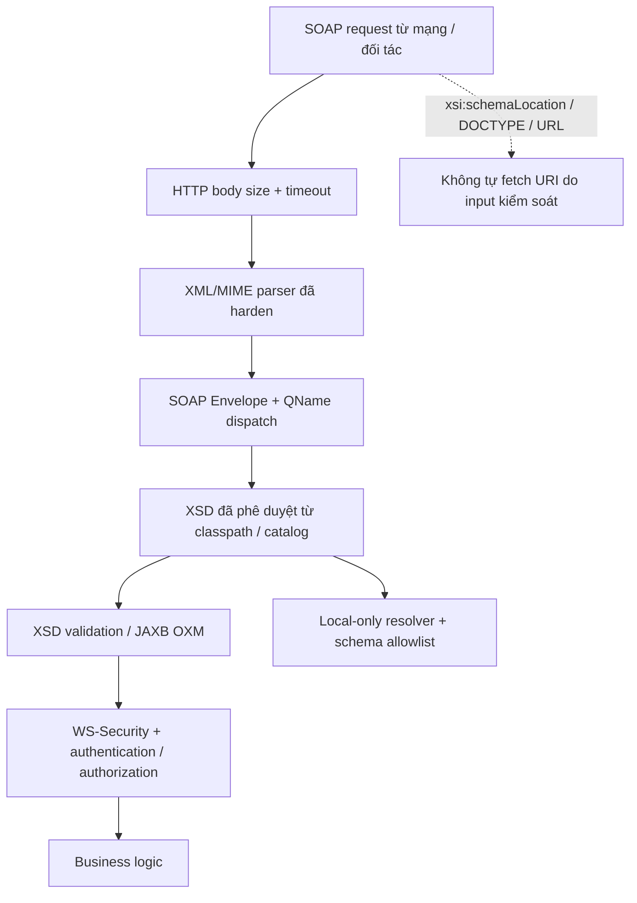
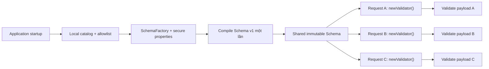
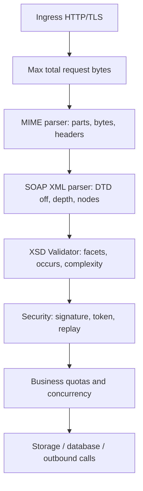

# Dùng schema tin cậy, phân giải cục bộ và kiểm soát tài nguyên hợp đồng

Một dịch vụ SOAP **contract-first** cần XSD/WSDL để các bên trao đổi XML có cấu trúc rõ ràng. Nhưng việc một SOAP request chứa `xsi:schemaLocation` hoặc một WSDL có `xs:import` **không cho phép** bên gửi tự chỉ định server sẽ tải schema, DTD hay tài liệu tham chiếu từ mạng. Khi XML parser hoặc schema compiler tự truy cập URL không kiểm soát, hệ thống có thể đối mặt với **XXE**, **SSRF**, rò dữ liệu, phụ thuộc mạng ngoài, thay đổi hợp đồng ngoài ý muốn và cạn tài nguyên.

Trong module **SPRING_WEB_SERVICES**, ứng dụng xây dựng SOAP service theo hướng contract-first: thiết kế XSD/WSDL, sinh JAXB, xây dựng `@Endpoint` và `WebServiceTemplate`, dùng SOAP Fault, interceptor, XML security, WS-Security, chứng chỉ cùng kiểm thử tương thích. Bài này thuộc chương **Bảo vệ xử lý XML**, tập trung vào ba nguyên tắc đi liền nhau:

1. **Dùng schema tin cậy:** schema phải đến từ phiên bản contract do ứng dụng quản lý, được phê duyệt và không bị điều khiển bởi dữ liệu đầu vào.
2. **Phân giải cục bộ:** `xs:include`, `xs:import`, `wsdl:import` và các tài nguyên tham chiếu khác phải theo allowlist/catalog, không tùy ý tải HTTP/file/UNC URL.
3. **Kiểm soát tài nguyên hợp đồng:** xác thực XML không chỉ là kiểm có đúng cấu trúc; còn phải giới hạn bytes, số node, độ sâu, entity expansion, schema compilation, thời gian xử lý, bộ nhớ, MIME attachments và mức đồng thời.

> **Nguyên tắc cốt lõi:** chỉ dùng XSD/WSDL được phát hành, cố định phiên bản và resolve từ nguồn tin cậy; chặn external resource access mặc định; áp giới hạn tài nguyên trước/trong khi parse; xem XSD validation, XML parser hardening và WS-Security là **những lớp khác nhau**, không thay thế nhau.

## 1. Mục tiêu học tập

Sau bài này, bạn có thể:

- Phân biệt **schema được quản lý**, **schemaLocation hint từ bên gửi** và **WSDL được công bố**.
- Giải thích mối quan hệ giữa `targetNamespace`, `xs:include`, `xs:import`, `schemaLocation` và `QName` khi phân giải schema.
- Thiết kế **catalog/allowlist tài nguyên nội bộ** và một `LSResourceResolver` để chỉ phục vụ XSD đã được phê duyệt.
- Dùng JAXP `SchemaFactory`, `Schema`, `Validator` cùng `XMLConstants.FEATURE_SECURE_PROCESSING` và `ACCESS_EXTERNAL_DTD`/`ACCESS_EXTERNAL_SCHEMA`.
- Cấu hình parser XML (DOM, SAX, StAX) theo nguyên tắc **từ chối DTD/entity external** và xử lý khác biệt hỗ trợ giữa các provider.
- Tích hợp schema validation vào Spring-WS qua `PayloadValidatingInterceptor`, `Jaxb2Marshaller` và kiểm thử client.
- Nhận biết **XXE**, **SSRF**, **billion laughs/entity expansion**, XML quá sâu, schema quá phức tạp, regex facet tốn CPU và MIME/MTOM quá lớn.
- Phân loại lỗi XML parsing, schema resolution, contract violation, SOAP Fault, HTTP/transport và WS-Security.
- Thiết kế kiểm thử âm/dương để chứng minh **không tải tài nguyên ngoài**, không dùng schema do client cung cấp và không để request quá lớn làm nghẽn dịch vụ.

## 2. Ranh giới tin cậy trong xử lý XML

Một XML request đi từ hệ thống đối tác qua Internet hoặc mạng nội bộ vẫn phải được coi là **dữ liệu không tin cậy**, kể cả khi HTTP connection dùng HTTPS hoặc mTLS. TLS bảo vệ kênh và có thể xác minh danh tính đối tác; nó **không đảm bảo** mọi giá trị XML đúng hợp đồng hoặc an toàn cho parser.



Sơ đồ là **mô hình trách nhiệm**, không khẳng định thứ tự thực thi interceptor cho mọi cấu hình Spring-WS. Một số security checks có thể chạy trước validation; HTTP/TLS có thể chặn trước parser; endpoint mapping có thể thất bại trước `PayloadValidatingInterceptor`. Nhưng ở bất kỳ thứ tự nào, **không dùng nội dung chưa được kiểm soát để quyết định nguồn schema tin cậy**.

### 2.1. Bốn loại nội dung thường bị nhầm

| Đầu vào/tài nguyên | Ai kiểm soát? | Chính sách |
|---|---|---|
| SOAP request XML và `xsi:schemaLocation` | Caller/đối tác | **Không tin**; chỉ dùng dữ liệu, không dùng làm chỉ thị tải schema |
| XSD/WSDL được đóng gói trong ứng dụng | Nhóm phát hành contract | **Nguồn tin cậy**, có version/hash/QA và quyền thay đổi |
| XSD/WSDL import từ dependency đã xác minh | Build/release pipeline | Cho phép theo danh sách cố định và provenance rõ |
| URL, file path, catalog entry động từ request | Có thể bị attacker điều khiển | **Không được** cung cấp cho parser/compiler theo đường mặc định |

Ngay cả một schema XSD **hợp lệ** cũng có thể không phải schema đáng tin: nó có thể mở rộng điều kiện validation, nhập thêm các type hoặc tiêu tốn CPU lớn. Giá trị “đã parse được” khác “đã được phê duyệt”.

## 3. Cần chống những loại tấn công nào?

| Mối đe dọa | Điểm bị khai thác | Hậu quả |
|---|---|---|
| XXE (XML External Entity) | DTD/entity external trong XML parser | Đọc file, gọi HTTP, rò thông tin hoặc lỗi parsing |
| SSRF | Parser/compiler tải schema, DTD, external resource | Kết nối tới host nội bộ, metadata endpoint hoặc Internet |
| Schema poisoning | Chọn XSD từ `xsi:schemaLocation` không tin cậy | Validator kiểm theo contract sai/giả |
| Supply-chain schema drift | Tải schema từ URL thay đổi theo thời gian | Build/runtime cùng version nhưng hợp đồng khác |
| Entity expansion bomb | Internal/external entities và mở rộng lặp | CPU/heap tăng mạnh, từ chối dịch vụ |
| XML quá sâu/nhiều phần tử | DOM/SAX/StAX/validator | Stack, CPU, bộ nhớ, parser limits |
| XSD quá phức tạp | Schema compilation, model groups, recursion | CPU/heap và thời gian khởi tạo |
| Regex facet tốn CPU | `xs:pattern`/schema validator | Validation latency bất thường |
| Tài nguyên phụ trợ quá lớn | `xs:import`, `xs:include`, WSDL import | Tăng network/đĩa/memory và độ trễ |
| MTOM/multipart lớn | MIME decoder, attachment streams | Cạn connection, heap/đĩa, bùng nổ file tạm |
| Error-message leakage | SOAP Fault/log raw parser error | Lộ đường dẫn nội bộ, raw XML, PII |
| Signature wrapping/mismatch | WS-Security + parser/QName assumptions | Xử lý nhầm element không được ký |

Không có một cờ cấu hình duy nhất ngăn được tất cả. **ACCESS_EXTERNAL_SCHEMA** xử lý một nhóm external access; **FEATURE_SECURE_PROCESSING** áp một số giới hạn/provider policy; **size/depth/concurrency** phải được kiểm riêng tại gateway và parser; **WS-Security** phục vụ xác thực/toàn vẹn.

## 4. Contract mẫu: hai XSD có namespace riêng

Xét dịch vụ SOAP nhận lệnh thanh toán đã xác thực. Nó dùng một XSD nghiệp vụ và một XSD kiểu chung:

```text
xsd/
  orders-v1.xsd
  common-types-v1.xsd
```

Namespace nghiệp vụ:

```text
urn:example:orders:v1
```

Namespace chung:

```text
urn:example:common:v1
```

### 4.1. `common-types-v1.xsd` (được phát hành cùng ứng dụng)

```xml
<?xml version="1.0" encoding="UTF-8"?>
<xs:schema
    xmlns:xs="http://www.w3.org/2001/XMLSchema"
    targetNamespace="urn:example:common:v1"
    xmlns:com="urn:example:common:v1"
    elementFormDefault="qualified">

    <xs:simpleType name="RequestIdType">
        <xs:restriction base="xs:token">
            <xs:pattern value="REQ-[0-9]{4}"/>
        </xs:restriction>
    </xs:simpleType>

    <xs:simpleType name="MoneyType">
        <xs:restriction base="xs:decimal">
            <xs:totalDigits value="12"/>
            <xs:fractionDigits value="2"/>
            <xs:minInclusive value="0"/>
        </xs:restriction>
    </xs:simpleType>
</xs:schema>
```

### 4.2. `orders-v1.xsd` tham chiếu kiểu ở namespace khác

```xml
<?xml version="1.0" encoding="UTF-8"?>
<xs:schema
    xmlns:xs="http://www.w3.org/2001/XMLSchema"
    xmlns:ord="urn:example:orders:v1"
    xmlns:com="urn:example:common:v1"
    targetNamespace="urn:example:orders:v1"
    elementFormDefault="qualified">

    <xs:import
        namespace="urn:example:common:v1"
        schemaLocation="common-types-v1.xsd"/>

    <xs:element name="SubmitOrderRequest">
        <xs:complexType>
            <xs:sequence>
                <xs:element name="requestId"
                            type="com:RequestIdType"/>
                <xs:element name="orderId"
                            type="xs:string"/>
                <xs:element name="amount"
                            type="com:MoneyType"/>
            </xs:sequence>
        </xs:complexType>
    </xs:element>

    <xs:element name="SubmitOrderResponse">
        <xs:complexType>
            <xs:sequence>
                <xs:element name="requestId"
                            type="com:RequestIdType"/>
                <xs:element name="accepted"
                            type="xs:boolean"/>
            </xs:sequence>
        </xs:complexType>
    </xs:element>
</xs:schema>
```

Đây là hai **XSD minh họa hoàn chỉnh** cho các kiểu và phần tử dùng trong bài. `xs:import` cần vì `MoneyType` và `RequestIdType` thuộc namespace **khác** namespace của order. `schemaLocation="common-types-v1.xsd"` là vị trí tham chiếu được ghi trong **XSD tin cậy do ứng dụng quản lý**, nhưng parser **vẫn không nên tự mở bất kỳ relative/HTTP path** từ vị trí đó mà không có resolver/allowlist.

### 4.3. SOAP request đúng contract

```xml
<ord:SubmitOrderRequest
    xmlns:ord="urn:example:orders:v1">
    <ord:requestId>REQ-0001</ord:requestId>
    <ord:orderId>ORD-101</ord:orderId>
    <ord:amount>150.50</ord:amount>
</ord:SubmitOrderRequest>
```

**Điểm dễ nhầm:** `requestId` có *type* `com:RequestIdType` nhưng **element** `requestId` vẫn thuộc namespace `urn:example:orders:v1` do `elementFormDefault="qualified"` trong `orders-v1.xsd`. Type namespace **không tự làm child element chuyển namespace**.

Một XML dùng `com:requestId` sẽ sai so với schema, trừ khi hợp đồng khai báo element ấy bằng QName tương ứng.

## 5. `xs:include` và `xs:import`: semantics khác nhau

| Cơ chế | Namespace quan hệ | Vai trò | Rủi ro nếu resolve tùy tiện |
|---|---|---|---|
| `xs:include` | Cùng target namespace hoặc chameleon include không targetNamespace | Gộp thêm schema components | Dẫn tới file ngoài phạm vi, schema version drift |
| `xs:import` | Khác target namespace | Tham chiếu components của namespace khác | Tải schema ngoài, thay type hoặc giới hạn đã duyệt |
| `xs:redefine` | Cơ chế XSD 1.0 thay đổi definitions theo quy tắc riêng | Tùy biến components | Rất khó kiểm soát tương thích/độ phức tạp |
| `xs:override` | Cơ chế XSD 1.1 nếu provider hỗ trợ | Thay components theo quy tắc 1.1 | Không mặc định JAXP/XMLSchema 1.0 hỗ trợ |

**Đừng xử lý `xs:include` bằng cách tin mọi `schemaLocation`**. Cùng namespace vẫn có thể dẫn đến đường dẫn như `../../other-contract.xsd` hoặc URL từ bên ngoài khi file XSD bị thay đổi trái phép.

### 5.1. Namespace URI không đồng nghĩa URL bắt buộc fetch

`urn:example:common:v1` là namespace name, không phải địa chỉ tải XSD. Trong XML Namespace, URI dùng để định danh QName. Kể cả namespace trông giống `https://schemas.example.org/common/v1`, nó **không đòi parser gửi HTTP GET** tới URI đó.

XSD `schemaLocation` mới là một hint về nơi lưu schema document; với ứng dụng production, ta có thể **thay hint bằng catalog mapping cục bộ** và hoàn toàn không gọi mạng.

### 5.2. Kiểm consistency khi catalog import

Một import:

```xml
<xs:import
    namespace="urn:example:common:v1"
    schemaLocation="common-types-v1.xsd"/>
```

chỉ được ánh xạ tới schema cục bộ có `targetNamespace="urn:example:common:v1"`. Nếu operator nhầm trỏ tới `common-types-v2.xsd` có targetNamespace khác, compiler phải báo lỗi; không được lặng lẽ nạp “bản nào gần giống”.

## 6. `xsi:schemaLocation` trong XML từ client chỉ là hint

SOAP payload có thể tự thêm:

```xml
<ord:SubmitOrderRequest
    xmlns:ord="urn:example:orders:v1"
    xmlns:xsi="http://www.w3.org/2001/XMLSchema-instance"
    xsi:schemaLocation="urn:example:orders:v1
                        https://untrusted.example/schema/orders.xsd">
    <ord:requestId>REQ-0001</ord:requestId>
    <ord:orderId>ORD-101</ord:orderId>
    <ord:amount>150.50</ord:amount>
</ord:SubmitOrderRequest>
```

`xsi:schemaLocation` chứa cặp **namespace URI + location hint**. Nó **không chứng minh schema ở URL là chính thống** và không cấp quyền tải schema từ URL đó.

Trong client/server contract-first:

1. Xác định contract version từ endpoint/binding/QName đã phê duyệt.
2. Lấy `Schema` đã compile từ **classpath/resource catalog tin cậy**.
3. Áp schema này cho payload nhận được.
4. Không dùng `SchemaFactory.newSchema()` không có nguồn schema cụ thể rồi tùy ý dựa vào hint của input.
5. Không lấy URL từ `xsi:schemaLocation`, `xsi:noNamespaceSchemaLocation` hoặc HTTP header do client gửi để chọn schema runtime.
6. Nếu XML chứa hint, có thể **bỏ qua** hoặc từ chối theo policy; **đừng fetch**.

**Cần phân biệt:** `xsi:type` và `xsi:nil` cũng ở XML Schema Instance namespace nhưng có ngữ nghĩa dữ liệu riêng, không phải nguồn tải XSD. Schema validation vẫn cần kiểm kiểu thực/element nillable theo contract.

## 7. “Schema tin cậy” trong quy trình phát hành nghĩa là gì?

Một file `orders-v1.xsd` trong classpath không tự an toàn chỉ vì nó nằm trong JAR. Cần một vòng đời quản lý contract:

- **Nguồn mã có kiểm soát:** XSD/WSDL đi qua review, test và quy trình đổi phiên bản.
- **Pin version:** schema của `v1` không bị thay đổi âm thầm bởi cập nhật dependency hoặc nội dung host ngoài.
- **Build reproducibility:** đóng gói bản schema đã duyệt vào artifact hoặc resource store chỉ đọc, không fetch từ Internet mỗi lần khởi động.
- **Integrity/provenance:** có thể ghi checksum/hash hoặc ký release để phát hiện thay đổi bất thường.
- **Namespace compatibility:** mapping QName và import graph khớp contract; test clients cũ với server mới.
- **Least privilege:** tài khoản runtime không có quyền ghi đè schema, không cần Internet egress cho schema validation.
- **Audit:** lưu dấu ai đổi contract, vì sao, khi nào và đã chạy interoperability tests nào.
- **Schema complexity review:** các `pattern`, type recursion, `maxOccurs` và extension points có được xem xét về chi phí validation.

Cần nhớ **schema tin cậy** nghĩa là *nguồn được quản lý và nội dung đã thẩm định*, không có nghĩa validator được phép bỏ mọi giới hạn tài nguyên vì “XSD là của mình”. Một schema hợp lệ nhưng có cấu trúc quá phức tạp vẫn có thể dẫn đến vấn đề hiệu năng dưới dữ liệu độc hại.

## 8. JAXP: chặn external access ngay ở `SchemaFactory`

JAXP cung cấp các control cho schema compilation và validation. Với Java hiện đại, cấu hình mặc định nên từ chối external DTD/XSD access:

```java
import javax.xml.XMLConstants;
import javax.xml.validation.SchemaFactory;

public final class SecureSchemaFactories {

    public static SchemaFactory newLockedDownFactory()
            throws Exception {

        SchemaFactory factory = SchemaFactory.newInstance(
            XMLConstants.W3C_XML_SCHEMA_NS_URI
        );

        factory.setFeature(
            XMLConstants.FEATURE_SECURE_PROCESSING,
            true
        );

        factory.setProperty(
            XMLConstants.ACCESS_EXTERNAL_DTD,
            ""
        );

        factory.setProperty(
            XMLConstants.ACCESS_EXTERNAL_SCHEMA,
            ""
        );

        return factory;
    }
}
```

Ý nghĩa:

- `FEATURE_SECURE_PROCESSING`: kích hoạt các biện pháp xử lý an toàn/giới hạn của JAXP provider. **Không** coi nó là toàn bộ chính sách XXE/DoS.
- `ACCESS_EXTERNAL_DTD=""`: không cho các external access protocol đối với DTD theo phạm vi property.
- `ACCESS_EXTERNAL_SCHEMA=""`: không cho các external access protocol đối với schema references theo phạm vi property.
- Chuỗi rỗng **khác** `"all"`: `"all"` cho phép truy cập rộng và không phù hợp với tài nguyên không tin cậy.
- Nếu provider không hỗ trợ feature/property được yêu cầu, mã cấu hình nên **fail closed** thay vì bắt exception rồi tiếp tục với parser không được harden.

Các property là **biện pháp kiểm soát của JAXP provider**, không kiểm soát network access của một `LSResourceResolver` do ứng dụng tự viết. Nếu custom resolver chủ động dùng `new URL(systemId).openStream()`, bản thân resolver đã tạo một đường SSRF mới. **Resolver phải enforce allowlist trước khi truy cập tài nguyên.**

### Không compile schema do caller đưa

Phản mẫu:

```java
// KHÔNG LÀM với requestXml do đối tác gửi:
String untrustedUrl = readSchemaLocationFromRequest(requestXml);

Schema schema = SchemaFactory
    .newInstance(XMLConstants.W3C_XML_SCHEMA_NS_URI)
    .newSchema(new java.net.URL(untrustedUrl));
```

Đoạn này minh họa hành vi **không an toàn**, không phải một cách triển khai khuyến nghị. Nó cho phép untrusted XML điều khiển kết nối mạng và quyết định validator kiểm theo schema nào.

## 9. Local-only catalog bằng `LSResourceResolver`

Với XSD có `xs:import`, chúng ta vẫn cần resolve một số tài nguyên hợp lệ. Một `LSResourceResolver` được dùng bởi `SchemaFactory` có thể ánh xạ **cặp namespace + systemId đã được duyệt** tới bytes trong classpath, thay vì mở bất kỳ URL nào.

Bảng allowlist cho ví dụ:

| Namespace được yêu cầu | `systemId` được chấp nhận | Nguồn được phép |
|---|---|---|
| `urn:example:common:v1` | `common-types-v1.xsd` | `/xsd/common-types-v1.xsd` |
| Giá trị khác | Bất kỳ | **Từ chối** |
| `urn:example:common:v1` | `https://.../common.xsd` | **Từ chối** |
| `urn:example:common:v1` | `../../common.xsd` | **Từ chối** |

Không xây đường dẫn classpath bằng phép nối `"/xsd/" + systemId` trên input tùy ý. Nếu cần một tập import lớn hơn, dùng **catalog tĩnh do hệ thống quản lý** với đầy đủ mapping; không mở thư mục bất kỳ theo dấu `../`.

### 9.1. Mẫu resolver cho đúng một import

Ví dụ dưới đây dùng `DOMImplementationLS` để tạo `LSInput` có bytes từ classpath. Đây là code minh họa đầy đủ **lõi cấu hình**, với các điều kiện fail-closed và giới hạn kích thước:

```java
package org.example.orders.xml;

import java.io.ByteArrayInputStream;
import java.io.IOException;
import java.io.InputStream;
import java.io.UncheckedIOException;

import javax.xml.XMLConstants;
import javax.xml.parsers.DocumentBuilderFactory;
import javax.xml.validation.Schema;
import javax.xml.validation.SchemaFactory;
import javax.xml.transform.stream.StreamSource;

import org.w3c.dom.DOMImplementation;
import org.w3c.dom.ls.DOMImplementationLS;
import org.w3c.dom.ls.LSInput;
import org.w3c.dom.ls.LSResourceResolver;

public final class LocalOrderSchema {

    private static final String COMMON_NS =
        "urn:example:common:v1";
    private static final String COMMON_LOCATION =
        "common-types-v1.xsd";

    // Giới hạn riêng cho XSD nhập từ catalog.
    private static final int MAX_IMPORTED_XSD_BYTES =
        256 * 1024;

    private LocalOrderSchema() {}

    public static Schema compile() throws Exception {
        SchemaFactory factory = SchemaFactory.newInstance(
            XMLConstants.W3C_XML_SCHEMA_NS_URI
        );

        factory.setFeature(
            XMLConstants.FEATURE_SECURE_PROCESSING, true
        );
        factory.setProperty(
            XMLConstants.ACCESS_EXTERNAL_DTD, ""
        );
        factory.setProperty(
            XMLConstants.ACCESS_EXTERNAL_SCHEMA, ""
        );

        DOMImplementation implementation =
            DocumentBuilderFactory.newInstance()
                .newDocumentBuilder()
                .getDOMImplementation();

        Object feature =
            implementation.getFeature("LS", "3.0");

        if (!(feature instanceof DOMImplementationLS domLS)) {
            throw new IllegalStateException(
                "DOM Level 3 Load/Save is unavailable"
            );
        }

        LSResourceResolver resolver =
            (type, namespaceURI, publicId, systemId, baseURI) -> {

            // Chỉ XSD import đã biết mới được giải quyết.
            if (!COMMON_NS.equals(namespaceURI)
                    || !COMMON_LOCATION.equals(systemId)) {
                throw new IllegalArgumentException(
                    "Disallowed schema import"
                );
            }

            try {
                byte[] bytes = readBoundedResource(
                    "/xsd/common-types-v1.xsd",
                    MAX_IMPORTED_XSD_BYTES
                );

                LSInput input = domLS.createLSInput();
                input.setByteStream(
                    new ByteArrayInputStream(bytes)
                );
                input.setSystemId(
                    "urn:local:xsd:common-types-v1.xsd"
                );
                return input;
            } catch (IOException e) {
                throw new UncheckedIOException(
                    "Approved schema unavailable", e
                );
            }
        };

        factory.setResourceResolver(resolver);

        try (InputStream root = LocalOrderSchema.class
                .getResourceAsStream("/xsd/orders-v1.xsd")) {

            if (root == null) {
                throw new IllegalStateException(
                    "Approved root XSD not packaged"
                );
            }

            StreamSource source = new StreamSource(root);
            source.setSystemId(
                "urn:local:xsd:orders-v1.xsd"
            );

            return factory.newSchema(source);
        }
    }

    private static byte[] readBoundedResource(
            String trustedPath, int maxBytes)
            throws IOException {

        try (InputStream in = LocalOrderSchema.class
                .getResourceAsStream(trustedPath)) {

            if (in == null) {
                throw new IOException(
                    "Approved XSD missing in application"
                );
            }

            byte[] bytes = in.readNBytes(maxBytes + 1);
            if (bytes.length > maxBytes) {
                throw new IOException(
                    "Approved XSD exceeds size budget"
                );
            }

            return bytes;
        }
    }
}
```

**Giả định:** sử dụng Java 17+, JAXP provider hỗ trợ `DOMImplementationLS` và các resource được đóng gói trong classpath như sơ đồ mục 4. `LSResourceResolver` nhận các tham số tùy compiler/provider; cần integration test để xác nhận `namespaceURI` và `systemId` phù hợp với cấu hình/định dạng import của XSD thực tế.

### 9.2. Điểm cần hiểu trong ví dụ

1. **Schema compilation được thực hiện từ root XSD cục bộ**; không tải HTTP.
2. `ACCESS_EXTERNAL_SCHEMA=""` chặn đường external mặc định của provider.
3. Resolver **từ chối** mọi `namespaceURI`/`systemId` ngoài cặp duy nhất cho phép.
4. Resolver **không dùng `systemId` để tạo file path**, tránh path traversal.
5. `LSInput` chứa bytes đã được đọc từ một resource cố định, không dùng HTTP URL.
6. `readNBytes(maxBytes + 1)` giúp phát hiện file vượt ngưỡng; nó không cần đọc vô hạn.
7. `StreamSource.setSystemId("urn:local:...")` cung cấp base URI nhận diện nguồn; nó không cấp quyền tải `urn:` từ ngoài.
8. Nếu thiếu resource hoặc provider không hỗ trợ phần cần thiết, compilation **thất bại**, không mở rộng quyền truy cập.
9. Code được gọi **lúc khởi động hoặc khi nâng cấp contract**, không nên compile lại schema cho từng request.

**Quan trọng:** ví dụ resolver chỉ chấp nhận **một import**. Nếu XSD có thêm include/import hợp lệ, cần mở rộng **catalog theo danh sách kiểm soát**, thay vì sửa thành `return null` cho tất cả unknown rồi để resolver mặc định tự tìm đường. Với `ACCESS_EXTERNAL_SCHEMA=""`, các external URL vẫn bị chặn theo provider, nhưng việc từ chối ngay trong resolver giúp phát hiện policy violation rõ ràng hơn.

### 9.3. Thứ gì vẫn cần kiểm ngoài resolver?

- Mã ứng dụng có thể tự mở URL trước khi gọi `newSchema`. External access property không chặn code tự viết.
- XSD root resource cũng cần size/integrity check nếu được nạp từ nguồn có thể thay đổi.
- WSDL imports có resolver/loader khác XSD imports.
- JAXB/OXM, XSLT transformer, SAX/DOM/StAX parser có thể dùng các provider/setting riêng.
- MIME/MTOM parser dùng mô hình attachment khác, không bị chi phối hoàn toàn bởi `LSResourceResolver`.
- `ACCESS_EXTERNAL_SCHEMA` không thay thế network egress policy ở container/kubernetes/firewall.

## 10. Lưu ý riêng cho `xs:include` cùng namespace

Trong nhiều schema thực, root `orders-v1.xsd` có thể chứa:

```xml
<xs:include
    schemaLocation="order-items-v1.xsd"/>
```

`xs:include` không dùng cặp namespace khác như `xs:import`; tham số `namespaceURI` mà resolver nhận có thể khác tùy trường hợp/provider. Vì vậy không copy nguyên điều kiện:

```java
if (!COMMON_NS.equals(namespaceURI)) {
    throw new IllegalArgumentException();
}
```

để xử lý **mọi** `xs:include` — nó có thể từ chối chính các include hợp lệ.

Thiết kế đúng:

- Có **entry catalog riêng** cho `order-items-v1.xsd`.
- Kiểm namespace của schema đích đúng quy tắc include/chameleon include.
- Kiểm `systemId` hoặc canonical catalog key **đúng chuỗi đã phát hành**.
- Giới hạn số level import/include và bytes của từng tài nguyên.
- Không normalize input path bằng cách “đi lên thư mục” từ một schema do client gửi.
- Nếu một include không nằm trong catalog, **fail closed** và báo lỗi triển khai contract.

Một catalog dùng chung có thể là XML Catalog chuẩn được nhiều XML libraries hỗ trợ; nhưng điểm quan trọng không phải định dạng catalog, mà là **danh sách tài nguyên được phê duyệt và tính nhất quán của giải pháp resolve**.

## 11. Không dùng `EntityResolver` thay cho `LSResourceResolver`

Trong Java XML ecosystem có nhiều resolver:

| API | Thường phục vụ | Lưu ý |
|---|---|---|
| `org.xml.sax.EntityResolver` | SAX parser resolve external entities/DTD | Không phải API đầy đủ để resolve XSD imports trong `SchemaFactory` |
| `org.w3c.dom.ls.LSResourceResolver` | `SchemaFactory`/schema loader resolve schema resources | Dùng cho XSD catalog khi được provider hỗ trợ |
| `javax.xml.transform.URIResolver` | XSLT `xsl:include`/`xsl:import`, `document()` | Không tự áp lên SAX DTD hoặc XSD imports |
| XML Catalog API | Mapping URI/public/system IDs theo quy tắc catalog | Cần cấu hình riêng cho từng parser/compiler |
| Spring `Resource`/`ResourceResolver` | Đọc resource classpath/file/URL theo Spring API | Không tự buộc `SchemaFactory` sử dụng catalog |
| HTTP/WSDL resolver | `wsdl:import` và dependency của WSDL loader | Cần chính sách riêng cho WSDL |

Một ứng dụng chỉ khóa `EntityResolver` nhưng vẫn để `SchemaFactory` tải `schemaLocation` ngoài có thể còn SSRF. Ngược lại, `LSResourceResolver` an toàn cũng không chặn parser SAX riêng đọc DTD từ request nếu parser đó chưa được harden.

**Quy tắc triển khai:** xác định **mọi API có thể truy cập external resource**, gắn policy tương ứng cho từng API, rồi test thực sự không có network/file access ngoài allowlist.

## 12. Parser hardening: DOM, SAX và StAX khác nhau

Một SOAP message có thể đi qua nhiều lớp xử lý XML: SAAJ/message factory, JAXB, DOM/SAX/StAX, XSLT, security engine hoặc custom interceptor. Không được mặc định cấu hình một `SchemaFactory` sẽ lan sang mọi parser.

### 12.1. DOM `DocumentBuilderFactory`

```java
import javax.xml.XMLConstants;
import javax.xml.parsers.DocumentBuilderFactory;

public static DocumentBuilderFactory hardenedDomFactory()
        throws Exception {

    DocumentBuilderFactory factory =
        DocumentBuilderFactory.newInstance();

    factory.setNamespaceAware(true);
    factory.setXIncludeAware(false);
    factory.setExpandEntityReferences(false);

    factory.setFeature(
        "http://apache.org/xml/features/disallow-doctype-decl",
        true
    );
    factory.setFeature(
        "http://xml.org/sax/features/external-general-entities",
        false
    );
    factory.setFeature(
        "http://xml.org/sax/features/external-parameter-entities",
        false
    );

    factory.setAttribute(
        XMLConstants.ACCESS_EXTERNAL_DTD,
        ""
    );
    factory.setAttribute(
        XMLConstants.ACCESS_EXTERNAL_SCHEMA,
        ""
    );

    return factory;
}
```

Đây là một **cấu hình nghiêm ngặt cho input không tin cậy** trong môi trường JAXP phù hợp. Một số URI feature có nguồn gốc từ Xerces và có thể không được mọi parser provider hỗ trợ. Khi một thuộc tính bảo mật bắt buộc không được hỗ trợ, **fail closed**, ghi diagnostics ở startup và lựa chọn provider phù hợp — không im lặng bỏ qua exception để tiếp tục đọc XML không tin cậy.

Tạo `DocumentBuilder` mới theo luồng xử lý; không dùng chung một instance builder mutable giữa các threads. Nếu ứng dụng không cần DOM tree đầy đủ, cân nhắc streaming để giảm heap, nhưng streaming **không thay** giới hạn XML.

### 12.2. SAX `SAXParserFactory`

```java
import javax.xml.parsers.SAXParserFactory;

public static SAXParserFactory hardenedSaxFactory()
        throws Exception {

    SAXParserFactory factory =
        SAXParserFactory.newInstance();

    factory.setNamespaceAware(true);
    factory.setValidating(false);

    factory.setFeature(
        "http://apache.org/xml/features/disallow-doctype-decl",
        true
    );
    factory.setFeature(
        "http://xml.org/sax/features/external-general-entities",
        false
    );
    factory.setFeature(
        "http://xml.org/sax/features/external-parameter-entities",
        false
    );
    factory.setFeature(
        "http://apache.org/xml/features/nonvalidating/load-external-dtd",
        false
    );

    return factory;
}
```

Với SAX parser, có thể thêm `EntityResolver` **chặn** external entities theo policy. Nhưng `EntityResolver` không thay `LSResourceResolver` của schema compiler và không phải bộ giới hạn số element/depth.

### 12.3. StAX `XMLInputFactory`

```java
import javax.xml.stream.XMLInputFactory;

public static XMLInputFactory hardenedStaxFactory() {

    XMLInputFactory factory =
        XMLInputFactory.newFactory();

    factory.setProperty(
        XMLInputFactory.SUPPORT_DTD,
        false
    );
    factory.setProperty(
        XMLInputFactory.IS_SUPPORTING_EXTERNAL_ENTITIES,
        false
    );

    return factory;
}
```

Ở đây phải kiểm provider chấp nhận cả hai property và behavior thực; nếu provider không hỗ trợ mà parser cần đọc XML không tin cậy, **không tiếp tục như đã an toàn**. Với StAX, nhiều XML resources chỉ được xử lý khi code thật sự duyệt event/cursor — phải giới hạn số events, độ sâu và kích thước value trong vòng lặp.

### 12.4. Không có một cấu hình phủ hết SOAP stack

| Lớp | Cần kiểm |
|---|---|
| `MessageFactory` (SAAJ/Axiom/transport) | Cách parser đọc SOAP Envelope/attachments và support DTD/external access |
| `Jaxb2Marshaller` | JAXB provider, unmarshaller schema, adapter/resource access |
| `PayloadValidatingInterceptor` | XSD nguồn, schema imports, response validation |
| Custom `@Endpoint` DOM/SAX/StAX | Parser hardening, input size/depth limits |
| XSLT/Transformer | `ACCESS_EXTERNAL_DTD`/`ACCESS_EXTERNAL_STYLESHEET`, `URIResolver` |
| WSS4J/XML Signature | Parser và signed element selection, signature policy |
| MTOM/MIME decoder | Body/part counts/size, Content-ID consistency, stream lifecycle |

Dùng `XMLConstants.FEATURE_SECURE_PROCESSING` cũng cho `TransformerFactory` khi phù hợp, kèm `ACCESS_EXTERNAL_DTD=""` và `ACCESS_EXTERNAL_STYLESHEET=""`. Nếu XSLT được tải từ input không tin cậy hoặc dùng `document()`/`xsl:include`, cần policy/`URIResolver` riêng, không tự tin rằng schema catalog đã khóa mọi network access.

## 13. Xác thực request bằng `Schema` đã compile và SAX parser an toàn

Một `Schema` được compile từ XSD tin cậy có thể được dùng lại cho nhiều request. Đối với mỗi payload, tạo `Validator` mới và một SAX parser riêng để tránh đọc DTD hoặc entities từ XML.

Ví dụ:

```java
package org.example.orders.xml;

import java.io.InputStream;
import javax.xml.XMLConstants;
import javax.xml.parsers.SAXParserFactory;
import javax.xml.transform.sax.SAXSource;
import javax.xml.validation.Schema;
import javax.xml.validation.Validator;

import org.xml.sax.InputSource;
import org.xml.sax.XMLReader;

public final class SafeOrderPayloadValidator {

    private final Schema approvedSchema;

    public SafeOrderPayloadValidator(Schema approvedSchema) {
        this.approvedSchema = approvedSchema;
    }

    public void validate(InputStream untrustedXml)
            throws Exception {

        SAXParserFactory parserFactory =
            SAXParserFactory.newInstance();

        parserFactory.setNamespaceAware(true);

        parserFactory.setFeature(
            "http://apache.org/xml/features/disallow-doctype-decl",
            true
        );
        parserFactory.setFeature(
            "http://xml.org/sax/features/external-general-entities",
            false
        );
        parserFactory.setFeature(
            "http://xml.org/sax/features/external-parameter-entities",
            false
        );
        parserFactory.setFeature(
            "http://apache.org/xml/features/nonvalidating/load-external-dtd",
            false
        );

        XMLReader xmlReader =
            parserFactory.newSAXParser().getXMLReader();

        Validator validator = approvedSchema.newValidator();
        validator.setProperty(
            XMLConstants.ACCESS_EXTERNAL_DTD, ""
        );
        validator.setProperty(
            XMLConstants.ACCESS_EXTERNAL_SCHEMA, ""
        );

        validator.validate(new SAXSource(
            xmlReader,
            new InputSource(untrustedXml)
        ));
    }
}
```

**Giả định:** Java/JAXP provider hỗ trợ các feature/property ở trên; `approvedSchema` đã được compile từ classpath/catalog đúng theo mục 8–10. Đây là đoạn code lõi validation, **chưa tự triển khai input byte/depth/time limits** — chúng cần được áp tại HTTP/gateway/stream wrapping và parser event handler theo policy.

### Các điểm an toàn cần nắm

- `newValidator()` gọi **mỗi request** vì `Validator` không được thiết kế để chia sẻ mutable state đồng thời.
- `Schema` có thể dùng lại giữa các threads khi được compile xong và không mutate.
- `SAXSource` cho phép truyền `XMLReader` đã harden thay vì để implementation chọn parser mặc định không được kiểm.
- `XMLConstants.ACCESS_EXTERNAL_*` tại `Validator` là defense-in-depth; không thay cấu hình parser.
- Việc caller sở hữu `InputStream` không đổi; code gọi phải đóng stream của mình đúng lifecycle.
- Không validate một `StreamSource` đã bị parser khác tiêu thụ rồi hy vọng có thể đọc lại.
- Nếu cần kiểm nhiều XSD versions, chọn `Schema` theo **contract version đáng tin** chứ không theo `xsi:schemaLocation` của XML.

### 13.1. Vì sao `Validator.validate(new StreamSource(...))` chưa phải toàn bộ lời giải?

```java
Validator validator = approvedSchema.newValidator();
validator.validate(
    new javax.xml.transform.stream.StreamSource(untrustedXml)
);
```

Đoạn trên có thể hoạt động và `ACCESS_EXTERNAL_*` của validator vẫn cần áp, nhưng parser được chọn cho `StreamSource` có thể do implementation quản lý. Nếu yêu cầu cụ thể là **từ chối mọi DOCTYPE và external entity** với hành vi nhất quán, cung cấp **SAXSource với XMLReader đã cấu hình** (hoặc parser factory được kiểm tương đương) giúp làm rõ ranh giới.

Dù vậy, không đưa SAXSource qua một lượt parser rồi lại đọc `InputStream` từ đầu trừ khi có khả năng replay đáng tin; **streaming source có thể chỉ đọc một lần**.

## 14. Cache `Schema` nhưng không tái sử dụng `Validator` mutable

**Compile XSD** có thể tốn CPU, nhất là khi root schema có nhiều import/include, complex types và pattern. Nếu chạy `SchemaFactory.newSchema(...)` cho **mỗi SOAP request**, ứng dụng tự tạo điểm nghẽn và tăng bề mặt tấn công DoS, dù schema lấy từ classpath an toàn.

Mô hình nên dùng:



Ví dụ Spring Bean:

```java
import javax.xml.validation.Schema;

import org.springframework.context.annotation.Bean;
import org.springframework.context.annotation.Configuration;

@Configuration
public class SchemaConfiguration {

    @Bean
    public Schema approvedOrderSchema()
            throws Exception {

        // Đọc schema từ catalog cục bộ và compile lúc startup.
        return LocalOrderSchema.compile();
    }

    @Bean
    public SafeOrderPayloadValidator orderValidator(
            Schema approvedOrderSchema) {

        return new SafeOrderPayloadValidator(
            approvedOrderSchema
        );
    }
}
```

Lợi ích:

- Fail-fast khi XSD root/import không đóng gói hoặc bị sửa sai.
- Một request từ mạng không thể kích hoạt `SchemaFactory` tải XSD mới.
- Validation diễn ra với contract version đã xác định.
- Có thể gắn metrics cho thời gian validation mà không tính trùng chi phí compile.
- Không dùng chung `Validator`, `DocumentBuilder`, `XMLReader` hoặc `Transformer` mutable giữa các threads.

Nếu cần nhiều contract versions, quản lý map `version/namespace → Schema` **cố định theo release**; không dùng một concurrent map không giới hạn với key là URL do caller cung cấp. Version discovery có thể dựa vào route, SOAP Body QName hoặc binding đã phê duyệt, nhưng phải áp whitelist trước khi chọn schema.

## 15. Kiểm soát tài nguyên: giới hạn ở lớp nào?

Không một parser flag nào thay được quy định **độ lớn và chi phí của request**. Một XML well-formed, không DTD, hợp lệ theo XSD vẫn có thể chứa số lượng phần tử hoặc text rất lớn nếu contract cho phép.



| Lớp | Giới hạn khuyến nghị theo policy | Không thay thế được |
|---|---|---|
| Reverse proxy/gateway | Request bytes, read timeout, concurrent requests, rate limit | Kiểm XSD QName hoặc field values |
| Servlet/transport | Content-Length/body actual bytes, request deadlines, thread limits | MIME part count hoặc XML depth |
| MIME/MTOM | Tổng part count, từng part size, total bytes, header length, Content-ID | SOAP Body XML structure |
| DOM/SAX/StAX | DTD/external access off, depth, number of elements, attribute count, text length | Business authorization |
| Schema compiler | XSD nguồn tin cậy, import allowlist, max schema bytes, compile once | Input XML size/resource limits |
| XSD Validator | `minOccurs/maxOccurs`, pattern, enum, decimal facets, QName | Quyền người gọi, file malware |
| WS-Security | Signature/signed parts, timestamp, replay, algorithm policy | XML contract validation hoặc input size |
| Service/business | Tenant quota, idempotency, transaction limits, storage budget | DTD blocking/XXE |

### 15.1. Tại sao XSD `maxOccurs="unbounded"` cần cân nhắc?

Một contract:

```xml
<xs:element name="line"
            type="ord:OrderLineType"
            minOccurs="0"
            maxOccurs="unbounded"/>
```

có thể hợp lệ về XSD khi request chứa rất nhiều `line`. Nhưng nếu endpoint tạo Java List hàng triệu phần tử rồi tính giá hoặc ghi DB, chi phí có thể vượt ngân sách xử lý. Đừng chỉ thêm memory cho JVM; cần:

- Cân nhắc giới hạn `maxOccurs` trong thiết kế contract nếu nghiệp vụ có mức tối đa thật.
- Đặt giới hạn bytes/nodes/lines ở ứng dụng/ingress độc lập với XSD.
- Dùng batching/pagination hoặc file processing workflow cho dữ liệu lớn thay vì một SOAP message khổng lồ.
- Giới hạn concurrent requests nặng để không giữ toàn bộ servlet thread/connection pool.
- Không nhận thêm phần tử lạ bằng `xs:any processContents="skip"` khi chưa có extension policy.

### 15.2. Giới hạn chiều sâu và số lượng node

Một XML không DTD vẫn có thể lồng hàng nghìn phần tử:

```xml
<ord:SubmitOrderRequest xmlns:ord="urn:example:orders:v1">
    <!-- ví dụ ý tưởng: nhiều mức lồng không có trong XSD -->
    <ord:a><ord:b><ord:c>...</ord:c></ord:b></ord:a>
</ord:SubmitOrderRequest>
```

Ví dụ chỉ để thấy rủi ro, **không phải request hợp lệ** cho schema ở mục 4. Parser có thể tiêu tốn tài nguyên **trước khi** validator từ chối vì content model không đúng. Vì vậy giới hạn depth/nodes nên được đặt **trong quá trình parse**, không chỉ sau khi DOM tree đã được dựng đầy đủ.

Đối với parser tùy biến SAX/StAX, có thể đếm depth trên `startElement/endElement` hoặc `START_ELEMENT/END_ELEMENT` và từ chối khi vượt ngưỡng. Với message factory Spring-WS, cấu hình thực tế phụ thuộc provider; gateway size limit và security parsers phải được kiểm đồng thời.

## 16. Khác biệt giữa XSD constraints và resource budgets

Có ít nhất ba cấp giới hạn:

1. **Semantic constraint:** XSD mô tả dữ liệu nghiệp vụ hợp lệ, ví dụ `amount > 0`, `requestId` pattern.
2. **Operational budget:** server chỉ xử lý tối đa một lượng byte/node/depth/time nhất định, bất kể XSD có cho phép nhiều hơn hay không.
3. **Security policy:** đầu vào phải không dùng external entities, không vượt parser limits, không truy cập schema ngoài và phải qua authentication/signature policy.

Ví dụ schema cho `description xs:string` có thể không giới hạn độ dài. Một client gửi chuỗi 80 MiB không cần DTD cũng có thể gây OOM nếu JAXB tạo Java String. Khi thực sự cần giới hạn văn bản, hãy kết hợp:

```xml
<xs:simpleType name="ShortDescriptionType">
    <xs:restriction base="xs:string">
        <xs:maxLength value="1024"/>
    </xs:restriction>
</xs:simpleType>
```

với **HTTP request body limit** và parser event text limits.

### Regex pattern và phép chuẩn hóa

Một `xs:pattern` có thể làm validation tốn CPU khi được thiết kế phức tạp. Đối với dữ liệu nhập dài:

- Giữ pattern đơn giản, ưu tiên datatype/facets chuẩn khi có thể.
- Áp max length trước khi chạy kiểm tra nặng, kể cả khi có schema maxLength.
- Kiểm behavior trên JAXB/provider/schema engine thực tế bằng stress tests.
- Không sao chép regex Java đầy đủ vào XSD mà không xét ngôn ngữ pattern khác nhau.
- Không để bên gửi tự thêm pattern hoặc XSD version mới.
- Khi thấy CPU tăng, kiểm schema compilation/validation metrics thay vì suy đoán lỗi network.

**Một hợp đồng được phê duyệt về nghiệp vụ vẫn cần được review hiệu năng** nếu nó thay đổi pattern, recursion, wildcards hay số phần tử lặp.

## 17. DTD, entity expansion và cách nhận biết xử lý không an toàn

Một XML document có thể khai báo `DOCTYPE` và internal/external entities. Một vài use case XML cổ điển cho phép DTD, nhưng **SOAP business payload thông thường không cần DTD từ caller**. Chính sách đơn giản, dễ kiểm nhất thường là từ chối DOCTYPE khi xử lý XML không tin cậy.

Ví dụ input **dùng để thử parser có từ chối DTD hay không**, không dùng với dịch vụ thực:

```xml
<?xml version="1.0"?>
<!DOCTYPE note [
    <!ENTITY demo "blocked-by-policy">
]>
<note>&demo;</note>
```

Khi parser hardening đúng như mục 12–13, request này cần bị từ chối ở bước phân tích XML theo policy, **dù DTD chỉ dùng internal entity vô hại**. Đây là lựa chọn kiểm soát nhất quán: nếu DTD không có vai trò trong contract SOAP, không cần mở ngoại lệ khó giám sát.

Với **external entity**, attacker có thể khiến parser cố truy cập file hoặc HTTP URI; với **entity expansion lặp**, nhiều entity nội bộ có thể làm số ký tự sau mở rộng tăng rất mạnh. Không nhất thiết phải chạy một “bomb payload” cực lớn trong CI: test một DTD nhỏ để xác nhận DOCTYPE bị từ chối, và dùng stress tests có giới hạn riêng cho budget.

### Vì sao `setExpandEntityReferences(false)` không đủ?

Trong DOM `DocumentBuilderFactory`, cờ này liên quan cách DOM biểu diễn entity references; nó **không thay thế** từ chối DOCTYPE, vô hiệu external entity resolution và giới hạn tài nguyên. Chính sách nên kết hợp nhiều control có kiểm thử provider.

### Khi hệ thống thật sự phải đọc DTD?

Nếu một chuẩn legacy **bắt buộc DTD**, cần tách đường xử lý và rủi ro riêng:

- DTD được phép phải nằm trong catalog **cục bộ** và không chứa URL không phê duyệt.
- Parser giới hạn entity expansion/bytes/time.
- Resource resolver chỉ phục vụ ID được allowlist.
- Không nhận DTD tùy ý do caller chỉ định.
- Test cụ thể XXE/SSRF cùng các giới hạn đã thống nhất.
- Nếu không thỏa điều kiện, từ chối/tách service thay vì tắt toàn bộ parser security.

Đây là ngoại lệ có kiểm soát, không phải lý do để bỏ qua hardening mặc định của SOAP stack.

## 18. Ứng dụng vào Spring-WS: `PayloadValidatingInterceptor`

Spring Web Services cung cấp `PayloadValidatingInterceptor` để kiểm SOAP Body payload theo XSD. Cấu hình skeleton:

```java
import java.util.List;

import org.springframework.context.annotation.Configuration;
import org.springframework.ws.config.annotation.WsConfigurer;
import org.springframework.ws.server.EndpointInterceptor;
import org.springframework.ws.soap.server.endpoint.interceptor.PayloadValidatingInterceptor;
import org.springframework.xml.xsd.XsdSchema;

@Configuration
public class SoapPayloadValidationConfiguration
        implements WsConfigurer {

    private final XsdSchema approvedSchema;

    public SoapPayloadValidationConfiguration(
            XsdSchema approvedSchema) {
        this.approvedSchema = approvedSchema;
    }

    @Override
    public void addInterceptors(
            List<EndpointInterceptor> interceptors) {

        PayloadValidatingInterceptor validator =
            new PayloadValidatingInterceptor();

        validator.setXsdSchema(approvedSchema);
        validator.setValidateRequest(true);
        validator.setValidateResponse(true);

        interceptors.add(validator);
    }
}
```

Có thể khai báo `XsdSchema` bằng resource cục bộ:

```java
import org.springframework.context.annotation.Bean;
import org.springframework.context.annotation.Configuration;
import org.springframework.core.io.ClassPathResource;
import org.springframework.xml.xsd.SimpleXsdSchema;
import org.springframework.xml.xsd.XsdSchema;

@Configuration
public class OrdersXsdResourceConfiguration {

    @Bean
    public XsdSchema ordersXsd() {
        return new SimpleXsdSchema(
            new ClassPathResource("xsd/orders-v1.xsd")
        );
    }
}
```

**Cảnh báo rất quan trọng:** ví dụ `SimpleXsdSchema` ở trên minh họa **nguồn XSD từ classpath**, **không chứng minh** mọi transitive `xs:import` đã được resolve theo allowlist. Với schema có import như mục 4, phải kiểm cách Spring-XML/Spring-WS version thực tế compile/import XSD. Nếu cấu hình đó không hỗ trợ local catalog policy tương ứng, hãy:

- Dùng **schema compilation/catalog được kiểm soát** ở lớp xác thực độc lập, hoặc
- Cung cấp một XSD tập hợp/chỉ tham chiếu resource cục bộ được phê duyệt theo khả năng Spring-XML hỗ trợ, hoặc
- Tùy biến thành phần validation/schema resolution với giải pháp đã được test.

**Không** chỉ cấu hình `ClassPathResource` rồi mặc định mọi import được khóa; ví dụ `LSResourceResolver` của mục 9 **không tự động gắn** vào mọi bean `SimpleXsdSchema` do Spring tạo.

### 18.1. Giới hạn của PayloadValidatingInterceptor

- Tập trung vào **SOAP Body payload**, không tự validate mọi SOAP Header/custom MIME part.
- Có thể chỉ chạy **sau khi endpoint mapping thành công**; root QName sai có thể đi đường lỗi khác.
- XSD validation không kiểm token, chữ ký hay tenant authorization.
- Validation response hữu ích để bắt server-generated XML sai contract nhưng tăng chi phí.
- Không xử lý mọi malformed XML trước message factory.
- Không áp kích thước HTTP request, XML depth/element limits hoặc attachment part limits thay gateway/parser.
- Không bảo đảm SOAP Fault detail mặc định giống schema lỗi nghiệp vụ do bạn công bố.

### 18.2. Kiểm interceptor được kích hoạt thật

Một request có root QName đúng nhưng child không đúng namespace hoặc `amount=ABC` phải bị từ chối khi validation được bật. Nếu request sai vẫn vào business service, có thể interceptor không được đăng ký, schema nguồn khác hoặc mapping/validation order không đúng. **Không dùng việc WSDL được publish thành công làm bằng chứng runtime payload validation đã bật.**

## 19. `Jaxb2Marshaller` và schema validation trên máy khách/server

Spring OXM `Jaxb2Marshaller` ánh xạ XML ↔ JAXB. Nó có thể áp schema validation cho marshal/unmarshal khi được cấu hình:

```java
import org.springframework.context.annotation.Bean;
import org.springframework.context.annotation.Configuration;
import org.springframework.core.io.ClassPathResource;
import org.springframework.oxm.jaxb.Jaxb2Marshaller;

@Configuration
public class OrderOxmConfiguration {

    @Bean
    public Jaxb2Marshaller orderMarshaller() {
        Jaxb2Marshaller m = new Jaxb2Marshaller();

        m.setContextPath(
            "org.example.orders.contract"
        );

        m.setSchema(
            new ClassPathResource(
                "xsd/orders-v1.xsd"
            )
        );

        return m;
    }
}
```

Những điểm cần kiểm:

- `@XmlRootElement`/`JAXBElement<T>` đúng QName, namespace và XSD v1.
- Generated code phù hợp stack `jakarta.xml.bind` (Boot 3/Spring-WS 4) hoặc `javax.xml.bind` của thế hệ cũ.
- `setSchema(...)` không có nghĩa JAXB tự harden mọi parser/cấp hạn resources bên dưới.
- `@XmlElement(required=true)` không thay schema validation: Java object vẫn có thể chứa null/giá trị ngoài facet.
- Nếu schema có import/include, **chính sách phân giải vẫn cần được áp** trên path mà JAXB provider thực sự dùng.
- Chỉ compile schema/version đã phê duyệt, không dựa vào `xsi:schemaLocation` do đối tác gửi.

### 19.1. Có nên validate hai lần?

Cấu hình `PayloadValidatingInterceptor` **và** `Jaxb2Marshaller` cùng validate request có thể bắt lỗi ở nhiều điểm nhưng cũng tăng chi phí parse/validate và tạo các lỗi bọc khác nhau. Chọn rõ mục tiêu:

| Chỗ validate | Lợi ích | Giới hạn |
|---|---|---|
| Interceptor server | Chặn payload sai XSD sớm theo chain | Có thể không chạy khi không map endpoint |
| OXM unmarshaller | Xác thực ở biên XML ↔ JAXB | Cần kiểm schema resource/import, cost và provider |
| OXM marshaller | Bắt response/request do app tạo sai XSD | Không thay business validation |
| Client inbound | Không tin hoàn toàn response của đối tác | Cần SOAP Fault/transport/security handling riêng |
| JAXP độc lập | Test contract và security policy cụ thể | Không tự tạo SOAP Fault trên server |
| WSDL/codegen CI | Phát hiện hợp đồng không sinh/bind được | Không chứng minh runtime đã validate |

Một production service có thể chọn một vị trí validation chính và các test bổ sung ở CI. **Không bỏ validation chỉ vì các lớp Java đã biên dịch.**

## 20. WSDL publication và resolver cũng là một bề mặt tin cậy

Server SOAP contract-first thường công bố WSDL qua `?wsdl` hoặc endpoint riêng. WSDL có thể nhúng XSD trong `wsdl:types` hoặc tham chiếu `wsdl:import`, `xs:import`. Các đường URL đó có hai chức năng khác nhau:

1. **Công bố contract cho client**: external clients tải tài liệu theo URL được server cung cấp.
2. **Runtime schema validation**: server chọn một `Schema` đáng tin để kiểm SOAP payload.

Hai hành vi **không bắt buộc dùng chung resolver**, và URL công bố cho client **không nên** biến thành URL mà server tự fetch mỗi request.

Ví dụ WSDL snippet:

```xml
<wsdl:types
    xmlns:wsdl="http://schemas.xmlsoap.org/wsdl/"
    xmlns:xs="http://www.w3.org/2001/XMLSchema">
    <xs:schema>
        <xs:import
            namespace="urn:example:orders:v1"
            schemaLocation="orders-v1.xsd"/>
    </xs:schema>
</wsdl:types>
```

Đây là fragment minh họa WSDL, chưa đủ `wsdl:definitions`/`portType`/`binding`/`service`. Đối tác có thể tải `orders-v1.xsd` theo URL công bố. Nhưng **server runtime** vẫn nên compile XSD bản local từ ứng dụng. Không lấy một `schemaLocation` trong WSDL do request cung cấp rồi đưa tới XML schema loader.

### 20.1. Tránh schema version bị phụ thuộc vào network

Nếu deployment A tải `https://schemas.example.org/orders-v1.xsd` lúc khởi động còn deployment B tải một bản đã đổi bất ngờ, cả hai có thể nhận khác nhau cùng SOAP QName. Đó là **schema drift** nguy hiểm.

Thay bằng:

- Contract artifact bất biến theo version và checksum.
- Resource nội bộ đi kèm ứng dụng hoặc repository chỉ đọc, xác minh integrity khi deploy.
- Document publication độc lập với runtime validation compilation.
- Cache/XSD catalog được versioning; không invalidate bằng HTTP cache headers tùy ý từ bên ngoài.
- Interoperability tests cho schema published và schema runtime phải nhất quán.

### 20.2. Chỉ tải WSDL từ nguồn đã phê duyệt ở build tools

Tools sinh JAXB/client từ WSDL/XSD có thể tự resolve `wsdl:import` hoặc `xs:import` từ Internet. Ngay cả khi **runtime** đã an toàn, **build pipeline** vẫn cần catalog/integrity pin và giới hạn network access. Build agent có quyền truy cập secrets/artifacts; không để một WSDL từ nguồn không tin điều khiển download tùy ý.

## 21. Schema trust liên hệ với WS-Security/XML Signature thế nào?

**Schema validation** trả lời: “XML này có phù hợp XSD contract không?” **WS-Security Signature** trả lời: “Những node/bytes nào được ký và chữ ký có hợp lệ theo key/trust policy không?” Hai câu hỏi khác nhau.

Một SOAP message có thể:

- Hợp lệ theo XSD nhưng **chữ ký giả/missing**.
- Có chữ ký hợp lệ trên một header nhưng SOAP Body chứa dữ liệu **không được ký**.
- Ký một body hợp lệ nhưng caller **không có quyền** đặt hàng cho tenant được khai báo.
- Có namespace/prefix bất thường khiến custom parser chọn nhầm element khác với element được WSS4J xác minh.
- Có XML comments, ID attributes, duplicate references hoặc cấu trúc “wrapping” được xử lý khác nhau nếu các library không chia sẻ cùng mô hình XML.

### 21.1. Không kiểm chữ ký trên một node rồi xử lý node khác

Khi dùng WS-Security, cần đảm bảo **phần tử business thực sự được endpoint xử lý** là phần tử đã được xác minh/toàn vẹn theo policy. Không tự XPath bằng cách chỉ tìm local name `SubmitOrderRequest` bỏ qua namespace và vùng được ký.

Sơ đồ nguy cơ:

```text
Signature verification:
    signed element A
Business XML extraction:
    selects element B with same local name
Result:
    business code trusts data that signature did not cover
```

Biện pháp:

- Sử dụng WSS4J/Spring-WS Security với cấu hình signed parts, XPath/QName/ID handling đúng policy.
- Không tự viết XML Signature verification giản lược.
- Chặn/kiểm cấu trúc SOAP Header/Body bất thường theo SOAP model/XSD.
- Không biến mọi `xsi:type` hoặc element substitution thành loại business object tùy ý nếu binding/security policy không chấp nhận.
- Cấu hình schema validation và signature verification như hai lớp bổ sung.
- Test cả request giả mạo/hỏng chữ ký và namespace variations hợp lệ.

**Không khẳng định** chạy validator trước hoặc sau WSS4J luôn an toàn trong mọi stack; hãy kiểm thứ tự thực tế, khả năng decrypt/verify và semantics của các node được xử lý.

## 22. SOAP Fault và lỗi phân giải schema phải được tách biệt

Nếu hệ thống trả Fault khi schema validation thất bại, phải phân loại theo loại sự cố:

| Loại lỗi | Tầng phát sinh | Có nên trả chi tiết nội bộ? |
|---|---|---|
| Request XML malformed/DTD bị từ chối | Parser/message factory | **Không**, chỉ thông báo yêu cầu không hợp lệ |
| Client root QName sai | SOAP endpoint mapping/contract | **Không** lộ cấu hình routing nội bộ |
| `amount` sai datatype/sequence | XSD validation | Trả field/code an toàn nếu contract cho phép |
| XSD resource trong classpath bị thiếu | Startup/schema compilation | **Lỗi cấu hình server**, không phải lỗi client |
| XSD import bị resolver chặn | Schema compiler/catalog | Nếu import thuộc XSD của server: **lỗi triển khai**, không đổ cho client |
| WSDL remote do build tool tải hỏng | Build/integration setup | Báo lỗi build/config, không tạo SOAP business Fault |
| WS-Security signature invalid | Security interceptor | Security Fault/rejection theo policy, không log token |
| HTTP request vượt size limit | Proxy/transport | Có thể HTTP 413 mà chưa có SOAP Fault |
| Database timeout sau validation | Business/server | SOAP Server/Receiver hoặc transport theo binding |

### 22.1. Một SOAP Fault an toàn cho lỗi dữ liệu

Ví dụ SOAP 1.1 của một contract có lỗi `InvalidOrderFault` đã được định nghĩa **riêng** trong XSD/WSDL:

```xml
<soap:Envelope
    xmlns:soap="http://schemas.xmlsoap.org/soap/envelope/"
    xmlns:err="urn:example:orders:fault:v1">
    <soap:Body>
        <soap:Fault>
            <faultcode>soap:Client</faultcode>
            <faultstring>Invalid order payload</faultstring>
            <detail>
                <err:InvalidOrderFault>
                    <err:code>INVALID_ORDER_XML</err:code>
                    <err:field>amount</err:field>
                </err:InvalidOrderFault>
            </detail>
        </soap:Fault>
    </soap:Body>
</soap:Envelope>
```

`InvalidOrderFault` **không có trong hai XSD ví dụ mục 4**; đây là SOAP Fault shape tùy biến để nêu nguyên tắc. Muốn áp dụng thật, hãy khai báo global element `err:InvalidOrderFault` trong schema faults, nối `wsdl:fault` và triển khai resolver/interceptor tạo đúng detail.

**Không trả raw `SAXParseException`** với filesystem path, schema catalog location, expected internal element names nhạy cảm hoặc đoạn XML chứa thông tin khách hàng. Cũng không dùng `ex.getMessage()` làm `faultstring` một cách vô điều kiện.

### 22.2. SOAP Fault không bao phủ mọi đường thất bại

Một request bị gateway chặn vì 100 MiB, TLS handshake fail hoặc SOAP Envelope bị parse lỗi trước mapping có thể **không** tạo SOAP Fault từ endpoint. Vì vậy phải đo **transport errors**, **parser rejects**, **schema validation faults**, **security rejects**, **business faults** ở các tầng phù hợp.

## 23. Kiểm thử an toàn: chứng minh không có external fetch

Test an toàn không thể chỉ assert “payload sai thì ném exception”. Cần kiểm rằng **không có network/file resolution ngoài ý muốn** ngay cả khi XML chứa hint hoặc DTD.

### 23.1. Bộ kiểm thử XSD/JAXP cốt lõi

| ID | Đầu vào/điều kiện | Kỳ vọng |
|---|---|---|
| P01 | Root XSD và common import từ classpath | Compile thành `Schema` thành công |
| P02 | XML request đúng QName/sequence/amount | XSD validation pass |
| P03 | Prefix đổi, URI giữ nguyên | Validation vẫn pass |
| P04 | Hai threads tạo `Validator` riêng từ cùng `Schema` | Không lẫn state, kết quả đúng |
| P05 | `xsi:schemaLocation` tới URL không tin nhưng schema fixed | Không fetch; XML vẫn validate theo schema tin cậy nếu các giá trị hợp lệ |
| N01 | Import `schemaLocation="http://..."` ngoài catalog | Compile bị từ chối |
| N02 | Import có `../` | Resolver từ chối, không path traversal |
| N03 | Namespace import đúng nhưng systemId không allowlist | Resolver từ chối |
| N04 | SystemId đúng nhưng namespace khác | Resolver từ chối |
| N05 | Resource được allowlist nhưng không đóng gói | Fail-fast tại startup |
| N06 | XSD resource vượt size budget | Compile bị từ chối |
| N07 | XML có DOCTYPE/internal entity | Parser từ chối |
| N08 | XML có external entity | Parser từ chối, không mở file/network |
| N09 | XML quá lớn | Bị chặn ở body/stream size limit |
| N10 | XML quá sâu/nhiều nodes | Bị chặn trong parser budget |
| N11 | XML `amount=ABC` | Datatype validation fail |
| N12 | XML `amount=-1` | MoneyType `minInclusive=0` fail |
| N13 | XML dùng child sai namespace | XSD validation fail |
| N14 | XML thiếu `orderId` hoặc đảo sequence | XSD validation fail |
| N15 | JAXB trả object dù schema validation không bật | Test nhắc rằng unmarshal success không bằng XSD-valid |
| N16 | Parser provider không hỗ trợ security feature bắt buộc | Startup fail closed, không silent fallback |

Trong các test trên, **N01–N06** liên quan **schema compilation/deployment**, còn **N07–N15** liên quan **XML request runtime**. Không trộn hai loại rồi trả SOAP Client Fault cho mọi trường hợp.

### 23.2. Kiểm thử resolver với input độc hại mà không tạo request mạng thật

Một unit test có thể gọi trực tiếp `LSResourceResolver.resolveResource(...)` với:

```text
namespaceURI = urn:example:common:v1
systemId     = common-types-v1.xsd
expected     = local LSInput

namespaceURI = urn:example:common:v1
systemId     = https://untrusted.example/xsd/common.xsd
expected     = reject

namespaceURI = urn:example:common:v1
systemId     = ../../private.xsd
expected     = reject

namespaceURI = urn:example:other:v1
systemId     = common-types-v1.xsd
expected     = reject
```

Nếu code hiện thực resolver ẩn lambda bên trong `compile()`, nên tách một helper có thể unit test hoặc kiểm qua XSD test fixture. Không cần cho test **thực sự gọi external URL** để chứng minh allowlist sẽ từ chối nó.

### 23.3. Kiểm thử fail-closed

Không chỉ test trường hợp “an toàn thì pass”; cố tình cấu hình parser provider không nhận một security property bắt buộc trong môi trường test cô lập và assert ứng dụng **không phục vụ XML untrusted** với cấu hình đó.

**Không viết**:

```java
try {
    factory.setProperty(
        XMLConstants.ACCESS_EXTERNAL_SCHEMA, ""
    );
} catch (Exception ignored) {
    // Tiếp tục như không có chuyện gì.
}
```

Đây là **phản mẫu**. Nó biến lỗi cấu hình bảo mật thành hành vi có thể bị bỏ qua và khiến production khác test dù code giống nhau.

## 24. Kiểm thử Spring-WS endpoint và SOAP client

### 24.1. Test server với `MockWebServiceClient`

`MockWebServiceClient` gửi payload vào Spring-WS application context. Nó giúp xác minh `PayloadValidatingInterceptor` đã được đăng ký và endpoint không bị gọi khi payload sai schema.

```java
import static org.springframework.ws.test.server.RequestCreators.withPayload;
import static org.springframework.ws.test.server.ResponseMatchers.noFault;

import org.springframework.xml.transform.StringSource;
import org.springframework.ws.test.server.MockWebServiceClient;

MockWebServiceClient client =
    MockWebServiceClient.createClient(applicationContext);

StringSource validPayload = new StringSource("""
    <ord:SubmitOrderRequest xmlns:ord="urn:example:orders:v1">
        <ord:requestId>REQ-0001</ord:requestId>
        <ord:orderId>ORD-101</ord:orderId>
        <ord:amount>150.50</ord:amount>
    </ord:SubmitOrderRequest>
    """);

client.sendRequest(withPayload(validPayload))
      .andExpect(noFault());
```

Đây là **test fragment**, cần Spring test context, endpoint, JAXB adapter, XSD bean và business service tương ứng. `noFault()` không thay kiểm response QName/XSD, vì test có thể pass nhưng server tạo response sai contract nếu chưa assert content.

Đối với ca âm, dùng payload có root đúng nhưng `amount=ABC`, sau đó assert Fault theo hành vi validator đã cấu hình **và** assert business service không nhận request ấy. Nếu root namespace sai đến mức không có endpoint, interceptor validation gắn theo endpoint có thể không chạy; đây là test của **endpoint mapping**, không nhất thiết cùng loại Fault.

### 24.2. Test client với `MockWebServiceServer`

`MockWebServiceServer` kiểm client `WebServiceTemplate`: response XML đúng thì JAXB unmarshal được, response sai QName/sequence thì client policy phải từ chối. Tuy nhiên mock message được buffer in-memory thường không xác nhận:

- TLS/HTTP transport hardening.
- Không có external network/file access ở parser thực tế.
- MIME/MTOM resource limits trên wire.
- Behavior khi socket/response stream bị cắt.
- Gateway timeout, HTTP 401/403/413 và proxy error HTML.

Vì vậy, **mock tests bổ sung nhưng không thay HTTP/TLS integration tests** với message factory và XML parser thực được dùng trong production.

## 25. Integration test cho giới hạn tài nguyên

Tạo một SOAP test server có thể trả request/response với kích thước và cấu trúc khác nhau **trong môi trường cô lập**, dùng dữ liệu synthetic, không dùng credential hay file production.

| ID | Tình huống | Assertion |
|---|---|---|
| I01 | XML nhỏ đúng contract | Response đúng, không network fetch schema |
| I02 | Gửi XML có DTD nhỏ | Reject theo parser policy |
| I03 | XML gần ngưỡng max request bytes | Accept/reject theo đúng ngưỡng đã công bố |
| I04 | XML vượt max request bytes | Reject trước khi giữ quá nhiều heap/CPU |
| I05 | XML lồng sâu quá mức | Reject trong parser, không stack overflow |
| I06 | Nhiều phần tử lặp | Quota/`maxOccurs` áp dụng đúng |
| I07 | Nhiều request nặng chạy đồng thời | Backpressure/rate limit, không cạn thread vô hạn |
| I08 | Request `xsi:schemaLocation` chỉ tới URL ngoài | Không gọi URL, dùng schema v1 đóng gói |
| I09 | WSDL import được công bố theo catalog | Client codegen từ artifact đã pin xử lý được |
| I10 | XSD local import bị thiếu khi startup | Service fail startup/fail deployment đúng |
| I11 | SOAP 1.1 HTTP 500 chứa Fault | Client phân loại SOAP Fault đúng |
| I12 | HTTP 413 từ gateway với body HTML | Không cố unmarshal thành SOAP response |
| I13 | WS-Security Signature invalid | Reject, không thực thi business |
| I14 | MTOM attachment vượt budget | Reject có cleanup temp/stream |
| I15 | Parse/validate exception | Connection lease và tài nguyên parser được release |
| I16 | Response server sinh sai XSD | Contract test phát hiện lỗi phía server |
| I17 | Schema version v2 được thêm có chủ đích | V1 còn hoạt động hoặc báo version mismatch theo policy |
| I18 | Load test với 99th percentile latency | Validation budget phù hợp SLO, không nghẽn schema compilation |

**Không chạy các stress cases vô hạn** trong CI; dùng payload nhỏ nhưng vượt ngưỡng test và giới hạn CPU/memory/time của job. Mục tiêu là chứng minh policy, không thử phá hủy môi trường chia sẻ.

## 26. Chẩn đoán lỗi namespace, schema import và parser

| Triệu chứng | Khả năng | Cách xác minh |
|---|---|---|
| `src-resolve` / không tìm type import | XSD import chưa resolve, sai namespace hoặc catalog key | Kiểm targetNamespace/import và allowlist |
| `schema_reference.4` hoặc lỗi tải XSD | Resource không được phép/thiếu, external access bị chặn | Kiểm classpath/catalog, không mở `http` tùy tiện |
| Request đúng root nhưng thiếu child | XSD `xs:sequence/minOccurs` vi phạm | Kiểm XML payload QName và content model |
| SOAP response khác schema sau deploy | Runtime schema version khác WSDL published | Kiểm hash/version contract artifacts |
| “DOCTYPE is disallowed” | Parser hardening đang từ chối DTD | Đúng policy nếu SOAP không cần DTD |
| “External entity access denied” | XXE/DTD/resource policy từ chối | Kiểm request security, không nới cờ |
| Client gửi `xsi:schemaLocation` tới Internet | Client hint không đáng tin | Bỏ qua; kiểm không có network fetch |
| CPU cao lúc startup | XSD import graph/phức tạp hoặc compile lặp | Compile một lần, review schema complexity |
| CPU cao khi request lớn | XML nodes, pattern hoặc JAXB allocations | Metrics parse/validate, giới hạn size/depth |
| XML malformed fail trước interceptor | Message factory/parser chặn trước endpoint | Quan sát parser/transport layer an toàn |
| MTOM large file gây OOM | Binary trong `byte[]`/DOM/log, thiếu part size limit | Streaming/storage và MIME limits |
| SOAP Fault lộ đường dẫn XSD | Raw parser exception được đưa ra client | Mã Fault ổn định, sanitize error |
| Lỗi chỉ khi nhiều threads | Chia sẻ `Validator`/parser mutable | `Schema` shared, `Validator` per request |
| Lỗi sau đổi JVM/JAXB provider | Feature/property support/behavior khác | Fail-closed config tests trên runtime thật |

### Quy trình debug theo tầng

1. Xác minh HTTP request đã qua TLS/authentication và body-size gate chưa.
2. Kiểm SOAP Envelope version; nếu malformed/DOCTYPE bị từ chối, không vội sửa endpoint.
3. So expanded QName của Body root với `@PayloadRoot`/WSDL element.
4. Xác định schema **runtime đã compile** là version nào, hash/artifact nào.
5. Kiểm `xs:import`/`xs:include` và catalog mapping theo namespace/systemId.
6. Không dùng URL trong `xsi:schemaLocation` để “sửa” validation.
7. Kiểm parser hardening trên đường đi thực: SAAJ/DOM/SAX/StAX/JAXB/validator.
8. Kiểm input budgets bytes/depth/nodes/attachments/concurrency.
9. Kiểm WS-Security signed parts và authentication/authorization, không suy từ XSD-valid.
10. Phân loại Fault/error và kiểm response/log không chứa path hoặc raw payload.
11. Tái hiện bằng test tối thiểu một lỗi mỗi lần.
12. Thêm regression test trước khi thay đổi schema catalog hoặc timeout limits.

## 27. Bài thực hành: xây dựng pipeline xác thực XML đáng tin

**Bối cảnh:** công ty cung cấp SOAP operation `SubmitOrder`. Payload phải tuân hai XSD ở mục 4. Có hai đối tác, một dùng generated JAXB client, một tự tạo SOAP XML. Hệ thống chạy sau một gateway, yêu cầu mTLS và WS-Security Signature cho nghiệp vụ quan trọng. Nhóm phát hiện `orders-v1.xsd` có `xs:import`, client có thể gửi `xsi:schemaLocation` khác nhau và thỉnh thoảng application server tăng CPU bất thường khi nhận XML lớn.

### 27.1. Nhiệm vụ

1. Đóng gói `orders-v1.xsd` và `common-types-v1.xsd` vào classpath theo version.
2. Định nghĩa namespace + exact systemId allowlist cho import.
3. Compile `Schema` ở startup với `FEATURE_SECURE_PROCESSING` và empty `ACCESS_EXTERNAL_DTD/SCHEMA`.
4. Cài `LSResourceResolver` chỉ đọc classpath resource đúng allowlist.
5. Làm test cho request có `xsi:schemaLocation` trỏ URL ngoài và assert **không có fetch**.
6. Cấu hình parser đọc SOAP Body không hỗ trợ DTD/external entity access.
7. Giới hạn HTTP body, MIME parts, XML depth/nodes và thời gian xử lý.
8. Dùng `PayloadValidatingInterceptor` hoặc OXM validation phù hợp; xác nhận chính import/catalog path thực tế.
9. Dùng cùng logical XSD v1 cho validation request/response theo contract.
10. Thêm test JAXB với `JAXBElement`, namespace prefix khác, wrong QName và bad datatype.
11. Cấu hình TLS/mTLS và WS-Security signed parts/authorization, tách khỏi schema validation.
12. Thiết kế business Fault `INVALID_ORDER_XML` an toàn, không lộ schema path.
13. Test malformed XML/DOCTYPE được chặn trước endpoint và không gọi business service.
14. Test thiếu import resource gây **startup failure**, không chuyển thành “lỗi client”.
15. Đo P95/P99 validation latency và pool/thread utilization dưới tải có giới hạn.
16. Đưa vào CI các negative tests N01–N16 và HTTP integration I01–I18, ưu tiên những đường thực sự được deploy.

### 27.2. Câu hỏi tự kiểm tra

1. `xsi:schemaLocation` do client gửi có phải nguồn tin cậy để server tải XSD không?
2. `xs:import` và `xs:include` giống nhau về target namespace không?
3. Vì sao một URL trông như namespace không có nghĩa parser phải fetch nó?
4. Nếu `SchemaFactory` đã khóa `ACCESS_EXTERNAL_SCHEMA=""`, custom resolver được phép tự gọi `new URL(systemId).openStream()` không?
5. `FEATURE_SECURE_PROCESSING` có thay thế giới hạn HTTP body và MIME parts không?
6. Vì sao `Schema` có thể cache nhưng `Validator` nên tạo mới mỗi request?
7. `@XmlElement(required=true)` có bảo đảm JAXB không bao giờ tạo Java object thiếu field không?
8. Nếu request XML có DOCTYPE nhưng không tham chiếu file/network, production SOAP parser có nên chấp nhận không?
9. Nếu `orders-v1.xsd` thiếu `common-types-v1.xsd` do lỗi deploy, nên trả SOAP Client Fault cho tất cả request hay fail startup?
10. Một SOAP message XSD-valid có tự đạt WS-Security Signature và authorization không?
11. Nếu XSD cho phép `maxOccurs=unbounded`, server có được mặc định xử lý vô hạn elements không?
12. Nếu raw HTTP body là MTOM multipart, có thể đưa toàn bộ bytes vào DOM XML parser không?
13. Nếu SOAP Body đã được validate nhưng SOAP Header chứa credential giả, request đã an toàn chưa?
14. Tại sao test `MockWebServiceClient` chưa đủ chứng minh HTTP body-size limit?
15. Nếu một parser provider không hỗ trợ tính năng chặn external DTD cần thiết, có nên catch-and-ignore lỗi cấu hình?

### 27.3. Đáp án và giải thích

| Câu | Trả lời |
|---|---|
| 1 | **Không.** Chỉ dùng schema tin cậy do server quản lý. |
| 2 | **Không.** Include chủ yếu cùng namespace/chameleon; import dùng cho namespace khác. |
| 3 | Namespace URI định danh QName, không phải chỉ thị tải tài nguyên. |
| 4 | **Không.** Resolver tự gọi network sẽ tạo đường SSRF ngoài chính sách. |
| 5 | **Không.** Secure-processing không thay input/resource budgets. |
| 6 | `Schema` là compiled representation có thể dùng lại; `Validator` có mutable state/per-call. |
| 7 | **Không.** Binding annotation không thay schema validation runtime. |
| 8 | Nếu policy SOAP không dùng DTD, nên **từ chối DOCTYPE** nhất quán. |
| 9 | **Fail-fast** như lỗi cấu hình/release contract, không đổ cho client. |
| 10 | Không; XSD, identity, signature và authorization khác nhau. |
| 11 | Không; operational limits độc lập với XSD occurrence. |
| 12 | Không; phải decode MIME/MTOM/XOP rồi xử lý logical SOAP XML. |
| 13 | Chưa; cần xử lý security/authorization ở tầng phù hợp. |
| 14 | Mock không đo HTTP/proxy/MIME behavior trên wire thật. |
| 15 | Không; **fail closed** và dùng provider phù hợp. |

### 27.4. Thử thách nâng cao

Giả sử dự án phát hành `orders-v2.xsd` có thêm namespace `urn:example:shipping:v1`. Hãy thiết kế **catalog v2**:

- Pin chính xác root, imported schema và hash của mỗi tài nguyên.
- Thêm allowlist entry cho shipping namespace và exact resource ID.
- Bảo đảm request v1 vẫn dùng catalog v1 thay vì vô tình dùng type v2.
- Test import cycles/unknown resources bị từ chối có kiểm soát.
- Test client cũ và server mới, gồm SOAP Fault detail và WSDL published imports.
- Thử cập nhật một `schemaLocation` sang external URL trong test fixture và xác nhận không có egress.
- Đo thời gian compile schema v2 và validation latency so với v1.
- Bảo đảm rollback deploy khôi phục đúng contract artifact.

## 28. Checklist triển khai production

- [ ] XSD/WSDL được pin version, review và đóng gói từ nguồn tin cậy.
- [ ] Các `xs:include`/`xs:import`/`wsdl:import` đều có resolver/catalog policy.
- [ ] Runtime không dùng `xsi:schemaLocation` của request làm nguồn XSD.
- [ ] `SchemaFactory` bật secure processing và empty external DTD/schema access.
- [ ] Custom `LSResourceResolver` không tự truy cập URL/path từ caller; chỉ allowlist exact IDs.
- [ ] Unknown schema import bị từ chối, không fallback im lặng sang network.
- [ ] Parser SAAJ/DOM/SAX/StAX và JAXB/OXM được kiểm khả năng chặn DTD/entity external.
- [ ] Nếu feature/property bảo mật bắt buộc không hỗ trợ, startup fail closed.
- [ ] `Schema` compile một lần theo version, `Validator` dùng riêng từng request.
- [ ] Root QName/child namespace, sequence, datatype facets và occurrence có contract tests.
- [ ] HTTP request size, XML depth/nodes/text length, MIME part size/count có giới hạn.
- [ ] Timeouts, concurrency limits, rate limiting và backpressure đã được kiểm thử.
- [ ] Không compile XSD hoặc tải WSDL remote theo mỗi request.
- [ ] WSDL public và schema runtime cùng một version/hợp đồng có kiểm hash/integrity.
- [ ] WS-Security signed parts, Timestamp, replay, TLS/mTLS và authorization được cấu hình riêng.
- [ ] Client-side response cũng có validation/security policy, không tin payload vì HTTP 200.
- [ ] SOAP Fault/log không đưa raw XML, token, stack trace, filesystem path.
- [ ] MTOM/MIME attachments có giới hạn và streaming/storage cleanup.
- [ ] Có negative tests cho `DOCTYPE`, external schema URL, unknown import, oversize, invalid QName.
- [ ] Có HTTP/TLS integration test với message factory/validator thực.
- [ ] Build/codegen pipeline sử dụng schema artifact/cached catalog tin cậy.
- [ ] Có metrics parser rejects, schema failures, CPU/heap, latency P95/P99 và HTTP 413.
- [ ] Có phương án upgrade/rollback XSD version và test client cũ/server mới.

## 29. Tổng kết

Một hệ thống SOAP **contract-first** chỉ đáng tin khi **hợp đồng dùng để kiểm tra cũng đáng tin**. XSD/WSDL phải được phát hành và cố định phiên bản; `xs:import`/`xs:include` được ánh xạ từ **catalog cục bộ có allowlist**; URL trong `xsi:schemaLocation` của đối tác **không bao giờ trở thành nguồn schema authority**. Với Java/JAXP, kết hợp `FEATURE_SECURE_PROCESSING`, `ACCESS_EXTERNAL_DTD/SCHEMA=""`, `LSResourceResolver` từ chối external resources, parser DOM/SAX/StAX đã harden, `Schema` dùng lại và `Validator` tạo mới theo request.

Chừng đó vẫn chưa đủ nếu không kiểm **giới hạn tài nguyên**. XML không có DTD vẫn có thể quá lớn/quá sâu; XSD hợp lệ vẫn có thể cho phép collection `unbounded`; MTOM có thể mang file khổng lồ; SOAP Fault/validator logs có thể lộ nội bộ. Do đó phải đặt ngân sách bytes/depth/nodes/time/concurrency từ gateway tới parser, schema validator, JAXB và storage, đồng thời xác thực TLS/WS-Security, phân quyền nghiệp vụ và kiểm thử âm/dương qua network thật.

Khi **schema trust, local resolution và resource budgets** được triển khai cùng nhau, dịch vụ Spring Web Services có thể kiểm XML đúng hợp đồng, tránh truy cập tài nguyên ngoài ý muốn, chống từ chối dịch vụ và duy trì tương thích ổn định giữa các hệ thống doanh nghiệp.
