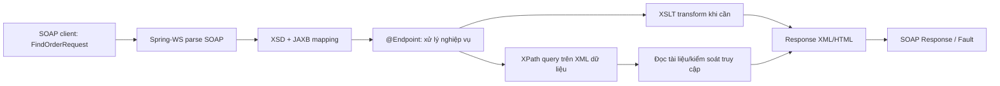

# Tránh ghép XPath hoặc XSLT từ dữ liệu không đáng tin

Một SOAP endpoint có thể sử dụng JAXB để chuyển XML thành đối tượng Java, sau đó truy vấn một tài liệu XML nội bộ bằng XPath hoặc biến đổi XML thành định dạng khác bằng XSLT. Nếu mã lập trình viên **ghép trực tiếp giá trị do client gửi vào biểu thức XPath hoặc nội dung stylesheet XSLT**, dữ liệu đầu vào có thể được **diễn giải như mã lệnh truy vấn/biến đổi** thay vì chỉ là một giá trị. Hệ quả có thể là truy xuất sai tài liệu, bỏ qua điều kiện lọc, lộ dữ liệu, gọi tới tài nguyên bên ngoài hoặc làm cạn tài nguyên của máy chủ.

Bài thuộc chương **Bảo vệ xử lý XML** trong module **SPRING_WEB_SERVICES**. Trong quy trình phát triển dịch vụ SOAP **contract-first** bằng Spring Web Services (Spring-WS), chúng ta thiết kế XSD/WSDL, ánh xạ JAXB, triển khai endpoint và SOAP client, xử lý SOAP Fault, interceptor, XML security, WS-Security, chứng chỉ và kiểm thử tương thích. Ở đây, trọng tâm là bảo vệ **những điểm mà ứng dụng tự thực thi XPath hoặc XSLT**, tránh nhầm rằng XML đã được parse, validate XSD hoặc xác minh chữ ký thì mọi phép truy vấn/biến đổi tự động an toàn.

Thông điệp chủ đạo:

> **Dữ liệu không đáng tin phải được truyền như dữ liệu — không được tạo thành cú pháp XPath/XSLT bằng phép nối chuỗi.** Biểu thức, stylesheet, tên tài nguyên và quyền truy cập bên ngoài phải do ứng dụng kiểm soát.

Các ví dụ sử dụng Java 17+, JAXP của Java SE (`javax.xml.xpath`, `javax.xml.transform`, `javax.xml.parsers`), Spring-WS thuộc thế hệ Jakarta và SOAP 1.1 khi minh họa Envelope. URI `example.org`, mã đơn hàng và nội dung XML chỉ là giả lập. Các ví dụ an toàn có thêm ràng buộc về parser, tài nguyên ngoài và giới hạn dung lượng; **một biện pháp đơn lẻ không thay thế mô hình phòng vệ nhiều lớp**.

## 1. XPath và XSLT nằm ở đâu trong ứng dụng SOAP?

**XPath** dùng để chọn node hoặc tính toán giá trị từ tài liệu XML. Ví dụ: tìm đơn hàng có mã `ORD-1001`.

**XSLT** là ngôn ngữ biến đổi XML theo stylesheet, có thể dùng XPath bên trong thuộc tính `select`/`match` hoặc biểu thức trong các instruction. Ví dụ: tạo bản tóm tắt XML hoặc HTML từ tài liệu đơn hàng.



| Thành phần | Vai trò | Có tự ngăn XPath/XSLT injection không? |
| --- | --- | --- |
| SOAP parser/message factory | Đọc Envelope/Body/Header đúng cú pháp SOAP | **Không**, vì lỗ hổng có thể xuất hiện sau bước parse |
| `PayloadValidatingInterceptor` | Kiểm tra SOAP Body theo XSD khi được cấu hình | **Không**, vì chuỗi hợp lệ theo XSD vẫn có thể chứa ký tự đặc biệt XPath |
| JAXB / Spring OXM | Chuyển XML ↔ Java | **Không**, vì một `String` có thể bị ghép thành mã ở bước tiếp theo |
| `@Endpoint`/business service | Sử dụng input, quyết định quyền và thao tác | **Có trách nhiệm** không tạo biểu thức/stylesheet từ input |
| JAXP XPath API | Biên dịch/đánh giá biểu thức XPath | An toàn hơn khi biểu thức cố định và giá trị truyền qua variable resolver |
| JAXP XSLT API | Biên dịch/thực thi stylesheet | An toàn hơn khi stylesheet cố định, dữ liệu qua parameter, external access bị khóa |
| WS-Security / TLS | Xác minh thông điệp, chữ ký, token, certificate/kênh | **Không** thay thế kiểm soát cú pháp truy vấn và transform |

Một tấn công có thể dùng **SOAP Body hoàn toàn đúng XSD**; vấn đề xảy ra khi mã Java biến giá trị trường đó thành một phần biểu thức XPath/XSLT. Vì vậy không thể kết luận “đã bật XSD validation thì không có injection”.

### 1.1. Phân biệt ba nhóm rủi ro XML

| Rủi ro | Nguồn đầu vào | Điều có thể xảy ra | Biện pháp chính |
| --- | --- | --- | --- |
| **XPath injection** | Chuỗi client được nối vào biểu thức XPath | Thay đổi điều kiện lọc, chọn node khác, vượt kiểm soát truy vấn | Biểu thức cố định + `XPathVariableResolver`, allowlist tên cấu trúc |
| **XSLT injection** | Chuỗi client được nối vào nội dung stylesheet, `select`, `match` hoặc template code | Thực thi biến đổi không dự kiến, chọn dữ liệu khác, gọi extension/tài nguyên ngoài tùy engine | Stylesheet tin cậy cố định + `xsl:param`/`Transformer#setParameter` |
| **XXE / external resource access** | XML document, DTD, entity, stylesheet `document()`/`xsl:include`/`xsl:import` | Đọc file nội bộ, SSRF, mở rộng entity hoặc truy cập ngoài | Parser an toàn, hạn chế JAXP external access, resolver kiểm soát, resource limits |

Ba nhóm có thể kết hợp: một stylesheet động chứa XPath không an toàn, lại được engine cho phép gọi `document()` tới địa chỉ do client điều khiển. **Phải phòng vệ cả phần tạo cú pháp và phần cho phép truy cập tài nguyên ngoài.**

## 2. Ví dụ XPath injection dễ xảy ra

Giả sử một kho XML nội bộ:

```xml
<?xml version="1.0" encoding="UTF-8"?>
<o:Orders xmlns:o="https://example.org/orders/v1">
    <o:Order>
        <o:orderId>ORD-1001</o:orderId>
        <o:owner>alice</o:owner>
        <o:status>PAID</o:status>
    </o:Order>
    <o:Order>
        <o:orderId>ORD-2002</o:orderId>
        <o:owner>bob</o:owner>
        <o:status>CONFIDENTIAL</o:status>
    </o:Order>
</o:Orders>
```

Một SOAP operation tìm đơn hàng nhận:

```xml
<o:FindOrderRequest xmlns:o="https://example.org/orders/v1">
    <o:orderId>ORD-1001</o:orderId>
</o:FindOrderRequest>
```

### 2.1. Mẫu không an toàn: nối giá trị thành biểu thức

```java
// SAI: orderId đến từ request không đáng tin.
String xpathText =
        "/o:Orders/o:Order[o:orderId='" + orderId + "']";

XPathExpression expression = xpath.compile(xpathText);
NodeList matches = (NodeList) expression.evaluate(
        xmlDocument, XPathConstants.NODESET);
```

Để ví dụ dễ hiểu, giả định `xpath` đã cấu hình namespace prefix `o`, `xmlDocument` là DOM và các import `javax.xml.xpath.*`, `org.w3c.dom.*` đã có.

Với `orderId = ORD-1001`, biểu thức trở thành:

```xpath
/o:Orders/o:Order[o:orderId='ORD-1001']
```

Nhưng một attacker có thể gửi giá trị:

```text
ORD-1001' or '1'='1
```

Biểu thức được tạo ra:

```xpath
/o:Orders/o:Order[o:orderId='ORD-1001' or '1'='1']
```

Trong XPath 1.0, điều kiện `'1'='1'` là true, nên predicate có thể chọn **cả hai đơn hàng**, bao gồm đơn của người khác. Đây là **thay đổi cấu trúc logic truy vấn**; XML request không cần sai cú pháp để gây lỗi.

### 2.2. Vì sao đây không chỉ là chuyện dấu nháy đơn?

XPath còn có:

- Toán tử logic `and`, `or`; so sánh và tính toán.
- Các trục và đường dẫn `//`, `..`, `@attribute`.
- Toán tử hợp node-set `|`.
- Các hàm như `contains()`, `starts-with()`, `string()` hoặc extension functions được engine đăng ký.
- Các biểu thức có ngữ nghĩa khác nhau tùy kiểu dữ liệu XPath 1.0 (string, number, boolean, node-set).

Một tấn công có thể lợi dụng nhiều ký tự hoặc cơ chế ép kiểu khác nhau. **Thay thế ký tự `'`, xóa `or` hoặc “escape vài ký tự đặc biệt” không phải chiến lược tổng quát đáng tin cậy.**

### 2.3. Trường hợp nghiêm trọng hơn: dùng XPath làm kiểm tra quyền

Ví dụ một ứng dụng viết biểu thức:

```java
// Anti-pattern: vừa chọn dữ liệu vừa quyết định quyền
// bằng chuỗi ghép không đáng tin.
String query = "/o:Orders/o:Order[" +
        "o:orderId='" + orderId + "' and " +
        "o:owner='" + claimedUsername + "']";
```

Ngay cả khi đã sửa lỗi injection, **`claimedUsername` lấy từ SOAP Body không được coi là principal đáng tin cậy**. Quyền truy cập phải dựa trên identity đã được xác minh bởi authentication/WS-Security và business authorization. An toàn cú pháp XPath là **điều kiện cần**, không phải toàn bộ access-control policy.

## 3. Giải pháp XPath: biểu thức cố định, dữ liệu qua biến

JAXP cung cấp `javax.xml.xpath.XPathVariableResolver`. Thay vì ghép `orderId` vào biểu thức, ta biên dịch một chuỗi XPath **do lập trình viên kiểm soát**:

```xpath
/o:Orders/o:Order[o:orderId = $requestedOrderId]
```

Sau đó cung cấp giá trị `$requestedOrderId` bằng resolver khi đánh giá. Dữ liệu sẽ được sử dụng như một **giá trị XPath**, không bị parse lại thành các token `or`, `|`, `//` hoặc dấu nháy.

### 3.1. Lớp `NamespaceContext` minh họa

XPath khi xử lý XML có namespace cần mapping prefix rõ ràng. **Prefix trong biểu thức XPath không cần trùng prefix của tài liệu XML**, miễn URI namespace và local name khớp.

```java
import java.util.Collections;
import java.util.Iterator;
import javax.xml.XMLConstants;
import javax.xml.namespace.NamespaceContext;

public final class OrdersNamespaces implements NamespaceContext {
    public static final String ORDERS_NS =
            "https://example.org/orders/v1";

    @Override
    public String getNamespaceURI(String prefix) {
        if (prefix == null) {
            throw new IllegalArgumentException("prefix is required");
        }
        return switch (prefix) {
            case "o" -> ORDERS_NS;
            case "xml" -> XMLConstants.XML_NS_URI;
            case "xmlns" -> XMLConstants.XMLNS_ATTRIBUTE_NS_URI;
            default -> XMLConstants.NULL_NS_URI;
        };
    }

    @Override
    public String getPrefix(String namespaceURI) {
        if (ORDERS_NS.equals(namespaceURI)) {
            return "o";
        }
        if (XMLConstants.XML_NS_URI.equals(namespaceURI)) {
            return "xml";
        }
        if (XMLConstants.XMLNS_ATTRIBUTE_NS_URI.equals(namespaceURI)) {
            return "xmlns";
        }
        return null;
    }

    @Override
    public Iterator<String> getPrefixes(String namespaceURI) {
        String prefix = getPrefix(namespaceURI);
        return prefix == null
                ? Collections.emptyIterator()
                : Collections.singleton(prefix).iterator();
    }
}
```

Đây là một class Java độc lập. Không dùng `local-name()` tràn lan để “bỏ qua vấn đề namespace” trong các truy vấn nhạy cảm, vì hai element cùng local name ở các URI namespace khác nhau có thể có ngữ nghĩa bảo mật khác nhau.

### 3.2. Bộ chọn đơn hàng an toàn

```java
import javax.xml.XMLConstants;
import javax.xml.namespace.QName;
import javax.xml.xpath.XPath;
import javax.xml.xpath.XPathConstants;
import javax.xml.xpath.XPathExpression;
import javax.xml.xpath.XPathExpressionException;
import javax.xml.xpath.XPathFactory;
import org.w3c.dom.Document;
import org.w3c.dom.NodeList;

public final class SafeOrderXPath {
    private static final String EXPRESSION =
            "/o:Orders/o:Order[o:orderId = $requestedOrderId]";

    private SafeOrderXPath() { }

    public static NodeList findById(
            Document orders, String requestedOrderId)
            throws XPathExpressionException {

        if (requestedOrderId == null
                || requestedOrderId.isBlank()
                || requestedOrderId.length() > 64) {
            throw new IllegalArgumentException("Invalid order ID");
        }

        // Tạo XPath per-call: không chia sẻ resolver có state
        // của request này với request khác.
        XPath xpath = XPathFactory.newInstance().newXPath();
        xpath.setNamespaceContext(new OrdersNamespaces());

        final QName variableName =
                new QName(XMLConstants.NULL_NS_URI, "requestedOrderId");
        xpath.setXPathVariableResolver(name -> {
            if (variableName.equals(name)) {
                return requestedOrderId;
            }
            throw new IllegalArgumentException(
                    "Unknown XPath variable");
        });

        XPathExpression compiled = xpath.compile(EXPRESSION);
        return (NodeList) compiled.evaluate(
                orders, XPathConstants.NODESET);
    }
}
```

Với đầu vào `ORD-1001' or '1'='1`, resolver trả **một chuỗi nguyên văn**. Biểu thức cố định so `o:orderId` với chuỗi ấy; chuỗi không trở thành toán tử `or` và không thể khiến các đơn khác được chọn. Chừng nào không có đơn nào có mã thật trùng chuỗi tấn công, kết quả sẽ rỗng.

Các điểm thiết kế:

1. `EXPRESSION` là hằng số được review trong source, không được lấy từ SOAP Body/Header.
2. Namespace prefix `o` được ánh xạ tới URI chính xác.
3. `XPathVariableResolver` cung cấp **giá trị**, không trả một đoạn XPath.
4. Mỗi lời gọi tạo một `XPath` với resolver theo request, tránh rò dữ liệu giữa request.
5. Kiểm tra null/độ dài để bảo vệ nghiệp vụ và tài nguyên; đây là **biện pháp bổ sung**, không phải nguyên nhân chính ngăn injection.
6. Nếu đối tượng đã parse có nguồn từ bên ngoài, **parser DOM cũng phải được cấu hình an toàn** (mục 7).

**Giới hạn của parameterization:** nếu biểu thức cố định dùng biến làm **địa chỉ tài nguyên** trong một hàm nguy hiểm hoặc sử dụng một extension function tùy ý, truyền biến đúng cách vẫn chưa bảo đảm an toàn. Chỉ cho phép các hàm/path đã được review, chặn quyền truy cập tài nguyên bên ngoài và xác định chính xác ý nghĩa biến.

### 3.3. Dùng kiểu dữ liệu đúng với biểu thức

XPath 1.0 có các quy tắc ép kiểu giữa string, number, boolean và node-set. Trong trường hợp tìm `orderId`, cố ý truyền `String` để so sánh chuỗi. Khi dùng numeric filter:

```xpath
/o:Orders/o:Order[o:quantity > $minimumQuantity]
```

Hãy xác định và kiểm tra `minimumQuantity` là số hợp lệ, hữu hạn trong phạm vi nghiệp vụ, rồi bind kiểu số phù hợp. **Không nhận giá trị Java kiểu `Object` tùy ý** từ client và để engine quyết định hành vi không kiểm soát; với các quy tắc nghiệp vụ phức tạp, lọc bằng model Java sau khi chọn dữ liệu hoặc dùng repository/query API chuyên dụng có thể rõ ràng hơn.

## 4. Khi phải chọn đường dẫn hoặc trường động: allowlist, không nối bừa

`XPathVariableResolver` rất phù hợp với **giá trị** trong biểu thức. Nó không phải công cụ để tham số hóa mọi **cấu trúc XPath**, chẳng hạn tên node, tên function hoặc toàn bộ đường dẫn do client tự soạn.

Ví dụ API SOAP cho phép sort theo một số field:

```text
sortBy = "orderId" | "status" | "owner"
```

**Không làm:**

```java
// SAI: user quyết định một đoạn XPath cấu trúc.
String expression = "/o:Orders/o:Order/o:" + sortBy;
```

Hãy chọn từ tập biểu thức cố định:

```java
public enum OrderField {
    ORDER_ID,
    STATUS,
    OWNER
}

public final class AllowedPaths {
    private AllowedPaths() { }

    public static String expressionFor(OrderField field) {
        return switch (field) {
            case ORDER_ID ->
                    "/o:Orders/o:Order/o:orderId";
            case STATUS ->
                    "/o:Orders/o:Order/o:status";
            case OWNER ->
                    "/o:Orders/o:Order/o:owner";
        };
    }
}
```

Hai `public` types phải nằm trong **hai file Java riêng**. Nếu API nhận `sortBy` là chuỗi, ánh xạ nó sang enum từ một allowlist nghiêm ngặt rồi mới chọn biểu thức. Không có case mặc định trả mọi node hoặc chấp nhận biểu thức do user viết.

### 4.1. Khi nào không nên dùng XPath để lọc nghiệp vụ?

Nếu dữ liệu đã được JAXB ánh xạ thành danh sách Java và chỉ cần tìm theo mã, dùng collection/repository có thể đơn giản hơn. Nếu dữ liệu nằm trong SQL database, sử dụng **prepared query/ORM parameter binding** phù hợp, đừng export cả database sang XML rồi dùng XPath như cơ chế authorization. Chọn XPath khi thực sự cần biểu diễn cấu trúc XML.

### 4.2. Escape XPath literal có đủ không?

Trong XPath 1.0 không có cú pháp escape dấu nháy bằng backslash theo cách Java/JavaScript thông thường. Có kỹ thuật tạo literal bằng `concat()` nếu chuỗi chứa cả dấu `'` và `"`, nhưng tự viết hàm này dễ sai và vẫn không giải quyết input dùng ở **vị trí cấu trúc**. Vì vậy:

- **Ưu tiên `XPathVariableResolver`**.
- Dùng biểu thức hằng hoặc allowlist khi phải thay đổi structure.
- Nếu thư viện không có parameter binding, cân nhắc đổi API/thiết kế hoặc dùng một helper literal encoder đã được kiểm thử đặc biệt; không coi escape ad hoc là lựa chọn mặc định.

## 5. XSLT injection: nguy hiểm khi dữ liệu trở thành stylesheet

XSLT sử dụng các instruction như `xsl:template`, `xsl:value-of`, `xsl:for-each` và các biểu thức XPath trong thuộc tính `select`, `match` hoặc điều kiện `test`. Vì vậy ghép input vào **source code stylesheet** tạo ra một ranh giới tin cậy mới.

### 5.1. Ví dụ ghép string không an toàn

```java
// Anti-pattern: không bao giờ xây stylesheet từ ID user.
String untrustedId = command.orderId();
String xslt = """
        <xsl:stylesheet
            xmlns:xsl="http://www.w3.org/1999/XSL/Transform"
            xmlns:o="https://example.org/orders/v1"
            version="1.0">
          <xsl:template match="/">
            <out>
              <xsl:value-of select="/o:Orders/o:Order[o:orderId='%s']/o:status"/>
            </out>
          </xsl:template>
        </xsl:stylesheet>
        """.formatted(untrustedId);

Transformer transformer = transformerFactory.newTransformer(
        new StreamSource(new StringReader(xslt)));
```

Đoạn này mang tính **anti-pattern**, giả định `transformerFactory` và imports JAXP có sẵn. Vấn đề:

- Đầu vào có dấu nháy có thể phá ngữ nghĩa `select`, tạo XPath khác.
- Đầu vào chứa ký tự đặc biệt XML có thể phá cú pháp stylesheet.
- Nếu người dùng kiểm soát **một phần lớn hơn của stylesheet**, họ có thể tạo instruction/template/function khác, tùy engine và quyền hạn.
- `newTransformer(Source)` **biên dịch một stylesheet từ Source**, không chỉ escape một giá trị.
- Nếu engine còn cho phép external resource/extension functions, hậu quả có thể vượt khỏi phạm vi chọn node.

Tấn công XPath injection qua `select` chỉ là một **trường hợp con** của việc để user kiểm soát stylesheet.

### 5.2. Không coi XML escaping là cách sửa hoàn chỉnh

Giả sử ta thay `&` bằng `&amp;` và `<` bằng `&lt;` trước khi ghép vào stylesheet. Điều này có thể giữ XML well-formedness, nhưng **không bảo đảm an toàn ngữ nghĩa XPath** trong thuộc tính `select`; dấu nháy và toán tử vẫn có thể ảnh hưởng biểu thức sau khi XML parser giải mã.

Tương tự, escape dùng cho HTML, JSON hay SQL không phải giải pháp đúng cho XPath/XSLT. **Giải pháp đúng là không tạo mã từ dữ liệu không đáng tin.**

## 6. XSLT an toàn: stylesheet cố định + `xsl:param`

Thay vì tạo stylesheet bằng nối chuỗi, hãy giữ **một file XSLT do ứng dụng quản lý**, biên dịch nó một lần, rồi truyền giá trị động qua tham số XSLT.

Ví dụ nội dung stylesheet `xslt/order-summary.xsl` được **đóng gói vào classpath** của ứng dụng:

```xml
<?xml version="1.0" encoding="UTF-8"?>
<xsl:stylesheet version="1.0"
    xmlns:xsl="http://www.w3.org/1999/XSL/Transform"
    xmlns:o="https://example.org/orders/v1">

    <xsl:output method="xml" encoding="UTF-8" indent="yes"/>
    <xsl:param name="requestedOrderId"/>

    <xsl:template match="/">
        <OrderSummaries>
            <xsl:for-each select="/o:Orders/o:Order[
                    o:orderId = $requestedOrderId]">
                <OrderSummary>
                    <id>
                        <xsl:value-of select="o:orderId"/>
                    </id>
                    <status>
                        <xsl:value-of select="o:status"/>
                    </status>
                </OrderSummary>
            </xsl:for-each>
        </OrderSummaries>
    </xsl:template>
</xsl:stylesheet>
```

Điểm bảo vệ là **`select` và cấu trúc XSLT không đổi** khi client nhập dữ liệu. `$requestedOrderId` được ràng buộc bằng `Transformer#setParameter(...)`:

```java
Transformer transformer = trustedTemplates.newTransformer();
transformer.setParameter("requestedOrderId", requestedOrderId);
transformer.transform(
        new DOMSource(securelyParsedDocument),
        new StreamResult(outputWriter));
```

Các biến `trustedTemplates`, `securelyParsedDocument`, `outputWriter` là đối tượng đã được tạo an toàn; mục 8 trình bày cấu hình đầy đủ. Một chuỗi như `ORD-1001' or '1'='1` sẽ được so như **giá trị string**, không được biên dịch lại làm một phần `select`.

### 6.1. Truyền tham số không đồng nghĩa cho phép stylesheet tùy ý

`setParameter` chỉ bảo vệ **cách truyền giá trị**. Nếu trusted stylesheet chứa:

```xml
<!-- Tránh thiết kế này với URI không tin cậy. -->
<xsl:param name="userUri"/>
<xsl:copy-of select="document($userUri)"/>
```

thì dữ liệu `userUri` vẫn có thể ảnh hưởng **đích đọc tài nguyên** nếu engine được phép truy cập ngoài. Dù tham số không gây XPath syntax injection, nó có thể dẫn đến **SSRF hoặc đọc file**. Vì vậy phải **khóa quyền truy cập ngoài** và chỉ dùng tham số trong những biểu thức đã được review, không đặt đầu vào tự do vào chức năng dereference URI.

### 6.2. Giới hạn nội dung output

`xsl:value-of` thường tạo text và để XML serializer escape phù hợp; nhưng không vì vậy mà tin mọi output format đều an toàn. Khi biến đổi XML thành **HTML, JavaScript, CSS, URL hoặc SQL**, các ngữ cảnh output có yêu cầu encoding riêng.

- Không bật `disable-output-escaping="yes"` cho input không đáng tin.
- Không tạo markup/script động từ input nếu không có context-aware encoding.
- Không coi XSLT transform là bước sanitize HTML hoặc làm sạch file XML.
- Nếu output được nhúng vào SOAP Body, phải còn đáp ứng schema response và không làm thay đổi nội dung đã được ký.
- Nếu XSLT có extension functions, hạn chế quyền và không cung cấp các hàm đọc file, network hoặc thực thi lệnh tùy ý.

Một stylesheet **cố định nhưng nguy hiểm** vẫn có thể gây vấn đề. Cố định source là bước đầu; cần cả policy cho functions, external resources và output.

## 7. Parse XML không đáng tin bằng DOM an toàn

Trước khi đánh giá XPath hoặc chạy XSLT, XML thường phải được parse. Nếu parser cho phép DTD/external entities, attacker có thể lợi dụng **XXE**, mở rộng entity hoặc đọc file dù biểu thức XPath hoàn toàn cố định.

Ví dụ dùng JAXP `DocumentBuilderFactory` với các ràng buộc bảo mật phổ biến:

```java
import java.io.ByteArrayInputStream;
import javax.xml.XMLConstants;
import javax.xml.parsers.DocumentBuilderFactory;
import org.w3c.dom.Document;

public final class SecureXmlDocuments {
    private SecureXmlDocuments() { }

    public static Document parse(byte[] xml) throws Exception {
        if (xml == null || xml.length == 0
                || xml.length > 1024 * 1024) {
            throw new IllegalArgumentException(
                    "XML size is outside allowed range");
        }

        DocumentBuilderFactory factory =
                DocumentBuilderFactory.newInstance();
        factory.setNamespaceAware(true);
        factory.setFeature(
                XMLConstants.FEATURE_SECURE_PROCESSING, true);

        // Không cho phép DOCTYPE, external entity hoặc XInclude.
        factory.setFeature(
                "http://apache.org/xml/features/disallow-doctype-decl",
                true);
        factory.setFeature(
                "http://xml.org/sax/features/external-general-entities",
                false);
        factory.setFeature(
                "http://xml.org/sax/features/external-parameter-entities",
                false);
        factory.setXIncludeAware(false);
        factory.setExpandEntityReferences(false);
        factory.setAttribute(
                XMLConstants.ACCESS_EXTERNAL_DTD, "");
        factory.setAttribute(
                XMLConstants.ACCESS_EXTERNAL_SCHEMA, "");

        return factory.newDocumentBuilder().parse(
                new ByteArrayInputStream(xml));
    }
}
```

**Lưu ý triển khai:**

1. Một số feature URI phụ thuộc parser/provider. **Không catch lỗi cấu hình rồi tiếp tục parse với mặc định không an toàn**. Nếu yêu cầu bảo vệ không được hỗ trợ, fail startup hoặc từ chối input cho tới khi thay provider/cấu hình đúng.
2. `FEATURE_SECURE_PROCESSING` là **một lớp phòng vệ**, không thay thế giới hạn kích thước, external-access properties và chính sách XML cụ thể.
3. Ví dụ giới hạn **1 MiB byte đầu vào** để minh họa; giới hạn thực cần dựa trên hợp đồng/payload và áp thêm tại HTTP gateway, parser, CPU/time/heap.
4. Dù đã tắt entity expansion, vẫn phải giới hạn độ sâu, số node và chi phí XPath/XSLT trên XML rất lớn; một file XML lớn nhưng well-formed vẫn có thể gây DoS.
5. Nếu XSD validation là bắt buộc, thực hiện qua validator được cấu hình an toàn và các schema đáng tin; XML parse thành DOM không tự kiểm tra XSD.

**Namespace:** DOM cần `setNamespaceAware(true)` để biểu thức `/o:Orders/o:Order` có thể so QName đúng. Tắt namespace awareness có thể làm query sai hoặc khiến nhà phát triển resort sang `local-name()` quá rộng.

### 7.1. DOMSource và StreamSource: coi chừng parser thứ hai

Khi truyền `DOMSource(document)` vào XSLT hoặc XPath, ứng dụng đã chủ động parse XML với cấu hình an toàn. Nếu thay bằng:

```java
new StreamSource(untrustedInputStream)
```

thì transform engine có thể phải **tự tạo parser khác**. Các cài đặt bảo vệ trên `DocumentBuilderFactory` bạn dùng trước đó **không tự lan sang mọi parser**. Vì thế:

- Đối với nguồn XML không đáng tin, ưu tiên parse/validate một lần qua parser đã cấu hình rồi truyền DOM hoặc một `SAXSource`/`StAXSource` có parser/reader kiểm soát.
- Nếu dùng `StreamSource` trực tiếp, phải kiểm tra chính sách JAXP của provider/transformer áp dụng cho đường xử lý đó.
- `StreamSource`/`StAXSource` có thể chỉ đọc một lần; không dùng lại stream đã bị validator/transformer tiêu thụ.
- DOM tiêu tốn RAM theo kích thước tài liệu; khi file lớn, cân nhắc pipeline streaming an toàn và resource budgets.

### 7.2. XSD validation và XPath injection là hai việc khác nhau

XSD minh họa:

```xml
<xs:element name="FindOrderRequest"
            xmlns:xs="http://www.w3.org/2001/XMLSchema">
    <xs:complexType>
        <xs:sequence>
            <xs:element name="orderId" type="xs:string"/>
        </xs:sequence>
    </xs:complexType>
</xs:element>
```

Giá trị `ORD-1001' or '1'='1` hoàn toàn có thể là **một string hợp lệ theo XSD** này. Muốn hạn chế định dạng mã, có thể thêm `xs:pattern`/`maxLength` theo hợp đồng, nhưng **regex không thay thế việc ràng buộc biến XPath**. Hơn nữa, các operation khác có thể nhận chuỗi tự do hợp lệ (tên khách hàng, địa chỉ, mô tả) mà không được phép cấm mọi dấu nháy.

## 8. Biên dịch XSLT đáng tin với `TransformerFactory`

JAXP phân biệt:

- `TransformerFactory`: tạo `Transformer` hoặc biên dịch stylesheet.
- `Templates`: **stylesheet đã biên dịch**, thường có thể dùng lại để tạo transformer mới.
- `Transformer`: đối tượng thực thi transform có **tham số, output properties và state**; không nên chia sẻ trực tiếp giữa các thread.

Lớp sau chỉ đọc stylesheet được đóng gói trong ứng dụng và tắt truy cập tài nguyên ngoài:

```java
import java.io.InputStream;
import java.io.StringWriter;
import javax.xml.XMLConstants;
import javax.xml.transform.Templates;
import javax.xml.transform.Transformer;
import javax.xml.transform.TransformerException;
import javax.xml.transform.TransformerFactory;
import javax.xml.transform.URIResolver;
import javax.xml.transform.dom.DOMSource;
import javax.xml.transform.stream.StreamResult;
import javax.xml.transform.stream.StreamSource;
import org.w3c.dom.Document;

public final class SafeOrderXsltRenderer {
    private final Templates templates;

    private static final URIResolver DENY_EXTERNAL =
            (href, base) -> {
                throw new TransformerException(
                        "External XSLT resource access is disabled");
            };

    public SafeOrderXsltRenderer() throws Exception {
        TransformerFactory factory = TransformerFactory.newInstance();
        factory.setFeature(
                XMLConstants.FEATURE_SECURE_PROCESSING, true);
        factory.setAttribute(
                XMLConstants.ACCESS_EXTERNAL_DTD, "");
        factory.setAttribute(
                XMLConstants.ACCESS_EXTERNAL_STYLESHEET, "");
        factory.setURIResolver(DENY_EXTERNAL);

        try (InputStream trusted =
                SafeOrderXsltRenderer.class.getResourceAsStream(
                        "/xslt/order-summary.xsl")) {
            if (trusted == null) {
                throw new IllegalStateException(
                        "Trusted XSLT not found");
            }
            // Biên dịch stylesheet tin cậy một lần.
            templates = factory.newTemplates(
                    new StreamSource(trusted));
        }
    }

    public String render(
            Document document, String requestedOrderId)
            throws TransformerException {
        if (requestedOrderId == null
                || requestedOrderId.length() > 64) {
            throw new IllegalArgumentException(
                    "Invalid order ID");
        }

        // Transformer mutable được tạo mới cho mỗi lượt xử lý.
        Transformer transformer = templates.newTransformer();
        transformer.setURIResolver(DENY_EXTERNAL);
        transformer.setParameter(
                "requestedOrderId", requestedOrderId);

        StringWriter result = new StringWriter();
        transformer.transform(
                new DOMSource(document),
                new StreamResult(result));
        return result.toString();
    }
}
```

**Phạm vi ví dụ:** chỉ xử lý XML từ `Document` đã được parse an toàn tại mục 7, stylesheet `order-summary.xsl` là nội dung tin cậy ở mục 6 được đóng gói trong `src/main/resources/xslt/`. Không tạo stylesheet từ SOAP input. Với output lớn, không dùng `StringWriter` vô giới hạn; dùng writer/stream được giới hạn dung lượng và do ứng dụng sở hữu.

### 8.1. Vì sao dùng cả `ACCESS_EXTERNAL_*` và `URIResolver`?

| Cơ chế | Mục đích |
| --- | --- |
| `FEATURE_SECURE_PROCESSING` | Bật chế độ bảo mật/giới hạn của JAXP provider |
| `ACCESS_EXTERNAL_DTD=""` | Không cho transformer truy cập DTD ngoài qua các cơ chế JAXP liên quan |
| `ACCESS_EXTERNAL_STYLESHEET=""` | Không cho truy cập stylesheet/tài nguyên ngoài theo cơ chế hỗ trợ của JAXP provider |
| `URIResolver` từ chối | Không cho việc resolve `href`/base URI trong các đường XSLT dùng resolver |
| Stylesheet được đóng gói cố định | Client không quyết định instruction/template hoặc đường dẫn stylesheet |
| `Templates` biên dịch một lần | Giảm việc parse stylesheet lặp lại mỗi request |

**Không thể kết luận mọi XSLT provider đều có cùng extension functions hoặc chính sách mặc định**. Kiểm tra provider/runtime và test cụ thể `document()`, `xsl:include`, `xsl:import`; nếu không hỗ trợ các property/feature cần thiết, phải **fail closed** hoặc chọn provider có thể kiểm soát. Không bắt exception từ `setAttribute` rồi “cố chạy tiếp”.

### 8.2. `Templates` dùng lại, `Transformer` theo lượt

`Templates` được thiết kế để tái sử dụng stylesheet đã biên dịch. `Transformer` có tham số mutable như `setParameter`, `setOutputProperty` và `setURIResolver`. Không chia sẻ **một Transformer singleton** cho nhiều request đồng thời vì:

- Request A có thể ghi đè tham số của request B.
- Một request có thể thay output target hoặc URI resolver của request khác.
- Dữ liệu khách hàng/tenant có thể rò qua output nếu state bị lẫn.

Tạo `templates.newTransformer()` cho từng lần render, sau đó đặt tham số riêng, sử dụng và bỏ đi. Tương tự, `XPath` có variable resolver theo request nên ví dụ mục 3 tạo instance mới mỗi lượt.

### 8.3. External resources trong XSLT

Các điểm cần review trong stylesheet:

- `xsl:include` và `xsl:import` có thể kéo thêm stylesheet.
- Hàm XPath/XSLT `document()` có thể đọc tài liệu XML từ URI khác.
- Extension functions do provider hỗ trợ có thể mở rộng quyền truy cập môi trường.
- Processor của một XSLT version/engine khác có thể hỗ trợ thêm instruction tạo file/đọc mạng; **không giả định mọi engine chỉ hỗ trợ đúng XSLT 1.0**.
- Resource resolver tùy chỉnh có thể vô tình cho phép HTTP, `file:` hoặc classpath không được kiểm soát.

Với stylesheet cố định có include/import **được dự án chủ động cho phép**, có thể thay deny-all resolver bằng **resolver allowlist** map những tên resource đã duyệt tới classpath. Không chấp nhận URI tùy ý do client đưa vào. Resolver phải phân biệt nguồn tin cậy ở thời điểm biên dịch với dữ liệu runtime và không mở host ngoài chỉ vì một include “không tìm thấy”.

## 9. Một giải pháp sai phổ biến: cho client gửi XSLT để “tùy biến báo cáo”

Một endpoint có thể được thiết kế ngây thơ:

```xml
<r:GenerateReportRequest xmlns:r="https://example.org/reports/v1">
    <r:stylesheet><![CDATA[
      <xsl:stylesheet ...>...</xsl:stylesheet>
    ]]></r:stylesheet>
</r:GenerateReportRequest>
```

Rồi code:

```java
// SAI: user kiểm soát stylesheet được biên dịch.
Transformer transformer = TransformerFactory.newInstance()
        .newTransformer(
                new StreamSource(
                        new StringReader(request.getStylesheet())));
```

Đây là thiết kế **không phù hợp cho dữ liệu client không tin cậy**. Việc bật `FEATURE_SECURE_PROCESSING`/khóa network có thể giảm tác hại của một số extension/resource, nhưng **không biến một chương trình XSLT tùy ý thành business input an toàn**: nó vẫn có thể duyệt dữ liệu XML không nên công bố, tạo output ngoài ý muốn hoặc tiêu thụ CPU/bộ nhớ lớn.

### 9.1. Thiết kế lại thành lựa chọn mẫu đã duyệt

```java
public enum ReportTemplate {
    ORDER_SUMMARY,
    ORDER_STATUS
}

public final class ReportTemplates {
    private ReportTemplates() { }

    public static String trustedResource(ReportTemplate template) {
        return switch (template) {
            case ORDER_SUMMARY -> "/xslt/order-summary.xsl";
            case ORDER_STATUS -> "/xslt/order-status.xsl";
        };
    }
}
```

Hai `public` types trong block là **hai file Java riêng**. Trong service:

1. Nhận một mã template từ **enum/allowlist**, không nhận source XSLT.
2. Kiểm tra caller có quyền xem loại báo cáo tương ứng.
3. Lấy `Templates` đã biên dịch từ classpath/trusted registry.
4. Bind tham số như order ID, date range, locale bằng API.
5. Chỉ cho transform đọc dữ liệu đã được cấp quyền.
6. Giới hạn số record/CPU/timeout/output.

Đừng ánh xạ user input thành đường dẫn file trực tiếp như `"/xslt/" + userTemplate + ".xsl"` mà không kiểm tra allowlist/canonical path. Với template chọn từ một tập cố định, server có thể quản lý version, security review và compatibility test dễ hơn.

### 9.2. Nếu business bắt buộc cho phép ngôn ngữ biểu thức

Trong một số hệ thống báo cáo thật sự cần expression tùy biến, phải xây một **ngôn ngữ con (DSL) giới hạn** hoặc trình xây query có cấu trúc và allowlist field/operator. Không lấy nguyên XPath/XSLT user gửi rồi “cứ chạy trong JVM của server”.

Nếu thực sự phải thực thi chương trình biến đổi không tin cậy, cần **sandbox/isolated service** với tài nguyên, filesystem, network, process, identity và timeout bị hạn chế, cùng security review riêng. Đây là kiến trúc khác với việc nhận SOAP request thông thường.

## 10. Tích hợp với Spring-WS endpoint contract-first

Giả sử WSDL/XSD đã định nghĩa element:

```xml
<xs:schema xmlns:xs="http://www.w3.org/2001/XMLSchema"
           targetNamespace="https://example.org/orders/service/v1"
           elementFormDefault="qualified">
    <xs:element name="FindOrderRequest">
        <xs:complexType>
            <xs:sequence>
                <xs:element name="orderId" type="xs:string"/>
            </xs:sequence>
        </xs:complexType>
    </xs:element>
    <xs:element name="FindOrderResponse">
        <xs:complexType>
            <xs:sequence>
                <xs:element name="status" type="xs:string"
                            minOccurs="0"/>
            </xs:sequence>
        </xs:complexType>
    </xs:element>
</xs:schema>
```

**Hai namespace độc lập**: request SOAP nghiệp vụ ở `https://example.org/orders/service/v1`, XML kho đơn hàng nội bộ ở `https://example.org/orders/v1`. XPath trong `SafeOrderXPath` phải dùng namespace của **tài liệu đang được truy vấn**, không suy từ SOAP Body.

Ví dụ cấu trúc endpoint:

```java
import javax.xml.xpath.XPathExpressionException;
import org.springframework.ws.server.endpoint.annotation.Endpoint;
import org.springframework.ws.server.endpoint.annotation.PayloadRoot;
import org.springframework.ws.server.endpoint.annotation.RequestPayload;
import org.springframework.ws.server.endpoint.annotation.ResponsePayload;
import org.w3c.dom.Document;
import org.w3c.dom.NodeList;

@Endpoint
public final class FindOrderEndpoint {
    private static final String SOAP_NS =
            "https://example.org/orders/service/v1";

    private final OrderXmlStore store;

    public FindOrderEndpoint(OrderXmlStore store) {
        this.store = store;
    }

    @PayloadRoot(namespace = SOAP_NS, localPart = "FindOrderRequest")
    @ResponsePayload
    public FindOrderResponse find(
            @RequestPayload FindOrderRequest request)
            throws XPathExpressionException {

        // Store chỉ trả XML đã được parse an toàn và
        // áp authorization phù hợp với caller.
        Document orders = store.authorizedSnapshot();
        NodeList matches = SafeOrderXPath.findById(
                orders, request.getOrderId());

        FindOrderResponse response = new FindOrderResponse();
        if (matches.getLength() == 1) {
            response.setStatus("FOUND");
        }
        return response;
    }
}
```

`FindOrderRequest`/`FindOrderResponse` là JAXB-generated types từ XSD dịch vụ; `OrderXmlStore` là thành phần ứng dụng giả định cần định nghĩa:

```java
import org.w3c.dom.Document;

public interface OrderXmlStore {
    Document authorizedSnapshot();
}
```

API `authorizedSnapshot()` minh họa ý định: **chỉ cung cấp tập dữ liệu mà principal đã xác thực được phép đọc**. Với hệ thống thực, interface có thể nhận explicit security context/tenant để tránh ngầm dựa vào global state. Endpoint này chưa phải ứng dụng hoàn chỉnh; cần WSDL, JAXB mapping, bean configuration, business error mapping và tests.

### 10.1. Quy tắc phân tầng trong SOAP endpoint

```text
SOAP Envelope/WS-Security
    │
    ├── Parse + xác minh chữ ký/token/role
    ├── Validate Body XSD (nếu contract yêu cầu)
    ├── JAXB unmarshal → FindOrderRequest
    ├── Authorization → tập dữ liệu được phép truy cập
    ├── XPath biểu thức cố định + bind orderId
    ├── Business response
    └── JAXB marshal → SOAP Response
```

Sơ đồ là **trách nhiệm logic**; thứ tự thực tế giữa các interceptor, security adapter và endpoint cần được xác nhận trên Spring-WS version/configuration đang dùng. Một XML document đã xác minh chữ ký chỉ bảo đảm những phần được signature policy bao phủ; không cho phép mã nghiệp vụ tự chọn một phần tử cùng tên khác chưa được xác minh.

### 10.2. XSD giúp giảm dữ liệu sai, không sửa mã XPath sai

Có thể ràng buộc `orderId` bằng XSD:

```xml
<xs:simpleType name="OrderIdType"
               xmlns:xs="http://www.w3.org/2001/XMLSchema">
    <xs:restriction base="xs:string">
        <xs:minLength value="1"/>
        <xs:maxLength value="64"/>
    </xs:restriction>
</xs:simpleType>
```

Điều này là **input validation bổ sung**, hữu ích cho tài nguyên và hợp đồng. Tuy nhiên, một tên khách hàng hoặc mô tả có thể hợp lệ khi chứa dấu nháy; không được dựa vào việc cấm ký tự để thay thế variable binding. XSD cũng không thể ngăn XSLT `document()` truy cập tài nguyên ngoài nếu stylesheet và transformer không được kiểm soát.

## 11. SOAP Fault: không để lộ biểu thức, đường dẫn và nội dung tài liệu

Một XPath hoặc XSLT lỗi có thể ném `XPathExpressionException`, `TransformerException` hoặc exception đặc thù của XML provider. Những exception này đôi khi mang **biểu thức**, URI stylesheet, stack trace, tên class hoặc một đoạn XML gây lỗi.

Phân loại:

| Tình huống | Phát hiện ở đâu | Phản hồi công khai phù hợp |
| --- | --- | --- |
| SOAP Body sai XSD | Validation interceptor | Request/Client/Sender Fault theo hợp đồng |
| order ID sai chính sách định dạng | Business/input validation | `INVALID_REQUEST` với message an toàn |
| Caller không có quyền xem document | Authorization layer | `ACCESS_DENIED` hoặc fault che sự tồn tại theo policy |
| XPath expression **cố định** có bug syntax | Code/configuration của server | Server/internal Fault chung; log nội bộ có kiểm soát |
| Trusted XSLT thiếu resource hoặc compile thất bại | Khởi tạo/configuration | Fail startup hoặc lỗi server an toàn |
| Stylesheet cố đọc resource bị cấm | Security guard/XSLT runtime | Từ chối, không tiết lộ URI/file nội bộ |
| XML có DOCTYPE/XXE cố ý | Parser an toàn | Request lỗi, không đọc entity hay phản chiếu secret |
| Biến đổi vượt quota/time limit | Resource policy | Timeout/processing Fault theo hợp đồng |
| WS-Security signature sai | Security interceptor | Security Fault, không tiết lộ key/token/cert |

**Không viết:**

```java
// Anti-pattern: mang raw lỗi parser/XPath/XSLT tới client.
throw new SoapFaultException(exception.getMessage());
```

`SoapFaultException` ở đây chỉ là kiểu giả lập để minh họa anti-pattern, **không phải tuyên bố đây là class Spring-WS chuẩn**. Khi viết Spring-WS thật, dùng exception resolver/Fault mapping được cấu hình để trả **public error catalog** và correlation ID đã chuẩn hóa; giữ nguyên nhân kỹ thuật trong log/tracing bảo vệ thích hợp.

Lỗi tại message factory, parser, security interceptor hoặc gateway có thể xảy ra **trước** khi endpoint exception resolver chạy. Phải test cả các tầng, bao gồm HTTP error page không phải SOAP Fault.

## 12. Quản lý hiệu năng và chống từ chối dịch vụ

Ngay cả biểu thức XPath cố định và stylesheet được kiểm soát cũng có thể tốn tài nguyên khi áp dụng lên XML rất lớn. Vì vậy mục tiêu không chỉ ngăn injection mà còn **giới hạn công việc do dữ liệu ngoài kích hoạt**.

| Nguồn chi phí | Rủi ro | Hướng kiểm soát |
| --- | --- | --- |
| DOM parse XML lớn | RAM/GC cao | Giới hạn byte/depth/nodes, xem xét SAX/StAX an toàn |
| XPath dùng `//` trên cây khổng lồ | Duyệt nhiều node | Chọn đường dẫn cụ thể, giới hạn dataset được cấp quyền |
| XPath expression biên dịch lại | CPU | Biểu thức cố định có thể cache nếu thread safety/variable binding được kiểm soát |
| `XPath`/resolver mutable dùng chung | Lẫn dữ liệu giữa request | Instance theo lời gọi, không mutable singleton |
| XSLT compile mỗi request | CPU/latency cao | `Templates` biên dịch một lần từ stylesheet tin cậy |
| `Transformer` singleton mutable | Race và rò tham số | `templates.newTransformer()` per-call |
| Output XSLT không giới hạn | Heap/disk/response rất lớn | Giới hạn record, output bytes, timeout |
| `document()`/external include | Network/file/SSRF, timeout | External access properties và resolver |
| Transformer extensions | Quyền ngoài ý muốn | Disable/review extension functions, sandbox nếu cần |
| Source/stream bị đọc lặp | EOF hoặc parse thêm | Quản lý vòng đời stream và buffering có chủ đích |

### 12.1. Có nên cache `XPathExpression`?

`XPathExpression` có thể được compile từ biểu thức cố định để giảm chi phí. Nhưng cách bind variable theo `XPathVariableResolver` và **thread-safety của XPath engine/provider** có thể phức tạp; không mặc nhiên chia sẻ một expression với resolver có request-state giữa các thread. Đối với endpoint vừa/nhỏ, **tạo mới `XPath` và compile biểu thức ngắn cho từng request** thường dễ kiểm chứng hơn. Khi tối ưu, benchmark trên provider thực và xây cache/binding có kiểm thử concurrency rõ ràng.

### 12.2. Giới hạn thời gian không chỉ bằng `FEATURE_SECURE_PROCESSING`

JAXP có một số giới hạn xử lý XML theo provider, nhưng **không phải API nào cũng cung cấp hard timeout per-transform hoặc bảo đảm CPU limit tuyệt đối**. Với XSLT phức tạp hoặc input lớn:

- Bảo đảm request có deadline ở gateway và service.
- Giới hạn XML input/output và số lượng phần tử xử lý.
- Không cho phép stylesheet do client cung cấp.
- Kiểm soát concurrency, queue và bộ nhớ.
- Nếu yêu cầu chạy chương trình không tin cậy, dùng process/container cô lập với resource budget độc lập.

Một HTTP timeout không tự động dừng mọi công việc đang chạy của XSLT engine nếu thread không được ngắt/engine không hỗ trợ cancellation. Cần thiết kế resource isolation cho những workload có rủi ro cao.

## 13. Kiểm thử XPath injection

Unit test cần chứng minh hai trường hợp: **input hợp lệ chọn đúng node** và **input chứa toán tử injection được xử lý như string nguyên văn**.

Ví dụ JUnit 5:

```java
import java.nio.charset.StandardCharsets;
import org.junit.jupiter.api.Test;
import org.w3c.dom.Document;
import org.w3c.dom.NodeList;

import static org.junit.jupiter.api.Assertions.*;

class SafeOrderXPathTest {
    private static final String ORDERS_XML = """
            <o:Orders xmlns:o="https://example.org/orders/v1">
              <o:Order>
                <o:orderId>ORD-1001</o:orderId>
                <o:status>PAID</o:status>
              </o:Order>
              <o:Order>
                <o:orderId>ORD-2002</o:orderId>
                <o:status>CONFIDENTIAL</o:status>
              </o:Order>
            </o:Orders>
            """;

    @Test
    void ordinaryIdSelectsExactlyOneOrder() throws Exception {
        Document doc = SecureXmlDocuments.parse(
                ORDERS_XML.getBytes(StandardCharsets.UTF_8));

        NodeList nodes = SafeOrderXPath.findById(
                doc, "ORD-1001");
        assertEquals(1, nodes.getLength());
    }

    @Test
    void xpathOperatorsRemainLiteralData() throws Exception {
        Document doc = SecureXmlDocuments.parse(
                ORDERS_XML.getBytes(StandardCharsets.UTF_8));

        String attackerValue = "ORD-1001' or '1'='1";
        NodeList nodes = SafeOrderXPath.findById(
                doc, attackerValue);

        assertEquals(0, nodes.getLength());
    }
}
```

Test này dùng parser an toàn và selector từ các phần trước. Nó chứng minh behavior dưới provider XPath thực của môi trường test; **không chỉ kiểm tra regex input**. Hãy bổ sung test:

- Chuỗi chứa dấu nháy đơn, kép và toán tử `|`.
- Chuỗi Unicode/space theo hợp đồng.
- Trường null, rỗng, quá dài.
- XML khác namespace URI nhưng cùng local name.
- Dữ liệu XML có duplicate ID/tenant khác.
- Hai request đồng thời với biến khác nhau.

Nếu một request là mã đơn hàng không hợp lệ theo quy tắc nghiệp vụ, có thể từ chối trước XPath; test vẫn hữu ích để bảo đảm **bất kỳ chuỗi nào lọt vào selector cũng không biến thành biểu thức**.

## 14. Kiểm thử XSLT injection và external resources

### 14.1. Test giá trị tấn công không thay đổi stylesheet

Với stylesheet ở mục 6 và renderer ở mục 8:

```java
import java.nio.charset.StandardCharsets;
import org.junit.jupiter.api.Test;
import org.w3c.dom.Document;

import static org.junit.jupiter.api.Assertions.*;

class SafeOrderXsltRendererTest {
    @Test
    void injectedXPathTextIsOnlyAParameter() throws Exception {
        String xml = """
                <o:Orders xmlns:o="https://example.org/orders/v1">
                  <o:Order>
                    <o:orderId>ORD-1001</o:orderId>
                    <o:status>PAID</o:status>
                  </o:Order>
                  <o:Order>
                    <o:orderId>ORD-2002</o:orderId>
                    <o:status>SECRET</o:status>
                  </o:Order>
                </o:Orders>
                """;

        Document doc = SecureXmlDocuments.parse(
                xml.getBytes(StandardCharsets.UTF_8));
        SafeOrderXsltRenderer renderer =
                new SafeOrderXsltRenderer();

        String result = renderer.render(
                doc, "ORD-1001' or '1'='1");

        assertFalse(result.contains("<status>PAID</status>"));
        assertFalse(result.contains("SECRET"));
        assertTrue(result.contains("OrderSummaries"));
    }
}
```

Test đặt parameter là **literal string**; kết quả không được vô tình bao gồm cả hai order. Khi nâng cấp processor hoặc stylesheet, giữ test này như regression.

### 14.2. Test khóa DTD, include/import và `document()`

Đừng chỉ xem cấu hình có set property; hãy **thử truy cập bị cấm** trong môi trường test có fixture vô hại.

| Ca thử | Input thử nghiệm | Kỳ vọng |
| --- | --- | --- |
| XML có `<!DOCTYPE ... SYSTEM "file:...">` | XML test file có DTD ngoài | Parser từ chối, không mở file |
| XML chứa entity expansion | Chuỗi entity test vô hại | Không expand, parser từ chối hoặc policy chặn |
| Stylesheet có `xsl:include href="http://..."` | Stylesheet test cố ý không tin cậy | Factory/URIResolver từ chối |
| Stylesheet có `xsl:import href="file:..."` | XSLT test cố ý tham chiếu file | Không đọc file |
| Stylesheet gọi `document("http://...")` | XSLT test dùng URI ngoài | Không thực hiện network fetch |
| Template nhận tham số attacker | Order ID chứa XPath operator | Không thay đổi node selection |
| Source có namespace không đúng | QName XML thay đổi | Không match nhầm |
| Output quá lớn | Nhiều node/chuỗi rất lớn | Giới hạn quota/timeout theo policy |
| Nhiều request đồng thời | Mỗi request có `requestedOrderId` riêng | Không lẫn tham số/response |

**Chỉ sử dụng endpoint/fixture test thuộc quyền kiểm soát**, không dùng URL bên ngoài thật hay tệp nhạy cảm để “thử” khả năng đọc. Một số provider có thể ném `TransformerConfigurationException` lúc compile, provider khác ném `TransformerException` lúc execute; test nên xác minh **việc truy cập bị từ chối** thay vì phụ thuộc tuyệt đối vào một exception class.

### 14.3. Security test dưới pipeline SOAP thật

Với Spring-WS:

- `MockWebServiceClient` kiểm tra endpoint nhận Body hợp lệ/sai schema, và xác minh payload chứa chuỗi injection **không làm lộ dữ liệu ngoài quyền**.
- `MockWebServiceServer` kiểm tra client SOAP marshal payload an toàn; một raw string chứa dấu nháy được serialize đúng XML chứ không tự tạo XPath.
- Integration test kiểm tra SOAP Fault code/detail không chứa XPath/XSLT source, file path, stack trace hoặc raw WS-Security token.
- Kiểm tra các message factory/JAXB provider và cấu hình TLS/WS-Security thật khi các tầng đó tham gia đường xử lý.

Một mock test **không** thay thế security test với engine XSLT/provider được deploy. Nếu test sử dụng provider khác production, `document()` hoặc extension-function restrictions có thể khác.

## 15. XSLT và chữ ký WS-Security: nội dung nào thực sự được bảo vệ?

Đây là một điểm thường bị bỏ qua khi kết hợp XML transformation và security trong SOAP.

1. WS-Security có thể ký SOAP Body, SOAP Header hoặc các phần tử được chỉ định.
2. Ứng dụng parse/transform XML sau khi nhận message.
3. Một phép XPath chọn **node khác với node đã được xác minh chữ ký** có thể dẫn tới lỗi logic hoặc rủi ro XML Signature wrapping.
4. Một phép XSLT làm thay đổi dữ liệu sau bước xác minh có thể tạo nội dung khác với dữ liệu được ký; điều này phải được xem xét theo security policy.
5. Nếu ứng dụng ký response, việc transform/serialize **sau bước ký** có thể thay đổi canonicalization hoặc phần đã ký và làm chữ ký không còn hợp lệ.

**Không dùng một XPath tự xây để tự khẳng định “đây là phần XML đã được ký”** chỉ dựa trên local name hoặc ID không được xác minh. Hãy dựa trên kết quả của security framework (chẳng hạn WSS4J) và chính sách signed parts/ID reference, kết hợp XML parser và schema validation chặt chẽ.

### 15.1. Tránh biến transform thành một ranh giới tin cậy ẩn

Nếu một interceptor kiểm tra dữ liệu **trước XSLT**, nhưng endpoint lại xử lý một output được biến đổi **sau khi kiểm tra**, cần tự hỏi:

- Dữ liệu đầu ra có còn đúng XSD/hợp đồng nghiệp vụ không?
- Có thể tạo một element mới hoặc thay đổi meaning của trường đã xác minh không?
- Nguồn dữ liệu nào được stylesheet phép đọc/merge vào?
- Ai kiểm tra quyền cho dữ liệu hợp nhất?
- Nếu response được ký, việc ký diễn ra trên output nào?

Validation đúng cho input không bảo đảm mọi output của stylesheet đều an toàn. Khi transform tạo tài liệu mới đi qua trust boundary, cân nhắc validate **output** theo schema và business rules thích hợp.

## 16. Troubleshooting: nguyên nhân và cách sửa

| Triệu chứng | Nguyên nhân khả dĩ | Cách kiểm tra/sửa |
| --- | --- | --- |
| Nhập `' or '1'='1` trả nhiều order | Nối request string vào XPath predicate | Dùng `XPathVariableResolver`, test injection |
| XPath trả rỗng dù XML có order | Sai namespace/`NamespaceContext` | So URI namespace, không so prefix text |
| XPath query được order khác tenant | Lấy principal từ SOAP Body hoặc query không có authorization | Áp identity đã xác minh và scoping dữ liệu |
| Tên field từ client làm XPath chạy ngoài dự kiến | Ghép cấu trúc query động | Allowlist field/operator và biểu thức hằng |
| XSLT compile lỗi do input có `&` hoặc dấu nháy | Ghép input vào stylesheet source | Dùng `xsl:param` và `Transformer#setParameter` |
| XSLT đọc file/HTTP bất ngờ | `document()`, include/import, URIResolver, JAXP external access mở | Khóa `ACCESS_EXTERNAL_*`/resolver, review stylesheet |
| TransformerFactory không hỗ trợ feature yêu cầu | Provider/JAXP version khác | Fail closed, chọn runtime/provider có policy kiểm soát |
| Parser vẫn xử lý DTD/XXE | Feature XML parser chưa được bật hoặc code đi qua parser khác | Xác định parse entry point, bảo vệ DOM/SAX/StAX/SAAJ |
| Một request trả dữ liệu của request khác | Share `XPath` resolver hoặc `Transformer` mutable | Instance per-call, tránh global request state |
| XSLT chậm do compile mỗi request | `newTransformer(Source)` mỗi lần | Biên dịch trusted `Templates` khi khởi tạo |
| Heap tăng khi báo cáo XML lớn | DOM/`StringWriter` output không giới hạn | Quota input/output, streaming/limits |
| Chữ ký XML hỏng sau transform | Dữ liệu đã ký bị sửa/serialize lại | Kiểm tra order verify/transform/sign và signed parts |
| SOAP Fault chứa XPath source hoặc URI file | Trả raw parser/transformer exception | Public Fault catalog, redaction, internal logging |
| Test local pass, production mở URL ngoài | JAXP provider/URIResolver khác | Security test trên runtime deployment |

Một trình tự chẩn đoán hiệu quả: **xác định entry point nhận untrusted data → tìm nơi tạo XPath/XSLT source → kiểm tra biến/allowlist → xác định parser/transformer thực → kiểm tra external access → test Fault và output**. Không bắt đầu bằng cách vô hiệu XSD hay WS-Security chỉ vì một truy vấn XPath thất bại.

## 17. Checklist bảo vệ XPath/XSLT trong Spring-WS

1. **Không ghép SOAP Body/Header values vào XPath/XSLT source** bằng `+`, `String.format`, `formatted`, template literal hay replace-string.
2. **XPath query cố định + `XPathVariableResolver`** để bind giá trị từ request.
3. **Tên node, path, function và sort key động phải nằm trong allowlist**; không dùng “param” cho toàn bộ biểu thức do client gửi.
4. **XSLT source phải tin cậy và được version hóa**; user chỉ chọn template trong danh sách được phép.
5. **Truyền dữ liệu qua `xsl:param`/`Transformer#setParameter`**, không ghép vào `select`/`match`/instruction.
6. **Review cả stylesheet cố định**: tránh `document()` dùng URL tự do, extension functions không kiểm soát và output escape sai context.
7. **Parser XML phải tắt DTD/external entities khi không cần**, giới hạn kích thước/độ sâu/nodes và fail closed khi security feature bị từ chối.
8. **TransformerFactory phải có secure processing và external resource restrictions**; URIResolver được quản lý, không tự fetch URI ngoài.
9. **Tái sử dụng `Templates`, tạo `Transformer` theo request**; tránh request-state trong singleton/resolver mutable.
10. **XSD/JAXB không thay thế XPath/XSLT injection controls**; business authorization vẫn cần identity đã xác minh.
11. **WS-Security phải xác minh đúng các phần được ký**; XPath không tự cấp tính đáng tin cậy cho một DOM node.
12. **SOAP Fault công khai không lộ expression, stylesheet path, token hoặc stack trace**.
13. **Test chuỗi injection, XXE, external resources, concurrency và DoS** trên provider/runtime thực tế, không chỉ test request hợp lệ.

## 18. Bài tập tự kiểm tra

**Câu 1.** Một SOAP request đã pass XSD nhưng chứa giá trị `ORD-1001' or '1'='1`. Có thể còn XPath injection không?

**Đáp án:** Có. XSD chỉ kiểm tra cấu trúc/kiểu input. Nếu ứng dụng nối giá trị đó vào XPath predicate, ký tự có thể thay đổi cú pháp truy vấn. Dùng biến XPath để tách code và data.

**Câu 2.** `XPathVariableResolver` có giúp thay đổi an toàn tên element do client gửi không?

**Đáp án:** Resolver dùng để bind **giá trị**, không phải cho client quyết định cấu trúc path. Với tên element/field động, dùng enum/allowlist và chọn một biểu thức hằng.

**Câu 3.** Vì sao việc thay mọi dấu `'` bằng dấu cách không phải giải pháp đúng?

**Đáp án:** Nó làm hỏng dữ liệu hợp lệ, không bao phủ các vị trí cú pháp/kiểu dữ liệu khác và không ngăn người dùng điều khiển toàn bộ expression. Truyền dữ liệu như biến XPath/XSLT mới đúng nguyên tắc.

**Câu 4.** Một stylesheet cố định dùng `document($url)`, trong đó `$url` được truyền qua `setParameter`. Có chắc không thể bị SSRF không?

**Đáp án:** Không. Parameter binding ngăn syntax injection nhưng dữ liệu vẫn quyết định URI được dereference. Phải cấm hoặc allowlist việc truy cập tài nguyên ngoài, không đưa URI tùy ý vào `document()`.

**Câu 5.** Có được nhận chuỗi XSLT từ SOAP Body rồi chạy `newTransformer(new StreamSource(...))` nếu đã bật secure processing không?

**Đáp án:** Không nên với đầu vào không đáng tin. Secure processing là lớp bảo vệ phụ, không đảm bảo một chương trình XSLT tùy ý không thể chọn dữ liệu ngoài quyền hoặc gây DoS. Dùng stylesheet tin cậy cố định và tham số.

**Câu 6.** Khi dùng `Templates` như bean singleton, có nên giữ thêm một `Transformer` singleton và thay `setParameter` cho từng request không?

**Đáp án:** Không. `Transformer` có trạng thái mutable và không phù hợp chia sẻ trực tiếp giữa các thread. Tái sử dụng `Templates`, tạo `Transformer` mới theo lượt.

**Câu 7.** Tại sao `DocumentBuilderFactory#setExpandEntityReferences(false)` một mình chưa đủ ngăn XXE?

**Đáp án:** Hành vi entity resolution phụ thuộc parser/provider; cần tắt DOCTYPE/external general/parameter entities, hạn chế external DTD/schema, bật secure processing và giới hạn input. Không được tiếp tục parse nếu cấu hình an toàn không được hỗ trợ.

**Câu 8.** XPath dùng `/o:Orders` nhưng XML trên wire dùng prefix `x` cho cùng namespace URI. Truy vấn có phải sửa thành `/x:Orders` không?

**Đáp án:** Không. XPath `NamespaceContext` map `o` tới **namespace URI**; prefix trong XML gốc có thể khác, miễn URI và local name tương ứng.

**Câu 9.** Một SOAP Header chứa `userId=admin` và request đã ký XML Body hợp lệ. Có được lấy `userId` để cấp quyền khi SOAP Header không nằm trong signed parts không?

**Đáp án:** Không. Cần identity đã xác thực và policy bảo vệ phần metadata được tin cậy; chữ ký Body không tự bảo vệ Header không được ký. XPath parameterization cũng không thay thế authorization.

**Câu 10.** XSLT có `xsl:value-of` thay cho concatenation, vậy mọi output HTML đều an toàn trước XSS chưa?

**Đáp án:** Chưa. XML/HTML serialization giúp escape text trong một số ngữ cảnh, nhưng JavaScript, CSS, URL và dynamic attribute có các yêu cầu encoding khác. Phải kiểm soát stylesheet và output context riêng.

**Câu 11.** Vì sao `StreamSource` từ một `InputStream` chưa được kiểm soát có thể nguy hiểm dù một DOM parser khác đã được cấu hình an toàn?

**Đáp án:** Transformer có thể dùng parser khác trên stream ấy, không tự kế thừa mọi feature của DOM parser kia. Cần kiểm soát từng parse entry point hoặc truyền tài liệu đã parse an toàn.

**Câu 12.** Nếu XPath lookup sai ở production, có nên trả nguyên `XPathExpressionException#getMessage()` qua SOAP Fault cho client debug không?

**Đáp án:** Không. Exception có thể lộ biểu thức/path/runtime details. Trả public error code/message an toàn và correlation ID, lưu nguyên nhân đầy đủ ở kênh log nội bộ có kiểm soát.

## Ghi nhớ

- **XPath injection xảy ra khi dữ liệu client trở thành cú pháp biểu thức**, thường qua nối chuỗi. Giữ biểu thức cố định và bind giá trị bằng `XPathVariableResolver`.
- **XSLT injection xảy ra khi dữ liệu client điều khiển stylesheet hoặc biểu thức bên trong nó**. Chỉ dùng stylesheet được kiểm soát và truyền giá trị qua `xsl:param`/`Transformer#setParameter`.
- **Parameterization không tự ngăn SSRF/XXE** nếu biểu thức cố định dùng biến làm URI hoặc engine vẫn có quyền truy cập file/network. Khóa `document()`, include/import, DTD/external entities và extension functions theo policy.
- **`Templates` tái sử dụng, `Transformer` theo lượt; `XPath` với resolver theo request cũng cần tránh state dùng chung.**
- **XSD/JAXB/WS-Security là các lớp khác nhau**. XML đúng hợp đồng và có chữ ký không chứng minh một XPath/XSLT tự xây là an toàn hoặc dữ liệu đã được cấp quyền.
- **Kiểm thử chuỗi injection, namespace, external resources, concurrency, output limits và SOAP Fault**, ưu tiên kiểm chứng trên đúng XML/XSLT provider đang deploy.
