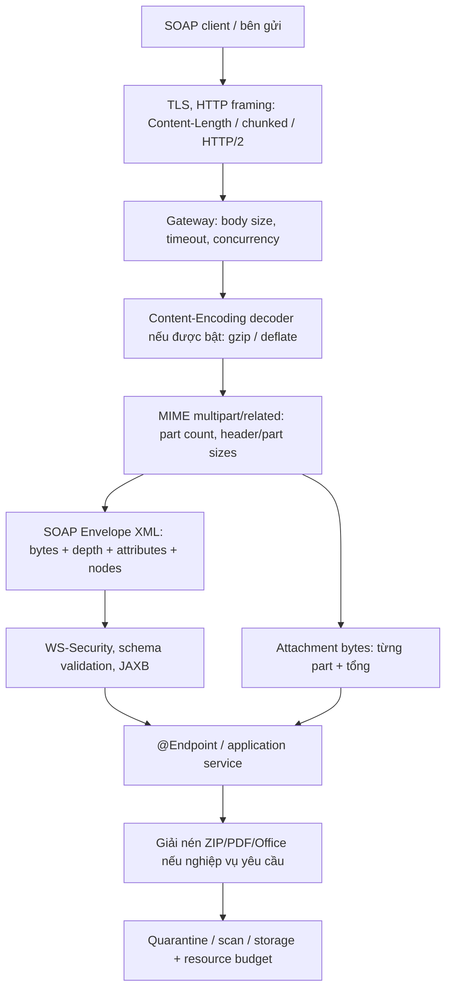

# Giới hạn kích thước SOAP, multipart và dữ liệu sau giải nén

## Mục tiêu học tập

Trong chương **Bảo vệ xử lý XML** của module **SPRING_WEB_SERVICES**, bài này trình bày cách đặt giới hạn tài nguyên ở **nhiều ranh giới** khi triển khai Spring Web Services (Spring-WS) contract-first. Dịch vụ SOAP doanh nghiệp có thể nhận XML qua HTTP, MIME `multipart/related` với SwA/MTOM, phần thân được nén bằng HTTP `Content-Encoding`, hoặc tệp đính kèm vốn là ZIP/PDF/Office và được giải nén trong nghiệp vụ. **Một giới hạn 10 MB cho request không đồng nghĩa giới hạn 10 MB cho mọi dữ liệu sẽ được tạo ra trong bộ nhớ.**

Bài tập trung vào ba câu hỏi: *đếm byte ở đâu*, *ai phải chặn trước khi cấp phát tài nguyên* và *làm sao kiểm chứng rằng một payload nhỏ sau nén không nở thành hàng trăm MB hoặc hàng triệu XML nodes*. Kiến thức này bổ sung cho thiết kế XSD/WSDL, JAXB, interceptor, SOAP Fault, TLS, WS-Security và kiểm thử tương thích đối tác; không thay thế những phần đó.

Học xong, bạn có thể:

1. Phân biệt kích thước **HTTP wire body**, **representation sau Content-Encoding**, **toàn gói MIME**, **SOAP Envelope XML**, **attachment đã giải mã**, **XML Infoset/DOM** và **dữ liệu giải nén từ file bên trong attachment**.
2. Giải thích vì sao `Content-Length` hợp lệ, `Transfer-Encoding: chunked`, HTTP/2 DATA frames và một SOAP Body nhỏ đều **không đủ** để xác định tổng chi phí xử lý.
3. Đặt các ngân sách độc lập cho request, multipart, số part, từng part, XML depth/nodes/attributes, dữ liệu sau giải nén, timeout, heap/temp disk và số request đồng thời.
4. Phân biệt HTTP **413 Content Too Large**, lỗi parser/protocol, SOAP Fault và lỗi nghiệp vụ; biết giai đoạn nào **chưa có SOAP Envelope** để trả Fault.
5. Cấu hình giới hạn sớm ở reverse proxy/API gateway và xác minh không có đường bypass thẳng tới Spring-WS backend.
6. Hiểu thông báo bảo mật **CVE-2026-59349 ngày 19/11/2026** và khác biệt giữa Spring-WS 4.1.4 cùng các phiên bản đã vá về `maxMessageSize`.
7. Không nhầm `spring.servlet.multipart.max-request-size` dành cho multipart upload trong Servlet/Spring MVC với giới hạn tự động cho SOAP MTOM/SwA `multipart/related`.
8. Viết hàm Java đọc/chép luồng theo byte budget, giải nén gzip có giới hạn **byte đầu vào lẫn byte đầu ra**, và chống ZIP bomb khi giải nén tệp.
9. Áp dụng parser XML an toàn: chặn DTD/XXE, giới hạn entity expansion, XML depth, số element/attributes và text size.
10. Kiểm thử size limit trước/sau giải nén, SOAP 1.1/1.2, multipart MTOM, chunked, Fault, mTLS/WS-Security và khả năng tương thích khi thay thư viện.

## 1. Vấn đề: payload nhỏ trên mạng nhưng lớn trong bộ nhớ

Giả sử hệ thống có operation `UploadInvoice`: client gửi SOAP Body chứa metadata và một tệp kế toán nén. Gateway báo request chỉ 2 MiB nên cho qua; tầng xử lý sau đó giải nén 200 MiB PDF/CSV/ZIP hoặc tạo hàng triệu node XML. Máy chủ có thể rơi vào tình trạng:

- `OutOfMemoryError` do message factory/SAAJ tạo DOM hoặc buffer.
- CPU tăng cao do XML entity expansion hoặc giải nén lồng nhau.
- Disk tạm đầy vì MIME parts, ZIP entries hay dữ liệu scan/quarantine.
- Thread xử lý request bị giữ quá lâu, làm cạn connection pool.
- Response SOAP client trả từ upstream quá lớn và làm cạn heap bên gọi.
- Lỗi timeout/502 xảy ra trước khi `@Endpoint` hoặc `EndpointExceptionResolver` có thể phản hồi.

Điều này không đòi hỏi XSD/WSDL phải sai. **Hợp đồng XML mô tả ý nghĩa dữ liệu, không phải ngân sách tài nguyên cho mọi lớp transport, parser, giải nén và lưu trữ.**

### 1.1. Ba tình huống dễ lọt giới hạn

| Tình huống | Giới hạn tưởng như đã đủ | Điểm còn hở |
| --- | --- | --- |
| SOAP XML 50 KiB có DTD tạo nhiều entity | HTTP body 1 MiB | Entity expansion khiến parser tạo dữ liệu lớn hơn nhiều. |
| HTTP request gzip 1 MiB, giải nén thành 80 MiB | Gateway chặn request trên 10 MiB | Gateway có thể chỉ đếm bytes **đã nén**, trong khi ứng dụng xử lý bytes sau giải nén. |
| SOAP Body 4 KiB có `xop:Include` và attachment 100 MiB | XSD `maxLength` cho metadata XML | Attachment binary không được giới hạn bởi `maxLength` của `documentId`. |

Thêm một rủi ro: 20 yêu cầu mỗi yêu cầu 10 MiB có thể tạo mức tiêu thụ cao hơn nhiều một yêu cầu 100 MiB nếu parser giữ đồng thời nhiều bản sao XML, MIME và JAXB objects.

## 2. Chuỗi dữ liệu cần tính giới hạn



Các mũi tên là mô hình **ranh giới kiểm soát**, không khẳng định mọi stack đều giải nén, parse MIME hay kiểm tra WS-Security theo đúng một thứ tự. Chẳng hạn gateway có thể giải nén trước khi forward; SAAJ có thể materialize toàn bộ message trước interceptor; một số client gọi trực tiếp qua JMS không đi qua HTTP.

### 2.1. Đặt tên các đại lượng riêng

| Đại lượng | Đơn vị | Thời điểm đếm | Vì sao khác các đại lượng còn lại? |
| --- | --- | --- | --- |
| `B_http` | byte | HTTP content đi tới tầng áp limit; có thể là representation đã `gzip` | Không tính HTTP chunk delimiters; cách quan sát phụ thuộc tầng. |
| `B_decoded` | byte | Sau khi bỏ `Content-Encoding` nếu có | Có thể lớn gấp nhiều lần `B_http`. |
| `B_mime` | byte | Toàn MIME body gồm root, MIME headers, boundaries và attachments | SOAP Envelope chỉ là một phần. |
| `N_parts` | số nguyên | Sau khi MIME parser nhận parts | Nhiều part nhỏ có thể gây CPU/metadata overhead. |
| `B_part_i` | byte | Bytes đã giải mã của attachment part thứ `i` | Tách biệt size của root XML. |
| `B_xml` | byte | Serialized SOAP Envelope XML, sau MIME/content decoding | Không phản ánh số Java objects sau DOM/JAXB. |
| `N_nodes`, `D_xml` | số nguyên | Trong XML parser | XML nhỏ vẫn có thể tạo quá nhiều nodes/depth nếu entity expansion. |
| `B_extracted` | byte | Sau giải nén nội dung ZIP/gzip bên trong attachment | Có thể nở thêm một lần nữa. |
| `C_inflight` | số request | Trong gateway/server | Nhân tài nguyên trung bình trên request. |

**Không được cộng/trừ các con số từ các lớp khác nhau như thể chúng đều đo cùng một byte stream.** Ví dụ `B_mime` có thể được tính sau HTTP content decoding, còn `B_http` có thể tính trước giải nén gzip.

### 2.2. `Content-Length` không phải kích thước XML cuối cùng

Với HTTP/1.1, `Content-Length` là số octet của HTTP content theo quy tắc HTTP framing khi không dùng `Transfer-Encoding`. Nó không phải:

- Số ký tự `String.length()` của SOAP XML.
- Số byte của chỉ phần tử business trong Body.
- Tổng số bytes sau `Content-Encoding: gzip` được giải nén.
- Dung lượng PDF/ZIP sau ứng dụng giải nén.
- Dung lượng heap mà DOM, JAXB và WS-Security sẽ cấp phát.

Ngoài ra, header `Content-Length` có thể vắng mặt khi HTTP/1.1 dùng chunked hoặc HTTP/2 dùng framing riêng. **Phải có cơ chế đo bytes thực**, không chỉ điều kiện `request.getContentLengthLong() > limit`.

## 3. Thiết kế một ngân sách tài nguyên theo hợp đồng

Không tồn tại một con số mặc định phù hợp cho mọi SOAP service. Hãy phân loại operation:

- Tra cứu `GetOrder` chỉ trao đổi XML nhỏ.
- `SubmitDocument` có MTOM/PDF.
- `ImportBatch` có ZIP chứa nhiều tệp.
- SOAP client nội bộ nhận report từ downstream không đáng tin hoàn toàn.
- Admin-only import có quota riêng nhưng **không được bypass các giới hạn an toàn cơ bản**.

### 3.1. Ví dụ ngân sách minh họa

**Đây là ví dụ do bài học đặt ra, không phải giá trị mặc định của Spring-WS hay Spring Boot.**

| Ranh giới | Mức ví dụ | Mục đích |
| --- | ---: | --- |
| HTTP request content tại gateway | 12 MiB | Chặn input quá lớn trước Spring-WS. |
| Toàn body sau `Content-Encoding` | 20 MiB | Chặn gzip/deflate inflation ở tầng giải mã. |
| XML SOAP Envelope serialized | 2 MiB | Tránh XML parsing quá lớn. |
| MIME part count | 4 | Giới hạn phần MIME và overhead xử lý. |
| Một attachment | 8 MiB | Giới hạn input mỗi tệp. |
| Tổng attachment bytes | 16 MiB | Chặn nhiều part dù từng part hợp lệ. |
| XML nesting depth | 64 | Tránh cây XML quá sâu. |
| XML element count | 100.000 | Chặn số node quá lớn. |
| Text node aggregate | 2 triệu ký tự | Chặn text value bất thường; không thay byte limit. |
| Archive entries | 100 | Chặn ZIP có quá nhiều entry. |
| Một entry sau giải nén | 8 MiB | Không cho một file nở quá mức. |
| Tổng bytes sau giải nén archive | 32 MiB | Chặn ZIP bomb. |
| Kết nối upload đồng thời | 8 | Kiểm soát tổng memory/temp disk và băng thông. |

**Giải thích ngưỡng:** Nếu hợp đồng thực sự cần PDF 100 MiB, không nâng `B_http` đơn lẻ lên 100 MiB rồi coi an toàn. Phải điều chỉnh độc lập tổng multipart, streaming, disk quotas, malware scanning, proxy timeout và memory budget.

### 3.2. Phân biệt MiB với MB

- `1 MiB = 1.048.576 byte`.
- `1 MB = 1.000.000 byte` theo SI.

Cấu hình ở Nginx, Spring Boot và message factory có thể ghi `m`, `MB` hoặc nhận `long` bytes với quy ước khác. Đối chiếu tài liệu sản phẩm và kiểm thử **ngay tại ngưỡng**, không suy rằng mọi con số “10M” là đúng một giá trị byte.

### 3.3. Xét mức tiêu thụ khi có concurrency

Giả sử 8 request, mỗi request được phép có 12 MiB body, pipeline tạo trung bình ba bản sao/representation tương đương. Một ước lượng sơ bộ về dữ liệu nằm trong memory cùng lúc là:

```text
8 * 12 MiB * 3 = 288 MiB
```

Đây chỉ là ví dụ **ước lượng**: DOM/JAXB objects và metadata Java có thể tốn nhiều hơn, trong khi disk-backed streaming có thể thấp hơn. Size limit không thay thế stress test theo **concurrency, heap size, GC, temporary disk và latency**.

## 4. HTTP framing: Content-Length, chunked và HTTP/2

### 4.1. Fixed-length HTTP/1.1

```http
POST /ws/orders HTTP/1.1
Host: api.example.test
Content-Type: text/xml; charset=utf-8
SOAPAction: "urn:example:orders:v1/GetOrder"
Content-Length: 842

[842 byte nội dung HTTP request theo framing]
```

Nếu header hợp lệ và client tuân thủ, `Content-Length` giúp gateway từ chối sớm request vượt size limit. Nhưng không dùng nó làm bằng chứng cuối cùng: phải xử lý trường hợp khác có chunking và phải có bảo vệ ở tầng đọc bytes.

### 4.2. Chunked HTTP/1.1

```http
POST /ws/orders HTTP/1.1
Host: api.example.test
Content-Type: text/xml; charset=utf-8
Transfer-Encoding: chunked
SOAPAction: "urn:example:orders:v1/GetOrder"

[chuỗi chunk size hex, dữ liệu từng chunk, chunk cuối 0]
```

Chunked là cơ chế framing **hợp lệ**. Không có Content-Length không có nghĩa body không thể giới hạn: gateway/container vẫn đếm tổng bytes sau khi giải transfer coding và dừng khi vượt ngưỡng.

### 4.3. CL + TE cùng lúc là lỗi framing

RFC 9112 quy định sender **không được** gửi đồng thời `Content-Length` và `Transfer-Encoding` trong HTTP/1.1. Các thành phần nhận có quy tắc phòng vệ, nhưng không biến cách gửi mâu thuẫn thành hợp lệ. Đây là vùng liên quan **HTTP request smuggling** nếu proxy/backend phân định ranh giới không giống nhau.

**Không tạo các request malformed để thử hệ thống bên ngoài chưa được cấp phép.** Negative tests chỉ nên chạy trong môi trường kiểm soát và qua thư viện HTTP parser chuẩn.

### 4.4. HTTP/2

HTTP/2 dùng DATA frames, không sử dụng `Transfer-Encoding: chunked` của HTTP/1.1. Khi gateway chuyển HTTP/2 sang HTTP/1.1, nó phải tạo framing HTTP/1.1 hợp lệ và áp size limit theo con đường thực sự xử lý content.

### 4.5. Sự kiện HTTP nên trả gì?

Theo RFC 9110, **413 Content Too Large** phù hợp khi request content vượt khả năng/chính sách tiếp nhận. Server có thể đóng kết nối; client **không nhất thiết nhận SOAP Fault** vì SOAP parser hoặc dispatcher có thể chưa chạy.

Với request quá lớn, **phản hồi sớm và ngắt đọc có kiểm soát** an toàn hơn cố buffer toàn bộ body chỉ để tạo SOAP Fault đẹp.

## 5. Đặt giới hạn ở ingress trước Spring-WS

### 5.1. Ví dụ reverse proxy Nginx

Một ví dụ rút gọn cho môi trường có Nginx làm ingress:

```nginx
server {
    listen 443 ssl;
    server_name soap.example.test;

    # ssl_certificate / ssl_certificate_key: cấu hình TLS thật.
    # Chỉ minh họa giới hạn upload, không phải Nginx config đầy đủ.

    location /ws/ {
        client_max_body_size 12m;
        proxy_request_buffering on;

        proxy_pass http://soap_backend;
    }
}
```

`client_max_body_size` giúp chặn HTTP request body vượt ngưỡng ở reverse proxy. `proxy_request_buffering on` cho phép proxy nhận/buffer request trước khi gửi upstream; nó có thể dùng disk tạm và ảnh hưởng latency. Điều chỉnh theo nhu cầu streaming và hạn mức temp disk, **không bật vô điều kiện trong mọi hệ thống**.

**Không xem Nginx config này đã bảo vệ giải nén gzip:** nếu proxy chỉ đếm compressed bytes rồi backend giải nén, dữ liệu hậu giải nén vẫn có thể vượt ngân sách. Cần thêm decoded-size limit ở đúng điểm giải mã.

### 5.2. Không có đường bypass backend

Giới hạn chỉ có tác dụng nếu mọi client không tin cậy thực sự đi qua gateway. Kiểm tra:

- Backend không mở public service port độc lập.
- Network policy/security groups chặn truy cập trực tiếp không mong muốn.
- Internal clients, job queues và môi trường test có chính sách tương ứng.
- Proxy tiers không tự nới giới hạn hoặc dùng cấu hình khác cho SOAP endpoint.
- Request qua HTTP/2, chunked HTTP/1.1, compressed content và multipart đều được kiểm tra.
- Health-check/metrics endpoints không vô tình cho phép request body tùy ý.

### 5.3. Giới hạn HTTP headers và thời gian cũng cần thiết

Một request có body nhỏ vẫn có thể làm cạn tài nguyên nếu có header quá dài, rất nhiều header, upload chậm hoặc kết nối giữ lâu. Cấu hình ingress/connector nên có:

- Maximum header count/header bytes.
- Request header/body read timeout và idle timeout.
- Connection limits, rate limits theo caller/tenant.
- Concurrent upload slots và queue policy.
- Temp disk quotas nếu proxy buffer request.
- Giới hạn retry để không khuếch đại tải ở service downstream.

## 6. Cảnh báo khi dùng Spring Boot: multipart/form-data không đồng nghĩa SOAP multipart/related

Một cấu hình Spring Boot thường thấy:

```properties
spring.servlet.multipart.max-file-size=10MB
spring.servlet.multipart.max-request-size=12MB
```

Các properties này phục vụ **Servlet multipart request handling**, thường là upload HTML/form-data qua `MultipartResolver` và Servlet `Part` APIs.

Trong khi đó SOAP SwA/MTOM thường dùng:

```http
Content-Type: multipart/related; type="application/xop+xml"; boundary="..."
```

và được **SOAP/MIME message factory** xử lý, không phải mặc định cùng đường đi với multipart/form-data của controller.

**Không khẳng định hai properties trên đã bảo vệ toàn bộ SOAP MTOM/SwA.** Cần xác minh Servlet container, filters và MIME message factory của ứng dụng có thực sự áp chúng lên đúng HTTP request path, part parser và message content hay không.

### 6.1. Hai property Tomcat cũng dễ bị hiểu nhầm

- `server.tomcat.max-http-form-post-size` liên quan parsing **HTTP form data**, không phải một limit tổng thể tin cậy cho mọi SOAP XML/MTOM body.
- `server.tomcat.max-swallow-size` kiểm soát lượng request body Tomcat có thể *swallow* trong các tình huống lỗi/aborted request, **không phải** quota SOAP Envelope size.

Thay vì giả định một property có tên “max” bảo vệ mọi tầng, viết một test gửi SOAP `text/xml`, `application/soap+xml` và `multipart/related` lớn vào URL thật và kiểm tra chúng bị chặn **trước message factory**.

### 6.2. Servlet Filter có đủ không?

Một filter có thể kiểm tra `getContentLengthLong()` sớm. Nhưng điều đó **không chặn** request chunked không có `Content-Length`, request header khai sai, hoặc content đã được giải nén ở tầng khác.

Muốn giới hạn byte stream bằng filter thì phải dùng một `ServletInputStream` wrapper **đúng hợp đồng Servlet**, bao gồm non-blocking APIs, vòng đời request và xử lý lỗi. Chỉ đọc hết body ở filter rồi cố đọc lại trong Spring-WS sẽ làm SOAP parser nhận stream rỗng. Vì tính phức tạp và nguy cơ buffer trước đó, ưu tiên **gateway/connector giới hạn bytes trước parser**, và chỉ thêm filter đã được kiểm chứng phù hợp khi cần.

## 7. Lưu ý phiên bản cực quan trọng: CVE-2026-59349

**Theo thông báo bảo mật chính thức của Spring công bố ngày 19/11/2026 (cập nhật phạm vi ngày 25/11/2026):**

[Spring Security Advisory — CVE-2026-59349: Memory Consumption via Oversized Incoming Messages](https://spring.io/security/cve-2026-59349/)

Thông báo nêu rằng `SaajSoapMessageFactory`, `AxiomSoapMessageFactory` và `DomPoxMessageFactory` ở các phiên bản bị ảnh hưởng **không tự giới hạn kích thước incoming message** khi parser nhận input. Nếu untrusted HTTP caller có thể gửi body quá lớn mà không bị proxy/gateway chặn, service có thể tiêu thụ bộ nhớ tỷ lệ với lượng dữ liệu và xảy ra OOM.

### 7.1. Phạm vi phiên bản được Spring nêu

| Spring-WS | Tình trạng trong advisory | Bản khắc phục được công bố |
| --- | --- | --- |
| 5.0.0 – 5.0.3 | Ảnh hưởng | **5.0.4** (OSS) hoặc 5.0.3.1 (Enterprise support). |
| 4.1.0 – 4.1.4 | Ảnh hưởng | **4.1.5** (Enterprise support). |
| 4.0.0 – 4.0.19 | Ảnh hưởng | **4.0.20** (Enterprise support). |
| 3.1.9 và các phiên bản cũ hơn | Ảnh hưởng theo phạm vi advisory | **3.1.10** (Enterprise support) cho nhánh tương ứng. |

Các phiên bản đã vá được Spring công bố áp giới hạn **10 MB mặc định cho incoming message** ở các message factories; cần kiểm tra `maxMessageSize` của factory nếu muốn xử lý SOAP message lớn hơn.

### 7.2. Không copy cấu hình `maxMessageSize` vào Spring-WS 4.1.4

**Đây là lỗi cấu hình rất dễ gặp:** đọc advisory về bản đã vá rồi cố gọi một setter `maxMessageSize` trên factory **4.1.4**. Property được thông báo cho **các bản đã sửa**; không giả định nó tồn tại hoặc hoạt động trong 4.1.4.

Với bản bị ảnh hưởng:

1. Ưu tiên nâng lên **bản đã vá phù hợp chính sách support và compatibility**.
2. Trong khi chưa thể nâng, bảo đảm có **request body limit tại ingress/gateway trước message factory**.
3. Không tin một `@EndpointInterceptor` hoặc `PayloadValidatingInterceptor` chạy *sau* parsing sẽ cứu được OOM trong message factory.
4. Kiểm tra cả HTTP request không có CL hoặc đi qua `Content-Encoding`.
5. Với transport JMS/Mail/XMPP, xem size limits của broker/client transport trước khi Spring-WS parse.
6. Ở phía client, đặt limit cho **SOAP response** khi gọi server bên ngoài có thể bị xâm nhập.

### 7.3. Khi nâng lên bản đã vá có giới hạn 10 MB

Nếu service vốn nhận MTOM request 30 MB, giới hạn 10 MB mặc định có thể làm chức năng ngừng hoạt động sau nâng cấp. Cách xử lý đúng là:

- Xác định kích thước thực của **toàn message** theo message factory đã vá.
- Tăng `maxMessageSize` có chủ đích **đúng phiên bản** và **chỉ khi có các giới hạn upstream/temp disk/memory tương ứng**.
- Không tắt hoặc tăng lên vô hạn chỉ để regression test pass.
- Chạy tests cho SOAP XML nhỏ, MTOM hợp lệ lớn, multipart malformed, oversized request và các trường hợp gzip.
- Kiểm tra memory profile và quan sát exception/status thực khi vượt ngưỡng.

**Thông báo CVE chỉ xác nhận bound ở message factory.** Nó không tự tạo giới hạn cho **archive extraction, số XML nodes sau entity expansion, kích thước file giải nén trong nghiệp vụ hoặc concurrent requests**. Vẫn cần defense in depth.

## 8. SOAP Envelope có thể lớn hơn “payload XML” trong XSD

Trong SOAP 1.1/1.2, thông điệp gồm Envelope, Header và Body. XSD cho phần tử nghiệp vụ chỉ là một phần của toàn message.

Ví dụ:

```xml
<soap:Envelope
    xmlns:soap="http://schemas.xmlsoap.org/soap/envelope/"
    xmlns:ord="urn:example:orders:v1">
    <soap:Header>
        <!-- WS-Security Signature, token, timestamp,
             certificates, WS-Addressing headers... -->
    </soap:Header>
    <soap:Body>
        <ord:SubmitDocumentRequest>
            <ord:documentId>DOC-2026-42</ord:documentId>
        </ord:SubmitDocumentRequest>
    </soap:Body>
</soap:Envelope>
```

Giới hạn `xs:maxLength` của `documentId` không ngăn việc client gửi hàng triệu ký tự trong SOAP Header khác, nhiều namespace declarations hoặc XML quá sâu trước khi schema validator làm việc.

### 8.1. XML cost model không chỉ là số bytes

Những yếu tố làm tăng chi phí:

- **Depth:** hàng nghìn phần tử lồng nhau gây stack/CPU pressure.
- **Width:** rất nhiều sibling elements và attributes.
- **Text:** một element có text rất dài.
- **Namespace declarations:** số lượng lớn, QName processing overhead.
- **DTD/entity expansion:** văn bản XML nhỏ có thể tạo Infoset lớn.
- **XPath/XSLT:** expression phức tạp có thể làm CPU sử dụng nhiều dù XML vừa phải.
- **DOM/JAXB object graph:** có overhead trên mỗi node/field, không tỷ lệ 1:1 với bytes.
- **XML Signature:** canonicalization, transforms và references tiêu tốn thêm tài nguyên.

### 8.2. Không dùng XSD thay cho resource limits

`xs:maxLength`, `xs:maxOccurs`, `xs:pattern` có tác dụng đối với giá trị/phần tử được schema validator kiểm tra. Nhưng schema validation có thể chạy **sau** SOAP parser đã tạo cây XML, và không nhất thiết giới hạn SOAP Header hoặc MIME parts ngoài payload.

**Cần bảo vệ sớm:** ingress byte budget, safe XML parser settings, limits về depth/attributes/entities, rồi mới schema validation và authorization.

## 9. DTD, XXE và entity expansion

Một XML document có thể làm parser mở external DTD/entity hoặc mở rộng entity nội bộ lớn hơn nhiều so với bytes đầu vào. Đây là nhóm rủi ro riêng với gzip/ZIP bomb.

### 9.1. Những rủi ro chính

- **External entity/DTD**: truy cập file nội bộ hoặc URL, gây SSRF và có thể làm lộ dữ liệu.
- **Internal entity expansion**: khuếch đại văn bản, gây CPU/heap exhaustion.
- **Deep/wide XML**: lượng cấu trúc XML quá lớn dù không dùng DTD.
- **External schema/XSLT**: trình biên dịch/validator/transformer có thể tải tài nguyên bên ngoài nếu không hạn chế.
- **Signature processing ambiguity**: nhiều node/ID trùng có thể dẫn tới khác biệt giữa security validator và application parser.

### 9.2. Các nguyên tắc cấu hình

Theo OWASP XML Security/XXE Prevention:

1. **Từ chối DTD** với XML không tin cậy khi hợp đồng không cần.
2. Tắt external entity resolution và external DTD loading; không chỉ chặn mạng mà vẫn cho entity expansion nội bộ vô hạn.
3. Hạn chế XInclude, external schemas/stylesheets và URI resolvers.
4. Bật secure-processing và **đặt processing limits phù hợp** khi parser hỗ trợ.
5. **Fail closed nếu một thiết lập bảo mật bắt buộc bị từ chối**, không bỏ qua exception rồi parse tiếp.
6. Áp giới hạn **bytes/depth/attribute/node count** độc lập với entity expansion limits.
7. Áp chính sách cho **mọi parser tự tạo thêm** trong endpoint/interceptor, không chỉ SOAP message factory.

### 9.3. Java JAXP có những lớp cấu hình khác nhau

| API | Biện pháp chính |
| --- | --- |
| `DocumentBuilderFactory` (DOM) | Từ chối DOCTYPE, disable XInclude, secure processing và external access. |
| `SAXParserFactory` / `XMLReader` | Từ chối DOCTYPE, chặn external entities, giới hạn parser. |
| `XMLInputFactory` (StAX) | `SUPPORT_DTD=false` và `IS_SUPPORTING_EXTERNAL_ENTITIES=false`, reject external resolvers. |
| `SchemaFactory` / `Validator` | `ACCESS_EXTERNAL_DTD=""`, `ACCESS_EXTERNAL_SCHEMA=""`, resolver/catalog nội bộ tin cậy. |
| `TransformerFactory` (XSLT) | `ACCESS_EXTERNAL_DTD=""` và `ACCESS_EXTERNAL_STYLESHEET=""`; không chạy stylesheet không đáng tin. |
| JAXB `Unmarshaller` | Nhận reader đã hardened hoặc dùng API/security controls được stack xác nhận. |

**Cẩn thận:** `FEATURE_SECURE_PROCESSING` không phải một nút thần kỳ chống mọi XXE/DoS. Các mặc định và giới hạn phụ thuộc JDK, XML provider và version; cần xác minh behavior qua negative tests.

## 10. Ví dụ Java: cấu hình StAX parser an toàn

Khi application service phải parse một XML attachment phụ ngoài SOAP Envelope, dùng parser do ứng dụng cấu hình. Trong Java 17+, `javax.xml.stream.*` vẫn là API JDK (không phải `jakarta.xml.stream`).

**`SecureStaxReaderFactory.java`**:

```java
package com.example.soap.security;

import java.io.InputStream;
import javax.xml.stream.XMLInputFactory;
import javax.xml.stream.XMLStreamException;
import javax.xml.stream.XMLStreamReader;

public final class SecureStaxReaderFactory {

    private SecureStaxReaderFactory() {
    }

    public static XMLStreamReader open(InputStream input)
            throws XMLStreamException {

        XMLInputFactory factory =
                XMLInputFactory.newDefaultFactory();

        // Nếu provider không hỗ trợ yêu cầu bảo mật này,
        // phải xử lý như lỗi cấu hình, không bỏ qua.
        factory.setProperty(XMLInputFactory.SUPPORT_DTD, false);
        factory.setProperty(
                XMLInputFactory.IS_SUPPORTING_EXTERNAL_ENTITIES,
                false);

        factory.setXMLResolver(
                (publicId, systemId, baseUri, namespace) -> {
                    throw new XMLStreamException(
                            "External XML resolution is forbidden");
                });

        return factory.createXMLStreamReader(input);
    }
}
```

Đoạn này **chỉ thực hiện XML parser hardening ban đầu**, chưa có size/depth limits. Cần cấp đầu vào là stream đã được **giới hạn bytes trước khi parse**, và dùng code ở phần tiếp theo để đếm nodes/depth trong quá trình đọc events.

### 10.1. Streaming parser giảm memory nhưng không tự hạn CPU

StAX có thể đọc tuần tự mà không dựng toàn DOM, nhưng nếu request có một triệu nodes, parser vẫn có thể tốn thời gian lớn. Phải tự giới hạn:

- Depth tối đa.
- Tổng START_ELEMENT events.
- Số attributes mỗi element.
- Tổng số ký tự text.
- Thời gian và concurrent parses.

Cũng không tự đọc SOAP Envelope hai lần qua `ServletInputStream` từ một `@Endpoint` đã được Spring-WS parse: việc này dễ làm sai pipeline. Đặt guard ở **đúng parser cấp đầu vào**, hoặc dùng chuẩn hóa kiến trúc trước parser.

## 11. Code Java: đếm độ sâu, nodes, attributes khi streaming XML

Ví dụ này dành cho **một XML attachment riêng** hoặc một XML stream mà application tự sở hữu, *không* phải interceptor chạy sau SAAJ và tự tin rằng đã bảo vệ SOAP Envelope từ đầu.

**`XmlEventBudget.java`**:

```java
package com.example.soap.security;

import java.io.InputStream;
import javax.xml.stream.XMLStreamConstants;
import javax.xml.stream.XMLStreamReader;

public final class XmlEventBudget {

    private static final int MAX_DEPTH = 64;
    private static final int MAX_ELEMENTS = 100_000;
    private static final int MAX_ATTRIBUTES_PER_ELEMENT = 64;
    private static final long MAX_TEXT_CHARS = 2_000_000;

    private XmlEventBudget() {
    }

    public static void inspect(InputStream boundedInput)
            throws Exception {

        XMLStreamReader reader =
                SecureStaxReaderFactory.open(boundedInput);

        int depth = 0;
        int elementCount = 0;
        long textChars = 0;

        try {
            while (reader.hasNext()) {
                int event = reader.next();

                if (event == XMLStreamConstants.START_ELEMENT) {
                    depth++;
                    elementCount++;

                    if (depth > MAX_DEPTH
                            || elementCount > MAX_ELEMENTS
                            || reader.getAttributeCount()
                                    > MAX_ATTRIBUTES_PER_ELEMENT) {
                        throw new IllegalArgumentException(
                                "XML complexity budget exceeded");
                    }
                } else if (event
                        == XMLStreamConstants.END_ELEMENT) {
                    depth--;
                } else if (event
                        == XMLStreamConstants.CHARACTERS
                        || event == XMLStreamConstants.CDATA) {

                    textChars += reader.getTextLength();

                    if (textChars > MAX_TEXT_CHARS) {
                        throw new IllegalArgumentException(
                                "XML text budget exceeded");
                    }
                } else if (event
                        == XMLStreamConstants.DTD) {
                    throw new IllegalArgumentException(
                            "DTD is prohibited");
                }
            }
        } finally {
            reader.close();
        }
    }
}
```

**Giới hạn minh họa:**

- Parser property `SUPPORT_DTD=false` có thể xử lý DOCTYPE khác nhau giữa providers; muốn **từ chối DTD tuyệt đối** phải verify với parser/provider và negative tests.
- Dòng cộng `textChars` chỉ an toàn vì `MAX_TEXT_CHARS` thấp; với giới hạn lớn hơn dùng kiểu cộng chống overflow.
- `reader.close()` không đảm bảo tự đóng `InputStream` bên ngoài; caller phải sở hữu và đóng stream.
- Trong production nên bắt thêm namespace-count, comment/processing-instruction length nếu workload yêu cầu.
- Nếu code dùng XML parsing để enforce policy ở runtime, **không bật lỗi parse thành successful response**; báo lỗi giới hạn có cấu trúc và cleanup tài nguyên.

## 12. MIME multipart/related và MTOM: đếm tổng entity, không chỉ SOAP Body

Trong SOAP with Attachments (SwA) hoặc MTOM/XOP, HTTP body có thể là:

```http
Content-Type: multipart/related;
    boundary="MIME_42";
    type="application/xop+xml";
    start="<soap-root@example.test>";
    start-info="application/soap+xml"
```

Body thực chứa SOAP root part, MIME headers/boundaries và các attachment parts. Ví dụ:

```mime
--MIME_42
Content-ID: <soap-root@example.test>
Content-Type: application/xop+xml; type="application/soap+xml"

<env:Envelope ...>
  <env:Body>
    <d:SubmitDocumentRequest>
      <d:content>
        <xop:Include href="cid:pdf-42@example.test"/>
      </d:content>
    </d:SubmitDocumentRequest>
  </env:Body>
</env:Envelope>

--MIME_42
Content-ID: <pdf-42@example.test>
Content-Type: application/pdf
Content-Transfer-Encoding: binary

[Binary PDF bytes]
--MIME_42--
```

**Đây là ví dụ chú giải, không phải byte stream MIME hợp lệ để gửi trực tiếp** (thiếu namespace thực, CRLF/binary bytes). Trong MTOM, XML logic của `d:content` là `xs:base64Binary`; `xop:Include` tối ưu cách biểu diễn **trên wire**.

### 12.1. Phải đặt ít nhất năm limit

1. **Tổng HTTP/MIME entity bytes** — bao gồm cả boundaries, MIME headers và binary parts.
2. **Số lượng parts** — nhiều part nhỏ vẫn có thể gây DoS metadata.
3. **Kích thước mỗi part** — chặn file quá lớn.
4. **Tổng bytes attachments** — chặn nhiều part hợp lệ riêng lẻ nhưng vượt tổng quota.
5. **Giới hạn root SOAP XML** — tách với ngân sách binary attachments.

Có thể thêm giới hạn **per-part header bytes**, Content-ID length, nesting của multipart, số MIME parameters và tổng số bytes temp disk.

### 12.2. XSD `maxLength` không giới hạn binary attachment

Một SOAP Body có:

```xml
<xop:Include href="cid:pdf-42@example.test"
             xmlns:xop="http://www.w3.org/2004/08/xop/include"/>
```

rất ngắn nhưng part PDF có thể hàng trăm MB. XSD validation trên JAXB `byte[]` hoặc String metadata có thể diễn ra **sau khi** MIME parser đã nhận/buffer phần dữ liệu lớn.

Đặt limits trước MIME parsing và trên attachment stream thực. `@PayloadRoot` chỉ chọn endpoint theo QName; không phải kích thước guard.

### 12.3. MIME headers là input không đáng tin

- `Content-Type: application/pdf` có thể bị giả.
- `Content-ID` có thể trùng, quá dài hoặc percent-encoded.
- `filename` có thể chứa traversal path.
- Multipart boundary có thể lỗi hoặc lồng nhiều cấp.
- Attachment có thể là ZIP bomb dù MIME type là `application/octet-stream`.

Không dereference external URL chỉ vì MIME part thiếu; `cid:` trỏ tới **part trong message**, không phải tài nguyên mạng.

## 13. HTTP Content-Encoding: lớp giải nén phía ngoài SOAP

Xét request:

```http
POST /ws/documents HTTP/1.1
Host: api.example.test
Content-Type: multipart/related; boundary="MIME_42"; type="application/xop+xml"
Content-Encoding: gzip
Content-Length: 1258291
```

Ở đây `Content-Length` mô tả HTTP **content đang ở dạng encoded**, nhưng khi có `Content-Encoding: gzip`, receiver phải giải mã representation để thu được MIME package. `Content-Encoding` không giống `Transfer-Encoding: chunked` và không giống MIME `Content-Transfer-Encoding` của từng part.

### 13.1. Size limit ở upstream có thể đo compressed bytes

Giả sử:

```text
HTTP content sau gzip = 1 MiB
Sau Content-Encoding decode = 18 MiB
SOAP root XML = 1 MiB
Attachments tổng = 16 MiB
Sau application giải nén ZIP attachment = 200 MiB
```

Một gateway chỉ có limit “request body < 12 MiB” cho compressed HTTP bytes vẫn có thể chuyển request cho backend; application phải có thêm **decoded-size** và **archive extraction** budgets.

**Không tự mở GZIPInputStream trong endpoint nếu Servlet/gateway đã giải mã Content-Encoding**: có thể gây double-decompression hoặc parse sai. Xác minh **thành phần nào được phép nhận Content-Encoding và làm decoding**.

### 13.2. Chính sách đơn giản nếu không cần compressed SOAP

Đối với nhiều dịch vụ SOAP, phương án an toàn nhất là **từ chối HTTP request có `Content-Encoding` khác `identity`** nếu contract không cho phép. Đừng âm thầm nhận gzip/deflate khi chưa có size limits sau giải nén, parser và test tương thích.

Nếu cần nén, xác định rõ:

- Các algorithm được hỗ trợ.
- Lớp sở hữu decoding.
- Maximum compressed bytes.
- Maximum decoded bytes.
- Maximum expansion ratio theo policy.
- Timeout/CPU budget.
- Hành vi khi gzip stream lỗi/CRC sai, dữ liệu cắt cụt hoặc nested gzip.

### 13.3. Tỉ lệ nở không thay thế absolute cap

Compression ratio:

```text
ratio = decodedBytes / max(1, compressedBytes)
```

Nếu giới hạn ratio là 30 nhưng input 100 MiB có ratio 1, output vẫn 100 MiB. Vì thế **giới hạn byte tuyệt đối sau giải nén phải được kiểm tra trong lúc stream**, ratio chỉ là guard bổ sung.

Ngược lại, file nén rất nhỏ nhưng hợp lệ có thể có ratio lớn; giới hạn ratio phải theo workload thực và có test giảm false positives. Đừng tự suy rằng mọi request ratio > 10 đều là tấn công.

## 14. Java: giới hạn byte khi đọc hoặc chép luồng

Ví dụ dưới đây là utility **thuần Java**, dùng ở điểm bạn **thực sự sở hữu InputStream** như khi xử lý attachment/ZIP sau MIME parsing hoặc HTTP decoder do ứng dụng quản lý. Nó **không tự bảo vệ Spring-WS message factory nếu factory đã buffer body trước khi utility được gọi**.

**`BoundedStreamCopy.java`**:

```java
package com.example.soap.security;

import java.io.IOException;
import java.io.InputStream;
import java.io.OutputStream;

public final class BoundedStreamCopy {

    private BoundedStreamCopy() {
    }

    public static long copyAtMost(
            InputStream input,
            OutputStream output,
            long maxBytes) throws IOException {

        if (maxBytes < 0) {
            throw new IllegalArgumentException(
                    "maxBytes must be non-negative");
        }

        byte[] buffer = new byte[64 * 1024];
        long total = 0;

        int n;
        while ((n = input.read(buffer)) != -1) {
            if (n == 0) {
                continue;
            }

            if (n > maxBytes - total) {
                throw new IOException(
                        "RESOURCE_LIMIT_EXCEEDED");
            }

            output.write(buffer, 0, n);
            total += n;
        }

        return total;
    }
}
```

### 14.1. Vì sao kiểm tra trước `write`?

Nếu bạn ghi toàn bộ chunk trước rồi mới kiểm tra, file/quarantine có thể đã phình vượt budget. Kiểm tra `n > maxBytes - total` tránh cộng overflow và **từ chối trước khi ghi chunk vượt ngưỡng**.

Dù vậy, dữ liệu đã ghi trước đó vẫn còn trong file tạm. Caller phải cleanup/rollback khi exception, **không commit một partial file** thành tài liệu hợp lệ.

### 14.2. Tại sao không dùng `readAllBytes()`?

`readAllBytes()` có thể tạo array khổng lồ trước khi code nhìn thấy size; dùng với input không tin cậy có thể gây OOM. Luồng bounded-copy hạn chế amount output ở tầng này; kết hợp giới hạn ingestion sớm, timeout và quotas để xử lý bền vững.

### 14.3. Giới hạn một stream chưa đủ

Hàm chỉ biết `maxBytes` của **một input stream**. Nếu có 100 attachments, phải có thêm **shared total budget** và part-count limit bên ngoài. Nếu input là gzip compressed bytes, cần **decoded output budget** sau giải nén nữa.

Các giới hạn ở đây cũng không kiểm tra file-type/malware, không làm authentication hay WS-Security; chúng chỉ ngăn một loại tiêu thụ tài nguyên.
## 15. Java: giới hạn cả gzip input và dữ liệu giải nén

Khi application trực tiếp quản lý một luồng `gzip` (ví dụ giải nén file đính kèm trong quarantine), cần hai giới hạn:

- `maxEncodedBytes`: lượng dữ liệu gzip nén mà decoder được phép tiêu thụ.
- `maxDecodedBytes`: lượng bytes mà decoder được phép tạo ra.

Ngoài hai giới hạn **tuyệt đối**, có thể kiểm tra `maxExpansionRatio` để phát hiện cách nén quá bất thường. Ratio không được thay thế decoded-size cap.

### 15.1. Bọc compressed stream bằng một bộ đếm có giới hạn

**`LimitedCountingInputStream.java`**:

```java
package com.example.soap.security;

import java.io.FilterInputStream;
import java.io.IOException;
import java.io.InputStream;
import java.util.Objects;

public final class LimitedCountingInputStream
        extends FilterInputStream {

    private final long limit;
    private long bytesRead;

    public LimitedCountingInputStream(InputStream delegate, long limit) {
        super(delegate);
        if (limit < 0) {
            throw new IllegalArgumentException("limit must be >= 0");
        }
        this.limit = limit;
    }

    public long bytesRead() {
        return bytesRead;
    }

    @Override
    public int read() throws IOException {
        int value = super.read();
        if (value == -1) {
            return -1;
        }
        if (bytesRead >= limit) {
            throw new IOException("ENCODED_SIZE_LIMIT_EXCEEDED");
        }
        bytesRead++;
        return value;
    }

    @Override
    public int read(byte[] bytes, int offset, int length)
            throws IOException {

        Objects.requireNonNull(bytes);
        Objects.checkFromIndexSize(offset, length, bytes.length);

        if (length == 0) {
            return 0;
        }

        // Đọc tối đa số byte còn được phép + 1,
        // để phát hiện luồng vượt limit thay vì giả EOF.
        long remaining = limit - bytesRead;
        int requested = remaining >= length
                ? length
                : (int) (remaining + 1);

        int count = in.read(bytes, offset, requested);

        if (count == -1) {
            return -1;
        }
        if (count > remaining) {
            throw new IOException("ENCODED_SIZE_LIMIT_EXCEEDED");
        }
        bytesRead += count;
        return count;
    }
}
```

**Cảnh báo khi dùng utility này:** ví dụ học thuật chỉ phục vụ luồng **blocking**; `FilterInputStream` không phải `ServletInputStream` và không thể nhét trực tiếp vào asynchronous servlet wrapper. Code dùng `Objects.checkFromIndexSize` (Java 9+) để kiểm tra bounds của `offset/length`, nhưng vẫn không nên coi ví dụ là một thư viện đã được kiểm thử toàn diện dưới mọi điều kiện I/O bất thường.

Ngoài ra, việc đọc thêm một byte để phát hiện vượt giới hạn có thể tiêu thụ byte vi phạm trước khi ném exception. Khi nhận dữ liệu không tin cậy, đó là cách kiểm tra thông thường và vẫn bảo đảm **không cấp dữ liệu quá budget cho downstream decoder**. Nếu yêu cầu không được tiêu thụ byte vượt giới hạn, cần design một protocol buffer khác.

### 15.2. Giải nén vào file tạm, không buffer trong heap

**`SafeGzipDecoder.java`**:

```java
package com.example.soap.security;

import java.io.IOException;
import java.io.InputStream;
import java.io.OutputStream;
import java.nio.file.Files;
import java.nio.file.Path;
import java.nio.file.StandardOpenOption;
import java.util.zip.GZIPInputStream;

public final class SafeGzipDecoder {

    private SafeGzipDecoder() {
    }

    public static Path decompressToQuarantine(
            InputStream compressedSource,
            Path quarantineDir,
            long maxEncodedBytes,
            long maxDecodedBytes,
            long maxRatio) throws IOException {

        if (maxEncodedBytes <= 0
                || maxDecodedBytes < 0
                || maxRatio <= 0
                || maxEncodedBytes > Long.MAX_VALUE / maxRatio) {
            throw new IllegalArgumentException(
                    "Invalid gzip resource budget");
        }

        // Directory phải do server quản lý, không do caller tự chọn.
        Path temp = Files.createTempFile(
                quarantineDir, "soap-gzip-", ".part");

        try {
            try (LimitedCountingInputStream boundedEncoded =
                         new LimitedCountingInputStream(
                                 compressedSource, maxEncodedBytes);
                 GZIPInputStream decoded =
                         new GZIPInputStream(boundedEncoded);
                 OutputStream file = Files.newOutputStream(
                         temp, StandardOpenOption.WRITE)) {

                long decodedBytes = BoundedStreamCopy.copyAtMost(
                        decoded, file, maxDecodedBytes);

                long encodedBytes = boundedEncoded.bytesRead();
                if (encodedBytes == 0
                        || decodedBytes > encodedBytes * maxRatio) {
                    throw new IOException(
                            "GZIP_EXPANSION_RATIO_EXCEEDED");
                }
            }

            return temp; // Chỉ là quarantine file, chưa phải hợp lệ.
        } catch (IOException | RuntimeException problem) {
            try {
                Files.deleteIfExists(temp);
            } catch (IOException cleanupFailure) {
                problem.addSuppressed(cleanupFailure);
            }
            throw problem;
        }
    }
}
```

Đây là **đoạn mẫu áp dụng cho một file do ứng dụng chủ động giải nén**. Caller phải có chính sách quyền truy cập thư mục `quarantineDir`, quotas temp disk, scan/hash, cleanup khi hết thời hạn và xử lý việc commit tệp sau khi validate.

### 15.3. Các giới hạn của ví dụ

- Đọc gzip vẫn tốn CPU; thêm request/extraction timeouts và concurrency limits.
- `maxDecodedBytes` được kiểm tra **trong lúc copy**, nên không cần tạo mảng 100 MiB để xem file lớn bao nhiêu.
- Ratio kiểm tra sau khi decoder kết thúc, trong khi **absolute caps** bảo vệ trong quá trình đọc. Vì vậy ratio không cứu được request nếu đã bỏ absolute cap.
- `GZIPInputStream` phải đọc đến cuối để xác minh checksum/trailer khi implementation có kiểm tra; không coi một phần output là file hợp lệ.
- Nếu client gửi **nhiều gzip files**, mỗi file hợp lệ vẫn có thể vượt **tổng quota**; giữ một shared budget bên ngoài.
- Đừng tự áp dụng decoder này cho toàn SOAP request khi gateway đã xử lý `Content-Encoding`; xác định rõ **một nơi chịu trách nhiệm decode**.
- Khi dùng nested gzip hoặc archive có nhiều tầng, không reset ngân sách tổng hoặc độ sâu lồng nhau sau mỗi lần mở file.

## 16. ZIP bomb và tệp đính kèm có cấu trúc nén

SOAP MTOM có thể mang một ZIP file 3 MiB nhưng chứa hàng chục nghìn entries hoặc hàng trăm MB dữ liệu sau khi giải nén. Một server chỉ kiểm tra `Attachment.getSize()` trước khi xử lý ZIP **không phát hiện** chi phí sau giải nén.

### 16.1. Những limit tối thiểu khi đọc ZIP

| Limit | Phát hiện | Tại sao cần |
| --- | --- | --- |
| Encoded ZIP bytes | Archive upload vượt quota | Từ chối tệp quá lớn ngay từ ingress/attachment reader. |
| Number of entries | ZIP có quá nhiều file | Giới hạn CPU, số file descriptors và metadata overhead. |
| Per-entry uncompressed bytes | Một entry nở quá lớn | Chặn extraction bomb một file. |
| Aggregate uncompressed bytes | Nhiều entry nhỏ nhưng tổng lớn | Chặn ZIP bomb dạng “many files”. |
| Nesting depth | ZIP chứa ZIP chứa ZIP | Chặn tăng trưởng đệ quy qua nhiều tầng. |
| Extraction time | Decoder bị giữ lâu | Chặn CPU exhaustion. |
| Path/filename policy | `../`, absolute path, symlink, reserved names | Chặn path traversal và arbitrary overwrite. |
| Temp storage quota | File tạm vượt ổ đĩa | Chặn disk exhaustion dù heap còn đủ. |

### 16.2. Java example: chỉ **đọc và đếm**, chưa giải nén ra filesystem

**`ZipBudgetInspector.java`**:

```java
package com.example.soap.security;

import java.io.IOException;
import java.io.InputStream;
import java.util.zip.ZipEntry;
import java.util.zip.ZipInputStream;

public final class ZipBudgetInspector {

    private static final int MAX_ENTRIES = 100;
    private static final long MAX_ENTRY_BYTES = 8L * 1024 * 1024;
    private static final long MAX_TOTAL_BYTES = 32L * 1024 * 1024;

    private ZipBudgetInspector() {
    }

    public static void inspect(InputStream boundedArchive)
            throws IOException {

        byte[] buffer = new byte[64 * 1024];
        int entries = 0;
        long total = 0;

        try (ZipInputStream zip =
                     new ZipInputStream(boundedArchive)) {

            ZipEntry entry;
            while ((entry = zip.getNextEntry()) != null) {
                entries++;
                if (entries > MAX_ENTRIES) {
                    throw new IOException(
                            "ARCHIVE_ENTRY_LIMIT_EXCEEDED");
                }

                String name = entry.getName().replace('\\', '/');
                if (name.startsWith("/")
                        || name.matches("^[A-Za-z]:.*")
                        || name.equals("..")
                        || name.startsWith("../")
                        || name.contains("/../")) {
                    throw new IOException(
                            "UNSAFE_ARCHIVE_ENTRY_PATH");
                }

                long entryBytes = 0;
                int n;

                while ((n = zip.read(buffer)) != -1) {
                    if (n == 0) {
                        continue;
                    }
                    if (n > MAX_ENTRY_BYTES - entryBytes
                            || n > MAX_TOTAL_BYTES - total) {
                        throw new IOException(
                                "ARCHIVE_DECODED_LIMIT_EXCEEDED");
                    }
                    entryBytes += n;
                    total += n;
                }

                zip.closeEntry();
            }
        }
    }
}
```

**Phạm vi:** lớp này không tạo file, nên không thể tự gây path traversal qua việc ghi file. Nếu ứng dụng thực sự **extract** entries, còn phải bảo vệ against symlinks/hardlinks, path normalization, extension allowlists, race conditions và atomic move vào storage an toàn. Metadata `ZipEntry.getSize()` có thể thiếu/sai; code đếm **bytes thực sau giải nén**, không tin size header.

### 16.3. Cẩn thận với nested archives

Đoạn code trên chỉ nhìn **một tầng ZIP**. Nếu entry bên trong lại là ZIP/GZIP, ứng dụng giải nén sâu hơn cần chia sẻ **một ngân sách tổng hợp** (aggregate bytes), maximum depth và timeout. Không gọi lại `inspect` với bộ đếm tổng bằng 0 rồi coi an toàn.

Với Office OOXML (DOCX/XLSX/PPTX), file vốn là ZIP. Các thư viện Office có thể có thêm giới hạn zip entry inflation ratio hoặc temp file policy; cần cấu hình đúng API/version, nhưng vẫn giữ **per-request budget** ở application boundary.

## 17. Giới hạn multipart phải được áp trước hoặc trong MIME parser

Trong Spring-WS, multipart SwA/MTOM thường được xử lý bởi SOAP/MIME message factory như SAAJ. Nếu toàn HTTP entity đã được buffer và parse vào object graph trước khi `@Endpoint` chạy, code trong endpoint có `if (attachment.getSize() > limit)` đã **quá muộn để bảo vệ bước parse ban đầu**.

### 17.1. Ba lớp giới hạn bổ sung

```text
Gateway/connector
   └─ total HTTP request bytes + timeout + concurrency
        └─ MIME parser / message factory
             ├─ total message bytes
             ├─ part-count + header-count + boundary constraints
             ├─ SOAP root XML size
             └─ attachment bytes + total attachment sum
                  └─ application stream scanner
                       ├─ per-file actual bytes
                       ├─ extracted bytes / entry count / nesting
                       └─ malware validation and storage quota
```

Không phải message factory nào cũng công khai **tất cả** các knobs trên. Nếu không cấu hình được một giới hạn tại parser, dùng chính sách bảo vệ ở tầng trước, giới hạn số lượng clients đồng thời và cân nhắc nâng thư viện/đổi thiết kế ingestion.

### 17.2. Trường hợp MIME root nhỏ nhưng attachment lớn

Ví dụ SOAP Envelope chỉ 4 KiB:

```xml
<doc:SubmitBinaryRequest
    xmlns:doc="urn:example:documents:v1"
    xmlns:xop="http://www.w3.org/2004/08/xop/include">
  <doc:content>
    <xop:Include href="cid:pdf-42@example.test"/>
  </doc:content>
</doc:SubmitBinaryRequest>
```

Nhưng MIME part `pdf-42@example.test` dài 100 MiB. Một giới hạn DOM XML node count có thể không phát hiện; phải có **total request/part bytes quota**. Ngược lại, một SOAP XML rất lớn nhưng không có attachment vẫn có thể gây OOM — cần cả hai.

### 17.3. Content-ID không làm file được tin cậy

`Content-ID` chỉ liên kết một part với tham chiếu. Nó không chứng minh:

- Binary bytes thuộc khách hàng đang xác thực.
- File extension hoặc MIME type đúng.
- Attachment không bị đổi sau khi SOAP Body được ký.
- Caller có quyền nhập tài liệu vào tenant.
- File an toàn để parse/scan/extract.

Phải có authentication/authorization, content verification và integrity checks theo hợp đồng.

## 18. WS-Security và kích thước: bảo vệ trước khi phép toán tốn kém

Một SOAP request có chữ ký WS-Security hợp lệ vẫn có thể rất lớn. Trước khi security layer xác minh xong, parser đã phải đọc đủ một phần của XML, tạo nodes và xử lý canonicalization. Nếu cho kích thước không giới hạn, chữ ký hoặc certificate không cứu được memory.

### 18.1. Quy tắc chung

1. **Giới hạn bytes** trước bước SOAP parsing và xác minh chữ ký tốn kém.
2. Giới hạn XML complexity và số lượng WS-Security header blocks.
3. Cấu hình WS-Security token/signature/encryption theo security profile được duy trì.
4. Không chỉ xác minh chữ ký trên một phần SOAP Body rồi tự tin attachments đã có integrity.
5. Giới hạn dữ liệu **sau decrypt/decompress**, vì plaintext có thể lớn hơn ciphertext/compressed bytes.
6. Kiểm tra replay, timestamp, nonce và principal theo security policy; **không** dùng message size làm chứng cứ xác thực.
7. Chặn lộ khác biệt bảo mật thông qua verbose Fault/errors hoặc logs.

### 18.2. Ký SOAP Body chưa chắc ký attachment bytes

Nếu Body được ký chỉ chứa `cid:pdf-42@example.test`, chữ ký có thể bảo vệ tham chiếu nhưng không bao phủ bytes của PDF. Nếu hợp đồng yêu cầu toàn vẹn end-to-end của binary, cần **attachment signature policy** hoặc hash được xác thực/ký và đối chiếu với bytes thực, tùy WS-Security profile.

### 18.3. Authorization không nên làm sau khi lưu file

Luồng an toàn hơn:

```text
request body limits
  → safe SOAP/MIME parsing
  → WS-Security validation / authenticated principal
  → authorization operation + tenant + resource
  → attachment byte scan/extraction within budgets
  → quarantine and storage commit
  → SOAP response / Fault
```

Thứ tự kiểm tra MIME parser, security và application có thể khác theo stack; điều bắt buộc là **không commit hoặc tiết lộ tài nguyên trước khi các điều kiện cần thiết đạt**.

### 18.4. Tại sao vẫn cần TLS/mTLS?

TLS/mTLS bảo vệ kênh và có thể xác thực peer ở hop TLS; nhưng không đặt giới hạn kích thước trên heap/CPU sau khi client đã qua TLS. Một đối tác được xác thực **vẫn có thể vô tình gửi payload lỗi** hoặc trở thành nguồn tấn công nếu account bị chiếm.

## 19. SOAP client cũng cần giới hạn phản hồi

Bài học không chỉ dành cho SOAP endpoint server. `WebServiceTemplate` có thể gọi một service đối tác trả response lớn hoặc malicious.

### 19.1. Rủi ro đối với client

- Server bị chiếm gửi SOAP Envelope rất lớn.
- Response `Content-Encoding: gzip` nhỏ trên wire nhưng nở quá ngưỡng trong client.
- SOAP Fault chứa reason/detail cực dài.
- MTOM response có nhiều attachments hơn hợp đồng.
- HTTP redirect không mong muốn tới endpoint khác.
- Retry tự động nhiều lần nhân chi phí mạng và memory.

**Cần giới hạn size trước khi client message factory nhận/parse response**, hoặc dùng factory đã vá có limit phù hợp; không chỉ kiểm tra `GetOrderResponse` sau khi `marshalSendAndReceive(...)` đã unmarshal toàn bộ.

### 19.2. WebServiceTemplate không phải size firewall

`WebServiceTemplate` điều phối SOAP send/receive, JAXB và Fault, nhưng không tự bảo đảm mọi HTTP sender có bounded response size/decoded-size budget. Xem chính sách của:

- HTTP client/message sender.
- Response interception ở transport layer.
- Message factory của Spring-WS version đang dùng.
- Gateway/egress proxy nếu có.
- Compression decoders.
- XML parsers và MTOM attachment consumers.

Với Spring-WS 4.1.4, không coi các giới hạn mới của các bản đã vá là hiện hữu. Với 5.0.4/enterprise fixed release, kiểm tra `maxMessageSize` và kích thước legitimate responses theo tài liệu của bản đó.

### 19.3. Timeout không phải size limit

Connect timeout, read timeout và overall deadline giúp giảm việc giữ socket quá lâu, nhưng server có thể gửi 1 GiB rất nhanh trước timeout. Do vậy **timeout, byte quota, concurrency và parser budget** phải cùng tồn tại.

## 20. Giới hạn bộ nhớ và đồng thời ở cấp hệ thống

Đặt `maxBodySize=12MiB` nhưng cho 2.000 concurrent uploads là một dạng cấu hình không có ngân sách tổng thể.

### 20.1. Tính capacity theo tầng

Các yếu tố phải ghi nhận:

- Request content đã được proxy buffer trong RAM/disk bao nhiêu?
- SOAP parser có dựng DOM toàn bộ hay streaming?
- WS-Security có tạo bản sao/canonicalization buffers không?
- JAXB có materialize `byte[]` hoặc `DataHandler`?
- MIME implementation spool attachment ra disk hay giữ trong RAM?
- File decoder ZIP/Office/PDF có tạo object graphs/temporary files?
- Response được lưu trong memory trước khi gửi không?
- Maximum concurrent requests và queued tasks là bao nhiêu?

### 20.2. Dùng queue/semaphore/capacity limit

Bảo vệ vận hành có thể gồm:

- Concurrency limit tổng và giới hạn upload slots riêng.
- Per-tenant quotas/rate limits.
- Bounded queue, overload shedding (HTTP 429/503 theo policy).
- Max temp disk size và cleanup job.
- Backpressure khi storage/scanner chậm.
- Per-request deadline; không chạy extraction vô hạn.
- Heap alerting, GC monitoring và memory pressure thresholds.

**Không tự tạo một ThreadLocal/Map global giữ toàn bộ SOAP attachments** làm cache per-request. Dữ liệu nhạy cảm và memory có thể rò giữa requests.

## 21. Phản hồi lỗi: 413, SOAP Fault hay lỗi bảo mật?

Một size limit có thể được phát hiện ở các điểm khác nhau, nên cách phản hồi cũng khác.

| Điểm phát hiện | Thông điệp có thể trả | Có SOAP Fault không? |
| --- | --- | --- |
| Gateway/HTTP connector trước SOAP parse | HTTP **413 Content Too Large**, có thể đóng kết nối. | Không mặc định. |
| TLS/mTLS handshake | TLS/network error. | Không có SOAP Envelope. |
| Message factory chặn oversized SOAP | Transport/SOAP parse error theo implementation. | Không bảo đảm. |
| XML parser từ chối DTD/entity/depth | Parser/protocol exception. | Chỉ nếu framework tạo Fault phù hợp sau đó. |
| MIME parser từ chối boundary/part count | MIME/protocol failure. | Không bảo đảm. |
| Endpoint đọc attachment và thấy file vượt quota | Domain/application validation exception. | Có thể map thành typed SOAP Fault nếu dispatcher/resolver được dùng. |
| WS-Security invalid | Security fault/rejection theo security profile. | Tùy stack, không map thành lỗi size nghiệp vụ. |
| SOAP client nhận response oversized | Client transport/message parse exception. | Không nhất thiết có SOAP Fault để giải mã. |

### 21.1. Không bắt mọi lỗi rồi trả SOAP 200

Đừng viết:

```java
catch (Exception ignored) {
    return new UploadDocumentResponse(true);
}
```

Cách đó che lỗi giới hạn, gây sai trạng thái nghiệp vụ, có thể dẫn đến client retry/lưu file trùng và làm audit trail vô nghĩa.

Nếu request bị chặn sau khi một phần file đã được ghi vào quarantine, **rollback/cleanup** trước khi trả lỗi. Nếu đã có side effect commit, cần idempotency/reconciliation riêng; SOAP Fault không tự undo giao dịch.

### 21.2. Chú ý thông tin công khai

Fault reason nên ổn định như `Attachment exceeds allowed size` hoặc `Invalid document` theo hợp đồng. Không trả:

- Đường dẫn file tạm hoặc tên mount.
- Stack trace, SQL host, token hoặc private key.
- Tên antivirus engine/chi tiết rule nội bộ không cần thiết.
- Danh sách tài nguyên của tenant khác.
- Toàn XML payload hoặc bytes ZIP lỗi.

Server log có thể ghi loại giới hạn bị chạm và correlation ID, nhưng vẫn phải giữ mức tối thiểu, masking và retention.

## 22. Quan sát: đo từng ngưỡng chứ không chỉ HTTP status

Để biết defense-in-depth có hoạt động, nên có metrics theo từng tầng.

### 22.1. Dữ liệu log tối thiểu

```text
requestId=3ed3...
operation=SubmitDocument
route=/ws/documents
boundary=gateway
result=REJECTED
limitKind=HTTP_BODY_BYTES
observedBytes=12582913
configuredLimitBytes=12582912
httpStatus=413
```

Một ví dụ khác:

```text
requestId=3ed3...
boundary=attachment_decoder
result=REJECTED
limitKind=EXTRACTED_BYTES
contentType=application/zip
attachmentOrdinal=2
configuredLimitBytes=33554432
```

Đây là **format minh họa**. Đừng log raw attachment, WS-Security headers, authentication token, full filename hoặc tenant/user IDs không cần thiết.

### 22.2. Những metric hữu ích

| Metric | Mục đích |
| --- | --- |
| `soap_http_body_rejected_total` | Request bị chặn sớm ở HTTP/gateway. |
| `soap_mime_part_limit_rejected_total` | Message có nhiều parts hoặc part quá lớn. |
| `soap_xml_complexity_rejected_total` | Depth/node/entity/text vượt budget. |
| `soap_decode_limit_rejected_total` | Gzip/ZIP/extracted data vượt quota. |
| `soap_message_factory_rejected_total` | Message factory reject message oversized khi đã hỗ trợ. |
| `soap_inflight_requests` | Quan sát concurrency. |
| `soap_temp_disk_bytes` | Phát hiện spool/quarantine disk pressure. |
| `soap_request_duration_seconds` | Phân tích timeout và CPU under load. |

Giữ metric labels có **cardinality giới hạn** (operation đã chuẩn hóa, loại limit, result). Không dùng raw Content-ID, filename, exception message hoặc request UUID làm label.

## 23. Unit test cho giới hạn bytes bằng JUnit 5

Hãy test hàm `BoundedStreamCopy` độc lập, không cần SOAP server.

**`BoundedStreamCopyTest.java`**:

```java
package com.example.soap.security;

import static org.junit.jupiter.api.Assertions.*;

import java.io.ByteArrayInputStream;
import java.io.ByteArrayOutputStream;
import java.io.IOException;
import java.nio.charset.StandardCharsets;

import org.junit.jupiter.api.Test;

class BoundedStreamCopyTest {

    @Test
    void acceptsExactlyAtLimit() throws Exception {
        byte[] payload = "hello"
                .getBytes(StandardCharsets.UTF_8);

        ByteArrayOutputStream output = new ByteArrayOutputStream();

        long copied = BoundedStreamCopy.copyAtMost(
                new ByteArrayInputStream(payload),
                output,
                payload.length);

        assertEquals(payload.length, copied);
        assertArrayEquals(payload, output.toByteArray());
    }

    @Test
    void rejectsOneByteOverLimit() {
        byte[] payload = "abcdef"
                .getBytes(StandardCharsets.UTF_8);

        ByteArrayOutputStream output = new ByteArrayOutputStream();

        assertThrows(IOException.class, () ->
                BoundedStreamCopy.copyAtMost(
                        new ByteArrayInputStream(payload),
                        output, 5));

        // Không được commit output khi copy thất bại.
        // Ví dụ này dùng output tạm trong memory chỉ để test.
    }

    @Test
    void rejectsNegativeLimit() {
        assertThrows(IllegalArgumentException.class, () ->
                BoundedStreamCopy.copyAtMost(
                        new ByteArrayInputStream(new byte[0]),
                        new ByteArrayOutputStream(),
                        -1));
    }
}
```

### 23.1. Test boundary values

Với một ngưỡng `L`, nên kiểm tra:

- `L - 1` bytes: chấp nhận.
- `L` bytes: chấp nhận.
- `L + 1` bytes: từ chối.
- Empty stream và zero limit.
- Stream chỉ trả từng byte hoặc trả chunks nhỏ.
- I/O exception giữa chừng và cleanup temp file.
- Nhiều luồng concurrent cùng dùng utility, không có shared mutable request state.

**Không dùng test này để kết luận gateway đã giới hạn raw request.** Đây chỉ là unit test ở nơi application sở hữu stream.

### 23.2. Test gzip: ngưỡng sau giải nén

Dùng bộ dữ liệu test **nhỏ, hữu hạn**; không cần tạo ZIP bomb cỡ GB.

```java
@Test
void rejectsExpandedGzipOverBudget() throws Exception {
    byte[] plain = new byte[64 * 1024];
    java.util.Arrays.fill(plain, (byte) 'A');

    ByteArrayOutputStream encoded = new ByteArrayOutputStream();
    try (java.util.zip.GZIPOutputStream gzip =
                 new java.util.zip.GZIPOutputStream(encoded)) {
        gzip.write(plain);
    }

    // Dù encoded rất ngắn, decoded budget chỉ 4 KiB.
    Path dir = Files.createTempDirectory("gzip-limits-test-");
    try {
        assertThrows(IOException.class, () ->
                SafeGzipDecoder.decompressToQuarantine(
                        new ByteArrayInputStream(encoded.toByteArray()),
                        dir,
                        1L * 1024 * 1024,
                        4L * 1024,
                        100));
    } finally {
        try (var files = Files.list(dir)) {
            assertEquals(0L, files.count());
        }
        Files.delete(dir);
    }
}
```

Đây là **method bổ sung** vào class test trước; thêm các imports `java.nio.file.Path`, `java.nio.file.Files` và `java.io.ByteArrayOutputStream`. Nó chứng minh **output budget chặn trước khi tạo file hoàn chỉnh**, nhưng vẫn chưa xác minh HTTP `Content-Encoding` path của SOAP service.

## 24. Integration test qua HTTP/SOAP thật

`MockWebServiceClient` và `MockWebServiceServer` hữu ích để kiểm tra QName, XSD, JAXB, SOAP Fault và message callbacks. Nhưng chúng **không chứng minh** ingress body limit, HTTP chunking, MIME wire boundaries, compression proxy hoặc mTLS thực sự đúng.

### 24.1. Kịch bản cần có server test cục bộ/được phép

1. HTTP request SOAP 1.1 nhỏ hợp lệ → operation chạy và có response đúng WSDL.
2. Payload **đúng giới hạn** → chấp nhận khi contract cho phép.
3. Payload vượt limit một byte → HTTP 413/exception theo điểm chặn đã cấu hình.
4. Request chunked không có `Content-Length` → vẫn bị chặn khi bytes vượt giới hạn.
5. SOAP 1.2 `application/soap+xml` → giới hạn hoạt động giống SOAP 1.1.
6. `Content-Encoding: gzip` nhỏ nhưng decoded body vượt giới hạn → reject tại decoder boundary.
7. `multipart/related` có MTOM attachment vượt giới hạn từng part/tổng → reject trước business side effects.
8. Nhiều attachments nhỏ vượt `N_parts` → reject theo part count.
9. XML sâu hoặc DTD/entity payload không tin cậy → parser/security reject mà không làm process OOM.
10. ZIP có nhiều entries hoặc tổng extracted bytes vượt ngưỡng → quarantine cleanup.
11. Payload có WS-Security chữ ký hợp lệ nhưng file quá lớn → size guard vẫn reject.
12. Payload sai chữ ký nhưng đúng size → security policy reject.
13. Service downstream trả compressed SOAP response quá lớn → client giới hạn response.
14. 10–20 requests đồng thời ở gần ngưỡng → heap/temp disk/latency không vượt capacity.
15. Gateway → backend cùng áp policy và không có đường bypass.

**Ghi chú:** HTTP status cụ thể có thể khác nếu request bị chặn trước/sau SOAP parser. Test phải xác định **boundary expected** và việc endpoint/application service **không tạo side effect**, không chỉ kiểm tra một status code.

### 24.2. Trường hợp chưa có SOAP Fault

Nếu gateway trả 413 trước khi request vào `MessageDispatcherServlet`, client có thể nhận HTTP response không chứa SOAP Envelope. Một Spring-WS SOAP client phải phân biệt:

```text
HTTP 413 / network termination
  != SOAP Fault hợp đồng
  != SOAP validation exception
  != lỗi nghiệp vụ UploadDocument
```

Không viết một test mock kỳ vọng typed SOAP Fault cho chính lỗi đã bị chặn **trước** SOAP message factory.

### 24.3. Khi kiểm thử multipart wire

Kiểm tra HTTP `Content-Type`, `boundary`, `start` và root `Content-ID`, số MIME parts, per-part headers và bytes. Dùng MIME parser phù hợp; không `String.split("--boundary")` trên data nhị phân. Nếu outer `Content-Encoding` là gzip, xác nhận decoder được áp **trước** MIME parser theo chính sách và cả hai lớp size limit hoạt động.

## 25. Ma trận tình huống kiểm thử bảo mật và hồi quy

| ID | Dữ liệu đầu vào/điều kiện | Kết quả mong muốn |
| --- | --- | --- |
| T01 | SOAP Body nhỏ, không attachment | Response hợp lệ theo XSD/WSDL. |
| T02 | SOAP request `L_http + 1` byte có Content-Length | Bị từ chối sớm, không parse/store. |
| T03 | Chunked SOAP request vượt body quota | Vẫn bị từ chối dù không có Content-Length. |
| T04 | HTTP/2 request lớn rồi downgrade H1 | Gateway vẫn enforce limit, framing hợp lệ. |
| T05 | Compressed 1 MiB, decoded 18 MiB > `L_decoded` | Bị từ chối ở decoded-size boundary. |
| T06 | gzip cắt thiếu trailer/CRC không hợp lệ | Bị từ chối, cleanup tệp tạm. |
| T07 | MIME root 5 KiB, attachment 20 MiB > per-part limit | Chặn toàn request, không lưu file. |
| T08 | 20 MIME parts, mỗi part nhỏ | Chặn vì count limit. |
| T09 | Multipart/related boundary lỗi | MIME parser từ chối an toàn. |
| T10 | `xop:Include` trỏ tới Content-ID thiếu | Từ chối, không dereference URL. |
| T11 | Hai MIME parts cùng Content-ID | Từ chối ambiguity theo profile. |
| T12 | SOAP XML có DTD/external entity | XML security layer từ chối; không fetch file/network. |
| T13 | SOAP XML depth 65 với policy depth 64 | Chặn ở complexity guard trước logic nghiệp vụ. |
| T14 | SOAP XML có quá nhiều attributes/nodes | Chặn theo budget, không OOM. |
| T15 | Archive 2 MiB giải ra 40 MiB > 32 MiB | Chặn extraction và cleanup. |
| T16 | Archive có 101 entries (limit 100) | Chặn entry-count budget. |
| T17 | Archive entry có `../secret` | Không ghi ngoài quarantine, trả lỗi an toàn. |
| T18 | Content-Type khai PDF nhưng bytes là ZIP | File-type policy từ chối hoặc xử lý đúng profile. |
| T19 | WS-Security signature hợp lệ, size vượt ngưỡng | Vẫn bị chặn size, không business side effects. |
| T20 | WS-Security signature sai, size dưới ngưỡng | Security layer từ chối. |
| T21 | SOAP client nhận Fault XML rất lớn | Response size guard hoạt động, không OOM. |
| T22 | SOAP request thiếu authenticated principal | Không được ghi file dù size hợp lệ. |
| T23 | Request đã lưu tệp tạm rồi phát sinh IOException | Tệp tạm được cleanup, chưa commit. |
| T24 | Retry SubmitDocument sau timeout | Không nhân đôi side effects nhờ idempotency policy. |
| T25 | Spring-WS 4.1.4 trước ingress gateway | Upstream body limit bảo vệ trước message factory. |
| T26 | Spring-WS bản đã vá, message > default 10 MB | Factory từ chối hoặc cấu hình maxMessageSize có chủ đích. |
| T27 | Multipart package tới qua route bypass gateway | Bị chặn bởi network policy/connector hoặc không truy cập được. |
| T28 | 8 uploads đồng thời ở gần ngưỡng | Concurrency/temp disk budgets giữ hệ thống ổn định. |

**Cần ghi rõ phạm vi:** các kiểm thử trên mang tính đặc tả, **không phải kết quả đã chạy** trong bài này. Test negative về HTTP framing/XML nên chạy ở sandbox hoặc môi trường kiểm soát, không gửi payload gây DoS tới đối tác hay production.

## 26. Chẩn đoán lỗi theo điểm vượt giới hạn

| Triệu chứng | Điểm nghi vấn | Hướng điều tra |
| --- | --- | --- |
| HTTP 413 trước khi ứng dụng log operation | Gateway/connector body limit. | Request size, route, proxy logs, không chờ SOAP Fault. |
| SOAP parser OOM với XML lớn | Message factory thiếu limit hoặc limit quá cao. | Kiểm tra Spring-WS version/CVE, ingress size cap, heap profile. |
| Request 1 MiB nhưng backend OOM | Gzip/entity expansion/archive bomb hoặc concurrency. | So encoded/decoded/extracted budgets và parser settings. |
| Chunked request vượt limit nhưng vẫn qua | Chỉ check Content-Length. | Đếm bytes thực và test chunked. |
| MTOM 100 MiB đi qua dù SOAP Body 4 KiB | Chỉ giới hạn XML root/XSD facets. | Thêm total multipart/per-part limit trước MIME buffering. |
| Spring Boot multipart props không tác dụng | SOAP `multipart/related` không đi qua form-data multipart parser. | Kiểm tra actual Servlet/SAJJ MIME path và ingress. |
| After upgrade Spring-WS upload > 10 MB bị lỗi | Message factory bản đã vá có default bound. | Kiểm tra maxMessageSize, cùng upstream/temp quotas. |
| XML parse lỗi ngay khi có DOCTYPE | DTD policy đang từ chối. | Đây là hành vi mong muốn với XML không tin cậy. |
| ZIP scan treo CPU lâu | Extracted bytes/entries/nesting/time limits thiếu. | Bounded stream, deadline, entry count. |
| Disk tạm đầy dù max attachment 8 MiB | Nhiều parts/concurrency, orphaned temp files. | Total budget + cleanup + temp disk quotas. |
| XML signed Body hợp lệ nhưng file bị sửa | Attachment bytes chưa được integrity-check. | Attachment signatures hoặc signed hash verified. |
| SOAP client bị OOM khi nhận response | Client-side response factory/sender không có bound. | Size guard trước unmarshal, upgrade/version. |
| MockWebServiceClient pass, HTTP runtime fail | Test mock không đi qua gateway/parser transport thật. | Integration test HTTP/HTTPS/multipart/Content-Encoding. |
| HTTP 502 sau khi upstream abort | Proxy/connector xử lý oversized body hoặc connection close. | Logs hai hop, framing, retry/idempotency. |
| File được lưu dù upload bị chặn | Side effects diễn ra trước validation/commit. | Quarantine, authorization, transaction boundary. |

### 26.1. Quy trình điều tra có hệ thống

```text
1. Request đến từ nguồn nào? HTTP / JMS / scheduled / downstream client?
2. Có gateway/body limit trước message factory không?
3. HTTP framing: Content-Length / chunked / HTTP/2?
4. Content-Encoding có bị giải nén ở đâu?
5. MIME root/part count/per-part size/total size được kiểm tra chưa?
6. SOAP parser có giới hạn bytes/depth/DTD/entity expansion chưa?
7. WS-Security và JAXB có tạo thêm memory/CPU cost không?
8. File attachment có được giải nén/scan trong budget không?
9. Side effect có xảy ra trước khi lỗi được phát hiện không?
10. HTTP 413 / SOAP Fault / transport exception gửi về client là gì?
11. Metrics về concurrency, memory, temp disk, latency có tăng bất thường?
12. Có regression test cho đúng boundary của stack/version không?
```

## 27. Các anti-pattern cần tránh

### 27.1. “Content-Length <= 10 MB thì chắc chắn an toàn”

Sai vì chunked có thể không có CL, gzip nở sau decode và MIME/ZIP/XML parsing có thể khuếch đại dữ liệu. CL cũng không đo Java object graph.

### 27.2. “XSD `maxLength` chặn SOAP request quá lớn”

XSD chỉ áp các facet đã định nghĩa cho XML values/structure **khi schema validation thực sự chạy**. HTTP/MIME/WS-Security Header và chi phí trước validation cần giới hạn độc lập.

### 27.3. “`spring.servlet.multipart.max-request-size` bảo vệ MTOM”

Không được mặc định như vậy. SOAP `multipart/related` có đường parser khác form-data upload. Test endpoint thật và limit trước SOAP message factory.

### 27.4. “Dùng `PayloadValidatingInterceptor` là đủ chống OOM”

Interceptor thường chạy sau khi message factory đã parse SOAP message; nếu OOM xảy ra trước đó, nó không thể giúp. Upgrade/fix ingress limit là tuyến phòng thủ sớm.

### 27.5. “Bật WS-Security là không bị XML bomb”

Chữ ký có thể tốn thêm CPU/canonicalization; size và parser limits phải chạy ở điểm thích hợp trước phép toán tốn kém, authentication không thay size quota.

### 27.6. “Gzip output đo cuối cùng là đủ”

Sai: nếu giải nén vô hạn rồi mới đo sẽ OOM/disk exhaustion. Kiểm tra output budget **trong lúc đọc**, ratio chỉ là lớp phụ.

### 27.7. “Thấy `Attachment.getSize() == -1` thì bỏ kiểm tra”

Size metadata có thể không xác định. Đếm bytes thật khi stream, đồng thời có limit ở ingress để tránh materialization trước endpoint.

### 27.8. “Mỗi ZIP entry < 8 MiB nên tổng an toàn”

Nhiều entries nhỏ vượt tổng budget. Áp per-entry, aggregate, count và nesting limits; không trích xuất thẳng vào filesystem.

### 27.9. “Tăng `maxMessageSize` đến vô hạn để hỗ trợ MTOM”

Điều đó triệt tiêu lớp phòng thủ vừa được thêm ở bản vá và có thể làm hỏng capacity. Chỉ tăng theo hợp đồng và test với workload hợp lệ.

### 27.10. “Test mock đã xác nhận HTTP limit”

Mock SOAP dispatcher không nhất thiết chạy socket, gateway, HTTP decompressor hoặc MIME serialization giống production. Bổ sung HTTP-level integration tests.

### 27.11. “Khi vượt quota thì trả SOAP Fault 200 và tiếp tục”

Có thể đánh lừa client, che lỗi bảo mật và tạo side effect không nhất quán. Từ chối sớm với HTTP 413 khi ở transport boundary, hoặc typed Fault phù hợp khi lỗi xảy ra trong SOAP pipeline.

### 27.12. “Đã có limit một request thì không cần concurrency limit”

Nhiều requests hợp lệ đồng thời vẫn có thể vượt heap/temp disk/CPU. Phải có capacity budget tổng.

## 28. Bài tập thực hành và đáp án

### Bài 1 — Xác định đơn vị đếm

SOAP Envelope có `contentRef` ngắn và PDF MTOM 40 MiB. XSD chỉ giới hạn độ dài `documentId`. Có thể nói request nhỏ không?

**Đáp án:** Không. HTTP/MIME message gồm toàn bộ PDF part; phải có total HTTP bytes, part size và total attachment budgets. XSD facet của `documentId` không giới hạn attachment.

### Bài 2 — Chunked body

Ingress chỉ kiểm tra `Content-Length > 12 MiB`. Client gửi chunked body 20 MiB không có Content-Length. Giới hạn đã đủ chưa?

**Đáp án:** Chưa. Phải enforce bytes thực nhận dù HTTP/1.1 chunked hoặc HTTP/2 framing, và có timeouts/concurrency limits.

### Bài 3 — Gzip inflation

HTTP request gzip 1 MiB, sau giải nén thành 30 MiB; gateway limit 12 MiB, decoded limit 20 MiB. Nên xử lý ra sao?

**Đáp án:** Gateway có thể cho qua compressed body; decoder phải **chặn khi decoded bytes vượt 20 MiB**, cleanup tạm và không chạy nghiệp vụ. Không chờ giải nén đủ 30 MiB rồi mới kiểm tra.

### Bài 4 — ZIP bomb

File ZIP 2 MiB chứa 500 entries; tổng giải nén chỉ 10 MiB. Limit 100 entries, tổng 32 MiB. Có chấp nhận không?

**Đáp án:** Không. Entry-count limit độc lập aggregate uncompressed bytes; 500 > 100.

### Bài 5 — Spring Boot multipart

Vì sao `spring.servlet.multipart.max-request-size=10MB` có thể không chặn SOAP `multipart/related` MTOM 100 MiB?

**Đáp án:** Property thường điều khiển Servlet multipart form-data handling, còn MTOM/SwA được SOAP message factory/MIME parser xử lý. Cần kiểm tra actual path và đặt limit tại gateway/transport hoặc factory hỗ trợ.

### Bài 6 — CVE phiên bản

Spring-WS 4.1.4 không có giới hạn HTTP request ở gateway. Có thể tin message factory tự chặn oversized SOAP không?

**Đáp án:** Không. Theo Spring advisory CVE-2026-59349, 4.1.4 thuộc phạm vi bị ảnh hưởng. Nâng bản đã vá phù hợp và áp request body limits sớm; không giả định property `maxMessageSize` từ bản vá tồn tại trong 4.1.4.

### Bài 7 — Bản đã vá

Dịch vụ nâng lên Spring-WS bản đã vá và upload hợp lệ 15 MB bỗng bị từ chối. Có nên bỏ limit hoàn toàn?

**Đáp án:** Không. Xem default 10 MB ở factory, điều chỉnh `maxMessageSize` có chủ đích theo kích thước hợp đồng, đồng thời cập nhật ingress, multipart, memory/temp disk và tests.

### Bài 8 — XML entities

SOAP request 50 KiB nhưng có DTD với entity expansion rất lớn. HTTP body limit 1 MiB đã đủ chưa?

**Đáp án:** Chưa. Từ chối DTD trên XML không tin cậy, chặn external access, giới hạn entity expansion/depth/nodes. HTTP bytes nhỏ không phản ánh lượng XML logic sau expansion.

### Bài 9 — BoundedStreamCopy

Vì sao nên dùng điều kiện `n > maxBytes - total` trước `output.write(...)`, thay vì `total += n; if(total > maxBytes)`?

**Đáp án:** Tránh overflow khi cộng và không ghi chunk vượt ngưỡng xuống output. Đồng thời vẫn phải cleanup output tạm nếu copy thất bại.

### Bài 10 — SOAP Fault hay HTTP 413?

Gateway nhận request quá lớn và trả HTTP 413 trước SOAP parsing. SOAP client mong `OrderTooLargeFault` trong Envelope. Yêu cầu đó có hợp lý không?

**Đáp án:** Không thể bảo đảm vì dispatcher chưa có SOAP message. Client phải xử lý HTTP/transport errors riêng, còn typed Fault chỉ dành cho lỗi được xử lý trong SOAP pipeline theo hợp đồng.

### Bài 11 — Authenticated caller

Đối tác có chứng chỉ mTLS hợp lệ gửi file nén nhỏ nhưng giải ra 200 MiB. Có thể cho qua vì đã xác thực không?

**Đáp án:** Không. Authentication không thay size/resource quota; vẫn phải áp decoded-size, archive-entry, time và concurrency limits cùng authorization nghiệp vụ.

### Bài 12 — MTOM và WS-Security

SOAP Body được ký, chứa `xop:Include` tham chiếu PDF. Có thể mặc định chữ ký này xác minh cả bytes PDF không?

**Đáp án:** Không. Cần kiểm tra signed parts/attachment signature policy hoặc signed hash và đối chiếu bytes; không suy từ việc CID nằm trong SOAP Body.

### Bài 13 — Nhiều request hợp lệ

Mỗi upload hợp lệ dưới 12 MiB, nhưng 100 uploads đồng thời gây OOM. Cần bổ sung giới hạn nào?

**Đáp án:** Concurrent requests/upload slots, bounded queue, memory/temp disk quotas, timeouts và monitoring. Per-request byte limit không giới hạn tổng tài nguyên.

### Bài 14 — Client-side oversized response

WebServiceTemplate gọi một partner và nhận SOAP Fault 50 MiB. Có thể chỉ kiểm tra Fault detail sau unmarshal không?

**Đáp án:** Không. Khi unmarshal xong, parser có thể đã cấp phát quá nhiều. Đặt response bytes/message factory limits **trước parse**, rồi kiểm tra nội dung theo contract.

### Bài 15 — Thời điểm dùng validator

Tại sao `PayloadValidatingInterceptor` không phải tuyến phòng thủ sớm chống oversized SOAP của SAAJ?

**Đáp án:** Nó được thực thi trong SOAP dispatcher pipeline sau khi message factory đã parse request. Nếu parser đã OOM trước đó, validator không có cơ hội chạy.

### Bài 16 — Kiểm thử an toàn

Có nên gửi trực tiếp payload dạng ZIP bomb hoặc malformed HTTP request tới SOAP server production của đối tác để thử sức chịu tải không?

**Đáp án:** Không. Chỉ kiểm thử trong môi trường được phép với dữ liệu tổng hợp hữu hạn, tài nguyên giới hạn, quan sát được và kế hoạch rollback. Production phải dựa vào hardening/controls đã được review.

## 29. Checklist trước khi triển khai SOAP endpoint/client

- [ ] Xác định rõ operation nào chỉ có XML, operation nào có SwA/MTOM và tệp archive.
- [ ] Có ingress body-size limit **trước Spring-WS message factory**, không có route bypass.
- [ ] Giới hạn bytes được áp cả khi Content-Length vắng mặt (chunked/H2).
- [ ] Không cho HTTP/1.1 sender gửi đồng thời Content-Length và Transfer-Encoding.
- [ ] Phân biệt HTTP `Content-Encoding`, `Transfer-Encoding` và MIME `Content-Transfer-Encoding`.
- [ ] Xác định thành phần giải mã gzip/deflate và có compressed + decoded absolute caps.
- [ ] Ratio limit chỉ là bổ sung cho decoded byte cap.
- [ ] Có request header size/count limits, read timeout, concurrent connection và rate limits.
- [ ] Không coi `spring.servlet.multipart.*` là giới hạn MTOM/SwA mặc định.
- [ ] Không coi `server.tomcat.max-http-form-post-size` hoặc `max-swallow-size` là limit cho mọi SOAP bytes.
- [ ] Đã đánh giá CVE-2026-59349 theo **version chính xác**; nâng bản đã vá hoặc áp mitigation sớm.
- [ ] Ở bản đã vá, `maxMessageSize` có giá trị hữu hạn phù hợp hợp đồng và upstream quota.
- [ ] SOAP XML có giới hạn bytes, depth, attributes, nodes và tổng text phù hợp workload.
- [ ] DTD/XXE/external schema/XSLT loading bị chặn khi không được phép.
- [ ] Không bỏ qua exception khi parser từ chối security feature bắt buộc.
- [ ] MIME part count/per-part size/aggregate size/root XML size được giới hạn.
- [ ] Duplicate CID, orphan parts và malformed MIME boundaries được xử lý fail-closed.
- [ ] `Attachment.getSize() == -1` không trở thành lý do bỏ giới hạn actual bytes.
- [ ] Tệp ZIP/Office có per-entry/aggregate decoded bytes, entry count, nesting và timeout limits.
- [ ] Tệp tạm được lưu quarantine, có cleanup ngay cả khi exception/timeout.
- [ ] Không dùng filename do caller cung cấp làm đường dẫn lưu.
- [ ] Có scanning/validation/hash và WS-Security attachment integrity policy khi cần.
- [ ] Authentication, authorization operation/tenant/resource được kiểm tra trước commit.
- [ ] SOAP client cũng có response size limits khi gọi downstream không tin cậy.
- [ ] HTTP 413/transport errors được phân biệt với SOAP Fault nghiệp vụ và lỗi WS-Security.
- [ ] Có tests `L-1`/`L`/`L+1`, gzip, ZIP, MIME, XML entities, chunked/H2, SOAP version 1.1/1.2.
- [ ] Có HTTP integration tests ngoài MockWebServiceClient/MockWebServiceServer.
- [ ] Có concurrency/load tests cho heap, CPU, temp disk và deadlines trong môi trường cho phép.
- [ ] Metrics theo loại quota không làm lộ token, SOAP Body hay PII.
- [ ] Khi thay Spring-WS/JAXB/SAAJ/HTTP sender, chạy lại regression và kiểm tra limits mặc định.
- [ ] Retry thao tác ghi có idempotency/reconciliation, không dựa vào việc client nhận/không nhận Fault.

## 30. Tài liệu tham khảo chính thức

Các tài liệu sau cho phép kiểm chứng và cập nhật chính sách theo đúng phiên bản stack. Ví dụ Spring-WS ở bài này đặt trong bối cảnh **ngày 27/11/2026**, khi Spring đã công bố bản vá cho oversized incoming messages.

1. [Spring — CVE-2026-59349: Spring Web Services Memory Consumption via Oversized Incoming Messages](https://spring.io/security/cve-2026-59349/) — phạm vi ảnh hưởng, bản fix, default 10 MB và `maxMessageSize` ở các bản đã vá; công bố 19/11/2026.
2. [Spring — Spring Web Services 5.0.4 available now, 19/11/2026](https://spring.io/blog/2026/11/19/spring-ws-5-0-4-available-now/) — phát hành OSS 5.0.4 và các CVEs đã được sửa.
3. [Spring Web Services 4.1.4 Reference](https://docs.spring.io/spring-ws/docs/4.1.4/reference/html/) — message factories, SAAJ/AXIOM, SOAP endpoint/interceptors, clients và testing.
4. [RFC 9110 — HTTP Semantics](https://www.rfc-editor.org/rfc/rfc9110.html) — `Content-Encoding`, `413 Content Too Large` và các HTTP semantics.
5. [RFC 9112 — HTTP/1.1](https://www.rfc-editor.org/rfc/rfc9112.html) — message framing, Content-Length, Transfer-Encoding và request smuggling risk.
6. [RFC 9113 — HTTP/2](https://www.rfc-editor.org/rfc/rfc9113.html) — DATA frame semantics và HTTP/2 headers.
7. [OWASP — XML Security Cheat Sheet](https://cheatsheetseries.owasp.org/cheatsheets/XML_Security_Cheat_Sheet.html) — jumbo XML payload, depth/width attacks, entities và resource limits.
8. [OWASP — XML External Entity Prevention Cheat Sheet](https://cheatsheetseries.owasp.org/cheatsheets/XML_External_Entity_Prevention_Cheat_Sheet.html) — JAXP DOM/SAX/StAX/SchemaFactory/TransformerFactory hardening.
9. [Oracle — Java JAXP Security Guide](https://docs.oracle.com/en/java/javase/25/security/java-api-xml-processing-jaxp-security-guide.html) — entityExpansionLimit, totalEntitySizeLimit, maxElementDepthLimit, external-access restrictions và secure processing.
10. [Spring Boot — Common Application Properties](https://docs.spring.io/spring-boot/appendix/application-properties/index.html) — Servlet multipart/form-data và Tomcat form settings, không suy rộng sang SOAP MTOM.
11. [RFC 2387 — MIME Multipart/Related](https://www.rfc-editor.org/rfc/rfc2387.html) — `type`, `boundary`, `start` và root part.
12. [RFC 2392 — Content-ID and Message-ID URLs](https://www.rfc-editor.org/rfc/rfc2392.html) — Content-ID và URI `cid:`.
13. [W3C — MTOM](https://www.w3.org/TR/soap12-mtom/) và [XOP](https://www.w3.org/TR/xop10/) — tối ưu base64 với binary MIME parts.
14. [OpenJDK Javadoc — GZIPInputStream](https://docs.oracle.com/en/java/javase/25/docs/api/java.base/java/util/zip/GZIPInputStream.html) và [ZipInputStream](https://docs.oracle.com/en/java/javase/25/docs/api/java.base/java/util/zip/ZipInputStream.html) — Java streaming decompression.
15. [Spring Security Reference](https://docs.spring.io/spring-security/reference/) — xác thực/phân quyền, không thay resource budgets.
16. [W3C — WSDL 1.1](https://www.w3.org/TR/wsdl11/) và [XML Schema 1.1](https://www.w3.org/TR/xmlschema11-1/) — hợp đồng XML/operation; ràng buộc schema không phải giới hạn HTTP resource.

**Giới hạn của bài:** Các code block Java tập trung minh họa kỹ thuật và yêu cầu thêm project/dependencies/imports nếu cần chạy thành công; chúng **chưa được chạy** trong workspace. Công cụ STEP 6 sẽ kiểm tra nội dung chuyên môn và khả năng áp dụng vào stack của dự án. Các ngưỡng 12 MiB, 20 MiB, 32 MiB và số parts/nodes là **ví dụ kiến trúc**, không phải mặc định thư viện hay bảo đảm phù hợp với mọi hệ thống.

## Tổng kết

Để bảo vệ một SOAP service Spring-WS, **không thể dùng một giới hạn duy nhất cho “kích thước request” rồi xem như xong**. Giới hạn phải được áp ở những chỗ dữ liệu đổi hình dạng: HTTP framing, `Content-Encoding` decoding, MIME multipart/MTOM, XML/SAAJ/JAXB parsing, WS-Security và giải nén tệp nghiệp vụ. **Bytes trên wire, bytes sau giải nén, số XML nodes và tổng chi phí của nhiều requests đồng thời là những đại lượng khác nhau.**

Thông báo **CVE-2026-59349** càng làm rõ điều này: với Spring-WS 4.1.4 và các nhánh bị ảnh hưởng, cần bảo vệ **trước message factory** và nâng lên bản đã vá; với bản đã vá có default message limit 10 MB, vẫn phải thiết kế `maxMessageSize` cùng budgets cho MIME parts, archive extraction, CPU và temp disk. Trong mọi trường hợp, ưu tiên **fail early, bounded reads, cleanup, security validation, contract tests và HTTP integration tests**, không hy sinh WS-Security/authorization hay tính tương thích WSDL để xử lý một lỗi quá tải.


