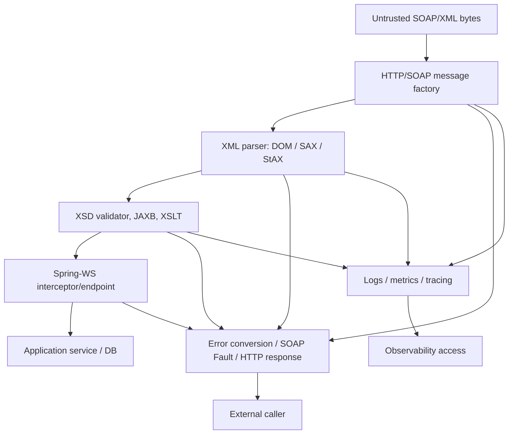
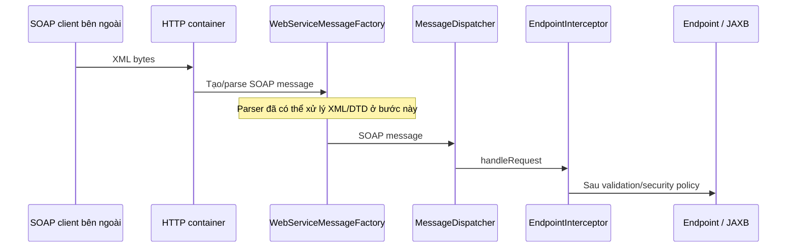
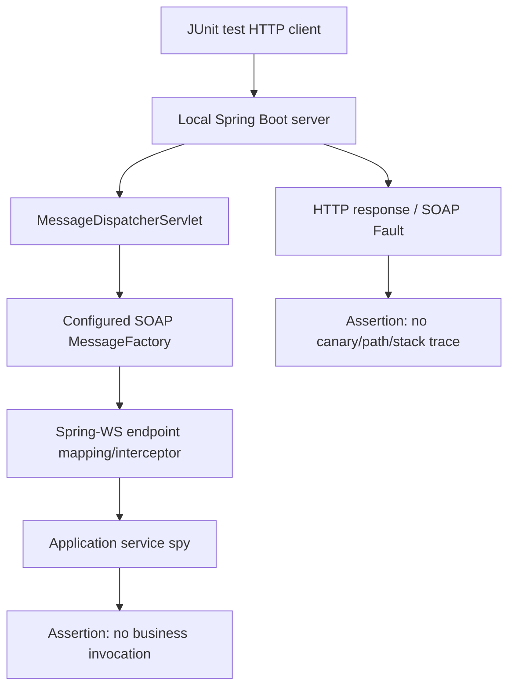
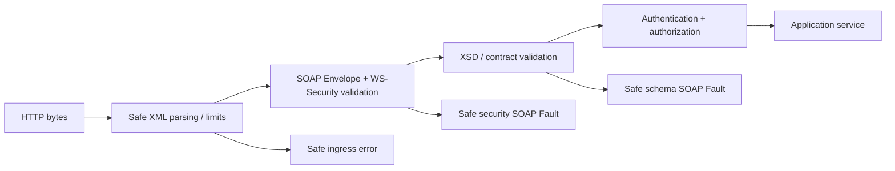
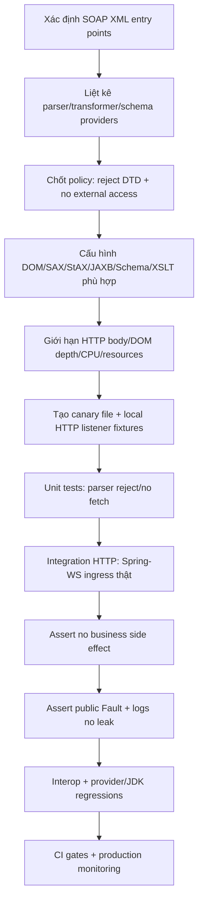

# Kiểm thử parser từ chối dữ liệu nguy hiểm mà không lộ nội dung hệ thống

## 1. Tình huống: SOAP request tưởng là XML hợp lệ nhưng chứa chỉ thị nguy hiểm

Một tổ chức dùng **Spring Web Services (Spring-WS)** để xây dựng dịch vụ SOAP contract-first. XSD định nghĩa operation `SubmitPaymentRequest` và JAXB sinh kiểu Java để endpoint xử lý. Ứng dụng dùng `MessageDispatcherServlet`, message factory, interceptor, JAXB unmarshaller, mapper và application service. Người gửi SOAP có thể là một đối tác được xác thực qua mTLS hoặc WS-Security, nhưng **XML nhận từ phía ngoài vẫn là dữ liệu không tin cậy**.

Đối tác hoặc kẻ tấn công gửi một SOAP Envelope chứa khai báo DTD/entity để buộc parser:

- Đọc một file trên máy chủ và chèn nội dung vào cây XML.
- Gửi một request HTTP tới địa chỉ loopback, metadata service hoặc mạng nội bộ.
- Mở một chuỗi entity lồng nhau khiến CPU/heap tăng bất thường.
- Tải schema, stylesheet hoặc tài nguyên ngoài từ `xsi:schemaLocation`, `xs:import`, `xsl:import` hoặc `document()` khi xử lý XML.
- Tạo XML cực lớn, quá sâu hoặc có quá nhiều thuộc tính khiến server cạn tài nguyên.

Hệ thống có thể chặn request trước khi vào `@Endpoint`; nhưng **chặn request chưa đủ** nếu SOAP Fault, HTTP response hoặc log vô tình để lộ tên file nội bộ, nội dung file, đường dẫn, stack trace hay địa chỉ máy chủ.

Đề mục bài học là **“Kiểm thử parser từ chối dữ liệu nguy hiểm mà không lộ nội dung hệ thống”**, thuộc chương **Bảo vệ xử lý XML** của module **SPRING_WEB_SERVICES**. Phạm vi module là phát triển dịch vụ SOAP contract-first với XSD/WSDL, JAXB, endpoint/client, SOAP Fault, interceptor, XML security, WS-Security, chứng chỉ và kiểm thử tương thích doanh nghiệp.

**Mục tiêu học tập:** người học thiết kế được bộ test chứng minh *cả hai điều kiện*:

1. **Fail closed:** parser từ chối hoặc vô hiệu hóa hành vi XML nguy hiểm, không truy cập tài nguyên ngoài, không tiếp tục thực thi nghiệp vụ.
2. **Không rò rỉ:** response/Fault và log được phép xem không chứa canary, nội dung máy chủ, đường dẫn nội bộ, thông tin hệ điều hành, secret hoặc chi tiết cấu hình.

Đây là bài học về **phòng vệ và cách kiểm chứng phòng vệ**, không phải hướng dẫn khai thác hệ thống. Mọi ví dụ đọc file và request mạng sử dụng **fixture giả, file tạm và loopback trong môi trường test cách ly**; không sử dụng đường dẫn nhạy cảm hay endpoint thật.

## 2. Hai bất biến an ninh phải kiểm tra cùng nhau

Một bài test không nên chỉ viết:

```java
assertThrows(Exception.class, () -> parse(untrustedXml));
```

Vì:

- Exception có thể xảy ra **sau khi parser đã đọc file nội bộ** hoặc gọi HTTP URL.
- Lỗi có thể xuất hiện trong business service, không phải từ lớp xử lý XML.
- Exception message có thể chứa một phần của dữ liệu bị đọc.
- SOAP Fault resolver có thể trả `e.getMessage()` hoặc stack trace ra client.
- Log tập trung có thể lưu raw XML hoặc exception context chứa canary.

### 2.1. Bộ bằng chứng tối thiểu

| Điều cần chứng minh | Quan sát/Assertion |
|---|---|
| Request nguy hiểm không thành công | Parser trả lỗi hợp lệ hoặc từ chối theo security policy |
| Không truy cập tài nguyên bên ngoài | Không có request tới HTTP listener loopback; không đọc file canary |
| Không có side effect | Application service/repository không được gọi; không ghi DB/tệp |
| Response an toàn | HTTP response/SOAP Fault không chứa canary, system path, URL nội bộ, stack trace |
| Log an toàn | Log public/centralized không chứa raw payload hoặc secret; chỉ log metadata đã sanitize |
| Request tốt vẫn hoạt động | XML hợp lệ không có DTD được xử lý thành công |
| Cấu hình không bị tự nới lỏng | Parser/provider không hỗ trợ security property phải gây lỗi cấu hình, không fallback im lặng |

**Tư duy quan trọng:** `parse failure` là một **tín hiệu**, không phải bằng chứng đầy đủ cho việc chống XXE/SSRF. Một negative test tốt kiểm chứng **tác động bên ngoài và vùng dữ liệu có thể quan sát**.

### 2.2. Sơ đồ đường đi của dữ liệu



Mục đích là thấy **nhiều parser và nhiều điểm rò rỉ**: kiểm tra một `DocumentBuilder` tự viết chưa chứng minh message factory Spring-WS hoặc XSLT provider đã an toàn. Tương tự, SOAP Fault có vẻ chung chung nhưng access log, debug log, exception resolver hoặc XML parser callback vẫn có thể để lộ dữ liệu.

## 3. Threat model: XML có thể điều khiển những tài nguyên nào?

### 3.1. XXE và DTD

**XML External Entity (XXE)** xảy ra khi parser cho phép một entity XML tham chiếu tài nguyên ngoài và giải quyết tham chiếu đó. Nguồn ngoài có thể là `file:` hoặc `http(s):` tùy provider và cấu hình. DTD cũng có thể chứa entity lồng nhau dẫn đến **entity expansion denial of service**.

Test phòng vệ:

```xml
<?xml version="1.0" encoding="UTF-8"?>
<!DOCTYPE order [
  <!ENTITY demo SYSTEM "file:///test-only/fixture-canary.txt">
]>
<order>&demo;</order>
```

Đường dẫn là **biểu tượng cho một file test**, không phải nơi tồn tại trong production. Test thực tế tạo tệp bằng `@TempDir` rồi lắp URI tạm đó vào XML. Mục tiêu là chắc chắn **parser không mở file**, không phải cố đọc nội dung nào đó của máy chủ.

### 3.2. SSRF qua external entity hoặc resource resolution

Một XML parser cho phép external fetch có thể bị buộc gửi request tới URL:

```xml
<!DOCTYPE order [
  <!ENTITY remote SYSTEM "http://127.0.0.1:18080/test-only-canary">
]>
<order>&remote;</order>
```

Địa chỉ loopback trong ví dụ chỉ dùng trong test riêng. Hãy dùng một HTTP server cục bộ được test khởi tạo, ghi bộ đếm hit và xác minh **hit count = 0**. Không gửi request tới metadata service, intranet thật hoặc URL công cộng để thử lỗi.

### 3.3. Entity expansion và resource exhaustion

Ngay cả khi không có entity ngoài, một internal DTD có thể định nghĩa nhiều entity tham chiếu nhau:

```xml
<!DOCTYPE r [
  <!ENTITY a "ABCD">
  <!ENTITY b "&a;&a;&a;&a;">
  <!ENTITY c "&b;&b;&b;&b;">
]>
<r>&c;</r>
```

Đây là fixture **kích thước nhỏ, có giới hạn** để test cơ chế từ chối DTD. Không cần tạo hàng triệu cấp nở rộng để kiểm tra bảo mật; những payload rất lớn có thể làm **chính CI hoặc môi trường test** bị thiếu bộ nhớ.

### 3.4. Các đường khác ngoài DTD

| Đường vào | Cơ chế | Nguy cơ |
|---|---|---|
| `xsi:schemaLocation` | Một công cụ xác thực schema có thể dùng thông tin location | Truy cập URL/schema không tin cậy nếu resolver cho phép |
| `xs:import`, `xs:include` | SchemaFactory tải dependency của XSD | SSRF/file read qua schema không được kiểm soát |
| `xsl:import`, `xsl:include` | TransformerFactory tải stylesheet khác | Tham chiếu file/URL ngoài |
| XSLT `document()` | Stylesheet tải XML để xử lý | SSRF và lộ tài nguyên |
| XInclude | DOM parser xử lý `xi:include` | Chèn nội dung file/URL |
| External parameter entities | DTD tải và mở rộng khai báo | XXE/DoS ngoài general entity |
| XML quá sâu/nhiều phần tử | Parser phải duyệt cây và cấp phát | CPU/heap/stack exhaustion |
| XML malformed | Lỗi parser có line/column/context | Fault hoặc log lộ dữ liệu đầu vào |

Không phải tất cả các cú pháp trên được xử lý ở mọi bước. Ví dụ một parser **không bật XInclude** không tự xử lý `xi:include`; và `xsi:schemaLocation` không tự buộc mọi validator tải URL. Điều cần kiểm tra là **provider và đường code cụ thể có quyền truy cập nguồn ngoài hay không**.

## 4. Chính sách parser cơ bản: từ chối DTD, chặn external access, fail closed

Một chuẩn phòng vệ cho dịch vụ SOAP **không có nhu cầu DTD** là:

1. **Disallow DOCTYPE** ở parser phù hợp.
2. Tắt external general entities và external parameter entities.
3. Tắt tải external DTD.
4. Tắt XInclude nếu không sử dụng.
5. Giới hạn truy cập external DTD/Schema/Stylesheet ở JAXP factories.
6. Bật secure processing ở nơi API hỗ trợ, nhưng **không coi đó là cấu hình duy nhất**.
7. Áp dụng giới hạn tài nguyên theo HTTP ingress và XML processing.
8. Nếu provider không hỗ trợ một thiết lập **bắt buộc**, fail application startup hoặc từ chối chế độ xử lý thay vì chạy không an toàn.

### 4.1. Cảnh báo quan trọng về provider

JAXP là API; cách hỗ trợ các flags có thể khác theo JDK, parser provider và phiên bản. Các URI feature như:

```text
http://apache.org/xml/features/disallow-doctype-decl
http://xml.org/sax/features/external-general-entities
http://xml.org/sax/features/external-parameter-entities
http://apache.org/xml/features/nonvalidating/load-external-dtd
```

có phạm vi hỗ trợ theo implementation. **Không catch `ParserConfigurationException` rồi bỏ qua, vì khi đó parser có thể đang chạy với cấu hình nguy hiểm.** Kể cả nếu các flags được thiết lập thành công, vẫn phải có negative tests trên **runtime thực dùng ở production**.

## 5. Tạo DOM parser phòng vệ có thể kiểm thử

Một ứng dụng tự đọc XML trực tiếp bằng DOM có thể đóng gói parser configuration vào **một factory dùng chung**. Đừng rải rác từng `DocumentBuilderFactory.newInstance()` trong codebase.

### 5.1. Factory phòng vệ

```java
package com.example.soap.security;

import java.io.IOException;
import javax.xml.XMLConstants;
import javax.xml.parsers.DocumentBuilder;
import javax.xml.parsers.DocumentBuilderFactory;
import javax.xml.parsers.ParserConfigurationException;
import org.xml.sax.SAXException;

public final class SecureDomFactory {
    private SecureDomFactory() {
    }

    public static DocumentBuilder newBuilder()
            throws ParserConfigurationException {
        DocumentBuilderFactory factory =
                DocumentBuilderFactory.newInstance();

        factory.setNamespaceAware(true);
        factory.setValidating(false);
        factory.setXIncludeAware(false);
        factory.setExpandEntityReferences(false);

        // Reject mọi DOCTYPE, bao gồm internal DTD.
        factory.setFeature(
                "http://apache.org/xml/features/disallow-doctype-decl",
                true);

        // Defense in depth nếu provider xử lý entity theo cách khác.
        factory.setFeature(
                "http://xml.org/sax/features/external-general-entities",
                false);
        factory.setFeature(
                "http://xml.org/sax/features/external-parameter-entities",
                false);
        factory.setFeature(
                "http://apache.org/xml/features/nonvalidating/load-external-dtd",
                false);

        factory.setFeature(XMLConstants.FEATURE_SECURE_PROCESSING, true);
        factory.setAttribute(XMLConstants.ACCESS_EXTERNAL_DTD, "");
        factory.setAttribute(XMLConstants.ACCESS_EXTERNAL_SCHEMA, "");

        DocumentBuilder builder = factory.newDocumentBuilder();
        builder.setEntityResolver((publicId, systemId) -> {
            // Nếu code vô tình tới resolver, không mở tài nguyên ngoài.
            throw new SAXException("External XML resource forbidden");
        });
        return builder;
    }
}
```

**Cách dùng:**

```java
import java.io.InputStream;
import org.w3c.dom.Document;

public Document parseDocument(InputStream xml) throws Exception {
    return SecureDomFactory.newBuilder().parse(xml);
}
```

Điểm thiết kế:

- `setNamespaceAware(true)` giúp so QName của SOAP/XML đúng namespace.
- `setValidating(false)` không phải biện pháp an ninh duy nhất; schema validation nếu cần được tổ chức riêng với `SchemaFactory` đã khóa external access.
- `setXIncludeAware(false)` ngăn parser xử lý XInclude ở đường DOM này nếu provider hỗ trợ thiết lập.
- `setExpandEntityReferences(false)` chỉ là defense in depth; **không** thay `disallow-doctype-decl`.
- `ACCESS_EXTERNAL_DTD/SCHEMA = ""` không cho phép các protocol external theo chính sách JAXP tương ứng.
- `EntityResolver` từ chối mọi nỗ lực resolve mà không mở file/network.
- Mỗi lần gọi tạo `DocumentBuilder` riêng. Không chia sẻ `DocumentBuilder` mutable giữa các thread.

Nếu provider ném lỗi khi đặt feature/attribute hoặc không hỗ trợ XInclude setting, cần **fail closed** hoặc chọn provider phù hợp; không biến lỗi cấu hình thành một log warning rồi tiếp tục parse.

### 5.2. Khi nào từ chối DOCTYPE có thể không phù hợp?

Một hệ thống legacy có DTD hợp lệ có thể cần internal entities. Khi thật sự bắt buộc hỗ trợ, phải thiết kế policy khác: cho phép internal subset **có giới hạn nghiêm ngặt**, khóa external resolution, giới hạn entity expansion và test bằng provider thực tế.

Nhưng đối với dịch vụ SOAP contract-first dùng XSD/JAXB thông thường, **không chấp nhận DTD** là baseline đơn giản, dễ chứng minh và an toàn hơn. Không mở DTD chỉ vì một client gửi XML sai chuẩn yêu cầu.

## 6. JUnit 5: chứng minh parser từ chối XXE file mà không đọc canary

Test sử dụng `@TempDir` tạo file tạm chứa dữ liệu **giả**. Đây là cách an toàn để kiểm tra “không đọc file nội bộ”: không động đến file cấu hình thật của môi trường.

### 6.1. Fixture file canary

```java
package com.example.soap.security;

import static org.junit.jupiter.api.Assertions.assertThrows;
import static org.junit.jupiter.api.Assertions.assertTrue;

import java.nio.file.Files;
import java.nio.file.Path;
import org.junit.jupiter.api.Test;
import org.junit.jupiter.api.io.TempDir;
import org.xml.sax.SAXException;

class SecureDomFactoryTest {
    private static final String CANARY =
            "TEST_ONLY_CANARY_DO_NOT_EXPOSE_7C91";

    @TempDir
    Path tempDir;

    @Test
    void rejectsExternalFileEntityWithoutExposingCanary()
            throws Exception {
        Path fixture = tempDir.resolve("canary.xml.txt");
        Files.writeString(fixture, CANARY);

        String xml = """
            <?xml version="1.0"?>
            <!DOCTYPE root [
              <!ENTITY secret SYSTEM "%s">
            ]>
            <root>&secret;</root>
            """.formatted(fixture.toUri());

        SAXException error = assertThrows(
                SAXException.class,
                () -> SecureDomFactory.newBuilder().parse(
                        new org.xml.sax.InputSource(
                                new java.io.StringReader(xml))));

        // Dấu hiệu bổ sung; KHÔNG chỉ dựa vào exception text.
        assertTrue(error.getClass().getSimpleName().contains("Exception"));
    }
}
```

Test cho thấy **DOCTYPE bị từ chối** và parser không trả `Document` thành công. Tuy nhiên nó **chưa đo trực tiếp việc file có bị truy cập không**: file tồn tại và nội dung không đổi không thể chứng minh không có read. Đó là lý do cần **EntityResolver spy**, HTTP listener canary hoặc cơ chế quan sát sandbox/OS khi threat model yêu cầu chứng minh chặt chẽ.

### 6.2. Test không nên làm gì?

Đừng viết:

```java
// Sai mục tiêu kiểm thử:
assertTrue(error.getMessage().contains(CANARY));
```

Vì như vậy bạn đang chấp nhận **canary xuất hiện trong lỗi**, trái với điều kiện không rò rỉ. Cũng đừng in raw exception ra console CI rồi mới assert nó không có mặt trong HTTP response; CI log đã là một bề mặt rò rỉ.

Đúng hơn, dùng marker test riêng và kiểm tra:

- Parser từ chối input.
- Application boundary chuyển lỗi thành **một mã lỗi chung** an toàn.
- SOAP Fault và log quan sát được **không chứa marker, đường dẫn file hoặc URI nội bộ**.
- Không có lời gọi application service sau khi parser từ chối.

## 7. SAX parser: đảm bảo handler không thấy dữ liệu từ external entities

SAX xử lý XML theo sự kiện. Nó có thể được dùng bởi code xử lý XML lớn, JAXP `SAXSource` hoặc các thư viện phía sau JAXB. Bởi vậy cần cấu hình **SAXParserFactory/XMLReader** riêng nếu ứng dụng sử dụng SAX.

### 7.1. Cấu hình SAX phòng vệ

```java
package com.example.soap.security;

import javax.xml.XMLConstants;
import javax.xml.parsers.ParserConfigurationException;
import javax.xml.parsers.SAXParserFactory;
import org.xml.sax.SAXException;
import org.xml.sax.XMLReader;

public final class SecureSaxFactory {
    private SecureSaxFactory() {
    }

    public static XMLReader newReader()
            throws ParserConfigurationException, SAXException {

        SAXParserFactory factory = SAXParserFactory.newInstance();
        factory.setNamespaceAware(true);
        factory.setValidating(false);
        factory.setXIncludeAware(false);
        factory.setFeature(
                "http://apache.org/xml/features/disallow-doctype-decl",
                true);
        factory.setFeature(
                "http://xml.org/sax/features/external-general-entities",
                false);
        factory.setFeature(
                "http://xml.org/sax/features/external-parameter-entities",
                false);
        factory.setFeature(
                "http://apache.org/xml/features/nonvalidating/load-external-dtd",
                false);
        factory.setFeature(XMLConstants.FEATURE_SECURE_PROCESSING, true);

        XMLReader reader = factory.newSAXParser().getXMLReader();
        reader.setProperty(XMLConstants.ACCESS_EXTERNAL_DTD, "");
        reader.setProperty(XMLConstants.ACCESS_EXTERNAL_SCHEMA, "");
        reader.setEntityResolver((publicId, systemId) -> {
            throw new SAXException("External XML resource forbidden");
        });
        return reader;
    }
}
```

Các provider có thể không hỗ trợ một property trên `XMLReader`, dù `SAXParserFactory` chấp nhận các feature khác. Nếu property chặn external access được coi là bắt buộc, lỗi `SAXNotRecognizedException` hoặc `SAXNotSupportedException` phải khiến cấu hình **thất bại có chủ đích**, không bị bỏ qua.

### 7.2. Test SAX bằng ContentHandler spy

```java
import static org.junit.jupiter.api.Assertions.assertEquals;
import static org.junit.jupiter.api.Assertions.assertThrows;

import java.io.StringReader;
import java.util.concurrent.atomic.AtomicInteger;
import org.junit.jupiter.api.Test;
import org.xml.sax.InputSource;
import org.xml.sax.SAXException;
import org.xml.sax.helpers.DefaultHandler;

@Test
void saxRejectsDtdBeforeBusinessEvents() throws Exception {
    String xml = """
        <!DOCTYPE r [<!ENTITY e "test">]>
        <r>&e;</r>
        """;

    AtomicInteger businessElements = new AtomicInteger();
    var reader = SecureSaxFactory.newReader();
    reader.setContentHandler(new DefaultHandler() {
        @Override
        public void startElement(
                String uri, String localName,
                String qName, org.xml.sax.Attributes attributes) {
            businessElements.incrementAndGet();
        }
    });

    assertThrows(
            SAXException.class,
            () -> reader.parse(new InputSource(new StringReader(xml))));
    assertEquals(0, businessElements.get());
}
```

Test bảo đảm SAX reader từ chối DTD trước khi đưa element tới content handler. Trong codebase thật, “không có business side effect” nên được kiểm tra ở ranh giới application service/repository nữa, vì content handler không nhất thiết là điểm phát sinh side effect cuối cùng.

## 8. StAX parser: tắt DTD/external entities và thử hành vi thực tế

StAX (Streaming API for XML) là cơ chế pull parser, thường dùng trong code xử lý XML stream hoặc trong một số SOAP/JAXB pipelines. Các property quan trọng của `XMLInputFactory` gồm:

- `XMLInputFactory.SUPPORT_DTD`: điều khiển xử lý DTD.
- `XMLInputFactory.IS_SUPPORTING_EXTERNAL_ENTITIES`: điều khiển khả năng resolve external entities.
- `XMLConstants.ACCESS_EXTERNAL_DTD`: giới hạn protocol external DTD theo JAXP khi provider hỗ trợ.
- `XMLResolver`: điều khiển quá trình resolve resource ngoài.

### 8.1. Factory StAX phòng vệ

```java
package com.example.soap.security;

import javax.xml.XMLConstants;
import javax.xml.stream.XMLInputFactory;
import javax.xml.stream.XMLStreamException;

public final class SecureStaxFactory {
    private SecureStaxFactory() {
    }

    public static XMLInputFactory newFactory() {
        XMLInputFactory factory = XMLInputFactory.newFactory();

        factory.setProperty(XMLInputFactory.SUPPORT_DTD, false);
        factory.setProperty(
                XMLInputFactory.IS_SUPPORTING_EXTERNAL_ENTITIES, false);
        factory.setProperty(XMLConstants.ACCESS_EXTERNAL_DTD, "");

        factory.setXMLResolver(
                (publicId, systemId, baseUri, namespace) -> {
                    throw new XMLStreamException(
                            "External XML resource forbidden");
                });

        return factory;
    }
}
```

**Khác biệt cần test:** tắt `SUPPORT_DTD` có thể làm provider **không xử lý** DTD, nhưng không nhất thiết khiến mọi provider **ném exception** khi thấy `<!DOCTYPE ...>`. Nếu chính sách nghiệp vụ **bắt buộc từ chối mọi DOCTYPE**, cần chứng minh provider làm được điều đó hoặc đặt một lớp kiểm tra XML đáng tin cậy trước StAX. Không dùng regex tùy tiện tìm chuỗi `<!DOCTYPE` như một giải pháp parsing bảo mật toàn diện, vì encoding/định dạng XML có thể khác.

### 8.2. Đọc stream, đóng resource và kiểm tra sự kiện

```java
import java.io.InputStream;
import javax.xml.stream.XMLStreamConstants;
import javax.xml.stream.XMLStreamException;
import javax.xml.stream.XMLStreamReader;

public void inspectXmlStream(InputStream input)
        throws XMLStreamException {
    XMLStreamReader reader =
            SecureStaxFactory.newFactory().createXMLStreamReader(input);
    try {
        while (reader.hasNext()) {
            int event = reader.next();
            if (event == XMLStreamConstants.DTD) {
                throw new XMLStreamException(
                        "DTD not permitted by XML policy");
            }
            // Chỉ xử lý element/text sau khi pass security policy.
        }
    } finally {
        reader.close();
    }
}
```

`XMLStreamReader.close()` giải phóng resource của parser nhưng **không bảo đảm luôn đóng InputStream do caller sở hữu**. Bên mở input stream cần quản lý ownership bằng `try-with-resources` hoặc contract rõ ràng.

**Điểm then chốt:** test StAX phải kiểm tra không external fetch và không có text canary trong output; nếu yêu cầu strict rejection thì test phải **fail** trên provider chỉ bỏ qua DTD mà không báo lỗi. Provider/version thay đổi có thể làm behavior khác, vì vậy cần giữ negative tests trong CI.

## 9. JAXB unmarshalling: an toàn phụ thuộc XML parser thực được sử dụng

JAXB chuyển XML thành object Java, nhưng **JAXB không phải firewall chống XXE**. Nhiều overload có thể nhận `File`, `InputStream`, `Reader`, `Source`, `Node` hoặc `XMLStreamReader`. Nếu provider tự tạo parser từ một stream chưa kiểm soát, security settings của `DocumentBuilderFactory` ở class khác **không tự áp dụng**.

### 9.1. Dùng `SAXSource` từ `XMLReader` đã khóa

Với project dùng JAXB trực tiếp:

```java
import jakarta.xml.bind.JAXBContext;
import jakarta.xml.bind.Unmarshaller;
import javax.xml.transform.sax.SAXSource;
import org.xml.sax.InputSource;
import org.xml.sax.XMLReader;
import java.io.InputStream;

public OrderPayload unmarshalOrder(InputStream xml) throws Exception {
    XMLReader secureReader = SecureSaxFactory.newReader();
    SAXSource source =
            new SAXSource(secureReader, new InputSource(xml));

    JAXBContext context = JAXBContext.newInstance(OrderPayload.class);
    Unmarshaller unmarshaller = context.createUnmarshaller();
    return (OrderPayload) unmarshaller.unmarshal(source);
}
```

`OrderPayload` là JAXB-bound class minh họa của dự án. Nếu generator tạo `JAXBElement<OrderPayload>`, cần xử lý root wrapper đúng và kiểm tra QName. Không sửa generated classes để lách schema.

Điểm quan trọng là `SAXSource` được cấp **reader đã cấu hình**, thay vì truyền thẳng một URL hoặc stream cho JAXB và hy vọng provider sẽ tự tắt external entities. Vẫn phải giữ giới hạn kích thước XML và schema validation ở lớp thích hợp.

### 9.2. `Jaxb2Marshaller` của Spring không đồng nghĩa parser DOM tự viết

Trong Spring-WS client/endpoint:

```java
import org.springframework.oxm.jaxb.Jaxb2Marshaller;

Jaxb2Marshaller marshaller = new Jaxb2Marshaller();
marshaller.setContextPath(
        "com.example.soap.generated.v1");
```

Bean này xử lý JAXB binding, nhưng behavior parser còn phụ thuộc **XML Source**, SOAP message factory, JAXB provider và Spring OXM version. Một test gọi `SecureDomFactory.newBuilder()` **không bao phủ** đường `MessageDispatcherServlet → SAAJ → JAXB`.

Cần kiểm thử request thực với message factory/endpoint của ứng dụng, bao gồm trường hợp parser **từ chối trước khi method endpoint được gọi**.

### 9.3. JAXB validation và an ninh là hai bài toán khác nhau

`ValidationEventHandler` hoặc XSD schema giúp phát hiện giá trị vi phạm schema; nó không thay cơ chế chặn external DTD và giới hạn tài nguyên.

Ví dụ `orderId` vi phạm `xs:pattern` sẽ là **lỗi dữ liệu**. Một request chứa `<!DOCTYPE ...>` và external entity phải bị từ chối vì **chính sách parser**, bất kể sau expansion dữ liệu có tình cờ khớp XSD hay không.

## 10. SchemaFactory: chặn tải XSD/DTD ngoài qua import/include

Một ứng dụng contract-first thường compile XSD rồi dùng để validate SOAP payload. Nhưng `SchemaFactory` có thể phải đọc:

- `xs:include` để ghép nhiều schema.
- `xs:import` để dùng namespace khác.
- DTD external nếu cấu hình không an toàn.

Khi schema hoặc `schemaLocation` bị ảnh hưởng bởi dữ liệu không tin cậy, đây là một bề mặt tải resource ngoài.

### 10.1. Compile XSD với external access bị khóa

```java
package com.example.soap.security;

import javax.xml.XMLConstants;
import javax.xml.validation.Schema;
import javax.xml.validation.SchemaFactory;
import javax.xml.transform.stream.StreamSource;
import java.io.InputStream;

public final class SafeSchemaCompiler {
    private SafeSchemaCompiler() {
    }

    public static Schema compileBundledSchema(InputStream trustedXsd)
            throws Exception {
        SchemaFactory factory = SchemaFactory.newInstance(
                XMLConstants.W3C_XML_SCHEMA_NS_URI);

        factory.setFeature(
                XMLConstants.FEATURE_SECURE_PROCESSING, true);
        factory.setProperty(XMLConstants.ACCESS_EXTERNAL_DTD, "");
        factory.setProperty(XMLConstants.ACCESS_EXTERNAL_SCHEMA, "");

        return factory.newSchema(new StreamSource(trustedXsd));
    }
}
```

Đoạn code chỉ compile được schema **tự chứa** hoặc không cần external imports. Với schema contract-first gồm nhiều XSD:

- Đóng gói các file được phê duyệt trong classpath.
- Dùng `LSResourceResolver`/catalog resolve **chỉ** tài nguyên đã allowlist.
- Không để `xs:import schemaLocation="http://..."` tải trực tiếp tài nguyên mạng ở runtime.
- Kiểm tra không có path traversal, redirect hoặc external schema bất ngờ.
- Nếu schema không tìm thấy dependency được phê duyệt, fail startup thay vì tải một URL dự phòng.

**Đừng mở `ACCESS_EXTERNAL_SCHEMA="all"` chỉ vì một `xs:include` đang lỗi.** Cần sửa resource resolution thay vì gỡ toàn bộ kiểm soát an ninh.

### 10.2. Test schema external import

Fixture XSD:

```xml
<?xml version="1.0" encoding="UTF-8"?>
<xs:schema xmlns:xs="http://www.w3.org/2001/XMLSchema">
  <xs:include schemaLocation="http://127.0.0.1:18080/test-only.xsd"/>
</xs:schema>
```

Trong test, URL được thay bằng **listener loopback ngẫu nhiên** do harness quản lý; `SchemaFactory` phải từ chối hoặc không tải URL đó. Quan sát `hitCount == 0` và compiler không trả về schema hoàn chỉnh nếu dependency bắt buộc không được resolve.

Một XSD chứa import có thể không được tải nếu provider lười resolve hoặc rơi vào nhánh khác; test phải bảo đảm đường code đang thực sự cố resolve khi không có policy chặn. Không chỉ assert một exception bất kỳ.

## 11. TransformerFactory/XSLT: khóa `document()` và stylesheet imports

Trong Spring-WS, `PayloadTransformingInterceptor` có thể sử dụng XSLT để chuyển payload theo contract version. Nhưng stylesheet cũng là một ngôn ngữ có khả năng tham chiếu tài nguyên ngoài:

- `xsl:include` và `xsl:import` trong thời gian compile.
- `document()` khi thực thi transform.
- Extension functions hoặc URI resolver tùy provider.

Một rule an toàn: **stylesheet là artifact đã review, được version hóa**; không nhận XSLT trực tiếp từ SOAP request.

### 11.1. Compiler XSLT có rào chắn

```java
package com.example.soap.security;

import javax.xml.XMLConstants;
import javax.xml.transform.Templates;
import javax.xml.transform.TransformerFactory;
import javax.xml.transform.TransformerException;
import javax.xml.transform.stream.StreamSource;
import java.io.InputStream;

public final class SafeXsltCompiler {
    private SafeXsltCompiler() {
    }

    public static Templates compile(InputStream approvedStylesheet)
            throws Exception {
        TransformerFactory factory = TransformerFactory.newInstance();

        factory.setFeature(
                XMLConstants.FEATURE_SECURE_PROCESSING, true);
        factory.setAttribute(XMLConstants.ACCESS_EXTERNAL_DTD, "");
        factory.setAttribute(
                XMLConstants.ACCESS_EXTERNAL_STYLESHEET, "");
        factory.setURIResolver((href, base) -> {
            throw new TransformerException(
                    "External stylesheet/XML reference forbidden");
        });

        return factory.newTemplates(
                new StreamSource(approvedStylesheet));
    }
}
```

Với nhiều stylesheet có imports hợp lệ, dùng resolver **allowlist classpath** riêng. Việc cho phép import cần dựa trên định danh artifact, không cho phép client lựa chọn URL.

**Không nhầm:** tạo `SafeXsltCompiler` trong ứng dụng **không tự cấu hình `TransformerFactory` nội bộ** mà Spring-WS `PayloadTransformingInterceptor` đang sử dụng. Phải kiểm tra cách interceptor tạo transformer trong **phiên bản Spring-WS hiện có**, cấu hình factory phù hợp hoặc xây adapter được kiểm soát, rồi kiểm thử chính đường xử lý đó.

### 11.2. Test `document()` bằng URL chỉ tồn tại trong test

```xml
<xsl:stylesheet version="1.0"
    xmlns:xsl="http://www.w3.org/1999/XSL/Transform">
  <xsl:template match="/">
    <result>
      <xsl:value-of
          select="document('http://127.0.0.1:18080/test-only.xml')/r"/>
    </result>
  </xsl:template>
</xsl:stylesheet>
```

Đây là stylesheet **negative fixture**, không dùng trong production. Test phải chứng minh:

1. Factory/transformer từ chối external document.
2. Không có request đến HTTP listener loopback.
3. Response hay exception gửi ra caller không chứa URL nội bộ hoặc một phần tài liệu.
4. CPU và số resource mở nằm trong giới hạn của test.

Nếu cần XSLT 2.0/3.0 với provider như Saxon, xem policy external resource và extension functions **của provider đó**, không giả định mọi JAXP feature áp dụng như nhau.

## 12. SOAP message factory: nơi XML có thể bị parse trước interceptor

Một lỗi kiến trúc rất phổ biến: nhóm viết `PayloadValidatingInterceptor` và nghĩ request độc hại sẽ bị chặn trước mọi hành vi nguy hiểm.

Nhưng một flow Spring-WS điển hình:



Nếu `SaajSoapMessageFactory`/SAAJ provider đã parse XML **trước khi** interceptor chạy, thì tắt DTD trong một `DocumentBuilder` của endpoint **không bảo vệ ingress**.

### 12.1. Cần kiểm tra trên đường production thật

| Vị trí | Cần xác minh |
|---|---|
| Reverse proxy/API gateway | Giới hạn body size, timeout, Content-Type, multipart |
| Servlet container | Request size/stream handling, connection timeout |
| `SaajSoapMessageFactory` / SAAJ provider | DTD/XXE/external resolution, message size, MIME behavior |
| `AxiomSoapMessageFactory` nếu được dùng | Parser và streaming/caching semantics, external access policy |
| `MessageDispatcherServlet` | Behavior khi parse lỗi trước endpoint mapping |
| `EndpointInterceptor` | Validation sau khi message đã được tạo |
| JAXB unmarshaller | Source/parser thực đang sử dụng |
| XSD validator/XSLT | External resource access và limits riêng |
| SOAP Fault resolver | Thông điệp lỗi an toàn |

Một `MockWebServiceClient` test tạo SOAP payload bằng `StringSource` có thể **không đi qua HTTP ingress parser giống production**. Vì vậy cần **local HTTP integration test** với đúng message factory/servlet của ứng dụng và XML bytes được gửi như request thật.

### 12.2. Hướng triển khai phòng vệ khi framework tự tạo parser

1. Chọn phiên bản Spring-WS, SAAJ/JAXB/AXIOM được hỗ trợ và cập nhật bản vá bảo mật.
2. Kiểm tra các cấu hình/hardening mà chính provider cho phép.
3. Không dựa vào global JAXP properties nếu provider không sử dụng chúng, và không coi một unit test parser riêng là đủ.
4. Nếu provider không thể chặn hành vi nguy hiểm theo policy, thay provider/phiên bản hoặc đặt parser/bộ lọc đáng tin ở ingress trước khi request đến code.
5. Kiểm thử **HTTP bytes qua đường production-like** để chứng minh kết quả, không chỉ kiểm tra config object.

**Không có một flag “bật an toàn XML cho toàn bộ Spring-WS” áp dụng cho mọi parser, marshaller, schema và XSLT provider.** Phòng vệ cần bao phủ toàn chuỗi.

## 13. Giới hạn tài nguyên: XXE bị chặn nhưng XML vẫn có thể gây DoS

Tắt external entities là cần thiết nhưng **không đủ** để ngăn cạn tài nguyên:

- Một SOAP Body dài hàng trăm megabyte có thể tạo áp lực heap.
- XML sâu hàng nghìn cấp có thể làm parser hoặc validator tốn stack/CPU.
- Các text nodes cực dài gây buffer allocation.
- Số lượng attributes/namespaces quá lớn có thể tốn CPU hoặc heap.
- Chuỗi XML hợp lệ về cú pháp nhưng sai XSD có thể yêu cầu nhiều lượt xử lý vô ích.
- SOAP attachments/MIME parts quá nhiều làm cạn storage/file descriptor.
- XSLT hoặc XPath phức tạp có thể tiêu tốn CPU dù không truy cập file/network.

### 13.1. Phân lớp giới hạn

| Lớp | Cần giới hạn | Lý do |
|---|---|---|
| Reverse proxy/API gateway | HTTP request body bytes, headers, timeout | Từ chối sớm trước khi SOAP parser nhận dữ liệu |
| Servlet container | Request size, connection timeout, concurrency | Tránh chiếm hết worker threads |
| SOAP message factory | XML depth/MIME size theo provider | SAAJ/AXIOM có behavior khác nhau |
| JAXP/XML parser | Entity expansion, element depth, attribute count | Chặn payload gây DoS ở tầng XML |
| XSD validator | Schema imports, recursion/complexity, timeout | Không cho kiểm tra schema trở thành tác vụ vô hạn |
| XSLT processor | External document, compute complexity, output size | Giảm SSRF/CPU exhaustion |
| Application | Domain limits theo `xs:maxOccurs`, string length | Bảo vệ business resources |
| Storage và SOAP attachments | File count/size, disk quota | Không bị lấp đầy disk/quarantine |

Các JVM/provider có thể hỗ trợ system properties như `jdk.xml.entityExpansionLimit`, `jdk.xml.totalEntitySizeLimit` và `jdk.xml.maxElementDepth`. Chúng không thay thế ingress limits; tên/semantics/phạm vi hỗ trợ phải đối chiếu với **JDK và XML provider thực chạy**. Không đưa một cấu hình giới hạn đã được đặt ở DOM parser rồi mặc định nghĩ SAAJ hoặc XSLT provider cũng áp dụng nó.

### 13.2. Vì sao không chỉ giới hạn sau khi parse?

Ví dụ chống pattern sai:

```java
// SAI nếu bytes đã được parser nạp hết vào DOM.
Document doc = parseSoapXml(untrustedInput);
if (doc.getDocumentElement().getTextContent().length() > 1_000_000) {
    throw new IllegalArgumentException("Too large");
}
```

Tới thời điểm kiểm tra độ dài text, parser có thể đã dùng nhiều bộ nhớ để xây DOM và entity expansion. Phải giới hạn **trước khi parse** hoặc ngay ở một input stream có giới hạn, kết hợp ingress HTTP limits.

### 13.3. Ví dụ byte-budget wrapper cho stream được sở hữu bởi ứng dụng

```java
package com.example.soap.security;

import java.io.FilterInputStream;
import java.io.IOException;
import java.io.InputStream;

public final class LimitedXmlInputStream extends FilterInputStream {
    private final long limit;
    private long consumed;

    public LimitedXmlInputStream(InputStream input, long limit) {
        super(input);
        if (limit <= 0) {
            throw new IllegalArgumentException("XML limit must be positive");
        }
        this.limit = limit;
    }

    @Override
    public int read() throws IOException {
        if (consumed == limit) {
            if (super.read() != -1) {
                throw new IOException("XML exceeds byte limit");
            }
            return -1;
        }
        int value = super.read();
        if (value != -1) {
            consumed++;
        }
        return value;
    }

    @Override
    public int read(byte[] buffer, int off, int len)
            throws IOException {
        java.util.Objects.checkFromIndexSize(off, len, buffer.length);
        if (len == 0) {
            return 0;
        }
        if (consumed == limit) {
            if (super.read() != -1) {
                throw new IOException("XML exceeds byte limit");
            }
            return -1;
        }
        int allowed = (int) Math.min((long) len, limit - consumed);
        int read = super.read(buffer, off, allowed);
        if (read > 0) {
            consumed += read;
        }
        return read;
    }

    @Override
    public long skip(long n) throws IOException {
        // Không cho phép consumer lách bộ đếm qua InputStream.skip().
        if (n > 0) {
            throw new IOException("Skipping XML bytes is forbidden");
        }
        return 0;
    }

    @Override
    public boolean markSupported() {
        return false;
    }

    @Override
    public void mark(int readlimit) {
        // Không cho phép đánh dấu để tua lại và đọc vượt ngân sách.
    }

    @Override
    public void reset() throws IOException {
        throw new IOException("Reset is not supported");
    }
}
```

**Đây là wrapper minh họa** dành cho đường code sở hữu `InputStream` trước khi parse. Bản trên cố tình **từ chối `skip` dương và `reset`** để không có đường đọc nào vượt bộ đếm. Nếu một parser yêu cầu skip hoặc mark/reset, hãy thay bằng implementation budget-aware có kiểm thử đầy đủ, không nới lỏng policy bằng cách dùng `FilterInputStream` mặc định. Bộ đếm này giới hạn **bytes** chứ không giới hạn XML element depth, entity expansion hoặc thời gian CPU.

**Điểm quan trọng hơn:** nếu SOAP request đã đi qua `SaajSoapMessageFactory` và được buffer vào heap **trước khi bạn tạo wrapper**, wrapper này quá muộn. HTTP/proxy ingress limits và message factory settings mới là hàng phòng vệ đầu tiên.

### 13.4. Test limits không được phá CI

Thay vì gửi XML 2 GiB, tạo một stream test **đếm byte** và cấu hình giới hạn 256 B rồi gửi 257 B. Test phải xác minh:

- Input vượt budget bị từ chối.
- Không có business side effect.
- Không có raw payload bị ghi vào Fault/log.
- Có cleanup stream/tệp tạm.
- Trong production-like test, HTTP server có thể từ chối sớm bằng 413 nếu policy đặt ở proxy/container.

Một test dùng cực nhiều dữ liệu để “kiểm tra DoS” có thể làm CI runner OOM; đó không phải cách kiểm thử an toàn.

## 14. Canary HTTP listener: chứng minh parser không gọi URL loopback

Để quan sát **external fetch** một cách trực tiếp, có thể dựng một HTTP listener trong test bằng `com.sun.net.httpserver.HttpServer`. Dùng **port ngẫu nhiên** thay vì port cố định để không xung đột với CI.

### 14.1. Negative test có bộ đếm request

```java
package com.example.soap.security;

import static org.junit.jupiter.api.Assertions.assertEquals;
import static org.junit.jupiter.api.Assertions.assertThrows;

import com.sun.net.httpserver.HttpServer;
import java.io.StringReader;
import java.net.InetSocketAddress;
import java.util.concurrent.atomic.AtomicInteger;
import org.junit.jupiter.api.Test;
import org.xml.sax.InputSource;
import org.xml.sax.SAXException;

class ExternalXmlFetchTest {

    @Test
    void parserRejectsDtdWithoutContactingLoopback()
            throws Exception {

        AtomicInteger requests = new AtomicInteger();
        HttpServer server = HttpServer.create(
                new InetSocketAddress("127.0.0.1", 0), 0);
        server.createContext("/canary", exchange -> {
            requests.incrementAndGet();
            try {
                byte[] body = "TEST_ONLY_REMOTE_CANARY"
                        .getBytes(java.nio.charset.StandardCharsets.UTF_8);
                exchange.sendResponseHeaders(200, body.length);
                try (var output = exchange.getResponseBody()) {
                    output.write(body);
                }
            } finally {
                exchange.close();
            }
        });
        server.start();

        try {
            String uri = "http://127.0.0.1:"
                    + server.getAddress().getPort()
                    + "/canary";
            String xml = """
                <!DOCTYPE root [
                  <!ENTITY remote SYSTEM "%s">
                ]>
                <root>&remote;</root>
                """.formatted(uri);

            var parser = SecureDomFactory.newBuilder();
            assertThrows(
                    SAXException.class,
                    () -> parser.parse(
                            new InputSource(new StringReader(xml))));
            assertEquals(0, requests.get(),
                    "XML parser attempted external HTTP fetch");
        } finally {
            server.stop(0);
        }
    }
}
```

Test dùng loopback do **chính fixture tạo**; nó không cố kết nối dịch vụ nội bộ nào khác. `0` ở request counter là bằng chứng phù hợp cho đường HTTP listener này.

### 14.2. Giới hạn của bộ đếm

- Nó chỉ quan sát **một URL đã được đăng ký**, không chứng minh mọi đường egress đều bị chặn.
- Nếu provider bất đồng bộ fetch trễ, cần đồng bộ quá trình test/đóng server và theo dõi trong cửa sổ quan sát phù hợp; với parser DOM đồng bộ đã throw trước khi resolve, counter thường ổn.
- Nếu request DNS/HTTP bị chặn ở network layer trước listener, `hitCount = 0` chưa chứng minh parser đã chủ động từ chối external access. Kết hợp parser assertions và provider configuration test.
- Để kiểm tra file-read không có side effects, có thể kết hợp EntityResolver spy và sandbox instrumentation. Đừng dựa vào việc file không đổi để suy ra nó chưa bị đọc.

### 14.3. Không thử bằng file thật của máy

Không cần đọc `/etc/passwd`, credential stores, key files hoặc metadata cloud để kiểm chứng XXE. Test dùng:

```text
@TempDir/canary.txt
TEST_ONLY_CANARY_DO_NOT_EXPOSE_7C91
```

Nội dung giả đủ giúp phát hiện rò rỉ nếu test setup lỗi. Mục tiêu là **bảo vệ production**, không tạo một test có rủi ro lấy thông tin nhạy cảm từ chính CI agent.

## 15. Từ exception parser sang SOAP Fault: an toàn nhưng vẫn hữu ích

Khi parser từ chối XML, bên gửi SOAP cần nhận một response có ý nghĩa **mà không được biết chi tiết nội bộ**.

### 15.1. Phân biệt các nhóm lỗi trước khi chuyển sang HTTP/SOAP

| Nhóm | Ví dụ | Response nên thể hiện |
|---|---|---|
| XML không well-formed | Tag sai, ký tự không hợp lệ | Thông điệp generic “Invalid XML/SOAP request” |
| XML có DOCTYPE/external resource | XXE attempt, external DTD | Từ chối theo chính sách, không echo URL/entity |
| Quá giới hạn kích thước | Payload vượt ingress budget | HTTP 413 hoặc Fault theo stage/policy |
| XML sai schema | Thiếu field/namespace, `xs:sequence` sai | Invalid request, typed fault khi hợp đồng định nghĩa |
| WS-Security không hợp lệ | Signature/token/timestamp sai | Security fault an toàn, không lộ key/certificate nội bộ |
| Lỗi parser provider/config | Security property không hỗ trợ | Lỗi hạ tầng/internal; fail startup hoặc server error |
| Tạm thời không đọc được stream | Connection reset, I/O | Không coi là business-validation fault |

Một XML có DTD có thể bị chặn **trước khi** Spring-WS tạo được SOAP message; trong trường hợp đó **HTTP error với body chung chung** có thể phù hợp hơn một SOAP Fault, tùy container và binding. **Không bắt buộc phải tạo SOAP Fault ở mọi lỗi ingress.**

### 15.2. SOAP 1.1 Fault an toàn (minh họa)

```xml
<soap:Envelope xmlns:soap="http://schemas.xmlsoap.org/soap/envelope/">
  <soap:Body>
    <soap:Fault>
      <faultcode>soap:Client</faultcode>
      <faultstring>Invalid SOAP request</faultstring>
    </soap:Fault>
  </soap:Body>
</soap:Envelope>
```

Đây là Fault XML minh họa. **Không** trả:

```text
Cannot read C:\server\private\credentials.xml
Exception in com.vendor.xml.Parser line 127...
Failed to resolve file:///srv/secrets/...
TEST_ONLY_CANARY_DO_NOT_EXPOSE_7C91
```

Những chuỗi trên là **ví dụ dạng thông tin không được trả**, không phải nội dung hệ thống thật.

SOAP 1.2 dùng `Code` và `Reason` thay cho `faultcode`/`faultstring`. WSDL và SOAP binding quyết định chi tiết representation. Dù dùng version nào, **không đưa raw exception message vào user-facing Fault**.

### 15.3. Exception boundary không mang raw parser message tới client

Một pattern ở tầng ứng dụng là chuyển `SAXException` sang exception công khai **không giữ raw cause trong đường serialize Fault**:

```java
package com.example.soap.security;

import java.io.InputStream;
import java.io.IOException;
import javax.xml.parsers.ParserConfigurationException;
import org.w3c.dom.Document;
import org.xml.sax.SAXException;

public final class SafeXmlGateway {

    public Document parseRequest(InputStream xml) throws IOException {
        try {
            return SecureDomFactory.newBuilder().parse(xml);
        } catch (ParserConfigurationException configFailure) {
            // Đây là lỗi bảo mật hạ tầng; không fallback parser.
            throw new IllegalStateException(
                    "Secure XML processing unavailable");
        } catch (SAXException invalidXml) {
            // Không chuyển invalidXml.getMessage() ra Fault.
            throw new InvalidXmlRequestException("Invalid SOAP request");
        }
    }
}

final class InvalidXmlRequestException extends RuntimeException {
    InvalidXmlRequestException(String safeMessage) {
        super(safeMessage);
    }
}
```

Đoạn code **không gắn raw `SAXException` làm cause của lỗi trả cho client**, nhằm giảm nguy cơ exception resolver tự serialize stack trace/cause message. Trong một hệ thống thật, team vẫn cần ghi nhận **mã lỗi và request correlation** cho chẩn đoán nội bộ, với chính sách log an toàn; không nhất thiết phải hủy mọi thông tin kỹ thuật ở toàn bộ khu vực được bảo vệ.

**Không trộn lỗi I/O với lỗi XML do người gửi:** method để `IOException` đi lên cho tầng transport/hạ tầng phân loại riêng. Lỗi cấu hình bảo mật làm service không sẵn sàng, không nên che thành “XML của đối tác sai”.

### 15.4. Cấu hình Spring-WS resolver phải tránh leak theo template

Nếu ứng dụng dùng `SoapFaultMappingExceptionResolver` hoặc custom resolver, cần kiểm tra:

- Có map exception validation sang `Client/Sender` fault đúng binding không?
- `faultStringOrReason` có dùng hằng an toàn thay vì `exception.getMessage()`?
- Có tạo `detail` chứa raw XML, system ID, hostname, file path không?
- Có in stack trace vào HTTP response body hay SOAP fault detail không?
- Lỗi xảy ra trước khi endpoint mapping có đi qua resolver này không?
- Default servlet error handling có thể trả stack trace hoặc framework debug HTML không?

Đừng chỉ test exception resolver bằng cách gọi method trực tiếp. Hãy gửi **SOAP request độc hại qua HTTP** và kiểm tra **response cuối cùng**.

## 16. Test “không rò rỉ”: HTTP response, SOAP Fault, logs, traces

Một bài test đầy đủ không chỉ nhìn `exception.getMessage()`. Các kênh quan sát được gồm:

1. HTTP status, headers, response body.
2. SOAP Fault code, reason/string và `detail`.
3. Logs của application, proxy, SOAP message tracing, error handlers.
4. Distributed tracing attributes và APM error reports.
5. Metrics labels nếu ứng dụng gắn raw URL/exception message.
6. File tạm hoặc các side effects do business processing.

### 16.1. Mẫu assertions cho response an toàn

```java
import static org.junit.jupiter.api.Assertions.*;

public void assertSafePublicError(
        String httpBody, String privateCanary, String privateUri) {

    assertNotNull(httpBody);
    assertFalse(httpBody.contains(privateCanary));
    assertFalse(httpBody.contains(privateUri));
    assertFalse(httpBody.contains("java.lang."));
    assertFalse(httpBody.contains("at com.example."));
    assertFalse(httpBody.contains("file:///"));
    assertFalse(httpBody.contains("Exception in thread"));
}
```

Đây là helper minh họa, không phải bộ lọc secrets đầy đủ. **Negative string assertions chỉ bổ sung cho thiết kế response allowlist**: server nên trả **một tập mã lỗi/chuỗi đã định nghĩa trước**, thay vì cho phép mọi text không khớp vài mẫu bị cấm.

Đặc biệt, test nên kiểm tra:

- Body phù hợp SOAP Fault XSD/policy nếu tạo SOAP message.
- Error reason là **hằng** như `Invalid SOAP request`, không lấy nguyên parser message.
- Correlation ID nếu có là giá trị được sanitize, không thể chứa CRLF/header injection.
- Raw XML inbound không bị echo vào response.
- JSON/HTML error page của servlet/proxy cũng không lộ stack trace khi SOAP parse thất bại.

### 16.2. Logging an toàn

Ví dụ log **chỉ metadata**:

```java
logger.warn(
    "soap_xml_rejected operation={} correlation={} category={}",
    safeOperationAlias,
    safeCorrelationId,
    "XML_POLICY_REJECTED");
```

Trong ví dụ này, `safeOperationAlias` và `safeCorrelationId` phải được chuẩn hóa/giới hạn độ dài; không nhận raw text tùy ý từ SOAP Body/Header rồi log như một label đáng tin. Không đưa `invalidXml`, XML source, URL external entity hay canary vào log mặc định.

Một số thư viện có thể log exception stack trace khi bật debug; cần xem **effective logging configuration** và kiểm thử. Chỉ chặn log trong một class nghiệp vụ không đủ nếu parser/provider, message tracing filter hoặc servlet error handler vẫn có thể ghi raw data.

### 16.3. Test log không chứa marker

Có thể dùng test appender của Logback/Log4j hoặc một `InMemoryAppender` dưới môi trường thử nghiệm:

```text
Arrange:
  Tạo canary và request XXE test-only
  Cài test appender bắt logs trong phạm vi request

Act:
  Gửi raw SOAP request qua HTTP ingress

Assert:
  Parser từ chối
  BusinessService.invocations == 0
  HTTP/SOAP response không chứa canary/URI/stack trace
  Captured logs không chứa canary/URI/raw request XML
  Captured tracing tags không chứa secret
```

Không ghi `assertFalse(log.contains(CANARY))` rồi **vẫn in toàn bộ captured log** ra CI khi assertion thất bại. Test failure output cũng là một bề mặt rò rỉ. Hãy báo mã lỗi và loại dữ liệu rò rỉ, không in nguyên nội dung nhạy cảm trong diagnostics.

### 16.4. Đừng tiết lộ lỗi khác nhau thành một “oracle” không cần thiết

Một service có thể cần trả `Invalid XML` và `Invalid business payload` khác nhau để đối tác sửa request. Tuy nhiên, tránh tạo sự khác biệt không cần thiết như:

- “File `/srv/private/x` tồn tại nhưng không có quyền.”
- “URL nội bộ `http://...` trả 403.”
- “Đã mở file A nhưng mở file B thất bại.”

Phân biệt lỗi theo **contract-level safe categories**, không theo chi tiết filesystem/network nội bộ.

## 17. HTTP/SOAP integration test: kiểm tra đúng message factory của Spring-WS

Unit tests DOM/SAX/StAX hữu ích nhưng không đủ. Với một Spring-WS service, cần test qua **HTTP boundary thực tế**:



### 17.1. Spring Boot test profile

Ví dụ một bài test sử dụng `@SpringBootTest(webEnvironment = RANDOM_PORT)` với ứng dụng đã cấu hình SOAP servlet tại `/ws/*`:

```java
package com.example.soap.security;

import static org.junit.jupiter.api.Assertions.*;

import java.net.URI;
import java.net.http.HttpClient;
import java.net.http.HttpRequest;
import java.net.http.HttpResponse;
import java.nio.file.Files;
import java.nio.file.Path;
import java.time.Duration;
import org.junit.jupiter.api.Test;
import org.junit.jupiter.api.io.TempDir;
import org.springframework.boot.test.context.SpringBootTest;
import org.springframework.boot.test.web.server.LocalServerPort;

@SpringBootTest(webEnvironment =
        SpringBootTest.WebEnvironment.RANDOM_PORT)
class SoapXmlIngressSecurityIT {

    @LocalServerPort
    int port;

    @TempDir
    Path temp;

    @Test
    void rejectsDoctypeAndNeverReturnsPrivateFixture()
            throws Exception {
        String canary = "TEST_ONLY_PRIVATE_CANARY_47AB";
        Path file = temp.resolve("private-test-only.txt");
        Files.writeString(file, canary);

        String maliciousSoap = """
            <?xml version="1.0" encoding="UTF-8"?>
            <!DOCTYPE soap:Envelope [
              <!ENTITY private SYSTEM "%s">
            ]>
            <soap:Envelope
                xmlns:soap="http://schemas.xmlsoap.org/soap/envelope/"
                xmlns:ord="urn:example:orders:v1">
              <soap:Body>
                <ord:GetOrderRequest>
                  <ord:orderId>&private;</ord:orderId>
                </ord:GetOrderRequest>
              </soap:Body>
            </soap:Envelope>
            """.formatted(file.toUri());

        HttpClient client = HttpClient.newBuilder()
                .connectTimeout(Duration.ofSeconds(2))
                .build();
        URI endpoint = URI.create(
                "http://127.0.0.1:" + port + "/ws");
        HttpRequest request = HttpRequest.newBuilder(endpoint)
                .timeout(Duration.ofSeconds(5))
                .header("Content-Type", "text/xml; charset=utf-8")
                .header("SOAPAction", "\"urn:example:orders:GetOrder\"")
                .POST(HttpRequest.BodyPublishers.ofString(maliciousSoap))
                .build();

        HttpResponse<String> response = client.send(
                request, HttpResponse.BodyHandlers.ofString());

        // Ví dụ giả định policy của app: reject bằng 4xx/5xx.
        assertTrue(response.statusCode() >= 400);
        String body = response.body();
        assertFalse(body.contains(canary));
        assertFalse(body.contains(file.toUri().toString()));
        assertFalse(body.contains("file:///"));
        assertFalse(body.contains("java.lang."));
        assertFalse(body.contains("at com.example."));
    }
}
```

**Đây là test harness minh họa**, không phải project Spring Boot runnable độc lập. Để dùng thật:

- Application phải có `MessageDispatcherServlet`/`SaajSoapMessageFactory` và endpoint `/ws` tương ứng; trong một số project URL thực có thể là `/ws/orders`.
- Dịch vụ phải có chính sách rõ **DTD bị từ chối**. Nếu phiên bản/runtime hiện tại cho request DTD đi qua mà vẫn trả HTTP 200, test phải **fail**.
- Cần thêm spy/mock ở business service để assert không có side effect.
- Muốn khẳng định “không đọc file”, bổ sung resolver/OS-level observation hoặc test HTTP listener như phần 14.
- Nếu server trả SOAP Fault với HTTP status khác theo binding, assertion có thể điều chỉnh theo policy chính thức — nhưng **không được biến “accepted business response” thành kết quả hợp lệ**.

**Chú ý cấu trúc DTD:** `<!DOCTYPE soap:Envelope ...>` xuất hiện **trước root SOAP Envelope**, vì một XML document chỉ có prolog/DOCTYPE trước root. Không đặt khai báo DOCTYPE tùy tiện **bên trong** `soap:Body` rồi kết luận parser có hỗ trợ XXE hay không; đó chỉ là XML sai cú pháp.

### 17.2. Test không có business side effect

Một test dựa trên `@MockitoBean`/mock/spy hoặc test service có counter có thể khẳng định:

```java
// Minh họa phần assertion, thay bằng fixture của ứng dụng.
assertEquals(0, paymentServiceSpy.numberOfInvocations());
assertEquals(0, paymentRepositorySpy.numberOfWrites());
```

Nếu Spring Boot/Spring Framework version khác, API mock bean có thể khác. **Điều cần giữ nguyên là assertion**, không phải tên annotation: parser reject XML trước mọi business operation.

Không dùng một service thật có thể tạo thanh toán để thử XXE; môi trường test cần database giả/cách ly và dữ liệu synthetic.

### 17.3. Phân biệt transport error với SOAP Fault

Đường đi khi parser chặn từ ingress:

```text
HTTP request
  -> servlet/message factory
     -> parse failure
        -> có thể trả HTTP 400/500 không tạo SOAP Fault
```

Đường đi khi XML parse xong nhưng payload sai XSD:

```text
HTTP request
  -> message factory
     -> endpoint mapping/interceptor
        -> schema validation error
           -> SOAP Fault theo resolver/binding
```

Cả hai đều có thể bị ứng dụng xem là request invalid, nhưng **test cần biết lỗi xuất hiện ở stage nào** để không nhầm rằng Fault resolver nội bộ đã che dữ liệu từ mọi parser.

## 18. Ma trận regression tests cho XML parser security

Xây một tập input nhỏ, có kiểm soát thay vì một chuỗi “payload tấn công” ngẫu nhiên.

| ID | Đầu vào test-only | Kỳ vọng khi policy cấm DTD/external access | Assertion không rò rỉ |
|---|---|---|---|
| XML-001 | XML hợp lệ, đúng XSD, không DTD | Accept, business được gọi | Không log raw data nhạy cảm |
| XML-002 | XML không well-formed | Reject | Không echo raw XML/stack trace |
| XML-003 | Internal DOCTYPE nhỏ | Reject DOCTYPE | Không có business side effect |
| XML-004 | External general entity trỏ file `@TempDir` | Reject | Không xuất canary/path |
| XML-005 | External parameter entity | Reject | Không mở resource |
| XML-006 | External DTD trỏ loopback | Reject | HTTP hit count = 0 |
| XML-007 | Entity lồng nhau nhỏ | Reject DTD | Không tăng CPU bất thường |
| XML-008 | XInclude trỏ file test | Không resolve; nếu strict policy, reject | Không xuất canary |
| XML-009 | `xsi:schemaLocation` trỏ loopback | Không tải URL nếu policy cấm | HTTP hit count = 0 |
| XML-010 | XSD `xs:include` external | Không compile bằng network | Không có egress |
| XML-011 | XSLT `xsl:include` external | Không compile bằng network | Không có egress |
| XML-012 | XSLT `document()` external | Không fetch | Không có canary |
| XML-013 | XML vượt byte budget 1 byte | Reject | Không parse/business, cleanup |
| XML-014 | XML sâu hơn giới hạn | Reject có kiểm soát | Không OOM, không stack trace public |
| XML-015 | Text/attributes dài | Reject theo limits | Không log toàn bộ input |
| XML-016 | Namespace/QName sai XSD | Reject schema | Fault an toàn |
| XML-017 | Encoding/byte sequence sai | Reject | Không lộ decoder internals |
| XML-018 | SOAP 1.1 Envelope gửi tới SOAP 1.2 endpoint | Version mismatch theo policy | Không lộ config nội bộ |
| XML-019 | SOAP Header chưa xác thực/đã bị sửa | Reject theo WS-Security policy | Không thực thi business |
| XML-020 | MIME attachment quá nhiều/quá lớn | Reject theo ingress limits | Không lưu tệp tạm tồn dư |

### 18.1. Negative control và positive control

Với mỗi parser security test, cần ít nhất:

- **Positive control:** XML hợp lệ đi qua pipeline, đúng QName và JAXB mapping, output expected.
- **Negative control:** XML độc hại bị chặn.
- **Side-effect control:** domain/repository không được gọi ở nhánh reject.
- **Leakage control:** HTTP/Fault/log không chứa canary hoặc chi tiết hệ thống.

Nếu tất cả request (kể cả XML tốt) đều bị lỗi, suite không chứng minh parser có cấu hình đúng; có thể server không khởi động hoặc endpoint mapping sai. Positive control ngăn **false confidence** kiểu “mọi input đều bị chặn nên bảo mật đạt”.

### 18.2. Chứng minh chính xác nguyên nhân từ chối

`assertThrows(Exception.class)` quá rộng. Nên:

1. Cấu hình parser trước test; fail rõ nếu security feature không được hỗ trợ.
2. Đưa fixture vào đúng parser hoặc HTTP path.
3. Phân biệt parse error với network error, test setup error, schema mismatch và application failure.
4. Assert reason code/loại exception ở mức **nội bộ test**, không phụ thuộc toàn bộ chuỗi text của parser provider.
5. Không gắn vào một câu thông báo lỗi thay đổi theo JDK version.

Đối với test hardening của provider, có thể assert **từ chối DOCTYPE theo policy** và kiểm tra resource access, thay vì so nguyên chuỗi `DOCTYPE is disallowed ...` — chuỗi này không phải API contract ổn định.

## 19. Fuzzing và property-based tests có kiểm soát

Ngoài fixtures tĩnh, fuzzing giúp tìm những nhánh parser ít được nghĩ đến:

- Namespace prefix khác nhau nhưng URI giống nhau.
- XML encoding UTF-8/UTF-16 hợp lệ và các byte sequences lỗi.
- Whitespace, comments, processing instructions, CDATA.
- Thứ tự attributes và độ dài tên phần tử.
- Entity/DTD syntax nhỏ, không tạo đầu vào quá lớn.
- Depth, width, repeated elements tại ranh giới giới hạn.
- SOAP Header/Body hợp lệ nhưng có content sai cấu trúc.

### 19.1. Các invariant khi fuzz

```text
For any generated XML under a safe input-size cap:
  - Parser completes or rejects within test deadline
  - No external file/network access
  - No unbounded memory growth
  - No raw input/canary in public response
  - No business side effect if payload is rejected
  - No stack trace in SOAP Fault / HTTP error
```

Chạy fuzz với **timeout, memory quota và input-size cap** trong process/container cách ly. Đừng để fuzz harness tự tạo entity explosion cực lớn hoặc chạy suốt trên shared CI agent.

### 19.2. So sánh giữa XML providers

Nếu JDK/SAAJ/JAXB provider thay đổi, một suite chỉ dựa trên parser cụ thể có thể bỏ sót behavior mới:

| Thành phần thay đổi | Regression cần lặp |
|---|---|
| JDK minor update | DOM/SAX/StAX security features, JAXP limits |
| SAAJ provider | HTTP SOAP ingress trước interceptor |
| JAXB runtime | Unmarshal `Source` và external resolution |
| XML Schema provider | `xs:import/include`, schema resolution |
| XSLT provider | `document()`, includes, extension functions |
| Spring-WS/Spring Boot | Message factory, endpoint mapping, fault handling |
| HTTP container/proxy | HTTP body size, error pages, request logging |

Không cố tạo kết quả “pass” bằng cách bỏ các test mà provider mới không hỗ trợ. Hãy chọn một phiên bản được hỗ trợ hoặc điều chỉnh cấu hình security tương đương rồi chứng minh qua negative tests.

## 20. WS-Security và chứng chỉ: parser an toàn là điều kiện tiên quyết

Trong SOAP có WS-Security, message có thể chứa:

- `wsse:Security`, `wsu:Timestamp` và UsernameToken.
- XML Digital Signature, các Reference/XPath/canonicalization.
- XML Encryption trong Body/Header.
- Chứng chỉ X.509 và thông tin trust.

Nhưng trước khi bất kỳ policy WS-Security nào có thể kiểm chứng nội dung, **XML đã phải được parser xử lý đủ để hiểu thông điệp**. Nếu parser cho phép XXE, người gửi có thể khai thác ở bước sớm hơn security interceptor.

### 20.1. Mô hình thứ tự an toàn



Đây là **sơ đồ trách nhiệm**, không khẳng định framework luôn chạy các bước theo đúng thứ tự đó với mọi interceptor. Cần test trên pipeline thực.

### 20.2. Chữ ký XML không cứu được parser cấu hình sai

Một request có chữ ký WS-Security hợp lệ **không tự bảo đảm**:

- XML parser đã chặn external entity.
- Validation không tải XSD tùy ý.
- XSLT không đọc URL/file.
- HTTP body không quá lớn.
- Lỗi không làm lộ stack trace.

Chữ ký giúp bảo vệ **các node được ký**, không thay thế parser hardening và resource limits.

### 20.3. Signature wrapping và tham chiếu XML

Một số kiểm thử XML security khác liên quan đến vị trí node được ký, ID resolution và business element được xử lý. Khi dùng XML Signature, phải xác nhận:

1. Security library xác minh đúng Reference, ID và canonicalization.
2. Endpoint sử dụng **chính dữ liệu đã được xác minh** theo policy.
3. Không xử lý một Body/node khác có cùng QName nhưng nằm ngoài vùng chữ ký.
4. Không cho parser/transformer thay nội dung đã ký sau bước verify.

Đây là **vấn đề bổ sung ở tầng message integrity**, khác XXE. Đừng chỉ vì một test XXE pass mà tuyên bố đã kiểm tra toàn bộ WS-Security.

### 20.4. Chứng chỉ và dữ liệu hệ thống trong lỗi bảo mật

Khi WS-Security hoặc TLS fail, lỗi trả cho client không nên lộ:

- Absolute path của key/truststore.
- Private key hoặc mật khẩu keystore.
- Certificate pinning secrets, nội dung token.
- Tên file cấu hình nội bộ.
- Stack trace của crypto provider.

Test bằng certificates/test truststores riêng. Không dùng private key production trong test và không tắt hostname verification để làm một negative test “pass”.

## 21. Vận hành: phát hiện XML attack mà không ghi chính payload độc hại

Một dịch vụ có thể bị gửi nhiều request có DTD/XXE để thăm dò. Cần đủ thông tin phục vụ vận hành nhưng không biến logs thành nơi lưu dữ liệu nhạy cảm.

### 21.1. Metrics gợi ý

| Metric | Giúp phân biệt |
|---|---|
| `soap_xml_rejected_total{category}` | Invalid syntax, DTD, schema, size, security |
| `soap_http_payload_too_large_total` | HTTP request bị từ chối trước SOAP |
| `soap_fault_total{type}` | Loại lỗi công khai theo contract |
| `soap_parser_error_total{provider}` | Parser/provider có lỗi cấu hình/tương thích |
| `soap_request_latency_seconds` | Tác động tài nguyên khi XML bất thường |
| `soap_inflight_requests` | Nguy cơ thread exhaustion |
| `soap_external_resolution_denied_total` | Có request đòi resource ngoài trong môi trường test/quan sát phù hợp |

Đừng đưa `systemId`/URL, raw XML, canary, username hoặc request body vào **metrics labels** vì cardinality sẽ tăng vô hạn và có thể làm rò dữ liệu vào hệ thống quan sát.

### 21.2. Alert vận hành

Các tín hiệu:

- DTD/XXE rejection tăng đột biến theo partner/endpoint alias.
- XML validation failures tăng sau một release thay XSD.
- SOAP 500 bất thường cùng heap/GC cao.
- Parser provider xuất hiện lỗi “security feature not recognized” sau nâng JDK.
- Reverse proxy bắt đầu trả HTML stack trace thay cho SOAP Fault.
- Có egress tới host không nằm trong allowlist từ SOAP processing service.

Một cảnh báo tốt dùng **mã lỗi an toàn và telemetry tổng hợp**, không yêu cầu trực tiếp dump SOAP messages chứa dữ liệu khách hàng vào log.

## 22. Những sai lầm bảo mật thường gặp

| Sai lầm | Vì sao nguy hiểm | Cách sửa |
|---|---|---|
| Chỉ gọi `setExpandEntityReferences(false)` | Không đủ chặn DOCTYPE/external fetch | Disallow DOCTYPE, disable entities, external properties |
| Chỉ bật `FEATURE_SECURE_PROCESSING` | Không bảo đảm mọi đường external access đã tắt | Thiết lập rõ từng factory và test behavior |
| Catch lỗi feature rồi tiếp tục | Chạy parser ở trạng thái kém an toàn | Fail closed/startup |
| Chỉ kiểm tra DOM parser riêng | SAAJ/JAXB/XSLT có thể dùng parser khác | Test end-to-end Spring-WS |
| Chỉ kiểm tra malformed XML | Không chứng minh XXE/SSRF/DTD bị chặn | Canary file + HTTP listener + side effects |
| Chỉ assert exception xuất hiện | External fetch có thể đã xảy ra | Quan sát network/file và no-leak |
| Test file `/etc/passwd` hoặc secrets thật | Rủi ro rò dữ liệu trong CI | Dùng synthetic `@TempDir` fixture |
| Cho JAXB unmarshal từ URL tùy ý | Parser/network behavior ngoài kiểm soát | Secure `SAXSource`/allowlist |
| Bật `ACCESS_EXTERNAL_SCHEMA="all"` để fix import | Mở rộng bề mặt SSRF | Catalog/LSResourceResolver allowlist |
| Cho XSLT `document()` tải URL ngoài | SSRF/file read | Trusted stylesheets + restricted resolver |
| Log `exception.getMessage()` ra client | Có thể chứa system ID/path | Generic Fault và safe internal category |
| Log raw SOAP Envelope | Có PII, WS-Security token và payload | Log metadata sanitized |
| Dùng XML regex chặn DOCTYPE | Bypass qua encoding/đường parser khác | Parser-level policy/ingress control |
| Kiểm tra size sau khi build DOM | Heap có thể đã cạn | HTTP/body limit trước parser |
| Dùng mock SOAP để kết luận parser HTTP an toàn | Mock có thể bỏ qua real message factory | Local HTTP integration test |
| Coi mTLS/WS-Security thay XML hardening | Parse có thể diễn ra trước auth verification | Bảo vệ parser ngay ingress |
| Chỉ test “bad” XML | Server lỗi tất cả request cũng pass | Thêm positive control |
| Bỏ qua async/logging agents | Leakage ở APM/logs vẫn xảy ra | Kiểm tra toàn observability pipeline |

## 23. Quy trình triển khai và kiểm thử từng bước



### 23.1. Bước 1 — Thống kê mọi đường parse XML

Đừng chỉ tìm `DocumentBuilderFactory`. Trong một Spring-WS module, cần xem:

- SOAP message factory phía server và client.
- JAXB unmarshal request/response.
- XSD validation và schema imports.
- XSLT và URI resolver.
- SOAP Header parsing, WS-Addressing, WS-Security.
- XML body logging/diagnostics.
- Bất kỳ XML parser tự viết ở application service.

Kết quả cần là một bảng entry point và provider cụ thể, cùng **ai sở hữu cấu hình bảo mật** của từng điểm.

### 23.2. Bước 2 — Viết policy có thể kiểm chứng

Ví dụ:

```text
XML_POLICY_V1
  DOCTYPE: reject
  external general entities: disabled
  external parameter entities: disabled
  external DTD: disabled
  XInclude: disabled
  external schema: deny except bundled catalog
  external stylesheet/XML documents: deny unless allowlisted
  HTTP XML body size: bounded
  parser depth/entity limits: bounded
  errors: allowlisted public codes only
  logs: no raw request or parser system IDs
  business side effects after security/contract validation only
```

Từng dòng phải gắn với code/config và một hoặc nhiều tests. Một tài liệu “bật XML security” nhưng không có negative tests thực tế chưa đủ.

### 23.3. Bước 3 — Fail closed tại thời điểm cấu hình

Những điểm phải bị phát hiện:

- Parser không hỗ trợ feature quan trọng.
- Một dependency thay XML provider sang implementation mới.
- XSD hoặc XSLT yêu cầu tải URL không nằm trong catalog.
- Message factory không được cấu hình/kiểm chứng theo policy.
- Proxy giới hạn body bị vô hiệu.

Không nên đánh dấu health check xanh nếu **bảo vệ parser bắt buộc không thể bật**. Khi phù hợp, ứng dụng phải từ chối khởi động hoặc ngừng nhận SOAP traffic.

### 23.4. Bước 4 — Kiểm thử bằng fixtures tổng hợp

Chuẩn bị:

1. XML tốt đúng QName/XSD.
2. Internal DTD.
3. External file entity trỏ canary `@TempDir`.
4. External HTTP entity trỏ local test listener.
5. XSD external import/XSLT `document()` negative fixtures.
6. XML vượt giới hạn một byte, sâu hơn depth limit.
7. SOAP Envelope malformed và SOAP version mismatch.

**Mọi fixture đều ở môi trường test**, không truy vấn hệ thống thật.

### 23.5. Bước 5 — Test ba loại đầu ra

- **Parser output:** có từ chối đúng policy và không tạo expanded text.
- **Business output:** không có side effect nếu request bị từ chối.
- **Observable output:** HTTP/SOAP Fault/logs/traces không chứa canary hoặc nội dung hệ thống.

Chỉ khi cả ba loại assertions đạt, bài test mới đáp ứng đúng yêu cầu **“từ chối dữ liệu nguy hiểm mà không lộ nội dung hệ thống”**.

### 23.6. Bước 6 — Bảo trì sau nâng cấp thư viện

Sau khi nâng JDK, Spring Boot, Spring-WS, JAXB, SAAJ, XML parser hoặc XSLT provider:

- Chạy lại suite negative security **trên runtime thực**.
- Kiểm tra flags có còn được hỗ trợ và hiệu lực không.
- Capture HTTP SOAP Error responses.
- Kiểm tra logging level/observability settings.
- Benchmark memory/CPU với XML boundary fixtures.
- Kiểm tra WSDL/XSD compatibility không bị ảnh hưởng.

Mục tiêu là tránh regression: code không thay đổi nhưng provider mới mở external resolution hoặc trả lỗi chi tiết hơn.

## 24. Checklist trước khi đưa SOAP XML processing vào production

### Cấu hình parser

- [ ] Mọi entry point nhận XML từ ngoài đã được nhận diện; không chỉ DOM parser tự viết.
- [ ] `DocumentBuilderFactory`/SAX/StAX được cấu hình chặn external entity, DTD và XInclude theo policy.
- [ ] Các security feature/property bắt buộc không bị bỏ qua khi provider báo unsupported.
- [ ] `SchemaFactory` không được tự tải `xs:import/include` từ Internet; tài nguyên hợp lệ có resolver/catalog allowlist.
- [ ] `TransformerFactory` cấm tải stylesheet/XML document ngoài; stylesheet từ artifact đã review.
- [ ] JAXB unmarshal sử dụng nguồn/parser đã được kiểm chứng, không dựa vào URL tùy ý.
- [ ] Spring-WS SAAJ/AXIOM message factory thực tế đã được kiểm tra trên HTTP ingress.
- [ ] Body size, depth, entity count, XML parser resource budgets và concurrency có giới hạn.

### Chứng minh bằng test

- [ ] Positive control: một SOAP request đúng XSD vẫn thành công.
- [ ] Malformed XML bị từ chối.
- [ ] Internal DTD và external general/parameter entities bị từ chối theo policy.
- [ ] File canary `@TempDir` không xuất hiện trong parse output, SOAP Fault hay log.
- [ ] Local HTTP canary listener không nhận request external resolution.
- [ ] XInclude và `xsi:schemaLocation`/`xs:import` không tự resolve ngoài policy.
- [ ] XSLT `document()`/`xsl:import` không truy cập tài nguyên ngoài.
- [ ] XML vượt giới hạn size/depth bị từ chối có kiểm soát.
- [ ] Business service/repository không được gọi khi XML bị từ chối.
- [ ] Response/Fault/HTML error pages không lộ absolute path, stack trace hay raw XML.
- [ ] Logs, tracing, APM và metrics labels không chứa secrets/canary.
- [ ] Có ít nhất một test HTTP Spring-WS thật, không chỉ mock/parser unit test.
- [ ] Negative tests lặp lại sau nâng JDK/Spring-WS/SAAJ/JAXB/provider.

### Bảo mật hệ thống

- [ ] TLS/mTLS và WS-Security được cấu hình theo hợp đồng, nhưng không thay parser hardening.
- [ ] Identity/authorization được kiểm tra trước mọi side effect.
- [ ] Không ghi private key, keystore password, token hoặc SOAP raw chứa dữ liệu nhạy cảm.
- [ ] Proxy/container có body limits và generic error pages.
- [ ] Egress allowlist chặn XML processing service truy cập mạng nội bộ không cần thiết.
- [ ] CI tests chạy bằng synthetic fixtures, môi trường cách ly, giới hạn CPU/heap/thời gian.

## 25. Bài tập thực hành

### Bài tập 1 — Tạo DOM parser và kiểm tra fail-closed

Xây `SecureDomFactory` tương tự phần 5. Viết ba tests:

1. XML tốt `<order><id>1001</id></order>` parse thành công.
2. XML có internal DOCTYPE bị từ chối.
3. XML có external entity trỏ file canary bị từ chối.

Sau đó thay parser provider trong môi trường test hoặc thử một URI feature không được hỗ trợ để chứng minh **ứng dụng không tự bỏ qua lỗi cấu hình**.

**Câu hỏi thảo luận:** vì sao `setExpandEntityReferences(false)` riêng lẻ không đủ để khẳng định XXE bị chặn?

### Bài tập 2 — Canary file và no-leak assertions

Tạo file tạm có:

```text
TEST_ONLY_CANARY_DO_NOT_EXPOSE_7C91
```

Gửi XML có external entity trỏ đến URI của file đó qua một parser test-only. Kiểm tra:

- Parser từ chối.
- Không có canary trong returned value.
- Không có canary/path URI trong exception thông điệp được trả cho client.
- Error logging chỉ chứa safe category và correlation ID.
- Nếu cần chứng minh không có file read, thêm resolver spy/sandbox observation.

**Không sử dụng một file thật chứa credentials.** Canary phải là dữ liệu giả do test sở hữu.

### Bài tập 3 — SSRF test không gửi request ra ngoài

Dùng `HttpServer` trên `127.0.0.1` và port ngẫu nhiên:

1. Tạo XML chứa external entity trỏ tới test listener.
2. Gọi DOM parser an toàn.
3. Assert parser reject, `hitCount == 0`.
4. Lặp lại với schema include và XSLT `document()` trong fixtures riêng.
5. So sánh hành vi của các provider Java hiện có.

**Câu hỏi:** Vì sao `hitCount == 0` khi firewall block mọi traffic không tự chứng minh parser đã được cấu hình đúng?

### Bài tập 4 — DOM, SAX, StAX có cùng security policy

Viết ba factory:

```text
SecureDomFactory
SecureSaxFactory
SecureStaxFactory
```

Thiết kế test:

- XML hợp lệ parse ở cả ba.
- External resource không được tải.
- DOCTYPE bị từ chối đúng policy.
- Nếu StAX provider chỉ bỏ qua DTD mà không throw, đánh dấu test **không đạt yêu cầu strict rejection**; chọn giải pháp chặn khác hoặc provider phù hợp.
- Không có parser object mutable nào được dùng đồng thời ở nhiều thread.

Giải thích khác nhau giữa **không resolve external entities** và **từ chối toàn bộ DOCTYPE**.

### Bài tập 5 — Bảo vệ JAXB và Spring-WS message factory

Tạo SOAP `GetOrderRequest` từ XSD và generated JAXB classes. Viết hai nhóm test:

1. Unit test với `SAXSource` dùng `SecureSaxFactory.newReader()` và JAXB unmarshal.
2. HTTP integration test gửi SOAP Envelope chứa DOCTYPE tới `MessageDispatcherServlet` thực.

Kiểm tra cả hai từ chối payload, nhưng **không được kết luận nhóm 1 đủ thay nhóm 2**. Tạo một positive control đúng XSD để chắc chắn endpoint mapping và marshaller không bị lỗi độc lập.

### Bài tập 6 — SchemaFactory và XSLT resource loading

Tạo một XSD tham chiếu include từ loopback; một XSLT dùng `document()` tới loopback. Hãy:

- Khóa `ACCESS_EXTERNAL_SCHEMA`/`ACCESS_EXTERNAL_STYLESHEET` theo JAXP.
- Assert local HTTP listener không nhận request.
- Nếu cần XSD import thật, viết một allowlist resolver chỉ đọc classpath.
- Không đổi setting sang `all` chỉ để test pass.
- Xác minh production `PayloadTransformingInterceptor` thực sự dùng factory/URI policy đã kiểm chứng.

### Bài tập 7 — SOAP Fault không rò rỉ

Tạo error handler cố tình trả parser exception message trong một **test-only implementation**. Chạy test no-leak để thấy test thất bại. Sau đó sửa thành hằng:

```text
Invalid SOAP request
```

Kiểm tra HTTP response body, SOAP Fault reason/detail, servlet error page và captured application logs. Test failure output chỉ báo **“sensitive marker leaked”**, không in canary nguyên văn.

**Câu hỏi:** Vì sao một HTTP 500 có thể xuất hiện trước khi Spring-WS exception resolver có cơ hội tạo SOAP Fault?

### Bài tập 8 — Giới hạn tài nguyên và hiệu năng

Chọn các budgets thử nghiệm nhỏ, ví dụ:

```text
SOAP XML body: 256 KiB
Maximum XML depth: 64
Maximum request time: deadline do test quy định
Maximum concurrent SOAP calls: tùy capacity của test environment
```

Viết boundary tests ở `limit - 1`, `limit`, `limit + 1`. Đo:

1. Peak heap/GC.
2. Thời gian parse.
3. HTTP response status và Fault category.
4. Cleanup stream/temp resource.
5. Không có business side effect khi request bị từ chối.

Không tạo input hàng gigabyte trên CI để kiểm tra một giới hạn 256 KiB.

### Bài tập 9 — Ma trận upgrade provider

Giả sử nhóm nâng Spring Boot/Spring-WS và JDK. Lập bảng:

- Parser provider cũ/mới.
- Những security flags có được hỗ trợ?
- Có còn từ chối DOCTYPE?
- File/HTTP canary có bị truy cập?
- Có lộ path/stack trace trong HTTP/Fault/log?
- SOAP request hợp lệ vẫn hoạt động?
- XSD/WSDL compatibility và WS-Security có giữ nguyên?

Kết luận release có được phép triển khai hay phải block cho tới khi sửa security regression.

### Bài tập 10 — Thiết kế chính sách cho đối tác XML legacy có DTD

Một đối tác cũ yêu cầu internal DTD và một số internal entities nhưng **không cần external entities**. Hãy đề xuất hai phương án:

1. Thương lượng nâng hợp đồng để **loại bỏ DTD**, giữ XSD contract-first.
2. Nếu không thể bỏ, cô lập một parser/provider chấp nhận internal subset với giới hạn chặt chẽ, **cấm mọi external resolution** và có negative tests chuyên biệt.

Giải thích rủi ro còn lại về entity expansion, parser complexity, compatibility và chi phí bảo trì. Không đơn giản tắt disallow-doctype rồi giữ nguyên mọi cấu hình khác.

## 26. Tổng kết

**Kiểm thử bảo mật XML phải chứng minh hai điều đồng thời: parser không thực hiện hành vi nguy hiểm và hệ thống không để lộ nội dung nội bộ qua response, SOAP Fault hoặc observability.** Chỉ assert exception hoặc chỉ bật một JAXP feature là chưa đủ.

Trong Spring Web Services, XML có thể được xử lý từ **message factory, DOM/SAX/StAX, JAXB, XSD validation và XSLT** trước khi ứng dụng thực hiện nghiệp vụ. Vì thế cần chính sách **fail-closed** ở từng parser/provider: từ chối DTD khi hợp đồng không cần, cấm external entities/DTD/schema/stylesheet resolution, giới hạn kích thước/độ sâu/tài nguyên và không tin XML đến từ bên ngoài dù TLS/mTLS hay WS-Security đã được cấu hình.

**Bộ test thực hành đúng mục tiêu** bao gồm positive control, canary file giả `@TempDir`, HTTP listener loopback với bộ đếm, boundary inputs nhỏ có giới hạn, integration test HTTP chạy đúng `MessageDispatcherServlet` và các assertions không có business side effect. Kiểm tra cả **HTTP response, SOAP Fault, log/tracing/metrics** để ngăn rò rỉ đường dẫn, canary và stack trace; phân loại lỗi bằng mã an toàn theo WSDL/Fault policy.

Giữ **XSD/WSDL là hợp đồng**, **JAXB và endpoint** xử lý dữ liệu nghiệp vụ sau khi XML đã được xác minh, **interceptor/SOAP client** tuân policy xử lý, còn **TLS, WS-Security và chứng chỉ** bảo vệ những lớp tương ứng. Khi tất cả lớp được kiểm chứng và negative tests được chạy lại sau mỗi lần nâng JDK/provider, hệ thống SOAP doanh nghiệp mới có bằng chứng thực tế rằng dữ liệu XML nguy hiểm bị từ chối **mà không lộ nội dung hệ thống**.
